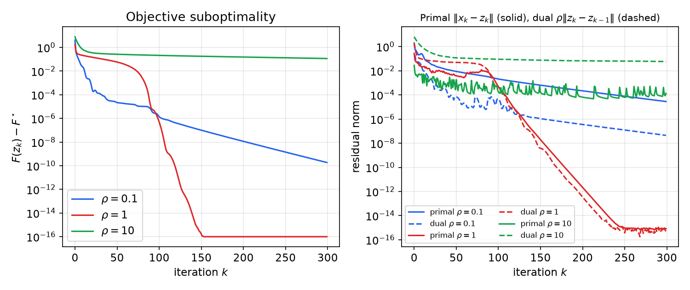
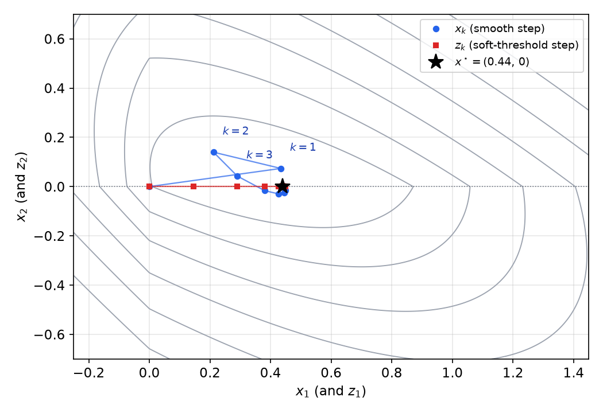
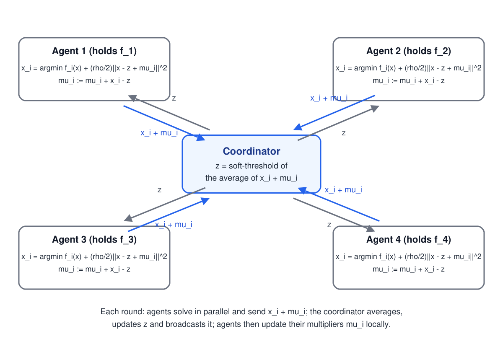
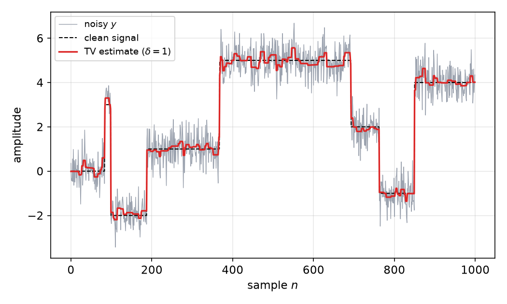
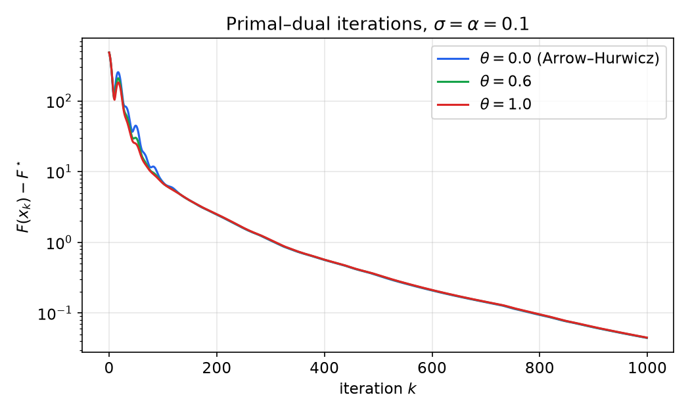

# ADMM and Primal–Dual Splitting

Many large problems resist the methods of the previous chapters. One term may be nonsmooth, the variables may be coupled across many agents, or the objective may be a nonsmooth function of a linear transform of the unknown. This chapter develops splitting methods built for these structures. We start with dual ascent and the method of multipliers, which motivate the **alternating direction method of multipliers** (ADMM) and its scaled form. We state its convergence theorem and apply it to the LASSO, to basis pursuit, and to consensus problems in which a coordinator combines the results of several agents. The chapter closes with primal–dual algorithms of Arrow–Hurwicz and Chambolle–Pock type for problems \\(\min f(Kx)+g(x)\\), including total-variation denoising. Throughout, \\(\mu\\) denotes a scaled dual variable and \\(\nu\\) an unscaled one.

## Dual Ascent

Consider
\\[
\min\_x f(x)\quad\text{subject to}\quad Ax=b,
\\]
with \\(f\\) convex. Its Lagrangian is \\(L(x,\nu)=f(x)+\nu^{T}(Ax-b)\\), and the dual function is
\\[
d(\nu)=\inf\_x L(x,\nu)=-f^\*(-A^{T}\nu)-b^{T}\nu,
\\]
where \\(f^\*(y)=\sup\_x\big(\langle y,x\rangle-f(x)\big)\\) is the conjugate of \\(f\\). The dual function is concave, and the dual problem maximizes it.

**Proposition 11.1 (Gradient of the dual function).** Suppose that for a given \\(\nu\\) the minimizer \\(x^+=\arg\min\_x L(x,\nu)\\) exists and is unique. Then \\(d\\) is differentiable at \\(\nu\\), with \\(\nabla d(\nu)=Ax^+-b\\).

*Proof.* For any \\(\nu'\\), \\(d(\nu')\le L(x^+,\nu')=f(x^+)+\nu'^{T}(Ax^+-b)=d(\nu)+(\nu'-\nu)^{T}(Ax^+-b)\\). So \\(Ax^+-b\\) is a supergradient of the concave function \\(d\\) at \\(\nu\\). Uniqueness of \\(x^+\\) makes the supergradient unique, so it is the gradient. ∎

Gradient ascent on the dual gives **dual ascent**:
\\[
x\_{k+1}=\arg\min\_x L(x,\nu\_k),\qquad \nu\_{k+1}=\nu\_k+\alpha\_k(Ax\_{k+1}-b).
\\]
The method is attractive when the \\(x\\)-minimization is cheap, for example when \\(f\\) is separable. Its weakness is that it requires \\(L(\cdot,\nu)\\) to have a minimizer for every \\(\nu\\), which fails for many functions that are merely convex, such as those that grow sublinearly in some direction. Its strength is that it decouples the problem whenever \\(f\\) is separable.

**Example 11.1 (Minimum-norm solution by dual ascent).** Minimize \\(\tfrac12\lVert x\rVert\_2^2\\) subject to \\(x\_1+x\_2=1\\), so \\(A=\begin{bmatrix}1 & 1\end{bmatrix}\\) and \\(b=1\\). The \\(x\\)-step gives \\(x\_{k+1}=-A^{T}\nu\_k\\), and the dual gradient is \\(\nabla d(\nu)=-AA^{T}\nu-b=-2\nu-1\\). With step \\(\alpha=\tfrac14\\), the dual update is \\(\nu\_{k+1}=\tfrac12\nu\_k-\tfrac14\\). Starting from \\(\nu\_0=0\\), the iterates are \\(\nu\_k=-\tfrac12+2^{-(k+1)}\\), so \\(x\_k=(\tfrac12-2^{-(k+1)})(1,1)\\). The sequence converges to \\(x^\star=(\tfrac12,\tfrac12)\\), the same point as in Example 8.2, with the error halving at each step.

## The Method of Multipliers

Dual ascent needs the \\(x\\)-subproblem to be well posed. The **augmented Lagrangian** adds a quadratic penalty on the constraint residual:
\\[
L\_\rho(x,\nu)=f(x)+\tfrac\rho2\lVert Ax-b\rVert\_2^2+\nu^{T}(Ax-b),\qquad\rho>0 .
\\]
On the feasible set the penalty vanishes, so the constrained problem is unchanged. The **method of multipliers** (MoM) iterates
\\[
x\_{k+1}=\arg\min\_x L\_\rho(x,\nu\_k),\qquad \nu\_{k+1}=\nu\_k+\rho(Ax\_{k+1}-b).
\\]
The penalty makes the \\(x\\)-subproblem well posed under mild conditions, so the dual function is differentiable and the dual update is the gradient step with step size \\(\rho\\). Why this step? At \\(x\_{k+1}\\), optimality of the \\(x\\)-update gives
\\[
0=\nabla f(x\_{k+1})+A^{T}\big(\nu\_k+\rho(Ax\_{k+1}-b)\big)=\nabla f(x\_{k+1})+A^{T}\nu\_{k+1}.
\\]
So the stationarity condition (K4) of Chapter 8 holds at every iterate, and the iterates approach primal feasibility. MoM converges much better than dual ascent in practice, but it does not split: because the penalty couples all components of \\(x\\), the \\(x\\)-step cannot be distributed over separable pieces of \\(f\\). ADMM is designed to recover splitting.

## ADMM

### The algorithm

Consider problems with two blocks of variables \\(x\\) and \\(z\\):
\\[
\min\_{x,z}\ f(x)+g(z)\quad\text{subject to}\quad Ax+Bz=c.
\\]
The augmented Lagrangian is
\\[
L\_\rho(x,z,\nu)=f(x)+g(z)+\nu^{T}(Ax+Bz-c)+\tfrac\rho2\lVert Ax+Bz-c\rVert\_2^2 .
\\]
Instead of minimizing jointly over \\((x,z)\\), as MoM does, ADMM minimizes over \\(x\\), then over \\(z\\) using the new \\(x\\), and then updates the multiplier:
\\[
x\_{k+1}=\arg\min\_x L\_\rho(x,z\_k,\nu\_k),\qquad z\_{k+1}=\arg\min\_z L\_\rho(x\_{k+1},z,\nu\_k),\qquad \nu\_{k+1}=\nu\_k+\rho(Ax\_{k+1}+Bz\_{k+1}-c).
\\]
This is a Gauss–Seidel sweep over the blocks, followed by a dual step. Each subproblem involves only one block, so with a good splitting each step is cheap.

The **scaled form** is usually more convenient. Let \\(\mu=\nu/\rho\\) and \\(r=Ax+Bz-c\\). Completing the square gives \\(\nu^{T}r+\tfrac\rho2\lVert r\rVert\_2^2=\tfrac\rho2\lVert r+\mu\rVert\_2^2-\tfrac\rho2\lVert\mu\rVert\_2^2\\), and the constant term does not depend on \\(x\\) or \\(z\\). The iterations become
\\[
\begin{aligned}
x\_{k+1}&=\arg\min\_x\Big(f(x)+\tfrac\rho2\lVert Ax+Bz\_k-c+\mu\_k\rVert\_2^2\Big)\\\\
z\_{k+1}&=\arg\min\_z\Big(g(z)+\tfrac\rho2\lVert Ax\_{k+1}+Bz-c+\mu\_k\rVert\_2^2\Big)\\\\
\mu\_{k+1}&=\mu\_k+Ax\_{k+1}+Bz\_{k+1}-c
\end{aligned}
\\]

### Convergence

**Theorem 11.1 (Convergence of ADMM).** Suppose (a) \\(f\\) and \\(g\\) are closed, proper and convex, and (b) the unaugmented Lagrangian \\(f(x)+g(z)+\nu^{T}(Ax+Bz-c)\\) has a saddle point. Then the primal residual \\(r\_k=Ax\_k+Bz\_k-c\\) tends to zero, the objective \\(f(x\_k)+g(z\_k)\\) tends to the optimal value \\(p^\star\\), and the dual variable \\(\nu\_k\\) tends to a dual optimal point. Under additional assumptions the primal iterates \\((x\_k,z\_k)\\) also converge.

The theorem is proved in Boyd, Parikh, Chu, Peleato and Eckstein (2011, §3.2). Assumption (b) holds when strong duality holds and the dual optimum is attained. No assumption on the rank of \\(A\\) or \\(B\\) is needed. In practice one stops when the primal residual \\(\lVert r\_k\rVert\\) and the dual residual \\(s\_k=\rho A^{T}B(z\_k-z\_{k-1})\\) are both small. The two residuals are a natural pair: the primal residual measures feasibility, and the dual residual measures how far \\(z\\) is still moving, which is the amount by which the dual stationarity condition fails. The penalty \\(\rho\\) trades one against the other. Boyd et al. (2011, §3.4.1) describe rules that adapt \\(\rho\\) to keep the two residuals balanced.

### ADMM as a sequence of proximal steps

Consider the special case \\(A=I\\), \\(B=-I\\), \\(c=0\\), so the constraint is \\(x=z\\). This is the structure of the LASSO and of the convex-constraint example below. The two updates then read
\\[
x\_{k+1}=\operatorname{prox}\_{f/\rho}(z\_k-\mu\_k),\qquad z\_{k+1}=\operatorname{prox}\_{g/\rho}(x\_{k+1}+\mu\_k),
\\]
because \\(\lVert x-z+\mu\rVert\_2^2=\lVert z-(x+\mu)\rVert\_2^2\\) and the proximal operator of \\(\lambda h\\) is the minimizer of \\(h(u)+\tfrac1{2\lambda}\lVert u-v\rVert\_2^2\\). So ADMM alternates two proximal steps, one on each function, and the multiplier carries the disagreement between them. Neither function is ever differentiated, which is the reason ADMM handles nonsmooth terms so well.

### Example: the LASSO

Take \\(f(x)=\tfrac12\lVert Ax-b\rVert\_2^2\\), \\(g(z)=\tau\lVert z\rVert\_1\\), and the constraint \\(x-z=0\\). The \\(x\\)-step is a regularized least-squares problem, and the \\(z\\)-step is a proximal step for the \\(\ell\_1\\) norm, which is soft thresholding. Write \\(S\_\lambda(v)=\operatorname{sign}(v)\max(\lvert v\rvert-\lambda,0)\\) for the scalar soft threshold, applied coordinatewise. The ADMM iterations for the LASSO are
\\[
x\_{k+1}=(A^{T}A+\rho I)^{-1}\big(A^{T}b+\rho(z\_k-\mu\_k)\big),\qquad z\_{k+1}=S\_{\tau/\rho}(x\_{k+1}+\mu\_k),\qquad \mu\_{k+1}=\mu\_k+x\_{k+1}-z\_{k+1}.
\\]
The matrix \\(A^{T}A+\rho I\\) does not change between iterations, so it can be factored once. Each iteration then costs one pair of triangular solves and one vector soft threshold.

The figure shows an experiment with \\(M=80\\) measurements of a sparse vector in \\(N=200\\) unknowns, ten nonzero entries, \\(\tau=0.02\\), and 300 iterations. The reference optimum \\(F^\star\\) comes from FISTA run for 20000 iterations.

*Figure: left, objective suboptimality \\(F(z\_k)-F^\star\\) for \\(\rho=0.1,1,10\\). Right, primal residual \\(\lVert x\_k-z\_k\rVert\\) (solid) and dual residual \\(\rho\lVert z\_k-z\_{k-1}\rVert\\) (dashed). The middle value converges fastest, the small value is slow, and the large value stalls in the residual phase. The choice of \\(\rho\\) matters even though the theory holds for every \\(\rho>0\\).*

**Example 11.2 (A two-variable LASSO).** Take \\(A=\begin{bmatrix}1 & \tfrac12\\\\ \tfrac12 & 1\end{bmatrix}\\), \\(b=(1,\\,0.1)\\), \\(\tau=\tfrac12\\), and \\(\rho=1\\). The optimum is \\(x^\star=(0.44,\\,0)\\), with \\(F(x^\star)=0.384\\). To check, \\(A^{T}(Ax^\star-b)=(-0.5,\\,-0.16)\\), so the subgradient condition holds with \\(s=(1,\\,0.32)\\), which lies in \\(\partial\lVert x^\star\rVert\_1\\) because \\(s\_1=1\\) at \\(x^\star\_1>0\\) and \\(\lvert s\_2\rvert\le 1\\). The ADMM iterates start from zero. The first \\(x\\)-iterate is \\(x\_1\approx(0.4338,\\,0.0738)\\), and the soft threshold gives \\(z\_1=0\\), since both entries lie below \\(\tau/\rho=\tfrac12\\). Then \\(z\_2\approx(0.1456,\\,0)\\), \\(z\_3\approx(0.2901,\\,0)\\), \\(z\_5\approx(0.4268,\\,0)\\), and \\(z\_{10}\approx(0.4424,\\,0)\\). The first iterate with \\(\lVert z\_k-x^\star\rVert<10^{-6}\\) is \\(k=24\\).

The second coordinate of \\(z\\) is exactly zero at every iteration shown. That is the sparsity mechanism of the method: \\(z\\) is produced by the soft threshold, so zeros are created exactly, while \\(x\\) is only approximately sparse.

*Figure: contours of the two-variable LASSO objective of Example 11.2. Blue points are the \\(x\\)-iterates and red squares the \\(z\\)-iterates, which move toward the same point \\((0.44,0)\\) (black star). The \\(z\\)-iterates lie on the horizontal axis after the first step.*

### Example: basis pursuit

**Example 11.3 (Basis pursuit).** Minimize \\(\lVert x\rVert\_1\\) subject to \\(Ax=b\\), a convex surrogate for finding the sparsest solution of an underdetermined system. Write it as \\(f(x)=\lVert x\rVert\_1\\), \\(g=\mathcal I\_C\\) with \\(C=\\{z : Az=b\\}\\), and the constraint \\(x-z=0\\). The \\(x\\)-step is a soft threshold, \\(x\_{k+1}=S\_{1/\rho}(z\_k-\mu\_k)\\). The \\(z\\)-step is a projection onto the affine set, which for \\(A\\) of full row rank is
\\[
P\_C(v)=v+A^{T}(AA^{T})^{-1}(b-Av),
\\]
so \\(z\_{k+1}=P\_C(x\_{k+1}+\mu\_k)\\), followed by \\(\mu\_{k+1}=\mu\_k+x\_{k+1}-z\_{k+1}\\). Only \\(AA^{T}\\) needs to be factored, and it is computed once.

*Figure: left, the basis-pursuit solution from ADMM (red crosses) recovers the six nonzero entries of the true vector, while the minimum \\(\ell\_2\\)-norm solution (blue dots) is dense. Right, relative error \\(\lVert z\_k-x^\star\rVert\_2/\lVert x^\star\rVert\_2\\), which reaches machine precision after about 350 iterations. Here \\(M=40\\), \\(N=120\\), and the true vector has six nonzeros.*

**Example 11.4 (Linear programming).** Minimize \\(c^{T}x\\) subject to \\(Ax=b\\) and \\(x\ge 0\\). Eliminate the equalities as in [Algorithms for Constrained Problems](constrained-algorithms.md): \\(x=x\_0+Qw\\), where \\(Ax\_0=b\\) and the columns of \\(Q\\) span \\(\operatorname{Null}(A)\\). Introduce \\(z\\) for the nonnegativity constraint, so that the constraint becomes \\(Qw-z+x\_0=0\\) with \\(z\ge 0\\). Taking \\(f(w)=c^{T}Qw\\) (the constant \\(c^{T}x\_0\\) is dropped) and \\(g=\mathcal I\_{\\{z\ge 0\\}}\\), the scaled iterations are
\\[
w\_{k+1}=(Q^{T}Q)^{-1}\Big(Q^{T}(z\_k-x\_0-\mu\_k)-\tfrac1\rho Q^{T}c\Big),\qquad z\_{k+1}=\big(Qw\_{k+1}+x\_0+\mu\_k\big)\_+,\qquad \mu\_{k+1}=\mu\_k+Qw\_{k+1}-z\_{k+1}+x\_0 .
\\]
The \\(w\\)-step solves a fixed linear system, so \\(Q^{T}Q\\) is factored once. The \\(z\\)-step is the projection onto the nonnegative orthant, which is the positive part. When the columns of \\(Q\\) are orthonormal, \\(Q^{T}Q=I\\) and the \\(w\\)-step is explicit.

### Convex constraints

A constrained problem \\(\min f(x)\\) subject to \\(x\in C\\), with \\(C\\) closed and convex, is an instance of ADMM with \\(g=\mathcal I\_C\\) and the constraint \\(x-z=0\\). The scaled iteration becomes
\\[
x\_{k+1}=\arg\min\_x\Big(f(x)+\tfrac\rho2\lVert x-z\_k+\mu\_k\rVert\_2^2\Big),\qquad z\_{k+1}=P\_C(x\_{k+1}+\mu\_k),\qquad \mu\_{k+1}=\mu\_k+x\_{k+1}-z\_{k+1}.
\\]
This is most attractive when \\(P\_C\\) is cheap and the \\(x\\)-step is a simple proximal problem.

## Consensus and Sharing

Many problems are sums over agents or data sources: \\(\min\_x\sum\_{i=1}^{B}f\_i(x)+g(x)\\), where each \\(f\_i\\) involves only the data of agent \\(i\\). ADMM splits such a problem by giving each agent its own copy \\(x^{(i)}\\) of the variable and forcing the copies to agree with a shared variable \\(z\\):
\\[
\min\_{x^{(1)},\dots,x^{(B)},z}\ \sum\_{i=1}^{B}f\_i(x^{(i)})+g(z)\quad\text{subject to}\quad x^{(i)}-z=0,\quad i=1,\dots,B.
\\]
The scaled augmented Lagrangian is separable across the agents, apart from the shared term in \\(z\\). Writing \\(\mu^{(i)}\\) for the scaled multiplier of agent \\(i\\), the ADMM updates are
\\[
x^{(i)}\_{k+1}=\arg\min\_{x}\Big(f\_i(x)+\tfrac\rho2\lVert x-z\_k+\mu^{(i)}\_k\rVert\_2^2\Big),\qquad z\_{k+1}=\arg\min\_z\Big(g(z)+\tfrac\rho2\sum\_{i=1}^{B}\lVert z-x^{(i)}\_{k+1}-\mu^{(i)}\_k\rVert\_2^2\Big),
\\]
and \\(\mu^{(i)}\_{k+1}=\mu^{(i)}\_k+x^{(i)}\_{k+1}-z\_{k+1}\\). The \\(x^{(i)}\\)-updates are independent, so they run in parallel.

The \\(z\\)-update simplifies through the averaging identity. With \\(v\_i=x^{(i)}\_{k+1}+\mu^{(i)}\_k\\) and \\(\bar v=\tfrac1B\sum\_iv\_i\\),
\\[
\sum\_{i=1}^{B}\lVert z-v\_i\rVert\_2^2=B\lVert z-\bar v\rVert\_2^2+\Big(\sum\_i\lVert v\_i\rVert\_2^2-B\lVert\bar v\rVert\_2^2\Big),
\\]
and the bracket does not depend on \\(z\\). The \\(z\\)-step therefore depends on the agents only through their averages, \\(z\_{k+1}=\arg\min\_z\big(g(z)+\tfrac{B\rho}2\lVert z-\bar x\_{k+1}-\bar\mu\_k\rVert\_2^2\big)\\), where \\(\bar x\_{k+1}\\) and \\(\bar\mu\_k\\) are the averages over agents. The multipliers then satisfy \\(\mu^{(i)}\_{k+1}=\mu^{(i)}\_k+x^{(i)}\_{k+1}-z\_{k+1}\\). Each agent needs only its own \\(f\_i\\) and the broadcast value \\(z\\). The coordinator needs only the averages. This is the **consensus ADMM** that underlies many distributed learning algorithms.

**Example 11.5 (Distributed LASSO with a coordinator).** Five agents hold data \\((A\_i,b\_i)\\) and jointly solve \\(\min\_x\ \tfrac\delta2\sum\_{i=1}^{5}\lVert b\_i-A\_ix\rVert\_2^2+\lVert x\rVert\_1\\). With \\(B=5\\), the consensus iteration becomes
\\[
x\_i^{k+1}=(\delta A\_i^{T}A\_i+\rho I)^{-1}\big(\delta A\_i^{T}b\_i+\rho(z^k-\mu\_i^k)\big),\qquad z^{k+1}=S\_{1/(5\rho)}\Big(\tfrac15\sum\_{i}(x\_i^{k+1}+\mu\_i^k)\Big),\qquad \mu\_i^{k+1}=\mu\_i^k+x\_i^{k+1}-z^{k+1}.
\\]
Each agent performs a local ridge regression, and the coordinator averages the agents' values and applies one soft threshold. The threshold \\(1/(5\rho)\\) is the \\(\ell\_1\\) weight \\(1\\) divided by \\(B\rho\\), as the averaging identity predicts.

*Figure: the consensus ADMM architecture. Each agent solves its local subproblem and sends \\(x\_i+\mu\_i\\) to the coordinator (blue arrows). The coordinator averages these values, computes the shared variable \\(z\\), and sends it back (gray arrows). The multipliers are then updated locally.*

### Feature splitting

The consensus form splits the data. When \\(g\\) is separable across features, the roles reverse: one can split the columns of \\(A\\) instead. Consider \\(\min\_x f(Ax)+g(x)\\) with \\(g(x)=\sum\_{i=1}^{B}g\_i(x^{(i)})\\) over blocks \\(x^{(i)}\\), and \\(A=\begin{bmatrix}A^{(1)} & \cdots & A^{(B)}\end{bmatrix}\\). Introduce variables \\(z^{(i)}\\) with the constraints \\(A^{(i)}x^{(i)}-z^{(i)}=0\\), so that \\(\sum\_iz^{(i)}\\) plays the role of \\(Ax\\). With a common multiplier \\(\mu\\), which the updates keep equal across agents, the iteration is
\\[
\begin{aligned}
x^{(i)}\_{k+1}&=\arg\min\_{x}\Big(g\_i(x)+\tfrac\rho2\lVert A^{(i)}x-z^{(i)}\_k+\mu\_k\rVert\_2^2\Big), &&i=1,\dots,B,\\\\
v\_{k+1}&=\tfrac1B\sum\_i\big(A^{(i)}x^{(i)}\_{k+1}+\mu\_k\big),\\\\
\bar z\_{k+1}&=\arg\min\_{\bar z}\Big(f(B\bar z)+\tfrac{B\rho}2\lVert\bar z-v\_{k+1}\rVert\_2^2\Big),\\\\
z^{(i)}\_{k+1}&=\bar z\_{k+1}-v\_{k+1}+A^{(i)}x^{(i)}\_{k+1}+\mu\_k,\\\\
\mu\_{k+1}&=v\_{k+1}-\bar z\_{k+1}.
\end{aligned}
\\]
The derivation is the same as for consensus. The \\(\bar z\\)-subproblem involves only the \\(M\\)-vector \\(v\\), not the \\(BM\\)-vector of all \\(z^{(i)}\\). For LASSO with \\(f(y)=\tfrac12\lVert y-b\rVert\_2^2\\), it has the closed form \\(\bar z\_{k+1}=(b+\rho v\_{k+1})/(B+\rho)\\). Each agent then solves a smaller LASSO at every iteration.

## Primal–Dual Splitting

ADMM handles structure through blocks of variables. A different class of problems has a nonsmooth function composed with a linear operator:
\\[
\min\_x\ f(Kx)+g(x),\qquad K\in\mathbb{R}^{M\times N},
\\]
with \\(f\\) and \\(g\\) convex but generally nonsmooth. Proximal gradient needs \\(f\\) differentiable, so it does not apply directly. A standard example is total-variation (TV) regularization, \\(\min\_x\lVert Dx\rVert\_1+\tfrac\delta2\lVert y-x\rVert\_2^2\\), where \\(D\\) is a discrete derivative. The prox of \\(\lVert Dx\rVert\_1\\) is not available in closed form, although the prox of \\(\lVert x\rVert\_1\\) is soft thresholding.

The fix is to write \\(f(Kx)\\) as a supremum. For closed convex \\(f\\), \\(f(Kx)=\sup\_\nu\big(\langle\nu,Kx\rangle-f^\*(\nu)\big)\\), so the problem becomes the saddle-point problem
\\[
\min\_x\max\_\nu\ \varphi(x,\nu),\qquad \varphi(x,\nu)=\langle\nu,Kx\rangle+g(x)-f^\*(\nu).
\\]
The function \\(\varphi\\) is convex in \\(x\\) and concave in \\(\nu\\). Alternating proximal steps, a descent in \\(x\\) and an ascent in \\(\nu\\), give the **Arrow–Hurwicz** type iteration
\\[
\nu^{k+1}=\operatorname{prox}\_{\sigma f^\*}(\nu^k+\sigma Kx^k),\qquad x^{k+1}=\operatorname{prox}\_{\alpha g}(x^k-\alpha K^{T}\nu^{k+1}),
\\]
with dual step \\(\sigma\\) and primal step \\(\alpha\\). The prox of \\(f^\*\\) is available whenever the prox of \\(f\\) is, through the **Moreau decomposition**: for any convex \\(f\\) and \\(\alpha>0\\),
\\[
z=\operatorname{prox}\_{\alpha f}(z)+\alpha\\,\operatorname{prox}\_{\alpha^{-1}f^\*}(z/\alpha) .
\\]
This identity is the reason the dual step is practical. For \\(f=\lVert\cdot\rVert\_1\\), the conjugate \\(f^\*\\) is the indicator of the \\(\ell\_\infty\\) unit ball, and its prox is the projection onto that ball, which is coordinatewise clipping.

**Chambolle–Pock algorithm.** Chambolle and Pock (2011) added an extrapolation step on the primal variable, which gives the iteration
\\[
\begin{aligned}
\nu^{k+1}&=\operatorname{prox}\_{\sigma f^\*}(\nu^k+\sigma K\bar x^k),\\\\
x^{k+1}&=\operatorname{prox}\_{\alpha g}(x^k-\alpha K^{T}\nu^{k+1}),\\\\
\bar x^{k+1}&=x^{k+1}+\theta(x^{k+1}-x^k).
\end{aligned}
\\]
The parameter \\(\theta\in[0,1]\\) controls the extrapolation. Setting \\(\theta=0\\) recovers the Arrow–Hurwicz iteration. For \\(\theta=1\\) and step sizes with \\(\alpha\sigma\lVert K\rVert\_2^2<1\\), the iterates converge to a saddle point, so \\(x^k\\) converges to a solution of the original problem. Chambolle and Pock also show that the duality gap of the averaged iterates decreases at rate \\(O(1/k)\\). The analysis covers \\(\theta=1\\); for \\(\theta=0\\) the convergence guarantee is weaker, although the iteration often works well in practice.

The method uses only products with \\(K\\) and \\(K^{T}\\) and proximal maps of \\(f^\*\\) and \\(g\\). It never inverts a matrix involving \\(K\\), which makes it suitable for very large imaging and inverse problems.

The two families are complementary. ADMM is the natural choice when the \\(x\\)-step has a closed form or a matrix that can be factored once, as in the LASSO, the consensus problems and linear programs. Primal–dual splitting is preferable when \\(K\\) is large and available only through fast products, and when both \\(f^\*\\) and \\(g\\) have simple proximal maps. Both methods converge under closed convexity and a saddle point, and both rely on the same optimality structure: at a saddle point the stationarity and feasibility conditions of Chapter 8 hold.

**Example 11.6 (One-dimensional total-variation denoising).** Consider \\(\min\_x\lVert Dx\rVert\_1+\tfrac\delta2\lVert y-x\rVert\_2^2\\), where \\(D\\) is the \\((N-1)\times N\\) forward-difference matrix, \\((Dx)\_n=x\_{n+1}-x\_n\\). Take \\(f=\lVert\cdot\rVert\_1\\), \\(K=D\\), and \\(g(x)=\tfrac\delta2\lVert y-x\rVert\_2^2\\). The prox of \\(\alpha g\\) is \\(\operatorname{prox}\_{\alpha g}(u)=(u+\alpha\delta y)/(1+\alpha\delta)\\), and the prox of \\(\sigma f^\*\\) is clipping to \\([-1,1]\\). The Chambolle–Pock iteration with \\(\theta=1\\) is therefore
\\[
\nu^{k+1}=\operatorname{clip}\_{[-1,1]}\big(\nu^k+\sigma D\bar x^k\big),\qquad x^{k+1}=\frac{x^k-\alpha D^{T}\nu^{k+1}+\alpha\delta y}{1+\alpha\delta},\qquad \bar x^{k+1}=2x^{k+1}-x^k .
\\]
Here \\(D^{T}\nu=(-\nu\_1,\ \nu\_1-\nu\_2,\dots,\nu\_{N-2}-\nu\_{N-1},\ \nu\_{N-1})\\). Since \\(\lVert D\rVert\_2^2\le 4\\), the step condition holds whenever \\(\alpha\sigma<\tfrac14\\). The experiment uses \\(N=1000\\) samples of a piecewise-constant signal with eight levels, noise standard deviation \\(0.6\\), \\(\delta=1\\), and \\(\alpha=\sigma=0.1\\).

*Figure: the noisy samples (gray), the clean piecewise-constant signal (dashed), and the TV estimate (red) after 1000 iterations with \\(\delta=1\\). The regularizer produces the staircase structure: flat pieces with sharp jumps, which an \\(\ell\_2\\) smoother would blur.*

*Figure: suboptimality \\(F(x\_k)-F^\star\\) for the TV problem of Example 11.6 with \\(\sigma=\alpha=0.1\\), for \\(\theta=0\\) (Arrow–Hurwicz), \\(\theta=0.6\\) and \\(\theta=1\\). The three curves are nearly indistinguishable after a few hundred iterations, with a small advantage for extrapolation early on.*

The same TV problem can also be attacked by ADMM, after splitting with \\(z=Dx\\). The iterations are \\(x\_{k+1}=(\delta I+\rho D^{T}D)^{-1}\big(\delta y+\rho D^{T}(z\_k-\mu\_k)\big)\\), \\(z\_{k+1}=S\_{1/\rho}(Dx\_{k+1}+\mu\_k)\\), and \\(\mu\_{k+1}=\mu\_k+Dx\_{k+1}-z\_{k+1}\\). In one dimension the \\(x\\)-step is a tridiagonal solve, which is cheap, but in two or three dimensions the same system becomes expensive. The primal–dual iteration needs only products with \\(D\\) and \\(D^{T}\\) and a clip, which is why it is preferred for images.

## Summary

- Dual ascent \\(x\_{k+1}=\arg\min\_xL(x,\nu\_k)\\), \\(\nu\_{k+1}=\nu\_k+\alpha(Ax\_{k+1}-b)\\) performs gradient ascent on the dual; the dual gradient is \\(Ax^+-b\\).
- The method of multipliers uses the augmented Lagrangian \\(L\_\rho\\); its dual step with size \\(\rho\\) keeps the stationarity condition satisfied at every iterate.
- ADMM for \\(\min f(x)+g(z)\\) subject to \\(Ax+Bz=c\\) minimizes over \\(x\\), then over \\(z\\), then updates the scaled multiplier \\(\mu\\). Under closed convexity and a saddle point, the residual tends to zero and the objective tends to the optimal value.
- For the LASSO, the \\(x\\)-step is a ridge solve with a fixed matrix and the \\(z\\)-step is soft thresholding, which creates exact zeros.
- For basis pursuit, the \\(z\\)-step is a projection onto \\(\\{z:Az=b\\}\\), and the \\(x\\)-step is a soft threshold.
- Consensus ADMM lets \\(B\\) agents solve local problems in parallel. The coordinator averages \\(x^{(i)}+\mu^{(i)}\\) and applies the shared prox, and the averaging identity makes this exact.
- Primal–dual splitting handles \\(\min f(Kx)+g(x)\\) by the saddle point \\(\min\_x\max\_\nu\\), with proximal steps in \\(\nu\\) and \\(x\\); the Moreau decomposition gives the prox of \\(f^\*\\). The Chambolle–Pock iteration with \\(\theta=1\\) converges when \\(\alpha\sigma\lVert K\rVert^2<1\\).
- For TV denoising, the dual step clips the dual variable to \\([-1,1]\\), and the primal step is an explicit average.

## See Also

- [Algorithms for Constrained Problems](constrained-algorithms.md): the projected gradient and barrier methods that ADMM generalizes.
- [Lagrange and Fenchel Duality](duality.md): the dual function, conjugates and the Fenchel duality used in the primal–dual derivation.
- [Constrained Optimality and the KKT Conditions](constrained-optimality.md): the stationarity and feasibility conditions that ADMM satisfies in the limit.
- [Subgradients and Proximal Algorithms](nonsmooth.md): proximal operators, soft thresholding and the proximal gradient method.
- [Distributed and Decentralized Optimization](decentralized.md): graph-based versions of the consensus iteration in this chapter.
- [Convex Relaxations](relaxations.md): basis pursuit and sparse recovery as convex relaxations of combinatorial problems.
- [Machine Learning](../../ml/README.md): LASSO, total variation and consensus methods as used in statistical learning.
