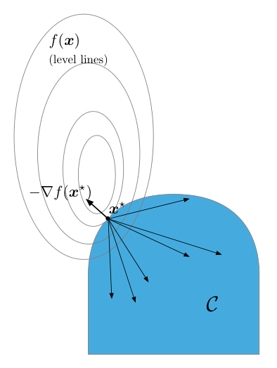
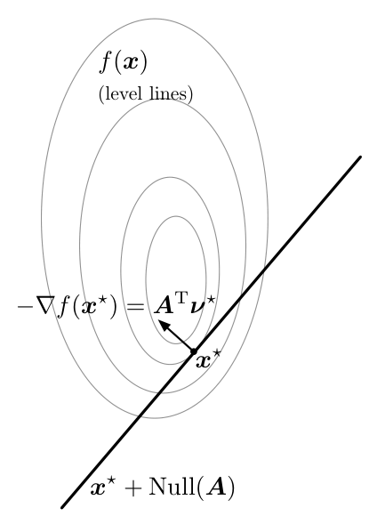
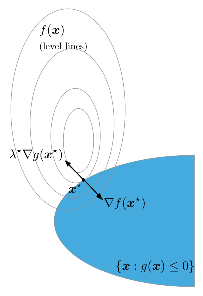
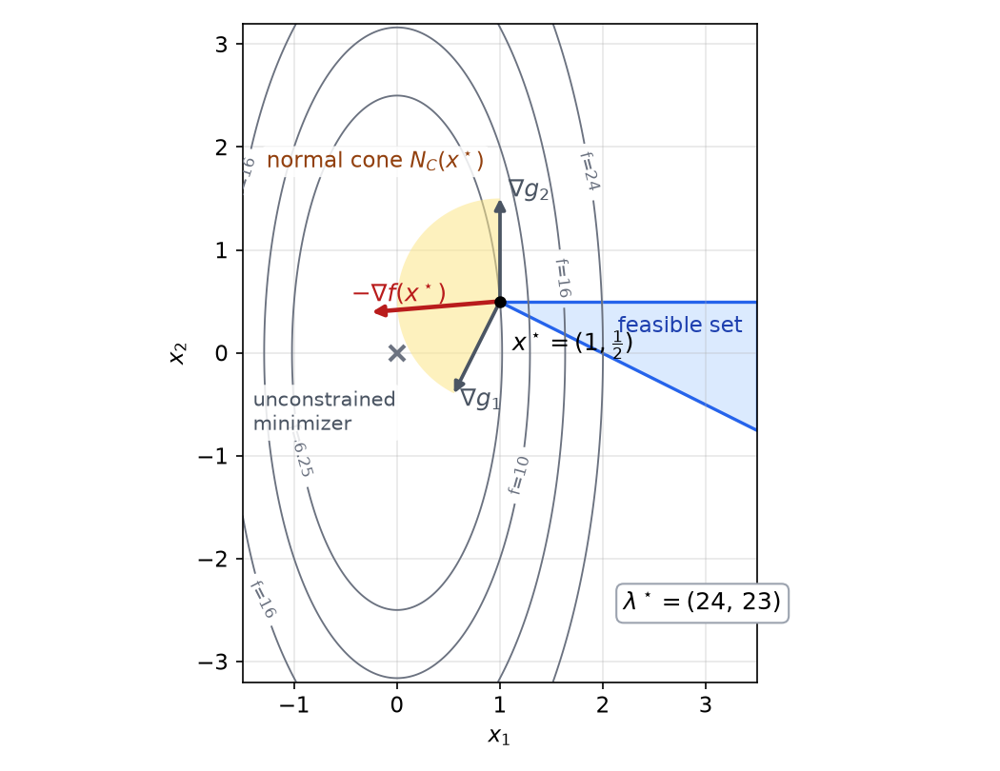
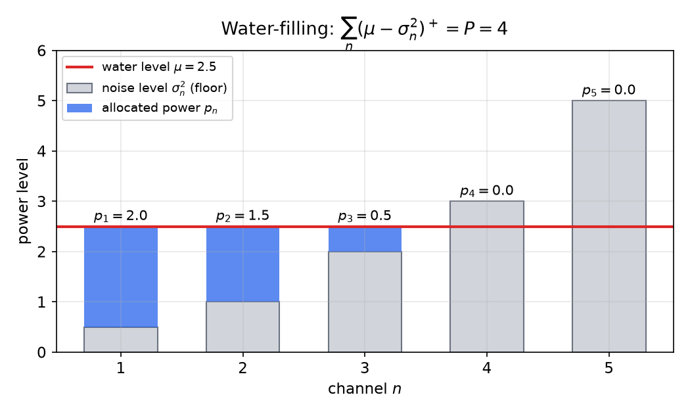
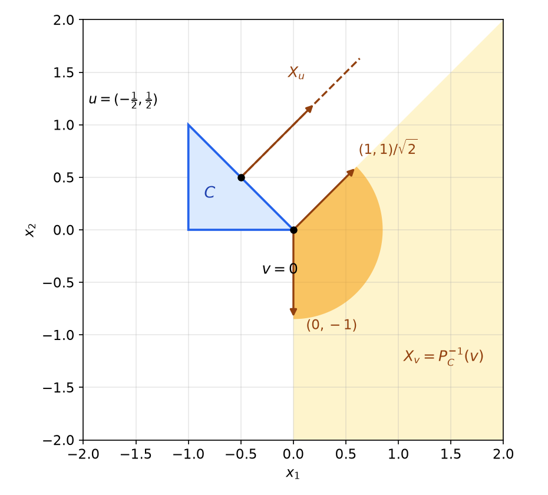

# Constrained Optimality and the KKT Conditions

For an unconstrained convex function, the condition \\(\nabla f(x^\star)=0\\) characterizes the minimizers. With constraints, a minimizer may lie on the boundary of the feasible set, where the gradient need not vanish; the question becomes which directions remain available for decreasing the objective. This chapter answers that question for convex problems. It starts with a geometric condition that holds over any closed convex set, then derives the Karush–Kuhn–Tucker (KKT) conditions for affine and convex inequality constraints. For convex problems the KKT conditions are sufficient for optimality and, under Slater's condition, necessary. They are the starting point for the duality theory of [Lagrange and Fenchel Duality](duality.md) and for the algorithms of [Algorithms for Constrained Problems](constrained-algorithms.md).

## Constrained Minimization

We consider the problem
\\[
\min\_{x\in\mathbb{R}^N} f(x) \quad\text{subject to}\quad x\in C,
\\]
with \\(f\\) convex and differentiable on \\(\mathbb{R}^N\\) and \\(C\\) nonempty, closed and convex. Problems with inequality and equality constraints fit this form with \\(C=\\{x : g\_m(x)\le 0 \text{ for all } m,\ Ax=b\\}\\), which is convex when the \\(g\_m\\) are convex and the equality constraints are affine. The later sections treat these cases explicitly.

A vector \\(d\\) is a **feasible direction** at \\(x\in C\\) if \\(x+td\in C\\) for all sufficiently small \\(t>0\\). Convexity makes feasible directions easy to describe: if \\(y\in C\\), then \\((1-t)x+ty\in C\\) for \\(t\in[0,1]\\), so \\(y-x\\) is a feasible direction. A point \\(x^\star\\) can be a minimizer only if no feasible direction decreases \\(f\\). Theorem 8.1 turns this observation into an exact criterion.

## The Geometric Optimality Condition

**Theorem 8.1 (First-order optimality over a convex set).** Let \\(f\\) be convex and differentiable on \\(\mathbb{R}^N\\), and let \\(C\\) be nonempty, closed and convex. Then \\(x^\star\\) minimizes \\(f\\) over \\(C\\) if and only if \\(x^\star\in C\\) and
\\[
\langle y-x^\star,\ \nabla f(x^\star)\rangle \ge 0 \qquad\text{for all } y\in C.
\\]

*Proof.* (\\(\Leftarrow\\)) For \\(y\in C\\), convexity gives \\(f(y)\ge f(x^\star)+\langle y-x^\star,\nabla f(x^\star)\rangle\ge f(x^\star)\\).

(\\(\Rightarrow\\)) Suppose \\(x^\star\\) is optimal but some \\(y\in C\\) satisfies \\(\langle y-x^\star,\nabla f(x^\star)\rangle<0\\). Put \\(d=y-x^\star\\). By differentiability, \\(f(x^\star+td)=f(x^\star)+t\langle\nabla f(x^\star),d\rangle+o(t)\\), which is smaller than \\(f(x^\star)\\) for all small \\(t>0\\). But \\(x^\star+td=(1-t)x^\star+ty\in C\\) for \\(t\in[0,1]\\), so \\(x^\star\\) is not optimal. This contradiction proves the claim. ∎

*Figure: at a minimizer \\(x^\star\\) of \\(f\\) over the convex set \\(C\\), every direction from \\(x^\star\\) into \\(C\\) makes an obtuse angle with \\(-\nabla f(x^\star)\\). The arrow \\(-\nabla f(x^\star)\\) points out of \\(C\\), so no feasible direction goes downhill.*

Three remarks put Theorem 8.1 in context.

1. **Normal cone form.** Recall the normal cone \\(N\_C(x)=\\{g : \langle g,y-x\rangle\le 0 \text{ for all } y\in C\\}\\) from [Convex Sets](convex-sets.md). Theorem 8.1 says exactly that \\(-\nabla f(x^\star)\in N\_C(x^\star)\\). If \\(x^\star\\) is an interior point of \\(C\\), then \\(N\_C(x^\star)=\\{0\\}\\) and the condition reduces to \\(\nabla f(x^\star)=0\\).

2. **Projection form.** For every \\(\alpha>0\\),
\\[
x^\star = P\_C\big(x^\star-\alpha\nabla f(x^\star)\big).
\\]
Indeed, \\(\hat x=P\_C(z)\\) if and only if \\(\hat x\in C\\) and \\(\langle y-\hat x,z-\hat x\rangle\le 0\\) for all \\(y\in C\\). With \\(z-x^\star=-\alpha\nabla f(x^\star)\\), this inequality is the one in Theorem 8.1. The fixed-point identity is the basis of the projected gradient method in [Algorithms for Constrained Problems](constrained-algorithms.md).

3. **Unconstrained case.** If \\(C=\mathbb{R}^N\\), the inequality must hold for \\(y=x^\star+h\\) with any \\(h\\). Replacing \\(h\\) by \\(-h\\) forces \\(\langle h,\nabla f(x^\star)\rangle=0\\) for all \\(h\\), so \\(\nabla f(x^\star)=0\\). This recovers the condition of [Unconstrained Optimality and Line Search](unconstrained.md).

**Example 8.1 (Projection onto a box).** Minimize \\(f(x)=\tfrac12\lVert x-c\rVert\_2^2\\) over \\(C=[0,1]^2\\), with \\(c=(1.5,\\,-0.4)\\). The gradient is \\(\nabla f(x)=x-c\\). The candidate \\(x^\star=(1,0)\\), obtained by clipping \\(c\\) coordinatewise, has \\(\nabla f(x^\star)=(-0.5,\\,0.4)\\). For every \\(y\in C\\),
\\[
\langle y-x^\star,\nabla f(x^\star)\rangle = -0.5\\,(y\_1-1)+0.4\\,y\_2 \ge 0,
\\]
because \\(y\_1\le 1\\) and \\(y\_2\ge 0\\). By Theorem 8.1, \\(x^\star\\) is the minimizer. The geometry is clear at the corner \\((1,0)\\): the two active faces have outward normals \\((1,0)\\) and \\((0,-1)\\), and \\(-\nabla f(x^\star)=(0.5,-0.4)=0.5\\,(1,0)+0.4\\,(0,-1)\\) is a nonnegative combination of them. The negative gradient points out of the box, so no feasible direction decreases \\(f\\).

## Affine Equality Constraints

**Theorem 8.2 (Affine equality constraints).** Let \\(f\\) be convex and differentiable, \\(A\in\mathbb{R}^{M\times N}\\) and \\(b\in\mathbb{R}^M\\). A point \\(x^\star\\) solves \\(\min f(x)\\) subject to \\(Ax=b\\) if and only if \\(Ax^\star=b\\) and there is \\(\nu^\star\in\mathbb{R}^M\\) with
\\[
\nabla f(x^\star)+A^{T}\nu^\star=0.
\\]

*Proof.* Let \\(x^\star\\) be feasible. The feasible set is \\(C=x^\star+\operatorname{Null}(A)\\). By Theorem 8.1, optimality is equivalent to \\(\langle h,\nabla f(x^\star)\rangle\ge 0\\) for all \\(h\in\operatorname{Null}(A)\\). The null space is a subspace, so \\(h\\) and \\(-h\\) both belong to it, and the inequality must hold with equality. Thus \\(\nabla f(x^\star)\\) is orthogonal to \\(\operatorname{Null}(A)\\). The orthogonal complement of \\(\operatorname{Null}(A)\\) is \\(\operatorname{Range}(A^{T})\\), so \\(\nabla f(x^\star)=-A^{T}\nu^\star\\) for some \\(\nu^\star\\).

Conversely, suppose \\(\nabla f(x^\star)=-A^{T}\nu^\star\\) and let \\(x\\) be feasible. Then \\(x-x^\star\in\operatorname{Null}(A)\\), so
\\[
f(x)\ge f(x^\star)+\langle\nabla f(x^\star),x-x^\star\rangle = f(x^\star)-\langle\nu^\star,A(x-x^\star)\rangle = f(x^\star). \qquad ∎
\\]

The vector \\(\nu^\star\\) is the **Lagrange multiplier** of the equality constraint. Its sign is unrestricted, because the constraint can be satisfied from either side.

**Example 8.2 (Minimum-norm solution of a linear system).** Minimize \\(\lVert x\rVert\_2^2\\) subject to \\(Ax=b\\), with \\(A\\) of full row rank. The condition \\(2x^\star+A^{T}\nu^\star=0\\) gives \\(x^\star=-\tfrac12A^{T}\nu^\star\\). Substituting into \\(Ax^\star=b\\) gives \\(\nu^\star=-2(AA^{T})^{-1}b\\), hence
\\[
x^\star = A^{T}(AA^{T})^{-1}b.
\\]
For the concrete case \\(A=\begin{bmatrix}1 & 1\end{bmatrix}\\) and \\(b=1\\), this gives \\(x^\star=(\tfrac12,\tfrac12)\\) and \\(\nu^\star=-1\\). Check: \\(\nabla f(x^\star)=(1,1)\\) and \\(\nabla f(x^\star)+A^{T}\nu^\star=(1,1)-(1,1)=0\\). Geometrically, the circles \\(\lVert x\rVert\_2^2=c\\) touch the line \\(x\_1+x\_2=1\\) at the point closest to the origin.

*Figure: at the minimizer \\(x^\star\\) of \\(f\\) on the affine set \\(x^\star+\operatorname{Null}(A)\\), the negative gradient \\(-\nabla f(x^\star)=A^{T}\nu^\star\\) is orthogonal to the set. Only the normal component of the gradient survives, and the multiplier balances it.*

## Nonnegativity Constraints

**Theorem 8.3 (Nonnegativity).** Let \\(f\\) be convex and differentiable. A point \\(x^\star\\) solves \\(\min f(x)\\) subject to \\(x\ge 0\\) if and only if
\\[
x^\star\ge 0,\qquad \nabla f(x^\star)\ge 0,\qquad \langle x^\star,\nabla f(x^\star)\rangle=0.
\\]
Equivalently, there is \\(\lambda^\star\ge 0\\) with \\(\nabla f(x^\star)=\lambda^\star\\) and \\(\lambda^\star\_n x^\star\_n=0\\) for every \\(n\\).

*Proof.* Apply Theorem 8.1 with \\(C=\mathbb{R}^N\_+\\), and write \\(g=\nabla f(x^\star)\\). Taking \\(y=0\\) and \\(y=2x^\star\\), both in \\(C\\), gives \\(-\langle x^\star,g\rangle\ge 0\\) and \\(\langle x^\star,g\rangle\ge 0\\). Hence \\(\langle x^\star,g\rangle=0\\). The condition of Theorem 8.1 then reads \\(\langle y,g\rangle\ge 0\\) for all \\(y\ge 0\\), which holds if and only if \\(g\ge 0\\): necessity follows by taking \\(y=e\_n\\). Conversely, these three conditions give \\(\langle y-x^\star,g\rangle=\langle y,g\rangle\ge 0\\) for every \\(y\ge 0\\). The complementarity statement follows because the sum \\(\sum\_n x^\star\_n g\_n\\) is zero and each term is nonnegative. ∎

**Example 8.3 (Nonnegative least squares).** Let \\(f(x)=\tfrac12\lVert y-Ax\rVert\_2^2\\) with \\(A=\begin{bmatrix}1 & 1\\\\ 1 & 2\end{bmatrix}\\) and \\(y=(0,1)\\). Then
\\[
\nabla f(x)=A^{T}Ax-A^{T}y=(2x\_1+3x\_2-1,\\;3x\_1+5x\_2-2).
\\]
The unconstrained minimizer is \\((-1,1)\\), which violates \\(x\ge 0\\). Try \\(x^\star=(0,\tfrac25)\\). Then \\(\nabla f(x^\star)=(0.2,\\,0)\\): both components are nonnegative, the first is positive where \\(x^\star\_1=0\\), and the second is zero where \\(x^\star\_2>0\\). Theorem 8.3 certifies that \\(x^\star\\) is optimal, with multiplier \\(\lambda^\star=(0.2,0)\\) and optimal value \\(f(x^\star)=\tfrac12(0.4^2+0.2^2)=0.1\\). This example reappears in [Algorithms for Constrained Problems](constrained-algorithms.md), where the same problem is solved by projected gradient.

## A Single Convex Inequality Constraint

We now consider \\(\min f(x)\\) subject to \\(g(x)\le 0\\), with \\(f\\) and \\(g\\) convex and differentiable. At a boundary point, the optimality condition is a statement about two gradients. The following elementary lemma describes when two gradients can be made to point in a common descent direction.

**Lemma 8.1 (Disjoint half-spaces).** Let \\(u,v\in\mathbb{R}^N\\) be nonzero, and let \\(H\_u=\\{d:\langle d,u\rangle<0\\}\\) and \\(H\_v=\\{d:\langle d,v\rangle<0\\}\\). Then \\(H\_u\cap H\_v=\emptyset\\) if and only if \\(v=-\lambda u\\) for some \\(\lambda>0\\).

*Proof.* If \\(v=-\lambda u\\) with \\(\lambda>0\\), then \\(\langle d,v\rangle=-\lambda\langle d,u\rangle\\), so no \\(d\\) satisfies both strict inequalities. Conversely, suppose \\(u\\) and \\(v\\) are linearly independent. The linear map \\(d\mapsto(\langle d,u\rangle,\langle d,v\rangle)\\) is then onto \\(\mathbb{R}^2\\), so some \\(d\\) has \\(\langle d,u\rangle=\langle d,v\rangle=-1\\), which lies in \\(H\_u\cap H\_v\\). If the vectors are dependent, \\(v=\mu u\\) with \\(\mu\ne 0\\). For \\(\mu>0\\), every \\(d\in H\_u\\) also lies in \\(H\_v\\), and \\(H\_u\\) is nonempty (it contains \\(-u\\)). So disjointness forces \\(\mu<0\\). ∎

**Theorem 8.4 (KKT for one inequality).** Let \\(f\\) and \\(g\\) be convex and differentiable.

(a) If \\(x^\star\\) satisfies \\(g(x^\star)\le 0\\) and there is \\(\lambda^\star\ge 0\\) with
\\[
\lambda^\star g(x^\star)=0,\qquad \nabla f(x^\star)+\lambda^\star\nabla g(x^\star)=0,
\\]
then \\(x^\star\\) minimizes \\(f\\) over \\(\\{x:g(x)\le 0\\}\\).

(b) Conversely, if Slater's condition holds, meaning \\(g(\bar x)<0\\) for some \\(\bar x\\), then every minimizer \\(x^\star\\) admits such a \\(\lambda^\star\\).

*Proof of (a).* If \\(\lambda^\star=0\\), then \\(\nabla f(x^\star)=0\\) and convexity gives \\(f(x)\ge f(x^\star)\\) for all \\(x\\). Otherwise \\(g(x^\star)=0\\). For a feasible \\(x\\) and \\(\theta\in[0,1]\\), convexity of \\(g\\) gives \\(g(x^\star+\theta(x-x^\star))\le(1-\theta)g(x^\star)+\theta g(x)\le 0\\). The function \\(\theta\mapsto g(x^\star+\theta(x-x^\star))\\) is therefore nonpositive on \\([0,1]\\) and vanishes at \\(\theta=0\\), so its derivative there satisfies \\(\langle\nabla g(x^\star),x-x^\star\rangle\le 0\\). Hence \\(\langle\nabla f(x^\star),x-x^\star\rangle=-\lambda^\star\langle\nabla g(x^\star),x-x^\star\rangle\ge 0\\), and convexity of \\(f\\) gives \\(f(x)\ge f(x^\star)\\).

*Proof of (b).* Let \\(x^\star\\) be a minimizer, so \\(g(x^\star)\le 0\\). If \\(g(x^\star)<0\\), the constraint is inactive near \\(x^\star\\), so \\(x^\star\\) is an unconstrained minimizer of \\(f\\) and \\(\lambda^\star=0\\) works. Now let \\(g(x^\star)=0\\). If \\(\nabla f(x^\star)=0\\), again \\(\lambda^\star=0\\) works, so assume \\(\nabla f(x^\star)\ne 0\\). Slater's condition forces \\(\nabla g(x^\star)\ne 0\\), because convexity gives
\\[
0>g(\bar x)\ge g(x^\star)+\langle\nabla g(x^\star),\bar x-x^\star\rangle = \langle\nabla g(x^\star),\bar x-x^\star\rangle,
\\]
which is impossible if \\(\nabla g(x^\star)=0\\). Next, there is no \\(d\\) with \\(\langle d,\nabla f(x^\star)\rangle<0\\) and \\(\langle d,\nabla g(x^\star)\rangle<0\\). Such a \\(d\\) would satisfy, for small \\(t>0\\), \\(f(x^\star+td)<f(x^\star)\\) and \\(g(x^\star+td)=t\langle d,\nabla g(x^\star)\rangle+o(t)<0\\), a feasible improvement. Lemma 8.1 with \\(u=\nabla f(x^\star)\\) and \\(v=\nabla g(x^\star)\\) gives \\(\nabla g(x^\star)=-\lambda\nabla f(x^\star)\\) for some \\(\lambda>0\\). Thus \\(\nabla f(x^\star)+\lambda^\star\nabla g(x^\star)=0\\) with \\(\lambda^\star=1/\lambda\\). ∎

Part (a) needs no assumption on \\(g\\); Slater's condition is needed only for the converse. The figure below shows the boundary case.

*Figure: a minimizer on the boundary of \\(\\{x:g(x)\le 0\\}\\). The gradient \\(\nabla f(x^\star)\\) points into the feasible set, and \\(\lambda^\star\nabla g(x^\star)\\) points outward, so the two cancel. The level lines of \\(f\\) are tangent to the constraint boundary at \\(x^\star\\).*

**Example 8.4 (Why a constraint qualification is needed).** Minimize \\(f(x)=x\\) subject to \\(g(x)=x^2\le 0\\). The only feasible point is \\(x^\star=0\\), so it is optimal. But \\(\nabla f(x^\star)=1\\) and \\(\nabla g(x^\star)=2x^\star=0\\), so \\(\nabla f(x^\star)+\lambda\nabla g(x^\star)=1\\neq 0\\) for every \\(\lambda\\). The KKT conditions fail at the optimum. Slater's condition fails too, since no \\(x\\) satisfies \\(x^2<0\\). The example shows that the assumption in part (b) cannot be dropped.

## The Farkas Lemma

Theorem 8.4(b) used only one constraint. For several constraints, the necessary condition is a theorem of the alternative, which we now state and prove.

**Lemma 8.2 (Farkas).** Let \\(A\in\mathbb{R}^{M\times N}\\) and \\(b\in\mathbb{R}^M\\). Exactly one of the following holds:

1. there is \\(x\ge 0\\) with \\(Ax=b\\);
2. there is \\(\lambda\in\mathbb{R}^M\\) with \\(A^{T}\lambda\le 0\\) and \\(\langle b,\lambda\rangle>0\\).

*Proof.* Both cannot hold: if \\(x\\) satisfies (1) and \\(\lambda\\) satisfies (2), then \\(\langle b,\lambda\rangle=\langle x,A^{T}\lambda\rangle\le 0\\), a contradiction. Suppose (1) fails, so \\(b\\) is not in the cone \\(K=\\{Ax:x\ge 0\\}\\) generated by the columns \\(a\_1,\dots,a\_N\\) of \\(A\\). A finitely generated cone is closed and convex (closedness is a standard consequence of Carathéodory's theorem). By the separation theorem for a point and a closed convex set (see [Convex Sets](convex-sets.md)), there is \\(\lambda\\) with \\(\langle\lambda,b\rangle>\sup\_{k\in K}\langle\lambda,k\rangle\\). Since \\(0\in K\\), the supremum is at least \\(0\\), so \\(\langle\lambda,b\rangle>0\\). Since \\(K\\) is a cone, the supremum is finite only if \\(\langle\lambda,a\_n\rangle\le 0\\) for every \\(n\\): otherwise scaling \\(a\_n\\) by a large factor makes it unbounded. That is exactly \\(A^{T}\lambda\le 0\\). ∎

## KKT Conditions for Inequality Constraints

Consider the problem
\\[
\min\_{x} f(x)\quad\text{subject to}\quad g\_m(x)\le 0,\qquad m=1,\dots,M,
\\]
(8.1), with \\(f\\) and all \\(g\_m\\) convex and differentiable. The **Lagrangian** is \\(L(x,\lambda)=f(x)+\sum\_m\lambda\_m g\_m(x)\\). A pair \\((x,\lambda)\\) satisfies the **KKT conditions** if
\\[
\begin{aligned}
&g\_m(x)\le 0, &&\text{(K1) primal feasibility}\\\\
&\lambda\_m\ge 0, &&\text{(K2) dual feasibility}\\\\
&\lambda\_m g\_m(x)=0, &&\text{(K3) complementary slackness}\\\\
&\nabla f(x)+\sum\_{m=1}^{M}\lambda\_m\nabla g\_m(x)=0. &&\text{(K4) stationarity}
\end{aligned}
\\]
Condition (K3) says that a multiplier can be positive only at an active constraint. Condition (K4) says that \\(\nabla\_x L=0\\) at \\((x,\lambda)\\).

**Theorem 8.5 (Sufficiency of KKT).** If \\((x^\star,\lambda^\star)\\) satisfies (K1)–(K4) for problem (8.1), then \\(x^\star\\) is a minimizer.

*Proof.* Let \\(\mathcal A=\\{m:\lambda^\star\_m>0\\}\\). By (K3), \\(g\_m(x^\star)=0\\) for \\(m\in\mathcal A\\), and (K4) reads \\(\nabla f(x^\star)=-\sum\_{m\in\mathcal A}\lambda^\star\_m\nabla g\_m(x^\star)\\). Let \\(x\\) be feasible. For \\(m\in\mathcal A\\), the first-order inequality for the convex function \\(g\_m\\) gives
\\[
0\ge g\_m(x)\ge g\_m(x^\star)+\langle\nabla g\_m(x^\star),x-x^\star\rangle=\langle\nabla g\_m(x^\star),x-x^\star\rangle.
\\]
Therefore \\(\langle\nabla f(x^\star),x-x^\star\rangle=-\sum\_{m\in\mathcal A}\lambda^\star\_m\langle\nabla g\_m(x^\star),x-x^\star\rangle\ge 0\\), and convexity of \\(f\\) gives \\(f(x)\ge f(x^\star)+\langle\nabla f(x^\star),x-x^\star\rangle\ge f(x^\star)\\). ∎

No constraint qualification is needed for sufficiency. The necessity theorems below address the converse.

**Theorem 8.6 (Necessity for affine constraints).** Suppose each \\(g\_m(x)=\langle a\_m,x\rangle-b\_m\\) is affine. If \\(x^\star\\) solves (8.1), then there is \\(\lambda^\star\\) such that \\((x^\star,\lambda^\star)\\) satisfies (K1)–(K4).

*Proof.* Let \\(\mathcal I=\\{m:g\_m(x^\star)=0\\}\\) be the active set and set \\(\lambda^\star\_m=0\\) for \\(m\notin\mathcal I\\), which makes (K1)–(K3) hold for any nonnegative multipliers on \\(\mathcal I\\). Suppose no \\(\lambda\ge 0\\) supported on \\(\mathcal I\\) satisfies \\(\nabla f(x^\star)+\sum\_{m\in\mathcal I}\lambda\_m a\_m=0\\). Apply Lemma 8.2 to the matrix with columns \\(a\_m\\), \\(m\in\mathcal I\\), and to \\(b=-\nabla f(x^\star)\\). The second alternative gives \\(d\\) with \\(\langle a\_m,d\rangle\le 0\\) for \\(m\in\mathcal I\\) and \\(\langle\nabla f(x^\star),d\rangle<0\\). For small \\(t>0\\): \\(f(x^\star+td)<f(x^\star)\\); for \\(m\in\mathcal I\\), \\(g\_m(x^\star+td)=t\langle a\_m,d\rangle\le 0\\) exactly, because \\(g\_m\\) is affine; and for \\(m\notin\mathcal I\\), \\(g\_m\\) stays negative. So \\(x^\star+td\\) is feasible and better, contradicting optimality. Hence a multiplier vector exists. ∎

**Slater's condition** asks for a strictly feasible point: some \\(\bar x\\) with \\(g\_m(\bar x)<0\\) for all \\(m\\).

**Theorem 8.7 (Necessity under Slater's condition).** If Slater's condition holds for problem (8.1) and \\(x^\star\\) solves it, then there is \\(\lambda^\star\\) such that \\((x^\star,\lambda^\star)\\) satisfies (K1)–(K4).

*Proof.* Let \\(\mathcal I\\) be the active set at \\(x^\star\\), and let \\(\bar x\\) be a Slater point. Suppose no \\(\lambda\ge 0\\) supported on \\(\mathcal I\\) satisfies (K4). By Lemma 8.2 applied to the gradients \\(\nabla g\_m(x^\star)\\), \\(m\in\mathcal I\\), there is \\(d\\) with \\(\langle\nabla g\_m(x^\star),d\rangle\le 0\\) for \\(m\in\mathcal I\\) and \\(\langle\nabla f(x^\star),d\rangle<0\\). For \\(m\in\mathcal I\\), convexity and Slater give \\(\langle\nabla g\_m(x^\star),\bar x-x^\star\rangle\le g\_m(\bar x)-g\_m(x^\star)<0\\). Set \\(e=(1-\theta)d+\theta(\bar x-x^\star)\\) with \\(\theta\in(0,1)\\) small enough that \\(\langle\nabla f(x^\star),e\rangle<0\\). Then \\(\langle\nabla g\_m(x^\star),e\rangle<0\\) for every \\(m\in\mathcal I\\), because the second term is strictly negative and the first is nonpositive. As in the proof of Theorem 8.6, \\(x^\star+te\\) is feasible and strictly better for small \\(t>0\\), a contradiction. ∎

The same argument handles mixed problems: affine constraints need no strictly feasible point, because for them \\(g\_m(x^\star+te)\\) is exactly linear. Theorem 8.6 and Theorem 8.7 therefore combine into a single statement: for convex problems, KKT conditions are necessary whenever Slater's condition holds for the nonaffine constraints.

## KKT with Equality Constraints

Now consider
\\[
\min\_x f(x)\quad\text{subject to}\quad g\_m(x)\le 0,\qquad Ax=b,
\\]
(8.2). A multiplier \\(\nu\in\mathbb{R}^P\\) is attached to each equality, and the stationarity condition (K4) becomes
\\[
\nabla f(x)+\sum\_{m}\lambda\_m\nabla g\_m(x)+A^{T}\nu=0.
\\]
The multiplier \\(\nu\\) is unconstrained in sign.

**Theorem 8.8.** If the \\(g\_m\\) are convex and differentiable, the equality constraints are affine, and \\((x^\star,\lambda^\star,\nu^\star)\\) satisfies the KKT conditions, then \\(x^\star\\) solves (8.2). If in addition Slater's condition holds for the \\(g\_m\\), every solution admits such multipliers.

*Proof.* Sufficiency repeats the proof of Theorem 8.5, with one extra term. For feasible \\(x\\), \\(\langle A^{T}\nu^\star,x-x^\star\rangle=\langle\nu^\star,A(x-x^\star)\rangle=0\\), so this term does not affect the inequality. For necessity, replace each equality \\(Ax=b\\) by the two affine inequalities \\(Ax-b\\le 0\\) and \\(-(Ax-b)\\le 0\\). The refined version of Theorem 8.7 gives multipliers \\(\lambda^{+},\lambda^{-}\ge 0\\) for this pair. Setting \\(\nu=\lambda^{+}-\lambda^{-}\\) gives \\(A^{T}\lambda^{+}-A^{T}\lambda^{-}=A^{T}\nu\\), so (K4) holds with the equalities included. Complementary slackness for the equality pair is automatic because \\(Ax-b=0\\). ∎

## Multipliers as Sensitivities

The multipliers have a concrete meaning. Let \\(p(u)\\) denote the optimal value of the problem with constraints \\(g\_m(x)\le u\_m\\), so \\(p(0)\\) is the value of (8.1).

**Theorem 8.9 (Multipliers bound the sensitivity).** Suppose \\((x^\star,\lambda^\star)\\) satisfies (K1)–(K4) for problem (8.1). Then
\\[
p(u)\ge p(0)-\langle\lambda^\star,u\rangle\qquad\text{for all } u\in\mathbb{R}^M.
\\]
Thus \\(-\lambda^\star\\) is a subgradient of the convex function \\(p\\) at \\(0\\). When \\(p\\) is differentiable at \\(0\\), \\(\lambda^\star\_m=-\partial p/\partial u\_m(0)\\).

*Proof.* The function \\(L(\cdot,\lambda^\star)=f+\sum\_m\lambda^\star\_m g\_m\\) is convex, and its gradient vanishes at \\(x^\star\\) by (K4), so \\(x^\star\\) minimizes it. Using (K3), \\(L(x^\star,\lambda^\star)=f(x^\star)=p(0)\\). Let \\(x\\) satisfy \\(g(x)\le u\\). Since \\(\lambda^\star\ge 0\\), we have \\(\langle\lambda^\star,g(x)\rangle\le\langle\lambda^\star,u\rangle\\), so
\\[
f(x)\ge L(x,\lambda^\star)-\langle\lambda^\star,u\rangle\ge L(x^\star,\lambda^\star)-\langle\lambda^\star,u\rangle=p(0)-\langle\lambda^\star,u\rangle.
\\]
Minimizing the left side over all such \\(x\\) gives the claim. ∎

Read as a sensitivity statement, a multiplier \\(\lambda^\star\_m\\) is the rate at which the optimal value would fall if constraint \\(m\\) were relaxed by a small amount. A large multiplier marks a constraint that is expensive to satisfy.

## Worked Examples

**Example 8.5 (A quadratic program with two active constraints).** Minimize \\(f(x)=6x\_1^2+x\_2^2\\) subject to \\(g\_1(x)=-\tfrac12x\_1-x\_2+1\le 0\\) and \\(g\_2(x)=x\_2-\tfrac12\le 0\\). The feasible set is the wedge \\(\\{x : x\_1\ge 1,\ 1-\tfrac12x\_1\le x\_2\le\tfrac12\\}\\) with apex \\(\bar x=(1,\tfrac12)\\), where both constraints are active. The unconstrained minimizer \\(0\\) is infeasible. We test the apex with KKT. Here \\(\nabla f(x)=(12x\_1,2x\_2)\\), so
\\[
\nabla f(\bar x)=(12,1),\qquad \nabla g\_1=(-\tfrac12,-1),\qquad \nabla g\_2=(0,1).
\\]
Solving \\(-\nabla f(\bar x)=\lambda\_1\nabla g\_1+\lambda\_2\nabla g\_2\\) gives
\\[
\begin{bmatrix}-\tfrac12 & 0\\\\ -1 & 1\end{bmatrix}\begin{bmatrix}\lambda\_1\\\\ \lambda\_2\end{bmatrix}=\begin{bmatrix}-12\\\\ -1\end{bmatrix}\qquad\Longrightarrow\qquad \lambda\_1=24,\quad \lambda\_2=23.
\\]
Both multipliers are nonnegative, both constraints are active, and (K4) holds by construction. Theorem 8.5 shows that \\(\bar x\\) is the minimizer, with value \\(f(\bar x)=6.25\\). Geometrically, \\(-\nabla f(\bar x)=(-12,-1)\\) lies inside the cone spanned by \\(\nabla g\_1\\) and \\(\nabla g\_2\\), which is the normal cone at the apex.

*Figure: level sets of \\(f=6x\_1^2+x\_2^2\\) and the feasible wedge (blue). The shaded region is the normal cone at the apex \\(\bar x\\), spanned by \\(\nabla g\_1\\) and \\(\nabla g\_2\\). The negative gradient (red) lies inside it, which is exactly the KKT stationarity condition with \\(\lambda^\star=(24,23)\\).*

**Example 8.6 (A one-dimensional problem).** Minimize \\(f(x)=x^2+1\\) subject to \\(g(x)=(x-2)(x-4)\le 0\\). The feasible set is \\([2,4]\\), and the minimizer is \\(x^\star=2\\) with \\(p^\star=5\\). For KKT, \\(2x+\lambda(2x-6)=0\\) at \\(x=2\\) gives \\(4-2\lambda=0\\), so \\(\lambda^\star=2\\). Complementary slackness holds because \\(g(2)=0\\). Slater's condition holds at \\(x=3\\), where \\(g(3)=-1<0\\), so the multiplier exists and the KKT conditions are necessary and sufficient. The dual function of this problem is computed in [Lagrange and Fenchel Duality](duality.md).

**Example 8.7 (Water-filling over parallel channels).** A transmitter has total power \\(P\\) to spread over channels with noise variances \\(\sigma\_n^2\\). The channel capacity is \\(C=\tfrac12\sum\_n\log\_2(1+p\_n/\sigma\_n^2)\\), so maximizing \\(C\\) over \\(p\ge 0\\) with \\(\sum\_n p\_n=P\\) is the task. Write \\(\alpha\_n=\sigma\_n^2/P\\) and \\(x\_n=p\_n/P\\). Since \\(1+p\_n/\sigma\_n^2=(\alpha\_n+x\_n)/\alpha\_n\\), the problem is equivalent to
\\[
\min\_x\ -\sum\_n\log(\alpha\_n+x\_n)\quad\text{subject to}\quad x\ge 0,\qquad \mathbf 1^{T}x=1.
\\]
The logarithm base does not change the minimizer. The Lagrangian is \\(-\sum\_n\log(\alpha\_n+x\_n)-\langle\lambda,x\rangle+\nu(\mathbf 1^{T}x-1)\\), so the KKT conditions are \\(x\ge 0\\), \\(\lambda\ge 0\\), \\(\lambda\_n x\_n=0\\), and
\\[
-\frac{1}{\alpha\_n+x\_n}-\lambda\_n+\nu=0.
\\]
Eliminating \\(\lambda\\) gives \\(\lambda\_n=\nu-1/(\alpha\_n+x\_n)\ge 0\\) and \\(x\_n(\nu-1/(\alpha\_n+x\_n))=0\\). If \\(x\_n>0\\), then \\(x\_n=1/\nu-\alpha\_n\\); if \\(x\_n=0\\), then \\(1/\nu\le\alpha\_n\\). In both cases
\\[
x\_n^\star=\max\Big\\{0,\ \frac{1}{\nu^\star}-\alpha\_n\Big\\}.
\\]
Write \\(w=1/\nu^\star\\), the **water level**. The constraint becomes \\(\sum\_n(w-\alpha\_n)^+=1\\). The left side is continuous, nondecreasing and strictly increasing wherever it is positive, so \\(w\\) is unique and can be found by bisection or by sorting the \\(\alpha\_n\\).

Take \\(\sigma\_n^2=(0.5,\\,1,\\,2,\\,3,\\,5)\\) and \\(P=4\\). Then \\(\alpha=(0.125,\\,0.25,\\,0.5,\\,0.75,\\,1.25)\\). The level \\(w=0.625\\) gives \\((0.5+0.375+0.125)=1\\) over the first three channels, while \\(w-\alpha\_4<0\\) and \\(w-\alpha\_5<0\\). So \\(w^\star=0.625\\), \\(\nu^\star=1.6\\), and \\(x^\star=(0.5,\\,0.375,\\,0.125,\\,0,\\,0)\\). The multipliers of the two silent channels are positive: \\(\lambda^\star\_4=1.6-\tfrac43=\tfrac{4}{15}\\) and \\(\lambda^\star\_5=1.6-0.8=0.8\\). In power units the allocation is \\(p^\star=(2,\\,1.5,\\,0.5,\\,0,\\,0)\\), with water level \\(Pw^\star=2.5\\). The capacity is \\(\tfrac12\log\_2(5\cdot 2.5\cdot 1.25)=\tfrac12\log\_2 15.625\approx 1.98\\) bits per transmission.

*Figure: water-filling with noise levels \\(\sigma\_n^2\\) (gray bars) and total power \\(P=4\\). The water level \\(\mu=2.5\\) is chosen so that the allocated powers (blue) sum to \\(P\\). Channels whose noise floor lies above the water level receive no power.*

**Example 8.8 (Normal cones of a triangle).** Let \\(C=\\{x : x\_1\ge -1,\ x\_2\ge 0,\ x\_1+x\_2\le 0\\}\\), the triangle with vertices \\((-1,0)\\), \\((0,0)\\) and \\((-1,1)\\). Take the midpoint \\(u=(-\tfrac12,\tfrac12)\\) of the hypotenuse and the vertex \\(v=(0,0)\\).

At \\(u\\), only the constraint \\(x\_1+x\_2\le 0\\) is active, so \\(N\_C(u)=\\{t(1,1):t\ge 0\\}\\), a single ray. At \\(v\\), the active constraints \\(x\_2\ge 0\\) and \\(x\_1+x\_2\le 0\\) have outward normals \\((0,-1)\\) and \\((1,1)\\), so \\(N\_C(v)\\) is the cone generated by them, which equals \\(\\{(p,q):p\ge 0,\ q\le p\\}\\). Theorem 8.1 gives a concrete consequence. For \\(f(x)=-x\_1\\), the condition \\(-\nabla f=(1,0)\in N\_C(v)\\) holds, so the minimizers of \\(-x\_1\\) over \\(C\\) are exactly the points with \\(x\_1\\) maximal. The only such point is \\(v\\), since \\(x\_1\le 0\\) on \\(C\\) with equality only at \\(v\\).

The normal cones also describe the projection onto \\(C\\). The set of points that project onto \\(v\\) is \\(X\_v=v+N\_C(v)=\\{x:x\_1\ge 0,\ x\_2\le x\_1\\}\\), and the points projecting onto \\(u\\) form the ray \\(X\_u=u+\\{t(1,1):t\ge 0\\}\\). For instance \\((1,0)\\) projects onto \\(v\\), while \\((0,1)\\) projects onto \\(u\\).

*Figure: the triangle \\(C\\) (blue), the normal cone at the vertex \\(v\\) (dark wedge), the set \\(X\_v=P\_C^{-1}(v)\\) (light shading), and the ray \\(X\_u\\) from the hypotenuse midpoint \\(u\\) (dashed). Each point of \\(X\_v\\) is \\(v\\) plus a vector in the normal cone.*

## Summary

- A point \\(x^\star\\) minimizes a differentiable convex \\(f\\) over a closed convex set \\(C\\) if and only if \\(\langle y-x^\star,\nabla f(x^\star)\rangle\ge 0\\) for all \\(y\in C\\), equivalently \\(-\nabla f(x^\star)\in N\_C(x^\star)\\), equivalently \\(x^\star=P\_C(x^\star-\alpha\nabla f(x^\star))\\).
- Affine equalities \\(Ax=b\\): optimal if and only if \\(\nabla f(x^\star)+A^{T}\nu^\star=0\\) for some \\(\nu^\star\\).
- Nonnegativity \\(x\ge 0\\): optimal if and only if \\(x^\star\ge 0\\), \\(\nabla f(x^\star)\ge 0\\) and \\(\langle x^\star,\nabla f(x^\star)\rangle=0\\).
- KKT conditions for \\(\min f\\) subject to \\(g\_m\le 0\\), with multipliers \\(\lambda\_m\ge 0\\): \\(g\_m(x)\le 0\\), \\(\lambda\_m g\_m(x)=0\\), \\(\nabla f(x)+\sum\_m\lambda\_m\nabla g\_m(x)=0\\). For convex, differentiable functions they are sufficient for optimality (no constraint qualification needed).
- Necessity of KKT needs a constraint qualification: Slater's condition (a strictly feasible point) for nonaffine constraints, or affine constraints alone. Without one the conditions can fail at the optimum (for example \\(\min x\\) subject to \\(x^2\le 0\\)).
- Farkas' lemma is the alternative theorem behind necessity: either \\(b\\) is a nonnegative combination of the columns of \\(A\\), or some \\(\lambda\\) separates \\(b\\) from them.
- The multipliers are sensitivities: \\(p(u)\ge p(0)-\langle\lambda^\star,u\rangle\\), so \\(-\lambda^\star\\) is a subgradient of the optimal value at zero.
- Water-filling: \\(x\_n^\star=(1/\nu^\star-\alpha\_n)^+\\), with the water level fixed by \\(\sum\_n(1/\nu^\star-\alpha\_n)^+=1\\).

## See Also

- [Convex Sets](convex-sets.md): normal cones, projections and separation, used throughout this chapter.
- [Convex Optimization Problems and Modeling](modeling.md): the problem classes whose optimality conditions are derived here.
- [Unconstrained Optimality and Line Search](unconstrained.md): the unconstrained case of Theorem 8.1.
- [Lagrange and Fenchel Duality](duality.md): dual functions, weak and strong duality, and the certificates behind the multipliers.
- [Algorithms for Constrained Problems](constrained-algorithms.md): projected gradient and barrier methods that use these conditions.
- [Subgradients and Proximal Algorithms](nonsmooth.md): the extension of these conditions to nonsmooth constraints.
- [Convex Optimization (overview)](../convex.md): a shorter survey of this subsection.
- [Optimization for Control](../../../eng/control/optimal-learning/optimization.md): constrained optimization as applied in control.
