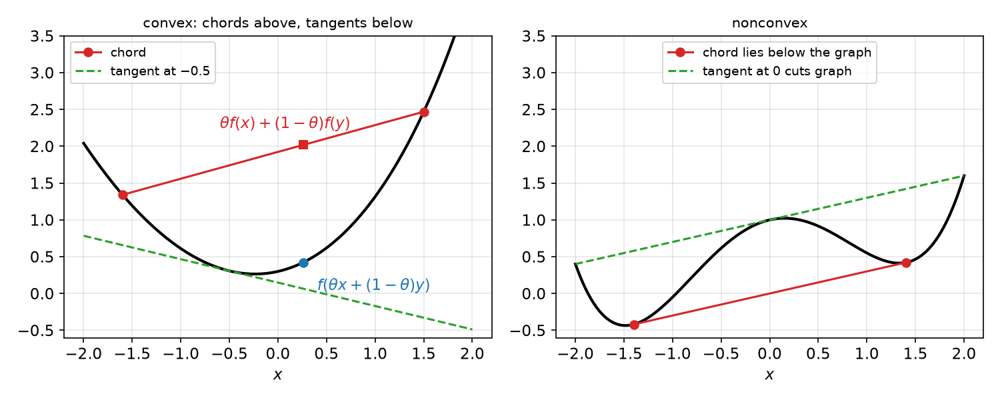
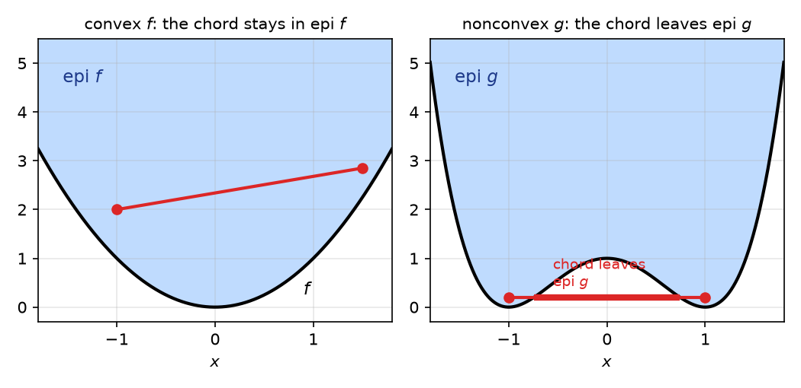
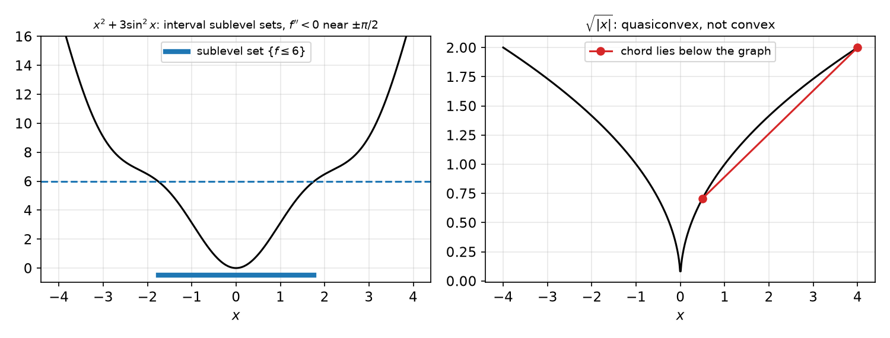
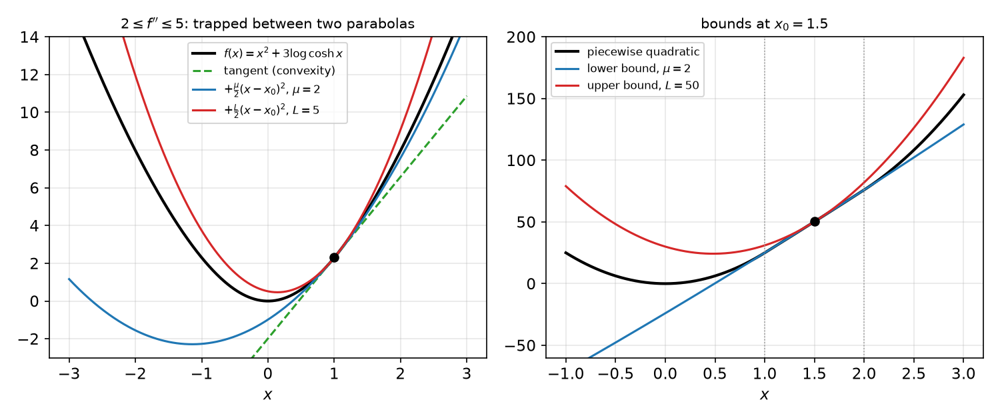
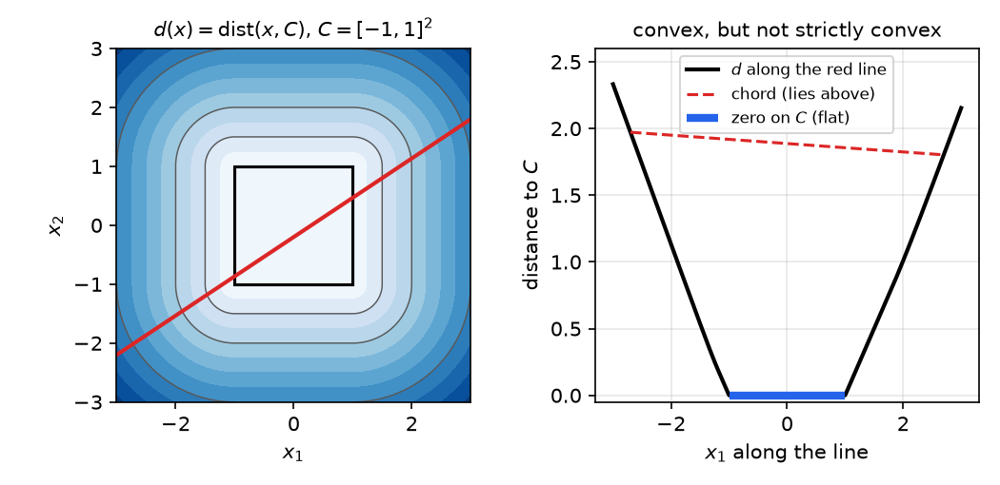

# Convex Functions

A function is convex when its graph never rises above a chord joining two of its points. That one geometric property decides most of what follows: a local minimum is automatically global, a tangent line is a global underestimator, and minimizing a convex function is a convex program. This chapter gives the definition and the standard ways of recognizing convexity: epigraphs, restriction to lines, first- and second-order conditions, and the operations that preserve convexity. It then introduces the two quantitative refinements on which the algorithms of this subsection depend. **Strong convexity** bounds the curvature from below, **smoothness** bounds it from above, and together they trap the graph between two quadratics at every point. That sandwich is the source of the convergence rates in [Gradient Descent and Accelerated Methods](first-order-methods.md) and [Newton and Quasi-Newton Methods](newton.md).

## Definition and Basic Examples

**Definition (Convex function).** Let \\(f\\) be a real-valued function with domain \\(\operatorname{dom} f\subseteq\mathbb{R}^N\\). Then \\(f\\) is **convex** if \\(\operatorname{dom} f\\) is a convex set and
\\[
f(\theta x+(1-\theta)y)\le\theta f(x)+(1-\theta)f(y)\qquad\text{for all } x,y\in\operatorname{dom} f,\ \theta\in[0,1].
\\]

The left side is the value of \\(f\\) at a point of the segment from \\(x\\) to \\(y\\). The right side is the height of the chord joining \\((x,f(x))\\) and \\((y,f(y))\\). The definition says that the graph never rises above its chords. The function is **strictly convex** if the inequality is strict whenever \\(x\ne y\\) and \\(0<\theta<1\\). It is **concave** if \\(-f\\) is convex. Since maximizing \\(f\\) is the same as minimizing \\(-f\\), every statement about minimizing a convex function has a counterpart for maximizing a concave one.

*Figure: left, a convex function. The chord (red) between two points of the graph lies above the graph, and the tangent line at \\(-0.5\\) (dashed) lies below it everywhere. Right, a nonconvex function. A chord falls below the graph, and the tangent at \\(0\\) lies above the graph over part of the domain.*

### Examples on the line and in \\(\mathbb{R}^N\\)

Several standard functions of one variable are convex or concave. The second-derivative test settles most of them:

- \\(x^2\\) is strictly convex, and \\(ax+b\\) is both convex and concave;
- \\(e^{ax}\\) is convex for every \\(a\in\mathbb{R}\\), since its second derivative is \\(a^2e^{ax}\\);
- \\(x^\alpha\\) on \\((0,\infty)\\) is convex for \\(\alpha\ge 1\\) or \\(\alpha\le 0\\), and concave for \\(0\le\alpha\le 1\\), since its second derivative is \\(\alpha(\alpha-1)x^{\alpha-2}\\);
- \\(\lvert x\rvert^\alpha\\) is convex on \\(\mathbb{R}\\) for \\(\alpha\ge 1\\);
- \\(\log x\\) and the entropy \\(-x\log x\\) are concave on \\((0,\infty)\\), since their second derivatives are \\(-1/x^2\\) and \\(-1/x\\).

On \\(\mathbb{R}^N\\), affine functions \\(f(x)=\langle x,a\rangle+b\\) are convex and concave. Every norm is convex: the triangle inequality and positive homogeneity give
\\[
\lVert\theta x+(1-\theta)y\rVert\le\theta\lVert x\rVert+(1-\theta)\lVert y\rVert .
\\]
Affine functions are the only functions that are both convex and concave. Indeed, if \\(f\\) and \\(-f\\) are both convex, the defining inequality holds with equality on every segment, which forces \\(f\\) to be affine. Strict convexity is stronger than convexity, and a function can be convex without being strictly convex. For example, \\(\lvert x\rvert\\) is convex but linear on each half-line.

### Domains and extended values

The domain matters. The function \\(x^3\\) is convex on \\([0,\infty)\\), but not on \\(\mathbb{R}\\), where its second derivative \\(6x\\) is negative for \\(x<0\\). It is often convenient to write \\(\tilde f(x)=f(x)\\) on \\(\operatorname{dom} f\\) and \\(\tilde f(x)=+\infty\\) elsewhere. With the convention that the defining inequality holds trivially when a point lies outside the domain, \\(f\\) is convex exactly when \\(\tilde f\\) is convex on all of \\(\mathbb{R}^N\\). This notation removes the domain from the formulas, and it is the form in which convex functions appear in the conjugate calculus of [Lagrange and Fenchel Duality](duality.md).

## Epigraphs, Sublevel Sets and Quasiconvexity

### The epigraph

The **epigraph** of \\(f\\) is the set of points lying on or above its graph,
\\[
\operatorname{epi} f=\Big\\{\begin{bmatrix}x\\\\ t\end{bmatrix}\in\mathbb{R}^{N+1} : x\in\operatorname{dom} f,\ f(x)\le t\Big\\}.
\\]

**Theorem (Epigraph characterization).** The function \\(f\\) is convex if and only if \\(\operatorname{epi} f\\) is a convex subset of \\(\mathbb{R}^{N+1}\\).

*Proof.* Suppose \\(f\\) is convex and \\((x,s)\\), \\((y,t)\\) lie in \\(\operatorname{epi} f\\). Then \\(\theta x+(1-\theta)y\in\operatorname{dom} f\\), and
\\[
f(\theta x+(1-\theta)y)\le\theta f(x)+(1-\theta)f(y)\le\theta s+(1-\theta)t ,
\\]
so the convex combination of the two points lies in the epigraph. Conversely, let \\(\operatorname{epi} f\\) be convex and take the points \\((x,f(x))\\) and \\((y,f(y))\\). Their convex combination \\((\theta x+(1-\theta)y,\ \theta f(x)+(1-\theta)f(y))\\) lies in the epigraph, which says exactly that \\(f(\theta x+(1-\theta)y)\le\theta f(x)+(1-\theta)f(y)\\). ∎

This theorem links the two kinds of convexity. A convex function is a convex set in one more dimension, so every tool for convex sets from [Convex Sets](convex-sets.md) applies to epigraphs.

*Figure: left, the epigraph (shaded) of the convex function \\(f(x)=x^2\\). The chord between two epigraph points stays in the epigraph. Right, the epigraph of the nonconvex function \\(g(x)=(x^2-1)^2\\). The chord between two points of the epigraph passes below the graph, so the epigraph is not convex.*

### Sublevel sets

The **sublevel set** of \\(f\\) at level \\(\beta\\) is \\(S\_\beta=\\{x\in\operatorname{dom} f : f(x)\le\beta\\}\\).

**Lemma (Sublevel sets of convex functions).** If \\(f\\) is convex, every sublevel set \\(S\_\beta\\) is convex.

*Proof.* If \\(x,y\in S\_\beta\\), then \\(f(\theta x+(1-\theta)y)\le\theta f(x)+(1-\theta)f(y)\le\theta\beta+(1-\theta)\beta=\beta\\). ∎

In particular, if the minimum value \\(f^\star\\) is attained, the set of minimizers \\(\\{x: f(x)=f^\star\\}=S\_{f^\star}\\) is convex. Convexity of sublevel sets is what makes the constraint sets \\(\\{g\_m(x)\le 0\\}\\) of a convex program convex.

### Quasiconvexity

The converse of the lemma is false. A function whose sublevel sets are all convex is called **quasiconvex**, and quasiconvexity is strictly weaker than convexity.

**Example 3.1 (Quasiconvex but not convex).** Take \\(f(x)=\sqrt{\lvert x\rvert}\\). Its sublevel sets \\(\\{x:\sqrt{\lvert x\rvert}\le\beta\\}=[-\beta^2,\beta^2]\\) are intervals, but \\(f\\) is not convex: the chord from \\((0.5,\sqrt{0.5})\\) to \\((4,2)\\) lies below the graph at \\(x=2.25\\), where \\(\sqrt{2.25}=1.5\\) exceeds the chord height \\(\approx 1.35\\). A smooth example is \\(f(x)=x^2+3\sin^2 x\\). Its second derivative \\(f''(x)=2+6\cos 2x\\) equals \\(-4\\) at \\(x=\pi/2\\), so \\(f\\) is not convex. Yet \\(f'(x)=2x+3\sin 2x\\) has the sign of \\(x\\): for \\(x>0\\), either \\(2x\ge\pi\\), and then \\(2x+3\sin 2x\ge\pi-3>0\\), or \\(0<2x<\pi\\), and then \\(\sin 2x>0\\). So \\(f\\) decreases on \\((-\infty,0]\\) and increases on \\([0,\infty)\\), and its sublevel sets are intervals.

*Figure: left, \\(f(x)=x^2+3\sin^2 x\\). The blue bar is the sublevel set \\(\\{f\le 6\\}\\), an interval, even though \\(f''<0\\) near \\(\pm\pi/2\\). Right, \\(\sqrt{\lvert x\rvert}\\). The red chord lies below the graph, so the function is not convex, although its sublevel sets are intervals.*

Quasiconvex functions appear in some applications, but the rest of this subsection concerns convex functions in the strict sense. The key fact is that sublevel sets of convex functions are convex, not the converse.

## Restriction to Lines and Operations That Preserve Convexity

### Restriction to lines

Checking convexity directly in \\(\mathbb{R}^N\\) is often awkward. The following lemma reduces it to one-dimensional functions.

**Lemma (Restriction to a line).** The function \\(f\\) is convex if and only if, for every \\(x\in\operatorname{dom} f\\) and every direction \\(v\in\mathbb{R}^N\\), the function \\(g(t)=f(x+tv)\\), defined on the interval \\(\\{t : x+tv\in\operatorname{dom} f\\}\\), is convex.

*Proof.* Each defining inequality for \\(g\\) at \\(s,t\\) is the defining inequality for \\(f\\) at the points \\(x+sv\\) and \\(x+tv\\). Conversely, given \\(x,y\in\operatorname{dom} f\\), apply the one-dimensional statement to \\(x\\) and \\(v=y-x\\) with \\(t=0\\) and \\(s=1\\). ∎

**Example 3.2 (Log-determinant).** The function \\(f(X)=-\log\det X\\) is convex on the cone \\(\mathbb{S}^N\_{++}\\) of positive definite matrices. Fix \\(X\succ 0\\) and a symmetric \\(V\\). Write \\(X^{1/2}\\) for the symmetric square root and let \\(\sigma\_1,\dots,\sigma\_N\\) be the eigenvalues of \\(X^{-1/2}VX^{-1/2}\\). For every \\(t\\) with \\(X+tV\succ 0\\),
\\[
X+tV=X^{1/2}\big(I+tX^{-1/2}VX^{-1/2}\big)X^{1/2},
\\]
so \\(\det(X+tV)=\det X\cdot\prod\_{n=1}^N(1+\sigma\_n t)\\). Therefore
\\[
g(t)=-\log\det(X+tV)=-\log\det X-\sum\_{n=1}^N\log(1+\sigma\_n t).
\\]
Each term \\(-\log(1+\sigma\_n t)\\) has second derivative \\(\sigma\_n^2/(1+\sigma\_n t)^2\ge 0\\), so \\(g\\) is convex. By the restriction lemma, \\(f\\) is convex.

### Operations

Most convex functions are built from simple ones by operations that preserve convexity. The following list is the standard toolkit.

- **Nonnegative weighted sums.** If \\(f\_1,\dots,f\_m\\) are convex and \\(w\_i\ge 0\\), then \\(\sum\_i w\_if\_i\\) is convex. This is immediate from the definition.
- **Composition with an affine map.** If \\(f\\) is convex, so is \\(x\mapsto f(Ax+b)\\), because \\(A(\theta x+(1-\theta)y)+b=\theta(Ax+b)+(1-\theta)(Ay+b)\\).
- **Scalar composition.** Let \\(h:\mathbb{R}\to\mathbb{R}\\) and \\(g:\mathbb{R}^N\to\mathbb{R}\\), and let \\(f=h\circ g\\). Then \\(f\\) is convex if \\(g\\) is convex and \\(h\\) is convex and nondecreasing, or if \\(g\\) is concave and \\(h\\) is convex and nonincreasing. For the first case, \\(h(g(\theta x+(1-\theta)y))\le h(\theta g(x)+(1-\theta)g(y))\le\theta h(g(x))+(1-\theta)h(g(y))\\), using that \\(g\\) is convex and \\(h\\) nondecreasing, and then that \\(h\\) is convex. The second case is symmetric. For instance, \\(e^{g(x)}\\) is convex when \\(g\\) is, and \\(1/g(x)\\) is convex when \\(g\\) is concave and positive.
- **Pointwise supremum.** If each \\(f\_m\\) is convex, then \\(\max\_m f\_m\\) is convex, since \\(\max\_m f\_m(\theta x+(1-\theta)y)\le\max\_m\big(\theta f\_m(x)+(1-\theta)f\_m(y)\big)\le\theta\max\_m f\_m(x)+(1-\theta)\max\_m f\_m(y)\\). In particular \\(\max\_m\langle a\_m,x\rangle\\) is convex, the pointwise maximum of linear functions.

Operations that preserve convexity explain many of the examples to come, and the pointwise maximum is the reason that hinge losses and \\(\ell\_\infty\\)-type objectives are convex.

**Example 3.3 (Convex, concave, both or neither).** We classify four functions on \\(\mathbb{R}^N\\).

- (a) \\(\sqrt{\sum\_n x\_n^2}=\lVert x\rVert\_2\\) is convex, since it is a norm.
- (b) \\(\big(\sum\_n\sqrt{\lvert x\_n\rvert}\big)^2\\), with \\(N\ge 2\\), is neither. Let \\(e\_1,e\_2\\) be the unit vectors. Both \\(e\_1\\) and \\(e\_2\\) give value \\(1\\), but the midpoint \\((\tfrac12,\tfrac12)\\) gives \\((\sqrt{1/2}+\sqrt{1/2})^2=2>1\\), which violates convexity. For concavity, \\(e\_1\\) and \\(-e\_1\\) both give value \\(1\\), while the midpoint \\(0\\) gives \\(0<1\\).
- (c) \\(\max\_m a\_m^{T}x\\) is convex, as a pointwise maximum of linear functions.
- (d) \\(\min\_m a\_m^{T}x\\) is concave, as a pointwise minimum of linear functions. It is not convex when the \\(a\_m\\) are distinct, because it has a concave kink. It is not both, because the only functions that are both convex and concave are affine, and a minimum of two distinct linear functions is not affine.

## First-Order Characterization

When \\(f\\) is differentiable, convexity can be read off from its tangent planes. Recall that \\(\nabla f(x)=[\partial f/\partial x\_1,\dots,\partial f/\partial x\_N]^{T}\\) and that \\(\operatorname{dom} f\\) is assumed open.

**Theorem (First-order characterization).** Let \\(f\\) be differentiable on an open convex domain. Then \\(f\\) is convex if and only if
\\[
f(y)\ge f(x)+\langle\nabla f(x),y-x\rangle\qquad\text{for all } x,y\in\operatorname{dom} f. \tag{1}
\\]

*Proof of necessity.* Let \\(f\\) be convex and \\(0<t\le 1\\). Convexity gives \\(f(x+t(y-x))\le(1-t)f(x)+tf(y)\\), that is,
\\[
f(y)-f(x)\ge\frac{f(x+t(y-x))-f(x)}{t}.
\\]
Letting \\(t\downarrow 0\\), the right side tends to \\(\langle\nabla f(x),y-x\rangle\\), which gives (1).

*Proof of sufficiency.* Fix \\(x,y\\) and \\(\theta\in[0,1]\\), and put \\(z=\theta x+(1-\theta)y\\). Apply (1) with the base point \\(z\\) and the two points \\(x\\) and \\(y\\):
\\[
f(x)\ge f(z)+\langle\nabla f(z),x-z\rangle,\qquad f(y)\ge f(z)+\langle\nabla f(z),y-z\rangle .
\\]
Multiply the first by \\(1-\theta\\), the second by \\(\theta\\), and add. Because \\((1-\theta)(x-z)+\theta(y-z)=0\\), the gradient terms cancel and
\\[
(1-\theta)f(x)+\theta f(y)\ge f(z)=f(\theta x+(1-\theta)y).
\\]
This is convexity. ∎

The inequality (1) says that the tangent plane at \\(x\\) is a **global underestimator** of \\(f\\). If we never had to worry about nondifferentiable functions, (1) could serve as the definition of convexity. The theorem has a useful consequence. If \\(\nabla f(x^\star)=0\\) for a convex differentiable \\(f\\), then (1) gives \\(f(y)\ge f(x^\star)\\) for every \\(y\\), so \\(x^\star\\) is a global minimizer. Local information is enough, which is the basis of the optimality conditions in [Unconstrained Optimality and Line Search](unconstrained.md).

### Directions of descent

The gradient also governs how a function changes along a direction. For a differentiable \\(f\\) and a vector \\(u\\),
\\[
\langle u,\nabla f(x)\rangle=\lim\_{\delta\to 0}\frac{f(x+\delta u)-f(x)}{\delta}.
\\]
This is the directional derivative. By the Cauchy–Schwarz inequality \\(\lvert\langle u,\nabla f(x)\rangle\rvert\le\lVert\nabla f(x)\rVert\_2\lVert u\rVert\_2\\), with equality when \\(u\\) is parallel to \\(\nabla f(x)\\). So \\(\nabla f(x)\\) points in the direction of steepest ascent and \\(-\nabla f(x)\\) in the direction of steepest descent. More precisely, if \\(\langle u,\nabla f(x)\rangle<0\\), then \\(u\\) is a **descent direction**: \\(f(x+tu)=f(x)+t\langle u,\nabla f(x)\rangle+o(t)<f(x)\\) for all sufficiently small \\(t>0\\). Descent directions are the raw material of the line-search methods in the next chapters.

## Second-Order Characterization

For twice differentiable functions, convexity becomes a condition on the Hessian \\(\nabla^2 f(x)=[\partial^2 f/\partial x\_i\partial x\_j]\\).

**Theorem (Second-order characterization).** Let \\(f\\) be twice differentiable on an open convex domain. Then \\(f\\) is convex if and only if \\(\nabla^2 f(x)\succeq 0\\) for all \\(x\in\operatorname{dom} f\\). If \\(\nabla^2 f(x)\succ 0\\) for all \\(x\\), then \\(f\\) is strictly convex. The converse of the last statement is false: \\(x^4\\) is strictly convex, but its second derivative vanishes at \\(0\\).

*Proof.* Let \\(x\\) and \\(v\\) be given and define \\(g(t)=f(x+tv)\\). By the chain rule, \\(g''(t)=v^{T}\nabla^2 f(x+tv)v\\). For a convex \\(g\\), convexity at \\(t\\) with \\(h>0\\) gives \\(g(t)\le\tfrac12 g(t+h)+\tfrac12 g(t-h)\\), that is, the second difference \\(\big(g(t+h)-2g(t)+g(t-h)\big)/h^2\\) is nonnegative. Letting \\(h\to 0\\) gives \\(g''(t)\ge 0\\). Taking \\(t=0\\) shows \\(v^{T}\nabla^2 f(x)v\ge 0\\) for every \\(v\\), so \\(\nabla^2 f(x)\succeq 0\\).

Conversely, if \\(\nabla^2 f\succeq 0\\) everywhere, then \\(g''\ge 0\\) for every restriction \\(g\\). A differentiable function of one variable with nondecreasing derivative is convex, so each \\(g\\) is convex, and the restriction lemma gives convexity of \\(f\\). If \\(\nabla^2 f\succ 0\\), then \\(g''>0\\) and \\(g'\\) is strictly increasing, which gives strict convexity by the same argument. ∎

**Example 3.4 (Quadratic functions and least squares).** For \\(f(x)=\tfrac12x^{T}Px+q^{T}x+r\\) with \\(P\\) symmetric, \\(\nabla f=Px+q\\) and \\(\nabla^2 f=P\\). The function is convex exactly when \\(P\succeq 0\\). For the least-squares objective \\(f(x)=\tfrac12\lVert Ax-y\rVert\_2^2\\),
\\[
\nabla f(x)=A^{T}(Ax-y),\qquad\nabla^2 f(x)=A^{T}A\succeq 0,
\\]
so \\(f\\) is convex for every matrix \\(A\\). The Hessian is constant, and its extreme eigenvalues \\(\lambda\_{\min}(A^{T}A)\\) and \\(\lambda\_{\max}(A^{T}A)\\) determine the strong convexity and smoothness constants of the next section.

**Example 3.5 (Log barrier).** Let \\(f(x)=-\sum\_{m=1}^M\log(c\_m^{T}x-b\_m)\\) on the open polyhedron \\(\\{x : c\_m^{T}x>b\_m\ \forall m\\}\\), which is convex as an intersection of halfspaces. With \\(g\_m=c\_m^{T}x-b\_m\\),
\\[
\nabla f(x)=-\sum\_m\frac{c\_m}{g\_m},\qquad\nabla^2 f(x)=\sum\_m\frac{c\_mc\_m^{T}}{g\_m^2}\succeq 0 .
\\]
The barrier is convex, and it tends to \\(+\infty\\) at the boundary, which is why it is used to enforce constraints in interior-point methods.

**Example 3.6 (Quadratic over linear).** The function \\(f(x)=x\_1^2/x\_2\\) on \\(\\{x\_2>0\\}\\) has
\\[
\nabla f(x)=\begin{bmatrix}2x\_1/x\_2\\\\ -x\_1^2/x\_2^2\end{bmatrix},\qquad
\nabla^2 f(x)=\frac{2}{x\_2^3}\begin{bmatrix}x\_2^2 & -x\_1x\_2\\\\ -x\_1x\_2 & x\_1^2\end{bmatrix}=\frac{2}{x\_2^3}\\,v v^{T},\quad v=\begin{bmatrix}x\_2\\\\ -x\_1\end{bmatrix}.
\\]
Since \\(x\_2>0\\), the Hessian is a positive multiple of \\(vv^{T}\\), which is positive semidefinite. So \\(f\\) is convex. This function is the perspective of \\(x\mapsto x^2\\), and it reappears whenever a squared quantity is divided by a positive one.

## Strong Convexity and Smoothness

Convexity says only that the curvature is nonnegative. Two quantitative refinements control how much curvature there is, and they govern the speed of algorithms.

### Strong convexity

**Definition (Strong convexity).** The function \\(f\\) is **\\(\mu\\)-strongly convex** (with \\(\mu>0\\)) if
\\[
f(x)-\tfrac{\mu}{2}\lVert x\rVert\_2^2\qquad\text{is convex}.\tag{2}
\\]
In words, \\(f\\) remains convex after a quadratic bowl of fixed strength is subtracted from it. Expanding \\(\lVert\theta x+(1-\theta)y\rVert\_2^2=\theta\lVert x\rVert\_2^2+(1-\theta)\lVert y\rVert\_2^2-\theta(1-\theta)\lVert x-y\rVert\_2^2\\) shows that (2) is the same as
\\[
f(\theta x+(1-\theta)y)\le\theta f(x)+(1-\theta)f(y)-\tfrac{\mu}{2}\theta(1-\theta)\lVert x-y\rVert\_2^2 .
\\]

**Theorem (Quadratic lower bound).** If \\(f\\) is differentiable and \\(\mu\\)-strongly convex, then for all \\(x,y\\),
\\[
f(y)\ge f(x)+\langle\nabla f(x),y-x\rangle+\tfrac{\mu}{2}\lVert y-x\rVert\_2^2 .\tag{S}
\\]

*Proof.* Let \\(g(x)=f(x)-\tfrac\mu2\lVert x\rVert\_2^2\\), which is convex and differentiable with \\(\nabla g(x)=\nabla f(x)-\mu x\\). The first-order condition (1) for \\(g\\) gives
\\[
f(y)-\tfrac\mu2\lVert y\rVert\_2^2\ge f(x)-\tfrac\mu2\lVert x\rVert\_2^2+\langle\nabla f(x)-\mu x,\\,y-x\rangle .
\\]
Rearranging, and using \\(\lVert y\rVert\_2^2-\lVert x\rVert\_2^2-2\langle x,y-x\rangle=\lVert y-x\rVert\_2^2\\), gives (S). ∎

Setting \\(x\\) fixed in (S) shows that \\(f(y)\\) grows at least quadratically in \\(\lVert y\rVert\\), so a strongly convex function has a minimizer, which is unique because strong convexity implies strict convexity. For twice differentiable \\(f\\), the second-order theorem applied to \\(g\\) shows that \\(f\\) is \\(\mu\\)-strongly convex exactly when \\(\nabla^2 f(x)\succeq\mu I\\) for all \\(x\\). The least-squares function of Example 3.4 is strongly convex when \\(A^{T}A\succ 0\\), with \\(\mu=\lambda\_{\min}(A^{T}A)\\).

### Smoothness

**Definition (Smoothness).** The function \\(f\\) is **\\(L\\)-smooth** if its gradient is Lipschitz continuous,
\\[
\lVert\nabla f(x)-\nabla f(y)\rVert\_2\le L\lVert x-y\rVert\_2\qquad\text{for all } x,y .\tag{3}
\\]
Smoothness says that the gradient does not change abruptly. It does not require convexity.

The key step is the following lemma, which lets us test convexity through the gradient alone.

**Lemma (Monotone gradients).** Let \\(f\\) be differentiable on \\(\mathbb{R}^N\\). If \\(\langle\nabla f(x)-\nabla f(y),x-y\rangle\ge 0\\) for all \\(x,y\\), then \\(f\\) is convex.

*Proof.* Fix \\(x,y\\) and set \\(\varphi(\alpha)=f(x+\alpha(y-x))\\) for \\(\alpha\in[0,1]\\). Then \\(\varphi'(\alpha)=\langle\nabla f(x+\alpha(y-x)),y-x\rangle\\). For \\(\alpha\in(0,1]\\), the vector \\(\alpha(y-x)\\) equals \\((x+\alpha(y-x))-x\\), so monotonicity gives
\\[
\varphi'(\alpha)-\varphi'(0)=\frac1\alpha\big\langle\nabla f(x+\alpha(y-x))-\nabla f(x),\\,\alpha(y-x)\big\rangle\ge 0 .
\\]
Thus \\(\varphi'\\) is nondecreasing on \\([0,1]\\), and
\\[
f(y)-f(x)=\int\_0^1\varphi'(\alpha)\\,d\alpha\ge\varphi'(0)=\langle\nabla f(x),y-x\rangle .
\\]
This is the first-order inequality (1) for all pairs, so \\(f\\) is convex by the first-order theorem. ∎

**Theorem (Quadratic upper bound).** If \\(f\\) is differentiable and \\(L\\)-smooth, then for all \\(x,y\\),
\\[
f(y)\le f(x)+\langle\nabla f(x),y-x\rangle+\tfrac{L}{2}\lVert y-x\rVert\_2^2 .\tag{U}
\\]
This holds for nonconvex \\(f\\) as well.

*Proof.* Let \\(g(x)=\tfrac L2\lVert x\rVert\_2^2-f(x)\\). Then \\(\nabla g(x)=Lx-\nabla f(x)\\), and by the Cauchy–Schwarz inequality and (3),
\\[
\langle\nabla g(x)-\nabla g(y),x-y\rangle=L\lVert x-y\rVert\_2^2-\langle\nabla f(x)-\nabla f(y),x-y\rangle\ge L\lVert x-y\rVert\_2^2-L\lVert x-y\rVert\_2^2=0 .
\\]
So \\(g\\) has a monotone gradient and is convex by the lemma. Applying the first-order inequality (1) to \\(g\\) at \\(x\\), we get \\(\tfrac L2\lVert y\rVert\_2^2-f(y)\ge\tfrac L2\lVert x\rVert\_2^2-f(x)+\langle Lx-\nabla f(x),y-x\rangle\\). Rearranging, and using \\(\lVert y\rVert\_2^2-\lVert x\rVert\_2^2-2\langle x,y-x\rangle=\lVert y-x\rVert\_2^2\\), gives (U). ∎

Together, (S) and (U) are the two quadratic bounds. Strong convexity says that \\(f\\) lies **above** a parabola touching its graph at \\(x\\), and smoothness says that \\(f\\) lies **below** a parabola of curvature \\(L\\) touching it at \\(x\\). Both are tangent to the graph at \\(x\\). The first makes the analysis of gradient descent work through the inequality \\(f(x)-f^\star\le\lVert\nabla f(x)\rVert^2/(2\mu)\\), and the second gives the sufficient-decrease inequality that drives the \\(O(1/k)\\) rate.

*Figure: left, \\(f(x)=x^2+3\log\cosh x\\). Here \\(f''=2+3\operatorname{sech}^2x\\) lies in \\((2,5]\\), so \\(f\\) is \\(2\\)-strongly convex and \\(5\\)-smooth. The blue parabola \\(f(x\_0)+f'(x\_0)(x-x\_0)+\tfrac{2}{2}(x-x\_0)^2\\) lies below the graph, and the red parabola with curvature \\(L=5\\) lies above it, at \\(x\_0=1\\). Right, the piecewise quadratic of Example 3.7 at \\(x\_0=1.5\\), with \\(\mu=2\\) and \\(L=50\\). The graph stays between the two bounds everywhere.*

### Hessian bounds and the condition number

For twice differentiable \\(f\\), the bounds (S) and (U) become spectral bounds on the Hessian. If \\(f\\) is \\(L\\)-smooth, then \\(\nabla^2 f(x)v=\lim\_{t\to 0}\big(\nabla f(x+tv)-\nabla f(x)\big)/t\\) has norm at most \\(L\lVert v\rVert\_2\\). Hence \\(\lVert\nabla^2 f(x)\rVert\_2\le L\\), that is,
\\[
\nabla^2 f(x)\preceq LI\quad\text{and}\quad\nabla^2 f(x)\succeq -LI .
\\]
If \\(f\\) is convex and \\(L\\)-smooth, the lower bound is automatic and \\(0\preceq\nabla^2 f\preceq LI\\). If \\(f\\) is \\(\mu\\)-strongly convex and \\(L\\)-smooth, then \\(\mu I\preceq\nabla^2 f(x)\preceq LI\\) for every \\(x\\).

Both bounds hold at once only when \\(\mu\le L\\). Indeed, subtract (S) from (U) at a point \\(y\ne x\\): the difference of the right sides is \\(\tfrac{L-\mu}{2}\lVert y-x\rVert\_2^2\\), which must be nonnegative. The **condition number**
\\[
\kappa=\frac{L}{\mu}\ge 1
\\]
measures how far apart the extreme curvatures are. For a quadratic \\(\tfrac12x^{T}Qx\\) with \\(Q\succ 0\\), \\(\kappa=\lambda\_{\max}(Q)/\lambda\_{\min}(Q)\\). Large \\(\kappa\\) means that the level sets are elongated, and gradient descent crawls along the flat directions. The rates in [Gradient Descent and Accelerated Methods](first-order-methods.md) are stated in terms of \\(\kappa\\).

### Examples

**Example 3.7 (A piecewise quadratic).** Consider
\\[
f(x)=\begin{cases}25x^2, & x<1,\\\\ x^2+48x-24, & 1\le x\le 2,\\\\ 25x^2-48x+72, & x>2.\end{cases}
\\]
*Smoothness of the pieces.* At \\(x=1\\) both neighbouring formulas give \\(25\\), and at \\(x=2\\) both give \\(76\\). The derivative is
\\[
f'(x)=\begin{cases}50x, & x<1,\\\\ 2x+48, & 1\le x\le 2,\\\\ 50x-48, & x>2,\end{cases}
\\]
and the one-sided derivatives agree at \\(x=1\\) (both \\(50\\)) and at \\(x=2\\) (both \\(52\\)). So \\(f\\) is \\(C^1\\), and \\(f''\\) exists except at the two junctions, where it takes the values \\(50\\), \\(2\\) and \\(50\\) on the three pieces.

*Constants.* For \\(x<y\\), \\(f'(y)-f'(x)=\int\_x^y f''(t)\\,dt\\) lies between \\(2(y-x)\\) and \\(50(y-x)\\), because \\(f''\\) takes only the values \\(2\\) and \\(50\\). Hence
\\[
2(y-x)^2\le\big(f'(y)-f'(x)\big)(y-x)\le 50(y-x)^2 .
\\]
The left inequality is strong monotonicity with \\(\mu=2\\), so \\(f\\) is \\(2\\)-strongly convex by the monotone-gradient argument applied to \\(f-\tfrac{2}{2}\lVert x\rVert^2\\). The right inequality with \\(\|f'(y)-f'(x)\|\le 50\|y-x\|\\) shows that \\(f\\) is \\(50\\)-smooth. So \\(\mu=2\\), \\(L=50\\) and \\(\kappa=25\\).

*Minimizer.* The derivative vanishes only at \\(x^\star=0\\), where \\(f(0)=0\\). On \\(1\le x\le 2\\) we have \\(2x+48>0\\), and for \\(x>2\\) we have \\(50x-48>0\\). The example is used in [Gradient Descent and Accelerated Methods](first-order-methods.md) to compare gradient descent with the momentum methods.

**Example 3.8 (Distance to a convex set).** Let \\(C\\) be a nonempty closed convex set and let \\(d(x)=\min\_{y\in C}\lVert x-y\rVert\_2\\) be the distance from \\(x\\) to \\(C\\). Then \\(d\\) is convex, but not strictly convex.

*Proof.* Let \\(\hat z\_x\\) and \\(\hat z\_y\\) be the projections of \\(x\\) and \\(y\\) onto \\(C\\). By convexity of \\(C\\), \\(\theta\hat z\_x+(1-\theta)\hat z\_y\in C\\), so
\\[
d(\theta x+(1-\theta)y)\le\big\lVert\theta(x-\hat z\_x)+(1-\theta)(y-\hat z\_y)\big\rVert\_2\le\theta d(x)+(1-\theta)d(y).
\\]
It is not strictly convex, because \\(d\equiv 0\\) on \\(C\\): for two points of \\(C\\), equality holds along the whole segment between them. ∎

*Figure: left, the distance \\(d(x)=\operatorname{dist}(x,C)\\) to the square \\(C=[-1,1]^2\\), with level curves. Right, \\(d\\) restricted to the red line in the left panel. The chord between two points outside \\(C\\) lies above the graph, which shows convexity. The graph is zero along the stretch inside \\(C\\), which is why convexity is not strict.*

**Example 3.9 (Logistic loss).** Let \\(\tilde x\_n\\) be feature vectors, \\(\tilde X\\) the matrix with rows \\(\tilde x\_n^{T}\\), and let \\(y\_n\in\\{0,1\\}\\). Write \\(t\_n=\tilde x\_n^{T}\theta\\) and \\(g(t)=1/(1+e^{-t})\\). Since \\(\log g(t)=t-\log(1+e^{t})\\) and \\(\log(1-g(t))=-\log(1+e^{t})\\), the negative log-likelihood is
\\[
\ell(\theta)=\sum\_{n}\big[\log(1+e^{t\_n})-y\_nt\_n\big] .
\\]
Its gradient and Hessian are
\\[
\nabla\ell(\theta)=\sum\_n\big(g(t\_n)-y\_n\big)\tilde x\_n,\qquad\nabla^2\ell(\theta)=\sum\_n g(t\_n)\big(1-g(t\_n)\big)\tilde x\_n\tilde x\_n^{T}.
\\]
Each \\(\log(1+e^t)\\) is convex in \\(t\\) (its second derivative is \\(g(1-g)\ge 0\\)), so \\(\ell\\) is convex. Since \\(g(1-g)\le\tfrac14\\), we have \\(\nabla^2\ell\preceq\tfrac14\tilde X^{T}\tilde X\\), so \\(\ell\\) is \\(L\\)-smooth with \\(L=\tfrac14\lambda\_{\max}(\tilde X^{T}\tilde X)\\).

The loss is not strongly convex in general. The weights \\(g(1-g)\\) tend to zero as \\(\lvert t\_n\rvert\\) grows, so the curvature vanishes along directions in which the margins grow. If the data are linearly separable, \\(\ell\\) is positive everywhere but can be made arbitrarily small by scaling \\(\theta\\) along a separating direction, so the infimum is approached only at infinity and no minimizer exists.

**Example 3.10 (A two-dimensional quadratic).** Let \\(f(x)=2x\_1^2+x\_2^2-2x\_1(x\_2+1)\\). Then
\\[
\nabla f(x)=\begin{bmatrix}4x\_1-2x\_2-2\\\\ 2x\_2-2x\_1\end{bmatrix},\qquad\nabla^2 f=\begin{bmatrix}4 & -2\\\\ -2 & 2\end{bmatrix}.
\\]
The Hessian has trace \\(6\\) and determinant \\(4\\), so its eigenvalues are \\(3\pm\sqrt5\\), both positive. Thus \\(f\\) is convex, and it is strongly convex with \\(\mu=3-\sqrt5\approx 0.76\\) and smooth with \\(L=3+\sqrt5\approx 5.24\\), giving \\(\kappa\approx 6.85\\). Setting \\(\nabla f=0\\) gives \\(x\_2=x\_1\\) and then \\(x\_1=1\\), so the unique minimizer is \\(x^\star=(1,1)\\). The same function is used in [Gradient Descent and Accelerated Methods](first-order-methods.md) to compare the gradient and Newton directions.

## Technical Background: Taylor's Theorem

The proofs above used the mean-value form of Taylor's theorem, which we record here. Let \\(f\\) be twice differentiable on an open convex set and let \\(x,y\\) lie in it. Put \\(g(t)=f(x+t(y-x))\\). By Lagrange's form of the remainder for \\(g\\), there is \\(\tau\in(0,1)\\) with \\(g(1)=g(0)+g'(0)+\tfrac12 g''(\tau)\\). Since \\(g'(0)=\langle\nabla f(x),y-x\rangle\\) and \\(g''(\tau)=(y-x)^{T}\nabla^2 f(z)(y-x)\\) with \\(z=x+\tau(y-x)\\), this reads
\\[
f(y)=f(x)+\langle\nabla f(x),y-x\rangle+\tfrac12(y-x)^{T}\nabla^2 f(z)(y-x)
\\]
for some \\(z\\) on the segment from \\(x\\) to \\(y\\). Also, for any differentiable \\(f\\), \\(f(y)=f(x)+\langle\nabla f(x),y-x\rangle+o(\lVert y-x\rVert)\\), which is the form used in the descent-direction argument.

## Summary

- A function \\(f\\) is convex if \\(f(\theta x+(1-\theta)y)\le\theta f(x)+(1-\theta)f(y)\\) on a convex domain. This is equivalent to convexity of \\(\operatorname{epi} f\\). Sublevel sets of convex functions are convex, but the converse fails: quasiconvexity is weaker (for example \\(\sqrt{\lvert x\rvert}\\)).
- Convexity is preserved by nonnegative weighted sums, composition with affine maps, scalar composition with a convex nondecreasing outer function, and pointwise maxima.
- First-order condition: for differentiable \\(f\\), \\(f\\) is convex iff \\(f(y)\ge f(x)+\langle\nabla f(x),y-x\rangle\\). Second-order condition: for twice differentiable \\(f\\), \\(f\\) is convex iff \\(\nabla^2 f\succeq 0\\).
- \\(\mu\\)-strong convexity means \\(f-\tfrac\mu2\lVert x\rVert^2\\) is convex. It gives the quadratic lower bound \\(f(y)\ge f(x)+\langle\nabla f(x),y-x\rangle+\tfrac\mu2\lVert y-x\rVert^2\\), and for twice differentiable \\(f\\), \\(\nabla^2 f\succeq\mu I\\).
- \\(L\\)-smoothness means \\(\nabla f\\) is \\(L\\)-Lipschitz. It gives the quadratic upper bound \\(f(y)\le f(x)+\langle\nabla f(x),y-x\rangle+\tfrac L2\lVert y-x\rVert^2\\), and \\(\lVert\nabla^2 f\rVert\le L\\).
- A differentiable function with a monotone gradient is convex. For a \\(\mu\\)-strongly convex, \\(L\\)-smooth function, \\(\mu\le L\\), and the condition number \\(\kappa=L/\mu\\) controls the speed of first-order methods.
- Examples: \\(-\log\det X\\) is convex on the positive definite cone; \\(\tfrac12\lVert Ax-y\rVert^2\\) has \\(\mu=\lambda\_{\min}(A^{T}A)\\) and \\(L=\lambda\_{\max}(A^{T}A)\\); the log barrier is convex; the logistic loss is convex and \\(\tfrac14\lambda\_{\max}(\tilde X^{T}\tilde X)\\)-smooth but not strongly convex.

## See Also

- [Convex Sets](convex-sets.md): the sets that epigraphs and sublevel sets produce, and the projection and separation results used for duality.
- [Convex Optimization Problems and Modeling](modeling.md): where convex functions appear as objectives and constraints.
- [Unconstrained Optimality and Line Search](unconstrained.md): local minima are global, and descent directions.
- [Gradient Descent and Accelerated Methods](first-order-methods.md): the quadratic bounds applied to gradient descent and momentum.
- [Newton and Quasi-Newton Methods](newton.md): second-order methods that use the Hessian directly.
- [Lagrange and Fenchel Duality](duality.md): conjugate functions of convex functions.
- [Convex Optimization (overview)](../convex.md) and [Gradient Descent and Variants](../gradient.md): shorter survey pages.
- [Multivariable Calculus](../../../math/calculus/multivariable.md) and [Eigenvalues and Eigenvectors](../../../math/linear-algebra/eigen.md): gradients, Hessians and spectral bounds.
- [Regularization](../../ml/regularization.md) and [Supervised Learning](../../ml/supervised.md): logistic and least-squares losses in machine learning.
