# Convex Sets

A constraint set is the "where" of an optimization problem, and convexity of that set is half of what makes a problem a convex program. This chapter builds up the geometry of convex sets in \\(\mathbb R^N\\): the basic examples (subspaces, affine sets, polyhedra, balls, ellipsoids), cones and the generalized inequalities they define, hyperplanes and halfspaces, and the operations that preserve convexity. The thread running through it is the **closest-point problem**: projecting a point onto a closed convex set has a unique answer characterized by an "obtuse angle" condition, and that single fact proves the separating and supporting hyperplane theorems on which duality and optimality conditions later rest.

## Definition and First Examples

**Definition (Convex set).** A set \\(\mathcal C\subseteq\mathbb R^N\\) is **convex** if
\\[
x,y\in\mathcal C\quad\Longrightarrow\quad(1-\theta)x+\theta y\in\mathcal C\quad\text{for all }\theta\in[0,1].
\\]
Travelling along the straight segment between any two points of \\(\mathcal C\\) never leaves \\(\mathcal C\\).

A point \\(\sum\_k\theta\_kx\_k\\) with \\(\theta\_k\ge 0\\), \\(\sum\_k\theta\_k = 1\\) is a **convex combination** of the \\(x\_k\\); by induction on the number of points, a convex set contains all convex combinations of its points. The **convex hull** \\(\operatorname{conv}S\\) is the set of all convex combinations of points of \\(S\\), the smallest convex set containing \\(S\\).

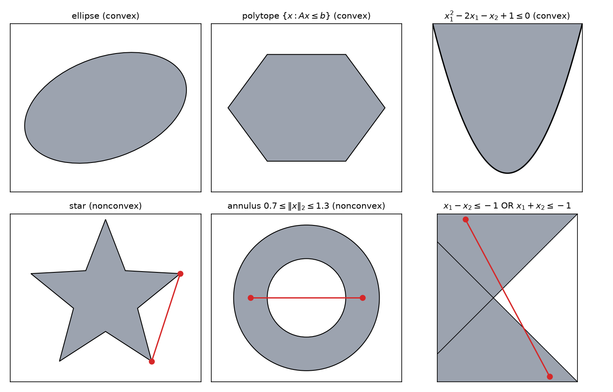

*Figure: top row, convex sets: an ellipse, a hexagon (a polytope) and the region above the parabola x₂ = (x₁ − 1)². Bottom row, nonconvex sets, each with a red segment whose endpoints lie in the set but whose middle does not: a star, an annulus, and the union of two halfplanes.*

### Examples

- **Subspaces.** \\(\mathcal T\\) with \\(x,y\in\mathcal T\Rightarrow ax+by\in\mathcal T\\) for all \\(a,b\in\mathbb R\\). In particular \\((1-\theta)x+\theta y\in\mathcal T\\).
- **Affine sets** (translated subspaces) \\(\\{y+v : y\in\mathcal T\\}\\); see below.
- **Boxes** (bound constraints) \\(\\{x:\ell\_n\le x\_n\le u\_n,\ n=1,\dots,N\\}\\).
- **The filled-in simplex** \\(\\{x:\sum\_nx\_n\le 1,\ x\_n\ge 0\\}\\).
- **Polyhedra** \\(\\{x: Ax\le b\\}\\), intersections of finitely many halfspaces. The filled-in simplex is the polyhedron with
  \\[
  A = \begin{bmatrix}1 & 1 & \cdots & 1\\\\ -1 & 0 & \cdots & 0\\\\ 0 & -1 & \cdots & 0\\\\ \vdots & & \ddots & \vdots\\\\ 0 & 0 & \cdots & -1\end{bmatrix},\qquad b = \begin{bmatrix}1\\\\ 0\\\\ \vdots\\\\ 0\end{bmatrix}.
  \\]
  A bounded polyhedron is called a **polytope**.
- **Norm balls** \\(B\_r = \\{x:\lVert x\rVert\le r\\}\\) for any norm. If \\(\lVert x\rVert,\lVert y\rVert\le r\\), the triangle inequality and homogeneity give \\(\lVert(1-\theta)x+\theta y\rVert\le(1-\theta)\lVert x\rVert+\theta\lVert y\rVert\le r\\).
- **Ellipsoids** \\(\mathcal E = \\{x:(x-x\_0)^{T}P^{-1}(x-x\_0)\le r\\}\\) with \\(P\\) symmetric positive definite. With \\(P = U\Lambda U^{T}\\), the ellipsoid is centred at \\(x\_0\\) with axes along the eigenvectors of \\(P\\) and semi-axis lengths \\(\sqrt{r\lambda\_i}\\), proportional to the *square roots* of the eigenvalues. It is the image of a Euclidean ball under the affine map \\(u\mapsto x\_0+\sqrt rP^{1/2}u\\), and therefore convex (affine images preserve convexity, below).
- **A single point and the empty set** are (trivially) convex.

**Example 2.1 (A parabolic region).** \\(\mathcal S = \\{x\in\mathbb R^2: x\_1^2-2x\_1-x\_2+1\le 0\\}\\). Completing the square, the condition is \\(x\_2\ge(x\_1-1)^2\\): the region on and above the parabola \\(x\_2 = (x\_1-1)^2\\), which is convex (it is the epigraph of a convex function). Reversing the inequality, \\(\\{x\_2\le(x\_1-1)^2\\}\\), gives the region below the parabola, which is **not** convex: \\((0,1)\\) and \\((2,1)\\) are in it but their midpoint \\((1,1)\\) is not. With equality, the set is the parabola itself, a curve, and certainly not convex.

**Example 2.2 ("and" versus "or").** \\(\\{x : x\_1-x\_2\le -1\ \text{and}\ x\_1+x\_2\le -1\\}\\) is the intersection of two halfplanes, a convex wedge. \\(\\{x : x\_1-x\_2\le -1\ \text{or}\ x\_1+x\_2\le -1\\}\\) is their union, which is not convex (bottom right of the figure). Constraints that must *all* hold produce intersections, which preserve convexity; "at least one must hold" produces unions, which do not.

## Affine Sets

A subspace \\(\mathcal T\\) is closed under all linear combinations. An **affine set** is a translated subspace,
\\[
\mathcal S = \mathcal T+v\_0 = \\{y+v\_0 : y\in\mathcal T\\},
\\]
with \\(\dim\mathcal S := \dim\mathcal T\\). Equivalently, \\(\mathcal S\\) is affine iff it contains the entire *line* through any two of its points:
\\[
x,y\in\mathcal S\quad\Longrightarrow\quad\lambda x+(1-\lambda)y\in\mathcal S\quad\text{for all }\lambda\in\mathbb R .
\\]
(Compare convexity, which requires only \\(\lambda\in[0,1]\\); every affine set is therefore convex.) An affine set is a subspace iff it contains the origin.

The **span** of vectors \\(v\_1,\dots,v\_K\\) is \\(\\{\sum\_k\alpha\_kv\_k:\alpha\_k\in\mathbb R\\}\\). Their **affine hull** is
\\[
\operatorname{Aff}(\\{v\_1,\dots,v\_K\\}) = \Big\\{\sum\_{k=1}^{K}\lambda\_kv\_k : \lambda\_k\in\mathbb R,\ \sum\_k\lambda\_k = 1\Big\\},
\\]
the smallest affine set containing them.

**Example 2.3.** For \\(v\_1 = (1,0)^{T}\\) and \\(v\_2 = (\tfrac12,\tfrac12)^{T}\\), the span is all of \\(\mathbb R^2\\) (the vectors are independent), but the affine hull is the line through them: \\(\lambda(1,0)+(1-\lambda)(\tfrac12,\tfrac12) = (\tfrac{1+\lambda}{2},\tfrac{1-\lambda}{2})\\), whose coordinates always sum to 1. So \\(\operatorname{Aff} = \\{x : x\_1+x\_2 = 1\\}\\).

**Algebraic description.** A \\(K\\)-dimensional subspace of \\(\mathbb R^N\\) is the null space of some matrix \\(A\in\mathbb R^{(N-K)\times N}\\): \\(x\in\mathcal T\iff Ax = 0\\) (the rows of \\(A\\) span \\(\mathcal T^\perp\\)). A \\(K\\)-dimensional affine set is the solution set of a consistent linear system \\(Ax = b\\) with \\(b\in\mathbb R^{N-K}\\). Equality constraints in optimization therefore define affine sets.

## Cones

**Definition.** \\(\mathcal C\\) is a **cone** if \\(x\in\mathcal C\Rightarrow\theta x\in\mathcal C\\) for all \\(\theta\ge 0\\). It is a **convex cone** if, in addition, it is closed under **conic (nonnegative) combinations**:
\\[
x\_1,x\_2\in\mathcal C\quad\Longrightarrow\quad\theta\_1x\_1+\theta\_2x\_2\in\mathcal C\quad\text{for all }\theta\_1,\theta\_2\ge 0 .
\\]

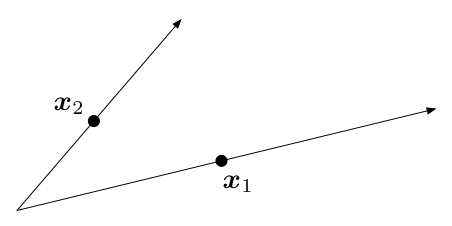

*Figure: two rays from the origin through x₁ and x₂. All nonnegative combinations θ₁x₁ + θ₂x₂ fill the wedge between the rays; this wedge is the smallest convex cone containing both points.*

A cone is **proper** if it is convex, closed, **solid** (non-empty interior) and **pointed** (contains no entire line, i.e. \\(x\in\mathcal C\\) and \\(-x\in\mathcal C\\) imply \\(x = 0\\)). Important proper cones:

- **The nonnegative orthant** \\(\mathbb R^N\_+ = \\{x: x\_n\ge 0\\}\\).
- **The positive semidefinite cone** \\(\mathbb S^N\_+\\) of symmetric matrices with nonnegative eigenvalues (proper relative to the space \\(\mathbb S^N\\) of symmetric matrices; see Example 2.4).
- **Nonnegative polynomials.** The coefficient vectors of polynomials nonnegative on \\([0,1]\\),
  \\[
  \\{x\in\mathbb R^N: x\_1+x\_2t+\cdots+x\_Nt^{N-1}\ge 0\ \text{for all }0\le t\le 1\\}.
  \\]
  It is an intersection of halfspaces (one for each \\(t\\)), hence a closed convex cone. The coefficients need not be nonnegative: \\(t-t^2\ge 0\\) on \\([0,1]\\) has \\(x = (0,1,-1)\\).
- **Norm cones** \\(\\{(x,t)\in\mathbb R^{N+1}:\lVert x\rVert\le t\\}\\); with the Euclidean norm this is the **second-order cone** of SOCPs (see [Modeling](modeling.md)).

**Example 2.4 (The PSD cone is a proper cone).** We check each property in \\(\mathbb S^N\\).

- *Convex cone.* \\(X\succeq 0\\) means \\(v^{T}Xv\ge 0\\) for all \\(v\\). For \\(X,Y\succeq 0\\) and \\(\theta\_1,\theta\_2\ge 0\\), \\(v^{T}(\theta\_1X+\theta\_2Y)v = \theta\_1v^{T}Xv+\theta\_2v^{T}Yv\ge 0\\). Equivalently, \\(\min\_{\lVert v\rVert = 1}v^{T}((1-\theta)X+\theta Y)v\ge(1-\theta)\min v^{T}Xv+\theta\min v^{T}Yv\ge 0\\).
- *Pointed.* If \\(X\succeq 0\\) and \\(-X\succeq 0\\) then all eigenvalues are both \\(\ge 0\\) and \\(\le 0\\), so \\(X = 0\\): no line lies in the cone.
- *Closed.* The complement is open. If \\(\lambda\_{\min}(A)<0\\), Weyl's inequality gives \\(\lambda\_{\min}(A+E)\le\lambda\_{\min}(A)+\lVert E\rVert\_2\le\lambda\_{\min}(A)+\lVert E\rVert\_F\\), so every symmetric \\(E\\) with \\(\lVert E\rVert\_F<-\lambda\_{\min}(A)\\) keeps \\(A+E\\) outside the cone. (Alternatively, \\(\mathbb S^N\_+ = \bigcap\_v\\{X: v^{T}Xv\ge 0\\}\\) is an intersection of closed halfspaces.)
- *Solid.* \\(X = I\\) is an interior point: for symmetric \\(Y\\) with \\(\lVert Y\rVert\_2\le\epsilon<1\\), \\(\lambda\_{\min}(I+Y)\ge 1-\epsilon>0\\).

### Generalized inequalities

A proper cone \\(K\\) defines a partial order, the **generalized inequality**
\\[
x\preceq\_K y\quad\iff\quad y-x\in K .
\\]
For \\(K = \mathbb R^N\_+\\) this is the componentwise order, written simply \\(x\le y\\). For \\(K = \mathbb S^N\_+\\) it is the **Loewner order**: \\(X\preceq Y\\) iff \\(Y-X\\) is positive semidefinite. Generalized inequalities share many properties of \\(\le\\) on \\(\mathbb R\\): they are reflexive, transitive, antisymmetric (by pointedness), preserved under addition (\\(x\preceq y\\) and \\(u\preceq v\\) imply \\(x+u\preceq y+v\\), because \\(K\\) is a convex cone) and under nonnegative scaling. But they are not total orders: there may be \\(x,y\\) with neither \\(x\preceq y\\) nor \\(y\preceq x\\) (for example \\(x = (1,0)\\), \\(y = (0,1)\\) in \\(\mathbb R^2\_+\\)). Strong convexity \\(\nabla^2f\succeq\mu I\\) and smoothness \\(\nabla^2f\preceq LI\\) in [Convex Functions](convex-functions.md) are Loewner inequalities.

### Normal cones

**Definition (Normal cone).** For a convex set \\(\mathcal C\\) and \\(x\in\mathcal C\\), the **normal cone** of \\(\mathcal C\\) at \\(x\\) is
\\[
N\_{\mathcal C}(x) = \\{g : \langle g, y-x\rangle\le 0\ \text{for all }y\in\mathcal C\\}.
\\]
It is a closed convex cone (an intersection of halfspaces, one for each \\(y\\)). At an interior point it is \\(\\{0\\}\\); at a point where the boundary is smooth it is a single ray along the outward normal; at a corner it is a wedge spanned by the normals of the faces that meet there. Normal cones are the language of constrained optimality: a point \\(x^\star\\) minimizes a differentiable convex \\(f\\) over \\(\mathcal C\\) iff \\(-\nabla f(x^\star)\in N\_{\mathcal C}(x^\star)\\) ([Constrained Optimality](constrained-optimality.md)). Below we will see that they also describe projections exactly: \\(P\_{\mathcal C}(x\_0) = \hat x\\) iff \\(x\_0-\hat x\in N\_{\mathcal C}(\hat x)\\).

## Hyperplanes and Halfspaces

**Definition.** For \\(a\neq 0\\) and \\(t\in\mathbb R\\), the **hyperplane** with **normal vector** \\(a\\) is
\\[
\mathcal H = \\{x:\langle x,a\rangle = t\\}.
\\]
It is an affine set of dimension \\(N-1\\). For \\(t = 0\\) it is the subspace \\(a^\perp\\) of vectors orthogonal to \\(a\\). For \\(t\neq 0\\) it is a translate \\(x\_0+a^\perp\\), where \\(x\_0\\) is any point with \\(\langle x\_0,a\rangle = t\\), for instance \\(x\_0 = t\\,a/\lVert a\rVert\_2^2\\). Changing \\(t\\) slides the hyperplane parallel to itself along \\(a\\).

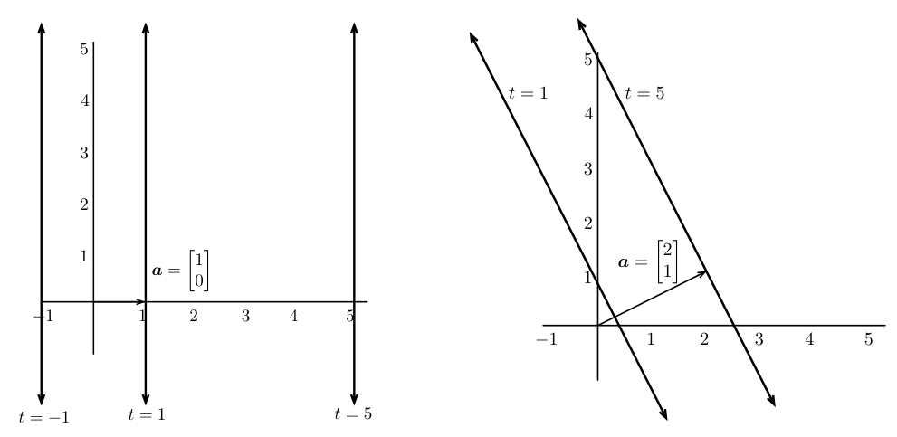

*Figure: left, hyperplanes (lines) ⟨x, a⟩ = t with a = (1, 0) for t = −1, 1, 5: vertical lines x₁ = t. Right, a = (2, 1) with t = 1 and t = 5: parallel lines perpendicular to a, the line for larger t lying farther in the direction of a.*

The **halfspace** \\(\\{x:\langle x,a\rangle\le t\\}\\) is the closed region on one side of \\(\mathcal H\\), the side opposite to \\(a\\). For \\(t = 0\\) it consists of the vectors making an angle of at least \\(90^\circ\\) with \\(a\\). Halfspaces are convex (and so polyhedra, finite intersections of them, are convex).

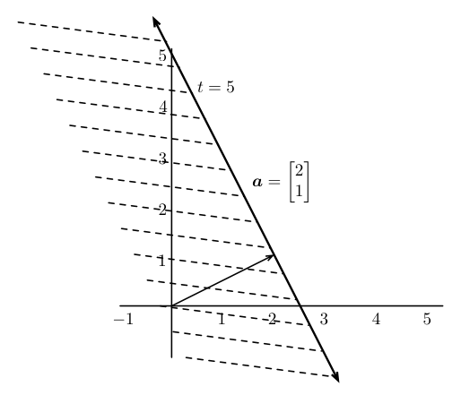

*Figure: the halfspace ⟨x, (2, 1)⟩ ≤ 5, hatched, on the side of the line t = 5 that contains the origin; the normal a = (2, 1) points out of the halfspace.*

**Example 2.5 (Projection onto a hyperplane).** Find the point of \\(\mathcal H = \\{x: a^{T}x = t\\}\\) closest to \\(x\_0\\), and the distance. Substitute \\(x' = x-x\_0\\): we minimize \\(\lVert x'\rVert\_2\\) subject to \\(a^{T}x' = t-a^{T}x\_0\\). This is a minimum-norm solution of one linear equation, \\(x' = a(a^{T}a)^{-1}(t-a^{T}x\_0)\\) (the pseudo-inverse formula of [Modeling](modeling.md) with a single row). Hence
\\[
\hat x = x\_0+\frac{t-a^{T}x\_0}{\lVert a\rVert\_2^2}\\,a = \frac{t}{\lVert a\rVert\_2^2}\\,a+\Big(I-\frac{aa^{T}}{\lVert a\rVert\_2^2}\Big)x\_0,\qquad
\operatorname{dist}(x\_0,\mathcal H) = \frac{\lvert t-a^{T}x\_0\rvert}{\lVert a\rVert\_2}.
\\]
The second form shows the structure: remove the component of \\(x\_0\\) along \\(a\\), then add the component that puts the point on \\(\mathcal H\\). This distance formula gives the SVM margin \\(1/\lVert w\rVert\_2\\).

## Operations That Preserve Convexity

To prove a set is convex, one rarely uses the definition directly. Instead, one builds the set from known convex sets by operations that preserve convexity.

- **Intersection.** If \\(\mathcal C\_\alpha\\) is convex for every \\(\alpha\\) in any index set, \\(\bigcap\_\alpha\mathcal C\_\alpha\\) is convex: if \\(x,y\\) lie in every \\(\mathcal C\_\alpha\\), so does the segment between them. Polyhedra, the PSD cone (\\(\bigcap\_v\\{X : v^{T}Xv\ge 0\\}\\)) and the cone of nonnegative polynomials all arise this way.
- **Affine images and preimages.** Let \\(h(x) = Ax+b\\). If \\(\mathcal C\\) is convex, so are \\(h(\mathcal C) = \\{Ax+b : x\in\mathcal C\\}\\) and \\(h^{-1}(\mathcal C) = \\{x: Ax+b\in\mathcal C\\}\\). (For the image: \\((1-\theta)(Ax+b)+\theta(Ay+b) = A((1-\theta)x+\theta y)+b\\).) Ellipsoids are images of balls; the SOCP constraint \\(\lVert A\_mx+b\_m\rVert\_2\le c\_m^{T}x+d\_m\\) is the preimage of the second-order cone; scaling, translation and projection onto some coordinates are special cases.
- **Sums.** \\(\mathcal C\_1+\mathcal C\_2 = \\{x+y : x\in\mathcal C\_1, y\in\mathcal C\_2\\}\\) is the image of the convex set \\(\mathcal C\_1\times\mathcal C\_2\\) under the linear map \\((x,y)\mapsto x+y\\).
- **Sublevel sets and epigraphs of convex functions** are convex ([Convex Functions](convex-functions.md)).
- **Perspective and linear-fractional maps** \\(x\mapsto(Ax+b)/(c^{T}x+d)\\) on \\(\\{c^{T}x+d>0\\}\\) also preserve convexity (see Boyd and Vandenberghe, §2.3).

Unions, complements and set differences do **not** preserve convexity (Example 2.2, the annulus).

## Technical Background: Topology in \\(\mathbb R^N\\)

The separation theorems and existence of projections depend on a few analysis facts, collected here.

- **Convergence.** \\(x\_k\to\hat x\\) if for every \\(\epsilon>0\\) there is \\(n\_\epsilon\\) with \\(\lVert x\_k-\hat x\rVert\_2\le\epsilon\\) for all \\(k\ge n\_\epsilon\\); in \\(\mathbb R^N\\) this is equivalent to componentwise convergence.
- **Balls, open and closed sets.** \\(B(x,\epsilon) = \\{y:\lVert x-y\rVert\_2\le\epsilon\\}\\). \\(\mathcal X\\) is **open** if every \\(x\in\mathcal X\\) has some \\(B(x,\epsilon\_x)\subseteq\mathcal X\\); **closed** if its complement is open, equivalently if it contains the limits of all its convergent sequences. The **closure** \\(\operatorname{cl}(\mathcal X)\\) adds all limit points; it is the smallest closed superset.
- **Bounded and compact.** \\(\mathcal X\\) is bounded if its diameter \\(\sup\_{x,y\in\mathcal X}\lVert x-y\rVert\_2\\) is finite. In \\(\mathbb R^N\\), **compact** means closed and bounded. **Bolzano–Weierstrass:** every sequence in a compact set has a subsequence converging to a point of the set.
- **Interior and relative interior.** \\(\operatorname{int}(\mathcal X) = \\{x:\exists\epsilon>0,\ B(x,\epsilon)\subseteq\mathcal X\\}\\). Many natural convex sets have empty interior, for instance the unit simplex \\(\Delta = \\{x\in\mathbb R^3: x\_1+x\_2+x\_3 = 1,\ x\_i\ge 0\\}\\), a flat triangle in \\(\mathbb R^3\\). The useful notion is the **relative interior**, the interior relative to the affine hull:
  \\[
  \operatorname{relint}(\mathcal X) = \\{x\in\mathcal X:\exists\epsilon>0,\ B(x,\epsilon)\cap\operatorname{Aff}(\mathcal X)\subseteq\mathcal X\\}.
  \\]
  For the simplex, \\(\operatorname{Aff}(\Delta) = \\{x\_1+x\_2+x\_3 = 1\\}\\) and \\(\operatorname{relint}(\Delta) = \\{x\in\Delta: x\_1,x\_2,x\_3>0\\}\\). For a convex set there is an equivalent "line-extension" test: \\(x\in\operatorname{relint}(\mathcal C)\\) iff for **every** \\(y\in\mathcal C\\) there is \\(\lambda>1\\) with \\(\lambda x+(1-\lambda)y\in\mathcal C\\), i.e. the segment from \\(y\\) through \\(x\\) can be extended a little beyond \\(x\\). The **relative boundary** is \\(\operatorname{cl}(\mathcal X)\setminus\operatorname{relint}(\mathcal X)\\).
- **Continuity.** \\(f\\) is **Lipschitz** with constant \\(L\\) if \\(\lvert f(x\_1)-f(x\_2)\rvert\le L\lVert x\_1-x\_2\rVert\_2\\); Lipschitz functions are continuous.
- **Infimum versus minimum.** \\(\min\_{x\ge 0}e^{-x}\\) does not exist, but \\(\inf\_{x\ge 0}e^{-x} = 0\\); on the other hand \\(\inf\_{x\in[0,1]}(x-\tfrac12)^2 = \min = 0\\).
- **Weierstrass extreme value theorem.** A continuous function on a nonempty compact set attains its infimum and supremum. This is the fundamental existence result in optimization: it gives general sufficient conditions for a minimizer to exist.

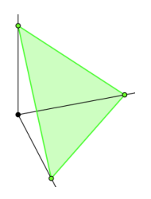

*Figure: the unit simplex Δ in ℝ³, the green triangle with vertices on the three coordinate axes. It has empty interior in ℝ³ but a nonempty relative interior: the points of the triangle with all three coordinates strictly positive.*

## The Closest-Point Problem

Given \\(x\_0\in\mathbb R^N\\) and a nonempty closed convex set \\(\mathcal C\\), the **projection** of \\(x\_0\\) onto \\(\mathcal C\\) is
\\[
P\_{\mathcal C}(x\_0) = \arg\min\_{y\in\mathcal C}\lVert x\_0-y\rVert\_2 .
\\]
We first treat subspaces and affine sets, where linear algebra gives closed forms, and then general closed convex sets.

### Projection onto a subspace

**Theorem (Orthogonality principle).** Let \\(\mathcal T\\) be a subspace of \\(\mathbb R^N\\). Then \\(\hat x\in\mathcal T\\) is the closest point of \\(\mathcal T\\) to \\(x\_0\\) iff the error is orthogonal to the subspace:
\\[
x\_0-\hat x\perp\mathcal T,\qquad\text{i.e.}\qquad\langle y, x\_0-\hat x\rangle = 0\ \text{ for all } y\in\mathcal T .
\\]

*Proof (sufficiency).* Let \\(\hat e = x\_0-\hat x\perp\mathcal T\\), take any \\(y\in\mathcal T\\) and write \\(e = x\_0-y = \hat e-(y-\hat x)\\). Since \\(y-\hat x\in\mathcal T\\) is orthogonal to \\(\hat e\\),
\\[
\lVert e\rVert\_2^2 = \lVert\hat e\rVert\_2^2-2\langle\hat e,y-\hat x\rangle+\lVert y-\hat x\rVert\_2^2 = \lVert\hat e\rVert\_2^2+\lVert y-\hat x\rVert\_2^2 ,
\\]
which is strictly larger than \\(\lVert\hat e\rVert\_2^2\\) unless \\(y = \hat x\\). So \\(\hat x\\) is the unique closest point. *(Necessity)* If \\(\langle v,\hat e\rangle\neq 0\\) for some unit \\(v\in\mathcal T\\), then \\(y = \hat x+\langle v,\hat e\rangle v\in\mathcal T\\) has \\(\lVert x\_0-y\rVert\_2^2 = \lVert\hat e\rVert\_2^2-\langle v,\hat e\rangle^2<\lVert\hat e\rVert\_2^2\\), so \\(\hat x\\) was not closest. ∎

**Computing it.** Let \\(v\_1,\dots,v\_K\\) be a basis of \\(\mathcal T\\), collected as the columns of \\(V\in\mathbb R^{N\times K}\\), and write \\(\hat x = \sum\_j\alpha\_jv\_j = V\alpha\\). Orthogonality to each basis vector gives
\\[
\Big\langle x\_0-\sum\_j\alpha\_jv\_j,\ v\_k\Big\rangle = 0\quad\Longrightarrow\quad\sum\_j\alpha\_j\langle v\_j,v\_k\rangle = \langle x\_0,v\_k\rangle,\quad k=1,\dots,K,
\\]
i.e. the **normal equations** \\(V^{T}V\alpha = V^{T}x\_0\\). Since the \\(v\_k\\) are independent, the Gram matrix \\(V^{T}V\\) is invertible, so
\\[
\hat\alpha = (V^{T}V)^{-1}V^{T}x\_0,\qquad\hat x = V(V^{T}V)^{-1}V^{T}x\_0 .
\\]
The projector onto a subspace is the linear map \\(V(V^{T}V)^{-1}V^{T}\\) (just \\(VV^{T}\\) for an orthonormal basis). Least squares, \\(\min\lVert y-Ax\rVert\_2\\), is exactly projection of \\(y\\) onto the column space of \\(A\\).

### Projection onto an affine set

For \\(\mathcal C = \mathcal T+v\_0\\), shift by \\(-v\_0\\), project onto \\(\mathcal T\\) and shift back: \\(P\_{\mathcal C}(x\_0) = v\_0+P\_{\mathcal T}(x\_0-v\_0)\\). The solution is unique and is characterized by
\\[
\langle y-\hat x,\ x\_0-\hat x\rangle = 0\quad\text{for all } y\in\mathcal C ,
\\]
since \\(y-\hat x\\) ranges over \\(\mathcal T\\). Example 2.5 is the case of a hyperplane.

### General closed convex sets: existence and uniqueness

For a general convex set there is usually no closed form, but the concepts carry over, with the equality replaced by an inequality.

**Theorem (Existence and uniqueness of the closest point).** If \\(\mathcal C\subseteq\mathbb R^N\\) is nonempty, closed and convex, then for every \\(x\_0\in\mathbb R^N\\) the problem \\(\min\_{y\in\mathcal C}\lVert x\_0-y\rVert\_2\\) has exactly one solution.

*Proof. Existence.* Pick any \\(x'\in\mathcal C\\) and let \\(B = \\{x:\lVert x-x\_0\rVert\_2\le\lVert x'-x\_0\rVert\_2\\}\\). Any minimizer must lie in \\(\mathcal C\cap B\\), which is nonempty (it contains \\(x'\\)), closed (intersection of closed sets) and bounded, hence compact. The function \\(y\mapsto\lVert x\_0-y\rVert\_2\\) is continuous, so by Weierstrass it attains its minimum on \\(\mathcal C\cap B\\) at some \\(\hat x\\), which is then a minimizer over all of \\(\mathcal C\\).

*Uniqueness.* Suppose \\(\hat x\\) is a minimizer (\\(\hat x\neq x\_0\\); if \\(x\_0\in\mathcal C\\) the minimum value is 0 and \\(\hat x = x\_0\\) is clearly the only minimizer) and let \\(y\in\mathcal C\\), \\(y\neq\hat x\\). Two cases.

(i) *\\(y\\) lies on the line through \\(x\_0\\) and \\(\hat x\\).* The set \\(I = \\{\alpha:\hat x+\alpha(x\_0-\hat x)\in\mathcal C\\}\\) is a closed interval containing 0 (convexity and closedness of \\(\mathcal C\\)). For a point \\(y = \hat x+\alpha(x\_0-\hat x)\\) on this line, \\(y-x\_0 = (1-\alpha)(\hat x-x\_0)\\), so the squared distance is
\\[
g(\alpha) = \lVert x\_0-\hat x-\alpha(x\_0-\hat x)\rVert\_2^2 = (1-\alpha)^2\lVert x\_0-\hat x\rVert\_2^2 ,
\\]
a strictly convex parabola in \\(\alpha\\). A strictly convex function has at most one minimizer on an interval, and by construction it is \\(\alpha = 0\\). So \\(y\\) is strictly farther than \\(\hat x\\).

(ii) *\\(y\\) is not on that line.* Then \\(x\_0-\hat x\\) and \\(x\_0-y\\) are not co-aligned, and the midpoint \\(\tfrac12\hat x+\tfrac12y\in\mathcal C\\) satisfies
\\[
\begin{aligned}
\Big\lVert x\_0-\tfrac{\hat x}{2}-\tfrac{y}{2}\Big\rVert\_2^2
&= \Big\lVert\tfrac{x\_0-\hat x}{2}+\tfrac{x\_0-y}{2}\Big\rVert\_2^2
= \tfrac14\lVert x\_0-\hat x\rVert\_2^2+\tfrac14\lVert x\_0-y\rVert\_2^2+\tfrac12\langle x\_0-\hat x,x\_0-y\rangle\\\\
&< \tfrac14\lVert x\_0-\hat x\rVert\_2^2+\tfrac14\lVert x\_0-y\rVert\_2^2+\tfrac12\lVert x\_0-\hat x\rVert\_2\lVert x\_0-y\rVert\_2
= \Big(\tfrac12\lVert x\_0-\hat x\rVert\_2+\tfrac12\lVert x\_0-y\rVert\_2\Big)^2\\\\
&\le\lVert x\_0-y\rVert\_2^2 .
\end{aligned}
\\]
The strict inequality is Cauchy–Schwarz, strict because the vectors are not co-aligned; the last step uses \\(\lVert x\_0-\hat x\rVert\_2\le\lVert x\_0-y\rVert\_2\\). If \\(y\\) were also a minimizer, the midpoint would be strictly closer than the minimum distance, a contradiction. ∎

Both hypotheses matter: for a nonconvex set (a circle, say, with \\(x\_0\\) at its center) the closest point can be non-unique, and for a non-closed set (an open ball, \\(x\_0\\) outside) it need not exist.

### The obtuse-angle characterization

**Lemma (A geometric inequality).** If \\(\lVert x+\theta y\rVert\_2\ge\lVert x\rVert\_2\\) for all \\(\theta\in[0,1]\\), then \\(\langle x,y\rangle\ge 0\\).

*Proof.* Expand: \\(\lVert x+\theta y\rVert\_2^2 = \lVert x\rVert\_2^2+2\theta\langle x,y\rangle+\theta^2\lVert y\rVert\_2^2\ge\lVert x\rVert\_2^2\\). Cancel \\(\lVert x\rVert\_2^2\\) and divide by \\(2\theta>0\\): \\(\langle x,y\rangle+\tfrac\theta2\lVert y\rVert\_2^2\ge 0\\) for all \\(\theta\in(0,1]\\). Let \\(\theta\to 0\\). ∎

**Theorem (Obtuseness principle).** Let \\(\mathcal C\\) be nonempty, closed and convex. Then \\(\hat x\in\mathcal C\\) equals \\(P\_{\mathcal C}(x\_0)\\) if and only if
\\[
\langle y-\hat x,\ x\_0-\hat x\rangle\le 0\quad\text{for all }y\in\mathcal C .
\\]
Equivalently, \\(x\_0-\hat x\in N\_{\mathcal C}(\hat x)\\): the error vector lies in the normal cone at the projection.

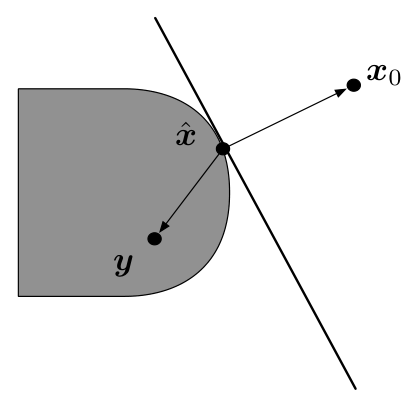

*Figure: a point x₀ outside a convex set, its projection x̂ on the boundary and an arbitrary point y of the set. The vectors x₀ − x̂ and y − x̂ make an obtuse (or right) angle for every y; the line through x̂ perpendicular to x₀ − x̂ supports the set.*

*Proof (\\(\Leftarrow\\)).* For any \\(y\in\mathcal C\\),
\\[
\lVert y-x\_0\rVert\_2^2 = \lVert(y-\hat x)+(\hat x-x\_0)\rVert\_2^2 = \lVert y-\hat x\rVert\_2^2+\lVert\hat x-x\_0\rVert\_2^2+2\langle y-\hat x,\hat x-x\_0\rangle\ge\lVert\hat x-x\_0\rVert\_2^2 ,
\\]
because \\(\langle y-\hat x,\hat x-x\_0\rangle = -\langle y-\hat x,x\_0-\hat x\rangle\ge 0\\) by hypothesis and the first term is nonnegative.

*(\\(\Rightarrow\\)).* For \\(y\in\mathcal C\\) and \\(\theta\in[0,1]\\), convexity gives \\(\hat x+\theta(y-\hat x)\in\mathcal C\\), and since \\(\hat x\\) is closest,
\\[
\lVert(\hat x-x\_0)+\theta(y-\hat x)\rVert\_2\ge\lVert\hat x-x\_0\rVert\_2\quad\text{for all }\theta\in[0,1].
\\]
By the lemma, \\(\langle\hat x-x\_0,\ y-\hat x\rangle\ge 0\\), i.e. \\(\langle y-\hat x,\ x\_0-\hat x\rangle\le 0\\). ∎

For an affine set the inequality must hold for both \\(y-\hat x\\) and \\(-(y-\hat x)\\) (both directions lie in \\(\mathcal T\\)), which forces equality: the orthogonality principle is the special case.

**Consequences.**

- *Inverse images of the projection.* The set of points that project to \\(p\in\mathcal C\\) is \\(P\_{\mathcal C}^{-1}(p) = p+N\_{\mathcal C}(p)\\).
- *Nonexpansiveness.* Writing the principle at \\(\hat x\_1 = P\_{\mathcal C}(x\_1)\\) with \\(y = \hat x\_2\\), and at \\(\hat x\_2\\) with \\(y = \hat x\_1\\), and adding, gives \\(\lVert\hat x\_1-\hat x\_2\rVert\_2^2\le\langle\hat x\_1-\hat x\_2,\ x\_1-x\_2\rangle\\), and by Cauchy–Schwarz \\(\lVert P\_{\mathcal C}(x\_1)-P\_{\mathcal C}(x\_2)\rVert\_2\le\lVert x\_1-x\_2\rVert\_2\\). Projection is 1-Lipschitz, the property that makes projected gradient descent work ([Constrained Algorithms](constrained-algorithms.md)).

**Example 2.6 (Projection onto a box and onto the \\(\ell\_\infty\\) ball).** For \\(\mathcal C = \\{x:\lVert x\rVert\_\infty\le\tau\\}\\) the projection clips each coordinate, \\(\hat x\_i = \min(\max(x\_{0,i},-\tau),\tau)\\). The obtuse-angle test confirms it coordinate by coordinate: where \\(x\_{0,i}\\) is unclipped, \\(x\_{0,i}-\hat x\_i = 0\\); where it is clipped at \\(+\tau\\), \\(x\_{0,i}-\hat x\_i>0\\) and \\(y\_i-\hat x\_i = y\_i-\tau\le 0\\); similarly at \\(-\tau\\). Every term of \\(\sum\_i(y\_i-\hat x\_i)(x\_{0,i}-\hat x\_i)\\) is \\(\le 0\\).

**Example 2.7 (Supporting hyperplanes and normal cones of a triangle).** Let \\(\mathcal C = \\{x: x\_1\ge -1,\ x\_2\ge 0,\ x\_1+x\_2\le 0\\}\\), the triangle with vertices \\((-1,0)\\), \\((0,0)\\), \\((-1,1)\\). Consider \\(u = (-\tfrac12,\tfrac12)\\), the midpoint of the hypotenuse, and the vertex \\(v = (0,0)\\).

- (a) *Supporting hyperplanes at \\(u\\).* Parametrize unit normals \\(a = (\cos\theta,\sin\theta)\\). The point \\(u\\) lies in the relative interior of the face \\(x\_1+x\_2 = 0\\), so the only hyperplane through \\(u\\) with \\(\mathcal C\\) on one side is the face's own line: \\(\theta = \pi/4\\), \\(a = (1,1)/\sqrt2\\), \\(t = \langle u,a\rangle = 0\\). The normal cone \\(N\_{\mathcal C}(u)\\) is the single ray \\(\\{\alpha(1,1):\alpha\ge 0\\}\\).
- (b) *Points that project to \\(u\\).* \\(X\_u = u+N\_{\mathcal C}(u) = \\{u+\alpha(1,1):\alpha\ge 0\\}\\), the ray from \\(u\\) along the outward normal.
- (c) *Supporting hyperplanes at \\(v\\).* At the vertex two faces meet, with outward normals \\((1,1)/\sqrt2\\) (hypotenuse) and \\((0,-1)\\) (bottom edge). Every direction between them supports \\(\mathcal C\\): \\(\\{x:\langle x,a\rangle = 0\\}\\) with \\(a = (\cos\theta,\sin\theta)\\), \\(\theta\in[-\pi/2,\pi/4]\\).
- (d) *Points that project to \\(v\\).* \\(X\_v = v+N\_{\mathcal C}(v)\\), the wedge generated by \\((1,1)\\) and \\((0,-1)\\). As linear inequalities: \\(X\_v = \\{x: x\_1\ge 0,\ x\_1\ge x\_2\\}\\). (Check: \\(x\_1\ge 0\\) is the side of the ray \\((0,-1)\\), i.e. the line \\(x\_1 = 0\\); \\(x\_1\ge x\_2\\) is below the ray \\((1,1)\\).)

Faces give rays, vertices give wedges.

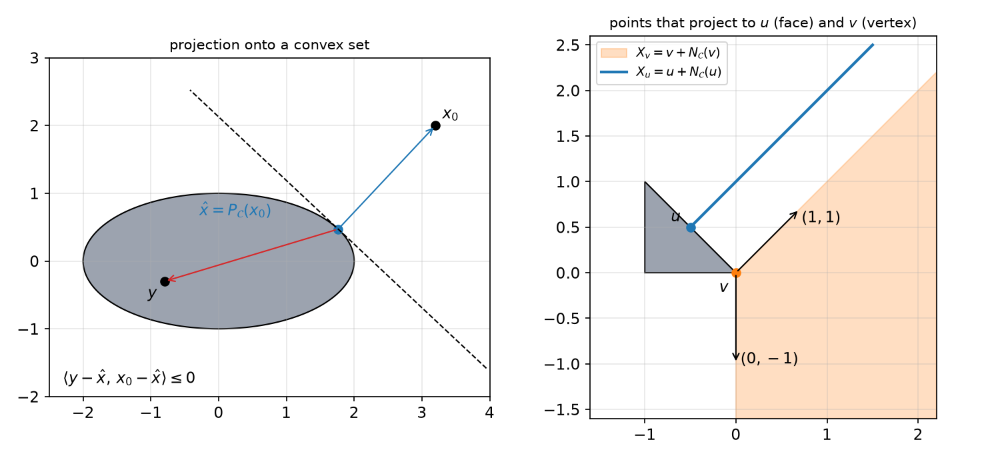

*Figure: left, projecting x₀ onto an ellipse: the error x₀ − x̂ (blue) makes an obtuse angle with y − x̂ (red) for every y in the set, and the dashed line through x̂ perpendicular to the error supports the ellipse. Right, the triangle of Example 2.7: every point on the blue ray projects to the face point u, and every point in the orange wedge projects to the vertex v; the wedge is spanned by the two outward face normals (1, 1) and (0, −1).*

## Separating Hyperplanes

Two disjoint convex sets can be separated by a hyperplane; for nonconvex sets this can fail.

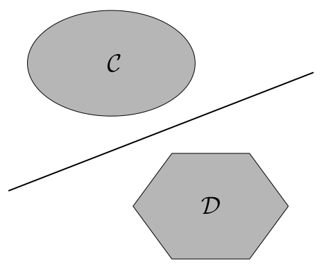

*Figure: an ellipse C and a hexagon D, disjoint and convex, with a line between them: C lies entirely on one side and D on the other.*

*Figure: a nonconvex polygon with a notch, and a triangle poking into the notch. The sets are disjoint, but no straight line has one entirely on each side.*

**Definitions.** The hyperplane \\(\mathcal H = \\{x:\langle x,a\rangle = t\\}\\), \\(a\neq 0\\):

- **separates** \\(\mathcal C\\) and \\(\mathcal D\\) if \\(\langle c,a\rangle\le t\le\langle d,a\rangle\\) for all \\(c\in\mathcal C\\), \\(d\in\mathcal D\\);
- **properly separates** them if it separates them and \\(\mathcal C\\), \\(\mathcal D\\) are not both contained in \\(\mathcal H\\);
- **strictly separates** them if \\(\langle c,a\rangle<t<\langle d,a\rangle\\);
- **strongly separates** them if there is \\(\epsilon>0\\) with \\(\langle c,a\rangle\le t-\epsilon\\) and \\(\langle d,a\rangle\ge t+\epsilon\\).

(The roles of \\(\mathcal C\\) and \\(\mathcal D\\) may be exchanged.) Strong implies strict implies proper (for nonempty sets) implies plain separation.

**Theorem (Strong separating hyperplane theorem).** Let \\(\mathcal C\\) and \\(\mathcal D\\) be disjoint, nonempty, closed, convex subsets of \\(\mathbb R^N\\), and let \\(\mathcal C\\) be bounded. Then there is a hyperplane that strongly separates \\(\mathcal C\\) and \\(\mathcal D\\).

*Proof (constructive).* Let \\(d(x,\mathcal D) = \inf\_{y\in\mathcal D}\lVert x-y\rVert\_2\\). Because \\(\mathcal D\\) is closed and convex, this infimum is attained at the unique projection \\(P\_{\mathcal D}(x)\\) (previous section), and \\(d(\cdot,\mathcal D)\\) is continuous (indeed 1-Lipschitz, by the triangle inequality). By Weierstrass it attains its minimum on the compact set \\(\mathcal C\\): there are \\(c\in\mathcal C\\) and \\(d = P\_{\mathcal D}(c)\in\mathcal D\\) with
\\[
\lVert c-d\rVert\_2 = \inf\_{x\in\mathcal C,\ y\in\mathcal D}\lVert x-y\rVert\_2 ,
\\]
and \\(c\neq d\\) because the sets are disjoint. Define
\\[
a = d-c,\qquad t = \frac{\lVert d\rVert\_2^2-\lVert c\rVert\_2^2}{2},\qquad\epsilon = \frac{\lVert c-d\rVert\_2^2}{2}>0 .
\\]
The hyperplane is the perpendicular bisector of the segment from \\(c\\) to \\(d\\). Let \\(f(x) = \langle x,a\rangle-t\\); we show \\(f\ge\epsilon\\) on \\(\mathcal D\\) and \\(f\le-\epsilon\\) on \\(\mathcal C\\).

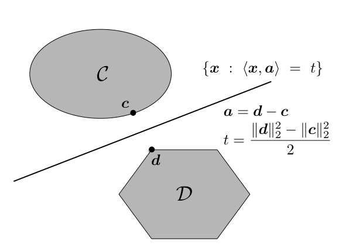

*Figure: c and d are the closest pair of points of C and D. The separating hyperplane {x : ⟨x, a⟩ = t} has normal a = d − c and passes through the midpoint of the segment cd, with t = (‖d‖² − ‖c‖²)/2.*

Take \\(u\in\mathcal D\\). Since \\(d\\) is the projection of \\(c\\) onto \\(\mathcal D\\), the obtuseness principle (or directly the lemma, using \\(d+\theta(u-d)\in\mathcal D\\)) gives \\(\langle u-d,\ c-d\rangle\le 0\\), i.e. \\(\langle u-d,\ d-c\rangle\ge 0\\). Now use \\(\lVert d\rVert\_2^2-\lVert c\rVert\_2^2 = \langle d+c,\ d-c\rangle\\):
\\[
f(u) = \langle u,d-c\rangle-\frac{\langle d+c,d-c\rangle}{2} = \Big\langle u-\frac{d+c}{2},\ d-c\Big\rangle = \langle u-d,\ d-c\rangle+\Big\langle\frac{d-c}{2},\ d-c\Big\rangle\ge\frac{\lVert c-d\rVert\_2^2}{2} = \epsilon .
\\]
Symmetrically, \\(c\\) is the projection of \\(d\\) onto \\(\mathcal C\\) (if a point of \\(\mathcal C\\) were closer to \\(d\\), the pair \\((c,d)\\) would not be closest), so for \\(v\in\mathcal C\\), \\(\langle v-c,\ d-c\rangle\le 0\\) and
\\[
f(v) = \langle v-c,\ d-c\rangle+\Big\langle c-\frac{d+c}{2},\ d-c\Big\rangle\le-\frac{\lVert c-d\rVert\_2^2}{2} = -\epsilon . \qquad ∎
\\]

Boundedness of one set is needed: the closed convex sets \\(\\{x\_2\le 0\\}\\) and \\(\\{x\_2\ge e^{x\_1}\\}\\) are disjoint, but their distance is 0, so they can be separated (by \\(x\_2 = 0\\)) but not strongly.

**Example 2.8 (Separating a convex set from a ball around an outside point).** Let \\(\mathcal C\\) be closed and convex, \\(x\_0\notin\mathcal C\\), \\(\hat x = P\_{\mathcal C}(x\_0)\\), and \\(B\_0 = \\{x:\lVert x-x\_0\rVert\_2\le\lVert\hat x-x\_0\rVert\_2\\}\\), the largest ball around \\(x\_0\\) that touches \\(\mathcal C\\) only on its boundary. Take
\\[
a = x\_0-\hat x,\qquad t = \langle\hat x,\ x\_0-\hat x\rangle .
\\]
- On \\(\mathcal C\\): \\(\langle x,a\rangle = t+\langle x-\hat x,\ x\_0-\hat x\rangle\le t\\) by the obtuseness principle.
- On \\(B\_0\\): write \\(x = \hat x+(x\_0-\hat x)+(x-x\_0)\\). Then \\(\langle x,a\rangle = t+\lVert x\_0-\hat x\rVert\_2^2-\langle x\_0-x,\ x\_0-\hat x\rangle\ge t\\), since Cauchy–Schwarz gives \\(\langle x\_0-x,x\_0-\hat x\rangle\le\lVert x\_0-x\rVert\_2\lVert x\_0-\hat x\rVert\_2\le\lVert x\_0-\hat x\rVert\_2^2\\).

So the hyperplane through \\(\hat x\\) with normal \\(x\_0-\hat x\\) is tangent to both \\(\mathcal C\\) and the ball, and separates them.

The sets need not be disjoint for separation; they may touch along their boundaries.

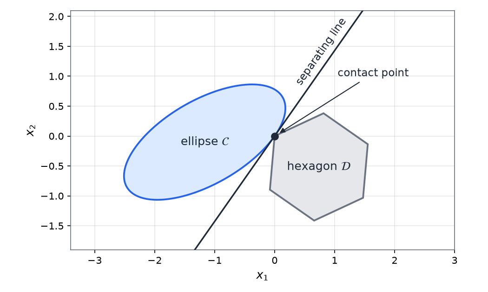

*Figure: an ellipse and a hexagon touching at a single boundary point; the line through the contact point still has one set on each side.*

**Theorem (Separating hyperplane theorem).** Nonempty convex sets \\(\mathcal C,\mathcal D\subseteq\mathbb R^N\\) can be properly separated by a hyperplane if and only if \\(\operatorname{relint}(\mathcal C)\cap\operatorname{relint}(\mathcal D) = \emptyset\\).

This general version (no closedness or boundedness, only disjoint relative interiors) is proved in Rockafellar's *Convex Analysis*, Theorem 11.3; we will not need its proof. A useful special case: if \\(\mathcal C\\) and \\(\mathcal D\\) are disjoint convex sets, there is \\(a\neq 0\\) and \\(t\\) with \\(\langle c,a\rangle\le t\le\langle d,a\rangle\\) on \\(\mathcal C\\) and \\(\mathcal D\\). This is the engine behind Lagrange duality and the existence of Lagrange multipliers ([Duality](duality.md)).

## Supporting Hyperplanes

**Definition.** Let \\(\mathcal C\\) be a set and \\(x\_0\\) a point of its boundary. If \\(a\neq 0\\) satisfies
\\[
\langle x,a\rangle\le\langle x\_0,a\rangle\quad\text{for all }x\in\mathcal C ,
\\]
then \\(\mathcal H = \\{x:\langle x,a\rangle = \langle x\_0,a\rangle\\}\\) is a **supporting hyperplane** to \\(\mathcal C\\) at \\(x\_0\\): it touches \\(\mathcal C\\) at \\(x\_0\\) and \\(\mathcal C\\) lies in the halfspace \\(\\{x:\langle x,a\rangle\le\langle x\_0,a\rangle\\}\\). It is **proper** if \\(\mathcal C\\) is not contained in \\(\mathcal H\\), i.e. \\(\langle y,a\rangle<\langle x\_0,a\rangle\\) for some \\(y\in\mathcal C\\). In normal-cone language, \\(a\\) defines a supporting hyperplane at \\(x\_0\\) iff \\(a\in N\_{\mathcal C}(x\_0)\setminus\\{0\\}\\).

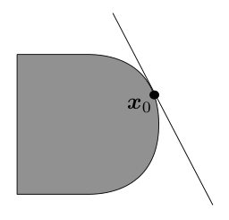

*Figure: a D-shaped convex set with a line tangent at a point x₀ on its curved side; the whole set lies on one side of the line.*

**Theorem (Supporting hyperplane theorem).** Let \\(\mathcal C\subseteq\mathbb R^N\\) be convex and \\(x\_0\in\mathcal C\\). There is a (proper) supporting hyperplane to \\(\mathcal C\\) at \\(x\_0\\) if and only if \\(x\_0\notin\operatorname{relint}(\mathcal C)\\).

*Proof sketch for closed \\(\mathcal C\\) with nonempty interior and \\(x\_0\\) on the boundary.* Choose points \\(x\_k\notin\mathcal C\\) with \\(x\_k\to x\_0\\) (possible since \\(x\_0\\) is a boundary point). Let \\(\hat x\_k = P\_{\mathcal C}(x\_k)\\) and \\(a\_k = (x\_k-\hat x\_k)/\lVert x\_k-\hat x\_k\rVert\_2\\). By the obtuseness principle, \\(\langle y,a\_k\rangle\le\langle\hat x\_k,a\_k\rangle\\) for all \\(y\in\mathcal C\\). The unit vectors \\(a\_k\\) have a convergent subsequence (Bolzano–Weierstrass), with limit \\(a\\), \\(\lVert a\rVert\_2 = 1\\); and \\(\hat x\_k\to x\_0\\) because projection is nonexpansive and \\(P\_{\mathcal C}(x\_0) = x\_0\\). Passing to the limit, \\(\langle y,a\rangle\le\langle x\_0,a\rangle\\) for all \\(y\in\mathcal C\\). (The general statement is Rockafellar, Theorem 11.6.) ∎

Supporting hyperplanes need not be unique. At a smooth boundary point there is exactly one (the tangent plane); at a corner there is a whole fan of them, one for each direction in the normal cone.

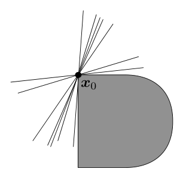

*Figure: the same D-shaped set with x₀ at the corner where the flat left side meets the curved top. A fan of lines through x₀ all support the set, one for each outward direction in the normal cone at the corner.*

**Example 2.9 (Closest point and supporting hyperplane).** For \\(x\_0\notin\mathcal C\\) (closed, convex), \\(\hat x\in\mathcal C\\) is the closest point to \\(x\_0\\) iff \\(\mathcal C\\) has a supporting hyperplane at \\(\hat x\\) with normal \\(x\_0-\hat x\\). Indeed, the obtuseness condition \\(\langle x-\hat x,\ x\_0-\hat x\rangle\le 0\\) for all \\(x\in\mathcal C\\) is the same as \\(\langle x,\ x\_0-\hat x\rangle\le\langle\hat x,\ x\_0-\hat x\rangle\\) for all \\(x\in\mathcal C\\), which is precisely the statement that the hyperplane through \\(\hat x\\) with normal \\(a = x\_0-\hat x\\) supports \\(\mathcal C\\).

**A consequence.** Every closed convex set is the intersection of all halfspaces that contain it. If \\(x\_0\notin\mathcal C\\), Example 2.8 provides a halfspace containing \\(\mathcal C\\) but not \\(x\_0\\). This "outer" description of convex sets by halfspaces is dual to the "inner" description by convex combinations, and it underlies conjugate functions and duality.

## Summary

- \\(\mathcal C\\) is convex if it contains every segment between its points; affine sets contain whole lines; cones are closed under nonnegative scaling, convex cones under nonnegative combinations.
- Standard convex sets: subspaces, affine sets \\(\\{Ax = b\\}\\), halfspaces, polyhedra \\(\\{Ax\le b\\}\\), norm balls, ellipsoids, the PSD cone \\(\mathbb S^N\_+\\), second-order cones.
- Proper cones (convex, closed, solid, pointed) define generalized inequalities \\(x\preceq\_Ky\iff y-x\in K\\); the Loewner order on \\(\mathbb S^N\\) is the key example.
- Convexity is preserved by intersections and by affine images and preimages; not by unions.
- Hyperplane \\(\\{\langle x,a\rangle = t\\}\\); distance \\(\lvert t-a^{T}x\_0\rvert/\lVert a\rVert\_2\\).
- Projection onto a nonempty closed convex set exists and is unique; \\(\hat x = P\_{\mathcal C}(x\_0)\iff\langle y-\hat x,x\_0-\hat x\rangle\le 0\ \forall y\in\mathcal C\iff x\_0-\hat x\in N\_{\mathcal C}(\hat x)\\). For subspaces this is the orthogonality principle, with projector \\(V(V^{T}V)^{-1}V^{T}\\). Projection is nonexpansive.
- Disjoint closed convex sets, one bounded, can be strongly separated (normal \\(a = d-c\\) from the closest pair); in general, convex sets with disjoint relative interiors can be properly separated.
- A convex set has a supporting hyperplane at every point outside its relative interior; it is unique at smooth points and forms a fan at corners.

## See Also

- [Convex Optimization Problems and Modeling](modeling.md): where these sets appear as constraints.
- [Convex Functions](convex-functions.md): epigraphs and sublevel sets connect functions to sets.
- [Constrained Optimality](constrained-optimality.md) and [Duality](duality.md): normal cones and separation in action.
- [Constrained Algorithms](constrained-algorithms.md): projected gradient descent.
- [Vector Spaces](../../../math/linear-algebra/vector-spaces.md) and [Matrices](../../../math/linear-algebra/matrices.md): subspaces, null spaces and projectors.
- [Convex Optimization (overview)](../convex.md).
