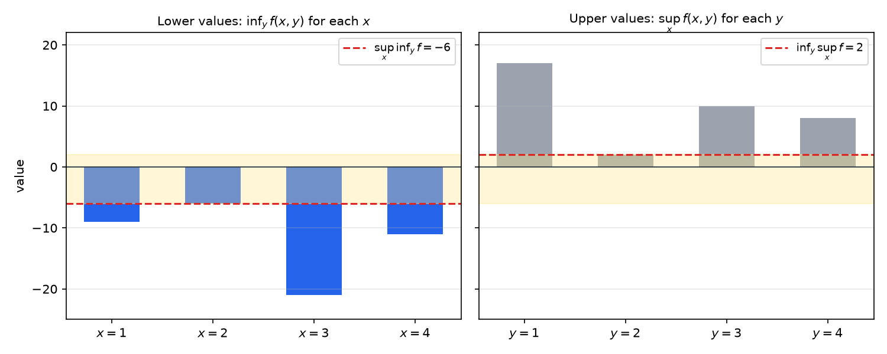
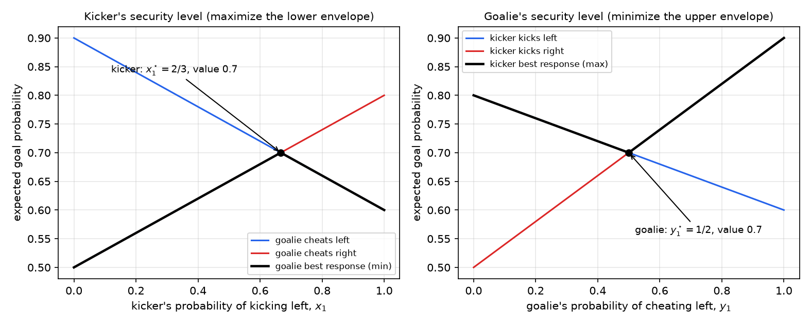
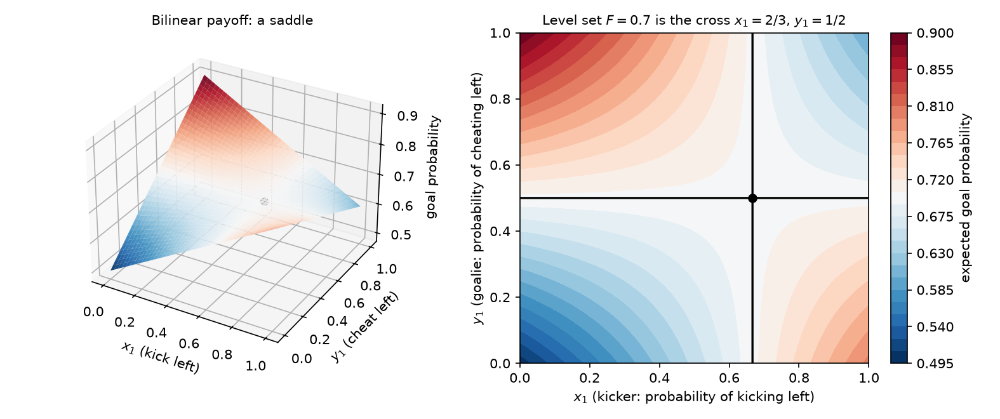

# Minimax Problems and Matrix Games

Many problems have the form \\(\min\_x\max\_y f(x,y)\\): a designer chooses \\(x\\) to limit the damage done by an adversary who chooses \\(y\\) to maximize it. Robust design, worst-case estimation, game theory and the Lagrangian of a constrained problem all lead to such saddle structures. The order of the two operations matters, and the difference is measured by a fundamental inequality. This chapter studies the simplest and most important case, the zero-sum matrix game, in which the payoff is bilinear. We prove the max–min inequality, von Neumann's minimax theorem, and show that the equilibrium of a matrix game can be computed by linear programming. The chapter sits between the [duality](duality.md) theory of constrained problems and the [linear programs](modeling.md) of the modeling chapter, and it is the static core of the dynamic games studied in [Dynamic and Differential Games](../../../eng/control/optimal-learning/games.md).

## Zero-Sum Matrix Games

### Players, Strategies and Payoffs

Two players choose actions simultaneously. Player 1 (P1) chooses an action \\(n\in\\{1,\dots,N\\}\\) and Player 2 (P2) chooses \\(m\in\\{1,\dots,M\\}\\). If the pair \\((m,n)\\) is played, P1 receives \\(G\_{m,n}\\) and P2 receives \\(-G\_{m,n}\\), where \\(G\\) is an \\(M\times N\\) payoff matrix. The game is **zero-sum**: what one player gains, the other loses. P1 wants the payoff large, and P2 wants it small. Rows of \\(G\\) are indexed by P2's actions and columns by P1's.

A **mixed strategy** is a probability distribution over actions, and the actions are drawn independently from it in each round. Let \\(\Delta\_N=\\{x\in\mathbb{R}^N:\mathbf{1}^{T}x=1,\ x\ge0\\}\\) be the probability simplex. If P1 uses \\(x\in\Delta\_N\\) and P2 uses \\(y\in\Delta\_M\\), then the expected payoff to P1 is
\\[
\mathbb{E}[\text{payoff}]=\sum\_{m,n}y\_m G\_{m,n}x\_n=y^{T}Gx .
\\]
P1 chooses \\(x\\) to maximize this, and P2 chooses \\(y\\) to minimize it. Pure strategies are the vertices \\(e\_n\\) and \\(e\_m\\) of the simplices.

**Example 15.1 (Rock–paper–scissors).** Let P1 and P2 each choose rock, paper or scissors, and let the payoff to P1 be \\(+1\\) for a win, \\(-1\\) for a loss and \\(0\\) for a tie. With the order rock, paper, scissors,
\\[
G=\begin{bmatrix} 0 & 1 & -1\\\\ -1 & 0 & 1\\\\ 1 & -1 & 0\end{bmatrix}.
\\]
Entry \\((m,n)\\) is the payoff when P2 plays row \\(m\\) and P1 plays column \\(n\\). For example, paper \\((m=2)\\) against rock \\((n=1)\\) gives \\(G\_{2,1}=-1\\), since paper beats rock for P2.

**Example 15.2 (Penalty kicks).** A kicker (P1) chooses left or right, and a goalie (P2) guesses which way to cheat. The entries are the probabilities of a goal:
\\[
G=\begin{bmatrix} 0.6 & 0.9\\\\ 0.8 & 0.5\end{bmatrix}.
\\]
Row \\(m=1\\) is the goalie cheating left and row \\(m=2\\) is cheating right. Column \\(n=1\\) is the kicker kicking left and column \\(n=2\\) is kicking right. If the goalie cheats left and the kicker kicks right, the goal probability is \\(0.9\\), and if both go left, it is \\(0.6\\). A goalie who cheats the side the kicker chooses reduces the goal probability.

### Pure Strategies Are Not Enough

A natural first idea is for each player to choose one action and stick to it. The example below shows that this fails, and that mixed strategies are needed.

Consider the penalty kick game and suppose the kicker always kicks left, so \\(x=e\_1\\). The goalie then chooses the row minimizing \\((Gx)\_m\\), which is the first column \\((0.6,0.8)\\). The goalie cheats left and holds the kicker to \\(0.6\\). If the kicker always kicks right, the goalie's best reply is the second column \\((0.9,0.5)\\), which gives \\(0.5\\). So the best pure strategy guarantees only \\(0.6\\).

The rock–paper–scissors game is worse. For each pure strategy \\(e\_n\\), some column of \\(G\\) contains a \\(-1\\), so the guaranteed payoff is \\(-1\\). The uniform mixed strategy \\(x=(\tfrac13,\tfrac13,\tfrac13)\\) gives \\(Gx=(0,0,0)\\), so it guarantees \\(0\\).

Both examples show that a player who always plays the same action can be exploited by an opponent who observes the pattern. Randomization removes the pattern, and in the penalty kick game it raises the guaranteed payoff from \\(0.6\\) to \\(0.7\\). We return to these examples after developing the theory.

## Best Responses and Revealed Strategies

Suppose P1 commits to a mixed strategy \\(x\\), and P2 knows it and best responds. P2 chooses \\(y\in\Delta\_M\\) to minimize \\(y^{T}(Gx)\\). The following lemma shows that the best response is always a pure strategy, up to ties.

**Lemma (linear minimization over the simplex).** For any \\(g\in\mathbb{R}^M\\),
\\[
\min\_{y\in\Delta\_M}y^{T}g=\min\_{m}g\_m .
\\]
The minimum is attained at a vertex \\(e\_{m^\star}\\), where \\(m^\star\\) is an index of the smallest entry of \\(g\\).

*Proof.* For \\(y\in\Delta\_M\\), \\(y^{T}g=\sum\_m y\_mg\_m\ge(\min\_m g\_m)\sum\_m y\_m=\min\_m g\_m\\), with equality when \\(y\\) puts all its mass on a minimizing index. ∎

So P2's best response to a known \\(x\\) is deterministic, namely the goalie's cheat side with the smaller goal probability. Symmetrically, P1's best response to a known \\(y\\) is a column of largest \\(\sum\_m G\_{m,n}y\_m\\). Ties can make the best response non-unique, and then P2 may spread its probability over all minimizing rows.

If P1's strategy is revealed before P2 chooses, P1 selects \\(x\\) to maximize its guaranteed payoff:
\\[
v\_1=\max\_{x\in\Delta\_N}\ \min\_{y\in\Delta\_M}y^{T}Gx . \tag{1}
\\]
If instead P2's strategy is revealed first, P2 selects \\(y\\) to minimize the best payoff available to P1:
\\[
v\_2=\min\_{y\in\Delta\_M}\ \max\_{x\in\Delta\_N}y^{T}Gx . \tag{2}
\\]
Knowing the opponent's strategy can only help the player who knows it, so one expects \\(v\_1\le v\_2\\). The max–min inequality makes this precise, and the minimax theorem shows that equality holds for matrix games.

## The Max–Min Inequality

The inequality below holds for any function of two variables, with no convexity or compactness. It is the basic weak-duality statement of saddle-point theory.

**Theorem (max–min inequality).** Let \\(X\\) and \\(Y\\) be arbitrary sets and \\(f:X\times Y\to\mathbb{R}\\). Then
\\[
\sup\_{x\in X}\inf\_{y\in Y}f(x,y)\ \le\ \inf\_{y\in Y}\sup\_{x\in X}f(x,y).
\\]
(The supremum and infimum are used because they need not be attained.)

*Proof.* Let \\(m(x)=\inf\_{y\in Y}f(x,y)\\). For every \\(x\\) and every \\(y\\), \\(m(x)\le f(x,y)\\). Taking the supremum over \\(x\\) on the right, \\(\sup\_x m(x)\le\sup\_x f(x,y)\\) for every \\(y\\). Hence \\(\sup\_x m(x)\\) is a lower bound for \\(\sup\_xf(x,y)\\) over all \\(y\\), and so it is at most their infimum. ∎

**Example 15.3 (A gap).** Let \\(f(x,y)\\) be given by the table below, with rows \\(y=1,\dots,4\\) and columns \\(x=1,\dots,4\\):
\\[
\begin{array}{c\|cccc} f & x=1 & x=2 & x=3 & x=4\\\\ \hline y=1 & 8 & 3 & 17 & 14\\\\ y=2 & -9 & -6 & 2 & -11\\\\ y=3 & 1 & 5 & -21 & 10\\\\ y=4 & -5 & 7 & 8 & -1\end{array}
\\]
The minima over \\(y\\) of each column are \\((-9,-6,-21,-11)\\), so \\(\sup\_x\inf\_y f=-6\\). The maxima over \\(x\\) of each row are \\((17,2,10,8)\\), so \\(\inf\_y\sup\_x f=2\\). The inequality holds with a gap of \\(8\\). No pair \\((x^\star,y^\star)\\) attains both the maximum and minimum, and the table has no saddle point. The figure below shows the two sets of values and the gap between them.



*Figure: left, the minimum over \\(y\\) of \\(f(x,y)\\) for each \\(x\\), whose largest value is \\(-6\\). Right, the maximum over \\(x\\) of \\(f(x,y)\\) for each \\(y\\), whose smallest value is \\(2\\). The shaded band between the two dashed lines is the gap that the max–min inequality allows. Games in which the gap closes, such as matrix games, are the subject of the minimax theorem.*

## Saddle Points and the Minimax Theorem

For a function \\(f:X\times Y\to\mathbb{R}\\), a point \\((x^\star,y^\star)\\) is a **saddle point** if
\\[
f(x,y^\star)\ \le\ f(x^\star,y^\star)\ \le\ f(x^\star,y)\qquad\text{for all }x\in X,\ y\in Y .
\\]
The first inequality says that P1 cannot gain by deviating from \\(x^\star\\), and the second says that P2 cannot gain by deviating from \\(y^\star\\).

**Proposition (saddle points and the max–min equality).** A point \\((x^\star,y^\star)\\) is a saddle point if and only if
\\[
\max\_{x}\inf\_{y}f(x,y)=\inf\_{y}\sup\_{x}f(x,y)=f(x^\star,y^\star),
\\]
with \\(x^\star\\) attaining the outer maximum and \\(y^\star\\) attaining the outer infimum.

*Proof.* Suppose \\((x^\star,y^\star)\\) is a saddle point. The right inequality gives \\(\inf\_yf(x^\star,y)=f(x^\star,y^\star)\\), so \\(\sup\_x\inf\_yf\ge f(x^\star,y^\star)\\). The left inequality gives \\(\sup\_xf(x,y^\star)=f(x^\star,y^\star)\\), so \\(\inf\_y\sup\_xf\le f(x^\star,y^\star)\\). The max–min inequality then forces equality. Conversely, if the two sides agree with value \\(v\\) and are attained at \\(x^\star\\) and \\(y^\star\\), then \\(f(x^\star,y)\ge\inf\_{y'}f(x^\star,y')=v\\) and \\(f(x,y^\star)\le\sup\_{x'}f(x',y^\star)=v\\), and \\(f(x^\star,y^\star)=v\\). ∎

The saddle point is the object of interest in a game. Each player's strategy is a best response to the other's, and no unilateral change helps.

**Theorem (minimax; von Neumann, Sion).** Let \\(X\subset\mathbb{R}^N\\) and \\(Y\subset\mathbb{R}^M\\) be nonempty, compact and convex, and let \\(f:X\times Y\to\mathbb{R}\\) be continuous, with \\(f(\cdot,y)\\) concave for each \\(y\\) and \\(f(x,\cdot)\\) convex for each \\(x\\). Then
\\[
\max\_{x\in X}\min\_{y\in Y}f(x,y)=\min\_{y\in Y}\max\_{x\in X}f(x,y).
\\]
Both extrema are attained, and the common value is the value of the game.

For bilinear payoffs \\(f(x,y)=y^{T}Gx\\), which is the matrix game case, the theorem is due to von Neumann (1928). The general form with concave–convex payoffs follows from Sion's minimax theorem (Sion, 1958), which relaxes the assumptions: only one of the two sets needs to be compact, and semicontinuity and quasi-concavity are enough. The statement above is the special case that is most used in practice.

**Example 15.4 (A Lagrangian saddle point).** Consider the convex program \\(\min\_x\\,x^2+1\\) subject to \\((x-2)(x-4)\le0\\), whose feasible set is \\([2,4]\\). Its Lagrangian is \\(L(x,\lambda)=x^2+1+\lambda(x-2)(x-4)\\) for \\(\lambda\ge0\\). For fixed \\(\lambda\\) it is convex in \\(x\\), and for fixed \\(x\\) it is affine in \\(\lambda\\). The point \\((x^\star,\lambda^\star)=(2,2)\\) is a saddle point:
- for fixed \\(\lambda=2\\), \\(L(x,2)=3x^2-12x+17\\) is minimized at \\(x=2\\) with value \\(5\\);
- for fixed \\(x=2\\), \\(L(2,\lambda)=5\\) for every \\(\lambda\\), because \\((2-2)(2-4)=0\\).

The dual function is \\(d(\lambda)=\min\_xL(x,\lambda)=(-\lambda^2+9\lambda+1)/(\lambda+1)\\), which is maximized at \\(\lambda=2\\) with \\(d(2)=5\\). So the minimax equality \\(\sup\_\lambda\inf\_xL=\inf\_x\sup\_\lambda L\\) holds with common value \\(5\\), which is the optimal value of the primal problem. In general, the Lagrangian of a convex program has this form, and strong duality is exactly the minimax equality for it. Slater's condition guarantees that equality; see [Lagrange and Fenchel Duality](duality.md).

## Matrix Games as Linear Programs

The minimax theorem for matrix games has a constructive proof through linear programming, and this gives a practical algorithm.

By the lemma above, for a fixed \\(x\\) the inner minimum over \\(y\\) equals \\(\min\_m(Gx)\_m\\). Therefore P1's maximin problem (1) becomes
\\[
\max\_{x\in\Delta\_N}\ \min\_{m}\\,(Gx)\_m .
\\]
Introducing a variable \\(z\\) for the minimum, this is the linear program
\\[
\max\_{x,\\,z}\ z\quad\text{subject to}\quad \sum\_{n}G\_{m,n}x\_n\ge z\ \ (m=1,\dots,M),\qquad \mathbf{1}^{T}x=1,\qquad x\ge0 . \tag{3}
\\]
Its variables are \\(x\\) and the scalar \\(z\\), and its constraints are linear. Problem (3) is a linear program in standard form.

Its dual can be derived from the Lagrangian. Attach multipliers \\(y\_m\ge0\\) to the constraints \\(\sum\_nG\_{m,n}x\_n-z\ge0\\), a free multiplier \\(w\\) to \\(\mathbf{1}^{T}x=1\\), and \\(u\_n\ge0\\) to \\(x\_n\ge0\\). Maximizing the Lagrangian over the free variable \\(z\\) requires \\(\sum\_my\_m=1\\), and maximizing over the free \\(x\\) requires \\((G^{T}y)\_n+u\_n-w=0\\), so \\(w\ge(G^{T}y)\_n\\) for each \\(n\\). The dual value is then \\(w\\), and the dual problem is
\\[
\min\_{y,\\,w}\ w\quad\text{subject to}\quad \sum\_mG\_{m,n}y\_m\le w\ \ (n=1,\dots,N),\qquad \mathbf{1}^{T}y=1,\qquad y\ge0 . \tag{4}
\\]
Problem (4) is the minimization problem for P2: it chooses the mixed strategy \\(y\\) that minimizes the largest of P1's expected payoffs \\((G^{T}y)\_n\\).

**Theorem (minimax for matrix games).** For every matrix \\(G\\),
\\[
\max\_{x\in\Delta\_N}\min\_{y\in\Delta\_M}y^{T}Gx=\min\_{y\in\Delta\_M}\max\_{x\in\Delta\_N}y^{T}Gx .
\\]
Both optimal strategies can be computed by linear programming.

*Proof.* The left side equals the optimal value of (3), and the right side equals the optimal value of (4), because a linear function over a simplex attains its maximum at a vertex. Problems (3) and (4) are dual to each other by the derivation above. Both are feasible: the uniform strategy is feasible for each, and taking \\(z\\) or \\(w\\) large enough makes the constraints hold. Both have bounded values, since the payoffs lie between \\(\min G\_{m,n}\\) and \\(\max G\_{m,n}\\). Linear programming strong duality then gives equality of the two optimal values. ∎

The proof also gives the optimal strategies. Solving (3) yields \\(x^\star\\), and solving (4) yields \\(y^\star\\). In code, with the standard solver from SciPy:

```python
import numpy as np
from scipy.optimize import linprog

def maximin_strategy(G):
    """Return the mixed strategy of the column player and the game value."""
    M, N = G.shape
    c = np.r_[np.zeros(N), -1.0]                        # maximize z
    A_ub = np.c_[-G, np.ones(M)]                        # z - (Gx)_m <= 0
    A_eq = np.r_[np.ones(N), 0.0][None, :]              # 1^T x = 1
    res = linprog(c, A_ub=A_ub, b_ub=np.zeros(M), A_eq=A_eq, b_eq=[1.0],
                  bounds=[(0, None)] * N + [(None, None)], method="highs")
    return res.x[:N], res.x[-1]

G = np.array([[0.6, 0.9], [0.8, 0.5]])
x_star, value = maximin_strategy(G)                     # x* = (2/3, 1/3), value 0.7
```

Applying the same routine to \\(-G^{T}\\) yields P2's strategy, which is the minimax strategy for the original game. Linear programs are solvable in polynomial time, so the value and optimal strategies of any finite zero-sum game are computable efficiently.

## Solved Examples

### Rock–Paper–Scissors

For the matrix of Example 15.1, the uniform strategies \\(x^\star=y^\star=(\tfrac13,\tfrac13,\tfrac13)\\) are optimal, and the value is \\(0\\). Indeed \\(Gx^\star=0\\), so \\(\min\_y y^{T}Gx^\star=0\\). Similarly \\(G^{T}y^\star=0\\), so \\(\max\_x y^{\star T}Gx=0\\). Both players' security levels are \\(0\\). Every pure strategy gives the same expected payoff \\(0\\) against \\(y^\star\\), The uniform strategy is the unique maximin strategy. A strategy \\(x\\) guarantees \\(0\\) only if every entry of \\(Gx\\) is nonnegative, and since the entries of \\(Gx\\) sum to zero (every column of \\(G\\) sums to zero), they must all vanish, which forces \\(x\\) to be uniform.

### Penalty Kicks

For the matrix of Example 15.2, parameterize the mixed strategies as \\(x=(q,1-q)\\) for the kicker and \\(y=(p,1-p)\\) for the goalie, where \\(q\\) is the probability of kicking left and \\(p\\) is the probability of cheating left. Then
\\[
Gx=\big(0.9-0.3q,\ 0.5+0.3q\big),\qquad G^{T}y=\big(0.8-0.2p,\ 0.5+0.4p\big).
\\]
The kicker's guaranteed payoff is \\(\min\\{0.9-0.3q,\ 0.5+0.3q\\}\\). The two lines cross at \\(q=\tfrac23\\), where both equal \\(0.7\\). The minimum is increasing for \\(q<\tfrac23\\) and decreasing for \\(q>\tfrac23\\), so \\(q=\tfrac23\\) is the unique maximizer. Therefore \\(x^\star=(\tfrac23,\tfrac13)\\) is the unique maximin strategy.

The goalie's worst case is \\(\max\\{0.8-0.2p,\ 0.5+0.4p\\}\\). These lines cross at \\(p=\tfrac12\\), where both equal \\(0.7\\). The maximum is decreasing for \\(p<\tfrac12\\) and increasing for \\(p>\tfrac12\\), so \\(p=\tfrac12\\) is the unique minimizer, and \\(y^\star=(\tfrac12,\tfrac12)\\) is the unique minimax strategy. The value of the game is \\(0.7\\). Check directly: \\(y^{\star T}Gx^\star=\tfrac12(0.7)+\tfrac12(0.7)=0.7\\).

Pure strategies do worse. If the kicker kicks left with certainty, the goalie holds the payoff to \\(0.6\\), and if the kicker kicks right, to \\(0.5\\). The mixed strategy \\(x^\star\\) guarantees \\(0.7\\) against every goalie strategy.

Both envelopes are visible in the figure below. The left panel shows the kicker's guaranteed payoff as a function of \\(q\\), a tent-shaped curve with peak \\(0.7\\) at \\(q=\tfrac23\\). The right panel shows the goalie's worst case as a function of \\(p\\), a valley with bottom \\(0.7\\) at \\(p=\tfrac12\\).



*Figure: left, the expected goal probability when the goalie cheats left (blue) or right (red), as functions of the kicker's probability \\(x\_1\\) of kicking left. The black curve is the lower envelope, whose maximum \\(0.7\\) at \\(x\_1=\tfrac23\\) is the kicker's security level. Right, the expected goal probability when the kicker kicks left (blue) or right (red), as functions of the goalie's probability \\(y\_1\\) of cheating left. The black curve is the upper envelope, whose minimum \\(0.7\\) at \\(y\_1=\tfrac12\\) is the goalie's security level.*

The surface of the bilinear payoff shows the same structure in two dimensions. With \\(x\_1\\) the kicker's probability of kicking left and \\(y\_1\\) the goalie's probability of cheating left, the expected payoff is \\(F(x\_1,y\_1)=0.5+0.3x\_1+0.4y\_1-0.6x\_1y\_1\\). This can be rewritten as
\\[
F(x\_1,y\_1)=0.7-0.6\big(x\_1-\tfrac23\big)\big(y\_1-\tfrac12\big),
\\]
which shows the saddle directly: \\(F\\) is linear in each variable separately, and the level set \\(F=0.7\\) is the cross formed by the two lines \\(x\_1=\tfrac23\\) and \\(y\_1=\tfrac12\\).



*Figure: left, the bilinear payoff \\(F(x\_1,y\_1)\\) as a surface, which rises in one direction and falls in the other, the shape of a saddle. Right, the same function as a filled contour map. The level set \\(F=0.7\\) (black) is the cross through the saddle point \\((x\_1,y\_1)=(\tfrac23,\tfrac12)\\), along which the payoff is constant in one variable.*

## Equilibria, Mixed Strategies and Indifference

A saddle point of a matrix game is a pair of strategies from which neither player can profitably deviate, which is the definition of a Nash equilibrium for a zero-sum game. The value \\(v\\) is then the payoff at equilibrium, \\(v=y^{\star T}Gx^\star\\). The propositions below describe what equilibrium strategies look like, and they explain why randomization is essential.

**Proposition (equilibria are saddle points).** For a matrix game, \\((x^\star,y^\star)\\) is a Nash equilibrium if and only if it is a saddle point of \\(y^{T}Gx\\), and the value is the common value of (1) and (2).

*Proof.* Neither player can gain by deviating from a saddle point, which is exactly the saddle property. Conversely, a Nash equilibrium satisfies the saddle inequalities, because each player's deviation cannot raise its own payoff. The equality of the two max–min problems then follows from the proposition on saddle points above. ∎

**Proposition (indifference).** Let \\((x^\star,y^\star)\\) be a saddle point with value \\(v\\). Then \\((G^{T}y^\star)\_n=v\\) for every column \\(n\\) in the support of \\(x^\star\\), and \\((Gx^\star)\_m=v\\) for every row \\(m\\) in the support of \\(y^\star\\).

*Proof.* By the saddle property, \\(y^{\star T}Gx\le v\\) for every \\(x\in\Delta\_N\\), and taking \\(x=e\_n\\) gives \\((G^{T}y^\star)\_n\le v\\) for all \\(n\\). Now \\(v=y^{\star T}Gx^\star=\sum\_n x^\star\_n(G^{T}y^\star)\_n\\). Each term satisfies \\(x^\star\_n(G^{T}y^\star)\_n\le x^\star\_nv\\), and the terms sum to \\(v\\) because \\(\sum\_nx^\star\_n=1\\). Equality therefore holds term by term, which means \\((G^{T}y^\star)\_n=v\\) whenever \\(x^\star\_n>0\\). The second claim is symmetric. ∎

This is the mathematical content of the familiar observation that a randomizing player must be indifferent among the actions it randomizes over. If the kicker mixed over a column whose payoff against \\(y^\star\\) were below \\(v\\), the goalie could exploit it by choosing \\(y^\star\\) and the kicker would lose.

The penalty kick game illustrates a subtlety. Against the kicker's optimal \\(x^\star\\), we have \\(Gx^\star=(0.7,0.7)\\), so every goalie strategy yields \\(0.7\\). The goalie is indifferent among all of its strategies, and every \\(y\\) is a best response to \\(x^\star\\). Yet the goalie's own equilibrium strategy \\(y^\star=(\tfrac12,\tfrac12)\\) is the unique strategy that stops the kicker from exploiting the goalie. For every other \\(y\\), the kicker's best response to \\(y\\) yields more than \\(0.7\\). In general, best responses to known strategies are deterministic, while best responses to an equilibrium strategy are typically non-unique. The equilibrium is found by the other player's indifference, not by the first player's own preference.

## Example: \\(\ell\_1\\) Regression as a Minimax Problem

Minimax structure also appears in problems that are not games. The dual norm of Example 7.3 gives \\(\lVert v\rVert\_1=\max\_{\lVert y\rVert\_\infty\le1}y^{T}v\\), so robust regression with an absolute-error loss is a minimax problem:
\\[
\min\_x\lVert Ax-b\rVert\_1=\min\_x\ \max\_{\lVert y\rVert\_\infty\le1}\\,y^{T}(Ax-b).
\\]
The payoff \\(y^{T}(Ax-b)\\) is bilinear and the set \\(\\{\lVert y\rVert\_\infty\le1\\}\\) is compact, so the minimax theorem applies with the compact set on the maximizing side (Sion's theorem allows either side to be compact). The inner infimum over \\(x\\) is \\(-b^{T}y\\) when \\(A^{T}y=0\\) and \\(-\infty\\) otherwise. Hence
\\[
\min\_x\lVert Ax-b\rVert\_1=\max\Big\\{-b^{T}y:\ A^{T}y=0,\ \lVert y\rVert\_\infty\le1\Big\\}.
\\]
The right side is a linear program, the dual of the \\(\ell\_1\\) regression problem that appears in the modeling chapter. The minimax viewpoint explains the duality: the \\(\ell\_\infty\\) ball of multipliers is the dual unit ball of the \\(\ell\_1\\) loss.

## Summary

- **Matrix game.** P1 maximizes \\(y^{T}Gx\\) over \\(x\in\Delta\_N\\), and P2 minimizes it over \\(y\in\Delta\_M\\). Pure strategies can be exploited, and mixed strategies are needed.
- **Linear minimization over the simplex.** \\(\min\_{y\in\Delta}y^{T}g=\min\_m g\_m\\), attained at a vertex. Best responses to known strategies are pure.
- **Max–min inequality.** \\(\sup\_x\inf\_y f\le\inf\_y\sup\_x f\\) for any \\(f\\), with a possibly strict gap (Example 15.3).
- **Saddle points.** \\((x^\star,y^\star)\\) is a saddle point if and only if the two sides of the max–min inequality coincide and are attained there.
- **Minimax theorem.** For compact convex sets and a continuous concave–convex payoff, \\(\max\_x\min\_y f=\min\_y\max\_x f\\). For matrix games this is von Neumann's theorem, and in general it is Sion's theorem.
- **Linear programming.** The value of a matrix game is the optimal value of the LP (3), and its dual (4) gives the opponent's optimal strategy.
- **Equilibria.** Saddle points of matrix games are Nash equilibria. At an equilibrium, every pure strategy used with positive probability is a best response to the opponent's equilibrium strategy, which is the indifference principle.
- **Lagrangians.** A convex program's Lagrangian has a saddle point when strong duality holds, as in Example 15.4.

## See Also

- [Lagrange and Fenchel Duality](duality.md): the Lagrangian saddle point and strong duality, which are the minimax equality for convex programs.
- [Constrained Optimality and the KKT Conditions](constrained-optimality.md): the optimality conditions that characterize saddle points of the Lagrangian.
- [Convex Optimization Problems and Modeling](modeling.md): linear programming, and the LP formulations of \\(\ell\_1\\) regression.
- [Convex Relaxations](relaxations.md): semidefinite and linear relaxations, whose duals are minimax problems.
- [Dynamic and Differential Games](../../../eng/control/optimal-learning/games.md): the same zero-sum structure extended to dynamic games, with the static matrix game as the starting point.
- [Optimization](../convex.md): the overview of convex optimization in this book.
