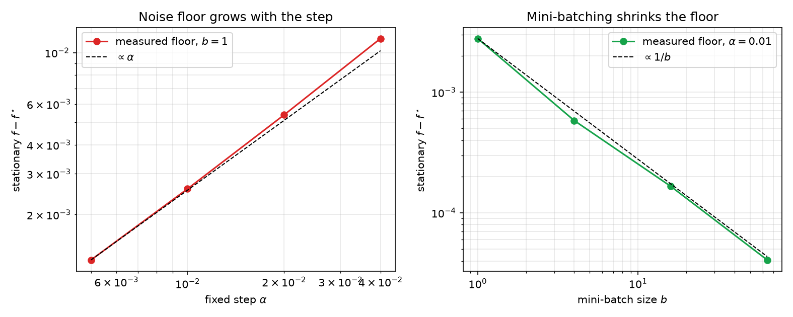
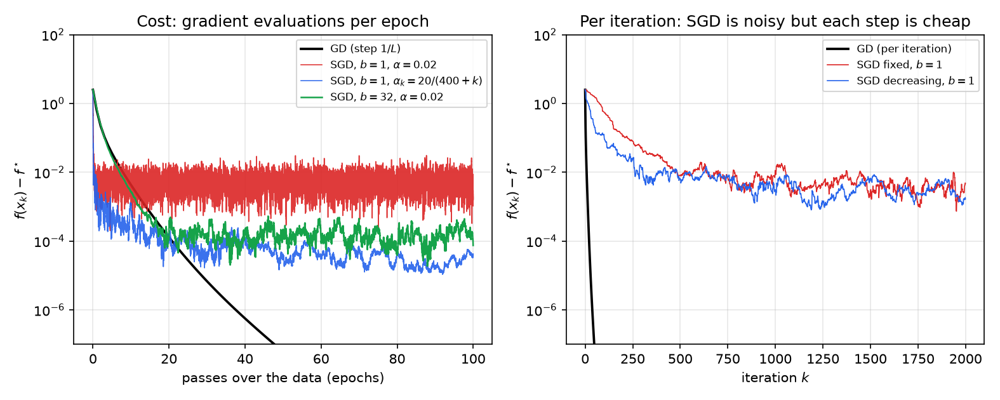
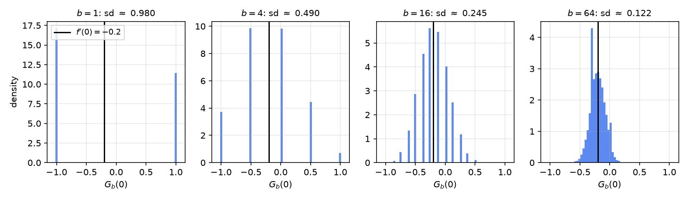
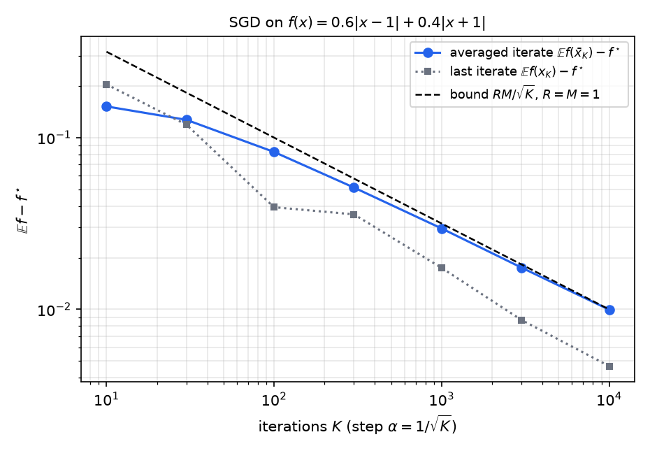

# Stochastic Gradient Methods

The gradient of an objective that is an average over many data points, or an expectation over random data, is often too expensive to compute exactly, and sometimes it cannot be computed at all. Stochastic gradient descent replaces the gradient by an unbiased random estimate, one data point or a small batch at a time. It is the workhorse of large-scale machine learning and of adaptive signal processing. This chapter proves what the randomness costs. With a constant step size the iterates reach only a noise floor whose height is proportional to the step. With decreasing steps the error decays like \\(1/k\\). For merely convex objectives, averaging the iterates gives \\(1/\sqrt k\\). The examples are empirical risk minimization, logistic regression and the least-mean-squares filter.

## Stochastic Gradients

### The stochastic oracle

Consider \\(\min\_x f(x)\\) where \\(f(x)=\mathbb{E}\\,F(x;\xi)\\) for a random variable \\(\xi\\). We cannot compute \\(f\\) or \\(\nabla f\\) exactly, but we can draw \\(\xi\\) and evaluate \\(\nabla F(x;\xi)\\). Under the usual regularity conditions that allow differentiation under the expectation, \\(\nabla f(x)=\mathbb{E}\\,\nabla F(x;\xi)\\). The random vector \\(G(x)=\nabla F(x;\xi)\\) is therefore an **unbiased stochastic gradient**:
\\[
\mathbb{E}\\,G(x)=\nabla f(x)\qquad\text{for all }x.
\\]
**Stochastic gradient descent** (SGD) is
\\[
x\_{k+1}=x\_k-\alpha\_k\\,G(x\_k;\xi\_k),
\\]
where \\(\xi\_0,\xi\_1,\dots\\) are independent draws. The stochastic direction \\(-G(x\_k;\xi\_k)\\) is random. In expectation it is a descent direction, since \\(\mathbb{E}\langle\nabla f(x),-G\rangle=-\lVert\nabla f(x)\rVert\_2^2<0\\) whenever \\(\nabla f(x)\ne0\\). For a particular realization it may point uphill, so SGD gives no monotone decrease of \\(f\\). Its analysis must therefore be probabilistic.

### Finite sums: empirical risk and minibatches

Many learning problems have the form
\\[
f(x)=\frac1M\sum\_{m=1}^M f\_m(x),
\\]
where \\(f\_m\\) is the loss on data point \\(m\\). The gradient \\(\nabla f=\frac1M\sum\_m\nabla f\_m\\) costs \\(M\\) gradient evaluations, which is expensive when \\(M\\) is large. A **minibatch** of size \\(b\\) draws a subset \\(\mathcal I\\subseteq\\{1,\dots,M\\}\\) of size \\(b\\) uniformly at random among all such subsets, and uses
\\[
G(x)=\frac1b\sum\_{i\in\mathcal I}\nabla f\_i(x).
\\]
This is unbiased. Each index belongs to \\(\mathcal I\\) with probability \\(b/M\\), so \\(\mathbb{E}\\,G(x)=\frac1b\cdot\frac bM\sum\_i\nabla f\_i(x)=\nabla f(x)\\).

The variance is governed by the spread of the individual gradients. Write \\(c\_i=\nabla f\_i(x)-\nabla f(x)\\), so that \\(\sum\_ic\_i=0\\) and \\(G(x)-\nabla f(x)=\frac1b\sum\_{i\in\mathcal I}c\_i\\).

**Proposition (Minibatch variance).** For a uniformly random minibatch without replacement,
\\[
\mathbb{E}\\,\lVert G(x)-\nabla f(x)\rVert\_2^2=\Bigl(1-\frac bM\Bigr)\frac1b\cdot\frac1{M-1}\sum\_{i=1}^M\lVert c\_i\rVert\_2^2 .
\\]

*Proof.* Expand the square: \\(\mathbb{E}\lVert\frac1b\sum\_{i\in\mathcal I}c\_i\rVert\_2^2=\frac1{b^2}\bigl[\sum\_i\Pr(i\in\mathcal I)\lVert c\_i\rVert\_2^2+\sum\_{i\ne j}\Pr(i,j\in\mathcal I)\langle c\_i,c\_j\rangle\bigr]\\). Here \\(\Pr(i\in\mathcal I)=b/M\\) and \\(\Pr(i,j\in\mathcal I)=\frac{b(b-1)}{M(M-1)}\\). Since \\(\sum\_{i\ne j}\langle c\_i,c\_j\rangle=\lVert\sum\_ic\_i\rVert\_2^2-\sum\_i\lVert c\_i\rVert\_2^2=-\sum\_i\lVert c\_i\rVert\_2^2\\), the bracket equals \\(\bigl(\frac bM-\frac{b(b-1)}{M(M-1)}\bigr)\sum\_i\lVert c\_i\rVert\_2^2=\frac{b(M-b)}{M(M-1)}\sum\_i\lVert c\_i\rVert\_2^2\\). Dividing by \\(b^2\\) gives the claim. ∎

The factor \\(1/b\\) shows that averaging over a minibatch reduces the variance; the factor \\(1-b/M\\) shows that sampling without replacement helps further, and at \\(b=M\\) the minibatch gradient is exact.

**Example 14.1 (Logistic regression).** Let \\(\tilde x\_i\in\mathbb{R}^{N+1}\\) be a data point \\(a\_i\\) with a constant appended, and let \\(y\_i\in\\{0,1\\}\\) be its label. Write \\(g(t)=1/(1+e^{-t})\\) and \\(t\_i=\tilde x\_i^{T}\theta\\). The negative log-likelihood of one point is
\\[
\ell\_i(\theta)=-y\_i\log g(t\_i)-(1-y\_i)\log(1-g(t\_i))=\log(1+e^{t\_i})-y\_it\_i ,
\\]
using \\(\log(1+e^{-t})=\log(1+e^t)-t\\). Its gradient and Hessian are
\\[
\nabla\ell\_i(\theta)=\bigl(g(t\_i)-y\_i\bigr)\tilde x\_i,\qquad \nabla^2\ell\_i(\theta)=g(t\_i)\bigl(1-g(t\_i)\bigr)\tilde x\_i\tilde x\_i^{T}\preceq\tfrac14\tilde x\_i\tilde x\_i^{T}.
\\]
The average \\(f=\frac1M\sum\_i\ell\_i\\) is convex and \\(L\\)-smooth with \\(L\le\frac14\lambda\_{\max}\bigl(\frac1M\sum\_i\tilde x\_i\tilde x\_i^{T}\bigr)\\). A minibatch gradient is \\(G(\theta)=\frac1b\sum\_{i\in\mathcal I}(g(\tilde x\_i^{T}\theta)-y\_i)\tilde x\_i\\), which is unbiased by the proposition above.

Strong convexity can fail. Along directions with \\(\tilde x\_i^{T}\theta\\) of large magnitude, the weights \\(g(1-g)\\) tend to zero, so the curvature vanishes. If the data are linearly separable, the loss can be driven toward zero by letting \\(\lVert\theta\rVert\_2\to\infty\\) along a separating direction, and no minimizer exists. Adding a penalty \\(\tfrac\lambda2\lVert\theta\rVert\_2^2\\) restores strong convexity. This is the setting of [Supervised Learning](../../ml/supervised.md) and [Regularization](../../ml/regularization.md).

### Online least squares and the LMS filter

Let \\(\mathbf a\\) be a random vector in \\(\mathbb{R}^N\\) and \\(Y\\) a random scalar. We seek a linear predictor minimizing \\(f(x)=\mathbb{E}\\,(Y-\mathbf a^{T}x)^2\\). Differentiating under the expectation, with \\(R=\mathbb{E}[\mathbf a\mathbf a^{T}]\\) and \\(r=\mathbb{E}[Y\mathbf a]\\),
\\[
\nabla f(x)=2\\,\mathbb{E}\bigl[\mathbf a\mathbf a^{T}x-Y\mathbf a\bigr]=2(Rx-r).
\\]
If \\(R\\) is known, gradient descent solves the problem with \\(x\_{k+1}=x\_k-\alpha(Rx\_k-r)\\) up to a rescaling of the step. In practice the statistics are unknown, and the expectation is replaced by a single sample \\((\mathbf a\_k,y\_k)\\). This gives the unbiased stochastic gradient \\(G(x)=\mathbf a\_k\mathbf a\_k^{T}x-y\_k\mathbf a\_k\\), and SGD becomes
\\[
x\_{k+1}=x\_k+\alpha\_k\bigl(y\_k-\mathbf a\_k^{T}x\_k\bigr)\mathbf a\_k .
\\]
This is the **least-mean-squares (LMS)** algorithm. It corrects the current prediction error in the direction of the input. It was introduced for adaptive filtering by Widrow and Hoff in 1960, and is one of the earliest applications of stochastic approximation.

**Example 14.2 (Adaptive noise cancellation).** A headphone microphone records the desired signal plus ambient noise that reaches the ear through an unknown filter. A second microphone records the ambient noise \\(\mathbf a\_k\\) (its most recent \\(N\\) samples). The LMS filter learns the filter that maps the reference noise to the noise in the signal, and subtracting its output from the microphone signal leaves the desired sound. Here \\(\mathbf a\_k\\) is the reference, \\(y\_k\\) the primary microphone, and the residual \\(y\_k-\mathbf a\_k^{T}x\_k\\) is the cleaned signal. The step \\(\alpha\\) trades speed of adaptation against the fluctuation of the weights. The analysis of the following sections applies once its assumptions are checked; for this problem (A4) holds with \\(\mu=\lambda\_{\min}(R)\\) when \\(R\\) is positive definite.

## Assumptions and a Basic Inequality

The analysis uses four assumptions.

- **(A1) Unbiasedness.** \\(\mathbb{E}\\,G(x)=\nabla f(x)\\) for every \\(x\\).
- **(A2) Independence.** The draws \\(\xi\_k\\) are independent of each other and of \\(x\_k\\).
- **(A3) Bounded variance.** There are constants \\(\sigma^2\ge0\\) and \\(\eta\ge1\\) with
\\[
\mathbb{E}\\,\lVert G(x)\rVert\_2^2\le\sigma^2+\eta\\,\lVert\nabla f(x)\rVert\_2^2 .\tag{3}
\\]
- **(A4) Smoothness and strong convexity.** \\(f\\) is \\(L\\)-smooth and \\(\mu\\)-strongly convex, with minimizer \\(x^\star\\) and optimal value \\(f^\star\\). In particular the Polyak–Łojasiewicz inequality holds:
\\[
2\mu\bigl(f(x)-f^\star\bigr)\le\lVert\nabla f(x)\rVert\_2^2\qquad\text{for all }x.\tag{4}
\\]

Inequality (3) splits the noise into two parts. The term \\(\sigma^2\\) is additive: it does not vanish at the solution, where \\(\nabla f=0\\) but the stochastic gradient is still random. The term \\(\eta\lVert\nabla f\rVert\_2^2\\) is multiplicative and decays as the iterates approach \\(x^\star\\). Since \\(\mathbb{E}\lVert G\rVert\_2^2=\mathbb{E}\lVert G-\nabla f\rVert\_2^2+\lVert\nabla f\rVert\_2^2\\) by (A1), a bound on the variance of \\(G\\) of the form \\(\sigma^2+(\eta-1)\lVert\nabla f\rVert\_2^2\\) implies (3).

**Lemma (One-step bound).** Under (A1)–(A4), with \\(\mathbb{E}\_k\\) denoting conditional expectation given \\(x\_k\\),
\\[
\mathbb{E}\_k\\,f(x\_{k+1})\le f(x\_k)-\alpha\_k\Bigl(1-\frac{\alpha\_k\eta L}{2}\Bigr)\lVert\nabla f(x\_k)\rVert\_2^2+\frac{\alpha\_k^2L}{2}\sigma^2 .\tag{5}
\\]

*Proof.* Smoothness gives \\(f(x\_{k+1})\le f(x\_k)+\langle\nabla f(x\_k),x\_{k+1}-x\_k\rangle+\tfrac L2\lVert x\_{k+1}-x\_k\rVert\_2^2\\), and \\(x\_{k+1}-x\_k=-\alpha\_kG\_k\\), so
\\[
f(x\_{k+1})\le f(x\_k)-\alpha\_k\langle\nabla f(x\_k),G\_k\rangle+\tfrac{L}{2}\alpha\_k^2\lVert G\_k\rVert\_2^2 .
\\]
Take \\(\mathbb{E}\_k\\). By (A1), \\(\mathbb{E}\_k\langle\nabla f(x\_k),G\_k\rangle=\lVert\nabla f(x\_k)\rVert\_2^2\\), and by (3), \\(\mathbb{E}\_k\lVert G\_k\rVert\_2^2\le\sigma^2+\eta\lVert\nabla f(x\_k)\rVert\_2^2\\). Substituting gives (5). ∎

Unlike the deterministic case, (5) does not guarantee a decrease in expectation: a small step makes the first term negative, but the noise term \\(\tfrac{\alpha\_k^2L}{2}\sigma^2\\) remains however small the gradient becomes.

## Constant Steps: Convergence to a Noise Floor

**Theorem (Constant step size).** Under (A1)–(A4), let \\(\alpha\_k=\alpha\le1/(\eta L)\\). Then for every \\(k\ge0\\),
\\[
\mathbb{E}\\,f(x\_k)-f^\star\le(1-\alpha\mu)^k\Bigl(f(x\_0)-f^\star-\frac{\alpha L\sigma^2}{2\mu}\Bigr)+\frac{\alpha L\sigma^2}{2\mu}.
\\]

*Proof.* Since \\(\alpha\eta L\le1\\), we have \\(1-\tfrac{\alpha\eta L}{2}\ge\tfrac12\\), so (5) gives \\(\mathbb{E}\_k f(x\_{k+1})-f(x\_k)\le-\tfrac\alpha2\lVert\nabla f(x\_k)\rVert\_2^2+\tfrac{\alpha^2L}{2}\sigma^2\\). By (4), \\(-\tfrac\alpha2\lVert\nabla f(x\_k)\rVert\_2^2\le-\alpha\mu(f(x\_k)-f^\star)\\). Subtracting \\(f^\star\\) and taking total expectations, \\(v\_k=\mathbb{E}f(x\_k)-f^\star\\) satisfies
\\[
v\_{k+1}\le(1-a)\\,v\_k+b,\qquad a=\alpha\mu,\quad b=\frac{\alpha^2L\sigma^2}{2}.
\\]
Here \\(0<a\le1\\), because \\(\alpha\le1/L\\) and \\(\mu\le L\\). Put \\(b/a=\alpha L\sigma^2/(2\mu)\\). Then \\(v\_{k+1}-b/a\le(1-a)(v\_k-b/a)\\), and iterating gives the claim. ∎

The bound has two parts. The transient term decays geometrically at rate \\(1-\alpha\mu\\), as in gradient descent but with the step divided by \\(\eta\\). The stationary term \\(\alpha L\sigma^2/(2\mu)\\) is a **noise floor**: the expected suboptimality does not converge to zero but stabilizes at a level proportional to the step size and to the noise. Halving the step halves the floor but also halves the contraction rate.

This trade-off has a useful consequence. To reach accuracy \\(\epsilon\\) in expectation, the floor requires \\(\alpha\le2\mu\epsilon/(L\sigma^2)\\), and then the transient needs roughly \\(1/(\alpha\mu)\\) iterations, that is, about \\(L\sigma^2/(2\mu^2\epsilon)\\) up to a logarithmic factor. Thus constant-step SGD needs \\(O(1/\epsilon)\\) iterations, against \\(O(\kappa\log(1/\epsilon))\\) for exact gradient descent. Each SGD iteration is far cheaper, which is why this trade is worthwhile in large-scale problems.

The figure below comes from a simulation on a least-squares problem and confirms the proportionality of the floor.

*Figure: simulated least squares with \\(M=2000\\) samples and \\(N=10\\) unknowns, averaged over the last \\(20\\%\\) of the iterations and three seeds. Left, the stationary suboptimality for \\(b=1\\) against the fixed step \\(\alpha\\) (red), with the dashed line \\(\propto\alpha\\). Right, the floor at \\(\alpha=0.01\\) against the minibatch size \\(b\\) (green), with the dashed line \\(\propto 1/b\\). The floor is driven by the noise variance, which scales as \\(1/b\\) for minibatches.*

**Minibatches and computation.** A minibatch of size \\(b\\) has noise about \\(\sigma^2/b\\), where \\(\sigma^2\\) is the per-sample noise level, by the proposition on minibatch variance. Its floor \\(\alpha L\sigma^2/(2\mu b)\\) is at most \\(\epsilon\\) when \\(\alpha\le2\mu b\epsilon/(L\sigma^2)\\). The transient then needs about \\(1/(\alpha\mu)\approx L\sigma^2/(2\mu^2 b\epsilon)\\) iterations, and each iteration costs \\(b\\) gradient evaluations. The total number of gradient evaluations, \\(b\\) times the number of iterations, is therefore about \\(L\sigma^2/(2\mu^2\epsilon)\\) up to a logarithmic factor, whatever \\(b\\) is. In this analysis minibatching does not reduce the total work needed for a given accuracy. Its benefit is that the work is done in larger blocks that parallelize well, with fewer sequential steps and less overhead per sample. The batch size is thus a question of hardware and of how the work is organized, not of the convergence bound.

## Decreasing Steps: An \\(O(1/k)\\) Rate

A constant step cannot drive the error to zero, but a decreasing step can, because the noise is averaged out over time while the step shrinks.

**Theorem (Decreasing steps).** Assume (A1)–(A4). Let \\(\alpha\_k=\beta/(\gamma+k)\\) with \\(\beta>1/\mu\\), \\(\gamma>0\\), and \\(\beta/\gamma\le1/(\eta L)\\). Then for every \\(k\ge0\\),
\\[
\mathbb{E}\\,f(x\_k)-f^\star\le\frac{\nu}{\gamma+k},\qquad\nu=\max\Bigl\\{\frac{\beta^2L\sigma^2}{2(\beta\mu-1)},\ \gamma\bigl(f(x\_0)-f^\star\bigr)\Bigr\\}.
\\]

*Proof.* Write \\(\hat k=k+\gamma\\) and \\(v\_k=\mathbb{E}f(x\_k)-f^\star\\). We use induction on \\(k\\). For \\(k=0\\), \\(v\_0=f(x\_0)-f^\star\le\nu/\gamma\\) by the second term in the maximum.

Suppose \\(v\_k\le\nu/\hat k\\). Since \\(\alpha\_k=\beta/\hat k\le\beta/\gamma\le1/(\eta L)\\), the argument of the previous theorem applies at step \\(k\\) with \\(a\_k=\mu\alpha\_k\\), and \\(1-\mu\alpha\_k\ge0\\) because \\(\mu\alpha\_k\le\mu/(\eta L)\le1\\). Hence
\\[
v\_{k+1}\le\Bigl(1-\frac{\mu\beta}{\hat k}\Bigr)\frac{\nu}{\hat k}+\frac{L\beta^2\sigma^2}{2\hat k^2}=\frac{(\hat k-1)\nu-(\beta\mu-1)\nu+\tfrac12L\beta^2\sigma^2}{\hat k^2}.
\\]
By the definition of \\(\nu\\), \\((\beta\mu-1)\nu\ge\tfrac12L\beta^2\sigma^2\\), so the numerator is at most \\((\hat k-1)\nu\\). Since \\((\hat k-1)(\hat k+1)\le\hat k^2\\), we get \\(v\_{k+1}\le(\hat k-1)\nu/\hat k^2\le\nu/(\hat k+1)\\), which is the claim at \\(k+1\\). ∎

The bound decays like \\(1/k\\). Reaching accuracy \\(\epsilon\\) therefore takes \\(O(1/\epsilon)\\) iterations, the same order as constant-step SGD, but without a floor: the error goes to zero. The choice \\(\beta>1/\mu\\) is needed for the constant \\(\nu\\) to be finite, and the constraint \\(\beta/\gamma\le1/(\eta L)\\) keeps the early steps small enough for the smoothness argument. The rate \\(1/k\\) does not depend on \\(\beta\\); the choice affects only \\(\nu\\), and \\(\beta=2/\mu\\) minimizes its first term.

The next figure compares the two regimes with gradient descent on the same least-squares problem as before.

*Figure: least-squares problem with \\(M=2000\\) samples and \\(N=10\\) unknowns. Left, suboptimality against the number of passes over the data: gradient descent with step \\(1/L\\) (black); SGD with \\(b=1\\) and fixed step \\(0.02\\) (red), which stalls near \\(10^{-2}\\); SGD with decreasing step \\(20/(400+k)\\) (blue), which reaches about \\(10^{-4}\\); and minibatch SGD with \\(b=32\\) (green). Right, the same methods per iteration. Per pass over the data, gradient descent is most accurate in this experiment; the advantage of SGD is that each step uses one sample or a small batch, so it does not need a full pass before it can move.*

### Step-size conditions

The schedule \\(\alpha\_k=\beta/(\gamma+k)\\) is an instance of the classical Robbins–Monro conditions,
\\[
\sum\_{k=0}^\infty\alpha\_k=\infty,\qquad\sum\_{k=0}^\infty\alpha\_k^2<\infty ,
\\]
introduced for stochastic approximation by Robbins and Monro (1951). The first condition says the steps can cover any distance to the solution, however far away the iterate starts. The second says the accumulated noise, which is governed by the sum of squared steps, stays finite. Both hold for \\(\alpha\_k=\beta/(\gamma+k)\\), because the harmonic series diverges while \\(\sum\_k1/k^2\\) converges. A constant step violates the second condition, and that is exactly why it leaves a floor. These conditions underlie almost-sure convergence results for SGD, which are stronger than the convergence in expectation proved above. Practical schedules such as warm-up followed by step decay lie outside the simple theory, but the decreasing-step theorem explains why a schedule that decays like \\(1/k\\) removes the floor.

## Minibatches and Variance: A Two-Point Example

The variance of the stochastic gradient, not only its expectation, determines how much the iterates fluctuate. A small example makes this concrete.

**Example 14.3 (A two-point model).** Let \\(Y\\) take the values \\(+1\\) and \\(-1\\), with \\(\Pr(Y=+1)=0.6\\). Consider
\\[
f(x)=\mathbb{E}\lvert x-Y\rvert=0.6\\,\lvert x-1\rvert+0.4\\,\lvert x+1\rvert .
\\]
The function is convex and piecewise linear. Its slope on \\((-1,1)\\) is \\(0.4-0.6=-0.2\\) and on \\((1,\infty)\\) it is \\(1\\), so the unique minimizer is \\(x^\star=1\\), the median of \\(Y\\), with \\(f^\star=0.8\\). The function is not differentiable at \\(x=\pm1\\), so it violates the smoothness assumption (A4), and the analysis of the previous sections does not apply directly. The stochastic oracle \\(G(x)=\operatorname{sign}(x-Y)\\) is an unbiased stochastic subgradient, since \\(\mathbb{E}\\,\operatorname{sign}(x-Y)=0.6\\,\operatorname{sign}(x-1)+0.4\\,\operatorname{sign}(x+1)\\) lies in the subdifferential of \\(f\\). Its values are \\(\pm1\\), so \\(\mathbb{E}\lVert G\rVert\_2^2=1\\).

At \\(x=0\\), a single sample gives \\(G=\pm1\\) with mean \\(f'(0)=-0.2\\) and standard deviation \\(\sqrt{1-0.04}\approx0.980\\). A minibatch of size \\(b\\) averages \\(b\\) such samples, so its standard deviation is about \\(0.980/\sqrt b\\). The figure shows the distributions of minibatch gradients for \\(b=1,4,16,64\\).

*Figure: histograms of \\(20000\\) minibatch gradients \\(G\_b(0)\\) at \\(x=0\\) for \\(b=1,4,16,64\\) in the two-point model of Example 14.3. The black line marks the true derivative \\(f'(0)=-0.2\\). Every histogram is centered at the same value, which illustrates unbiasedness, while the spread shrinks like \\(1/\sqrt b\\), which is the variance reduction of the proposition above.*

The numbers can be checked directly. The variance of a single sample at \\(x=0\\) is \\(1-0.2^2=0.96\\), and drawing the \\(b\\) samples of a minibatch independently gives variance \\(0.96/b\\). The standard deviations are therefore \\(0.980\\), \\(0.490\\), \\(0.245\\) and \\(0.122\\) for \\(b=1,4,16,64\\), which are the values in the panel titles. Multiplying the batch size by four halves the standard deviation, while the mean stays at \\(-0.2\\). An SGD step built from a minibatch of size \\(b\\) therefore has the same expected direction as one built from a single sample, with a fraction \\(1/b\\) of the variance.

## The Convex Case: Averaging and an \\(O(1/\sqrt k)\\) Rate

The previous sections assumed strong convexity and smoothness. Many useful objectives, such as absolute-value losses and hinge losses, are convex but not strongly convex and not smooth. For them the natural assumption is a bound on the second moment of the stochastic gradient, and the natural estimate is obtained by averaging the iterates.

Assume now that \\(f\\) is convex with minimizer \\(x^\star\\), and that the stochastic (sub)gradient satisfies \\(\mathbb{E}\\,G(x)\in\partial f(x)\\) and \\(\mathbb{E}\lVert G(x)\rVert\_2^2\le M^2\\) for all \\(x\\). Let \\(R=\lVert x\_0-x^\star\rVert\_2\\), and let \\(\bar x\_K=\frac1K\sum\_{k=0}^{K-1}x\_k\\) be the averaged iterate.

**Theorem (Averaged SGD).** Run SGD with a constant step \\(\alpha>0\\). Then
\\[
\mathbb{E}\\,f(\bar x\_K)-f^\star\le\frac{R^2}{2\alpha K}+\frac{\alpha M^2}{2}.
\\]
With the choice \\(\alpha=R/(M\sqrt K)\\), this gives \\(\mathbb{E}f(\bar x\_K)-f^\star\le RM/\sqrt K\\).

*Proof.* Let \\(\mathbb{E}\_k\\) condition on \\(x\_k\\), and write \\(g\_k=\mathbb{E}\_kG(x\_k)\in\partial f(x\_k)\\). Expanding the square,
\\[
\lVert x\_{k+1}-x^\star\rVert\_2^2=\lVert x\_k-x^\star\rVert\_2^2-2\alpha\langle G\_k,x\_k-x^\star\rangle+\alpha^2\lVert G\_k\rVert\_2^2 .
\\]
Taking \\(\mathbb{E}\_k\\) and using the subgradient inequality \\(\langle g\_k,x\_k-x^\star\rangle\ge f(x\_k)-f^\star\\) gives
\\[
\mathbb{E}\_k\lVert x\_{k+1}-x^\star\rVert\_2^2\le\lVert x\_k-x^\star\rVert\_2^2-2\alpha\bigl(f(x\_k)-f^\star\bigr)+\alpha^2M^2 .
\\]
Take total expectations and sum over \\(k=0,\dots,K-1\\). Summing over \\(k\\), the squared distances telescope, and dropping the nonnegative final term gives
\\[
2\alpha\sum\_{k=0}^{K-1}\bigl(\mathbb{E}f(x\_k)-f^\star\bigr)\le R^2+\alpha^2M^2K .
\\]
Divide by \\(2\alpha K\\). By convexity, \\(f(\bar x\_K)\le\frac1K\sum\_kf(x\_k)\\), so the average of the expected gaps bounds \\(\mathbb{E}f(\bar x\_K)-f^\star\\). The second statement follows by substituting \\(\alpha=R/(M\sqrt K)\\). ∎

The averaging step is essential to the proof: convexity turns the average of the gaps into the gap of the averaged point, which the last iterate does not enjoy directly.

**Example 14.4 (Averaged SGD on the two-point model).** In Example 14.3, \\(R=\lvert0-1\rvert=1\\) and \\(M=1\\). With \\(\alpha=1/\sqrt K\\) the theorem gives \\(\mathbb{E}f(\bar x\_K)-f^\star\le1/\sqrt K\\). The figure compares this bound with simulation, using \\(2000\\) independent runs for each horizon \\(K\\) and starting from \\(x\_0=0\\). The simulated gaps are \\(0.152\\), \\(0.0825\\), \\(0.0296\\) and \\(0.00996\\) at \\(K=10\\), \\(100\\), \\(1000\\) and \\(10^4\\), against the bounds \\(0.316\\), \\(0.100\\), \\(0.0316\\) and \\(0.0100\\). The bound holds at every horizon, and at large \\(K\\) it is nearly attained, so its constant cannot be improved for this example.

*Figure: expected suboptimality of the averaged iterate (blue) and of the last iterate (gray dotted), each averaged over \\(2000\\) runs of SGD with step \\(1/\sqrt K\\) on \\(f(x)=0.6\lvert x-1\rvert+0.4\lvert x+1\rvert\\), against the bound \\(RM/\sqrt K\\) with \\(R=M=1\\) (dashed). The log-log slope of the averaged iterate is close to \\(-1/2\\), and the bound is nearly tight at \\(K=10^4\\).*

The \\(1/\sqrt K\\) rate is the best possible in the worst case over convex functions with bounded stochastic subgradients, by classical lower bounds of Nemirovski and Yudin. Smoothness and strong convexity buy a faster rate: with decreasing steps the error decays like \\(1/k\\) in the theorem above, and accelerated stochastic methods can do better still (see Lan, 2020, for a comprehensive treatment).

## Summary

- **Unbiased stochastic gradient:** \\(\mathbb{E}\\,G(x)=\nabla f(x)\\); SGD is \\(x\_{k+1}=x\_k-\alpha\_kG(x\_k)\\), and in expectation each step is a descent step.
- **Minibatch:** averaging \\(b\\) sampled gradients keeps the mean and reduces the variance to \\((1-b/M)\\,\sigma\_{\text{pop}}^2/b\\), with \\(\sigma\_{\text{pop}}^2=\frac1{M-1}\sum\_i\lVert c\_i\rVert\_2^2\\).
- **One-step bound:** \\(\mathbb{E}\_kf(x\_{k+1})\le f(x\_k)-\alpha(1-\alpha\eta L/2)\lVert\nabla f(x\_k)\rVert\_2^2+\tfrac{\alpha^2L}{2}\sigma^2\\).
- **Constant step:** \\(\mathbb{E}f(x\_k)-f^\star\le(1-\alpha\mu)^k(f(x\_0)-f^\star-\tfrac{\alpha L\sigma^2}{2\mu})+\tfrac{\alpha L\sigma^2}{2\mu}\\), a noise floor proportional to \\(\alpha\\).
- **Decreasing step \\(\beta/(\gamma+k)\\):** \\(\mathbb{E}f(x\_k)-f^\star\le\nu/(\gamma+k)\\), so the noise is averaged out and the error goes to zero.
- **Convex case:** with constant step \\(\alpha\\) and averaged iterate, \\(\mathbb{E}f(\bar x\_K)-f^\star\le\frac{R^2}{2\alpha K}+\frac{\alpha M^2}{2}\\), which gives \\(RM/\sqrt K\\) with \\(\alpha=R/(M\sqrt K)\\).
- **Examples:** logistic regression (per-sample gradient \\((g(t\_i)-y\_i)\tilde x\_i\\)) and the LMS filter \\(x\_{k+1}=x\_k+\alpha(y\_k-\mathbf a\_k^{T}x\_k)\mathbf a\_k\\).

## See Also

- [Gradient Descent and Accelerated Methods](first-order-methods.md): the deterministic rates and the Polyak–Łojasiewicz inequality that the stochastic analysis extends.
- [Unconstrained Optimality and Line Search](unconstrained.md): the step-size rules, which SGD cannot use in the same way because the gradient is random.
- [Subgradients and Proximal Algorithms](nonsmooth.md): subgradients and the subgradient method, the deterministic counterpart of the convex case.
- [Convex Relaxations](relaxations.md) and [Minimax Problems and Matrix Games](minimax.md): other large-scale and modern methods covered in this subsection.
- [Supervised Learning](../../ml/supervised.md) and [Neural Networks](../../ml/neural-networks.md): empirical risk minimization, where minibatch SGD is the standard training method.
- [Expectation](../../../math/probability/expectation.md): the expectations and unbiasedness used throughout.
- Lan, *First-order and Stochastic Optimization Methods for Machine Learning* (Springer, 2020), and Bottou, Curtis and Nocedal, "Optimization methods for large-scale machine learning" (SIAM Review, 2018): the standard references for these results.
