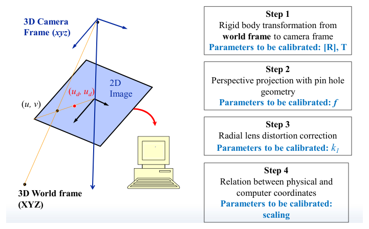
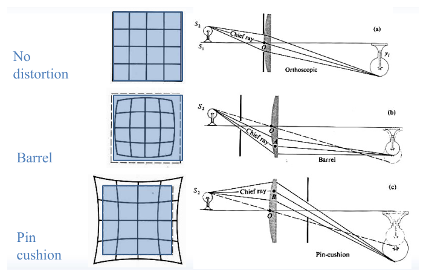
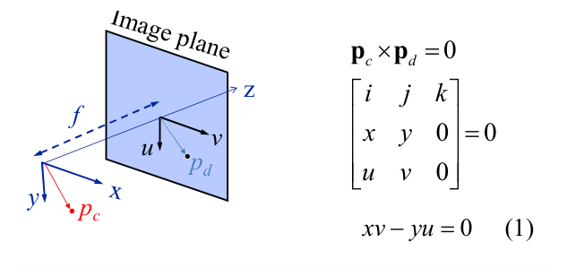
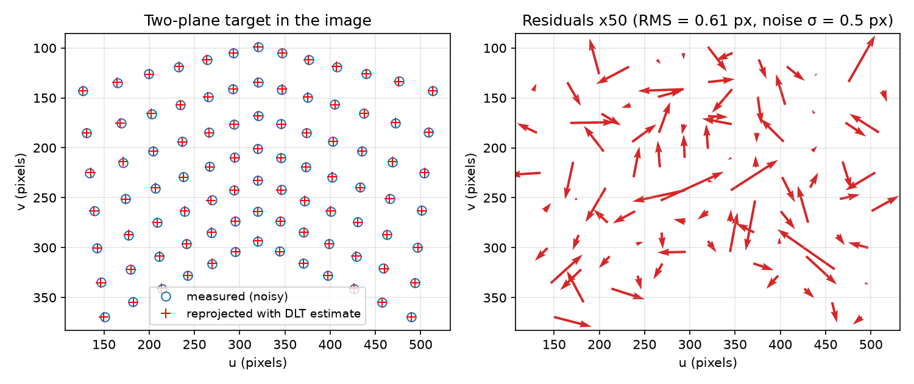
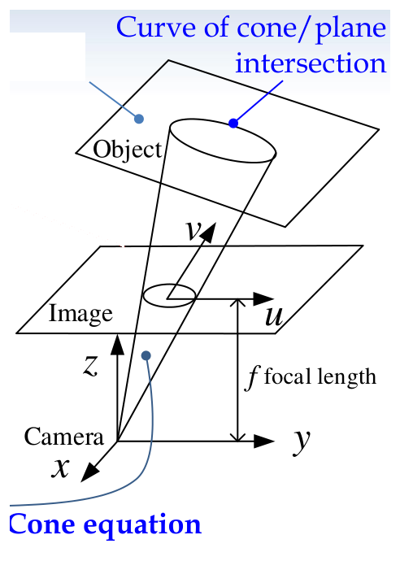
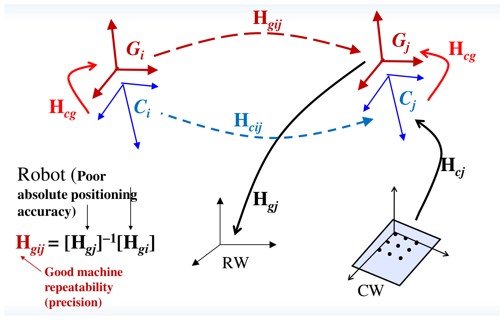

# Camera Calibration, Pose Estimation and Hand–Eye Calibration

A camera measures angles, not distances: every pixel is the image of a ray. To turn pixel coordinates into metric statements about the world (where a part lies on a conveyor, how far a robot gripper must move) we need the mathematical model that maps a 3-D point to a pixel, and the numerical values of its parameters. This chapter builds that model, shows how to estimate its parameters from a calibration target (Tsai's two-stage method, and the direct linear transformation), and then uses a calibrated camera to recover the pose of known objects from points, lines and circles. It ends with hand–eye calibration, which finds the fixed transformation between a camera and the robot gripper that carries it.

## Why Calibrate, and What

Camera calibration determines the parameters of the transformation between the 3-D scene a camera observes and the 2-D image it produces. Calibration is needed to

- recover quantitative 3-D measures of the scene from 2-D images;
- model and predict the accuracy of vision algorithms;
- locate the camera relative to a calibration board, usually the working plane of the application;
- provide the base for other calibrations: robot kinematics, hand–eye and general geometric calibration.

The parameters fall into two groups.

**Definition (intrinsic parameters).** The parameters fixed by the camera, lens and digitizer: the image centre (where the optical axis meets the sensor), the horizontal and vertical scale factors (pixel spacings), the principal distance or effective focal length \\(f\\), and the lens distortion coefficients.

**Definition (extrinsic parameters).** The pose of the camera relative to a world frame: a translation \\((T\_x, T\_y, T\_z)\\) and a rotation (three angles about \\(X, Y, Z\\)).

Four right-handed frames appear throughout: world coordinates \\((X, Y, Z)\\), camera coordinates \\((x, y, z)\\) with \\(z\\) along the optical axis, image-plane coordinates \\((u, v)\\) in physical units on the sensor, and frame (pixel) coordinates in the memory of the computer.

## The Camera Model

### Pinhole projection

The most elementary imaging device is the pinhole camera. A ray from an object point passes through the pinhole and strikes an image plane at distance \\(f\\) behind it, producing an inverted image. It is algebraically simpler to place a *virtual image plane* at distance \\(f\\) in front of the pinhole, where the image is upright; the geometry is identical up to sign. A real lens collects much more light than a pinhole, but for points in focus it obeys the same central projection with \\(f\\) the effective focal length (see [Image Formation and Acquisition](imaging.md) for the thin-lens equation and the blur circle).

### Tsai's four-step model

Tsai's camera model maps a world point to a pixel in four steps, each with its own parameters.



*Figure: the four steps of the Tsai camera model. A world point is moved into the camera frame by a rigid transformation (R, T), projected through the pinhole to the undistorted image point (u, v), displaced radially by lens distortion to (u_d, v_d), and finally scaled into pixel coordinates in the computer.*

**Step 1: rigid-body transformation (parameters \\(R, T\\)).** The camera coordinates of a world point are
\\[
\begin{bmatrix} x \\\\ y \\\\ z \end{bmatrix}
= \underbrace{\begin{bmatrix} r\_{11} & r\_{12} & r\_{13} \\\\ r\_{21} & r\_{22} & r\_{23} \\\\ r\_{31} & r\_{32} & r\_{33} \end{bmatrix}}\_{R}
\begin{bmatrix} X \\\\ Y \\\\ Z \end{bmatrix} + \underbrace{\begin{bmatrix} T\_x \\\\ T\_y \\\\ T\_z \end{bmatrix}}\_{T}.
\\]
\\(R\\) is orthonormal, \\(R^T = R^{-1}\\), \\(\det R = 1\\), so only three of its nine entries are independent. It is convenient to name its rows: \\(\alpha^T = [r\_{11}\ r\_{12}\ r\_{13}]\\), \\(\beta^T = [r\_{21}\ r\_{22}\ r\_{23}]\\), \\(\gamma^T = [r\_{31}\ r\_{32}\ r\_{33}]\\).

**Step 2: perspective projection (parameter \\(f\\)).** By similar triangles,
\\[
u = f\frac{x}{z}, \qquad v = f\frac{y}{z}.
\\]

**Step 3: radial lens distortion (parameter \\(k\_1\\)).** Real lenses bend rays passing near their edge more (or less) than an ideal lens. Under the *radial distortion assumption* the distorted image point \\((u\_d, v\_d)\\) lies on the same ray from the image centre as the ideal point \\((u, v)\\), only at a different distance:
\\[
\begin{bmatrix} u\_d \\\\ v\_d \end{bmatrix} = L(r)\begin{bmatrix} u \\\\ v \end{bmatrix}, \qquad L(r) = 1 + k\_1 r^2 + \cdots,
\\]
which, to first order and written with the measurable radius \\(r\_d^2 = u\_d^2 + v\_d^2\\), becomes
\\[
u\_d = u(1 + k\_1 r\_d^2), \qquad v\_d = v(1 + k\_1 r\_d^2).
\\]
The distortion components are \\(D\_x = u\_d - u\\) and \\(D\_y = v\_d - v\\). With \\(k\_1 < 0\\) points are pulled toward the centre (barrel distortion); with \\(k\_1 > 0\\) they are pushed outward (pin-cushion distortion). Straight lines that do not pass through the centre then image as curves.



*Figure: radial distortion. A square grid images as a square grid through an orthoscopic lens (top), bulges outward under barrel distortion (middle) and is pinched under pin-cushion distortion (bottom). The ray diagrams show how the position of the aperture stop relative to the lens changes the path of the chief ray.*

Two algebraic forms are in use. Tsai's original paper writes the correction as \\(u = u\_d(1 + \kappa\_1 r\_d^2)\\). The form used in this chapter inverts the forward model,
\\[
u = \frac{u\_d}{1 + k\_1 r\_d^2}, \qquad v = \frac{v\_d}{1 + k\_1 r\_d^2},
\\]
because, as shown below, it keeps the second calibration stage linear.

**Step 4: physical to pixel coordinates (scaling parameters).** A sensor has \\(N\_{cx} \times N\_{cy}\\) elements with spacings \\(d\_x, d\_y\\) and centre \\((C\_x, C\_y)\\). If a cropped window with top-left element \\((w\_x, w\_y)\\) is read out and \\((u'\_d, v'\_d)\\) are pixel coordinates inside it,
\\[
u\_d = (w\_x + u'\_d - C\_x)\\,d\_x, \qquad v\_d = (w\_y + v'\_d - C\_y)\\,d\_y .
\\]
When a frame grabber resamples each line into \\(N\_{fx} \times N\_{fy}\\) pixels, the effective spacings become
\\[
d'\_x = \frac{N\_{cx}}{N\_{fx}}d\_x, \qquad d'\_y = \frac{N\_{cy}}{N\_{fy}}d\_y .
\\]

**Example 7.1 (Pixel scaling for an analogue CCD camera).** A 2/3-inch progressive-scan interline-transfer CCD camera has \\(768 \times 484\\) cells of size \\(11.6\ \mu\text{m} \times 13.6\ \mu\text{m}\\) and outputs an NTSC signal (525 lines, 30 Hz) that a frame grabber digitizes to \\(512 \times 512\\) pixels. Then \\(C\_x = 768/2 = 384\\), \\(C\_y = 484/2 = 242\\) sensor elements, and
\\[
d'\_x = 11.6\left(\frac{768}{512}\right) = 17.4\ \mu\text{m}, \qquad d'\_y = 13.6\left(\frac{484}{512}\right) = 12.86\ \mu\text{m}.
\\]
For a full-frame image the centre is taken at the computer-image centre \\(C\_{fx} = C\_{fy} = 256\\), so a dot centroid found at pixel \\((U, V)\\) has physical image coordinates \\(u\_d = (U - 256)d'\_x\\), \\(v\_d = (V - 256)d'\_y\\). In MATLAB:

```matlab
Xd_phy = (Xd_pix(:,1) - Cfx) * dxp;
Yd_phy = (Xd_pix(:,2) - Cfy) * dyp;
```

### The matrix form

Ignoring distortion, steps 1, 2 and 4 are linear in homogeneous coordinates. With pixel size \\((s\_x, s\_y)\\) and image centre \\((o\_x, o\_y)\\) in pixels,
\\[
s\begin{bmatrix} x\_{im} \\\\ y\_{im} \\\\ 1 \end{bmatrix}
= \underbrace{\begin{bmatrix} 1/s\_x & 0 & o\_x \\\\ 0 & 1/s\_y & o\_y \\\\ 0 & 0 & 1 \end{bmatrix}
\begin{bmatrix} f & 0 & 0 & 0 \\\\ 0 & f & 0 & 0 \\\\ 0 & 0 & 1 & 0 \end{bmatrix}}\_{M\_{int}\ (3\times 4)}
\underbrace{\begin{bmatrix} R & T \\\\ 0 & 1 \end{bmatrix}}\_{M\_{ext}\ (4\times4)}
\begin{bmatrix} X \\\\ Y \\\\ Z \\\\ 1 \end{bmatrix}
= M\begin{bmatrix} X \\\\ Y \\\\ Z \\\\ 1 \end{bmatrix}.
\\]
The \\(3 \times 3\\) left part of \\(M\_{int}\\) is the *camera matrix* \\(K\\), so \\(M = K[R \mid T]\\). Allowing non-perpendicular pixel axes (skew angle \\(\theta\\)) gives the general form
\\[
K = \begin{bmatrix} f k\_u & -f k\_u\cot\theta & u\_0 \\\\ 0 & f k\_v/\sin\theta & v\_0 \\\\ 0 & 0 & 1 \end{bmatrix},
\\]
with \\(k\_u, k\_v\\) pixels per unit length. This \\(3 \times 4\\) projection matrix is the starting point for stereo (see [Stereo Vision and Depth Perception](stereo.md)).

## Tsai's Two-Stage Calibration

Calibration from a target means: given \\(n\\) points with known world coordinates \\((X\_i, Y\_i, Z\_i)\\) and measured image coordinates \\((u\_{di}, v\_{di})\\), find \\(R, T, f, k\_1\\). The full problem is nonlinear. Tsai's insight is that one geometric constraint, which does not involve \\(f\\), \\(T\_z\\) or \\(k\_1\\) at all, determines most of the extrinsic parameters by linear least squares; the rest then follow from a second linear problem.

The method has two stages.

- **Stage 1 (radial alignment constraint).** (1a) Solve for the five ratios \\(r\_{11}/T\_y\\), \\(r\_{12}/T\_y\\), \\(r\_{21}/T\_y\\), \\(r\_{22}/T\_y\\), \\(T\_x/T\_y\\). (1b) Find \\(T\_y\\). (1c) Recover \\(R\\), \\(T\_x\\), \\(T\_y\\).
- **Stage 2 (perspective constraint).** Given \\(R\\), \\(T\_x\\), \\(T\_y\\), solve for \\(f\\), \\(k\_1\\), \\(T\_z\\).

The following assumptions are used: (1) distortion is purely radial; (2) the sensor \\(uv\\) plane is parallel to the camera \\(xy\\) plane (the optical axis is perpendicular to the sensor); (3) the calibration target is planar and the world frame is attached to it, so \\(Z\_i = 0\\) for all points. Typical targets are a grid of circular dots, whose centroids are found by thresholding and labelling (see [Image Enhancement and Region Properties](image-enhancement.md)), or a checkerboard.

### The radial alignment constraint

Let \\(p\_c = (x, y, 0)\\) be the vector from the optical axis to the object point, measured in a plane perpendicular to the axis, and \\(p\_d = (u\_d, v\_d, 0)\\) the vector from the image centre to the observed image point.



*Figure: the radial alignment constraint. Under perspective projection the image vector p_d is parallel to the object vector p_c measured from the optical axis, and radial distortion changes only its length, never its direction.*

Perspective projection scales \\((x, y)\\) by \\(f/z\\), and radial distortion scales the result by \\(1 + k\_1 r\_d^2\\); neither changes direction. Hence \\(p\_c \parallel p\_d\\):
\\[
p\_c \times p\_d = \begin{vmatrix} i & j & k \\\\ x & y & 0 \\\\ u\_d & v\_d & 0 \end{vmatrix} = 0
\quad\Longrightarrow\quad x\\,v\_d - y\\,u\_d = 0 .
\\]
The constraint is independent of \\(f\\), \\(k\_1\\) and \\(T\_z\\), which is what makes Stage 1 linear.

### Stage 1a: five ratios by least squares

Substitute Step 1 with \\(Z\_i = 0\\):
\\[
(r\_{11}X\_i + r\_{12}Y\_i + T\_x)\\,v\_{di} - (r\_{21}X\_i + r\_{22}Y\_i + T\_y)\\,u\_{di} = 0 .
\\]
This is homogeneous in the six unknowns \\(r\_{11}, r\_{12}, r\_{21}, r\_{22}, T\_x, T\_y\\), so with six or more points its least-squares solution would be the trivial zero vector. Dividing by \\(T\_y\\) (which is nonzero as long as the target origin is not placed on the camera's \\(xz\\) plane) fixes the scale:
\\[
\left[X\_i\frac{r\_{11}}{T\_y} + Y\_i\frac{r\_{12}}{T\_y} + \frac{T\_x}{T\_y}\right]v\_{di} - \left[X\_i\frac{r\_{21}}{T\_y} + Y\_i\frac{r\_{22}}{T\_y} + 1\right]u\_{di} = 0 .
\\]
Stacking all points,
\\[
\underbrace{\begin{bmatrix}
X\_1 v\_{d1} & Y\_1 v\_{d1} & -X\_1 u\_{d1} & -Y\_1 u\_{d1} & v\_{d1} \\\\
\vdots & & & & \vdots \\\\
X\_n v\_{dn} & Y\_n v\_{dn} & -X\_n u\_{dn} & -Y\_n u\_{dn} & v\_{dn}
\end{bmatrix}}\_{A\ (n\times 5)}
\underbrace{\begin{bmatrix} r\_{11}/T\_y \\\\ r\_{12}/T\_y \\\\ r\_{21}/T\_y \\\\ r\_{22}/T\_y \\\\ T\_x/T\_y \end{bmatrix}}\_{\mu}
= \underbrace{\begin{bmatrix} u\_{d1} \\\\ \vdots \\\\ u\_{dn} \end{bmatrix}}\_{b},
\qquad \mu = A^{+}b,
\\]
where \\(A^{+} = (A^TA)^{-1}A^T\\) is the pseudo-inverse (see [Singular Value Decomposition](../../../math/linear-algebra/svd.md)). At least five points in general position are needed. Write \\(\mu\_1 = \mu\_{11} = r\_{11}/T\_y\\), \\(\mu\_2 = \mu\_{12} = r\_{12}/T\_y\\), \\(\mu\_3 = \mu\_{21} = r\_{21}/T\_y\\), \\(\mu\_4 = \mu\_{22} = r\_{22}/T\_y\\), \\(\mu\_5 = T\_x/T\_y\\).

### Stage 1b: \\(T\_y\\) from orthonormality

In terms of the ratios,
\\[
R = \begin{bmatrix} \mu\_{11}T\_y & \mu\_{12}T\_y & r\_{13} \\\\ \mu\_{21}T\_y & \mu\_{22}T\_y & r\_{23} \\\\ r\_{31} & r\_{32} & r\_{33} \end{bmatrix},
\qquad \alpha^T = [\mu\_{11}T\_y,\ \mu\_{12}T\_y,\ r\_{13}], \quad \beta^T = [\mu\_{21}T\_y,\ \mu\_{22}T\_y,\ r\_{23}],
\\]
and the third row is \\(\gamma = \alpha \times \beta\\):
\\[
r\_{31} = r\_{12}r\_{23} - r\_{13}r\_{22}, \qquad r\_{32} = r\_{13}r\_{21} - r\_{11}r\_{23}, \qquad r\_{33} = r\_{11}r\_{22} - r\_{12}r\_{21}.
\\]
The rows must be orthonormal:
\\[
\alpha\cdot\beta = 0:\ T\_y^2(\mu\_{11}\mu\_{21} + \mu\_{12}\mu\_{22}) + r\_{13}r\_{23} = 0,
\\]
\\[
\alpha\cdot\alpha = 1:\ r\_{13}^2 = 1 - T\_y^2(\mu\_{11}^2 + \mu\_{12}^2), \qquad
\beta\cdot\beta = 1:\ r\_{23}^2 = 1 - T\_y^2(\mu\_{21}^2 + \mu\_{22}^2).
\\]
To avoid the square roots in \\(r\_{13}\\) and \\(r\_{23}\\), square the first equation and substitute the other two:
\\[
T\_y^4(\mu\_{11}\mu\_{21} + \mu\_{12}\mu\_{22})^2 = r\_{13}^2r\_{23}^2 = \left[1 - T\_y^2(\mu\_{11}^2 + \mu\_{12}^2)\right]\left[1 - T\_y^2(\mu\_{21}^2 + \mu\_{22}^2)\right]
= 1 - T\_y^2U + T\_y^4(\mu\_{11}^2 + \mu\_{12}^2)(\mu\_{21}^2 + \mu\_{22}^2),
\\]
with \\(U = \mu\_1^2 + \mu\_2^2 + \mu\_3^2 + \mu\_4^2\\). Lagrange's identity, \\((\mu\_{11}^2 + \mu\_{12}^2)(\mu\_{21}^2 + \mu\_{22}^2) - (\mu\_{11}\mu\_{21} + \mu\_{12}\mu\_{22})^2 = (\mu\_{11}\mu\_{22} - \mu\_{12}\mu\_{21})^2\\), collapses this to a quadratic in \\(T\_y^2\\):
\\[
(\mu\_1\mu\_4 - \mu\_2\mu\_3)^2\\,T\_y^4 - U\\,T\_y^2 + 1 = 0 .
\\]
Therefore
\\[
\boxed{T\_y^2 = \begin{cases} \dfrac{1}{U}, & \mu\_1\mu\_4 = \mu\_2\mu\_3, \\\\[2mm] \dfrac{U - \left[U^2 - 4(\mu\_1\mu\_4 - \mu\_2\mu\_3)^2\right]^{1/2}}{2(\mu\_1\mu\_4 - \mu\_2\mu\_3)^2}, & \text{otherwise.} \end{cases}}
\\]
Only the root with the minus sign is admissible. The product of the two roots is \\(1/(\mu\_1\mu\_4 - \mu\_2\mu\_3)^2\\), and Tsai shows that the larger root always makes \\(r\_{13}^2\\) or \\(r\_{23}^2\\) negative; the worked example below illustrates this.

**Sign of \\(T\_y\\).** Take \\(T\_y = +\sqrt{T\_y^2}\\), compute \\(r\_{ij} = \mu\_{ij}T\_y\\) and \\(T\_x = \mu\_5T\_y\\), and pick a calibration point \\((X\_0, Y\_0, 0)\\) far from the image centre. Since \\(z > 0\\) and \\(f > 0\\), the image point must lie in the same quadrant as \\((x, y)\\):
\\[
\xi\_x = r\_{11}X\_0 + r\_{12}Y\_0 + T\_x, \qquad \xi\_y = r\_{21}X\_0 + r\_{22}Y\_0 + T\_y .
\\]
If \\(\text{sgn}(\xi\_x) = \text{sgn}(u\_{d0})\\) and \\(\text{sgn}(\xi\_y) = \text{sgn}(v\_{d0})\\), the sign is correct; otherwise set \\(T\_y \leftarrow -T\_y\\) and recompute \\(r\_{ij}\\) and \\(T\_x\\).

### Stage 1c: the rotation matrix

\\[
R = \begin{bmatrix} r\_{11} & r\_{12} & s\_1\sqrt{1 - r\_{11}^2 - r\_{12}^2} \\\\ r\_{21} & r\_{22} & s\_2\sqrt{1 - r\_{21}^2 - r\_{22}^2} \\\\ r\_{31} & r\_{32} & r\_{33} \end{bmatrix},
\\]
with signs \\(s\_1, s\_2 = \pm 1\\). The orthogonality condition \\(\alpha^T\beta = 0\\) reads
\\[
\underbrace{(r\_{11}r\_{21} + r\_{12}r\_{22})}\_{a} + s\_1s\_2\underbrace{\sqrt{1 - r\_{11}^2 - r\_{12}^2}\sqrt{1 - r\_{21}^2 - r\_{22}^2}}\_{b \ \ge 0} = 0,
\\]
so \\(a\\) and \\(s\_1s\_2b\\) must cancel. Choose \\(s\_1 = s\_2 = +1\\); if \\(a \le 0\\) keep them, otherwise set \\(s\_2 = -1\\). The third row follows from \\(\gamma = \alpha \times \beta\\). A residual ambiguity (flipping both \\(r\_{13}, r\_{23}\\) and the corresponding entries of \\(\gamma\\)) is resolved in Stage 2: if it returns \\(f < 0\\), flip the signs of \\(r\_{13}, r\_{23}, r\_{31}, r\_{32}\\) and solve Stage 2 again, since \\(f\\) and \\(T\_z\\) must be positive (the object is in front of the camera).

### Stage 2: \\(f\\), \\(k\_1\\), \\(T\_z\\) by the perspective constraint

With \\(Z\_i = 0\\),
\\[
\frac{x\_i}{z\_i} = \frac{r\_{11}X\_i + r\_{12}Y\_i + T\_x}{r\_{31}X\_i + r\_{32}Y\_i + T\_z},
\\]
and combining \\(u = fx/z\\) with \\(u = u\_d/(1 + k\_1r\_d^2)\\),
\\[
u\_{di} = f(1 + k\_1r\_{di}^2)\frac{r\_{11}X\_i + r\_{12}Y\_i + T\_x}{r\_{31}X\_i + r\_{32}Y\_i + T\_z}.
\\]
Let \\(x\_i = r\_{11}X\_i + r\_{12}Y\_i + T\_x\\), now known. Cross-multiplying,
\\[
u\_{di}(r\_{31}X\_i + r\_{32}Y\_i + T\_z) = x\_i f(1 + k\_1r\_{di}^2)
\;\Longrightarrow\;
x\_i f + x\_ir\_{di}^2(fk\_1) - u\_{di}T\_z = u\_{di}(r\_{31}X\_i + r\_{32}Y\_i),
\\]
which is linear in \\((f,\ fk\_1,\ T\_z)\\):
\\[
\underbrace{\begin{bmatrix} x\_1 & r\_{d1}^2x\_1 & -u\_{d1} \\\\ \vdots & \vdots & \vdots \\\\ x\_n & r\_{dn}^2x\_n & -u\_{dn} \end{bmatrix}}\_{A'}
\begin{bmatrix} f \\\\ fk\_1 \\\\ T\_z \end{bmatrix}
= \underbrace{\begin{bmatrix} (r\_{31}X\_1 + r\_{32}Y\_1)u\_{d1} \\\\ \vdots \\\\ (r\_{31}X\_n + r\_{32}Y\_n)u\_{dn} \end{bmatrix}}\_{b'},
\qquad x' = A'^{+}b' .
\\]
The same equations written with \\(y\_i\\) and \\(v\_{di}\\) may be appended. With Tsai's form \\(u = u\_d(1 + \kappa\_1r\_d^2)\\) the equation becomes \\(u\_{di}(r\_{31}X\_i + r\_{32}Y\_i + T\_z)(1 + \kappa\_1r\_{di}^2) = fx\_i\\), which contains the product \\(T\_z\kappa\_1\\) and is nonlinear in \\((T\_z, \kappa\_1, f)\\); Tsai solves it by first ignoring distortion and then refining iteratively. The modified model avoids this step.

### Worked examples

**Example 7.2 (Tsai calibration with five points).** Five coplanar points (cm) and their image coordinates, with no lens distortion:

| \\(i\\) | \\(X\\) | \\(Y\\) | \\(Z\\) | \\(u\\) | \\(v\\) |
|---|---|---|---|---|---|
| 1 | 0 | 5 | 0 | −0.58 | 0 |
| 2 | 10 | 7.5 | 0 | 1.73 | 1 |
| 3 | 10 | 5 | 0 | 1.73 | 0 |
| 4 | 5 | 10 | 0 | 0 | 1 |
| 5 | 5 | 0 | 0 | 0 | −1 |

Find \\(f\\), \\(R\\) and \\(T\\).

*Stage 1a.* Rows \\([v\_iX\_i,\ v\_iY\_i,\ -u\_iX\_i,\ -u\_iY\_i,\ v\_i]\\) and right-hand side \\(u\_i\\):
\\[
A = \begin{bmatrix} 0 & 0 & 0 & 2.9 & 0 \\\\ 10 & 7.5 & -17.3 & -12.975 & 1 \\\\ 0 & 0 & -17.3 & -8.65 & 0 \\\\ 5 & 10 & 0 & 0 & 1 \\\\ -5 & 0 & 0 & 0 & -1 \end{bmatrix},
\quad b = \begin{bmatrix} -0.58 \\\\ 1.73 \\\\ 1.73 \\\\ 0 \\\\ 0 \end{bmatrix},
\quad \mu = A^{+}b = \begin{bmatrix} -0.173 \\\\ 0 \\\\ 0 \\\\ -0.2 \\\\ 0.865 \end{bmatrix}.
\\]

*Stage 1b.* \\(U = 0.173^2 + 0.2^2 = 0.06993\\) and \\(\mu\_1\mu\_4 - \mu\_2\mu\_3 = 0.0346\\), so
\\[
T\_y^2 = \frac{0.06993 - \sqrt{0.06993^2 - 4(0.0346)^2}}{2(0.0346)^2} = \frac{0.06993 - 0.01007}{0.002394} = 25 .
\\]
(The other root, \\(33.4\\), would give \\(r\_{23}^2 = 1 - 33.4(0.04) < 0\\).) Try \\(T\_y = +5\\): \\(r\_{11} = -0.865\\), \\(r\_{12} = r\_{21} = 0\\), \\(r\_{22} = -1\\), \\(T\_x = 4.325\\). Check point 2, \\((10, 7.5)\\): \\(\xi\_x = -8.65 + 4.325 = -4.325\\), \\(\xi\_y = -7.5 + 5 = -2.5\\), both negative while \\((u, v) = (1.73, 1)\\) are positive. Hence \\(T\_y = -5\\), and recomputing: \\(r\_{11} = 0.865\\), \\(r\_{12} = r\_{21} = 0\\), \\(r\_{22} = 1\\), \\(T\_x = -4.325\\).

*Stage 1c.* With \\(s\_1 = s\_2 = +1\\): \\(r\_{13} = \sqrt{1 - 0.865^2} = 0.5018\\), \\(r\_{23} = \sqrt{1 - 0 - 1} = 0\\). The test quantity \\(r\_{11}r\_{21} + r\_{12}r\_{22} = 0\\) is non-positive, so the signs stand. Then \\(r\_{31} = r\_{12}r\_{23} - r\_{13}r\_{22} = -0.5018\\), \\(r\_{32} = r\_{13}r\_{21} - r\_{11}r\_{23} = 0\\), \\(r\_{33} = r\_{11}r\_{22} - r\_{12}r\_{21} = 0.865\\):
\\[
R = \begin{bmatrix} 0.865 & 0 & 0.5018 \\\\ 0 & 1 & 0 \\\\ -0.5018 & 0 & 0.865 \end{bmatrix},
\\]
a rotation of about \\(30^\circ\\) about the \\(y\\) axis.

*Stage 2* (\\(k\_1 = 0\\), unknowns \\(f, T\_z\\)). Here \\(x\_i = 0.865X\_i - 4.325 = (-4.325,\ 4.325,\ 4.325,\ 0,\ 0)\\) and \\(b'\_i = -0.5018X\_iu\_i = (0,\ -8.681,\ -8.681,\ 0,\ 0)\\). Least squares on rows \\([x\_i,\ -u\_i]\\) gives
\\[
f = 1.0123, \qquad T = \begin{bmatrix} -4.325 \\\\ -5 \\\\ 7.5484 \end{bmatrix}.
\\]
Reprojecting the five points with these values reproduces the given \\(u\\) exactly and \\(v\\) to within \\(0.005\\), the rounding of the data.

**Example 7.3 (Synthetic data and recalibration).** A "T" pattern of 20 points with \\(Z = 0\\) is viewed by a camera with \\(R = R\_x(120^\circ)\\), \\(T = [5,\ 3,\ 10]^T\\) and \\(f = 1\\). The point \\((0, 4, 0)\\) maps to camera coordinates \\(R\_x(120^\circ)(0, 4, 0)^T + T = (0, -2, 3.464) + (5, 3, 10) = (5,\ 1,\ 13.464)\\) and to the image point \\(u = 5/13.464 = 0.3714\\), \\(v = 1/13.464 = 0.0743\\). Running the two-stage algorithm on the 20 synthetic correspondences returns \\(f = 1.0000\\), \\(T = [5, 3, 10]^T\\) and
\\[
R = \begin{bmatrix} 1 & 0 & 0 \\\\ 0 & -0.5 & -0.866 \\\\ 0 & 0.866 & -0.5 \end{bmatrix} = R\_x(120^\circ).
\\]
A practical caution: when \\(T\_y^2(\mu\_{11}^2 + \mu\_{12}^2)\\) is very close to 1, round-off can make \\(1 - T\_y^2(\cdot)\\) slightly negative and \\(r\_{13}\\) complex. Clamp the radicand at zero (or round the image data sensibly) before taking the square root.

**Example 7.4 (Projection with radial distortion).** A camera has \\(R = \begin{bmatrix} 1 & 0 & 0 \\\\ 0 & \sqrt3/2 & -1/2 \\\\ 0 & 1/2 & \sqrt3/2 \end{bmatrix}\\), \\(T = [1, 2, 4]^T\\), \\(f = 2\\). Project the point \\((1, 3, 2)\\), and find \\(k\_1\\) if the observed point is \\(u\_d = 2u\\).

Camera coordinates: \\(x = 1 + 1 = 2\\), \\(y = 0.866(3) - 0.5(2) + 2 = 3.598\\), \\(z = 0.5(3) + 0.866(2) + 4 = 7.232\\). Ideal image point: \\(u = 2(2/7.232) = 0.553\\), \\(v = 2(3.598/7.232) = 0.995\\). Radial distortion scales both coordinates by the same factor, so \\(u\_d = 1.106\\), \\(v\_d = 1.989\\), \\(r\_d^2 = 1.106^2 + 1.989^2 = 5.182\\), and \\(1 + k\_1r\_d^2 = 2\\) gives \\(k\_1 = 1/5.182 = 0.193\\). The radial alignment constraint is satisfied: \\(xv\_d - yu\_d = 2(1.989) - 3.598(1.106) \approx 0\\).

**Example 7.5 (A reduced Stage 1).** Suppose all calibration points lie on the line \\(Y = 0\\) of the board and the ratio \\(\rho = T\_x/T\_y\\) is known. The radial alignment constraint becomes \\((r\_{11}X\_i + T\_x)v\_i - (r\_{21}X\_i + T\_y)u\_i = 0\\), or, dividing by \\(T\_y\\),
\\[
\begin{bmatrix} v\_iX\_i & -u\_iX\_i \end{bmatrix}\begin{bmatrix} \mu\_1 \\\\ \mu\_2 \end{bmatrix} = u\_i - \rho v\_i, \qquad \mu\_1 = \frac{r\_{11}}{T\_y},\ \mu\_2 = \frac{r\_{21}}{T\_y}.
\\]
With \\(\rho = 0.5\\) and two points the system is \\(\begin{bmatrix} -11.2 & -207.1 \\\\ -318.6 & -579 \end{bmatrix}\mu = \begin{bmatrix} 21.27 \\\\ 13.99 \end{bmatrix}\\), giving \\(\mu = [0.13,\ -0.0955]^T\\). If the camera is known to be parallel to the board about this axis (\\(r\_{31} = 0\\)), the first column of \\(R\\) is a unit vector in the \\(xy\\) plane, so \\(T\_y^2(\mu\_1^2 + \mu\_2^2) = 1\\): \\(T\_y = 1/\sqrt{0.13^2 + 0.0955^2} = 6.198\\) (taking \\(T\_y > 0\\)) and \\(T\_x = \rho T\_y = 3.099\\).

**Example 7.6 (Calibrating a real camera).** The camera of Example 7.1 with a C-mount lens views a 25-dot board. Dot centroids are found by binarizing, labelling and keeping only blobs of plausible area:

```matlab
img_lab = bwlabel(img_bin);
props   = regionprops(img_lab, 'centroid', 'area');
centroid = cat(1, props.Centroid);  areas = cat(1, props.Area);
keep = areas > 200 & areas < 800;           % reject noise and merged blobs
centr_t = centroid(keep, :);
```

Stage 1 gives
\\[
R = \begin{bmatrix} 0.9979 & 0.0412 & 0.0492 \\\\ 0.0147 & 0.5992 & -0.8004 \\\\ -0.0624 & 0.7995 & 0.5974 \end{bmatrix}, \qquad T\_x = -1.87\ \text{mm}, \quad T\_y = -63.55\ \text{mm},
\\]
and Stage 2 gives \\(f = 14.1\\) mm, \\(k\_1 = 1.23\times10^{-3}\ \text{mm}^{-2}\\) and \\(T\_z = 336.5\\) mm. (Solving instead with Tsai's form of the distortion model gives \\(f = 14.3\\) mm, \\(\kappa\_1 = -0.88\times10^{-3}\ \text{mm}^{-2}\\), \\(T\_z = 340.6\\) mm; the two coefficients have opposite signs because one model multiplies and the other divides.) Reading the rotation as roll–pitch–yaw angles, \\(\tan^{-1}(r\_{23}/r\_{33}) = -53^\circ\\) about \\(x\\), \\(-\sin^{-1}r\_{13} = -3^\circ\\) about \\(y\\) and \\(\tan^{-1}(r\_{12}/r\_{11}) = 2^\circ\\) about \\(z\\): the board is tilted about \\(53^\circ\\) from fronto-parallel. Validation compares \\(RX\_i + T\\) with the back-projection \\((z\_i/f)(u\_{di}, v\_{di})/(1 + k\_1r\_{di}^2)\\); for three dots the \\(y\\) coordinates agree to within about \\(0.25\\) mm at a range of 340 mm.

## The Direct Linear Transformation

Tsai's method exploits a planar target and an explicit physical model. A more generic alternative estimates the \\(3 \times 4\\) projection matrix \\(M\\) directly and factors it afterwards. Each correspondence \\(s(u\_i, v\_i, 1)^T = M(X\_i, Y\_i, Z\_i, 1)^T\\) gives, after eliminating \\(s = m\_3^T\tilde X\_i\\) (\\(m\_k^T\\) the rows of \\(M\\), \\(\tilde X\_i\\) the homogeneous world point),
\\[
m\_1^T\tilde X\_i - u\_i\\,m\_3^T\tilde X\_i = 0, \qquad m\_2^T\tilde X\_i - v\_i\\,m\_3^T\tilde X\_i = 0 .
\\]
These are linear and homogeneous in the 12 entries of \\(M\\). Stacking \\(n \ge 6\\) non-coplanar points gives \\(Lm = 0\\) with \\(L\\) of size \\(2n \times 12\\); the solution with \\(\lVert m \rVert = 1\\) that minimizes \\(\lVert Lm \rVert\\) is the right singular vector of \\(L\\) for its smallest singular value. Numerical conditioning improves greatly if image and world points are first translated to zero mean and scaled to unit average distance, and the normalization is undone afterwards. Finally the left \\(3 \times 3\\) block of \\(M\\) is factored as \\(K R\\) by an RQ decomposition (upper-triangular \\(K\\) times orthonormal \\(R\\)), and \\(T = K^{-1}m\_4\\). Lens distortion is then added and all parameters refined by nonlinear least squares on the reprojection error. Zhang's widely used method follows the same pattern with several views of a planar checkerboard: each view yields a plane-to-image homography, and each homography gives two linear constraints on \\(K^{-T}K^{-1}\\).

**Example 7.7 (DLT on a synthetic two-plane target).** A camera with \\(K = \begin{bmatrix} 800 & 0 & 320 \\\\ 0 & 780 & 240 \\\\ 0 & 0 & 1 \end{bmatrix}\\) views an L-shaped target made of two perpendicular grids with 50 mm spacing (91 points). Gaussian noise of \\(\sigma = 0.5\\) pixel is added to the image points. Normalized DLT followed by RQ decomposition recovers
\\[
\hat K = \begin{bmatrix} 811.2 & -1.0 & 317.3 \\\\ 0 & 790.2 & 245.4 \\\\ 0 & 0 & 1 \end{bmatrix},
\\]
a rotation within \\(0.41^\circ\\) of the true one, and a translation within 15 mm at a range of 1.2 m. The RMS reprojection error is 0.61 pixel, close to the noise level, which is the expected behaviour of a well-posed fit.

```python
import numpy as np
def dlt(Xw, uv):                      # Xw: n x 3 world points, uv: n x 2 pixels
    rows = []
    for (X, Y, Z), (u, v) in zip(Xw, uv):
        P = [X, Y, Z, 1]
        rows.append(P + [0, 0, 0, 0] + [-u*p for p in P])
        rows.append([0, 0, 0, 0] + P + [-v*p for p in P])
    _, _, Vt = np.linalg.svd(np.array(rows))
    return Vt[-1].reshape(3, 4)        # (normalize the data first in practice)
```



*Figure: DLT calibration on synthetic data. Left: measured target points (circles) and their reprojections with the estimated camera (crosses). Right: residual vectors magnified 50 times; they are small and show no systematic pattern, which indicates that the model (here without distortion) fits the data and the error is due to measurement noise alone.*

A systematic radial pattern in such a residual plot is the classic signature of unmodelled lens distortion.

## Pose Estimation

Pose estimation is the inverse task of calibration with the roles exchanged: the camera is calibrated, an object's geometric features are known in its own reference frame, and we want the object's rotation \\(R\\) and translation \\(T\\) relative to the camera. Machined parts offer three kinds of features: points (corners), lines (straight edges) and circles (holes, bosses), the last imaging as ellipses. Lens distortion is neglected here, or corrected beforehand with \\((u, v) = (u\_d, v\_d)/(1 + k\_1r\_d^2)\\).

For a point \\(X\_i\\) in the object frame, the pinhole model \\(\lambda(u, v, f) = (x, y, z)\\) and \\((x, y, z)^T = RX\_i + T\\) give
\\[
\frac{u\_i}{f} = \frac{\alpha^TX\_i + T\_x}{\gamma^TX\_i + T\_z}, \qquad \frac{v\_i}{f} = \frac{\beta^TX\_i + T\_y}{\gamma^TX\_i + T\_z},
\\]
with 12 unknowns \\(V = [\alpha^T\ \beta^T\ \gamma^T\ T^T]^T\\) subject to six orthonormality constraints \\(\alpha^T\alpha = \beta^T\beta = \gamma^T\gamma = 1\\), \\(\alpha^T\beta = \alpha^T\gamma = \beta^T\gamma = 0\\).

### A circle in space and its image

A circle of radius \\(\rho\\), centre \\(c\\) and unit plane normal \\(n\\) is the set of points \\(r = (x, y, z)\\) with
\\[
n^T(r - c) = 0, \qquad \lVert r - c \rVert^2 = \rho^2 .
\\]
Eliminating \\(z - c\_z = (-n\_xx - n\_yy + n\_xc\_x + n\_yc\_y)/n\_z\\) from the second equation and multiplying by \\(n\_z^2\\) gives the general elliptical equation of a circle in space, expressed in \\(x\\) and \\(y\\):
\\[
(n\_x^2 + n\_z^2)x^2 + (n\_y^2 + n\_z^2)y^2 + 2n\_xn\_yxy - 2(c\_xn\_z^2 + c\_yn\_xn\_y + c\_xn\_x^2)x - 2(c\_yn\_z^2 + c\_xn\_xn\_y + c\_yn\_y^2)y + n\_z^2(c\_x^2 + c\_y^2 - \rho^2) + (n\_xc\_x + n\_yc\_y)^2 = 0 .
\\]
When \\(n = (0, 0, \pm1)\\) this reduces to \\((x - c\_x)^2 + (y - c\_y)^2 = \rho^2\\).

**Example 7.8 (Circle parallel to the image plane).** Let \\(R = I\\) and let the object circle \\((X - C\_x)^2 + (Y - C\_y)^2 = \rho^2\\) lie in a plane of constant \\(Z\\). From \\(u/f = (X + T\_x)/(Z + T\_z)\\), \\(X = (Z + T\_z)u/f - T\_x\\), and similarly for \\(Y\\). Substituting,
\\[
\left[u - f\frac{C\_x + T\_x}{Z + T\_z}\right]^2 + \left[v - f\frac{C\_y + T\_y}{Z + T\_z}\right]^2 = \rho^2\left(\frac{f}{Z + T\_z}\right)^2 .
\\]
The image is a circle of radius \\(f\rho/(Z + T\_z)\\) centred at the projection of the circle's centre. A circle seen face-on images as a circle; any tilt produces an ellipse.

**Example 7.9 (Tilted circle).** A circle of radius \\(\rho\\) centred at the object origin with normal \\((0, 0, 1)\\) is rotated by \\(\theta\\) about the camera \\(x\\) axis, so its normal in the camera frame is \\(N\_c = R\_x(\theta)(0, 0, 1)^T = (0, \sin\theta, \cos\theta)\\). Write its plane as \\(z = \alpha x + \beta y + \gamma\\), whose normal is proportional to \\((\alpha, \beta, -1)\\); matching gives \\(\alpha = 0\\), \\(\beta = -\tan\theta\\). Suppose the image is the ellipse \\((u/a)^2 + (v/b)^2 = 1\\). Substituting \\(u = fx/z\\), \\(v = fy/z\\) gives the cone \\((bf)^2x^2 + (af)^2y^2 - a^2b^2z^2 = 0\\); eliminating \\(z = -(\tan\theta)y + \gamma\\),
\\[
\left(\frac{f}{a}\right)^2x^2 + \left[\left(\frac{f}{b}\right)^2 - \tan^2\theta\right]y^2 + (2\gamma\tan\theta)\\,y - \gamma^2 = 0 .
\\]
For the curve to be a circle seen along \\(z\\), the coefficients of \\(x^2\\) and \\(y^2\\) must match, \\(\tan^2\theta = (f/b)^2 - (f/a)^2\\): the aspect ratio of the ellipse encodes the tilt.

### Ellipse–circle correspondence

Now the general problem: an image ellipse
\\[
Au^2 + 2Buv + Cv^2 + 2Du + 2Ev + F = 0
\\]
is the image of a circle of known radius \\(r\\); find its centre \\(O\_c\\) and normal \\(N\_c\\) in the camera frame. Substituting \\(u = fx/z\\), \\(v = fy/z\\) and multiplying by \\(z^2/f^2\\) gives the elliptic cone through the optical centre on which the circle must lie:
\\[
Ax^2 + 2Bxy + Cy^2 + 2\frac{D}{f}xz + 2\frac{E}{f}yz + \frac{F}{f^2}z^2 = 0, \qquad
x^TCx = 0, \quad C = \begin{bmatrix} A & B & D/f \\\\ B & C & E/f \\\\ D/f & E/f & F/f^2 \end{bmatrix}.
\\]



*Figure: the image ellipse back-projects to an elliptic cone with apex at the camera centre. The object circle is the intersection of this cone with the unknown object plane; finding the plane whose section is a circle of the known radius gives the pose of the circle.*

The object plane \\(z = \alpha x + \beta y + \gamma\\) is unknown. Substituting it into the cone gives the curve of intersection, written in \\(x, y\\):
\\[
\left(A + 2\frac{D}{f}\alpha + \frac{F}{f^2}\alpha^2\right)x^2 + \left(C + 2\frac{E}{f}\beta + \frac{F}{f^2}\beta^2\right)y^2 + 2\left(B + \frac{D}{f}\beta + \frac{E}{f}\alpha + \frac{F}{f^2}\alpha\beta\right)xy + 2\gamma\left(\frac{D}{f} + \frac{F}{f^2}\alpha\right)x + 2\gamma\left(\frac{E}{f} + \frac{F}{f^2}\beta\right)y + \frac{F}{f^2}\gamma^2 = 0 .
\\]
A direct method imposes the circle conditions on this equation: equal coefficients of \\(x^2\\) and \\(y^2\\), and zero \\(xy\\) coefficient. (This treats the projection of the curve onto the camera \\(xy\\) plane as the circle, which is exact only for a nearly fronto-parallel circle; the canonical-form method below is exact.)

**Step 1.** Multiplying the two conditions by \\(f^2/F\\) and completing squares gives
\\[
\left(\alpha + \frac{Df}{F}\right)^2 - \left(\beta + \frac{Ef}{F}\right)^2 = k\_1, \qquad \left(\alpha + \frac{Df}{F}\right)\left(\beta + \frac{Ef}{F}\right) = k\_2,
\\]
\\[
k\_1 = \left(\frac{f}{F}\right)^2(CF - AF + D^2 - E^2), \qquad k\_2 = \left(\frac{f}{F}\right)^2(DE - BF).
\\]
With \\(s = \alpha + Df/F\\), \\(w = \beta + Ef/F\\): \\(s^2 - w^2 = k\_1\\), \\(sw = k\_2\\).

**Step 2.** Eliminating \\(s = k\_2/w\\) gives \\(w^4 + k\_1w^2 - k\_2^2 = 0\\), whose positive root in \\(w^2\\) is \\(w^2 = \tfrac12\left(-k\_1 + \sqrt{k\_1^2 + 4k\_2^2}\right)\\). Hence
\\[
w\_{1,2} = \pm\sqrt{\tfrac12\left(-k\_1 + \sqrt{k\_1^2 + 4k\_2^2}\right)}, \qquad s\_{1,2} = \frac{k\_2}{w\_{1,2}}, \qquad \alpha\_{1,2} = s\_{1,2} - \frac{Df}{F}, \quad \beta\_{1,2} = w\_{1,2} - \frac{Ef}{F}.
\\]

**Step 3.** Divide the curve by its \\(x^2\\) coefficient, \\((Af^2 + 2Df\alpha + F\alpha^2)/f^2\\), and compare with \\(x^2 + y^2 - 2O\_{cx}x - 2O\_{cy}y + (O\_{cx}^2 + O\_{cy}^2 - r^2) = 0\\). Writing the resulting coefficients as \\(-O\_{cx}/\gamma = q\_1\\), \\(-O\_{cy}/\gamma = q\_2\\), \\((O\_{cx}^2 + O\_{cy}^2 - r^2)/\gamma^2 = q\_3\\), with
\\[
q\_1 = \frac{Df + F\alpha}{Af^2 + 2Df\alpha + F\alpha^2}, \quad q\_2 = \frac{Ef + F\beta}{Af^2 + 2Df\alpha + F\alpha^2}, \quad q\_3 = \frac{F}{Af^2 + 2Df\alpha + F\alpha^2},
\\]
we get \\(\gamma^2(q\_1^2 + q\_2^2) = q\_3\gamma^2 + r^2\\), so
\\[
\gamma = \pm\sqrt{\frac{r^2}{q\_1^2 + q\_2^2 - q\_3}} .
\\]
Then \\(O\_{cx} = -\gamma q\_1\\), \\(O\_{cy} = -\gamma q\_2\\), \\(O\_{cz} = \alpha O\_{cx} + \beta O\_{cy} + \gamma\\), and \\(N\_c = (\alpha, \beta, -1)/\sqrt{\alpha^2 + \beta^2 + 1}\\). Two \\((\alpha, \beta)\\) pairs and two signs of \\(\gamma\\) give four candidate solutions. Those that put the circle behind the camera, or whose image would lie in the wrong quadrant, are discarded.

### The general strategy via the canonical cone

An exact and numerically robust procedure transforms the cone to a frame in which the circle is easy to describe.

1. Form the cone matrix \\(C\\) in the camera frame.
2. **Canonical form.** \\(C\\) is real symmetric, so \\(C = PDP^T\\) with \\(P\\) orthogonal (its columns the eigenvectors) and \\(D\\) diagonal (see [Eigenvalues and Eigenvectors](../../../math/linear-algebra/eigen.md)). In the coordinates \\(x\_1 = P^Tx\\) the cone is
\\[
\frac{x\_1^2}{a^2} + \frac{y\_1^2}{b^2} - \frac{z\_1^2}{c^2} = 0, \qquad \frac{1}{a^2} \le \frac{1}{b^2},
\\]
with \\(z\_1\\) along the cone's axis and \\(x\_1\\) along the major axis of its elliptical sections. Planes \\(z\_1 = \text{const}\\) cut ellipses; tilting the cutting plane about the major axis by the right angle turns the section into a circle.
3. **Rotate about the major axis.** Let \\(x\_1 = R\_x(\alpha)x\_2\\), \\(R\_x(\alpha) = \begin{bmatrix} 1 & 0 & 0 \\\\ 0 & \cos\alpha & \sin\alpha \\\\ 0 & -\sin\alpha & \cos\alpha \end{bmatrix}\\), so that the \\(x\_2y\_2\\) plane is parallel to the object circle. The cone becomes
\\[
\frac{x\_2^2}{a^2} + \frac{(y\_2\cos\alpha + z\_2\sin\alpha)^2}{b^2} - \frac{(-y\_2\sin\alpha + z\_2\cos\alpha)^2}{c^2} = 0,
\\]
and on the circle's plane \\(z\_2 = \gamma\\) it reads \\(K\_1x\_2^2 + K\_2y\_2^2 + K\_3y\_2 + K\_4 = 0\\) with
\\[
K\_1 = \frac{1}{a^2}, \quad K\_2 = \frac{\cos^2\alpha}{b^2} - \frac{\sin^2\alpha}{c^2}, \quad K\_3 = 2\sin\alpha\cos\alpha\left(\frac{1}{b^2} + \frac{1}{c^2}\right)\gamma, \quad K\_4 = \left(\frac{\sin^2\alpha}{b^2} - \frac{\cos^2\alpha}{c^2}\right)\gamma^2 .
\\]
4. **Circle conditions.** A circle needs \\(K\_1 = K\_2\\):
\\[
\sin\alpha = \pm\frac{c}{a}\sqrt{\frac{a^2 - b^2}{c^2 + b^2}}, \qquad \cos\alpha = \pm\frac{b}{a}\sqrt{\frac{a^2 + c^2}{c^2 + b^2}} .
\\]
Completing the square, the radius satisfies \\((K\_3/2K\_1)^2 - K\_4/K\_1 = \rho^2\\), which with \\(\sigma\_{ba} = b^2/a^2\\), \\(\sigma\_{bc} = b^2/c^2\\) gives
\\[
\gamma^2 = \frac{\sigma\_{ba}\\,\rho^2/a^2}{(1 + \sigma\_{bc})^2\sin^2\alpha\cos^2\alpha - (\sin^2\alpha - \sigma\_{bc}\cos^2\alpha)}, \qquad \gamma > 0 .
\\]
5. **Back to the camera frame.** In frame 2 the centre is \\((0,\ -K\_3/2K\_2,\ \gamma)\\) and the normal \\((0, 0, 1)\\), so
\\[
O\_c = P\\,R\_x(\alpha)\begin{bmatrix} 0 \\\\ -K\_3/(2K\_2) \\\\ \gamma \end{bmatrix}, \qquad N\_c = P\\,R\_x(\alpha)\begin{bmatrix} 0 \\\\ 0 \\\\ 1 \end{bmatrix}.
\\]

The two signs of \\(\alpha\\) give two genuinely different circle poses that project to the same ellipse; no image measurement of a single circle can separate them. Application constraints (the part rests on a known plane, or a point feature is also visible) select the physical one.

**Example 7.10 (Pose of a circular hole).** An ellipse is measured in a camera with \\(f = 0.79\\) and belongs to a hole of radius \\(r = 2.5\\). Diagonalizing the cone matrix and applying steps 3 to 5 gives \\(\gamma = 28.8279\\), \\(K\_1 = K\_2 = 0.1155\\), \\(K\_3 = 17.7816\\), \\(K\_4 = 683.70\\), and candidate angles \\(\alpha = \pm1.2122\\) and \\(\pi \pm 1.2122\\). Keeping solutions in front of the camera (\\(z > 0\\)):

| \\(\alpha\\) | centre \\(O\_c\\) | normal \\(N\_c\\) |
|---|---|---|
| 1.2122 | \\((-2.045,\ -6.947,\ 81.88)\\) | \\((-0.280,\ -0.922,\ 0.267)\\) |
| \\(\pi - 1.2122\\) | \\((-17.19,\ -56.73,\ 56.95)\\) | \\((-0.262,\ -0.863,\ -0.432)\\) |

Both centres lie at the same distance (82.2) from the camera, as they must: both are the point on the cone at which a section of radius 2.5 is a circle. They differ in where along the viewing cone and with what tilt the circle sits, which is the two-fold ambiguity noted above.

### The integrated linear technique

Points, lines and circles each give equations that are *linear* in the 12 unknowns \\(V\\) once they are written in the camera frame. Stacking them yields a single linear least-squares problem (Ji, Costa, Haralick and Shapiro, 1999).

**Points.** Cross-multiplying the projection equations,
\\[
(fX\_i^T)\alpha - (u\_iX\_i^T)\gamma + fT\_x - u\_iT\_z = 0, \qquad (fX\_i^T)\beta - (v\_iX\_i^T)\gamma + fT\_y - v\_iT\_z = 0 .
\\]
Each point contributes the rows \\([fX\_i\ fY\_i\ fZ\_i\ \ 0\ 0\ 0\ \ -u\_iX\_i\ -u\_iY\_i\ -u\_iZ\_i\ \ f\ 0\ -u\_i]\\) and \\([0\ 0\ 0\ \ fX\_i\ fY\_i\ fZ\_i\ \ -v\_iX\_i\ -v\_iY\_i\ -v\_iZ\_i\ \ 0\ f\ -v\_i]\\); \\(K\\) points give \\(M\_{2K \times 12}V = 0\\).

**Lines.** A model line \\(L: X = \lambda N + P\\) (direction \\(N\\), point \\(P\\), object frame) is observed as the image line \\(au + bv + c = 0\\). Substituting \\(u = fx/z\\), \\(v = fy/z\\) shows that the line, together with the optical centre, spans the *projection plane* \\(afx + bfy + cz = 0\\), whose normal is \\(n \propto (af, bf, c)\\). The 3-D line lies in this plane, so its direction and any point on it satisfy
\\[
n^T(RN) = 0:\quad af\\,N^T\alpha + bf\\,N^T\beta + c\\,N^T\gamma = 0,
\\]
\\[
n^T(RP + T) = 0:\quad af(\alpha^TP + T\_x) + bf(\beta^TP + T\_y) + c(\gamma^TP + T\_z) = 0 .
\\]
Each line contributes the two rows \\([af N^T\ \ bf N^T\ \ cN^T\ \ 0\ 0\ 0]\\) and \\([af P^T\ \ bf P^T\ \ cP^T\ \ af\ bf\ c]\\); \\(J\\) lines give \\(H\_{2J \times 12}V = 0\\).

**Example 7.11 (Line constraints from a measured edge).** Two edge pixels \\((395, 340)\\) and \\((365, 320)\\) define the pixel line \\(-2u' + 3v' - 230 = 0\\). With 5 µm square pixels and centre \\((320, 240)\\), \\(u' = u/5 + 320\\), \\(v' = v/5 + 240\\) (\\(u, v\\) in µm), so \\(-0.4u + 0.6v - 150 = 0\\), or \\(-2u + 3v - 750 = 0\\): \\(a = -2\\), \\(b = 3\\), \\(c = -750\\) µm. For a model edge through the object origin (\\(P = 0\\)) with direction \\(N = (0, 0.7071, 0.7071)\\) and \\(f = 10\\) mm \\(= 10^4\\) µm, the two rows are
\\[
[0,\ 0.7071af,\ 0.7071af,\ 0,\ 0.7071bf,\ 0.7071bf,\ 0,\ 0.7071c,\ 0.7071c,\ 0,\ 0,\ 0], \qquad [0, \ldots, 0,\ af,\ bf,\ c].
\\]

**Circles.** A circle with known centre \\(O\_o\\) and normal \\(N\_o\\) in the object frame is handled in three stages. (1) From its image ellipse, find \\(O\_c\\) and \\(N\_c\\) in the camera frame by the method above. (2) Impose \\(N\_c = RN\_o\\) and \\(O\_c = RO\_o + T\\): six equations, linear in \\(V\\), and *non-homogeneous*, for example \\([N\_{ox}\ N\_{oy}\ N\_{oz}\ 0 \cdots 0]V = N\_{cx}\\) and \\([O\_{ox}\ O\_{oy}\ O\_{oz}\ 0 \cdots 0\ 1\ 0\ 0]V = O\_{cx}\\). For \\(I\\) circles, \\(Q\_{6I \times 12}V = b\_{6I}\\). (3) Partially enforce orthogonality with \\(N\_o = R^TN\_c\\), three more linear equations such as \\([N\_{cx}\ 0\ 0\ N\_{cy}\ 0\ 0\ N\_{cz}\ 0\ 0\ 0\ 0\ 0]V = N\_{ox}\\), giving \\(Q'\_{3I \times 12}V = b'\_{3I}\\).

**Integrated system.**
\\[
\underbrace{\begin{bmatrix} M\_{2K \times 12} \\\\ H\_{2J \times 12} \\\\ Q\_{6I \times 12} \\\\ Q'\_{3I \times 12} \end{bmatrix}}\_{W} V = \underbrace{\begin{bmatrix} 0\_{2K} \\\\ 0\_{2J} \\\\ b\_{6I} \\\\ b'\_{3I} \end{bmatrix}}\_{d}, \qquad V = (W^TW)^{-1}W^Td .
\\]
The circle equations supply the non-zero right-hand side that fixes the scale; with only points and lines the system is homogeneous and is solved instead by the smallest singular vector with \\(\lVert \gamma \rVert = 1\\). The linear estimate ignores most of the orthonormality constraints, so it is usually polished by a few iterations of nonlinear least squares, or projected onto the nearest rotation via the SVD of the estimated \\(R\\).

**Example 7.12 (Value of mixing features).** For a machined bracket observed in a real image, the linear technique gives:

| Features | \\(R\\) (rows) | \\(T\\) | Nonlinear iterations to converge |
|---|---|---|---|
| Points only | (0.410, −0.129, −0.902); (0.606, −0.700, 0.376); (−0.681, −0.701, −0.208) | (−43.1, −25.5, 1232.0) | 4 |
| Circle only | (0.302, 0.302, −0.932); (0.692, −0.628, 0.355); (−0.655, −0.753, −0.054) | (−35.2, −15.4, 1195.3) | 6 |
| Points and circle | (0.398, −0.142, −0.902); (0.554, −0.667, 0.336); (−0.700, −0.684, −0.201) | (−43.1, −26.4, 1217.9) | 1 |
| Nonlinear reference | (0.341, −0.156, −0.927); (0.631, −0.693, 0.349); (−0.697, −0.704, −0.137) | (−43.2, −28.3, 1273.1) | — |

Six points alone or one circle alone give visibly misaligned model overlays; combinations such as two points and a circle, or one point, two lines and a circle, align well. Simulations with Gaussian noise (signal-to-noise ratio \\(20\log(d/\sigma)\\) from 10 to 100 dB) show that imposing the orthogonality equations lowers the average rotation and translation errors at low SNR, with both methods converging to near zero error above about 40 dB.

## Hand–Eye Calibration

A camera mounted on a robot's wrist sees the world in its own frame; the robot moves its gripper in the robot's frame. To act on what the camera sees, we need the fixed transformation \\(H\_{cg}\\) between camera and gripper. Measuring it with a ruler is hopeless (the camera's optical centre is inside the lens), and placing a calibration board in a precisely known pose relative to the robot base is equally difficult. Hand–eye calibration estimates \\(H\_{cg}\\) from relative motions instead.

### Representations of rotation

**Equivalent angle–axis.** Any rotation can be produced by rotating through an angle \\(\theta\\) about a suitable unit axis \\(k = (k\_1, k\_2, k\_3)\\). With \\(c = \cos\theta\\), \\(s = \sin\theta\\), \\(v = 1 - \cos\theta\\),
\\[
R\_k(\theta) = \begin{bmatrix} k\_1k\_1v + c & k\_1k\_2v - k\_3s & k\_1k\_3v + k\_2s \\\\ k\_1k\_2v + k\_3s & k\_2k\_2v + c & k\_2k\_3v - k\_1s \\\\ k\_1k\_3v - k\_2s & k\_2k\_3v + k\_1s & k\_3k\_3v + c \end{bmatrix},
\\]
which reduces to \\(R\_x, R\_y, R\_z\\) for the coordinate axes. Equivalently \\(R = cI + v\\,kk^T + s[k]\_\times\\), where \\([k]\_\times\\) is the skew-symmetric matrix with \\([k]\_\times a = k \times a\\).

**Inverse problem.** Given \\(R = [r\_{ij}]\\), the trace is \\(r\_{11} + r\_{22} + r\_{33} = (k\_1^2 + k\_2^2 + k\_3^2)v + 3c = 1 + 2\cos\theta\\), so
\\[
\theta = \cos^{-1}\frac{r\_{11} + r\_{22} + r\_{33} - 1}{2}, \qquad
k = \frac{1}{2\sin\theta}\begin{bmatrix} r\_{32} - r\_{23} \\\\ r\_{13} - r\_{31} \\\\ r\_{21} - r\_{12} \end{bmatrix} \quad (0 < \theta < \pi).
\\]
For \\(\theta = 0\\) the axis is arbitrary. For \\(\theta = \pi\\) the skew part vanishes; use the diagonal, \\(r\_{ii} = 2k\_i^2 - 1\\), so \\(k\_i = \pm\sqrt{(r\_{ii} + 1)/2}\\), choose the sign of \\(k\_1\\), and set \\(\text{sgn}\\,k\_2 = \text{sgn}(r\_{12})\\,\text{sgn}\\,k\_1\\), \\(\text{sgn}\\,k\_3 = \text{sgn}(r\_{13})\\,\text{sgn}\\,k\_1\\).

**Example 7.13 (Angle and axis).** For \\(R = \begin{bmatrix} 0.866 & 0 & 0.5 \\\\ 0.354 & 0.707 & -0.612 \\\\ -0.353 & 0.707 & 0.612 \end{bmatrix}\\), \\(\theta = \cos^{-1}[(0.866 + 0.707 + 0.612 - 1)/2] = 0.9366\\) rad (53.7°), \\(\sin\theta = 0.8054\\), and \\(k = (1.319,\ 0.853,\ 0.354)/1.611 = (0.819,\ 0.529,\ 0.220)\\).

**Euler parameters (unit quaternion).** Define \\(\varepsilon\_i = k\_i\sin(\theta/2)\\), \\(i = 1, 2, 3\\), and \\(\varepsilon\_4 = \cos(\theta/2)\\), with \\(\varepsilon\_1^2 + \varepsilon\_2^2 + \varepsilon\_3^2 + \varepsilon\_4^2 = 1\\). Then
\\[
R = \begin{bmatrix} 1 - 2\varepsilon\_2^2 - 2\varepsilon\_3^2 & 2(\varepsilon\_1\varepsilon\_2 - \varepsilon\_3\varepsilon\_4) & 2(\varepsilon\_1\varepsilon\_3 + \varepsilon\_2\varepsilon\_4) \\\\ 2(\varepsilon\_1\varepsilon\_2 + \varepsilon\_3\varepsilon\_4) & 1 - 2\varepsilon\_1^2 - 2\varepsilon\_3^2 & 2(\varepsilon\_2\varepsilon\_3 - \varepsilon\_1\varepsilon\_4) \\\\ 2(\varepsilon\_1\varepsilon\_3 - \varepsilon\_2\varepsilon\_4) & 2(\varepsilon\_2\varepsilon\_3 + \varepsilon\_1\varepsilon\_4) & 1 - 2\varepsilon\_1^2 - 2\varepsilon\_2^2 \end{bmatrix}.
\\]

**Derivation (Rodrigues' formula).** Rotate frame \\(A\\) by \\(\theta\\) about the unit vector \\(n = n\_1a\_1 + n\_2a\_2 + n\_3a\_3\\), \\(n\_i = \cos\theta\_i\\) its direction cosines, to obtain frame \\(B\\). Decompose the image \\(b\_1\\) of \\(a\_1\\) into three parts. Its projection on the axis is unchanged by the rotation: \\(x\_1 = n\cos\theta\_1\\). The remainder \\(a\_1 - x\_1\\), of length \\(\sin\theta\_1\\), rotates by \\(\theta\\) in the plane perpendicular to \\(n\\): its component along the original direction is \\(y\_1 = (a\_1 - n\cos\theta\_1)\cos\theta\\), and its component along the perpendicular direction \\(n \times a\_1/\lvert n \times a\_1 \rvert\\) is \\(z\_1 = (n \times a\_1)\sin\theta\\), since \\(\lvert n \times a\_1 \rvert = \sin\theta\_1\\). Summing,
\\[
b\_1 = x\_1 + y\_1 + z\_1 = n\cos\theta\_1(1 - \cos\theta) + a\_1\cos\theta + (n \times a\_1)\sin\theta .
\\]
With the half-angle identities \\(\cos\theta = 2\cos^2(\theta/2) - 1\\), \\(1 - \cos\theta = 2\sin^2(\theta/2)\\), \\(\sin\theta = 2\sin(\theta/2)\cos(\theta/2)\\), and \\(e = \sin(\theta/2)\\,n\\), \\(e\_0 = \cos(\theta/2)\\),
\\[
b\_1 = (2e\_0^2 - 1 + 2e\_1^2)a\_1 + (2e\_1e\_2 + 2e\_0e\_3)a\_2 + (2e\_1e\_3 - 2e\_0e\_2)a\_3 ,
\\]
which is the first column of the matrix above. Repeating for \\(a\_2, a\_3\\),
\\[
R = (2e\_0^2 - 1)I + 2ee^T + 2e\_0[e]\_\times .
\\]

**The Tsai–Lenz parameterization.** Define the scaled axis \\(P\_r = 2\sin(\theta/2)\\,n\\), \\(0 \le \theta \le \pi\\). Then \\(\lvert P\_r \rvert^2 = 4\sin^2(\theta/2)\\), \\(2\cos(\theta/2) = \sqrt{4 - \lvert P\_r \rvert^2}\\), and Rodrigues' formula becomes free of trigonometric functions:
\\[
R = \left(1 - \frac{\lvert P\_r \rvert^2}{2}\right)I + \frac12\left[P\_rP\_r^T + \alpha\\,[P\_r]\_\times\right], \qquad \alpha = \sqrt{4 - \lvert P\_r \rvert^2} .
\\]
(Check: \\(1 - \lvert P\_r \rvert^2/2 = \cos\theta\\), \\(\tfrac12 P\_rP\_r^T = (1 - \cos\theta)nn^T\\), \\(\tfrac12\alpha[P\_r]\_\times = \sin\theta[n]\_\times\\).) Note \\(Rn = n\\): the axis is the eigenvector of \\(R\\) for eigenvalue 1.

### The hand–eye equation \\(AX = XB\\)

Write a rigid transformation as \\(H = \begin{bmatrix} R & T \\\\ 0 & 1 \end{bmatrix}\\). The frames are the robot world RW, the gripper G (pose \\(H\_g\\) reported by the robot controller), the calibration board or camera world CW, and the camera C (pose \\(H\_c\\) from camera calibration against the board). \\(H\_{cg}\\) is unknown and constant.



*Figure: hand–eye calibration. The robot moves the gripper from station i to station j (relative motion H_gij); the camera, rigidly attached, moves correspondingly (H_cij, measured by calibrating against a fixed board CW). Because H_cg is the same at every station, the two loops close: H_gij H_cg = H_cg H_cij.*

Robots have poor absolute accuracy but good repeatability, so relative motions are trustworthy where absolute poses are not. The relative gripper and camera motions between stations \\(i\\) and \\(j\\) are
\\[
H\_{gij} = H\_{gj}^{-1}H\_{gi}, \qquad H\_{cij} = H\_{cj}H\_{ci}^{-1} .
\\]
Going from camera pose \\(C\_i\\) to gripper pose \\(G\_j\\) by two different paths gives the hand–eye equation, of the form \\(AX = XB\\):
\\[
H\_{gij}H\_{cg} = H\_{cg}H\_{cij} .
\\]
Its rotation and translation parts are
\\[
R\_{gij}R\_{cg} = R\_{cg}R\_{cij}, \qquad R\_{gij}T\_{cg} + T\_{gij} = R\_{cg}T\_{cij} + T\_{cg} .
\\]

**Lemma 1.** \\(R\_{gij} = R\_{cg}R\_{cij}R\_{cg}^T\\): the gripper rotation is the camera rotation expressed in another frame. Consequently the two have the same rotation angle, \\(\theta\_{gij} = \theta\_{cij}\\), a useful check on data.

**Lemma 2.** The rotation axes are related by \\(P\_{gij} = R\_{cg}P\_{cij}\\). (Apply Lemma 1 to \\(P\_{cij}\\): \\(R\_{gij}(R\_{cg}P\_{cij}) = R\_{cg}R\_{cij}P\_{cij} = R\_{cg}P\_{cij}\\), so \\(R\_{cg}P\_{cij}\\) is the axis of \\(R\_{gij}\\); the angles are equal, so the lengths match.)

**Theorem (Tsai–Lenz).** With \\(P'\_{cg} = P\_{cg}/\sqrt{4 - \lvert P\_{cg} \rvert^2}\\), so that \\(P'\_{cg} = \tan(\theta\_{cg}/2)\\,n\_{cg}\\),
\\[
[P\_{gij} + P\_{cij}]\_\times\\,P'\_{cg} = P\_{cij} - P\_{gij} .
\\]

*Proof sketch.* Drop the subscripts \\(ij\\). By Lemma 2, \\(P\_g\\) is \\(P\_c\\) rotated by \\(\theta\_{cg}\\) about \\(n\_{cg}\\). (i) *Direction.* Both have the same component along \\(P\_{cg}\\), since \\((P\_g - P\_c)^TP\_{cg} = P\_c^T(R\_{cg}^T - I)P\_{cg} = 0\\) because \\(R\_{cg}P\_{cg} = P\_{cg}\\). Also \\(P\_g\\) and \\(P\_c\\) have equal length, so \\(P\_g - P\_c \perp P\_g + P\_c\\) (diagonals of a rhombus). A vector perpendicular to both \\(P\_{cg}\\) and \\(P\_g + P\_c\\) is parallel to \\((P\_g + P\_c) \times P\_{cg}\\). (ii) *Length.* Project onto the plane perpendicular to \\(n\_{cg}\\): the projections of \\(P\_c\\) and \\(P\_g\\) are two radii of a circle separated by angle \\(\theta\_{cg}\\). The chord \\(P\_g - P\_c\\) and the sum \\(P\_g + P\_c\\) bisect each other at right angles, and in the right triangle so formed \\(\lvert P\_g - P\_c \rvert = \tan(\theta\_{cg}/2)\\,\lvert (P\_g + P\_c)\_\perp \rvert\\), where \\((\cdot)\_\perp\\) is the component perpendicular to the axis. Since \\(\lvert (P\_g + P\_c) \times n\_{cg} \rvert = \lvert (P\_g + P\_c)\_\perp \rvert\\), combining direction and length (and fixing the sign by the right-hand rule) gives \\((P\_g + P\_c) \times P'\_{cg} = P\_c - P\_g\\). ∎

### The Tsai–Lenz procedure

**Step 1 (rotation axis).** For each pair of stations compute \\(P\_{gij}\\) and \\(P\_{cij}\\) from the measured rotations by the inverse angle–axis formulas and stack
\\[
\begin{bmatrix} [P\_{g12} + P\_{c12}]\_\times \\\\ [P\_{g23} + P\_{c23}]\_\times \\\\ \vdots \end{bmatrix} P'\_{cg} = \begin{bmatrix} P\_{c12} - P\_{g12} \\\\ P\_{c23} - P\_{g23} \\\\ \vdots \end{bmatrix}, \qquad P'\_{cg} = A^{+}b .
\\]
A skew-symmetric matrix has rank 2, so one station pair yields only two independent equations; at least two pairs, that is **three stations**, with non-parallel rotation axes are needed for the three unknowns.

**Step 2 (angle).** \\(\theta\_{cg} = 2\tan^{-1}\lvert P'\_{cg} \rvert\\).

**Step 3 (rotation).** Since \\(\cos(\theta\_{cg}/2) = 1/\sqrt{1 + \lvert P'\_{cg} \rvert^2}\\),
\\[
P\_{cg} = \frac{2P'\_{cg}}{\sqrt{1 + \lvert P'\_{cg} \rvert^2}},
\\]
and \\(R\_{cg}\\) follows from the Tsai–Lenz form of Rodrigues' formula.

**Step 4 (translation).** Rearranging the translation part of \\(AX = XB\\),
\\[
(R\_{gij} - I)\\,T\_{cg} = R\_{cg}T\_{cij} - T\_{gij},
\\]
stacked over station pairs and solved by least squares. \\(R\_{gij} - I\\) is singular (its null space is the rotation axis), so again at least two pairs with non-parallel axes are required.

**Example 7.14 (Three-station hand–eye calibration).** From three camera poses, the relative camera motions are
\\[
R\_{c12} = \begin{bmatrix} -0.0958 & 0.9346 & -0.3425 \\\\ -0.8060 & -0.2747 & -0.5243 \\\\ -0.5841 & 0.2258 & 0.7797 \end{bmatrix}, \quad T\_{c12} = \begin{bmatrix} 4.8930 \\\\ 4.8245 \\\\ -1.9306 \end{bmatrix},
\\]
\\[
R\_{c23} = \begin{bmatrix} 0.0041 & -0.2779 & 0.9606 \\\\ 0.4665 & 0.8502 & 0.2440 \\\\ -0.8845 & 0.4471 & 0.1331 \end{bmatrix}, \quad T\_{c23} = \begin{bmatrix} -4.4892 \\\\ -1.2969 \\\\ 8.5167 \end{bmatrix}.
\\]
Angle–axis decomposition gives

| Motion | axis \\(n\\) | \\(\theta\\) (rad) | \\(P = 2\sin(\theta/2)n\\) |
|---|---|---|---|
| camera 1→2 | (0.3926, 0.1265, −0.9110) | 1.8707 | (0.6319, 0.2035, −1.4663) |
| camera 2→3 | (0.1016, 0.9226, 0.3722) | 1.5771 | (0.1441, 1.3088, 0.5281) |
| gripper 1→2 | (−0.1268, 0.3927, −0.9109) | 1.8705 | (−0.2041, 0.6320, −1.4661) |
| gripper 2→3 | (−0.9225, 0.1014, 0.3723) | 1.5770 | (−1.3087, 0.1438, 0.5282) |

The camera and gripper angles agree pair by pair, as Lemma 1 requires. Solving the stacked \\(6 \times 3\\) system gives \\(P'\_{cg} = (0.0002,\ 0.0001,\ 1.0002)\\), so \\(\theta\_{cg} = 2\tan^{-1}(1.0002) = 90.0^\circ\\) and \\(P\_{cg} = (0.0003,\ 0.0001,\ 1.4143)\\). With \\(\alpha = \sqrt{4 - 2} = 1.414\\),
\\[
R\_{cg} = \left(1 - \tfrac{2}{2}\right)I + \tfrac12\left[P\_{cg}P\_{cg}^T + 1.414[P\_{cg}]\_\times\right] \approx \begin{bmatrix} 0 & -1 & 0 \\\\ 1 & 0 & 0 \\\\ 0 & 0 & 1 \end{bmatrix},
\\]
a 90° rotation about \\(z\\): the gripper axes are the camera axes turned a quarter turn about the optical axis. The translation equations then give \\(T\_{cg} = (-0.6070,\ -0.8034,\ -0.5022)\\).

Tsai and Lenz's method decouples rotation from translation, which makes it fast and closed-form, but errors in the rotation propagate into the translation. Later methods (dual quaternions, simultaneous nonlinear refinement) estimate both together; the linear Tsai–Lenz solution remains the usual initial guess.

## Summary

- **Camera model (Tsai):** \\((x, y, z)^T = R(X, Y, Z)^T + T\\); \\(u = fx/z\\), \\(v = fy/z\\); \\(u\_d = u(1 + k\_1r\_d^2)\\); \\(u\_d = (w\_x + u'\_d - C\_x)d'\_x\\) with \\(d'\_x = (N\_{cx}/N\_{fx})d\_x\\). In matrix form \\(s\tilde u = K[R \mid T]\tilde X\\).
- **Radial alignment constraint:** \\(xv\_d - yu\_d = 0\\), independent of \\(f, k\_1, T\_z\\). With a planar target it gives five ratios \\(r\_{11}/T\_y, r\_{12}/T\_y, r\_{21}/T\_y, r\_{22}/T\_y, T\_x/T\_y\\) by linear least squares.
- **\\(T\_y\\):** \\((\mu\_1\mu\_4 - \mu\_2\mu\_3)^2T\_y^4 - UT\_y^2 + 1 = 0\\), take the smaller root; fix the sign with a far point; complete \\(R\\) by orthonormality and \\(\gamma = \alpha \times \beta\\).
- **Stage 2:** \\(x\_if + x\_ir\_{di}^2(fk\_1) - u\_{di}T\_z = u\_{di}(r\_{31}X\_i + r\_{32}Y\_i)\\), linear in \\((f, fk\_1, T\_z)\\) with the distortion model \\(u = u\_d/(1 + k\_1r\_d^2)\\).
- **DLT:** two homogeneous equations per point in the 12 entries of \\(M\\); smallest singular vector; RQ factorization \\(M = K[R \mid T]\\); judge the result by reprojection error.
- **Pose:** points give \\(fX\_i^T\alpha - u\_iX\_i^T\gamma + fT\_x - u\_iT\_z = 0\\); lines give \\(n^TRN = 0\\), \\(n^T(RP + T) = 0\\) with \\(n \propto (af, bf, c)\\); a circle's image ellipse back-projects to the cone \\(x^TCx = 0\\), and its pose (two-fold ambiguous) follows from the canonical form of the cone. All stack into \\(WV = d\\).
- **Rotations:** \\(\theta = \cos^{-1}[(\text{tr}R - 1)/2]\\), \\(k = (r\_{32} - r\_{23}, r\_{13} - r\_{31}, r\_{21} - r\_{12})/(2\sin\theta)\\); \\(R = (1 - \lvert P\_r \rvert^2/2)I + \tfrac12[P\_rP\_r^T + \sqrt{4 - \lvert P\_r \rvert^2}[P\_r]\_\times]\\).
- **Hand–eye (\\(AX = XB\\)):** \\(H\_{gij}H\_{cg} = H\_{cg}H\_{cij}\\); \\([P\_{gij} + P\_{cij}]\_\times P'\_{cg} = P\_{cij} - P\_{gij}\\); \\(\theta\_{cg} = 2\tan^{-1}\lvert P'\_{cg} \rvert\\); \\((R\_{gij} - I)T\_{cg} = R\_{cg}T\_{cij} - T\_{gij}\\). Three stations at least.

## See Also

- [Stereo Vision and Depth Perception](stereo.md): two calibrated cameras, the essential and fundamental matrices, triangulation.
- [Image Formation and Acquisition](imaging.md): pinhole and lens optics, sensors.
- [Image Enhancement and Region Properties](image-enhancement.md): thresholding, labelling and centroids for target dots.
- [The Hough Transform](hough.md): finding the lines and ellipses used as pose features.
- [3D Vision](../3d-vision.md): overview of camera models and reconstruction.
- [Robot Kinematics](../../../app/robotics/kinematics.md): rotation matrices and homogeneous transforms.
- [Singular Value Decomposition](../../../math/linear-algebra/svd.md) and [Eigenvalues and Eigenvectors](../../../math/linear-algebra/eigen.md): the linear algebra behind least squares and the canonical cone.
