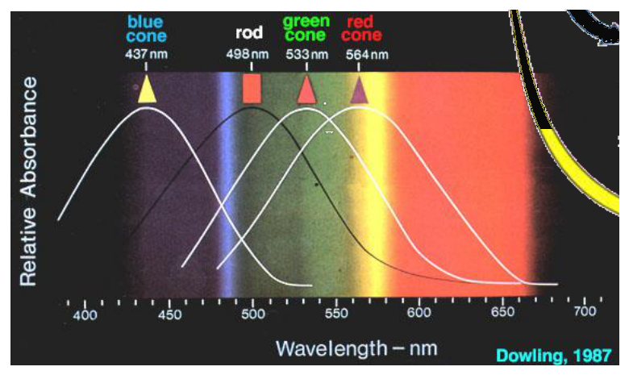
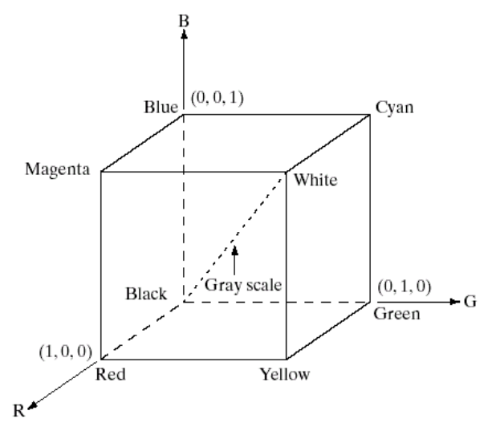
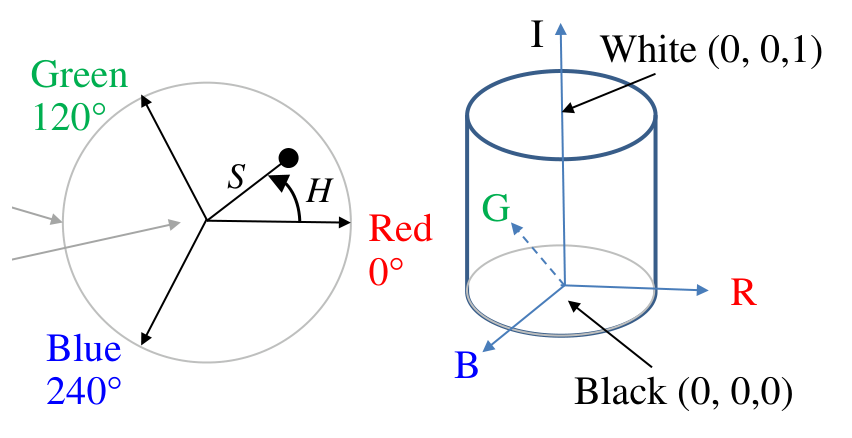
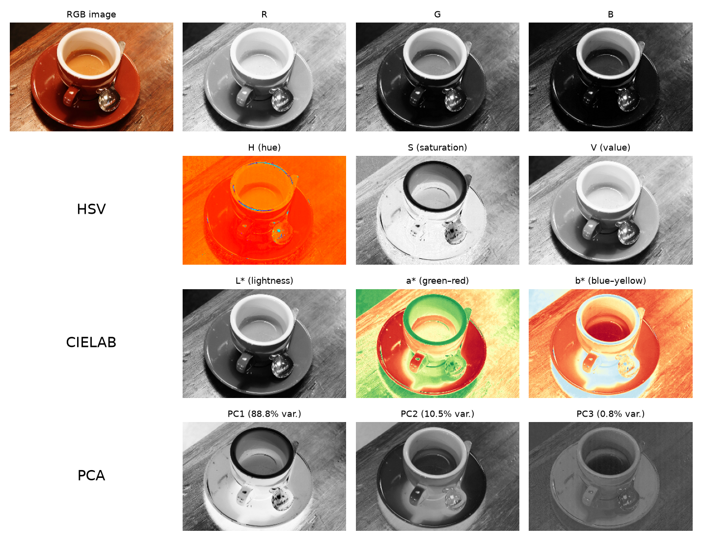
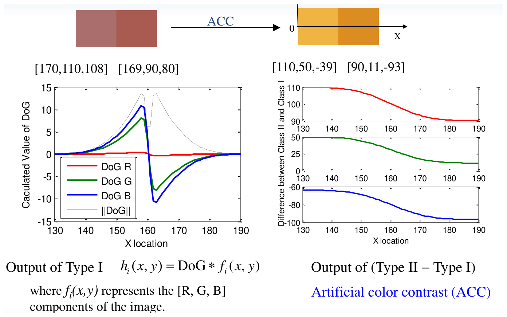

# Color Vision and Color Features

Gray-level machine vision throws away most of what a color camera measures. In food processing, agriculture and inspection, the feature that matters (a blood spot on meat, the red comb of a chicken, a ripe fruit) often differs from its surroundings mainly in hue, and a color method can find it faster and more reliably than any shape algorithm. This chapter starts from the physics of light and the human visual system, introduces the color models used in practice and the conversions between them, and then develops three tools for color feature detection: principal component analysis of color, artificial color contrast (a transform modelled on retinal ganglion cells), and classifiers that decide whether a pixel's color belongs to a target.

## Light and Color Perception

### Physics

White light passed through a prism separates into a continuous spectrum. The visible band is a narrow window of the electromagnetic spectrum, roughly 400 nm (violet) to 700 nm (red), between ultraviolet and infrared. The color of an object is determined by which wavelengths it reflects.

Three quantities describe chromatic light:

- **Radiance**, the total energy flowing from the source, in watts.
- **Luminance**, in lumens, the amount of that energy an observer perceives; it depends on wavelength (a source radiating mostly in the infrared has high radiance and almost zero luminance) and on distance.
- **Brightness**, a subjective descriptor of the intensity sensation, which cannot be measured directly.

### The human visual system

The sensation of color is produced by the brain. The retina contains two kinds of photoreceptors:

- **Rods** (about 100 million) have very low spatial resolution but are extremely sensitive, capable of responding to a single photon. They give night (scotopic) vision and no color.
- **Cones** (about 5 million) are relatively insensitive but provide color vision and high spatial resolution. They are concentrated in the fovea, a rod-free area about 200 µm across.



*Figure: relative absorbance of human photoreceptors against wavelength. The short (blue), medium (green) and long (red) wavelength cones peak near 437, 533 and 564 nm and the rods near 498 nm. The curves overlap heavily, so any wavelength excites more than one cone type and color is coded by ratios of responses.*

Signals flow from the photoreceptors through bipolar cells to the retinal ganglion cells (RGCs), whose axons form the optic nerve; horizontal and amacrine cells connect laterally and modulate the signals. Two classical theories describe color coding, and both are correct at different stages. **Trichromacy** (Young–Helmholtz): three cone types with broad, overlapping sensitivities, so any color sensation can be matched by mixing three primaries. **Opponent processing** (Hering): further along the pathway the cone signals are recombined into a black–white (luminance) channel and two chromatic channels, red–green and yellow–blue. Opponent coding explains why no color looks "reddish green". Artificial color contrast, later in this chapter, borrows the opponent idea.

### Color image sensing

Most single-chip color cameras place a **Bayer color filter array** over the sensor: a mosaic of red, green and blue filters (two green per 2×2 block, matching the eye's greater sensitivity to green), with a micro-lens above each pixel. Each pixel measures one color; the other two are interpolated from neighbours (demosaicing), after which the camera applies color correction. A **3-CCD camera** instead splits the light with a prism onto three sensors, one per primary, measuring all three colors at every pixel. It is more expensive but has better color resolution and less color noise; an example below shows how a color transform can let a cheaper single-CCD camera compete.

## Specifying Color

The perceptual attributes of a color are:

- **Hue**, associated with the dominant wavelength: the color perceived (red, orange, …).
- **Saturation**, the relative purity, or the amount of white light mixed with the hue. Pure spectral colors are fully saturated; pink is a desaturated red.
- **Brightness**, the perceived light level.

Hue and saturation together are the **chromaticity**.

**CIE chromaticity.** The CIE system describes any color by **tristimulus values** \\(X, Y, Z\\), the amounts of three (imaginary) primaries needed to match it. The **trichromatic coefficients**
\\[
x = \frac{X}{X + Y + Z}, \qquad y = \frac{Y}{X + Y + Z}, \qquad z = \frac{Z}{X + Y + Z}, \qquad x + y + z = 1,
\\]
remove the intensity, and since \\(z = 1 - x - y\\) every chromaticity is a point \\((x, y)\\) in the plane: the **chromaticity diagram**. Pure spectral colors lie on its horseshoe-shaped boundary from 380 to 780 nm; the point of equal energy, near the centre, is white. For example a color with 62% green (\\(y = 0.62\\)) and 25% red (\\(x = 0.25\\)) has \\(z = 1 - 0.25 - 0.62 = 0.13\\), 13% blue. Any color inside the triangle whose vertices are three primaries can be produced by mixing them; no three real primaries cover the whole diagram, which is why every display has a limited *gamut*. The gamuts are nested roughly as CIELAB ⊃ Adobe RGB ⊃ sRGB ⊃ printing CMYK.

## Color Models

A color model is a coordinate system for color, chosen for a purpose: hardware (RGB for displays and cameras, CMY for printing, YIQ for broadcast) or perception and analysis (HSI, HSV, CIELAB). Models such as HSI and CIELAB separate chromaticity from intensity, which reduces a 3-D color problem to a 2-D "color" problem that is largely insensitive to lighting level.

### RGB

Each color is a point in the unit cube with red, green and blue axes.



*Figure: the RGB cube. Black is at the origin and white at (1, 1, 1); the gray scale runs along the main diagonal between them. The primaries red, green and blue and the secondaries cyan, magenta and yellow sit at the other six vertices.*

With 8 bits per channel there are \\((2^8)^3 = 2^{24} = 16{,}777{,}216\\) colors. The 216 "safe" colors take six levels per channel (0, 51, …, 255, \\(6^3 = 216\\)) and reproduce identically on any display. RGB values depend on the device; a linear transformation converts between RGB systems, for example from NTSC to CIE primaries:
\\[
\begin{bmatrix} R \\\\ G \\\\ B \end{bmatrix}\_{CIE} = \begin{bmatrix} 1.167 & -0.146 & -0.151 \\\\ 0.114 & 0.753 & 0.159 \\\\ -0.001 & 0.059 & 1.128 \end{bmatrix}\begin{bmatrix} R \\\\ G \\\\ B \end{bmatrix}\_{NTSC}.
\\]

### CMY and YIQ

Printing subtracts light from white paper, so its primaries are the secondaries of light (cyan absorbs red, and so on):
\\[
\begin{bmatrix} C \\\\ M \\\\ Y \end{bmatrix} = \begin{bmatrix} 1 - R \\\\ 1 - G \\\\ 1 - B \end{bmatrix}.
\\]
The YIQ model of NTSC color television separates luminance \\(Y\\) (the signal a black-and-white set displays) from two chrominance signals:
\\[
\begin{bmatrix} Y \\\\ I \\\\ Q \end{bmatrix} = \begin{bmatrix} 0.299 & 0.587 & 0.114 \\\\ 0.596 & -0.275 & -0.321 \\\\ 0.212 & -0.523 & 0.311 \end{bmatrix}\begin{bmatrix} R \\\\ G \\\\ B \end{bmatrix}.
\\]
The luminance row, \\(Y = 0.299R + 0.587G + 0.114B\\), is the standard conversion of a color image to gray, weighting green most as the eye does.

### HSI

The HSI model describes color the way people do. Picture the RGB cube standing on its black vertex: the gray diagonal becomes a vertical **intensity** axis, and planes perpendicular to it carry hue and saturation.



*Figure: the HSI model. In a plane perpendicular to the intensity axis, hue H is the angle measured from red (0°) through green (120°) to blue (240°), and saturation S is the distance from the centre: pure colors lie on the periphery (S = 1) and grays at the centre (S = 0). Intensity runs from black (0, 0, 0) to white (0, 0, 1).*

**RGB to HSI.** With \\(R, G, B\\) normalized to \\([0, 1]\\),
\\[
I = \frac{R + G + B}{3}, \qquad S = 1 - \frac{3}{R + G + B}\min(R, G, B),
\\]
\\[
\theta = \cos^{-1}\left\\{\frac{\tfrac12\left[(R - G) + (R - B)\right]}{\left[(R - G)^2 + (R - B)(G - B)\right]^{1/2}}\right\\}, \qquad H = \begin{cases} \theta, & B \le G, \\\\ 360^\circ - \theta, & B > G. \end{cases}
\\]
The hue formula is the angle between the projection of \\((R, G, B)\\) onto the plane perpendicular to the gray axis and the projection of the red axis: the numerator is their dot product and the denominator the product of their lengths (up to a common factor). Saturation measures how far the color is from the gray axis relative to its intensity: \\(S = 0\\) when \\(R = G = B\\), and \\(S = 1\\) when at least one component is zero.

**HSI to RGB.** With normalized components \\(r = R/(R + G + B)\\), etc., so \\(r + g + b = 1\\), the formula depends on the 120° sector containing \\(H\\):

- RG sector, \\(0^\circ < H \le 120^\circ\\): \\(b = \tfrac13(1 - S)\\), \\(r = \tfrac13\left[1 + \dfrac{S\cos H}{\cos(60^\circ - H)}\right]\\), \\(g = 1 - (r + b)\\).
- GB sector, \\(120^\circ < H \le 240^\circ\\), with \\(H \leftarrow H - 120^\circ\\): \\(r = \tfrac13(1 - S)\\), \\(g = \tfrac13\left[1 + \dfrac{S\cos H}{\cos(60^\circ - H)}\right]\\), \\(b = 1 - (r + g)\\).
- BR sector, \\(240^\circ < H \le 360^\circ\\), with \\(H \leftarrow H - 240^\circ\\): \\(g = \tfrac13(1 - S)\\), \\(b = \tfrac13\left[1 + \dfrac{S\cos H}{\cos(60^\circ - H)}\right]\\), \\(r = 1 - (g + b)\\).

The actual components are then \\(R = 3Ir\\), \\(G = 3Ig\\), \\(B = 3Ib\\).

**HSV and HSL** are close relatives that use hexagonal rather than circular hue geometry and define the third coordinate differently. HSV, the default in most software, uses value \\(V = \max(R, G, B)\\), saturation \\(S = (V - \min(R, G, B))/V\\), and a piecewise-linear hue. HSL uses lightness \\((\max + \min)/2\\). All three share the weakness that hue is undefined (and very noisy) for grays and dark pixels, where saturation is near zero.

### CIELAB

CIELAB (\\(L^\*a^\*b^\*\\)) is designed to be **perceptually uniform**, so that equal Euclidean distances correspond roughly to equal perceived color differences, and **device independent**. \\(L^\*\\) is lightness (0 black, 50 mid-gray, 100 white); \\(a^\*\\) runs from green (negative) to red/magenta (positive); \\(b^\*\\) from blue (negative) to yellow (positive). These axes mirror the opponent channels. From tristimulus values relative to a reference white \\((X\_w, Y\_w, Z\_w)\\) (for the D65 daylight white, chromaticity \\(x = 0.3127\\), \\(y = 0.3290\\)):
\\[
L^\* = 116\\,h\\!\left(\frac{Y}{Y\_w}\right) - 16, \qquad a^\* = 500\left[h\\!\left(\frac{X}{X\_w}\right) - h\\!\left(\frac{Y}{Y\_w}\right)\right], \qquad b^\* = 200\left[h\\!\left(\frac{Y}{Y\_w}\right) - h\\!\left(\frac{Z}{Z\_w}\right)\right],
\\]
\\[
h(q) = \begin{cases} \sqrt[3]{q}, & q > 0.008856, \\\\ 7.787q + 16/116, & q \le 0.008856. \end{cases}
\\]
The cube root mimics the compressive response of the eye; the linear segment avoids its infinite slope at zero. Because the Euclidean distance in \\((a^\*, b^\*)\\) is a meaningful color difference, CIELAB is the natural space for clustering pixels by color, for example k-means segmentation (see [Template Matching, Clustering and Shape Signatures](shape-analysis.md)).

### Conversions in practice

**Example 9.1 (One image in several color spaces).** The figure decomposes a photograph into its RGB, HSV and CIELAB components and its principal components (next section). The code uses scikit-image; MATLAB's `rgb2hsv`, `rgb2lab` and `rgb2ycbcr` are direct equivalents.

```python
import numpy as np
from skimage import data, color
img = data.coffee() / 255.0                 # H x W x 3, RGB in [0, 1]
hsv = color.rgb2hsv(img)                    # hue, saturation, value
lab = color.rgb2lab(img)                    # L* in [0, 100], a*, b*
gray = img @ [0.299, 0.587, 0.114]          # luminance (Y of YIQ)
```



*Figure: one image in four color representations. The R, G and B channels are strongly correlated (all three look alike). Hue separates the orange coffee, the reddish saucer and the white cup regardless of shading, but is noisy on the white and dark areas where saturation is low. L* carries the shading while a* and b* carry the color, as opponent channels. The first principal component (88.8% of the variance) is essentially an intensity image; the second picks out the red-versus-blue contrast; the third is nearly flat.*

## Principal Component Analysis of Color

### Why PCA

The colors of the pixels in an image form a cloud in RGB space. The direction of greatest spread is rarely aligned with the \\(R\\), \\(G\\) or \\(B\\) axis; typically it is close to the gray diagonal, because shading changes all three channels together. PCA finds the linear transformation whose new axes coincide with the directions of largest spread. In the new axes the components are **uncorrelated**.

**Definitions.** The variance measures the spread of one variable about its mean; the covariance measures how two variables vary together. For an \\(h \times w\\) image with channels \\(x\_i(k, \ell)\\), \\(i = 1, 2, 3\\), the covariance between channels \\(i\\) and \\(j\\) is
\\[
C(i, j) = E\\{[x\_i - \bar x\_i][x\_j - \bar x\_j]\\} = \frac{1}{hw}\sum\_{k=1}^{h}\sum\_{\ell=1}^{w}\left[x\_i(k, \ell) - \bar x\_i\right]\left[x\_j(k, \ell) - \bar x\_j\right].
\\]
\\(C\\) is a symmetric \\(3 \times 3\\) matrix with the channel variances on its diagonal.

**Theorem (principal axes).** Let \\(C = V\Lambda V^T\\) with orthonormal eigenvectors \\(v\_1, v\_2, v\_3\\) and eigenvalues \\(\lambda\_1 \ge \lambda\_2 \ge \lambda\_3 \ge 0\\). Then the projection \\(y\_1 = v\_1^T(x - \bar x)\\) has the largest variance of any unit-vector projection, equal to \\(\lambda\_1\\); \\(v\_2\\) maximizes the variance among directions orthogonal to \\(v\_1\\); and the transformed components are uncorrelated, with covariance matrix \\(\Lambda\\).

*Proof sketch.* The variance of \\(a^T(x - \bar x)\\) is \\(a^TCa\\). Maximizing it subject to \\(a^Ta = 1\\) with a Lagrange multiplier gives \\(Ca = \lambda a\\), so \\(a\\) is an eigenvector and the variance is its eigenvalue; the largest is \\(\lambda\_1\\). The covariance of \\(y = V^T(x - \bar x)\\) is \\(V^TCV = \Lambda\\), which is diagonal. ∎

### Procedure

1. **Centre** each channel: \\(\hat R = R - \bar R\\), \\(\hat G = G - \bar G\\), \\(\hat B = B - \bar B\\).
2. **Covariance.** Reshape the \\(h \times w \times 3\\) image into a \\(3 \times n\\) matrix \\(X\\) (\\(n = hw\\)) with rows \\(\hat R, \hat G, \hat B\\); then \\(C = XX^T/(hw)\\).
3. **Eigen-decomposition** of \\(C\\): \\((v\_1, v\_2, v\_3)\\), \\(\lambda\_1 > \lambda\_2 > \lambda\_3\\).
4. **Transform** each pixel: \\(y(k, \ell) = A\\,\hat x(k, \ell)\\), \\(A = \begin{bmatrix} v\_1^T \\\\ v\_2^T \\\\ v\_3^T \end{bmatrix}\\). Component \\(y\_i\\) is the pixel's coordinate along \\(v\_i\\).
5. **Inverse:** \\((R, G, B)^T = y\_1v\_1 + y\_2v\_2 + y\_3v\_3 + (\bar R, \bar G, \bar B)^T\\).

**Example 9.2 (PCA of a 3 × 3 color image).** Let
\\[
R = \begin{bmatrix} 4 & 5 & 2 \\\\ 3 & 6 & 3 \\\\ 8 & 4 & 1 \end{bmatrix}, \quad G = \begin{bmatrix} 3 & 3 & 8 \\\\ 5 & 3 & 7 \\\\ 2 & 9 & 5 \end{bmatrix}, \quad B = \begin{bmatrix} 5 & 4 & 6 \\\\ 3 & 2 & 3 \\\\ 8 & 6 & 8 \end{bmatrix}.
\\]
The means are \\(\bar R = 4\\), \\(\bar G = 5\\), \\(\bar B = 5\\), and the centred channels are
\\[
\hat R = \begin{bmatrix} 0 & 1 & -2 \\\\ -1 & 2 & -1 \\\\ 4 & 0 & -3 \end{bmatrix}, \quad \hat G = \begin{bmatrix} -2 & -2 & 3 \\\\ 0 & -2 & 2 \\\\ -3 & 4 & 0 \end{bmatrix}, \quad \hat B = \begin{bmatrix} 0 & -1 & 1 \\\\ -2 & -3 & -2 \\\\ 3 & 1 & 3 \end{bmatrix}.
\\]
The variance of \\(R\\) is the sum of squares of the entries of \\(\hat R\\) divided by 9, \\(\sigma^2\\{R\\} = 36/9 = 4\\); the covariance of \\(R\\) and \\(G\\) is the sum of the element-wise products divided by 9, \\(\sigma\\{R, G\\} = -26/9 = -2.889\\); and so on:
\\[
C = \begin{bmatrix} 4 & -2.889 & -0.222 \\\\ -2.889 & 5.556 & 0.222 \\\\ -0.222 & 0.222 & 4.222 \end{bmatrix}.
\\]
Its eigen-decomposition is

| \\(i\\) | \\(\lambda\_i\\) | \\(v\_i^T\\) |
|---|---|---|
| 1 | 7.7967 | (−0.6065, 0.7904, 0.0868) |
| 2 | 4.1958 | (−0.0393, 0.0793, −0.9961) |
| 3 | 1.7853 | (0.7941, 0.6075, 0.0170) |

The first component (57% of the total variance \\(\text{tr}\\,C = 13.78\\)) is essentially \\(G - R\\): in this image red and green are strongly anti-correlated.

(1) The pixel at row 2, column 2 has \\((R, G, B) = (6, 3, 2)\\), centred \\((2, -2, -3)\\). Its principal components are
\\[
p = A\begin{bmatrix} 2 \\\\ -2 \\\\ -3 \end{bmatrix} = \begin{bmatrix} -0.6065 & 0.7904 & 0.0868 \\\\ -0.0393 & 0.0793 & -0.9961 \\\\ 0.7941 & 0.6075 & 0.0170 \end{bmatrix}\begin{bmatrix} 2 \\\\ -2 \\\\ -3 \end{bmatrix} = \begin{bmatrix} -3.0542 \\\\ 2.7511 \\\\ 0.3222 \end{bmatrix}.
\\]
(2) The point on the first principal axis with \\(y\_1 = 1\\) is \\((\bar R, \bar G, \bar B) + v\_1 = (4, 5, 5) + (-0.6065, 0.7904, 0.0868) = (3.3935,\ 5.7904,\ 5.0868)\\).

### Uses and limits

Because the principal components are uncorrelated, no component can be predicted from another, and the information per stored bit is maximal. For a monochrome rendering the first component has the greatest contrast and information content of any linear combination of the channels; higher components often isolate color features. In an image of a live chicken, for instance, the second component highlights the red comb against the white feathers. The last component, with the smallest variance, is mostly noise and is nearly flat. The disadvantage is that principal-component values have no physical meaning: they are not colors, and the axes change from image to image.

## Artificial Color Contrast

### Motivation: receptive fields

Natural products vary in color, and the color difference between a defect and its surroundings may be small (a blood spot on chicken meat, a fanbone among flesh). The human visual system copes well with such noise, which suggests emulating its early processing.

Retinal ganglion cells have **centre–surround receptive fields**. An ON-centre cell is excited by light in a small central disc and inhibited by light in the surrounding annulus; an OFF-centre cell does the opposite. The weighting profile across the field is a "Mexican hat". Its standard model is the **difference of Gaussians**, an approximation to the Laplacian of Gaussian (see [Smoothing and Edge Detection](edge-detection.md)):
\\[
\text{DoG} \triangleq G\_{\sigma\_c} - G\_{\sigma\_s} = \frac{1}{\sqrt{2\pi}}\left[\frac{1}{\sigma\_c}e^{-(x^2 + y^2)/2\sigma\_c^2} - \frac{1}{\sigma\_s}e^{-(x^2 + y^2)/2\sigma\_s^2}\right], \qquad \sigma\_c < \sigma\_s .
\\]
Convolved with a step edge, the DoG gives a positive and a negative lobe on either side of the edge and returns to zero away from it, because the kernel integrates to zero. Recordings from cat ganglion cells responding to an edge show the two lobes, but the response settles to **non-zero offsets** on each side of the edge. A DoG cannot reproduce these offsets: the real cell also signals the *level* of its input relative to the other side, not just the presence of an edge. The offset is what artificial color contrast adds.

### Definition

**Definition (artificial color contrast, ACC).** The ACC output for a centre color component \\(f\_i\\) and a surround component \\(f\_j\\) is the difference of a narrowly and a widely smoothed image,
\\[
h\_i(x, y) = G\_{\sigma\_c} \* f\_i(x, y) - G\_{\sigma\_s} \* f\_j(x, y), \qquad G\_\sigma(x, y) = \frac{1}{\sqrt{2\pi\sigma^2}}\exp\left(-\frac{x^2 + y^2}{2\sigma^2}\right).
\\]
- **Type I surround** (\\(f\_i = f\_j = f\\)): \\(h = (G\_{\sigma\_c} - G\_{\sigma\_s}) \* f = \text{DoG} \* f\\), a pure edge detector.
- **Type II surround** (\\(f\_i \ne f\_j\\)): the general case.

Adding and subtracting \\(G\_{\sigma\_s} \* f\_i\\) splits every Type II output into an edge term and a contrast term:
\\[
h\_i = \underbrace{\text{DoG} \* f\_i}\_{\text{edge detection}} + \underbrace{G\_{\sigma\_s} \* (f\_i - f\_j)}\_{\text{artificial color contrast}} .
\\]
Far from edges the first term vanishes and \\(h\_i\\) equals the locally averaged difference \\(f\_i - f\_j\\): a constant offset, exactly what the DoG lacked.

### Opponent surrounds

Choosing the surround from the opponent channels, \\(f\_{\pm(R - G)} = \pm(R - G)\\) and \\(f\_{\pm(Y - B)} = \pm(R + G - B)\\) (yellow = red + green), gives six features. With the surround \\(R - G\\):
\\[
h\_{R\_c(R - G)\_s} = G\_{\sigma\_c} \* R - G\_{\sigma\_s} \* (R - G) = \text{DoG} \* R + G\_{\sigma\_s} \* G,
\\]
\\[
h\_{G\_c(R - G)\_s} = \text{DoG} \* G + G\_{\sigma\_s} \* (2G - R), \qquad h\_{B\_c(R - G)\_s} = \text{DoG} \* B + G\_{\sigma\_s} \* \left[B - (R - G)\right].
\\]
With the surround \\(Y - B = R + G - B\\):
\\[
h\_{R\_c(Y - B)\_s} = \text{DoG} \* R + G\_{\sigma\_s} \* (B - G), \quad h\_{G\_c(Y - B)\_s} = \text{DoG} \* G + G\_{\sigma\_s} \* (B - R), \quad h\_{B\_c(Y - B)\_s} = \text{DoG} \* B + G\_{\sigma\_s} \* \left[2B - (R + G)\right].
\\]
Each follows from \\(h = \text{DoG} \* f\_i + G\_{\sigma\_s} \* (f\_i - f\_s)\\); for example, for \\(h\_{B\_c(Y - B)\_s}\\), \\(B - (R + G - B) = 2B - (R + G)\\). A useful choice for reddish targets is
\\[
h\_4 = \text{DoG} \* R + G\_{\sigma\_s} \* G, \qquad h\_5 = \text{DoG} \* G + G\_{\sigma\_s} \* (2G - R), \qquad h\_6 = \text{DoG} \* B + G\_{\sigma\_s} \* \left[2B - (R + G)\right].
\\]
Typical scales are \\(\sigma\_c = 1\\) pixel and \\(\sigma\_s = 10\\) pixels.

**Example 9.3 (Blood and bone marrow).** Two adjacent regions of chicken meat have mean colors \\([170, 110, 108]\\) (blood) and \\([169, 90, 80]\\) (bone marrow). In RGB they are two similar reddish shades: the red channels are identical and the difference is spread over green and blue. After the ACC transform the outputs \\([h\_4, h\_5, h\_6]\\) are \\([110, 50, -39]\\) and \\([90, 11, -93]\\), clearly different. The first two values can be checked by hand: inside a uniform region the DoG term vanishes, so \\(h\_4 \to G\\) and \\(h\_5 \to 2G - R\\), giving \\(110\\) and \\(2(110) - 170 = 50\\) for blood, and \\(90\\) and \\(2(90) - 169 = 11\\) for marrow. (For \\(h\_6\\) the far-field values would be \\(-64\\) and \\(-99\\); the reported values were taken within the wide surround of the boundary, where the two regions mix.)



*Figure: ACC across the boundary between the two regions. The Type I output (DoG of R, G, B and its norm, left) is nonzero only near the boundary: it detects the edge but says nothing about the regions. The difference between the Type II and Type I outputs (right) is a smooth step in each channel, the contrast term, which separates the two regions everywhere. The step in the blue-centre channel resembles the offset response of a cat ganglion cell.*

**Example 9.4 (ACC on food-processing images).** For three detection tasks, the distance between the class means and the class standard deviations before and after ACC:

| Task | Space | Target mean | Noise mean | Target SD | Noise SD | Distance |
|---|---|---|---|---|---|---|
| Chicken comb vs bare spot | RGB | [152, 58, 45] | [135, 85, 39] | [3.9, 7.2, 22.2] | [1.1, 4.3, 10] | 36 |
| | ACC | [61, −34, −123] | [81, 29, −143] | [3.5, 4.2, 12.8] | [0.5, 1.9, 7.5] | 69 |
| Fanbone (3-CCD) | RGB | [150, 92, 108] | [138, 62, 67] | [4.1, 6.6, 11.9] | [5.3, 8.0, 14.0] | 52 |
| | ACC | [88, 30, −24] | [70, −5, −77] | [1.9, 4.1, 10.9] | [4.4, 7.1, 11.9] | 67 |
| Fanbone (single CCD) | RGB | [67, 39, 44] | [93, 45, 45] | [1.2, 2.3, 9.2] | [5.6, 9.9, 31.2] | 27 |
| | ACC | [36, 9, −24] | [50, 7, 57] | [0.6, 2.0, 5.9] | [5.1, 7.8, 18.4] | 36 |

In every case ACC increases the separation of the class means and reduces most standard deviations, because the wide surround Gaussian averages out pixel noise. With ACC, the cheap single-CCD camera achieves spreads comparable to or smaller than those of the 3-CCD camera without it.

**Example 9.5 (Deriving ACC features for a blue target).** A blue target \\([88, 96, 225]\\) must be separated from a grayish background \\([135, 134, 149]\\). Using the \\(R - G\\) surround, the three features are \\(h\_1 = \text{DoG} \* R + G\_{\sigma\_s} \* G\\), \\(h\_2 = \text{DoG} \* G + G\_{\sigma\_s} \* (2G - R)\\), \\(h\_3 = \text{DoG} \* B + G\_{\sigma\_s} \* [B - (R - G)]\\); their region values are \\([96, 104, 233]\\) for the target and \\([134, 133, 148]\\) for the background. With the \\(Y - B\\) surround, \\(h\_a = \text{DoG} \* R + G\_{\sigma\_s} \* (B - G)\\), \\(h\_b = \text{DoG} \* G + G\_{\sigma\_s} \* (B - R)\\), \\(h\_c = \text{DoG} \* B + G\_{\sigma\_s} \* [2B - (R + G)]\\), with region values \\([129, 137, 266]\\) and \\([15, 14, 29]\\). The \\(Y - B\\) surround, whose opponent axis is aligned with the target's color, spreads the classes much further apart.

## Color Feature Classification

### The problem

Given training samples of a target color (for example pixels of a chicken comb), which form a cluster \\(\Omega\\) in color space, find a boundary \\(\Gamma\\) such that a pixel color inside \\(\Gamma\\) is classified as target and outside as non-target. In real-time applications on live objects the classifier must be fast, robust to color noise, and tolerant of natural color variation.

### Statistical fast bounded box

The simplest boundary is a box: accept a color if each of its components lies within a range. A box aligned with the \\(R, G, B\\) axes is fast but loose: the target cluster is usually elongated along a diagonal, so an axis-aligned box that contains it also contains much empty space, where noise colors fall.

The **statistical fast bounded box (SFBB)** assumes that the three components, after decorrelation, are independent random variables, and aligns the box with the principal axes of the training set.

**Training.**
1. From the training colors \\(R = (R\_r, R\_g, R\_b)\\) compute the mean \\(\bar R\\) and the covariance
\\[
U = \begin{bmatrix} \sigma^2\\{R\_r\\} & \sigma\\{R\_r, R\_g\\} & \sigma\\{R\_r, R\_b\\} \\\\ \cdot & \sigma^2\\{R\_g\\} & \sigma\\{R\_g, R\_b\\} \\\\ \cdot & \cdot & \sigma^2\\{R\_b\\} \end{bmatrix}.
\\]
2. Compute its eigenvalues and normalized eigenvectors \\(v\_1, v\_2, v\_3\\).
3. Transform the training data, \\(\hat R = [v\_1\ v\_2\ v\_3]^T(R - \bar R)\\).
4. Set the box limits on each transformed component, for example at the mean plus or minus a multiple of its standard deviation \\(\sqrt{\lambda\_i}\\), or at percentiles of the training data.

Classifying a pixel costs one \\(3 \times 3\\) matrix–vector product and six comparisons.

**Example 9.6 (Comb color of live birds).** The training set has mean \\(\bar R = (242, 112, 69)\\) and covariance
\\[
U = \begin{bmatrix} 441 & 384 & 226 \\\\ 384 & 666 & 432 \\\\ 226 & 432 & 325 \end{bmatrix},
\qquad
\begin{bmatrix} v\_1^T \\\\ v\_2^T \\\\ v\_3^T \end{bmatrix} = \begin{bmatrix} -0.14 & 0.61 & -0.78 \\\\ 0.86 & -0.32 & -0.41 \\\\ 0.50 & 0.72 & 0.48 \end{bmatrix}.
\\]
The large off-diagonal terms show strong correlation; the tilted box in the transformed axes is far tighter than the axis-aligned box. Normal probability plots validate the independence assumption: the original red component is far from normal (it saturates near 255), while the three transformed components plot as nearly straight lines.

### Neural and kernel alternatives

- **RCE network** (restricted Coulomb energy; Reilly, Cooper and Elbaum, 1982): the hidden layer stores prototypes, each with a hypersphere of influence of radius \\(\lambda\_k\\); a color inside any sphere of the target class is accepted. Small radii need many prototypes (slow); large radii admit noise.
- **Support vector machine:** the linear SVM \\(f(x) = \text{sign}(w^Tx + b)\\) chooses the separating hyperplane with the largest margin; a kernel maps colors into a higher-dimensional space where a hyperplane corresponds to a curved boundary in color space (see [Supervised Learning](../../ml/supervised.md)).

**Example 9.7 (Live-bird transfer).** An automated system for transferring live birds must detect each bird's orientation by finding its comb, within a cycle time of at most 1 s and with 99% reliability, despite bare flesh spots, dirt on feathers, shadows and reflections. Comparing the three classifiers on this task:

| Classifier | Boundary | Relative time | Detection rate |
|---|---|---|---|
| SFBB | box aligned with principal axes | \\(T\\) | 99% |
| RCE network | union of hyperspheres | \\(1.9T\\) | 85% |
| SVM | hyperplane in kernel space | \\(13T\\) | 74% |

For a compact, roughly Gaussian color cluster the simplest statistically aligned model was both the fastest and the most accurate; the more flexible classifiers fitted the noise in the training samples.

## Summary

- Color sensation comes from three overlapping cone types (437, 533, 564 nm) recombined into opponent channels (black–white, red–green, yellow–blue).
- Chromaticity: \\(x = X/(X + Y + Z)\\), \\(y = Y/(X + Y + Z)\\). Hue, saturation and brightness describe perceived color.
- Models: RGB cube; \\(\text{CMY} = 1 - \text{RGB}\\); YIQ with \\(Y = 0.299R + 0.587G + 0.114B\\); HSI with \\(I = (R + G + B)/3\\), \\(S = 1 - 3\min(R, G, B)/(R + G + B)\\), \\(H\\) an angle; CIELAB perceptually uniform, with cube-root compression.
- PCA: eigenvectors of the channel covariance give uncorrelated components ordered by variance; the first is a maximum-contrast gray image, later ones isolate color features.
- ACC: \\(h\_i = G\_{\sigma\_c} \* f\_i - G\_{\sigma\_s} \* f\_j = \text{DoG} \* f\_i + G\_{\sigma\_s} \* (f\_i - f\_j)\\), an edge term plus a contrast offset; opponent surrounds \\(R - G\\) and \\(R + G - B\\).
- SFBB: a box aligned with the principal axes of the training colors; fast and tight when the target cluster is compact.

## See Also

- [Image Formation and Acquisition](imaging.md): sensors and spectral response.
- [Smoothing and Edge Detection](edge-detection.md): Gaussian, LoG and DoG kernels.
- [Template Matching, Clustering and Shape Signatures](shape-analysis.md): k-means clustering, used for color segmentation.
- [Neural Networks for Machine Vision](neural-networks.md): learned classifiers and CNNs on color images.
- [Image Processing](../image-processing.md): general image operations.
- [Unsupervised Learning](../../ml/unsupervised.md): PCA and clustering in general.
- [Eigenvalues and Eigenvectors](../../../math/linear-algebra/eigen.md): the linear algebra of PCA.
