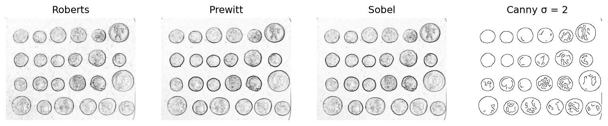
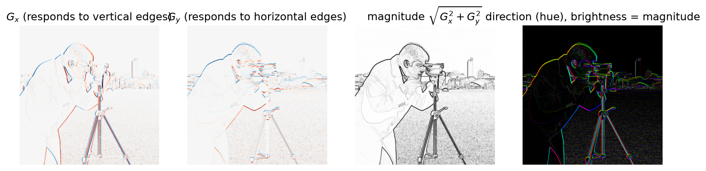
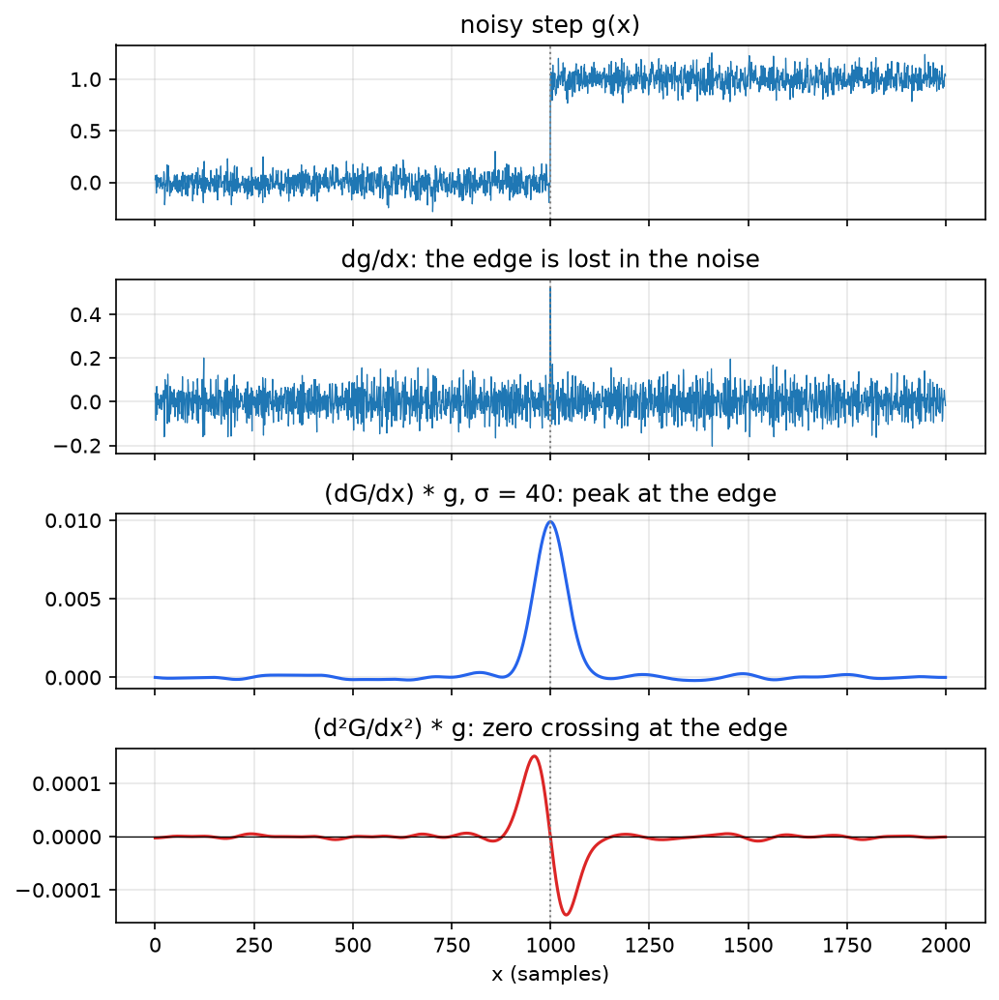
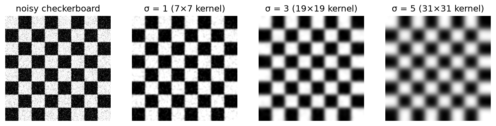
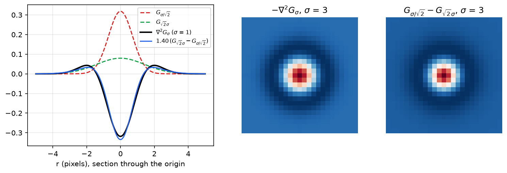
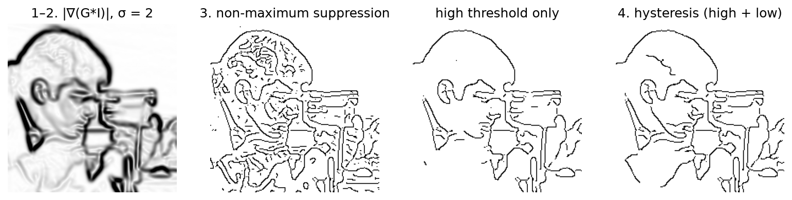
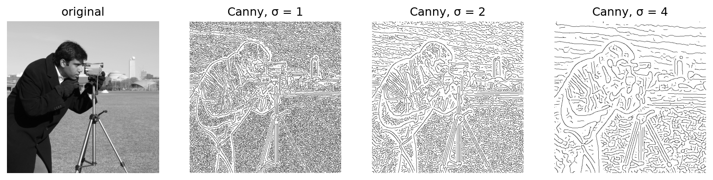

# Smoothing and Edge Detection

Edges, the places where image brightness changes abruptly, mark object boundaries, surface markings, shadows and depth discontinuities. Turning a 2-D array of gray levels into a set of edge curves extracts the salient structure of the image in a far more compact form than the pixels themselves, and nearly every later step (the Hough transform, boundary curvature, matching, calibration targets) starts from edges. Edges are measured with derivatives, and derivatives amplify noise, so edge detection is inseparable from smoothing. This chapter develops both: the gradient and Laplacian of an ideal edge, discrete difference operators (Roberts, Prewitt, Sobel), Gaussian smoothing and its properties, the Laplacian of Gaussian and its difference-of-Gaussians approximation, the role of scale, and finally the Canny detector, step by step.

## What an Edge Is

Consider the gray level \\(g(s)\\) along a path \\(s\\) that crosses an edge. In an ideal **step edge** \\(g\\) jumps from one value to another; real edges are **ramps**, smoothed by the optics (the blur of [Image Formation and Acquisition](imaging.md)) and by the finite pixel size. In either case:

- the **first derivative** \\(dg/ds\\) has an extremum (maximum magnitude) at the edge;
- the **second derivative** \\(d^2g/ds^2\\) passes through **zero** at the edge, between a positive and a negative lobe.

These two facts give the two families of edge detectors: *first-order* methods find maxima of the gradient magnitude, *second-order* methods find zero crossings of the Laplacian. A practical edge operator must cope with noise and with discreteness, and should report both the **magnitude** and the **orientation** of each edge with **high detection** (few missed and few false edges) and **good localization** (edges reported where they really are).

## The Gradient

**Definition (Gradient).** For an image \\(g(x, y)\\), the gradient is the vector
\\[
\nabla g = \frac{\partial g}{\partial x}\\,\hat{\imath} + \frac{\partial g}{\partial y}\\,\hat{\jmath}, \qquad \lVert \nabla g \rVert = \sqrt{\left( \frac{\partial g}{\partial x} \right)^2 + \left( \frac{\partial g}{\partial y} \right)^2}, \qquad \theta = \tan^{-1}\frac{\partial g/\partial y}{\partial g/\partial x},
\\]
with the direction \\(\theta\\) measured counter-clockwise from the \\(x\\) axis (toward the \\(y\\) axis). The gradient points in the direction of the steepest *increase* of brightness, so it points from the dark side toward the bright side, and its magnitude is the rate of increase in that direction. At a vertical edge (brightness changing with \\(x\\) only) \\(\nabla g = [\partial g/\partial x,\ 0]\\); at a horizontal edge \\(\nabla g = [0,\ \partial g/\partial y]\\).

### Gradient and Laplacian of an ideal straight edge

The claim that the gradient is perpendicular to the edge, and that the Laplacian has a zero crossing on it, can be made exact. Let the edge be the line
\\[
\ell(x, y) = x\sin\theta - y\cos\theta + \rho = 0,
\\]
which is \\(y = (\tan\theta)x + \rho/\cos\theta\\), a line of slope \\(\tan\theta\\), so \\(\theta\\) is the edge direction. It separates a region of brightness \\(B\_1\\) (where \\(\ell < 0\\)) from a region of brightness \\(B\_2\\) (where \\(\ell > 0\\)). With the unit step \\(u(t) = \int\_{-\infty}^{t}\delta(s)\\,ds\\) (equal to 1 for \\(t > 0\\), \\(\tfrac12\\) at \\(t = 0\\), 0 for \\(t < 0\\)), the image is
\\[
g(x, y) = B\_1 + (B\_2 - B\_1)\\, u[\ell(x, y)].
\\]
By the chain rule, with \\(\partial\ell/\partial x = \sin\theta\\) and \\(\partial\ell/\partial y = -\cos\theta\\),
\\[
G\_x = \frac{\partial g}{\partial x} = (B\_2 - B\_1)\sin\theta\\; \delta[\ell(x, y)], \qquad G\_y = \frac{\partial g}{\partial y} = -(B\_2 - B\_1)\cos\theta\\; \delta[\ell(x, y)].
\\]
Hence:

- the **magnitude** is \\(G = \sqrt{G\_x^2 + G\_y^2} = (B\_2 - B\_1)\\,\delta[\ell(x, y)]\\): an impulse on the edge, of strength equal to the contrast;
- the gradient direction is \\((\sin\theta, -\cos\theta)\\), whose dot product with the edge direction \\((\cos\theta, \sin\theta)\\) is zero. The slope of the gradient, \\(-\cos\theta/\sin\theta = -1/\tan\theta\\), is the negative reciprocal of the edge slope: **the gradient is normal to the edge**;
- differentiating again, \\(\partial^2 g/\partial x^2 = (B\_2 - B\_1)\sin^2\theta\\,\delta'[\ell]\\) and \\(\partial^2 g/\partial y^2 = (B\_2 - B\_1)\cos^2\theta\\,\delta'[\ell]\\), so the **Laplacian** is
\\[
L(x, y) = \nabla^2 g = \frac{\partial^2 g}{\partial x^2} + \frac{\partial^2 g}{\partial y^2} = (B\_2 - B\_1)\\,\delta'[\ell(x, y)],
\\]
a doublet (positive on one side, negative on the other) whose zero crossing lies on the edge, whatever its orientation. The Laplacian is **isotropic**: it needs no direction, unlike the gradient, which needs two components.

## Discrete Difference Operators

On a pixel grid with spacing \\(\varepsilon\\), derivatives are replaced by differences.

**First differences.** The simplest are \\(g(i+1, j) - g(i, j)\\) and \\(g(i, j+1) - g(i, j)\\), which estimate the derivative at a point half a pixel away from either sample. A symmetric estimate uses a \\(2 \times 2\\) cell and averages the two differences in each direction:
\\[
\frac{\partial g}{\partial x} \approx \frac{(g\_{i+1,j+1} - g\_{i,j+1}) + (g\_{i+1,j} - g\_{i,j})}{2\varepsilon}, \qquad \frac{\partial g}{\partial y} \approx \frac{(g\_{i+1,j+1} - g\_{i+1,j}) + (g\_{i,j+1} - g\_{i,j})}{2\varepsilon},
\\]
both estimating the gradient at the cell centre. As masks (rows indexed by \\(j\\), columns by \\(i\\)) these are \\(\frac{1}{2\varepsilon}\begin{bmatrix} -1 & 1 \\\\ -1 & 1 \end{bmatrix}\\) and \\(\frac{1}{2\varepsilon}\begin{bmatrix} 1 & 1 \\\\ -1 & -1 \end{bmatrix}\\).

**Second differences.** From Taylor expansions \\(g(x \pm \varepsilon) = g \pm \varepsilon g' + \tfrac12\varepsilon^2 g'' \pm \tfrac16\varepsilon^3 g''' + O(\varepsilon^4)\\), adding the two cancels the odd terms:
\\[
\frac{\partial^2 g}{\partial x^2} \approx \frac{g\_{i-1,j} - 2g\_{i,j} + g\_{i+1,j}}{\varepsilon^2}, \qquad \frac{\partial^2 g}{\partial y^2} \approx \frac{g\_{i,j-1} - 2g\_{i,j} + g\_{i,j+1}}{\varepsilon^2},
\\]
each accurate to \\(O(\varepsilon^2)\\). Adding them gives the 5-point Laplacian; a 9-point version that also uses the diagonals is more accurate (more nearly isotropic):
\\[
\nabla^2 g \approx \frac{1}{\varepsilon^2}\begin{bmatrix} 0 & 1 & 0 \\\\ 1 & -4 & 1 \\\\ 0 & 1 & 0 \end{bmatrix}, \qquad \nabla^2 g \approx \frac{1}{6\varepsilon^2}\begin{bmatrix} 1 & 4 & 1 \\\\ 4 & -20 & 4 \\\\ 1 & 4 & 1 \end{bmatrix}.
\\]
The point mask of [Image Enhancement and Region Properties](image-enhancement.md), with 8 in the centre and \\(-1\\) around it, is (minus) yet another discrete Laplacian.

### Roberts, Prewitt and Sobel

**Roberts cross** (\\(2 \times 2\\)) takes differences along the two diagonals:
\\[
\begin{bmatrix} 0 & 1 \\\\ -1 & 0 \end{bmatrix}, \qquad \begin{bmatrix} 1 & 0 \\\\ 0 & -1 \end{bmatrix}.
\\]
It localizes well but is very sensitive to noise and detects poorly, because it averages nothing.

**Prewitt** (\\(3 \times 3\\)) takes central differences and averages them over three rows (or columns):
\\[
\begin{bmatrix} -1 & 0 & 1 \\\\ -1 & 0 & 1 \\\\ -1 & 0 & 1 \end{bmatrix}, \qquad \begin{bmatrix} -1 & -1 & -1 \\\\ 0 & 0 & 0 \\\\ 1 & 1 & 1 \end{bmatrix}.
\\]

**Sobel** (\\(3 \times 3\\), the most commonly used) weights the centre row twice as heavily:
\\[
\begin{bmatrix} -1 & 0 & 1 \\\\ -2 & 0 & 2 \\\\ -1 & 0 & 1 \end{bmatrix} = \begin{bmatrix} 1 \\\\ 2 \\\\ 1 \end{bmatrix}\begin{bmatrix} -1 & 0 & 1 \end{bmatrix}, \qquad \begin{bmatrix} -1 & -2 & -1 \\\\ 0 & 0 & 0 \\\\ 1 & 2 & 1 \end{bmatrix} = \begin{bmatrix} -1 \\\\ 0 \\\\ 1 \end{bmatrix}\begin{bmatrix} 1 & 2 & 1 \end{bmatrix}.
\\]
The factorization shows what Sobel does: a central difference \\([-1\ 0\ 1]\\) in one direction, combined with a smoothing \\([1\ 2\ 1]\\) (a binomial approximation to a Gaussian) in the perpendicular direction. Prewitt is the same with box smoothing \\([1\ 1\ 1]\\). Both kernels are separable, so they cost two 1-D passes. (For a derivative in physical units divide Sobel by \\(8\varepsilon\\) and Prewitt by \\(6\varepsilon\\); edge detection rarely needs the scale.)

Larger masks smooth more. A \\(5 \times 5\\) Sobel-type pair is
\\[
\begin{bmatrix} -1 & -2 & 0 & 2 & 1 \\\\ -2 & -3 & 0 & 3 & 2 \\\\ -3 & -5 & 0 & 5 & 3 \\\\ -2 & -3 & 0 & 3 & 2 \\\\ -1 & -2 & 0 & 2 & 1 \end{bmatrix}, \qquad \begin{bmatrix} 1 & 2 & 3 & 2 & 1 \\\\ 2 & 3 & 5 & 3 & 2 \\\\ 0 & 0 & 0 & 0 & 0 \\\\ -2 & -3 & -5 & -3 & -2 \\\\ -1 & -2 & -3 & -2 & -1 \end{bmatrix}.
\\]
It is less sensitive to noise and detects weak edges better, but localizes worse: nearby edges merge and corners round off. This is the basic **detection–localization trade-off**: a larger mask averages more noise away but blurs position. Canny's analysis, below, makes the trade-off precise.



*Figure: gradient magnitude from the Roberts, Prewitt and Sobel operators, and the Canny edge map, on an image of coins. Roberts responds to the fine texture almost as strongly as to the coin outlines; the 3 × 3 operators give thicker but cleaner responses; Canny returns thin, connected contours.*

### Sobel worked examples

In the following examples \\(x\\) points *down the rows* and \\(y\\) *along the columns*, the convention of matrix indexing, and the masks are applied as correlations to the \\(3 \times 3\\) neighbourhood
\\[
Z = \begin{bmatrix} z\_1 & z\_2 & z\_3 \\\\ z\_4 & z\_5 & z\_6 \\\\ z\_7 & z\_8 & z\_9 \end{bmatrix}, \qquad H\_x = \begin{bmatrix} -1 & -2 & -1 \\\\ 0 & 0 & 0 \\\\ 1 & 2 & 1 \end{bmatrix}, \quad H\_y = \begin{bmatrix} -1 & 0 & 1 \\\\ -2 & 0 & 2 \\\\ -1 & 0 & 1 \end{bmatrix},
\\]
so \\(G\_x = \sum\_{i=1}^{9} w\_{x,i} z\_i\\) (bottom row minus top row) and \\(G\_y = \sum\_{i=1}^{9} w\_{y,i} z\_i\\) (right column minus left column).

**Example 1 (Sobel gradient at a pixel).** In the image
\\[
\begin{bmatrix} 3 & 4 & 2 & 5 & 1 \\\\ 2 & 1 & 6 & 4 & 2 \\\\ 3 & 5 & 7 & 1 & 3 \\\\ 4 & 2 & 5 & 7 & 1 \\\\ 2 & 5 & 1 & 3 & 2 \end{bmatrix}
\\]
find the gradient at the pixel in row 2, column 2 (value 1), whose neighbourhood is \\(Z = \begin{bmatrix} 3 & 4 & 2 \\\\ 2 & 1 & 6 \\\\ 3 & 5 & 7 \end{bmatrix}\\).

*Solution.* In vector form, \\(\mathbf{h}\_x^T = [-1\ -2\ -1\ 0\ 0\ 0\ 1\ 2\ 1]\\), \\(\mathbf{h}\_y^T = [-1\ 0\ 1\ -2\ 0\ 2\ -1\ 0\ 1]\\) and \\(\mathbf{z} = [3\ 4\ 2\ 2\ 1\ 6\ 3\ 5\ 7]^T\\):
\\[
G\_x = \mathbf{h}\_x^T\mathbf{z} = (3 + 2 \cdot 5 + 7) - (3 + 2 \cdot 4 + 2) = 20 - 13 = 7,
\\]
\\[
G\_y = \mathbf{h}\_y^T\mathbf{z} = (2 + 2 \cdot 6 + 7) - (3 + 2 \cdot 2 + 3) = 21 - 10 = 11,
\\]
\\[
\lVert \nabla g \rVert = \sqrt{7^2 + 11^2} = \sqrt{170} \approx 13, \qquad \theta = \tan^{-1}\frac{11}{7} = 57.53^\circ.
\\]
The angle is measured from the \\(+x\\) axis (down) toward the \\(+y\\) axis (right): the gradient points down and to the right, toward the bright values 6 and 7, as a gradient must.

**Example 2 (Sobel on an X-ray patch).** In the \\(6 \times 8\\) X-ray block of [Image Enhancement and Region Properties](image-enhancement.md), the pixel at row 5, column 2 has neighbourhood (rows 4–6, columns 1–3)
\\[
Z = \begin{bmatrix} 173 & 175 & 177 \\\\ 172 & 173 & 175 \\\\ 168 & 170 & 175 \end{bmatrix}.
\\]
Then
\\[
G\_x = (168 + 2 \cdot 170 + 175) - (173 + 2 \cdot 175 + 177) = 683 - 700 = -17,
\\]
\\[
G\_y = (177 + 2 \cdot 175 + 175) - (173 + 2 \cdot 172 + 168) = 702 - 685 = 17,
\\]
so \\(\lVert \nabla g \rVert = \sqrt{17^2 + 17^2} = 24.04\\). Here \\(\tan^{-1}(G\_y/G\_x) = \tan^{-1}(-1)\\) is ambiguous; the signs (\\(G\_x < 0\\), \\(G\_y > 0\\)) put the vector in the second quadrant, so \\(\theta = \operatorname{atan2}(17, -17) = 135^\circ\\) from \\(+x\\): up the rows and to the right, toward the brighter upper-right pixels. Always use the two-argument arctangent for gradient directions.



*Figure: Sobel derivatives of a test image. G_x (here the horizontal image axis) responds to vertical edges, G_y to horizontal ones, with sign showing whether brightness rises or falls; the magnitude combines both; in the direction map the hue encodes θ and brightness the magnitude, so opposite sides of a thin dark structure appear in opposite colours.*

On a checkerboard, the Sobel \\(G\_x\\) and \\(G\_y\\) images show the two families of edges separately, and their magnitude shows the grid, but the response vanishes at the X-junctions where four squares meet: there the contributions of the two diagonally opposite squares cancel. Gradient operators assume one dominant edge direction in the window, and they fail at corners and junctions.

On the retroreflective-background images of [Image Formation and Acquisition](imaging.md), the gradient of the *gray* image is cluttered by surface texture and reflections inside the parts, while the gradient of the *thresholded binary* image gives clean outlines. When lighting allows a good threshold, thresholding before differentiating is the simplest edge detector.

## Noise and Smoothing

Differentiation multiplies each frequency component by its frequency, so high-frequency noise is amplified. A step corrupted by small noise, differentiated sample by sample, gives a derivative in which the edge is invisible.



*Figure: a step at sample 1000 with additive Gaussian noise of standard deviation 0.08 (8% of the step). The raw first difference is dominated by noise. Convolving with the derivative of a Gaussian (σ = 40 samples) yields one clear peak at the edge; the second derivative of a Gaussian yields a clean zero crossing there.*

Common noise models are **salt-and-pepper** (random pixels set to black or white, as from bit errors), **impulse** (random white pixels) and **Gaussian** (each pixel perturbed by an independent normally distributed amount, as from sensor and amplifier noise). Gaussian noise is reduced by linear smoothing; impulsive noise is better removed by non-linear filters such as the median.

The two linear smoothers are the mean (box) filter and the Gaussian filter. Both reduce noise, but the box filter weighs the farthest pixel of its window as heavily as the centre and then drops to zero abruptly. Its frequency response is a sinc with negative side lobes, so it passes some high frequencies with inverted sign and produces blocky, ringing artifacts; its impulse response is a square. The Gaussian's weights fall off smoothly, its frequency response is again a Gaussian with no side lobes, and its impulse response is a soft round blob. The Gaussian is the preferred smoother for edge detection.

### The Gaussian filter

**Definition (Gaussian kernel).** The 2-D Gaussian of standard deviation \\(\sigma\\) is
\\[
G\_\sigma(x, y) = \frac{1}{2\pi\sigma^2}\exp\left[ -\frac{x^2 + y^2}{2\sigma^2} \right].
\\]
A digital \\((2k+1) \times (2k+1)\\) kernel \\(H\\) samples it at the integer offsets from the centre:
\\[
h\_{mn} = \frac{1}{2\pi\sigma^2}\exp\left[ -\frac{(m - k - 1)^2 + (n - k - 1)^2}{2\sigma^2} \right], \qquad m, n = 1, \dots, 2k+1.
\\]

**Example 3 (A \\(3 \times 3\\) Gaussian kernel, \\(\sigma = 1\\)).** With \\(k = 1\\) there are three distinct weights:
\\[
w\_5 = G\_\sigma(0, 0) = \frac{1}{2\pi\sigma^2} = 0.1592,
\\]
\\[
w\_2 = w\_4 = w\_6 = w\_8 = G\_\sigma(\pm 1, 0) = G\_\sigma(0, \pm 1) = \frac{1}{2\pi\sigma^2}e^{-1/(2\sigma^2)} = 0.0965,
\\]
\\[
w\_1 = w\_3 = w\_7 = w\_9 = G\_\sigma(\pm 1, \pm 1) = \frac{1}{2\pi\sigma^2}e^{-1/\sigma^2} = 0.0585.
\\]
Extending to \\(5 \times 5\\) adds \\(G(\pm2, 0) = 0.0215\\), \\(G(\pm2, \pm1) = 0.0131\\), \\(G(\pm2, \pm2) = 0.0029\\):
\\[
H = \begin{bmatrix} 0.0029 & 0.0131 & 0.0215 & 0.0131 & 0.0029 \\\\ 0.0131 & 0.0585 & 0.0965 & 0.0585 & 0.0131 \\\\ 0.0215 & 0.0965 & 0.1592 & 0.0965 & 0.0215 \\\\ 0.0131 & 0.0585 & 0.0965 & 0.0585 & 0.0131 \\\\ 0.0029 & 0.0131 & 0.0215 & 0.0131 & 0.0029 \end{bmatrix}.
\\]
The \\(5 \times 5\\) weights sum to 0.982 and the \\(3 \times 3\\) weights to only 0.779, because truncation discards the tails. In practice the sampled kernel is divided by its sum so that flat regions keep their brightness.

**Choosing the size.** About 99.7% of a 1-D Gaussian's mass lies within \\(\pm 3\sigma\\), so a kernel of width \\(2 \cdot 3\sigma + 1 = 6\sigma + 1\\) captures essentially all of it: \\(7 \times 7\\) for \\(\sigma = 1\\), \\(19 \times 19\\) for \\(\sigma = 3\\), \\(31 \times 31\\) for \\(\sigma = 5\\). The peak value \\(1/(2\pi\sigma^2)\\) falls from 0.159 at \\(\sigma = 1\\) to 0.0177 at \\(\sigma = 3\\) and 0.0064 at \\(\sigma = 5\\) as the same unit mass spreads wider. Larger \\(\sigma\\) removes more noise and blurs edges more.



*Figure: a checkerboard with strong Gaussian noise, smoothed with σ = 1, 3 and 5 (kernels 7 × 7, 19 × 19, 31 × 31). Noise falls rapidly with σ, but the square boundaries become wider ramps: the detection–localization trade-off in one picture.*

### Properties of the Gaussian

**Separability.** The 2-D Gaussian is a product of 1-D Gaussians:
\\[
G\_\sigma(m, n) = \frac{1}{2\pi\sigma^2}e^{-(m^2 + n^2)/2\sigma^2} = \left[ \frac{1}{\sqrt{2\pi}\\,\sigma}e^{-m^2/2\sigma^2} \right]\left[ \frac{1}{\sqrt{2\pi}\\,\sigma}e^{-n^2/2\sigma^2} \right] = G\_\sigma(m)\\,G\_\sigma(n).
\\]
Hence \\(G\_\sigma \ast\ast\\, I = G\_\sigma(n) \* \big(G\_\sigma(m) \* I\big)\\): filter the rows with a 1-D kernel, then the columns. A \\(w \times w\\) kernel then costs \\(2w\\) instead of \\(w^2\\) multiplications per pixel, 62 instead of 961 for \\(\sigma = 5\\). The Gaussian is also the only kernel that is both separable and rotationally symmetric.

**Cascade.** Convolving two Gaussians gives a Gaussian whose variances add:
\\[
G\_{\sigma\_1} \ast\ast\\, G\_{\sigma\_2} = G\_{\sqrt{\sigma\_1^2 + \sigma\_2^2}}.
\\]
*Proof.* The Fourier transform of \\(G\_\sigma\\) is \\(e^{-\sigma^2(\omega\_x^2 + \omega\_y^2)/2}\\), and convolution becomes multiplication: \\(e^{-\sigma\_1^2\lvert\omega\rvert^2/2}e^{-\sigma\_2^2\lvert\omega\rvert^2/2} = e^{-(\sigma\_1^2 + \sigma\_2^2)\lvert\omega\rvert^2/2}\\). (Probabilistically: the sum of independent normal variables is normal with the sum of the variances.) \\(\square\\) Repeated small blurs therefore equal one larger blur, and smoothing with \\(\sigma\\) twice equals smoothing once with \\(\sqrt2\\,\sigma\\).

**Derivative theorem.** Differentiation commutes with convolution:
\\[
\frac{\partial}{\partial x}\left( G\_\sigma \ast\ast\\, I \right) = \left( \frac{\partial G\_\sigma}{\partial x} \right) \ast\ast\\, I.
\\]
*Proof.* \\(\frac{\partial}{\partial x}\iint G\_\sigma(u, v)I(x - u, y - v)\\,du\\,dv\\), with the convolution written the other way round, \\(\iint G\_\sigma(x - u, y - v)I(u, v)\\,du\\,dv\\), places all the \\(x\\)-dependence in \\(G\_\sigma\\); differentiating under the integral sign (legitimate because \\(G\_\sigma\\) is smooth and decays rapidly) gives \\(\iint \partial\_x G\_\sigma(x - u, y - v)I(u, v)\\,du\\,dv\\). \\(\square\\)

"Smooth, then differentiate" is therefore a single convolution with the **derivative of Gaussian** \\(\partial G\_\sigma/\partial x = -\frac{x}{\sigma^2}G\_\sigma\\), saving one operation, and the peaks of the result locate edges. Equally,
\\[
\frac{\partial^2}{\partial x^2}\left( G\_\sigma \ast\ast\\, I \right) = \left( \frac{\partial^2 G\_\sigma}{\partial x^2} \right) \ast\ast\\, I,
\\]
whose **zero crossings** locate edges. In 2-D the derivative-of-Gaussian kernels in \\(x\\) and \\(y\\) look like a positive and a negative blob side by side, and the Sobel masks are their \\(3 \times 3\\) caricatures.

## Laplacian of Gaussian

**Derivation.** Differentiate \\(G\_\sigma(x, y)\\):
\\[
\frac{\partial G\_\sigma}{\partial x} = -\frac{x}{\sigma^2}G\_\sigma, \qquad \frac{\partial^2 G\_\sigma}{\partial x^2} = \left( \frac{x^2}{\sigma^4} - \frac{1}{\sigma^2} \right)G\_\sigma,
\\]
and similarly in \\(y\\). Adding,
\\[
\boxed{\nabla^2 G\_\sigma(x, y) = \frac{x^2 + y^2 - 2\sigma^2}{\sigma^4}\\,G\_\sigma(x, y) = \frac{1}{2\pi\sigma^4}\left( \frac{x^2 + y^2}{\sigma^2} - 2 \right)e^{-(x^2 + y^2)/2\sigma^2}.}
\\]
The kernel is rotationally symmetric, negative in a disc of radius \\(r = \sqrt2\\,\sigma\\) around the centre and positive outside it; its negative is the "Mexican hat". Its integral over the plane is zero, so it ignores constant brightness, and by the derivative theorem
\\[
\mathrm{LoG} = (\nabla^2 G\_\sigma) \ast\ast\\, I = \nabla^2 (G\_\sigma \ast\ast\\, I).
\\]
The **Marr–Hildreth** edge detector convolves the image with \\(\nabla^2 G\_\sigma\\) and marks the zero crossings (sign changes between neighbouring pixels, optionally only where the local slope of the response is large). Zero crossings form closed contours, and the operator is isotropic: one convolution, no direction needed. Its drawbacks are that every zero crossing is reported, including weak ones caused by noise and "phantom" crossings at points of inflection that are not edges, and that zero crossings round off corners.

A \\(5 \times 5\\) digital approximation (sign as \\(\nabla^2 G\\), weights summing to zero) is
\\[
\begin{bmatrix} 0 & 0 & 1 & 0 & 0 \\\\ 0 & 1 & 2 & 1 & 0 \\\\ 1 & 2 & -16 & 2 & 1 \\\\ 0 & 1 & 2 & 1 & 0 \\\\ 0 & 0 & 1 & 0 & 0 \end{bmatrix}.
\\]

### Difference of Gaussians

The LoG can be approximated by subtracting two Gaussian-blurred images, which is cheap because each Gaussian is separable and because a pyramid of blurred images is often computed anyway.

**Proposition (DoG approximation).** For \\(\sigma\_2 > \sigma\_1\\) close to \\(\sigma\\),
\\[
G\_{\sigma\_2} - G\_{\sigma\_1} \approx (\sigma\_2 - \sigma\_1)\\,\sigma\\,\nabla^2 G\_\sigma .
\\]
*Derivation.* Differentiate the Gaussian with respect to its scale:
\\[
\frac{\partial G\_\sigma}{\partial\sigma} = \left( -\frac{2}{\sigma} + \frac{x^2 + y^2}{\sigma^3} \right)G\_\sigma = \frac{x^2 + y^2 - 2\sigma^2}{\sigma^3}G\_\sigma = \sigma\\,\nabla^2 G\_\sigma .
\\]
(This is the heat equation: a Gaussian blur of variance \\(\sigma^2 = 2t\\) is the solution of \\(\partial u/\partial t = \nabla^2 u\\) at time \\(t\\).) A finite difference in \\(\sigma\\) then gives \\(G\_{\sigma\_2} - G\_{\sigma\_1} \approx (\sigma\_2 - \sigma\_1)\\,\partial G/\partial\sigma\\). \\(\square\\)

A good choice is \\(\sigma\_1 = \sigma/\sqrt2\\) and \\(\sigma\_2 = \sqrt2\\,\sigma\\), whose geometric mean is \\(\sigma\\). Then \\(\sigma\_2 - \sigma\_1 = \sigma/\sqrt2\\) and
\\[
\nabla^2 G\_\sigma \approx \frac{\sqrt2}{\sigma^2}\left( G\_{\sqrt2\sigma} - G\_{\sigma/\sqrt2} \right).
\\]
A least-squares fit of the two profiles for \\(\sigma = 1\\) gives a scale factor of 1.40, close to the predicted \\(\sqrt2 = 1.41\\), and the zero crossing of the DoG falls at \\(r = 1.36\sigma\\) against \\(\sqrt2\\,\sigma = 1.41\sigma\\) for the LoG. (Marr and Hildreth recommended a ratio \\(\sigma\_2/\sigma\_1 \approx 1.6\\) as a compromise between accuracy and sensitivity; the narrower the ratio, the closer the approximation but the smaller the response.) Sign conventions vary: \\(G\_{\sigma\_1} - G\_{\sigma\_2}\\), narrow minus wide, is the positive-centred Mexican hat \\(-\nabla^2 G\\), the classic centre–surround receptive field of retinal ganglion cells.



*Figure: left, cross-sections of a narrow and a wide Gaussian, the LoG with σ = 1, and the scaled difference of the two Gaussians, which nearly coincides with it. Right, the negated LoG and the DoG (narrow minus wide) as 2-D kernels: a positive centre surrounded by a negative ring.*

Both LoG and DoG are isotropic (rotation invariant). Normalized by \\(\sigma^2\\), the response \\(\sigma^2\nabla^2 G\_\sigma \ast\ast\\, I\\) is comparable across scales, and the DoG pyramid with extrema across scale is the blob detector at the heart of SIFT ([Feature Detection](../features.md)).

### Scale

Every Gaussian-based detector has a **scale** parameter \\(\sigma\\). Small \\(\sigma\\) detects fine edges, including texture and noise, and localizes them precisely; large \\(\sigma\\) detects only large-scale, high-contrast boundaries and displaces or merges nearby edges. No single scale is right for all images: the choice depends on the size of the structures of interest. Tracking edges and curvature features across a range of scales, a **scale space**, is developed for boundary curves in [Shape Analysis](shape-analysis.md).

## Methods of Edge Detection

Edge detectors fall into first-order derivative methods, second-order derivative methods and optimal detectors. Most follow three steps:

1. **Noise smoothing**, usually Gaussian.
2. **Edge filtering**: compute gradient components or the Laplacian.
3. **Edge localization**: thin the response to one-pixel-wide curves and threshold it.

Thresholding the gradient magnitude alone fails at step 3. The magnitude of a blurred edge is a ridge several pixels wide, so a low threshold yields thick bands ("where exactly is the edge?") and a high threshold yields broken fragments. Both problems are solved by the Canny detector.

## The Canny Edge Detector

Canny (1986) posed edge detection as an optimization problem for a step edge in white Gaussian noise, with three criteria:

1. **Good detection**: a low probability of missing real edges and of marking false ones, i.e. a high signal-to-noise ratio at the filter output.
2. **Good localization**: the marked edge should be as close as possible to the true edge.
3. **Single response**: one edge should produce one response, not several nearby maxima caused by noise.

The first two criteria conflict (the same trade-off as mask size), and their product, together with the third, defines an optimal 1-D filter. Canny showed that the optimum is closely approximated, within about 20% of the criteria, by the **first derivative of a Gaussian**, which is easy to compute. In 2-D the detector applies this filter in the gradient direction and adds two localization steps.

### The four steps

**Step 1. Smooth.** Convolve the image with a 2-D Gaussian: \\(S = G\_\sigma \ast\ast\\, I\\).

**Step 2. Gradient.** Compute the gradient of the smoothed image, for example with Sobel masks (or, equivalently by the derivative theorem, convolve once with derivative-of-Gaussian kernels). At each pixel record the **edge magnitude** and the **edge normal**:
\\[
M = \lVert \nabla (G\_\sigma \ast\ast\\, I) \rVert, \qquad \mathbf{n} = \frac{\nabla (G\_\sigma \ast\ast\\, I)}{\lVert \nabla (G\_\sigma \ast\ast\\, I) \rVert}.
\\]

**Step 3. Non-maximum suppression (NMS).** An edge is where the smoothed brightness changes fastest *along the normal*: a maximum of \\(M\\) in the direction \\(\mathbf{n}\\), equivalently a zero crossing of the second directional derivative \\(\partial^2 S/\partial\mathbf{n}^2\\). Keep a pixel only if its magnitude is a local maximum along the gradient direction, and set it to zero otherwise. With \\(M(x', y')\\) and \\(M(x'', y'')\\) the magnitudes at the two neighbours on either side along \\(\mathbf{n}\\),
\\[
M\_{\text{NMS}}(x, y) = \begin{cases} M(x, y), & \text{if } M(x, y) > M(x', y') \text{ and } M(x, y) > M(x'', y''), \\\\ 0, & \text{otherwise}. \end{cases}
\\]
On a pixel grid the neighbours along \\(\mathbf{n}\\) are found in one of two ways:

- **Quantization.** Round the gradient direction to the nearest of **eight** directions (multiples of \\(45^\circ\\)). Opposite directions use the same neighbour pair, so there are four cases: horizontal (compare left and right), vertical (up and down), and the two diagonals.
- **Interpolation.** The true points \\(p\\) and \\(r\\) at unit distance on either side of the pixel \\(q\\) along \\(\mathbf{n}\\) usually lie between grid points; estimate \\(M(p)\\) and \\(M(r)\\) by linear interpolation between the two grid neighbours that bracket each one. This is more accurate for oblique edges.

The result is a set of ridges one pixel wide, the thin edges.

**Step 4. Hysteresis (double) thresholding and linking.** Many thinned ridges correspond to reasonable boundaries, but a single threshold breaks them: along a real contour the magnitude fluctuates, and wherever it dips below the threshold the curve is cut, while noise maxima occasionally exceed it. Canny uses two thresholds, \\(T\_{\text{high}} > T\_{\text{low}}\\):

- a pixel with \\(M\_{\text{NMS}} \ge T\_{\text{high}}\\) is a **strong** edge and *starts* an edge chain;
- a pixel with \\(T\_{\text{low}} \le M\_{\text{NMS}} < T\_{\text{high}}\\) is **weak** and is kept only if it is connected (through other weak or strong pixels) to a strong pixel; it *continues* a chain;
- a pixel below \\(T\_{\text{low}}\\) is discarded.

Following a chain, the magnitude may dip below \\(T\_{\text{high}}\\) but, as long as it stays above \\(T\_{\text{low}}\\), the chain remains connected. Isolated weak responses, mostly noise, are dropped because no strong pixel anchors them. Canny recommended a ratio \\(T\_{\text{high}}/T\_{\text{low}}\\) of 2 to 3. Implementation is a connected-component labelling of the weak-or-strong pixels with 8-connectivity, keeping the components that contain at least one strong pixel (or, equivalently, a flood fill from every strong pixel).



*Figure: the Canny steps on part of a test image, σ = 2. The gradient magnitude of the smoothed image forms thick ridges; non-maximum suppression thins them to one-pixel curves but keeps many weak ones; a single high threshold leaves only fragments; hysteresis (high = 90th percentile of the magnitude, low = 0.4 × high) keeps the weak pixels that connect to strong ones, closing gaps along the contours.*

**Example 4 (Non-maximum suppression at one pixel).** A pixel has \\(M = 50\\), and its eight neighbours have magnitudes
\\[
\begin{bmatrix} 31 & 55 & 38 \\\\ 42 & \mathbf{50} & 47 \\\\ 36 & 30 & 44 \end{bmatrix}
\\]
(rows up to down, columns left to right).

- If the gradient direction is \\(20^\circ\\) from the horizontal, it quantizes to \\(0^\circ\\) and the comparison is with left and right, 42 and 47. Since \\(50 > 42\\) and \\(50 > 47\\), the pixel is kept.
- If the direction is \\(80^\circ\\), it quantizes to \\(90^\circ\\) and the comparison is with the pixels above and below, 55 and 30. Since \\(50 < 55\\), the pixel is suppressed: the ridge crest lies one pixel higher.
- With interpolation at \\(\theta = 30^\circ\\) (measured counter-clockwise from the right, with up as positive), the point at unit distance along the gradient lies between the right neighbour (47) and the upper-right neighbour (38), at a fraction \\(\tan 30^\circ = 0.577\\) of the way toward the diagonal: \\(M(p) \approx (1 - 0.577)(47) + 0.577(38) = 19.9 + 21.9 = 41.8\\). On the opposite side, between left (42) and lower-left (36): \\(M(r) \approx 0.423(42) + 0.577(36) = 17.8 + 20.8 = 38.5\\). Both are below 50, so the pixel is kept.

### Parameters and behaviour

Canny has three parameters: \\(\sigma\\), the width of the Gaussian blur, and the high and low thresholds. The choice of \\(\sigma\\) depends on the desired behaviour: a large \\(\sigma\\) detects large-scale edges and suppresses texture, a small \\(\sigma\\) detects fine detail.



*Figure: Canny edges at σ = 1, 2 and 4. At σ = 1 the grass texture and fine folds of the coat produce many edges; at σ = 4 only the main silhouette and large structures remain, slightly rounded at corners.*

Canny remains one of the most widely used edge detectors. Its main weakness is shared by all gradient-based detectors: it **fails at corners and junctions**, where the assumption that the two partial derivatives estimate a single oriented gradient breaks down. Near a corner the smoothed gradient direction rotates, non-maximum suppression cuts the contour, and junctions appear as gaps or rounded curves. Corners are better found from the boundary curve itself, by curvature ([Shape Analysis](shape-analysis.md)), or by corner detectors that analyse the distribution of gradient directions in a window ([Feature Detection](../features.md)).

**Example 5 (Canny in MATLAB and Python).**
```matlab
I  = imread('cameraman.tif');
BW1 = edge(I, 'sobel');                 % thresholded Sobel magnitude
BW2 = edge(I, 'canny');                 % default sigma and thresholds
BW3 = edge(I, 'canny', [0.05 0.15], 2); % [low high] thresholds, sigma = 2
[BW, thresh, gv, gh] = edge(I, 'sobel');% also returns the two gradient images
```
```python
import numpy as np
from scipy import ndimage as ndi
from skimage import data, feature

I = data.camera().astype(float)
edges = feature.canny(I, sigma=2, low_threshold=10, high_threshold=30)

# The same steps by hand
S  = ndi.gaussian_filter(I, 2)                       # 1. smooth
gx, gy = ndi.sobel(S, axis=1), ndi.sobel(S, axis=0)  # 2. gradient
M  = np.hypot(gx, gy)
q  = (np.round(np.degrees(np.arctan2(gy, gx)) % 180 / 45) % 4).astype(int)
nbr = {0: (0, 1), 1: (1, 1), 2: (1, 0), 3: (1, -1)}  # neighbour offset per direction
N = np.zeros_like(M)                                 # 3. non-maximum suppression
for k, (dy, dx) in nbr.items():
    a = np.roll(M, (dy, dx), axis=(0, 1)); b = np.roll(M, (-dy, -dx), axis=(0, 1))
    keep = (q == k) & (M >= a) & (M >= b)
    N[keep] = M[keep]
hi = np.percentile(M, 90); lo = 0.4 * hi             # 4. hysteresis
lab, _ = ndi.label(N >= lo, structure=np.ones((3, 3)))
strong_labels = np.unique(lab[N >= hi])
edges_by_hand = np.isin(lab, strong_labels[strong_labels > 0])
```

## Summary

- An edge is a maximum of the first derivative and a zero crossing of the second. For an ideal straight edge \\(g = B\_1 + (B\_2 - B\_1)u[\ell]\\): \\(\lVert \nabla g \rVert = (B\_2 - B\_1)\delta[\ell]\\), the gradient is normal to the edge, and \\(\nabla^2 g = (B\_2 - B\_1)\delta'[\ell]\\).
- Gradient \\(\nabla g = [g\_x, g\_y]\\), magnitude \\(\sqrt{g\_x^2 + g\_y^2}\\), direction \\(\operatorname{atan2}(g\_y, g\_x)\\), pointing toward the brighter side.
- Discrete operators: Roberts (2 × 2, good localization, noisy), Prewitt and Sobel (difference × smoothing, separable), 5 × 5 masks (better detection, worse localization). Laplacian masks \\([0\ 1\ 0; 1\ {-4}\ 1; 0\ 1\ 0]\\) and \\(\frac16[1\ 4\ 1; 4\ {-20}\ 4; 1\ 4\ 1]\\).
- Differentiation amplifies noise: smooth first. The Gaussian \\(G\_\sigma\\) is separable, cascades as \\(G\_{\sigma\_1} \ast\ast\\, G\_{\sigma\_2} = G\_{\sqrt{\sigma\_1^2 + \sigma\_2^2}}\\), commutes with differentiation, and needs a kernel of width about \\(6\sigma + 1\\).
- LoG: \\(\nabla^2 G\_\sigma = \frac{x^2 + y^2 - 2\sigma^2}{\sigma^4}G\_\sigma\\), zero at \\(r = \sqrt2\\,\sigma\\); edges at zero crossings of \\(\nabla^2 G\_\sigma \ast\ast\\, I\\).
- DoG: \\(\partial G/\partial\sigma = \sigma\nabla^2 G\\), so \\(\nabla^2 G\_\sigma \approx \frac{\sqrt2}{\sigma^2}(G\_{\sqrt2\sigma} - G\_{\sigma/\sqrt2})\\).
- Scale \\(\sigma\\): small for fine edges and precise location, large for robust, coarse edges.
- Canny: (1) Gaussian smoothing; (2) gradient magnitude and normal; (3) non-maximum suppression along the normal (8-direction quantization or interpolation); (4) hysteresis with \\(T\_{\text{high}}\\) to start and \\(T\_{\text{low}}\\) to continue chains. Parameters \\(\sigma\\), \\(T\_{\text{high}}\\), \\(T\_{\text{low}}\\). Fails at corners.

## See Also

- [Image Enhancement and Region Properties](image-enhancement.md): masks and convolution.
- [Image Formation and Acquisition](imaging.md): why real edges are ramps.
- [The Hough Transform](hough.md): grouping edge points into lines and circles, using the gradient direction.
- [Shape Analysis](shape-analysis.md): boundary curvature, corners and scale space.
- [Colour](color.md): difference-of-Gaussian contrast in colour channels.
- [Feature Detection](../features.md): corners, blobs and DoG-based detectors.
- [Image Processing](../image-processing.md): overview of filtering and edges.
- [Convolution](../../../signals/convolution.md): convolution theorem and LSI systems.
