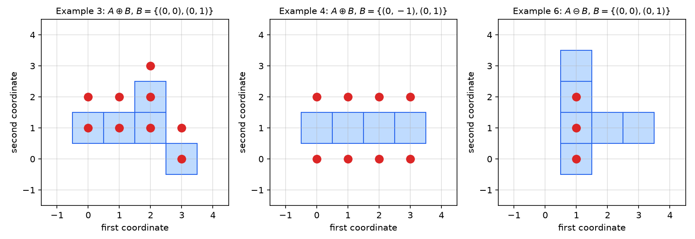
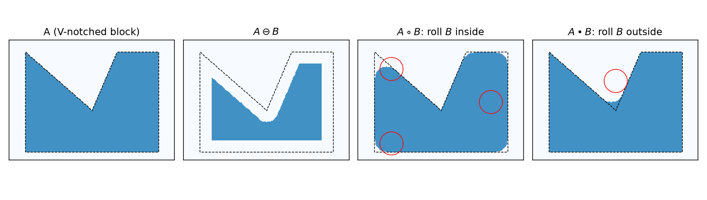
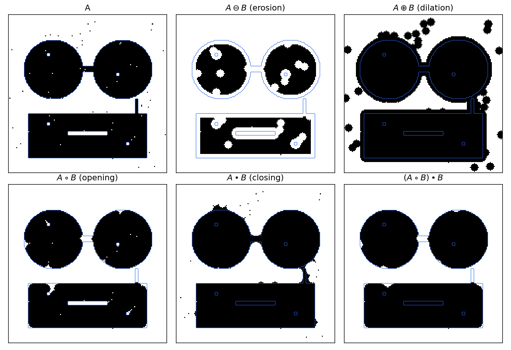
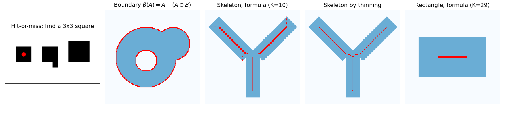
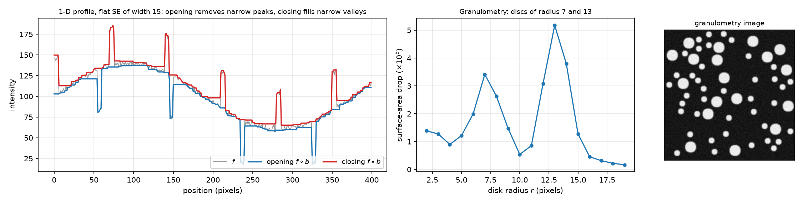

# Morphological Image Processing

Thresholding turns a gray image into a binary one, but the result is rarely clean: objects touch, thin bridges join them, specks of noise surround them, and holes and cracks break them. **Mathematical morphology** repairs and analyses such images with an algebra of shape built on set theory: a binary image is probed by a small set, the structuring element, through two primitive operations, dilation and erosion. Opening, closing, the hit-or-miss transform, boundaries and skeletons are all composed from these two, and the same ideas extend to gray-scale images. The chapter develops the binary theory with proofs and worked exercises, then the gray-scale theory, and ends with processing pipelines of the kind used in industrial inspection.

## Sets, Images and Structuring Elements

### Images as sets

Morphology is based on set theory. A **binary image** is a set in \\(\mathbb Z^2\\): each element is the coordinate pair \\((x, y)\\) of a foreground (1) pixel. A **gray-scale image** is a set in \\(\mathbb Z^3\\) of triples \\((x, y, f)\\), the third component being the intensity. Morphology extracts image components useful for representing and describing region shape: boundaries, skeletons, convex hulls.

The set operations used are the usual ones. For sets \\(A\\), \\(B\\) in \\(\mathbb Z^2\\): membership \\(a \in A\\), \\(a \notin A\\); the empty set \\(\varnothing\\); subset \\(A \subseteq B\\); union \\(A \cup B\\); intersection \\(A \cap B\\) (\\(A\\) and \\(B\\) are disjoint if \\(A \cap B = \varnothing\\)); complement \\(A^c = \\{w \mid w \notin A\\}\\); difference
\\[
A - B = \\{w \mid w \in A,\ w \notin B\\} = A \cap B^c .
\\]
On binary arrays these are pixelwise logical operations. In MATLAB, `A & B` (AND, intersection), `A | B` (OR, union), `~A` (NOT, complement), `A & ~B` (difference), and `xor(A, B)`. Overlaying two text images "UTK" and "GT" illustrates them: the union shows both words, the intersection only the overlapping strokes, and the difference the strokes of one word not covered by the other.

Two geometric operations are specific to morphology:
\\[
\hat B = \\{w \mid w = -b,\ b \in B\\} \quad \text{(reflection)}, \qquad
(B)\_z = \\{c \mid c = b + z,\ b \in B\\} \quad \text{(translation by } z\text{)}.
\\]
Reflection is a rotation by \\(180^\circ\\) about the origin; translation shifts every element by the vector \\(z\\).

### Structuring elements

A **structuring element** (SE) is a small set, or sub-image, used to probe an image for a property of interest. It has a designated **origin** (usually, but not necessarily, its centre). In digital form an SE is stored as a small array, padded with background elements to a rectangle; some formulations also allow "don't care" elements, which match either value. Symmetric SEs (squares, disks, crosses) equal their own reflections, \\(\hat B = B\\); for others the reflection matters.

The common SEs in MATLAB's `strel`:

| call | shape |
|---|---|
| `strel('diamond', R)` | diamond, distance \\(R\\) from origin to the points |
| `strel('disk', R)` | disk of radius \\(R\\) (approximated by line segments) |
| `strel('line', LEN, DEG)` | line segment of length LEN at angle DEG |
| `strel('octagon', R)` | octagon, \\(R\\) a multiple of 3 |
| `strel('pair', OFFSET)` | two points: the origin and one offset |
| `strel('periodicline', P, V)` | \\(2P+1\\) points spaced by the vector V |
| `strel('rectangle', MN)` | M × N rectangle |
| `strel('square', W)` | W × W square |
| `strel('arbitrary', NHOOD)` or `strel(NHOOD)` | any 0/1 neighbourhood array |

A **flat** SE has zero height; the distinction becomes meaningful only for gray-scale morphology.

## Dilation and Erosion

### Dilation

**Definition (Dilation).** The dilation of \\(A\\) by \\(B\\) is
\\[
A \oplus B = \\{z \mid (\hat B)\_z \cap A \ne \varnothing\\}.
\\]
Reflect \\(B\\) about its origin and shift it by \\(z\\); \\(A \oplus B\\) is the set of all displacements \\(z\\) for which the reflected, shifted SE overlaps \\(A\\) in at least one element.

An equivalent form is the **Minkowski sum**
\\[
A \oplus B = \\{a + b \mid a \in A,\ b \in B\\} = \bigcup\_{b \in B} (A)\_b .
\\]
*Proof of equivalence.* \\(z \in A \oplus B\\) iff there is \\(b \in B\\) with \\(z - b \in A\\) (an element of \\(\hat B\\) shifted by \\(z\\) is \\(z - b\\)), i.e. iff \\(z = a + b\\) for some \\(a \in A\\), \\(b \in B\\). \\(\square\\)

The sum form makes several properties immediate: dilation is **commutative** (\\(A \oplus B = B \oplus A\\)), **associative** (\\((A \oplus B) \oplus C = A \oplus (B \oplus C)\\), so a large SE can be built from small ones), **translation-invariant** (\\((A)\_z \oplus B = (A \oplus B)\_z\\)), and **increasing** (\\(A \subseteq A'\\) implies \\(A \oplus B \subseteq A' \oplus B\\)). If the origin belongs to \\(B\\), dilation is **extensive**: \\(A \subseteq A \oplus B\\).

**Example 1 (Squares).** Dilating a \\(d \times d\\) square \\(A\\) by a \\(d/4 \times d/4\\) square SE centred on its origin (\\(\hat B = B\\)) gives a square of side \\(d + d/4\\): the boundary grows by \\(d/8\\) on every side. An elongated \\(d/4 \times d\\) SE (tall and thin) gives a rectangle grown by \\(d/2\\) vertically and \\(d/8\\) horizontally. Dilation grows objects by the shape of the SE.

**Example 2 (Bridging gaps).** In low-resolution scanned text, characters are often broken: strokes with gaps of one or two pixels. Dilation with the 3 × 3 cross (or 3 × 3 square) of ones bridges the gaps, making the characters readable by a recognizer; the cost is slightly thicker strokes.

**Example 3 (Dilation on a grid).** Let \\(A = \\{(0,1), (1,1), (2,1), (2,2), (3,0)\\}\\) and \\(B = \\{(0,0), (0,1)\\}\\). By the sum form, \\(A \oplus B = A \cup (A)\_{(0,1)}\\):
\\[
(A)\_{(0,1)} = \\{(0,2), (1,2), (2,2), (2,3), (3,1)\\},
\\]
\\[
A \oplus B = \\{(0,1), (1,1), (2,1), (2,2), (3,0), (0,2), (1,2), (2,3), (3,1)\\}.
\\]
With the definition: at \\(z = (2,0)\\) the reflected SE \\(\\{(2,0), (2,-1)\\}\\) contains no point of \\(A\\), so \\((2,0) \notin A \oplus B\\); at \\(z = (3,1)\\) it is \\(\\{(3,1), (3,0)\\}\\), which overlaps \\(A\\) in one element, so \\((3,1) \in A \oplus B\\).

**Example 4 (SE without its origin).** Let \\(A = \\{(0,1), (1,1), (2,1), (3,1)\\}\\), a row of four pixels, and \\(B = \\{(0,-1), (0,1)\\}\\), a two-cell SE whose origin, the cell between the two, is *not* a member. Then \\(A \oplus B = (A)\_{(0,-1)} \cup (A)\_{(0,1)}\\):
\\[
A \oplus B = \\{(0,0), (1,0), (2,0), (3,0), (0,2), (1,2), (2,2), (3,2)\\}.
\\]
The original row is *not* retained: dilation is extensive only if the origin belongs to the SE.



*Figure: the grid exercises, with A as blue cells and the result as red dots. Left, Example 3: dilation adds a copy of A shifted by (0, 1). Centre, Example 4: the SE does not contain its origin, so A itself disappears and two shifted copies remain. Right, Example 6: erosion keeps only the points z with both z and z + (0, 1) in A.*

### Erosion

**Definition (Erosion).** The erosion of \\(A\\) by \\(B\\) is
\\[
A \ominus B = \\{z \mid (B)\_z \subseteq A\\},
\\]
the set of all points \\(z\\) such that \\(B\\), translated by \\(z\\), is contained in \\(A\\). Equivalently, \\(A \ominus B = \bigcap\_{b \in B}(A)\_{-b}\\): \\(z\\) survives when \\(z + b \in A\\) for every \\(b \in B\\).

Erosion is translation-invariant and increasing in \\(A\\), decreasing in \\(B\\) (a larger SE erodes more), and **anti-extensive** when the origin belongs to \\(B\\): \\(A \ominus B \subseteq A\\). It is *not* the inverse of dilation: \\((A \ominus B) \oplus B\\) is in general smaller than \\(A\\), which is the opening defined below.

**Example 5 (Squares and wires).** A \\(d \times d\\) square eroded by a \\(d/4\\) square SE becomes a square of side \\(3d/4\\); eroded by a \\(d/4 \times d\\) bar it shrinks to a line. For a 486 × 486 binary mask of a wire-bonded chip (square pads joined by thin wires), erosion with 11 × 11, 15 × 15 and 45 × 45 SEs makes the thin wires disappear first and then shrinks the square pads. Erosion removes every structure into which the SE does not fit, which makes it a size filter.

**Example 6 (Erosion on a grid).** Let \\(A = \\{(1,0), (1,1), (1,2), (1,3), (2,1), (3,1)\\}\\) and \\(B = \\{(0,0), (0,1)\\}\\). A point \\(z\\) survives iff \\(z \in A\\) and \\(z + (0,1) \in A\\):

- \\((1,0)\\): \\((1,1) \in A\\), kept; \\((1,1)\\): \\((1,2) \in A\\), kept; \\((1,2)\\): \\((1,3) \in A\\), kept;
- \\((1,3)\\): \\((1,4) \notin A\\); \\((2,1)\\): \\((2,2) \notin A\\); \\((3,1)\\): \\((3,2) \notin A\\).

Hence \\(A \ominus B = \\{(1,0), (1,1), (1,2)\\}\\). Similarly, a 6 × 6 pattern eroded by the eight-neighbour ring (a 3 × 3 SE without its centre) keeps only the points whose eight neighbours all lie in \\(A\\), whether or not the point itself does.

### Duality

**Theorem (Duality of erosion and dilation).**
\\[
(A \ominus B)^c = A^c \oplus \hat B, \qquad (A \oplus B)^c = A^c \ominus \hat B .
\\]

*Proof.* Starting from the definition of erosion,
\\[
(A \ominus B)^c = \\{z \mid (B)\_z \subseteq A\\}^c .
\\]
\\((B)\_z \subseteq A\\) means \\((B)\_z\\) has no element in \\(A^c\\), so this is
\\[
\\{z \mid (B)\_z \cap A^c = \varnothing\\}^c = \\{z \mid (B)\_z \cap A^c \ne \varnothing\\}.
\\]
By the definition of dilation, \\(A^c \oplus \hat B = \\{z \mid (\hat{\hat B})\_z \cap A^c \ne \varnothing\\} = \\{z \mid (B)\_z \cap A^c \ne \varnothing\\}\\), since \\(\hat{\hat B} = B\\). The second identity follows by applying the first to \\(A^c\\) and \\(\hat B\\) and complementing. \\(\square\\)

In words: eroding the foreground is the same as dilating the background with the reflected SE. Every statement about one operation has a dual statement about the other, and so does every algorithm.

## Opening and Closing

**Definition (Opening and closing).**
\\[
A \circ B = (A \ominus B) \oplus B \quad\text{(opening)}, \qquad
A \bullet B = (A \oplus B) \ominus B \quad\text{(closing)}.
\\]

**Geometric interpretation.** The opening is the union of all translates of \\(B\\) that fit inside \\(A\\):
\\[
A \circ B = \bigcup\\{(B)\_z \mid (B)\_z \subseteq A\\}.
\\]
(The erosion collects the positions \\(z\\) where \\(B\\) fits; dilating by \\(B\\) places a copy of \\(B\\) at each.) Imagine rolling the SE around *inside* the boundary of \\(A\\): the boundary of the opening is traced by the points of \\(B\\) that reach farthest into the boundary of \\(A\\). Opening **smooths contours, breaks narrow isthmuses and removes thin protrusions** and any part of \\(A\\) smaller than \\(B\\). Dually, closing rolls the SE *outside* the boundary: it **fuses narrow breaks, fills long thin gulfs and small holes**, and rounds concave corners.



*Figure: a V-notched block A (dashed outline) processed with a disk B of radius 14 pixels. The erosion shrinks A by the disk radius. The opening restores the size but cannot follow the sharp outer corners, which become arcs of the rolling disk (red circles show positions of B inside A). The closing fills the bottom of the notch, where the disk rolled along the outside can no longer reach.*

**Properties.** For any SE \\(B\\):

1. \\(A \circ B \subseteq A \subseteq A \bullet B\\) (opening is anti-extensive, closing extensive). This holds even if the origin is not in \\(B\\), by the union-of-translates characterization.
2. Both are increasing: \\(C \subseteq D\\) implies \\(C \circ B \subseteq D \circ B\\) and \\(C \bullet B \subseteq D \bullet B\\).
3. Both are **idempotent**: \\((A \circ B) \circ B = A \circ B\\) and \\((A \bullet B) \bullet B = A \bullet B\\). Repeating them changes nothing; they are filters in the strict sense of morphology.
4. Duality: \\((A \bullet B)^c = A^c \circ \hat B\\) and \\((A \circ B)^c = A^c \bullet \hat B\\).

*Proof of idempotence for opening.* \\(A \circ B\\) is a union of translates of \\(B\\), each of which fits inside \\(A \circ B\\) and therefore survives a second opening; so \\((A \circ B) \circ B \supseteq A \circ B\\). Property 1 gives the reverse inclusion. \\(\square\\)

**Example 7 (Filtering a noisy fingerprint).** A binary fingerprint image has noise specks in the background and small holes and gaps in the ridges. With \\(B\\) the 3 × 3 square of ones:

1. \\(A \ominus B\\) removes the background noise (every speck smaller than \\(B\\) disappears), but also thins the ridges and enlarges the gaps;
2. \\((A \ominus B) \oplus B = A \circ B\\) restores the ridge width; the noise does not come back;
3. \\((A \circ B) \oplus B\\) closes the gaps in the ridges, which are now thicker;
4. \\([(A \circ B) \oplus B] \ominus B = (A \circ B) \bullet B\\) thins them back.

**Opening followed by closing** removes noise while preserving the ridges. A residual defect is that some ridges remain broken where the gap was wider than \\(B\\).

The same sequence can be followed on an H-shaped object processed with a disk: erosion, then opening, then dilation of the opening, then closing.



*Figure: binary operations with a disk SE of radius 4 on a test image (blue: outline of the noise-free shapes). The image has two disks joined by a 6-pixel isthmus, a bar with a 4-pixel crack and a 3-pixel spur, small holes, and salt-and-pepper noise. Erosion removes the salt but enlarges every hole; dilation fills holes and the crack but swells the salt into blobs. Opening removes the salt, the spur and the isthmus (narrower than the 9-pixel disk); closing fills the crack and the holes. Opening followed by closing gives the cleanest result.*

## The Hit-or-Miss Transform

Erosion detects where the SE fits inside the foreground. To detect a *shape*, an object of a given form surrounded by background, one must also check that the background around it is background.

**Definition (Hit-or-miss transform).** With a composite SE \\(B = (B\_1, B\_2)\\), where \\(B\_1\\) is associated with the object of interest and \\(B\_2\\) with its background,
\\[
A \circledast B = (A \ominus B\_1) \cap (A^c \ominus B\_2).
\\]
A point \\(z\\) is in the result iff \\(B\_1\\) shifted to \\(z\\) fits inside \\(A\\) ("hit") *and* \\(B\_2\\) shifted to \\(z\\) fits inside the background \\(A^c\\) ("miss"). Since \\(B\_1\\) and \\(B\_2\\) must be disjoint for a non-empty result, the transform can be read as matching a template with "must be 1" and "must be 0" elements, the remaining elements being "don't care".

**Example 8 (Detecting one shape among three).** An image contains a 3 × 3 square, a 3 × 3 square with an extra pixel attached, and a 4 × 4 square. To find the 3 × 3 square: \\(B\_1\\) is the 3 × 3 square, \\(B\_2\\) the one-pixel ring around it. The erosion \\(A \ominus B\_1\\) fires at the centres of all three objects (several points for the 4 × 4 square); \\(A^c \ominus B\_2\\) fires where a ring of background surrounds a 3 × 3 window, which excludes the 4 × 4 square (its ring would hit foreground) and the square with an extra pixel (whose extra pixel lies on the ring). The intersection is the single centre of the isolated 3 × 3 square, shown in the first panel of the figure below.

The illustration in Gonzalez and Woods takes \\(A = C \cup D \cup E\\), three small shapes; with \\(B\_1 = D\\) and \\(B\_2\\) a background ring around \\(D\\), the transform marks the origin of \\(D\\) only. A text example: in an image with the characters 0, 5 and 3, take \\(B\_1\\) as the glyph "0" and \\(B\_2\\) as the dilated "0" minus the "0", a ring around the glyph; `bwhitmiss(A, B1, B2)` returns a single dot at the location of the 0.

## Binary Morphological Algorithms

### Boundary extraction

The boundary of a set is what erosion removes:
\\[
\beta(A) = A - (A \ominus B) = A \cap (A \ominus B)^c ,
\\]
with \\(B\\) typically the 3 × 3 square, which gives a boundary about one pixel thick along straight edges. Applied to the silhouette of a head, it produces a one-pixel outline. `bwperim` and `bwmorph(BW, 'remove')` implement it; the latter sets a pixel to 0 if all its 4-connected neighbours are 1, leaving only boundary pixels.

### Region filling and connected components

Two further algorithms illustrate how morphology turns into iteration under a constraint. Both are standard, though only outlined here.

- **Hole filling.** Starting from a point \\(X\_0\\) inside a hole bounded by \\(A\\), iterate \\(X\_k = (X\_{k-1} \oplus B) \cap A^c\\) with the 3 × 3 cross until \\(X\_k = X\_{k-1}\\); then \\(X\_k \cup A\\) is \\(A\\) with the hole filled. The intersection with \\(A^c\\) stops the growth at the boundary. (`imfill`.)
- **Connected components.** Starting from a point \\(X\_0\\) of a component of \\(A\\), iterate \\(X\_k = (X\_{k-1} \oplus B) \cap A\\) with the 3 × 3 square until convergence; \\(X\_k\\) is the whole 8-connected component. (`bwlabel`.)

Convex hull, thinning, thickening and pruning are built the same way from hit-or-miss transforms with families of SEs.

### Skeletons

**Definition (Skeleton).** A point \\(z\\) belongs to the skeleton \\(S(A)\\) if the largest disk \\((D)\_z\\) centred at \\(z\\) and contained in \\(A\\) is a **maximum disk**: no larger disk inside \\(A\\) contains it. Such a disk touches the boundary of \\(A\\) at two or more places.

For a Y-shaped region the maximum disks sit along the centre lines of the three arms; a disk at a free end touches the end's two corners, and a disk at the junction touches all three inner corners. The skeleton is the "medial axis" through the centres of these disks, and together with the disk radii it describes the shape completely.

**Theorem (skeleton by erosion).** With \\(B\\) the 3 × 3 square,
\\[
S(A) = \bigcup\_{k=0}^{K} S\_k(A), \qquad S\_k(A) = (A \ominus kB) - (A \ominus kB) \circ B ,
\\]
where \\((A \ominus kB) = ((\dots(A \ominus B) \ominus B) \ominus \dots) \ominus B\\) denotes \\(k\\) successive erosions and \\(K = \max\\{k \mid A \ominus kB \ne \varnothing\\}\\), the last step before \\(A\\) erodes to the empty set. Moreover \\(A\\) can be **reconstructed** from its skeleton subsets,
\\[
A = \bigcup\_{k=0}^{K} \left(S\_k(A) \oplus kB\right),
\\]
with \\(\oplus kB\\) denoting \\(k\\) successive dilations.

*Sketch of proof.* A point \\(z\\) of \\(A \ominus kB\\) lies in the opening \\((A \ominus kB) \circ B\\) exactly when it lies in a translate \\((B)\_w\\) contained in \\(A \ominus kB\\). Such a translate means that the \\(k\\)-square centred at \\(z\\) is covered by a \\((k+1)\\)-square centred at \\(w\\) lying inside \\(A\\), because \\(kB \oplus B = (k+1)B\\). So \\(S\_k(A)\\) keeps exactly the centres of the maximal \\(k\\)-squares, dilation by \\(kB\\) restores those squares, and their union is \\(A\\). \\(\square\\)

**Properties and pitfalls.** The skeleton of a rectangle is its centre line plus diagonal branches running into the four corners; a bar with rounded ends gives a line with small forks; the morphological skeleton computed by the formula need not be connected, because digital maximum disks of successive sizes are not adjacent. The skeleton is also very **sensitive to boundary noise**: a small bump on the boundary creates a new maximum disk and a spurious branch. A binarized photograph of a telephone handset produces a skeleton full of short spurs. In practice skeletons are computed by **thinning** (repeatedly deleting boundary pixels that are not needed for connectivity), which guarantees a connected one-pixel-wide result, and then **pruned** to remove short branches (`bwmorph(BW, 'skel', Inf)` followed by `bwmorph(BW, 'spur', n)`).



*Figure: left, hit-or-miss transform locating the isolated 3 × 3 square (red dot) among three similar shapes. Second, boundary extraction β(A) of a region with a hole: both the outer boundary and the hole's boundary are found. Third, the skeleton of a Y-shaped region from the erosion formula (K = 10 erosion steps): the centre lines plus short disconnected branches into the corners. Fourth, the skeleton of the same region by thinning, connected and one pixel wide. Right, the skeleton of a rectangle from the erosion formula with a 3 × 3 square SE (K = 29): a single centre segment.*

## Binary Morphology in MATLAB

The basic calls are `IM2 = imdilate(IM, SE)` and `IM2 = imerode(IM, SE)`, with `SE` from `strel` or a 0/1 array. For example, eroding the image `circbw.tif` (circuit-like shapes) with a 40 × 30 rectangle of ones keeps only the regions large enough to contain the rectangle, and dilating the result with the same SE restores their size: an opening that selects large regions.

```matlab
BW1 = imread('circbw.tif');
SE  = ones(40, 30);
BW2 = imerode(BW1, SE);      % only regions containing a 40x30 block survive
BW3 = imdilate(BW2, SE);     % restore their size: BW3 = imopen(BW1, SE)
```

Further functions: `imopen`, `imclose`, `imtophat`, `imbothat`, `imclearborder` (remove objects touching the border), `imfill`, `bwhitmiss`, `bwperim`, `bwskel`, `bwulterode` (ultimate erosion), and the multipurpose `bwmorph(BW, op)` (`bwmorph(BW, op, n)` repeats \\(n\\) times; `n = Inf` repeats until nothing changes). Its main operations:

| op | effect |
|---|---|
| `'bothat'` | closing minus input |
| `'branchpoints'` | branch points of a skeleton |
| `'bridge'` | set 0-pixels that have two unconnected 1-neighbours: `[1 0 0; 1 0 1; 0 0 1]` becomes `[1 1 0; 1 1 1; 0 1 1]` |
| `'clean'` | remove isolated 1-pixels |
| `'close'`, `'open'` | closing, opening with `ones(3)` |
| `'diag'` | diagonal fill to remove 8-connectivity of the background: `[0 1 0; 1 0 0; 0 0 0]` becomes `[0 1 0; 1 1 0; 0 0 0]` |
| `'dilate'`, `'erode'` | dilation, erosion with `ones(3)` |
| `'fill'` | fill isolated interior 0-pixels |
| `'hbreak'` | remove H-connected pixels: `[1 1 1; 0 1 0; 1 1 1]` becomes `[1 1 1; 0 0 0; 1 1 1]` |
| `'majority'` | set a pixel to 1 if at least 5 pixels of its 3 × 3 neighbourhood are 1 |
| `'remove'` | remove interior pixels, leaving the boundary |
| `'shrink'` | with `n = Inf`, shrink objects to points (objects with holes to rings) |
| `'skel'` | with `n = Inf`, skeleton without breaking objects |
| `'spur'` | remove end points (pruning) |
| `'thicken'`, `'thin'` | thicken without joining objects; thin to a minimally connected stroke (a ring halfway between hole and outer boundary for objects with holes) |
| `'tophat'` | input minus opening |

The majority filter is a convenient speckle remover after thresholding: for a three-lobed parts image binarized with `BW2 = im2bw(BW1, 0.45)`, `BW3 = bwmorph(BW2, 'majority')` removes the isolated noise pixels. In Python the same operations are in `scipy.ndimage` (`binary_erosion`, `binary_dilation`, `binary_opening`, `binary_closing`, `binary_hit_or_miss`, `binary_fill_holes`, `label`) and `skimage.morphology` (`disk`, `square`, `skeletonize`, `thin`, `remove_small_objects`).

```python
from scipy import ndimage as ndi
import numpy as np
from skimage.morphology import disk, skeletonize

B = disk(4)
opened  = ndi.binary_opening(A, structure=B)
cleaned = ndi.binary_closing(opened, structure=B)       # open-close filter
boundary = A & ~ndi.binary_erosion(A, structure=np.ones((3, 3)))
skeleton = skeletonize(cleaned)
```

## Gray-Scale Morphology

### Erosion and dilation

Let \\(f(x, y)\\) be a gray-scale image and \\(b(x, y)\\) an SE defined on a small domain of \\(\mathbb Z^2\\). SEs are **flat** (zero height over their domain: only the shape matters) or **nonflat** (with a height profile). With a flat SE whose origin is at its centre,
\\[
\left[f \ominus b
ight] (x, y) = \min\_{(s,t) \in b}\\{f(x + s, y + t)\\}, \qquad
\left[f \oplus b
ight] (x, y) = \max\_{(s,t) \in b}\\{f(x - s, y - t)\\}.
\\]
Gray-scale erosion is a **minimum filter** over the SE window and dilation a **maximum filter** over the reflected window. For a nonflat SE the heights enter: \\(\left[f \ominus b
ight] (x,y) = \min\\{f(x+s, y+t) - b(s,t)\\}\\) and \\(\left[f \oplus b
ight] (x,y) = \max\\{f(x-s, y-t) + b(s,t)\\}\\). The reflection is \\(\hat b(x, y) = b(-x, -y)\\), and the duality \\((f \ominus b)^c = f^c \oplus \hat b\\) holds with \\(f^c = -f\\) (or \\(L - 1 - f\\)).

For binary \\(f\\) these reduce to the binary definitions: the minimum over the window is 1 exactly when the whole window lies in the foreground.

**Example 9 (One neighbourhood).** For the 3 × 3 neighbourhood
\\[
\begin{bmatrix} 60 & 65 & 94 \\\\ 80 & 75 & 82 \\\\ 77 & 68 & 58 \end{bmatrix}
\\]
and a flat 3 × 3 SE, the eroded value of the centre pixel is the minimum, **58**, and the dilated value the maximum, **94**.

Since the minimum over a window is never larger than the centre value (for an SE containing its origin), erosion darkens: bright features smaller than the SE shrink or vanish and dark features grow. Dilation does the opposite. On an X-ray image of a circuit board processed with a flat disk of radius 2, erosion reduces the bright wires and enlarges the dark holes, while dilation thickens the wires and shrinks the holes.

### Opening and closing

\\[
f \circ b = (f \ominus b) \oplus b, \qquad f \bullet b = (f \oplus b) \ominus b .
\\]
View \\(f\\) as a 3-D surface (intensity as height). For **opening**, push the flat SE up *underneath* the surface: at each position it rises until it touches \\(f\\), and the opening is the highest value reached by any part of \\(b\\) as it slides under \\(f\\). Bright peaks narrower than \\(b\\) cannot be entered and are cut off, while the overall gray levels and broad bright regions are preserved. For **closing**, push the flat SE *down along the top* of the surface; dark valleys narrower than \\(b\\) are filled. Opening removes small bright details; closing removes small dark details. Both are idempotent, opening is anti-extensive (\\(f \circ b \le f\\)) and closing extensive (\\(f \bullet b \ge f\\)), exactly as in the binary case.



*Figure: left, a 1-D intensity profile with narrow bright spikes and narrow dark notches, processed with a flat SE of width 15. Opening (blue) follows the profile from below and clips the spikes; closing (red) follows it from above and fills the notches; both preserve the slow variation. Centre, granulometry of an image of bright discs of radii 7 and 13: the drop in total intensity of the opening when the disk radius grows from r − 1 to r peaks near r = 7 and r = 13, the two particle sizes. Right, the image.*

**Morphological smoothing, top-hat and bottom-hat.** Opening followed by closing (or the reverse) smooths an image by removing both small bright and small dark artefacts. The **top-hat** transform \\(f - f \circ b\\) keeps only the bright details smaller than \\(b\\), and is the standard correction for uneven illumination (subtract the opening with a large SE, which estimates the background). The **bottom-hat** \\(f \bullet b - f\\) keeps the small dark details.

### Applications

**Granulometry.** Granulometry estimates the size distribution of particles without identifying and measuring each one. For a 531 × 675 image of wood dowels seen end-on: smooth the image (opening followed by closing, to remove fine texture), then open it with disks of increasing radius (10, 20, 25, 30 pixels and so on). Each opening removes the particles smaller than the disk, so the "surface area" (sum of pixel values) of the opened image drops sharply when the disk radius passes a common particle size. Plotting the difference in surface area against \\(r\\) gives two peaks, near \\(r = 19\\) and \\(r = 27\\): the image contains two dominant dowel sizes.

**Textural segmentation.** In a 600 × 600 image containing a region of small blobs and a region of large blobs, closing with a disk larger than the small blobs removes them (dark blobs on a light background); opening with a disk larger than the gaps between the large blobs then removes the light patches between them. The result is two uniform regions, and the boundary between them (by a morphological gradient or a threshold) separates the two textures.

**Morphological gradient.** The difference between dilation and erosion,
\\[
g = (f \oplus b) - (f \ominus b),
\\]
is large where the intensity changes within the SE window and small in uniform regions. For a 512 × 512 head CT, the gradient image highlights the edges of the skull and of the brain structures; it is an edge detector that, unlike derivative masks, depends only on the order of the gray levels.

## Processing Pipelines

Real applications chain several operations, each removing one kind of defect or selecting one kind of structure. Designing the chain means reasoning about object sizes relative to the SEs.

**Example 10 (Component pads on a circuit board).** A noisy image shows small rectangular pads of components on a board. One pipeline:

1. binarize the image;
2. close with `strel('square', 13)` to merge each pad's fragmented pixels into a solid blob;
3. invert, so that the pads become foreground if they were dark;
4. erode with `strel('square', 5)` to cut thin connections between blobs;
5. filter the connected components by area, discarding blobs much smaller or larger than a pad;
6. dilate to restore the pad size.

The output is a clean binary map of isolated component pads. A second image of a regular array of pads is handled by `bwmorph(I3, 'majority')` to remove speckle; erosion with a custom 29 × 72 SE whose ones are corner blocks; a small opening `imopen(..., strel('square', 2))`; dilation; `bwmorph(..., 'shrink', Inf)` to reduce each detection to a single point; and `imdilate(I6, ones(6, 11))` to draw a pad-sized rectangle at each point, giving a regular array of rectangular pads.

**Example 11 (Locating chip leads).** A chip of 147 × 82 pixels with leads of 5 × 11 pixels is to be segmented into body and leads. Two paths:

- *Body.* Binarize (threshold 0.39); dilate, close, and close again with a small SE to make the body solid; invert; erode with a wide rectangle so that only the interior of the body survives; shrink to a single point; AND with a rectangle image to keep only seeds in the expected area; dilate by a rectangle of half the chip height by half the chip width. The result is a mask \\(A\\) of the body.
- *Leads.* Binarize; erode with a small rectangle; close; dilate; close with a wide SE; thin; shrink to skeleton dots; AND with the body mask \\(A\\); dilate by half the lead size, giving a mask of the leads.

Two ideas recur. **Shrink-to-point followed by AND** acts as a *seed selector*: it reduces each candidate to one point and keeps only the points in an allowed region. **Dilation by an SE of known object size** then *reconstructs* the object around each seed. Together they turn knowledge of the part's dimensions into a robust segmentation.

## Summary

- Binary image = set in \\(\mathbb Z^2\\); reflection \\(\hat B = \\{-b\\}\\), translation \\((B)\_z = \\{b + z\\}\\).
- Dilation \\(A \oplus B = \\{z \mid (\hat B)\_z \cap A \ne \varnothing\\} = \\{a + b\\}\\): grows objects, bridges gaps; commutative and associative.
- Erosion \\(A \ominus B = \\{z \mid (B)\_z \subseteq A\\}\\): shrinks objects, removes structures smaller than \\(B\\).
- Duality: \\((A \ominus B)^c = A^c \oplus \hat B\\), \\((A \oplus B)^c = A^c \ominus \hat B\\).
- Opening \\(A \circ B = (A \ominus B) \oplus B\\) (union of translates of \\(B\\) inside \\(A\\): removes protrusions, isthmuses, noise); closing \\(A \bullet B = (A \oplus B) \ominus B\\) (fills gaps and holes). Both idempotent; \\(A \circ B \subseteq A \subseteq A \bullet B\\).
- Hit-or-miss \\(A \circledast B = (A \ominus B\_1) \cap (A^c \ominus B\_2)\\): shape detection with object and background SEs.
- Boundary \\(\beta(A) = A - (A \ominus B)\\); skeleton \\(S(A) = \bigcup\_k [(A \ominus kB) - (A \ominus kB) \circ B]\\), reconstruction \\(A = \bigcup\_k S\_k(A) \oplus kB\\); skeletons are noise-sensitive and need pruning.
- Gray scale with a flat SE: erosion = local minimum, dilation = local maximum; opening removes small bright details, closing small dark ones; top-hat \\(f - f \circ b\\), gradient \\((f \oplus b) - (f \ominus b)\\), granulometry by openings of increasing size.

## See Also

- [Image Enhancement and Region Properties](image-enhancement.md): thresholding and region properties of the binary images processed here.
- [Smoothing and Edge Detection](edge-detection.md): derivative-based edge detection, to compare with the morphological gradient.
- [Template Matching, Clustering and Shape Signatures](shape-analysis.md): boundaries and silhouettes as input to shape analysis.
- [Image Processing](../image-processing.md): overview of the main operator families.
- [Color Vision and Color Features](color.md): color segmentation that produces binary masks for morphological cleanup.
