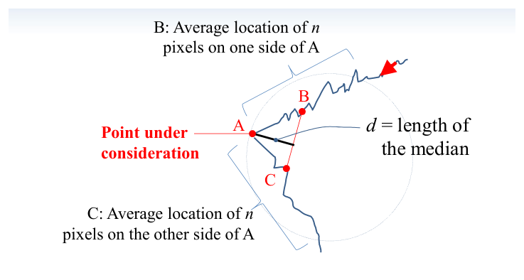
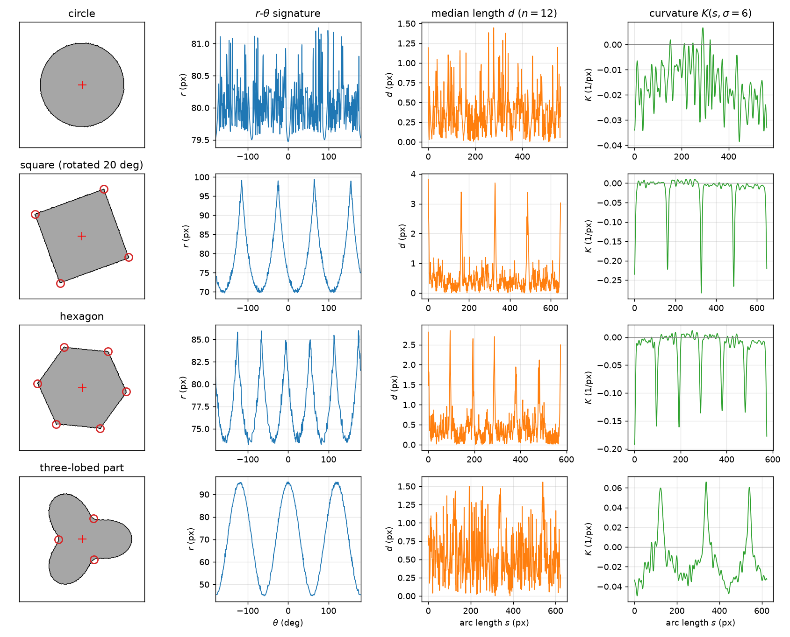
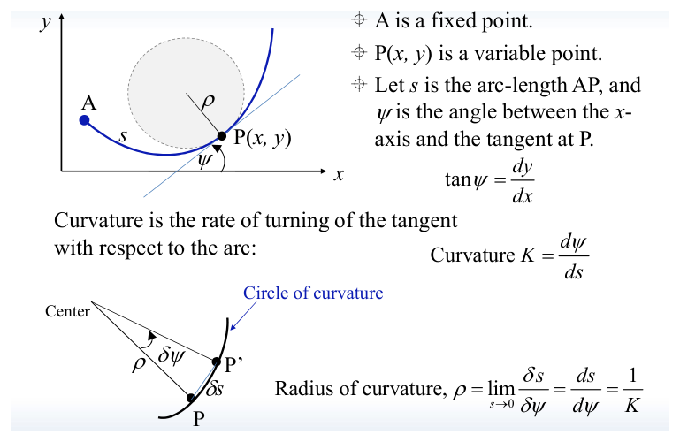
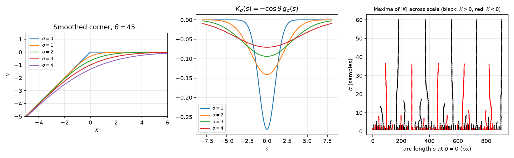
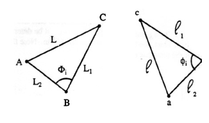
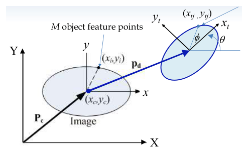
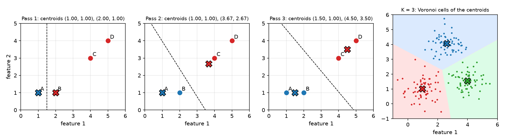

# Template Matching, Clustering and Shape Signatures

A part-feeding robot must know what an object is, where it lies and how it is oriented, and each question becomes easier once the boundary has been reduced to a few robust feature points. This chapter develops the classical model-based answers: a boundary is summarized by a one-dimensional signature (distance from the centroid, median length or curvature), its corners are matched to a stored template through similar triangles, and the transformation is estimated by linear least squares. Correlation matching and K-means clustering are treated along the way, and the scale-space theory that makes curvature-based corner detection reliable is developed in full. The chapter builds on the boundaries and gradients of [Smoothing and Edge Detection](edge-detection.md) and on the lines of [The Hough Transform](hough.md).

## Template Matching

### Tasks and setting

Typical tasks are to **model** objects (build a description that can be stored), **identify** them (which of the stored models is present), and **locate** them (position and orientation). Applications range from recognizing tool silhouettes (bottle, screwdriver, scissors, wrench, spoon, pliers) and faces, to robotic assembly, where a vision system presents parts to a robot: image acquisition, low-level processing, feature extraction, analysis (identify part A or part B) and a decision passed to the robot.

Real images complicate matters: **shadows and highlights** change the apparent outline; parts may be **partially overlapped**; some may be **missing**; and an **oversized** object cannot be imaged whole without losing detail. A useful matching method must work from partial information.

Two families of methods exist. **Correlation methods** compare pixel values of the template directly with the image. **Feature-based methods** first reduce both template and image to a few geometric features and then match the features. The second family, developed in most of this chapter, tolerates rotation, scale and partial occlusion far better.

### Correlation-based matching

Let \\(w(s,t)\\) be a template of size \\(m \times n\\) and \\(f(x,y)\\) the image. Slide the template over the image and, at each offset \\((x, y)\\), measure the mismatch by the **sum of squared differences**
\\[
\mathrm{SSD}(x,y) = \sum\_{s,t}\left[f(x+s, y+t) - w(s,t)\right]^2 = \sum\_{s,t} f^2(x+s,y+t) - 2\sum\_{s,t} f(x+s,y+t)\\,w(s,t) + \sum\_{s,t} w^2(s,t).
\\]
The last term is constant. If the local image energy (the first term) varied little across the image, minimizing the SSD would be the same as maximizing the **cross-correlation**
\\[
c(x,y) = \sum\_{s,t} f(x+s,y+t)\\,w(s,t),
\\]
which is a correlation of the kind computed by the masks of [Image Enhancement and Region Properties](image-enhancement.md). But the local energy does vary, and the raw correlation is largest wherever the image is bright, not where it resembles the template. The remedy is to remove the local mean and normalize by the local energy. The **normalized cross-correlation** is
\\[
\gamma(x,y) = \frac{\sum\_{s,t}\left[f(x+s,y+t) - \bar f\_{xy}\right]\left[w(s,t) - \bar w\right]}
{\sqrt{\sum\_{s,t}\left[f(x+s,y+t) - \bar f\_{xy}\right]^2 \\; \sum\_{s,t}\left[w(s,t) - \bar w\right]^2}},
\\]
where \\(\bar w\\) is the template mean and \\(\bar f\_{xy}\\) the mean of the image under the template. Viewing the two zero-mean patches as vectors, \\(\gamma\\) is the cosine of the angle between them, so by the Cauchy–Schwarz inequality \\(-1 \le \gamma \le 1\\), with \\(\gamma = 1\\) exactly when the image patch is a positive affine function \\(\alpha w + \beta\\) of the template. Normalized correlation is therefore invariant to changes of brightness (\\(\beta\\)) and contrast (\\(\alpha > 0\\)), which is why it is the standard choice. In MATLAB it is `normxcorr2(template, image)`; in scikit-image, `skimage.feature.match_template`.

Correlation matching is simple and accurate for objects whose appearance is fixed, but it is not invariant to **rotation or scale**: a template rotated by more than a few degrees no longer correlates well, and searching over rotations and scales multiplies the cost. It also degrades under partial occlusion. For parts lying in arbitrary orientations on a conveyor, a geometric approach is preferred.

### Matching by alignment of feature points

The alternative is to represent the object by a few characteristic points and to *align* model and image. In the alignment approach (Huttenlocher and Ullman, 1986), feature points are detected in a model image and in the input image; correspondences between small groups of points are hypothesized (possibly organized by a Hough-type voting); each correspondence determines a transformation from model to image; and a hypothesis is accepted when the transformed model aligns many of its edge points with image edge points, even in clutter.

For planar parts on a flat surface, the pipeline used here is

> image → part silhouette → boundary → feature points → similar triangles → match and transformation parameters,

with a **model description** (feature point positions and orientations in a local object frame) stored in a database. The working assumptions are: the object lies on a flat surface; the images are 2-D; the orientation can be determined from the outline or from the feature points. Under real-time constraints the feature points must be *characteristic* of the object, *easy to find*, *unique and robust*, and *sufficient* for fast recognition and accurate computation. Corners and other points of high curvature meet these requirements; the following sections show how to find them and then how to match them.

## Shape Signatures

A closed boundary traced from a starting point is a sequence of pixels \\(\\{(x(s), y(s))\\}\\), parameterized by path length \\(s\\). A **signature** reduces it to a one-dimensional function whose extrema mark the feature points. Three signatures are standard.

### The r–θ signature

1. Compute the centroid \\((x\_c, y\_c)\\) of the region (the mean of the pixel coordinates) and take it as origin.
2. Take the major (principal) axis of the region, which gives the object's orientation, as the reference direction for angles. (The principal-axis angle is derived in [Image Enhancement and Region Properties](image-enhancement.md).)
3. Walk along the boundary; at each edge point compute the distance and angle
\\[
r = \sqrt{(x - x\_c)^2 + (y - y\_c)^2}, \qquad \theta = \operatorname{atan2}(y - y\_c, x - x\_c) - \theta\_{\text{ref}} ,
\\]
and plot \\(r\\) against \\(\theta\\) (the \\(\rho\\)–\\(\theta\\) signature).

Measuring angles from the principal axis makes the signature invariant to rotation; dividing \\(r\\) by its mean makes it invariant to scale. Corners of convex polygons appear as maxima of \\(r\\), and thresholding \\(r\\) picks them out.

**Example 1 (Circle and square).** For a circle of radius \\(R\\), \\(r(\theta) = R\\), a constant: the circle has no distinguished points. For a square of half-side \\(h\\) centred at the origin, the boundary point in direction \\(\theta\\) lies on the side whose outward normal is closest to \\(\theta\\), at distance \\(h\\) along that normal, so
\\[
r(\theta) = \frac{h}{\max(\lvert\cos\theta\rvert, \lvert\sin\theta\rvert)} ,
\\]
which oscillates between \\(h\\) (mid-sides, \\(\theta = 0^\circ, 90^\circ, \dots\\)) and \\(h\sqrt 2\\) (corners, \\(\theta = 45^\circ, 135^\circ, 225^\circ, 315^\circ\\)). The four corners are the four maxima.

The r–θ signature is single-valued only for shapes that are star-shaped with respect to the centroid (every ray from the centroid crosses the boundary once). For a hexagonal nut on a tan background, the distances from the centroid to the edge points form a bimodal histogram: about 30–40 pixels for the hole and 60–72 pixels for the outer boundary. Keeping only the outer edge, the plot of \\(\rho\\) (about 62–72 pixels) against \\(\theta \in [-\pi, \pi]\\) shows six peaks \\(P\_1, \dots, P\_6\\), the corners.

### Median length

The r–θ signature depends on a global reference, the centroid. The **median length** is a local measure. For a boundary point \\(A\\):

- let \\(B\\) be the average location of the \\(n\\) boundary pixels on one side of \\(A\\);
- let \\(C\\) be the average location of the \\(n\\) boundary pixels on the other side;
- let \\(d\\) be the length of the **median** of triangle \\(ABC\\) from \\(A\\), i.e. the distance from \\(A\\) to the midpoint of \\(BC\\).

**Definition (critical point).** \\(A\\) is a critical point (a corner) if \\(d\\) exceeds a threshold distance **and** \\(d\\) is a maximum within a neighbourhood of \\(2n\\) pixels.



*Figure: the median-length construction. B and C are the averages of n boundary pixels on either side of the point A under consideration; d is the distance from A to the midpoint of BC.*

**Why the median length measures curvature.** Near \\(A\\), with \\(T\\) and \\(N\\) the unit tangent and normal and \\(K\\) the curvature, a boundary point at arc distance \\(s\\) is approximately \\(A + sT + \tfrac12 K s^2 N\\). With pixels at spacing \\(\Delta s\\), the points on one side are at \\(s\_j = j\Delta s\\), \\(j = 1, \dots, n\\), and on the other at \\(-s\_j\\). Averaging,
\\[
B \approx A + \overline{s}\\,T + \tfrac12 K\\,\overline{s^2}\\,N, \qquad C \approx A - \overline{s}\\,T + \tfrac12 K\\,\overline{s^2}\\,N ,
\\]
where \\(\overline{s} = \frac1n\sum\_j s\_j\\) and \\(\overline{s^2} = \frac1n\sum\_j s\_j^2 = \Delta s^2 \frac{(n+1)(2n+1)}{6}\\). The tangential terms cancel in the midpoint, leaving
\\[
d = \left\lVert \tfrac12(B + C) - A \right\rVert \approx \frac{\lvert K\rvert\\, \Delta s^2 (n+1)(2n+1)}{12} .
\\]
So on a smooth curve \\(d\\) is proportional to the curvature, and the averaging over \\(n\\) pixels on each side smooths the pixel noise. At a true corner the curvature is concentrated and \\(d\\) is large. The median length is thus a cheap **relative curvature** measure; \\(n\\) plays the role of a smoothing scale.

**Example 2 (Three-lobed parts).** For two three-lobed parts, the median-length plots against curve length are noisy, but thresholding with the \\(2n\\)-neighbourhood maximum condition picks out the corners, which are marked on the silhouettes. The full pipeline is: gray image → binary image → boundary detected with the Sobel gradient (thresholded) → smoothed second-derivative plot against \\(\theta\\) → boundary with the detected corners circled.

### Curvature

Curvature is the most fundamental of the three, since corners are by definition points of high curvature, and it is independent of any reference point. Its definition and computation are developed in full below. The figure compares the three signatures on simple shapes.



*Figure: signatures of four binary shapes with ragged (pixel-noise) boundaries. Columns: the shape with its centroid (+) and the corners found from curvature (circles); the r–θ signature; the median length d (n = 12); the curvature K(s, σ = 6). The circle gives a flat r–θ signature and no curvature extrema; the square and hexagon give 4 and 6 peaks in all three signatures; for the three-lobed part, r–θ shows the three lobes, while the curvature shows three positive (concave) peaks at the necks between lobes. The median length is the noisiest of the three, and curvature with Gaussian smoothing the cleanest.*

**Example 3 (Trapezoid with a hole).** For a four-sided part with a hole (corners near (912, 720), (766, 184), (162, 184), (162, 720) in image coordinates), the r(θ) signature about the centroid shows four peaks at θ ≈ 73°, 139°, 215°, 298°, giving corners (912, 720), (766, 184), (162, 184), (162, 720). The median-length signature over the ~2400 boundary points shows four spikes, at (163, 184), (767, 185), (916, 721), (162, 720). The smoothed curvature \\(\kappa(s)\\) shows four negative spikes of −0.08 to −0.09 at the same places. The methods agree to within a few pixels, and with the Hough-line corners of [The Hough Transform](hough.md).

## Curvature of a Plane Curve

### Definition

Let \\(A\\) be a fixed point on a curve and \\(P(x,y)\\) a variable point, \\(s\\) the arc length from \\(A\\) to \\(P\\), and \\(\psi\\) the angle between the \\(x\\)-axis and the tangent at \\(P\\), so \\(\tan\psi = dy/dx\\).

**Definition (Curvature).** The curvature is the rate of turning of the tangent with respect to arc length,
\\[
K = \frac{d\psi}{ds} .
\\]
The **radius of curvature** is
\\[
\rho = \lim\_{\delta s \to 0}\frac{\delta s}{\delta\psi} = \frac{ds}{d\psi} = \frac1K ,
\\]
the radius of the **circle of curvature** (osculating circle) that best fits the curve at \\(P\\).



*Figure: curvature. The tangent angle ψ turns by δψ over an arc δs; the ratio defines K, and its reciprocal ρ is the radius of the circle of curvature.*

### Curvature of a graph \\(y(x)\\)

Differentiate \\(\tan\psi = dy/dx\\) with respect to \\(s\\), using the chain rule on the right and \\(dx/ds = \cos\psi\\):
\\[
\sec^2\psi\\,\frac{d\psi}{ds} = \frac{d}{dx}\left(\frac{dy}{dx}\right)\frac{dx}{ds} = \frac{d^2y}{dx^2}\cos\psi .
\\]
With \\(d\psi/ds = 1/\rho\\),
\\[
\rho = \frac{\sec^3\psi}{d^2y/dx^2} = \frac{(1 + \tan^2\psi)^{3/2}}{d^2y/dx^2}
\quad\Longrightarrow\quad
\boxed{K = \frac{1}{\rho} = \frac{d^2y/dx^2}{\left[1 + (dy/dx)^2\right]^{3/2}} .}
\\]

**Sign.** The denominator is always positive, so the sign of \\(K\\) is the sign of \\(d^2y/dx^2\\): a convex arc (shaped like ∩) has negative curvature, a concave arc (shaped like ∪) positive curvature, and a straight segment zero. On a closed contour the sign also depends on the direction of traversal; with a consistent direction, convex corners of an object all have one sign and concavities the other.

### Parametric curves

Boundaries in images are parametric, \\(\\{x(s), y(s)\\}\\). Write \\(\dot x = dx/ds\\), \\(\ddot x = d^2x/ds^2\\), and similarly for \\(y\\). Then \\(y' = dy/dx = \dot y/\dot x\\) and
\\[
y'' = \frac{d}{dx}\left(\frac{\dot y}{\dot x}\right) = \frac{1}{\dot x}\\,\frac{\ddot y\dot x - \dot y\ddot x}{\dot x^2} = \frac{\dot x\ddot y - \dot y\ddot x}{\dot x^3}.
\\]
Substituting into the boxed formula, \\(1 + y'^2 = (\dot x^2 + \dot y^2)/\dot x^2\\) and
\\[
\boxed{K(s) = \frac{\dot x\ddot y - \dot y\ddot x}{(\dot x^2 + \dot y^2)^{3/2}} .}
\\]
This holds for any parameter \\(s\\). If \\(s\\) is the arc length, then \\(\dot x = \cos\psi\\), \\(\dot y = \sin\psi\\), \\(\dot x^2 + \dot y^2 = 1\\), and
\\[
K = \dot x\ddot y - \dot y\ddot x .
\\]

**Example 4 (Line, circle, corner).**

- *Straight line:* \\(x = s\cos\theta\\), \\(y = s\sin\theta\\); \\(\ddot x = \ddot y = 0\\), so \\(K = 0\\).
- *Circle:* \\(x = r\cos(2\pi s/N)\\), \\(y = r\sin(2\pi s/N)\\), with \\(N\\) the path length. Then \\(\dot x^2 + \dot y^2 = (2\pi r/N)^2\\) and \\(\dot x\ddot y - \dot y\ddot x = r^2(2\pi/N)^3\\), so \\(K = 1/r\\): constant, and larger for smaller circles.
- *Corner:* \\(x(s) = -s\\), \\(y(s) = 0\\) for \\(s < 0\\); \\(x(s) = s\cos\theta\\), \\(y(s) = s\sin\theta\\) for \\(s \ge 0\\). Both arms are straight (\\(K = 0\\)); all the turning happens at \\(s = 0\\), where \\(K\\) is a delta function. A discrete boundary turns this into a single large value buried in pixel noise, which is why curvature must be computed at a chosen *scale*.

## Scale-Space Filtering

### Gaussian smoothing of a contour

Differentiating a pixel boundary twice amplifies the quantization noise enormously (at \\(\sigma = 0\\), the curvature of a real boundary is pure noise). The cure is to smooth the coordinate functions with a Gaussian of scale \\(\sigma\\),
\\[
g\_\sigma(s) = \frac{1}{\sigma\sqrt{2\pi}}\exp\left(\frac{-s^2}{2\sigma^2}\right), \qquad
X(s,\sigma) = x \* g\_\sigma = \int x(s - u)\\,g\_\sigma(u)\\,du, \qquad Y(s,\sigma) = y \* g\_\sigma ,
\\]
and to compute the curvature of the smoothed curve,
\\[
K\_\sigma[X, Y] = \frac{\dot X\ddot Y - \dot Y\ddot X}{(\dot X^2 + \dot Y^2)^{3/2}}, \qquad \dot X = \frac{\partial X}{\partial s},\quad \ddot X = \frac{\partial^2 X}{\partial s^2}.
\\]
With the arc-length simplification of the original curve (\\(\dot x^2 + \dot y^2 = 1\\)) this is commonly approximated by
\\[
K(s,\sigma) = \dot X(s,\sigma)\ddot Y(s,\sigma) - \dot Y(s,\sigma)\ddot X(s,\sigma).
\\]
The approximation is good where the smoothed curve moves at nearly unit speed, which is the case away from sharp corners and for small smoothing scales. For the symmetric corner analysed below, the extremum stays at the corner for either form, as the remark after the theorem shows.

**Derivatives by convolution.** Convolution commutes with differentiation:
\\[
F(s,\sigma) = \int f(s - u)\\,g\_\sigma(u)\\,du = \int g\_\sigma(s - u)\\,f(u)\\,du,
\qquad
\frac{dF}{ds} = \int \frac{d g\_\sigma(s - u)}{ds} f(u)\\,du ,
\\]
i.e. \\(\dot F(s,\sigma) = \frac{d}{ds}\left[F(s,0) \* g\_\sigma\right] = F(s,0) \* \dot g\_\sigma\\), and similarly \\(\ddot F = F(s,0) \* \ddot g\_\sigma\\). The smoothed derivatives are obtained by convolving the raw coordinates with derivatives of the Gaussian, with no numerical differentiation of noisy data. In discrete form, truncating the Gaussian at \\(\pm 5\sigma\\),
\\[
F(s,\sigma) = \sum\_{u=-5\sigma}^{5\sigma} f(s - u)\\,g\_\sigma(u), \qquad
\frac{dF}{ds} \approx F(j+1,\sigma) - F(j-1,\sigma), \qquad
\frac{d^2F}{ds^2} \approx F(j+1,\sigma) - 2F(j,\sigma) + F(j-1,\sigma)
\\]
(the first difference is often divided by 2 to make it a central difference; the factor does not move extrema).

**Closed contours.** The boundary of an object is periodic, so the convolution must wrap around. A simple implementation duplicates the coordinate sequence, convolves, and keeps one period:

```matlab
% x0, y0: outer boundary from bwboundaries(~BW,'noholes')
x = [x0; x0]; y = [y0; y0];               % duplicate for circular convolution
n = length(x); s = linspace(-n/2, n/2, n);
sigma = 5;
g0 = 1/sqrt(2*pi*sigma^2) * exp(-s.^2/(2*sigma^2));
g  = [g0 g0]';
X = conv(x, g, 'same'); X = X(1:end/2);   % 'same' keeps the central part
Y = conv(y, g, 'same'); Y = Y(1:end/2);
Xd = diff(X); Xdd = diff(Xd); Yd = diff(Y); Ydd = diff(Yd);
K = Xd(1:end-1).*Ydd - Xdd.*Yd(1:end-1);  % curvature (unit-speed form)
[pk, loc] = findpeaks(-K);                % convex corners = negative peaks
```

In Python, `scipy.ndimage.gaussian_filter1d(x, sigma, order=k, mode='wrap')` returns the \\(k\\)-th derivative of the smoothed periodic sequence directly.

**Example 5 (Hex nut corners at \\(\sigma = 5\\)).** For the outer boundary of the hexagonal nut, the curvature at \\(\sigma = 0\\) is noise; at \\(\sigma = 5\\), \\(K(s, 5)\\) shows six clear negative peaks. The corners found by the three methods (image coordinates with \\(X\\) pointing down) are

| corner | r–θ signature | curvature, \\(\sigma = 5\\) | intersection of Hough lines |
|---|---|---|---|
| \\(P\_1\\) | (133, 49) | (140, 54) | (137.92, 45.92) |
| \\(P\_2\\) | (68, 71) | (70, 70) | (69.32, 69.06) |
| \\(P\_3\\) | (55, 142) | (50, 135) | (47.66, 135.66) |
| \\(P\_4\\) | (107, 186) | (95, 185) | (103.27, 191.21) |
| \\(P\_5\\) | (172, 163) | (164, 171) | (169.13, 169.13) |
| \\(P\_6\\) | (185, 94) | (185, 105) | (192.21, 100.21) |

The Hough lines come from foot-of-normal votes: \\((x\_0, y\_0, a, b)\\) for \\(y = ax + b\\) are \\(L\_1\\) (−44, 44, 1, 88), \\(L\_2\\) (46, −46, 1, −92), \\(L\_3\\) (83, 27, −3.074, 282.148), \\(L\_4\\) (203, 68, −2.985, 674.015), \\(L\_5\\) (28, 83, −0.337, 92.446), \\(L\_6\\) (68, 203, −0.335, 225.778), and each corner is the intersection of two adjacent lines. Because every line is fitted to a whole side, the three estimates agree to within about 9 pixels.

### Scale-space description of a corner

How does smoothing move a corner? Take a corner at \\(s = 0\\) whose tangent turns by an angle determined by \\(\theta\\):
\\[
x(s) = \begin{cases} s\sin\theta, & s < 0 \\\\ s, & s \ge 0 \end{cases}
\qquad
y(s) = \begin{cases} s\cos\theta, & s < 0 \\\\ 0, & s \ge 0 \end{cases}
\\]
One arm runs along the positive \\(x\\)-axis for \\(s \ge 0\\); the other arrives along the unit direction \\((\sin\theta, \cos\theta)\\), making angle \\(\theta\\) with the vertical. Both arms are parameterized by arc length. Let
\\[
G\_\sigma(s) = \int\_{-\infty}^{s} g\_\sigma(u)\\,du
\\]
be the Gaussian cumulative distribution function, so \\(\dot G\_\sigma = g\_\sigma\\), and recall \\(\dot g\_\sigma(s) = -s\\,g\_\sigma(s)/\sigma^2\\).

**Example 6 (Smoothed tangent \\(\dot X, \dot Y\\)).** By the convolution rule, \\(\dot X = \dot x \* g\_\sigma = \int \dot x(s - u)\\,g\_\sigma(u)\\,du\\). Split the integral at \\(u = s\\). For \\(u \le s\\) the argument \\(t = s - u \ge 0\\) and \\(\dot x = 1\\); for \\(u > s\\), \\(t < 0\\) and \\(\dot x = \sin\theta\\). Hence
\\[
\dot X(s,\sigma) = \int\_{-\infty}^{s} g\_\sigma\\,du + \sin\theta\int\_{s}^{\infty} g\_\sigma\\,du = G\_\sigma + (1 - G\_\sigma)\sin\theta = (1 - \sin\theta)G\_\sigma + \sin\theta .
\\]
Likewise \\(\dot y = 0\\) for \\(t \ge 0\\) and \\(\cos\theta\\) for \\(t < 0\\):
\\[
\dot Y(s,\sigma) = \cos\theta\int\_{s}^{\infty} g\_\sigma(u)\\,du = (1 - G\_\sigma)\cos\theta .
\\]

**Example 7 (Smoothed curve \\(X, Y\\)).** Directly,
\\[
X(s,\sigma) = \int\_{-\infty}^{s}(s - u)\\,g\_\sigma\\,du + \sin\theta\int\_{s}^{\infty}(s - u)\\,g\_\sigma\\,du = sG\_\sigma + s\sin\theta(1 - G\_\sigma) - \int\_{-\infty}^{s} u\\,g\_\sigma\\,du - \sin\theta\int\_{s}^{\infty} u\\,g\_\sigma\\,du .
\\]
For the remaining integrals substitute \\(\tau = -u^2/2\sigma^2\\), \\(d\tau = -u\\,du/\sigma^2\\):
\\[
{}-\int u\\,g\_\sigma(u)\\,du = \frac{\sigma^2}{\sigma\sqrt{2\pi}}\int e^{\tau}\\,d\tau = \sigma^2 g\_\sigma(u) + \text{const}.
\\]
Since \\(g\_\sigma(\pm\infty) = 0\\), \\(-\int\_{-\infty}^{s} u\\,g\_\sigma\\,du = \sigma^2 g\_\sigma(s)\\) and \\(-\int\_{s}^{\infty} u\\,g\_\sigma\\,du = -\sigma^2 g\_\sigma(s)\\). Therefore
\\[
X(s,\sigma) = s\left[(1 - \sin\theta)G\_\sigma + \sin\theta\right] + \sigma^2(1 - \sin\theta)\\,g\_\sigma(s),
\\]
\\[
Y(s,\sigma) = \cos\theta\int\_{s}^{\infty}(s - u)\\,g\_\sigma\\,du = \cos\theta\left[s(1 - G\_\sigma) - \sigma^2 g\_\sigma(s)\right].
\\]

**Example 8 (Consistency check).** Differentiate Example 7 using \\(\dot G\_\sigma = g\_\sigma\\) and \\(\dot g\_\sigma = -s\\,g\_\sigma/\sigma^2\\):
\\[
\dot X = (1 - \sin\theta)G\_\sigma + \sin\theta + s(1 - \sin\theta)g\_\sigma - s(1 - \sin\theta)g\_\sigma = (1 - \sin\theta)G\_\sigma + \sin\theta,
\\]
the last two terms cancelling, and similarly \\(\dot Y = \cos\theta\left[(1 - G\_\sigma) - s g\_\sigma + s g\_\sigma\right] = (1 - G\_\sigma)\cos\theta\\). Both agree with Example 6.

**Curvature of the smoothed corner.** Differentiating once more,
\\[
\ddot X = (1 - \sin\theta)\\,g\_\sigma, \quad \dddot X = (1 - \sin\theta)\\,\dot g\_\sigma, \quad \ddot Y = -g\_\sigma\cos\theta, \quad \dddot Y = -\dot g\_\sigma\cos\theta .
\\]
Then
\\[
K(s,\sigma) = \dot X\ddot Y - \dot Y\ddot X = -g\_\sigma\cos\theta\left[(1 - \sin\theta)G\_\sigma + \sin\theta + (1 - G\_\sigma)(1 - \sin\theta)\right] = -\cos\theta\\,g\_\sigma(s).
\\]
The bracket simplifies to \\((1 - \sin\theta) + \sin\theta = 1\\). The curvature of the smoothed corner is a Gaussian bump centred on the corner, with peak \\(-\cos\theta/(\sigma\sqrt{2\pi})\\) that decreases, and width that grows, in proportion to \\(\sigma\\). Its integral is \\(-\cos\theta\\), independent of \\(\sigma\\): smoothing spreads the turning over a longer arc but preserves the total.



*Figure: left, a 45° corner smoothed at σ = 0, 1, 2, 3, 4 using the closed-form X(s, σ), Y(s, σ); the corner rounds progressively. Centre, K_σ(s) = −cos θ g_σ(s): the peak stays at s = 0 while it lowers and widens. Right, a curvature scale-space map of a noisy five-lobed contour: each dot is a local maximum of |K| at scale σ, plotted at its arc-length position. Noise maxima die out at small σ; the five lobes (black, K > 0 with this traversal) and the five concavities between them (red) persist as nearly vertical lines over a wide range of scales.*

### Locating curvature maxima

Corner detection at a fixed scale means finding all locations of maximum \\(\lvert K(s,\sigma)\rvert\\): positive maxima (concave) and negative minima (convex). Treating \\(\sigma\\) as constant:

- for \\(K > 0\\) (concave): solve \\(\dfrac{dK}{ds} = 0\\) subject to \\(\dfrac{d^2K}{ds^2} < 0\\);
- for \\(K < 0\\) (convex): solve \\(\dfrac{dK}{ds} = 0\\) subject to \\(\dfrac{d^2K}{ds^2} > 0\\).

With the unit-speed form,
\\[
\frac{dK}{ds} = \frac{d}{ds}(\dot X\ddot Y - \dot Y\ddot X) = \ddot X\ddot Y + \dot X\dddot Y - \ddot Y\ddot X - \dot Y\dddot X ,
\\]
the middle terms cancel, and
\\[
\boxed{\frac{\partial K}{\partial s} = \dot X(s,\sigma)\dddot Y(s,\sigma) - \dot Y(s,\sigma)\dddot X(s,\sigma) = 0 ,}
\\]
where the third derivatives are again convolutions, \\(\dddot F(s,\sigma) = \frac{d^3}{ds^3}\left[F(s,0) \* g\_\sigma\right] = \ddot F(s,0) \* \dot g\_\sigma = \dot F(s,0) \* \ddot g\_\sigma\\).

**Theorem (Scale invariance of a corner's location).** For the corner above, with \\(\theta \ne 90^\circ\\) and \\(\theta > -90^\circ\\), the only extremum of curvature of the smoothed curve is at \\(s = 0\\), for every \\(\sigma > 0\\).

*Proof.* Substitute the derivatives into the boxed condition:
\\[
\left[(1 - \sin\theta)G\_\sigma + \sin\theta\right] (-\dot g\_\sigma\cos\theta) - \left[(1 - G\_\sigma)\cos\theta\right] (1 - \sin\theta)\dot g\_\sigma = 0 .
\\]
The terms in \\(G\_\sigma\\) cancel, leaving
\\[
{}-\dot g\_\sigma\cos\theta = 0 .
\\]
If \\(\theta = 90^\circ\\), \\(\cos\theta = 0\\) and the "corner" is a straight line: every \\(s\\) satisfies the equation but none satisfies the second-order condition, so there is no curvature maximum. Otherwise \\(\cos\theta \ne 0\\) and the condition requires \\(\dot g\_\sigma(s) = -s\\,g\_\sigma(s)/\sigma^2 = 0\\), whose only solution is \\(s = 0\\), independent of the corner angle \\(\theta\\) and the scale \\(\sigma\\). At \\(s = 0\\), \\(K = -\cos\theta\\,g\_\sigma(0)\\), a minimum for \\(\cos\theta > 0\\) (the convex case) and a maximum for \\(\cos\theta < 0\\). \\(\square\\)

The same conclusion holds for the exact curvature formula with the speed normalization, because the corner is symmetric under reflection in its bisector combined with \\(s \to -s\\), so \\(\lvert K\rvert\\) is an even function of \\(s\\) and \\(s = 0\\) is an extremum at every scale.

**Consequence.** In the \\((s, \sigma)\\) plane, the curvature extremum of a corner traces a **vertical line**: its position on the contour does not move as the curve is smoothed. Noise-induced extrema, by contrast, merge and vanish as \\(\sigma\\) grows. This is the basis of robust corner detection (Rattarangsi and Chin, 1992): smooth over a range of scales and keep the extrema that persist.

**Example 9 (Ramp: two corners).** Consider the profile
\\[
x(s) = \begin{cases} s\sin\theta, & s < 0 \\\\ s, & 0 \le s < \ell \\\\ \ell, & s \ge \ell \end{cases}
\qquad\Longrightarrow\qquad
\dot x = \sin\theta,\\ 1,\\ 0 \text{ on the three pieces.}
\\]
Splitting the convolution at \\(u = s\\) and \\(u = s - \ell\\),
\\[
\dot X(s,\sigma) = \sin\theta\left[1 - G\_\sigma(s)\right] + \left[G\_\sigma(s) - G\_\sigma(s - \ell)\right] = (1 - \sin\theta)G\_\sigma(s) + \sin\theta - G\_\sigma(s - \ell),
\\]
\\[
\ddot X(s,\sigma) = (1 - \sin\theta)\\,g\_\sigma(s) - g\_\sigma(s - \ell).
\\]
Each break in slope contributes its own Gaussian bump to the second derivative. Near \\(s = 0\\) and for \\(\ell \gg \sigma\\) the second term is negligible and the result reduces to the single corner, \\(\ddot X = (1-\sin\theta)g\_\sigma\\). (A frequent slip is to write \\(\ddot X = (1 - \sin\theta)(-s\\,g\_\sigma/\sigma^2)\\); that is \\(\dddot X\\), one derivative too many.) When \\(\sigma\\) becomes comparable to \\(\ell\\), the two bumps overlap and the two corners merge into one in scale space.

### The curvature scale-space map

Computing the curvature maxima for a continuum of scales and plotting each one at its arc-length position (horizontal axis: arc length of the original curve at \\(\sigma = 0\\); vertical axis: the Gaussian parameter \\(\sigma\\), which sets the degree of smoothing) gives the **scale-space map**. Each line in the map traces one curvature extremum across scales; signs mark downward (+) and upward (−) concavity. For a hand-shaped contour smoothed at five increasing scales, \\(X(s,\sigma)\\), \\(Y(s,\sigma)\\) and \\(K(s,\sigma)\\) become steadily smoother with fewer extrema, and in the map the dominant points appear as long, nearly vertical lines, while the noise extrema form short arches near \\(\sigma = 0\\). Dominant points are read off as the lines that reach a large scale, located at their \\(\sigma \to 0\\) end where the position is most precise.

## Matching Feature Points: Similar Triangles

Once each object is reduced to a set of feature points, matching proceeds with **triangles** of feature points as the basic unit. A triangle is the smallest configuration that fixes a planar similarity transformation, and its shape (two side ratios and an angle) is invariant to translation, rotation and scale.

**Approach.** The precompiled description of a part is the *template*. Use triples of feature points (corners, high-curvature locations) forming triangles as the basis:

1. search for triangles in the image similar to template triangles;
2. determine the transformation parameters mapping the template onto the silhouette;
3. verify the remaining points using the template;
4. determine location and orientation from the best match.

### The similarity test

Let a template triangle have sides \\(L\\), \\(L\_1\\), \\(L\_2\\) and included angle \\(\Phi\_i\\), and an image triangle sides \\(\ell\\), \\(\ell\_1\\), \\(\ell\_2\\) and angle \\(\phi\_i\\). Two constraints must be met:
\\[
\left\lvert\frac{L\_i}{L} - \frac{\ell\_i}{\ell}\right\rvert < \varepsilon\_i \quad (i = 1, 2), \qquad \lvert\Phi\_i - \phi\_i\rvert < \varepsilon\_\phi .
\\]
For an exact match the sides are proportional with **scaling factor**
\\[
k = \frac{\ell}{L} = \frac{\ell\_i}{L\_i} .
\\]



*Figure: a template triangle (left) and a candidate image triangle (right). Similarity requires matching side ratios L_i/L and ℓ_i/ℓ and matching angles Φ_i and φ_i.*

**Choosing the tolerance.** Measured lengths are not exact (because of fabrication tolerances, segmentation and pixel quantization): \\(\ell\_i = kL\_i \pm \delta\_i\\) and \\(\ell = kL \pm \delta\\). Suppose the dimensional tolerance is a relative error bound
\\[
\rho = \frac{\lvert\delta\rvert}{\ell} = \frac{\lvert\delta\_i\rvert}{\ell\_i}, \qquad 0 < \rho < 1 .
\\]
What \\(\varepsilon\_i\\) does it imply? Substitute into the ratio test:
\\[
\left\lvert\frac{L\_i}{L} - \frac{kL\_i \pm \delta\_i}{kL \pm \delta}\right\rvert = \left\lvert\frac{L\_i(kL \pm \delta) - L(kL\_i \pm \delta\_i)}{L(kL \pm \delta)}\right\rvert = \left\lvert\frac{\pm L\_i\delta \mp L\delta\_i}{L(kL \pm \delta)}\right\rvert .
\\]
In the worst case the two errors add. Using \\(\delta = \rho\ell = \rho kL\\) and \\(\delta\_i = \rho\ell\_i = \rho kL\_i\\),
\\[
\frac{L\_i\\,\rho kL + L\\,\rho kL\_i}{L(kL \pm \rho kL)} = \frac{2\rho}{1 \pm \rho}\\,\frac{L\_i}{L} = \frac{2\rho}{1 \pm \rho}\\,\frac{\ell\_i}{\ell} .
\\]
The largest value occurs with the minus sign, so
\\[
\boxed{(\varepsilon\_i)\_{\max} = \frac{2\rho}{1 - \rho}\left(\frac{\ell\_i}{\ell}\right).}
\\]
For a 5% tolerance (\\(\rho = 0.05\\)) the ratio tolerance is \\(0.105\\) times the side ratio.

### Polygon matching procedure

A template polygon with \\(N\\) vertices contains \\(\binom{N}{3}\\) triangles; for \\(N = 5\\), \\(\binom{5}{3} = \frac{5!}{3!\\,2!} = \frac{5\times4}{2\times1} = 10\\) triangles (123, 124, 125, 134, 135, 145, 234, 235, 245, 345).

1. Order the vertices of each triangle by sorting its side lengths (ascending or descending), so that corresponding vertices of similar triangles have the same index.
2. Match two similar triangles by aligning longest side to longest side.
3. Use the pseudo-inverse (next section) to find the transformation parameters \\((x\_d, y\_d; k, \theta)\\) between the two triangles.
4. Compute the error by applying the forward transformation to the three template vertices and comparing with the image vertices.
5. Repeat over all candidate triangle pairs.
6. Choose the pair with the smallest error and use its estimate as the final parameters (optionally refined with all matched points).

With 6 template points and 4 detected object points, for instance, there are \\(\binom{6}{3} = 20\\) template triangles to test against \\(\binom{4}{3} = 4\\) object triangles; the best match minimizes \\(E = \sum\_i\left[(x\_{ti} - x\_i)^2 + (y\_{ti} - y\_i)^2\right]\\) over the matched points.

## Transformation Parameters by Least Squares

### The similarity transformation

Let the object's local frame sit at its centroid \\(\mathbf P\_c = (X\_c, Y\_c)\\) in the image frame \\((X, Y)\\); there are \\(M\\) object feature points. The template has its own frame \\((x\_t, y\_t)\\) at the template centroid and \\(N\\) feature points, each written in polar form
\\[
\begin{bmatrix} x\_{tj} \\\\ y\_{tj} \end{bmatrix} = r\begin{bmatrix}\cos\phi \\\\ \sin\phi\end{bmatrix}.
\\]



*Figure: the image frame (X, Y), the object frame at the object centroid (x_c, y_c), and the template frame (x_t, y_t), displaced by p_d and rotated by θ relative to the object frame. A template point is at radius r and angle φ in its own frame.*

In the object frame, a template displaced by \\(\mathbf p\_d = (x\_d, y\_d)\\) and rotated by \\(\theta\\) places its point at
\\[
\begin{bmatrix} x \\\\ y \end{bmatrix} = \begin{bmatrix} x\_d \\\\ y\_d \end{bmatrix} + r\begin{bmatrix}\cos(\phi + \theta) \\\\ \sin(\phi + \theta)\end{bmatrix}.
\\]
Expand with the angle-sum formulas, \\(r\cos(\phi+\theta) = r\cos\phi\cos\theta - r\sin\phi\sin\theta = x\_{tj}\cos\theta - y\_{tj}\sin\theta\\) and \\(r\sin(\phi+\theta) = x\_{tj}\sin\theta + y\_{tj}\cos\theta\\):
\\[
\begin{bmatrix} x \\\\ y \end{bmatrix} = \begin{bmatrix}\cos\theta & -\sin\theta \\\\ \sin\theta & \cos\theta\end{bmatrix}\begin{bmatrix} x\_{tj} \\\\ y\_{tj}\end{bmatrix} + \begin{bmatrix} x\_d \\\\ y\_d\end{bmatrix}.
\\]
In image coordinates, allowing a scale factor \\(k\\),
\\[
\begin{bmatrix} X\_{tj} \\\\ Y\_{tj} \end{bmatrix} = k\begin{bmatrix}\cos\theta & -\sin\theta \\\\ \sin\theta & \cos\theta\end{bmatrix}\begin{bmatrix} x\_{tj} \\\\ y\_{tj}\end{bmatrix} + \begin{bmatrix} X\_c + x\_d \\\\ Y\_c + y\_d\end{bmatrix}.
\\]

### Linearization

If the scaled template matches and template point \\((x\_{tj}, y\_{tj})\\) corresponds to image point \\((X\_i, Y\_i)\\), then
\\[
X\_i = \underbrace{k\cos\theta}\_{q\_1}\\,x\_{tj} - \underbrace{k\sin\theta}\_{q\_2}\\,y\_{tj} + \underbrace{X\_c + x\_d}\_{q\_3}, \qquad
Y\_i = q\_2\\,x\_{tj} + q\_1\\,y\_{tj} + \underbrace{Y\_c + y\_d}\_{q\_4}.
\\]
The model is nonlinear in \\((k, \theta)\\) but **linear** in \\(\mathbf Q = [q\_1\ q\_2\ q\_3\ q\_4]^T\\):
\\[
\underbrace{\begin{bmatrix} x\_{tj} & -y\_{tj} & 1 & 0 \\\\ y\_{tj} & x\_{tj} & 0 & 1\end{bmatrix}}\_{\mathbf A}\mathbf Q = \underbrace{\begin{bmatrix} X\_i \\\\ Y\_i \end{bmatrix}}\_{\mathbf R}.
\\]
Each correspondence contributes two rows. Two correspondences determine \\(\mathbf Q\\) exactly; \\(m\\) correspondences give an overdetermined system of \\(2m\\) equations in 4 unknowns, solved in the least-squares sense:
\\[
\mathbf Q = (\mathbf A^T\mathbf A)^{-1}\mathbf A^T\mathbf R .
\\]
The physical parameters are recovered as
\\[
\boxed{k = \sqrt{q\_1^2 + q\_2^2}, \qquad \theta = \tan^{-1}\frac{q\_2}{q\_1}, \qquad x\_d = q\_3 - X\_c, \qquad y\_d = q\_4 - Y\_c ,}
\\]
with \\(\theta\\) taken in the correct quadrant (`atan2(q2, q1)`). In the formulation of Lee and Janakiraman (1992) the stacked matrix \\(\mathbf A\\) is written with centroid-relative coordinates (columns such as \\(x\_{t1} - X\_c\\), \\(-y\_{t1} + Y\_c\\)) and \\(2 \times 2\\) identity blocks, which is the same system with the origin moved.

### Linear least squares

The pseudo-inverse solution is worth deriving once, since it recurs in camera calibration. Consider \\(p\\) linear equations in \\(q\\) unknowns,
\\[
a\_{i1}x\_1 + \dots + a\_{iq}x\_q = y\_i, \quad i = 1,\dots,p, \qquad\text{i.e.}\qquad \mathbf A\mathbf x = \mathbf y,\quad \mathbf A \in \mathbb R^{p\times q}.
\\]
Three cases arise: \\(p < q\\), **underconstrained** (more unknowns than equations; a family of solutions, selected by an optimization criterion); \\(p = q\\), a unique solution when \\(\mathbf A\\) is nonsingular; \\(p > q\\), **overconstrained** (more equations than unknowns; generally no exact solution), the situation of curve fitting, template matching and calibration.

In the overconstrained case minimize the sum of squared residuals
\\[
E \overset{\text{def}}{=} \sum\_{i=1}^{p}(a\_{i1}x\_1 + \dots + a\_{iq}x\_q - y\_i)^2 = \lVert\mathbf A\mathbf x - \mathbf y\rVert^2 = \mathbf e^T\mathbf e, \qquad \mathbf e = \mathbf A\mathbf x - \mathbf y .
\\]
At the minimum, \\(\partial E/\partial x\_i = 2\\,(\partial\mathbf e/\partial x\_i)\cdot\mathbf e = 0\\) for every \\(i\\). Write \\(\mathbf A\\) by columns, \\(\mathbf c\_j = [a\_{1j}\ \dots\ a\_{pj}]^T\\); then \\(\mathbf e = x\_1\mathbf c\_1 + \dots + x\_q\mathbf c\_q - \mathbf y\\) and \\(\partial\mathbf e/\partial x\_i = \mathbf c\_i\\). The \\(q\\) conditions \\(\mathbf c\_i^T(\mathbf A\mathbf x - \mathbf y) = 0\\) stack into
\\[
\begin{bmatrix}\mathbf c\_1^T \\\\ \vdots \\\\ \mathbf c\_q^T\end{bmatrix}(\mathbf A\mathbf x - \mathbf y) = \mathbf A^T(\mathbf A\mathbf x - \mathbf y) = \mathbf 0
\quad\Longrightarrow\quad
\mathbf A^T\mathbf A\\,\mathbf x = \mathbf A^T\mathbf y ,
\\]
the **normal equations**: the residual is orthogonal to every column of \\(\mathbf A\\). If \\(\mathbf A\\) has full column rank, \\(\mathbf A^T\mathbf A\\) is invertible and
\\[
\mathbf x = (\mathbf A^T\mathbf A)^{-1}\mathbf A^T\mathbf y ,
\\]
which is MATLAB's `x = pinv(A)*y` (or, numerically preferable, `x = A\y`). Since \\(E\\) is a convex quadratic, this stationary point is the global minimum.

**Example 10 (Template-to-target match).** A template has features F1 (0, 0), F2 (10, 0), F3 (10, 5), F4 (0, 10); the target object shows three features (8.5355, 8.5355), (5, 5), (1.4645, 8.5355). Matching the right triangle {F1, F2, F4} (legs \\(L\_1 = L\_2 = 10\\)) to the target triangle and solving the \\(6 \times 4\\) least-squares system (frames with \\(X\_c = Y\_c = 0\\)) gives
\\[
k = 0.5, \qquad \theta = 45^\circ, \qquad x\_d = y\_d = 5 .
\\]
Check: F1 (0, 0) maps to \\((5, 5)\\). F2 (10, 0) maps to \\(0.5(10\cos45^\circ, 10\sin45^\circ) + (5,5) = 0.5(7.071, 7.071) + 5 = (8.5355, 8.5355)\\). F4 (0, 10) maps to \\(0.5(-7.071, 7.071) + 5 = (1.4645, 8.5355)\\). All three residuals vanish.

**Example 11 (Forward and inverse transformation).** Take template points (0, 0), (2, 6), (5, 2) and \\(k = 2.5\\), \\(\theta = 15^\circ\\), \\((x\_d, y\_d) = (7, 3)\\), with \\(c = \cos 15^\circ = 0.9659\\), \\(s = \sin 15^\circ = 0.2588\\). The forward map gives
\\[
(0,0) \mapsto (7, 3), \qquad (2,6) \mapsto \left(7 + 2.5(2c - 6s),\\; 3 + 2.5(2s + 6c)\right) = (7.947,\ 18.783),
\\]
\\[
(5,2) \mapsto \left(7 + 2.5(5c - 2s),\\; 3 + 2.5(5s + 2c)\right) = (17.780,\ 11.065).
\\]
For the inverse problem, the rows \\([x\_t, -y\_t, 1, 0]\\) and \\([y\_t, x\_t, 0, 1]\\) for the three points form a \\(6 \times 4\\) matrix; the pseudo-inverse returns \\(q\_1 = 2.4148\\), \\(q\_2 = 0.6470\\), \\(q\_3 = 7\\), \\(q\_4 = 3\\), i.e. \\(k = 2.5\\), \\(\theta = 15^\circ\\), \\((x\_d, y\_d) = (7, 3)\\), with zero residual.

```python
import numpy as np
def similarity_ls(T, O):
    """Least-squares k, theta (deg), xd, yd mapping template points T to image points O."""
    A, R = [], []
    for (xt, yt), (X, Y) in zip(T, O):
        A += [[xt, -yt, 1, 0], [yt, xt, 0, 1]]
        R += [X, Y]
    q = np.linalg.lstsq(np.array(A, float), np.array(R, float), rcond=None)[0]
    return np.hypot(q[0], q[1]), np.degrees(np.arctan2(q[1], q[0])), q[2], q[3]

print(similarity_ls([(0, 0), (2, 6), (5, 2)], [(7, 3), (7.947, 18.783), (17.780, 11.065)]))
# -> (2.500, 15.00, 7.00, 3.00) to the precision of the rounded image points
```

**Verification and matching error.** After the transformation is estimated from a triangle, all template points are mapped into the image and compared with the detected feature points. A common score is the **matching error**
\\[
E\_M = \sum\_{j=1}^{n}\sqrt{(x\_{tj} - x\_i)^2 + (y\_{tj} - y\_i)^2},
\\]
the summed distance between transformed template points and their nearest image points. In a text example, the template "INE" matched against the original text gives \\(x\_d = 87\\), \\(y\_d = 4\\), \\(k = 0.9925\\), \\(\theta = 0.5443^\circ\\) with \\(E\_M = 21\\); against a scaled and rotated copy the match is found at \\((x\_d, y\_d) = (85, 15)\\) with \\(\theta = 10.7^\circ\\).

## K-Means Clustering

Clustering groups a set of objects into classes of similar objects. It appears in machine vision whenever votes, features or pixel colors must be grouped without labels: the Hough-vote clustering of [The Hough Transform](hough.md) is one example, color segmentation another.

### The objective

Given data points \\(\\{x^{(1)}, \dots, x^{(m)}\\}\\), \\(x^{(i)} \in \mathbb R^n\\), and a number of clusters \\(K\\), K-means seeks cluster centres \\(\mu\_1, \dots, \mu\_K\\) and an assignment \\(c^{(i)} \in \\{1, \dots, K\\}\\) of each point that minimize the within-cluster sum of squared distances
\\[
J = \sum\_{k=1}^{K}\sum\_{x \in C\_k} d^2(x, \mu\_k), \qquad d(x, \mu\_k) = \sqrt{\sum\_{l=1}^{n}(x\_l - \mu\_{kl})^2}\\ \text{(Euclidean)} .
\\]
Finding the global optimum requires searching all partitions, a combinatorial problem. K-means is the standard **heuristic**: an unsupervised, iterative partitioning that learns from raw data.

### The algorithm

**Algorithm (K-means).**

1. Initialize the centres \\(\mu\_1, \dots, \mu\_K\\) (seed points), e.g. \\(K\\) randomly chosen data points.
2. Repeat until convergence:
   - **assign:** for every \\(i\\), \\(c^{(i)} := \arg\min\_j \lVert x^{(i)} - \mu\_j\rVert^2\\) (each point joins the cluster of the nearest centre);
   - **update:** for every \\(j\\), \\(\mu\_j := \dfrac{\sum\_{i} \mathbf 1\\{c^{(i)} = j\\}\\,x^{(i)}}{\sum\_i \mathbf 1\\{c^{(i)} = j\\}}\\) (each centre moves to the centroid of its cluster).
3. Stop after a fixed number of iterations, or when the partition no longer changes, or when the centroids no longer move.

In MATLAB, `[idx, C, sumd] = kmeans(XY, K, 'Distance', 'sqeuclidean', 'Replicates', 20)`; in Python, `scipy.cluster.vq.kmeans2` or `sklearn.cluster.KMeans`. The `Replicates` option repeats the algorithm from different random seeds and keeps the solution with the lowest \\(J\\).

**Theorem (Convergence of K-means).** Each iteration does not increase \\(J\\), and the algorithm terminates after finitely many iterations at a partition where neither step changes anything.

*Proof.* The assignment step, with centres fixed, minimizes each point's term \\(\lVert x^{(i)} - \mu\_{c^{(i)}}\rVert^2\\) separately, so it cannot increase \\(J\\). The update step, with the partition fixed, minimizes \\(\sum\_{x \in C\_k}\lVert x - \mu\rVert^2\\) over \\(\mu\\); setting the gradient \\(-2\sum\_{x\in C\_k}(x - \mu)\\) to zero gives \\(\mu = \\) the centroid, so this step cannot increase \\(J\\) either. \\(J\\) depends only on the partition once the centres are set to centroids, and there are finitely many partitions; a strictly decreasing sequence of values cannot revisit a partition, so the iteration stops. \\(\square\\)

The limit is a *local* minimum: the result depends on the seeds, which is why several random restarts are used.

**K-means as EM.** K-means is a special case of the **Expectation–Maximization** algorithm, which is known to converge. The assignment step is the E-step (assign each point to a cluster) and the update step the M-step (re-estimate the means). The iterations can in principle be many but usually are few.

**Voronoi partition.** With \\(K\\) centroids fixed, the assignment rule partitions the whole feature space into \\(K\\) mutually exclusive regions, each the set of points closer to one centroid than to any other: a **Voronoi diagram**, whose boundaries are perpendicular bisectors of pairs of centroids. Moving the centroids changes the partition. This is what makes a trained K-means model generalize: a new point (a new survey response, say, in a clustered population survey) is classified by the cell it falls in.

### Worked example

**Example 12 (Four points, \\(K = 2\\)).** Features \\(A(1,1)\\), \\(B(2,1)\\), \\(C(4,3)\\), \\(D(5,4)\\); seeds \\(c\_1 = A = (1,1)\\) and \\(c\_2 = B = (2,1)\\).

*Pass 1.* Distances to the seeds, e.g. \\(d(C, c\_1) = \sqrt{(4-1)^2 + (3-1)^2} = \sqrt{13} = 3.61\\), \\(d(C, c\_2) = \sqrt{(4-2)^2 + (3-1)^2} = \sqrt 8 = 2.83\\), \\(d(D, c\_1) = \sqrt{16 + 9} = 5\\), \\(d(D, c\_2) = \sqrt{9 + 9} = 4.24\\):
\\[
\mathbf D^0 = \begin{bmatrix} 0 & 1 & 3.61 & 5 \\\\ 1 & 0 & 2.83 & 4.24 \end{bmatrix}
\begin{matrix} c\_1 = (1,1) \\\\ c\_2 = (2,1) \end{matrix}
\qquad (\text{columns } A, B, C, D).
\\]
Each point joins the nearer centre: groups \\(\\{A\\}\\) and \\(\\{B, C, D\\}\\).

*Pass 2.* New centroids \\(c\_1 = (1,1)\\), \\(c\_2 = \left(\frac{2+4+5}{3}, \frac{1+3+4}{3}\right) = \left(\frac{11}{3}, \frac{8}{3}\right) = (3.67, 2.67)\\). Distances to \\(c\_2\\): \\(d(A) = \sqrt{(8/3)^2 + (5/3)^2} = 3.14\\), \\(d(B) = \sqrt{(5/3)^2 + (5/3)^2} = 2.36\\), \\(d(C) = \sqrt{(1/3)^2 + (1/3)^2} = 0.47\\), \\(d(D) = \sqrt{(4/3)^2 + (4/3)^2} = 1.89\\):
\\[
\mathbf D^1 = \begin{bmatrix} 0 & 1 & 3.61 & 5 \\\\ 3.14 & 2.36 & 0.47 & 1.89 \end{bmatrix}.
\\]
\\(B\\) is now closer to \\(c\_1\\) (1 < 2.36): new partition \\(\\{A, B\\}\\), \\(\\{C, D\\}\\).

*Pass 3.* Centroids \\(c\_1 = (1\tfrac12, 1)\\), \\(c\_2 = (4\tfrac12, 3\tfrac12)\\):
\\[
\mathbf D^2 = \begin{bmatrix} 0.5 & 0.5 & 3.20 & 4.61 \\\\ 4.30 & 3.54 & 0.71 & 0.71 \end{bmatrix}.
\\]
No point changes membership, so the algorithm stops with clusters \\(\\{A, B\\}\\) and \\(\\{C, D\\}\\), \\(J = 0.25 + 0.25 + 0.5 + 0.5 = 1.5\\).



*Figure: the three passes of Example 12 (crosses: centroids; dashed: the perpendicular bisector separating the two Voronoi cells; point colour: current assignment), and on the right K-means with K = 3 on synthetic data with the Voronoi cells of the final centroids shaded.*

**Practical notes.** K-means assumes roughly spherical clusters of similar size (it uses Euclidean distance to a single centre) and needs \\(K\\) in advance. Features with different units should be scaled first. \\(K\\) can be chosen from prior knowledge (the number of sides of a part when clustering Hough votes) or by watching how \\(J\\) falls as \\(K\\) grows. Outliers pull centroids; in the Hough application, discarding votes that fall in low-count accumulator cells before clustering avoids this.

## Summary

- Correlation matching: SSD, cross-correlation, and normalized cross-correlation \\(\gamma \in [-1, 1]\\), invariant to brightness and contrast but not to rotation or scale.
- Signatures reduce a boundary to 1-D: r–θ (distance from the centroid versus angle from the principal axis), median length \\(d \approx \lvert K\rvert\Delta s^2(n+1)(2n+1)/12\\) (a relative curvature measure), and curvature.
- Curvature: \\(K = d\psi/ds = y''/(1 + y'^2)^{3/2} = (\dot x\ddot y - \dot y\ddot x)/(\dot x^2 + \dot y^2)^{3/2}\\), reducing to \\(\dot x\ddot y - \dot y\ddot x\\) for arc length; convex arcs negative, concave positive.
- Scale space: smooth \\(x(s), y(s)\\) with \\(g\_\sigma\\), computing derivatives by convolution with derivatives of \\(g\_\sigma\\). For a corner, \\(\dot X = (1 - \sin\theta)G\_\sigma + \sin\theta\\), \\(\dot Y = (1 - G\_\sigma)\cos\theta\\), \\(K = -\cos\theta\\,g\_\sigma(s)\\); the extremum condition \\(\dot X\dddot Y - \dot Y\dddot X = 0\\) reduces to \\(-\dot g\_\sigma\cos\theta = 0\\), so \\(s = 0\\) for every \\(\sigma\\): corners are vertical lines in the curvature scale-space map.
- Similar triangles: \\(\lvert L\_i/L - \ell\_i/\ell\rvert < \varepsilon\_i\\), \\(\lvert\Phi\_i - \phi\_i\rvert < \varepsilon\_\phi\\); a relative tolerance \\(\rho\\) implies \\((\varepsilon\_i)\_{\max} = \frac{2\rho}{1-\rho}\frac{\ell\_i}{\ell}\\).
- Transformation: \\(X = q\_1x\_t - q\_2y\_t + q\_3\\), \\(Y = q\_2x\_t + q\_1y\_t + q\_4\\), \\(\mathbf Q = (\mathbf A^T\mathbf A)^{-1}\mathbf A^T\mathbf R\\), \\(k = \sqrt{q\_1^2 + q\_2^2}\\), \\(\theta = \tan^{-1}(q\_2/q\_1)\\).
- K-means alternates nearest-centre assignment and centroid update; \\(J\\) never increases, the result is a local minimum (use restarts), and the centroids induce a Voronoi partition.

## See Also

- [The Hough Transform](hough.md): line features whose intersections give corners, and K-means on Hough votes.
- [Smoothing and Edge Detection](edge-detection.md): Gaussian smoothing and gradient operators used here on contours.
- [Image Enhancement and Region Properties](image-enhancement.md): centroid, principal axis and convolution masks.
- [Camera Calibration, Pose Estimation and Hand–Eye Calibration](calibration.md): the same least-squares machinery for camera parameters.
- [Morphological Image Processing](morphology.md): silhouettes and boundaries from binary images.
- [Feature Detection](../features.md) and [Unsupervised Learning](../../ml/unsupervised.md).
- [Linear Systems](../../scientific-computing/linear-systems.md) and [Singular Value Decomposition](../../../math/linear-algebra/svd.md): numerical solution of least-squares problems.
