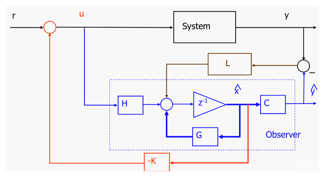
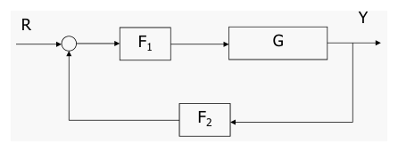
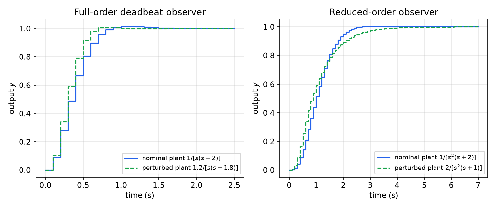
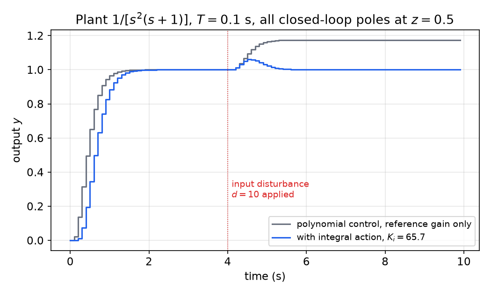

# Combined Controller–Observer Design

State feedback puts the closed-loop poles anywhere we like, but it needs the whole state, and in practice only a few outputs are measured. An observer rebuilds the state from the input and output records. This chapter puts the two together. The **separation principle** says the controller and the observer can be designed independently: the closed-loop poles are just the controller poles together with the observer poles. We then rewrite the observer-based controller as an ordinary two-degree-of-freedom compensator, extend it to reduced-order observers, and finish with the equivalent **polynomial (Diophantine) design**, which goes straight from the plant transfer function to the compensator polynomials, with or without integral action.

Throughout, the plant is \\(x(k+1) = Gx(k) + Hu(k)\\), \\(y(k) = Cx(k)\\), with \\(x \in \mathbb{R}^n\\). State feedback design is covered in [State Feedback Control](state-feedback.md) and observer design in [Observers](observers.md).

## The Observer-Based Controller

Not all state variables are measurable. The idea is to compute the control law from an estimate \\(\hat x\\) produced by a full-order (Luenberger) observer:

- **Plant:** \\(x^+ = Gx + Hu\\), \\(y = Cx\\), where \\(x^+ := x(k+1)\\).
- **Controller:** \\(u = -K\hat x + r\\).
- **Observer:** \\(\hat x^+ = G\hat x + Hu + L(y - C\hat x)\\).

The gain \\(K\\) is designed as though the full state were available (pole placement on \\((G,H)\\)). The gain \\(L\\) is designed as though there were no controller (pole placement on \\((G^T, C^T)\\) by duality).



*Figure: the combined controller–observer. The plant ("System") produces \\(y\\). The dashed box is the observer, a copy of the plant model (\\(H\\), \\(z^{-1}\\), \\(G\\), \\(C\\)) driven by the same input \\(u\\) and corrected through \\(L\\) by the output error \\(y - \hat y\\). The estimate \\(\hat x\\), not the true state, is fed back through \\(-K\\).*

Physically, the compensator is everything except the "System" block: a dynamic system of order \\(n\\) with two inputs (\\(r\\) and \\(y\\)) and one output (\\(u\\)).

## The Separation Principle

### Closed-loop equations

Let the estimation error be \\(\tilde x = \hat x - x\\). Substituting \\(\hat x = x + \tilde x\\) in the control law, the plant becomes
\\[
x^+ = Gx + H(-K\hat x + r) = Gx - HK(x + \tilde x) + Hr = (G - HK)x - HK\tilde x + Hr .
\\]
Subtracting the plant equation from the observer equation, and using \\(y - C\hat x = -C\tilde x\\),
\\[
\tilde x^+ = \hat x^+ - x^+ = G\tilde x - LC\tilde x = (G - LC)\tilde x .
\\]
The input terms \\(Hu\\) cancel exactly, because the observer uses the same \\(u\\) as the plant. Stacking the two:
\\[
\begin{bmatrix} x \\\\ \tilde x \end{bmatrix}^+
= \begin{bmatrix} G - HK & -HK \\\\ 0 & G - LC \end{bmatrix}
\begin{bmatrix} x \\\\ \tilde x \end{bmatrix} + \begin{bmatrix} H \\\\ 0 \end{bmatrix} r,
\qquad
y = \begin{bmatrix} C & 0 \end{bmatrix}\begin{bmatrix} x \\\\ \tilde x \end{bmatrix}.
\\]

**Theorem (Separation principle).** For the plant, observer and control law above, the \\(2n\\) closed-loop eigenvalues are the \\(n\\) eigenvalues of \\(G - HK\\) (the controller poles) together with the \\(n\\) eigenvalues of \\(G - LC\\) (the observer poles). If \\((G,H)\\) is controllable and \\((G,C)\\) is observable, both sets can be assigned arbitrarily and independently.

*Proof.* The closed-loop matrix is block upper triangular, so its characteristic polynomial factors:
\\[
\det\begin{bmatrix} zI - G + HK & HK \\\\ 0 & zI - G + LC \end{bmatrix}
= \det(zI - G + HK)\\,\det(zI - G + LC).
\\]
\\(K\\) appears only in the first factor and \\(L\\) only in the second. Controllability allows arbitrary placement of the first set and observability of the second. ∎

The coordinates \\((x, \tilde x)\\) are related to the implementation coordinates \\((x, \hat x)\\) by the nonsingular transformation \\(\tilde x = \hat x - x\\), so the eigenvalues are the same in either set of coordinates.

In practice the observer poles are chosen faster than the controller poles, typically two to five times faster in the equivalent \\(s\\)-plane, or at the origin (a **deadbeat observer**), so that \\(\hat x\\) converges before it matters much to the control. Very fast observer poles mean large \\(L\\) and more amplification of measurement noise, so the choice is a compromise.

### The closed-loop transfer function

Take z-transforms with zero initial conditions. The second block row gives \\((zI - G + LC)\tilde X(z) = 0\\), so \\(\tilde X = 0\\). The first block row then reads \\((zI - G + HK)X = HR\\), and
\\[
\boxed{G\_{closed}(z) = \frac{Y(z)}{R(z)} = C(zI - G + HK)^{-1}H .}
\\]
This is exactly the transfer function obtained with full state feedback. The observer modes are **uncontrollable from \\(r\\)**: a reference change never excites them, so they cancel from the input–output map. They still matter. They govern how quickly initial estimation errors die out, and they appear in the response to disturbances and noise and in the robustness of the loop to model errors. A transfer function computed from \\(r\\) to \\(y\\) hides them.

## Transfer-Function Form of the Compensator

It is often more convenient to implement, and to analyse, the observer-based controller as transfer functions acting on \\(r\\) and \\(y\\).

### Derivation of \\(F\_1\\) and \\(F\_2\\)

Write the observer as a dynamic system driven by \\(u\\) and \\(y\\), with \\(\underline G := G - LC\\):
\\[
\hat x^+ = \underline G\hat x + Hu + Ly
\quad\Longrightarrow\quad
\hat X(z) = (zI - \underline G)^{-1}\big(HU(z) + LY(z)\big).
\\]
Substitute into \\(U = -K\hat X + R\\):
\\[
U = -K(zI - \underline G)^{-1}HU - K(zI - \underline G)^{-1}LY + R .
\\]
Collect the \\(U\\) terms on the left:
\\[
\big[I + K(zI - \underline G)^{-1}H\big]U = R - K(zI - \underline G)^{-1}LY .
\\]
Hence
\\[
\boxed{U(z) = F\_1(z)\big[R(z) - F\_2(z)Y(z)\big],\qquad
F\_1(z) = \big[I + K(zI - \underline G)^{-1}H\big]^{-1},\quad
F\_2(z) = K(zI - \underline G)^{-1}L .}
\\]



*Figure: the observer-based controller redrawn as a two-degree-of-freedom loop. \\(F\_1\\) acts in the forward path on the error \\(R - F\_2Y\\); \\(F\_2\\) acts on the measured output in the feedback path. Here \\(G\\) denotes the plant transfer function.*

With \\(P(z)\\) the plant transfer function (written \\(G\\) in the figure), the loop gives
\\[
G\_{closed} = (I + PF\_1F\_2)^{-1}PF\_1 = C(zI - G + HK)^{-1}H ,
\\]
the second equality being the separation result above.

### State-space realizations

Both compensator blocks are easy to realize from the observer matrices:

| Block | Realization \\((A, B, C, D)\\) |
|---|---|
| \\(F\_2(z) = K(zI - \underline G)^{-1}L\\) | \\((\underline G,\ L,\ K,\ 0)\\) |
| \\(F\_1'(z) = K(zI - \underline G)^{-1}H\\) | \\((\underline G,\ H,\ K,\ 0)\\) |
| \\(F\_1 = (I + F\_1')^{-1}\\) | \\((\underline G - HK,\ H,\ -K,\ I)\\) |

The last line uses the inverse of a system with identity feedthrough. If \\(w = (I + F\_1')v\\) has realization \\(\xi^+ = \underline G\xi + Hv\\), \\(w = K\xi + v\\), then \\(v = w - K\xi\\), and substituting gives \\(\xi^+ = (\underline G - HK)\xi + Hw\\), \\(v = -K\xi + w\\). In MATLAB, `F1 = feedback(1, F1p)` gives the same system.

**Example 1 (Observer-based control of \\(1/[s(s+2)]\\)).** The plant is \\(G\_p(s) = 1/[s(s+2)]\\), sampled with \\(T = 0.1\\) s. The design asks for \\(\zeta = 0.8\\) and settling time \\(t\_s = 10T = 1\\) s, with a deadbeat full-order observer. To test robustness, the controller is applied to a perturbed "actual" plant \\(1.2/[s(s+1.8)]\\) (20% gain and 10% pole error).

*Desired poles.* \\(\omega\_n = 4/(\zeta t\_s) = 5\\) rad/s, \\(\sigma = \zeta\omega\_n = 4\\), \\(\omega\_d = \omega\_n\sqrt{1 - \zeta^2} = 3\\) rad/s, so
\\[
p\_{d} = e^{(-4 \pm 3j)(0.1)} = 0.6404 \pm 0.1981j .
\\]
*Plant.* The ZOH discretization is
\\[
P(z) = \frac{0.004683z + 0.004381}{z^2 - 1.8187z + 0.8187}.
\\]
*Compensator.* `acker` gives \\(K\\), and the deadbeat observer gain is `L = acker(G',C',[0;0])'`. The resulting transfer functions do not depend on the state coordinates chosen:
\\[
F\_{ff} = F\_1 = \frac{z^2}{z^2 + 0.5380z + 0.2783},\qquad
F\_{fb} = F\_2 = \frac{70.62z - 52.02}{z^2}.
\\]
The denominator \\(z^2\\) of \\(F\_2\\), and the numerator \\(z^2\\) of \\(F\_1\\), are the deadbeat observer polynomial \\(\det(zI - \underline G) = z^2\\).

*Closed loop.* With the nominal plant,
\\[
\frac{Y}{R} = \frac{0.004683z + 0.004381}{z^2 - 1.281z + 0.4493},
\\]
whose poles are exactly \\(p\_d\\). The observer poles at the origin have cancelled. A reference gain \\(g\\) equal to the reciprocal of the DC gain (\\(1/g = 18.60\\)) makes the steady-state output equal to \\(y\_d\\). With the perturbed plant, the cancellation no longer happens and the closed loop is fourth order:
\\[
\frac{Y}{R} = \frac{0.005656z^3 + 0.005326z^2}{z^4 - 1.297z^3 + 0.5257z^2 + 0.02046z - 0.04458},
\\]
with pole magnitudes 0.595 (pair), 0.534 and 0.236, all well inside the unit circle.

```matlab
% Combined controller/observer example: Gp(s)=1/[s(s+2)], zeta=0.8, ts=10T
T=0.1; ts=10*T; zeta=0.8; wn=4/(zeta*ts);
sig=zeta*wn; wd=sqrt(1-zeta^2)*wn;
pd1=exp((-sig+j*wd)*T); pd2=conj(pd1);
sysd=c2d(tf(1,[1 2 0]),T);           % nominal plant
sysda=c2d(tf(1.2,[1 1.8 0]),T);      % "actual" plant with parameter errors
[G,H,C,D]=ssdata(sysd);
K=acker(G,H,[pd1;pd2]);               % state feedback
L=acker(G',C',zeros(2,1))'; Go=G-L*C; % deadbeat observer
fb=ss(Go,L,K,0,T);                    % F2
ff=ss(Go-H*K,H,-K,1,T);               % F1
clsysa=feedback(ff*sysda,fb);         % actual closed loop
clsys=ss(G-H*K,H,C,0,T);              % ideal closed loop
[numc,denc]=tfdata(clsys,'v'); gain=sum(denc)/sum(numc);
step(gain*clsysa,gain*clsys);
```



*Figure: unit-step responses (with reference gain). Left: Example 1, full-order deadbeat observer. Both responses reach 98% of the final value within about 0.6–0.8 s with under 1% overshoot; the perturbed plant (dashed) is actually a little faster because of its higher gain. Right: Example 2 below, reduced-order observer. The perturbed plant settles more slowly, with a longer tail out to about 4 s, but still without overshoot. Both designs tolerate the parameter errors well.*

## Controller with a Reduced-Order Observer

When some states are measured exactly, there is no need to estimate them. Partition the state so that the measured part comes first, \\(y = x\_a\\) (\\(m\\) components), and the unmeasured part is \\(x\_b\\) (\\(n - m\\) components):
\\[
\begin{bmatrix} x\_a \\\\ x\_b \end{bmatrix}^+ = \begin{bmatrix} G\_{aa} & G\_{ab} \\\\ G\_{ba} & G\_{bb} \end{bmatrix}\begin{bmatrix} x\_a \\\\ x\_b \end{bmatrix} + \begin{bmatrix} H\_a \\\\ H\_b \end{bmatrix}u,\qquad y = x\_a .
\\]
The reduced-order observer (ROO) from [Observers](observers.md) is
\\[
\eta^+ = G\_r\eta + H\_uu + H\_yy,\qquad \hat x\_b = \eta + Ly,
\\]
\\[
G\_r = G\_{bb} - LG\_{ab},\quad H\_u = H\_b - LH\_a,\quad H\_y = G\_rL + G\_{ba} - LG\_{aa}.
\\]
Its error \\(e\_b = x\_b - \hat x\_b\\) satisfies \\(e\_b^+ = G\_re\_b\\), independently of \\(u\\) and \\(y\\).

### Closed loop and separation

The control law uses the measured part directly and the estimate for the rest. With \\(K = [K\_a\ \ K\_b]\\) partitioned conformably,
\\[
u = -K\_ax\_a - K\_b\hat x\_b + r = -K\_ay - K\_b(\eta + Ly) + r = -(K\_a + K\_bL)x\_a - K\_b\eta + r .
\\]
In the coordinates \\((x\_a, x\_b, \eta)\\) used for implementation, the closed loop is
\\[
\begin{bmatrix} x\_a \\\\ x\_b \\\\ \eta \end{bmatrix}^+ =
\begin{bmatrix}
G\_{aa} - H\_a(K\_a + K\_bL) & G\_{ab} & -H\_aK\_b \\\\
G\_{ba} - H\_b(K\_a + K\_bL) & G\_{bb} & -H\_bK\_b \\\\
H\_y - H\_u(K\_a + K\_bL) & 0 & G\_r - H\_uK\_b
\end{bmatrix}
\begin{bmatrix} x\_a \\\\ x\_b \\\\ \eta \end{bmatrix} + \begin{bmatrix} H\_a \\\\ H\_b \\\\ H\_u \end{bmatrix} r .
\\]
Its eigenvalues are easiest to see in the coordinates \\((x, e\_b)\\). Since \\(\hat x\_b = x\_b - e\_b\\),
\\[
u = -Kx + K\_be\_b + r
\quad\Longrightarrow\quad
\begin{bmatrix} x \\\\ e\_b \end{bmatrix}^+ = \begin{bmatrix} G - HK & HK\_b \\\\ 0 & G\_r \end{bmatrix}\begin{bmatrix} x \\\\ e\_b \end{bmatrix} + \begin{bmatrix} H \\\\ 0 \end{bmatrix}r .
\\]
Again the matrix is block triangular. The \\(2n - m\\) closed-loop poles are the \\(n\\) controller poles \\(\operatorname{eig}(G - HK)\\) and the \\(n - m\\) reduced-observer poles \\(\operatorname{eig}(G\_r)\\), and the reference-to-output transfer function is still \\(C(zI - G + HK)^{-1}H\\).

### Transfer-function form

Taking z-transforms of the observer, \\(\eta(z) = (zI - G\_r)^{-1}(H\_uU + H\_yY)\\). Substituting into the control law,
\\[
U = -K\_b(zI - G\_r)^{-1}H\_uU - \big[K\_b(zI - G\_r)^{-1}H\_y + K\_a + K\_bL\big]Y + R,
\\]
so \\(U = F\_1(R - F\_2Y)\\), with the same structure as before:
\\[
\boxed{F\_1(z) = \big[I + K\_b(zI - G\_r)^{-1}H\_u\big]^{-1},\qquad
F\_2(z) = K\_b(zI - G\_r)^{-1}H\_y + K\_a + K\_bL .}
\\]
\\(F\_1\\) and \\(F\_2\\) now have order \\(n - m\\), lower than with a full-order observer. Note that \\(F\_2\\) has direct feedthrough \\(K\_a + K\_bL\\): the measured state is fed back without delay. Realizations:

| Block | Realization \\((A, B, C, D)\\) |
|---|---|
| \\(F\_2\\) | \\((G\_r,\ H\_y,\ K\_b,\ K\_a + K\_bL)\\) |
| \\(F\_1'\\) | \\((G\_r,\ H\_u,\ K\_b,\ 0)\\) |
| \\(F\_1 = (I + F\_1')^{-1}\\) | \\((G\_r - H\_uK\_b,\ H\_u,\ -K\_b,\ I)\\) |

**Example 2 (Reduced-order observer for \\(1/[s^2(s+2)]\\)).** The plant is \\(G\_p(s) = 1/[s^2(s+2)]\\) with \\(T = 0.1\\) s. The "actual" plant used for the robustness test is \\(2/[s^2(s+1)]\\). The discretized nominal plant is
\\[
P(z) = \frac{0.0001587z^2 + 0.0006041z + 0.0001436}{z^3 - 2.8187z^2 + 2.6375z - 0.8187}.
\\]
*Realization.* To satisfy the ROO assumption \\(y = x\_1\\), use the observable canonical form, in which the output is the first state:
\\[
G = \left[\begin{array}{c\|cc} 2.8187 & 1 & 0 \\\\ \hline -2.6375 & 0 & 1 \\\\ 0.8187 & 0 & 0 \end{array}\right],\qquad
H = 10^{-3}\begin{bmatrix} 0.1587 \\\\ 0.6041 \\\\ 0.1436 \end{bmatrix},\qquad
C = \begin{bmatrix} 1 & 0 & 0 \end{bmatrix}.
\\]
The partition lines separate \\(x\_a = x\_1\\) from \\(x\_b = (x\_2, x\_3)\\), so \\(G\_{aa} = 2.8187\\), \\(G\_{ab} = [1\ \ 0]\\), \\(G\_{ba} = [-2.6375\ \ 0.8187]^T\\) and \\(G\_{bb} = \begin{bmatrix} 0 & 1 \\\\ 0 & 0 \end{bmatrix}\\).

*Observer.* With \\(L = [l\_1\ \ l\_2]^T\\), \\(G\_r = G\_{bb} - LG\_{ab} = \begin{bmatrix} -l\_1 & 1 \\\\ -l\_2 & 0 \end{bmatrix}\\) has characteristic polynomial \\(z^2 + l\_1z + l\_2\\). A deadbeat ROO therefore needs \\(L = 0\\), and then \\(G\_r = G\_{bb}\\), \\(H\_u = H\_b\\), \\(H\_y = G\_{ba}\\). The canonical form already makes \\(G\_{bb}\\) nilpotent.

*Controller.* The design uses \\(\zeta = 0.8\\) and \\(\omega\_n = 2.5\\) rad/s, giving a dominant pair at \\(s = -2 \pm 1.5j\\) and a third pole at \\(s = -\omega\_n = -2.5\\). Mapped by \\(z = e^{sT}\\), Ackermann's formula in these coordinates gives
\\[
K = [528.48\ \ 463.13\ \ 398.58].
\\]
(In the original script, `wn=(4/zeta*ts)` with \\(t\_s = 5T\\) evaluates as \\((4/\zeta)t\_s = 2.5\\), which is the value used here.)

*Compensator.*
\\[
F\_{ff} = \frac{z^2}{z^2 + 0.3370z + 0.06649},\qquad
F\_{fb} = \frac{528.5z^2 - 895.1z + 379.2}{z^2}.
\\]
*Closed loop.* With the nominal plant,
\\[
\frac{Y}{R} = \frac{0.0001587z^2 + 0.0006041z + 0.0001436}{z^3 - 2.398z^2 + 1.931z - 0.5220},
\\]
whose denominator is \\((z^2 - 1.6189z + 0.6703)(z - 0.7788)\\), the images of \\(-2 \pm 1.5j\\) and \\(-2.5\\). With the actual plant the closed loop is fifth order,
\\[
\frac{Y}{R} = \frac{0.0003252z^4 + 0.001269z^3 + 0.0003093z^2}{z^5 - 2.396z^4 + 2.277z^3 - z^2 + 0.08608z + 0.05712},
\\]
with all poles inside the unit circle (largest magnitude 0.870). The step responses are in the right panel of the figure above.

```matlab
% feedback and feedforward blocks with a deadbeat ROO (L = 0)
fb=ss(Gbb,Gba,Kb,Ka,T);      % F2: (Gr,Hy,Kb,Ka+Kb*L) with L=0
ff1=ss(Gbb,Hb,Kb,0,T);       % F1'
ff=feedback(1,ff1);          % F1
clsysa=feedback(ff*sysda,fb);
```

## Polynomial (Diophantine) Design

The observer-based compensator has a fixed polynomial structure, so we can design it directly from the plant transfer function \\(P(z) = B(z)/A(z)\\) without going through a state model.

### Structure

The single-input single-output compensator is written as
\\[
\boxed{F\_1(z) = \frac{\Lambda(z)}{\alpha(z)} = \frac{z^{n-1} + \lambda\_1z^{n-2} + \dots + \lambda\_{n-1}}{\alpha\_0z^{n-1} + \dots + \alpha\_{n-2}z + \alpha\_{n-1}},\qquad
F\_2(z) = \frac{\beta(z)}{\Lambda(z)} = \frac{\beta\_0z^{n-1} + \dots + \beta\_{n-2}z + \beta\_{n-1}}{z^{n-1} + \lambda\_1z^{n-2} + \dots + \lambda\_{n-1}} .}
\\]
This is the CCRO structure for a single output (\\(m = 1\\)): both blocks have order \\(n - 1\\) and share the polynomial \\(\Lambda(z) = \det(zI - G\_r)\\), the reduced-order observer polynomial. In \\(F\_1\\) it appears as a numerator and in \\(F\_2\\) as a denominator.

### The design equation

With \\(U = F\_1(R - F\_2Y)\\) and \\(Y = PU\\),
\\[
\frac{Y}{R} = \frac{PF\_1}{1 + PF\_1F\_2}
= \frac{\dfrac{B}{A}\dfrac{\Lambda}{\alpha}}{1 + \dfrac{B}{A}\dfrac{\Lambda}{\alpha}\dfrac{\beta}{\Lambda}}
= \frac{B\Lambda}{\alpha A + \beta B}.
\\]
If we require
\\[
\boxed{\alpha(z)A(z) + \beta(z)B(z) = D(z) := \Lambda(z)\Phi^{des}(z),}
\\]
then \\(\Lambda\\) cancels and \\(Y/R = B(z)/\Phi^{des}(z)\\): the closed loop has the desired characteristic polynomial \\(\Phi^{des}\\) and keeps the plant zeros, exactly as state feedback does. This polynomial identity in the unknowns \\(\alpha, \beta\\) is a **Diophantine equation**. The procedure is:

1. Choose the observer polynomial \\(\Lambda(z)\\) of degree \\(n - 1\\) (often \\(z^{n-1}\\), a deadbeat observer).
2. Choose the desired closed-loop polynomial \\(\Phi^{des}(z)\\) of degree \\(n\\).
3. Solve \\(\alpha A + \beta B = \Lambda\Phi^{des}\\) for \\(\alpha\\) and \\(\beta\\).

### The Sylvester matrix

Let \\(A(z) = a\_0z^n + a\_1z^{n-1} + \dots + a\_n\\) (normally \\(a\_0 = 1\\)) and \\(B(z) = b\_0z^n + b\_1z^{n-1} + \dots + b\_n\\) (normally \\(b\_0 = 0\\) for a strictly proper plant). Then \\(\alpha A + \beta B\\) has degree \\(2n - 1\\). Matching coefficients of \\(z^{2n-1}, z^{2n-2}, \dots\\) gives
\\[
\begin{aligned}
z^{2n-1}&:\ a\_0\alpha\_0 + b\_0\beta\_0 = d\_0,\\\\
z^{2n-2}&:\ a\_1\alpha\_0 + a\_0\alpha\_1 + b\_1\beta\_0 + b\_0\beta\_1 = d\_1,\\\\
z^{2n-3}&:\ a\_2\alpha\_0 + a\_1\alpha\_1 + a\_0\alpha\_2 + b\_2\beta\_0 + b\_1\beta\_1 + b\_0\beta\_2 = d\_2,\\\\
&\ \ \vdots
\end{aligned}
\\]
These are \\(2n\\) linear equations in the \\(2n\\) unknowns \\(\alpha\_0, \dots, \alpha\_{n-1}, \beta\_0, \dots, \beta\_{n-1}\\). In matrix form, \\(E\theta = d\\), where \\(E\\) is the \\(2n \times 2n\\) **Sylvester (resultant) matrix**. Its first \\(n\\) columns are copies of \\([a\_0, a\_1, \dots, a\_n]^T\\), each shifted down one row from the previous one, and its last \\(n\\) columns are shifted copies of \\([b\_0, \dots, b\_n]^T\\). For \\(n = 3\\):
\\[
\begin{bmatrix}
a\_0 & 0 & 0 & b\_0 & 0 & 0 \\\\
a\_1 & a\_0 & 0 & b\_1 & b\_0 & 0 \\\\
a\_2 & a\_1 & a\_0 & b\_2 & b\_1 & b\_0 \\\\
a\_3 & a\_2 & a\_1 & b\_3 & b\_2 & b\_1 \\\\
0 & a\_3 & a\_2 & 0 & b\_3 & b\_2 \\\\
0 & 0 & a\_3 & 0 & 0 & b\_3
\end{bmatrix}
\begin{bmatrix} \alpha\_0 \\\\ \alpha\_1 \\\\ \alpha\_2 \\\\ \beta\_0 \\\\ \beta\_1 \\\\ \beta\_2 \end{bmatrix} =
\begin{bmatrix} d\_0 \\\\ d\_1 \\\\ d\_2 \\\\ d\_3 \\\\ d\_4 \\\\ d\_5 \end{bmatrix}.
\\]

**Theorem (Solvability).** The Sylvester matrix is nonsingular if and only if \\(A(z)\\) and \\(B(z)\\) have no common root. In that case the Diophantine equation has a unique solution with \\(\deg\alpha, \deg\beta \le n - 1\\), for any right-hand side \\(D\\) of degree at most \\(2n - 1\\).

This is the classical resultant theorem. Coprimeness of \\(A\\) and \\(B\\) is the transfer-function counterpart of the minimal realization being controllable and observable: a common root would be a pole–zero cancellation, a mode that feedback can neither see nor move.

```matlab
function [numc,denc,E,ND]=fbcp(nump,denp,dend)
% feedback (numc/Lambda) and feedforward (Lambda/denc) compensation
% with a dead-beat observer, Lambda(z)=z^(n-1)
n=length(denp)-1;
E=zeros(2*n,2*n);
for jj=1:n
    E(jj:jj+n,jj)=denp';
    E(jj:jj+n,jj+n)=nump';
end
if length(dend)~=2*n
  y=[dend';zeros(n-1,1)];   % D(z) = z^(n-1)*Phi_des(z)
else
  y=dend';
end
Ei=inv(E); ND=Ei(:,1:n+1);
x=Ei*y;
denc=x(1:n).'; numc=x(n+1:2*n).';
```

With \\(\Lambda(z) = z^{n-1}\\), the right-hand side \\(D = z^{n-1}\Phi^{des}\\) is just the coefficient vector of \\(\Phi^{des}\\) padded with \\(n - 1\\) zeros, which is what the `if` branch does.

**Example 3 (Polynomial control of \\(1/[s^2(s+1)]\\)).** The plant \\(G\_p(s) = 1/[s^2(s+1)]\\) is sampled at \\(T\_s = 0.1\\) s, and all closed-loop poles are to be at \\(z = p = 0.5\\): \\(\Phi^{des}(z) = (z - 0.5)^3 = z^3 - 1.5z^2 + 0.75z - 0.125\\).

*Plant.* \\(n = 3\\) and
\\[
P(z) = \frac{B(z)}{A(z)} = \frac{0.0001626z^2 + 0.0006344z + 0.0001547}{z^3 - 2.9048z^2 + 2.8097z - 0.9048}.
\\]
*Solution.* With a deadbeat observer, \\(\Lambda = z^2\\) and \\(D = z^2(z - 0.5)^3\\). Solving the \\(6 \times 6\\) system gives
\\[
\alpha(z) = z^2 + 1.0623z + 0.2255,\qquad \beta(z) = 2106.6z^2 - 3294.8z + 1319.6,
\\]
so
\\[
F\_{ff} = \frac{z^2}{z^2 + 1.062z + 0.2255},\qquad F\_{fb} = \frac{2107z^2 - 3295z + 1320}{z^2}.
\\]
*Check.* After `minreal`, the closed loop is
\\[
\frac{Y}{R} = \frac{0.0001626z^2 + 0.0006344z + 0.0001547}{z^3 - 1.5z^2 + 0.75z - 0.125} = \frac{B(z)}{(z - 0.5)^3},
\\]
and the two observer poles at the origin have cancelled as predicted.

```matlab
% Polynomial control example: Gp(s)=1/[s^2(s+1)], D(z)=(z-p)^3
Ts=0.1; p=0.5;
dz=[1 -3*p 3*p^2 -p^3];
plant=c2d(tf(1,[1 1 0 0]),Ts);
[nump,denp]=tfdata(plant,'v');
[numc,denc]=fbcp(nump,denp,dz);
ffc=tf([1 0 0],denc,Ts);      % F1 = Lambda/alpha
fbc=tf(numc,[1 0 0],Ts);      % F2 = beta/Lambda
clsys=minreal(feedback(ffc*plant,fbc));
```

A Python equivalent of `fbcp` takes a few lines of NumPy:

```python
import numpy as np
def fbcp(B, A, Phi_des):
    """Solve alpha*A + beta*B = z^(n-1)*Phi_des; B, A, Phi_des as coefficient arrays (highest power first),
    B padded with a leading zero so len(B) == len(A) == n+1."""
    n = len(A) - 1
    E = np.zeros((2*n, 2*n))
    for j in range(n):
        E[j:j+n+1, j] = A
        E[j:j+n+1, j+n] = B
    d = np.concatenate([Phi_des, np.zeros(n-1)])
    x = np.linalg.solve(E, d)
    return x[:n], x[n:]          # alpha, beta
```

## Polynomial Control with Integral Action

The design so far reaches the desired steady state only through a reference gain, so a constant input disturbance leaves a steady-state error. As in state-space integral control, an outer integrator removes it.

### Structure and design

The outer loop forms the integrated error and feeds it into the inner polynomial loop:
\\[
V(z) = \frac{K\_i}{z - 1}\big(Y\_d(z) - Y(z)\big),\qquad U = F\_1(V - F\_2Y).
\\]
An optional feedforward \\(Y\_d/g\\) can be added to \\(V\\); it changes the closed-loop zeros but not the poles. If the inner loop is designed by the Diophantine method for some polynomial \\(\Phi\\), the inner closed loop is \\(Y/V = B(z)/\Phi(z)\\). Closing the outer loop:
\\[
\frac{Y}{Y\_d} = \frac{\dfrac{K\_i}{z - 1}\dfrac{B}{\Phi}}{1 + \dfrac{K\_i}{z - 1}\dfrac{B}{\Phi}}
= \frac{K\_iB(z)}{(z - 1)\Phi(z) + K\_iB(z)} .
\\]
Let \\(D(z)\\), of degree \\(n + 1\\), be the desired overall characteristic polynomial. We need \\(K\_i\\) and a monic \\(\Phi\\) of degree \\(n\\) with
\\[
D(z) = (z - 1)\Phi(z) + K\_iB(z).
\\]
Setting \\(z = 1\\) kills the first term, so
\\[
\boxed{K\_i = \frac{D(1)}{B(1)},\qquad \Phi(z) = \frac{D(z) - K\_iB(z)}{z - 1}.}
\\]
The division is exact because the numerator vanishes at \\(z = 1\\) by the choice of \\(K\_i\\). It requires \\(B(1) \neq 0\\): the plant must not have a zero at \\(z = 1\\), which would block the integrator. Finally, solve the Diophantine equation with \\(\Phi\\) in place of \\(\Phi^{des}\\) to get \\(F\_1\\) and \\(F\_2\\). The overall closed loop has unity DC gain, since \\(Y/Y\_d\\) at \\(z = 1\\) equals \\(K\_iB(1)/D(1) = 1\\). By the [internal model principle](tracking.md#the-internal-model-principle), any constant disturbance is rejected.

```matlab
function [numc,denc,Ki]=fbcpi(num,den,cz)
% feedback/feedforward compensation with integral control action
% V = Ki*(Yd-Y)/(z-1); find dz and Ki such that dz*(z-1)+Ki*num = cz
n=length(den)-1;
dz=[1 zeros(1,n)];
Ki=sum(cz)/sum(num);
for ii=2:n+1
    dz(ii)=cz(ii)+dz(ii-1)-Ki*num(ii-1);   % synthetic division by (z-1)
end
[numc,denc]=fbcp(num,den,dz);
```

The loop is synthetic division of \\(D - K\_iB\\) by \\(z - 1\\). Here `num` is the plant numerator padded to length \\(n + 1\\), and `sum` evaluates a polynomial at \\(z = 1\\).

**Example 4 (Integral action for Example 3).** Take the same plant and ask for all four closed-loop poles at 0.5, \\(D(z) = (z - 0.5)^4\\). Then \\(D(1) = 0.0625\\) and \\(B(1) = 9.517 \times 10^{-4}\\), so
\\[
K\_i = 65.68,\qquad \Phi(z) = z^3 - z^2 + 0.4893z - 0.05234 .
\\]
The roots of \\(\Phi\\) are \\(0.429 \pm 0.428j\\) and \\(0.143\\). The inner loop is stable, although its poles are no longer at 0.5; only the overall loop has the prescribed poles. Solving the Diophantine equation with this \\(\Phi\\) and a deadbeat observer gives \\(\alpha = z^2 + 1.3669z + 0.2987\\) and \\(\beta = 3308.7z^2 - 4597.0z + 1747.5\\).



*Figure: step responses of Example 3 (gray, reference gain only) and Example 4 (blue, integral action). At \\(t = 4\\) s a constant input disturbance \\(d = 10\\) enters the plant input. Without integral action the output settles to a new, wrong value (an offset of about 0.17); with integral action the disturbance is rejected and \\(y\\) returns to 1. The price is a slightly slower step response, because one more pole sits at 0.5.*

For this type-2 plant, the plain polynomial design is already insensitive to plant *gain* errors: the plant integrators force \\(y\_{ss} = v/F\_2(1)\\), whatever the plant gain. It is the input disturbance, which the plant integrators cannot see, that needs the extra integrator in the controller.

## Summary

- **Observer-based control:** \\(u = -K\hat x + r\\), \\(\hat x^+ = G\hat x + Hu + L(y - C\hat x)\\).
- **Separation principle:** in coordinates \\((x, \tilde x)\\) the closed loop is block triangular, \\(\begin{bmatrix} G - HK & -HK \\\\ 0 & G - LC \end{bmatrix}\\), so the poles are \\(\operatorname{eig}(G - HK) \cup \operatorname{eig}(G - LC)\\). Design \\(K\\) and \\(L\\) independently, with the observer faster.
- **Reference response:** \\(Y/R = C(zI - G + HK)^{-1}H\\). The observer modes are uncontrollable from \\(r\\) and cancel.
- **Two-degree-of-freedom form:** \\(U = F\_1(R - F\_2Y)\\), with \\(F\_1 = [I + K(zI - \underline G)^{-1}H]^{-1}\\) and \\(F\_2 = K(zI - \underline G)^{-1}L\\). For a reduced-order observer, \\(F\_1 = [I + K\_b(zI - G\_r)^{-1}H\_u]^{-1}\\) and \\(F\_2 = K\_b(zI - G\_r)^{-1}H\_y + K\_a + K\_bL\\).
- **Polynomial design:** \\(F\_1 = \Lambda/\alpha\\), \\(F\_2 = \beta/\Lambda\\). Solve \\(\alpha A + \beta B = \Lambda\Phi^{des}\\) with the \\(2n \times 2n\\) Sylvester matrix, which is nonsingular iff \\(A\\) and \\(B\\) are coprime. The result is \\(Y/R = B/\Phi^{des}\\).
- **Integral action:** \\(K\_i = D(1)/B(1)\\) and \\(\Phi = (D - K\_iB)/(z - 1)\\); constant input disturbances are rejected.

## See Also

- [State Feedback Control](state-feedback.md) and [Observers](observers.md): the two halves combined here
- [Tracking and Disturbance Rejection](tracking.md): feedforward and internal-model design around this compensator
- [Discrete-Time Linear Quadratic Regulation](lqr.md): choosing \\(K\\) by optimization instead of pole placement
- [Combined Controller–Observer (continuous time)](../linear/separation.md) and [LQG and LTR](../linear/lqg.md)
- [State-Space Methods](../state-space.md) and [Modern Control](../modern.md)
- [The z-Transform](../../../signals/z-transform.md)
