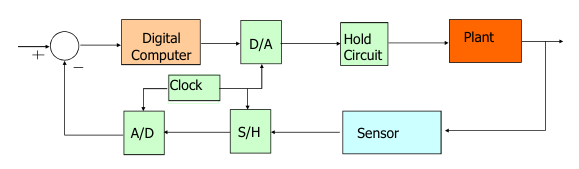
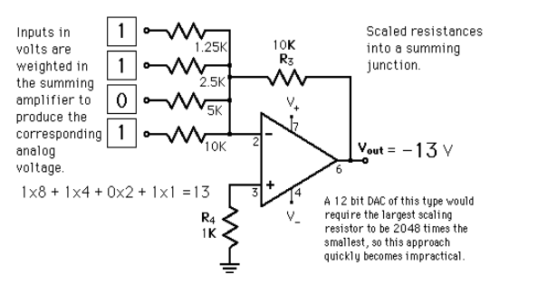
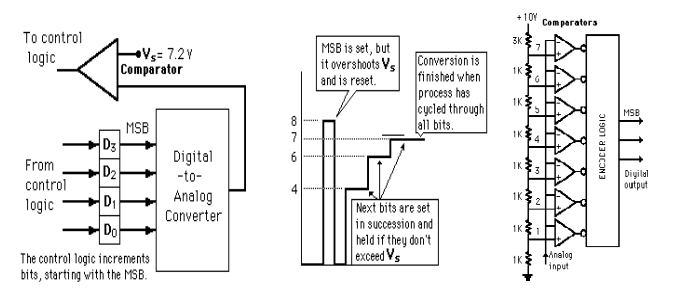
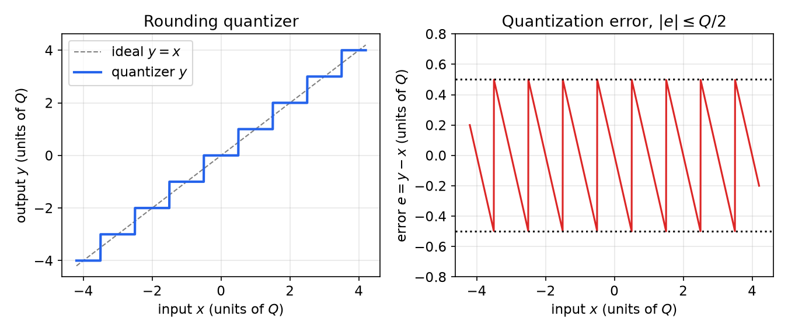
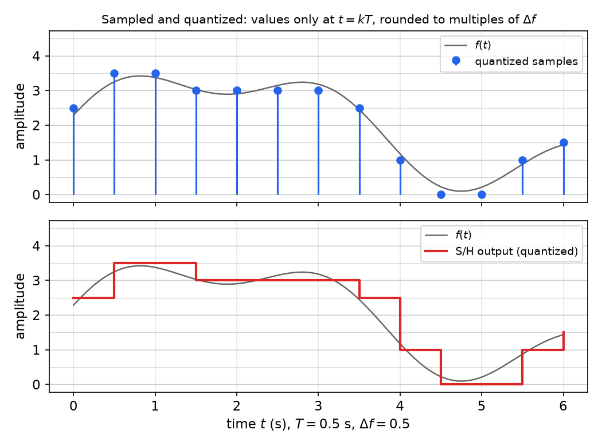
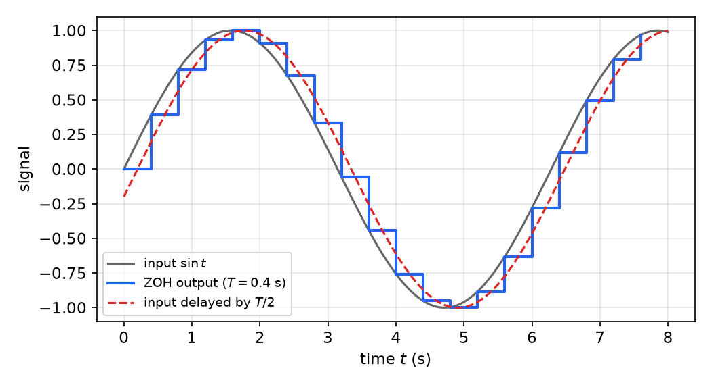

# Digital Control Systems: Architecture and Hardware

Almost every controller built today is a program running on a processor: it reads a sensor at discrete instants, computes a number, and writes that number to an actuator, which holds it until the next update. This chapter describes that architecture and the hardware that joins the continuous plant to the discrete computer: samplers, analog-to-digital (A/D) and digital-to-analog (D/A) converters, quantizers and holds. It also sets out the main questions the rest of the subsection answers: how to describe a loop that is part continuous and part discrete, what is lost when a signal is sampled and quantized, and how fast the loop must run.

## Why Control Digitally?

Cheap and powerful digital hardware has made digital controllers the default in nearly every field of engineering:

- **Aerospace:** flight control of aircraft, satellites and missiles; planetary rovers; delivery drones.
- **Automotive:** a modern car carries on the order of 30–35 electronic control units (ECUs) handling fuel injection and ignition, anti-lock braking (ABS), stability and traction control, active suspension, climate control and automatic transmission; hybrid and electric drivetrains add battery and motor management.
- **Manufacturing and robotics:** CNC machine tools, industrial and aerial robots, process control in materials processing.
- **Biomedical devices:** powered prostheses and artificial limbs, cardiovascular assist devices.
- **Consumer products:** appliances, cameras, toys and entertainment robots.

The computing element ranges from a microcontroller costing a few dollars (8-bit PIC or AVR parts, the ARM Cortex-M chips on STM32 boards, Arduino boards) through single-board computers with gigahertz ARM processors (Raspberry Pi, BeagleBone) to digital signal processors (DSPs) and programmable logic controllers (PLCs) in industrial plants.

### Analog versus digital control

Before microprocessors, controllers were built from operational amplifiers, resistors and capacitors that integrate, differentiate and sum signals continuously. The comparison below explains why the digital approach has largely displaced them.

| Analog control | Digital control |
|---|---|
| Control computations (integration, differentiation, multiplication, addition) run in continuous time | All computations happen at distinct instants, once per sampling period |
| Op-amps are the computing elements | Microprocessors, DSPs, microcontrollers and PLCs are the computing elements |
| Hard-wired, so changing the control law means changing the circuit | Flexible: the control law is software and is easily reprogrammed |
| Very sensitive to measurement and process noise, component drift and tolerances | Insensitive to drift, but subject to signal-conversion errors, quantization noise and round-off or truncation in arithmetic |
| Inexpensive for simple loops, but costly for complex ones | Hardware is inexpensive; the software development tools and effort can be the main cost |

Digital control also makes things practical that are awkward or impossible in analog form: logic and mode switching, gain scheduling, nonlinear and adaptive laws, estimation with Kalman filters, communication over networks, and recording of data. The price is that the controller sees the plant only at the sampling instants and acts on it only through a piecewise-constant signal. Much of digital control theory is about accounting for this exactly.

## The Sampled-Data Control Loop



*Figure: a sampled-data (digital) control system. The error is formed inside the computer from the digitized measurement. The D/A converter and hold produce a piecewise-constant actuator signal; the sensor output is sampled (S/H) and digitized (A/D). A single clock synchronizes sampling and actuation.*

The figure shows the standard architecture. Its elements are:

- **Plant.** The physical process, with a continuous-time input \\(u(t)\\) and output \\(y(t)\\), usually described by differential equations or a transfer function \\(P(s)\\).
- **Sensor.** Converts the plant output into a voltage; its own dynamics \\(H(s)\\) are often negligible.
- **Sample-and-hold (S/H).** Freezes the sensor voltage at the sampling instant so that the A/D converter sees a constant input while it works.
- **A/D converter.** Converts the held voltage into a binary number of finite length.
- **Digital computer.** Compares the measurement with the reference and evaluates the control law, a *difference equation* relating present and past errors and inputs.
- **D/A converter.** Converts the computed number back into a voltage.
- **Hold circuit.** Keeps that voltage constant until the next update; most D/A converters hold their output by construction, so the D/A and hold together act as a **zero-order hold** (ZOH).
- **Clock.** Triggers sampling and actuation at the instants \\(t\_k = kT\\), \\(k = 0, 1, 2, \ldots\\), where \\(T\\) is the **sampling period** and \\(\omega\_s = 2\pi/T\\) the **sampling frequency** in rad/s.

Each cycle of the program executes the same sequence: wait for the clock tick, read the A/D, compute the new control value from the stored history, write the D/A, and update the stored history. In pseudocode for a controller \\(u(k) = b\_0 e(k) + b\_1 e(k-1) - a\_1 u(k-1)\\):

```text
loop every T seconds:
    y  = read_ADC()
    e  = r - y
    u  = b0*e + b1*e_old - a1*u_old
    write_DAC(u)
    e_old = e;  u_old = u
```

### Four kinds of signal

A sampled-data loop contains signals of four kinds, and it helps to keep them apart.

| Signal | Time | Amplitude | Where it appears |
|---|---|---|---|
| Analog (continuous-time) | continuous | continuous | plant input and output, sensor voltage |
| Sampled-data (discrete-time) | discrete instants \\(kT\\) | continuous | ideal sampler output \\(f(kT)\\) |
| Digital | discrete instants | quantized (finite word length) | inside the computer |
| Piecewise constant (held) | continuous | constant over each period | D/A plus hold output |

The loop is therefore a **hybrid system**: the plant evolves continuously, while the controller updates only at the sampling instants. Between samples the plant runs open loop under a constant input. Two idealizations make this tractable and are used throughout:

1. **Synchronous, uniform sampling.** All samplers and holds are driven by the same clock with the same period \\(T\\).
2. **Negligible conversion and computation time,** or a computation delay that is a known fraction of \\(T\\) (often one full period, if the result computed from sample \\(k\\) is applied at time \\((k+1)T\\)). A delay of one period is modelled exactly by a factor \\(z^{-1}\\) once the z-transform is available.

With these idealizations, quantization is the only nonlinearity left. It is usually small enough to treat as additive noise, so the loop can be analysed with linear discrete-time tools: the z-transform, pulse transfer functions and the z-plane.

## Sampling

Sampling replaces a continuous-time signal \\(f(t)\\) by the sequence of its values at the sampling instants,
\\[
f(t) \quad\longrightarrow\quad f\_0, f\_1, \ldots, f\_k, \ldots, \qquad f\_k = f(t\_k),
\\]
written \\(f(kT)\\) or simply \\(f(k)\\) when \\(T\\) is understood. Everything between the samples is discarded. Whether that discarded information matters depends on how fast \\(f\\) varies compared with \\(T\\). A sinusoid of frequency \\(\omega\\) is captured faithfully only if \\(\omega < \omega\_s/2\\); faster components are not lost but *misrepresented* as slower ones (aliasing). The mathematical model of an ideal sampler, a train of Dirac impulses weighted by the samples, and the resulting sampling theorem are developed in [Sampling, Reconstruction and Discretization](sampling.md).

## Digital-to-Analog Conversion

A D/A converter turns an \\(n\\)-bit word \\(b\_{n-1} b\_{n-2} \cdots b\_0\\) into a voltage proportional to the number it represents,
\\[
V\_{out} = -V\_{FS} \sum\_{i=0}^{n-1} b\_i\\, 2^{\\,i-n},
\\]
where \\(V\_{FS}\\) is the full-scale voltage and the sign depends on the circuit.

### Weighted-resistor converter



*Figure: a 4-bit weighted-resistor D/A converter. Each bit drives the inverting input of an op-amp through a resistor that halves for each more significant bit, so the bits are weighted 8, 4, 2, 1 in the summing junction. The input 1101 produces −13 V.*

The simplest D/A converter is an inverting summing amplifier. Each bit applies a voltage \\(V\_i = b\_i V\_{ref}\\) through its own input resistor \\(R\_i\\). The inverting input is a virtual ground, so the input currents \\(V\_i / R\_i\\) add and all flow through the feedback resistor \\(R\_f\\):
\\[
V\_{out} = -R\_f \sum\_{i} \frac{V\_i}{R\_i}.
\\]
In the figure, \\(R\_f = 10\\ \text{k}\Omega\\) and the input resistors are \\(1.25, 2.5, 5, 10\\ \text{k}\Omega\\) for bits 3, 2, 1, 0, so the gains \\(R\_f/R\_i\\) are \\(8, 4, 2, 1\\). With 1 V logic levels and the word 1101,
\\[
V\_{out} = -(1\cdot 8 + 1\cdot 4 + 0 \cdot 2 + 1\cdot 1)\ \text{V} = -13\ \text{V}.
\\]
The resistor \\(R\_4\\) on the non-inverting input only compensates bias current. The weakness of this design is the **spread of resistor values**. An \\(n\\)-bit converter needs resistors in the ratio \\(2^{n-1}:1\\), so a 12-bit converter needs its largest resistor 2048 times its smallest, and every resistor must be accurate to better than the weight of the least significant bit. That quickly becomes impractical. Practical converters use the **R–2R ladder**, which needs only two resistor values. At every node of the ladder the resistance looking toward the termination equals \\(2R\\), so the current splits in half at each node and the bit currents are automatically binary-weighted.

Because the D/A output stays at its last value until it is rewritten, the converter itself performs the hold operation. Its output is the staircase described below under the zero-order hold.

## Analog-to-Digital Conversion

An A/D converter approximates an analog voltage by an \\(n\\)-bit number. Most devices combine the sample-and-hold, the conversion and the binary encoding in one package. Three architectures dominate.



*Figure: common A/D architectures. Left, successive approximation: control logic sets the bits of an internal D/A, starting with the MSB, and a comparator checks the D/A output against the input \\(V\_s\\). Centre, the bit trials for \\(V\_s = 7.2\\) V: the MSB (8) overshoots and is reset, then 4, 2 and 1 are each kept because the running total stays below \\(V\_s\\). Right, a flash converter: a resistor ladder sets reference levels for a bank of comparators whose outputs are encoded in a single step.*

- **Successive approximation (SAR)** performs a binary search. The control logic sets the most significant bit of an internal D/A converter and compares the D/A output with the held input. If the D/A output exceeds the input, the bit is reset; otherwise it is kept. The procedure moves to the next bit, and conversion ends after all \\(n\\) bits have been tried, so it takes \\(n\\) comparison cycles. For the 4-bit example in the figure, with 1 V per count and \\(V\_s = 7.2\\) V: trial 1000 (8 V) exceeds 7.2 V and is reset; 0100 (4 V) is kept; 0110 (6 V) is kept; 0111 (7 V) is kept. The result 0111 = 7 is the largest code not exceeding the input, a truncating quantizer. SAR converters are simple and moderately fast, and they are the most common type in microcontrollers.
- **Integrating (ramp, dual-slope) converters** measure the time a ramp takes to reach the input, or the time to discharge a capacitor charged by the input. They are slow but accurate, and they reject high-frequency noise because they average the input over the integration interval.
- **Flash (parallel) converters** use \\(2^n - 1\\) comparators, one per threshold of a resistor ladder, and encode the comparator outputs (a "thermometer code") into binary in a single step. They are the fastest type, but the hardware doubles with every extra bit, so they are used at low resolution and very high speed.

**Why the sample-and-hold is needed.** A SAR conversion takes a finite time \\(t\_c\\). If the input moves by more than half a quantization step during \\(t\_c\\), different bits are decided against different values and the result is wrong. For an input \\(A\sin(2\pi f t)\\), the largest slope is \\(2\pi f A\\), so without a hold the requirement is \\(2\pi f A\\, t\_c < Q/2\\). With \\(A\\) at half the full-scale range (\\(\text{FSR}/2\\)) and \\(Q = \text{FSR}/2^n\\), this gives \\(f < 1/(2\pi\\, 2^{n} t\_c)\\). For a 12-bit converter with \\(t\_c = 10\\ \mu\text{s}\\), that is only about 4 Hz. The S/H removes this restriction by presenting a frozen voltage, so the only remaining timing error is the much smaller **aperture uncertainty** of the hold switch.

## Quantization

**Quantization** is the conversion of a value of effectively infinite precision into one of finite precision, a multiple of the **quantization step**
\\[
Q = \frac{\text{FSR}}{2^n},
\\]
where FSR is the full-scale range of the converter and \\(n\\) the number of bits. A rounding quantizer maps the input \\(x\\) to the nearest level \\(y\\), with **quantization error**
\\[
e = y - x, \qquad \lvert e \rvert \le \frac{Q}{2}.
\\]
A truncating quantizer, such as the SAR converter above, keeps the level below the input, with \\(-Q < e \le 0\\).



*Figure: left, the staircase characteristic of a rounding quantizer with step \\(Q\\) against the ideal line \\(y = x\\). Right, the quantization error \\(e = y - x\\), a sawtooth confined to \\(\pm Q/2\\).*

**Example (resolution of a 12-bit converter).** With FSR = 10 V and \\(n = 12\\): \\(Q = 10/4096 = 2.44\\) mV and
\\[
\lvert e \rvert < \frac{10}{2^{13}} \approx 0.0012\ \text{V}.
\\]

### Quantization as noise

The quantizer is a nonlinear, many-to-one map. Analysing it exactly is hard: quantization can produce small limit cycles and dead zones in feedback loops. When the signal is large compared with \\(Q\\) and changes by several steps between samples, the error behaves like a random variable that is uniformly distributed on \\([-Q/2, Q/2]\\) and uncorrelated with the signal. Under this **additive-noise model**, \\(y = x + e\\), the noise has zero mean and variance
\\[
\sigma\_e^2 = \int\_{-Q/2}^{Q/2} e^2\\,\frac{1}{Q}\\,de = \frac{Q^2}{12}.
\\]
A full-scale sinusoid (amplitude \\(\text{FSR}/2\\)) has power \\(\text{FSR}^2/8\\). The **signal-to-quantization-noise ratio** is therefore
\\[
\text{SQNR} = \frac{\text{FSR}^2/8}{Q^2/12} = \frac{3}{2}\\,2^{2n}, \qquad
10\log\_{10}\text{SQNR} = 6.02\\,n + 1.76\ \text{dB}.
\\]
Each extra bit buys about 6 dB. A 12-bit converter gives about 74 dB and a 16-bit converter about 98 dB. In control loops the converter resolution sets the finest regulation the loop can achieve and the noise floor that the controller's derivative action amplifies.

The same finite-word-length effects occur *inside* the computer: controller coefficients are stored with finite precision (coefficient quantization moves the poles), and products are rounded (round-off noise). These matter most when the sampling rate is high, as the section on sample-rate selection explains. In the linear theory of the following chapters, quantization is neglected or modelled as additive noise.



*Figure: sampling and quantization together. Top, the computer sees only the values at \\(t = kT\\), each rounded to a multiple of \\(\Delta f\\) (grid lines). Bottom, the sample-and-hold (or D/A plus hold) output is a staircase that is piecewise constant in time and quantized in amplitude.*

## Reconstruction and the Zero-Order Hold

**Reconstruction** converts a sequence \\(f\_0, f\_1, \ldots\\) back into a continuous-time signal. The plant needs an input at every instant, not just at \\(t = kT\\), so some rule must fill in the values between samples. The simplest rule, and the one implemented by almost every D/A converter, is the **zero-order hold** (ZOH): hold each value constant for one period,
\\[
u(t) = u(k), \qquad kT \le t < (k+1)T.
\\]

**Impulse response and transfer function.** If a unit impulse of weight \\(u(0) = 1\\) is applied at \\(t = 0\\), the ZOH outputs a pulse of height 1 and width \\(T\\): \\(h\_0(t) = 1(t) - 1(t-T)\\), where \\(1(t)\\) is the unit step. Its Laplace transform is
\\[
G\_{h0}(s) = \frac{1}{s} - \frac{e^{-sT}}{s} = \frac{1 - e^{-sT}}{s}.
\\]
This transfer function is the key to the exact discrete model of a plant driven through a ZOH, derived in [Pulse Transfer Functions and z-Plane Analysis](z-plane.md).

**Frequency response.** Setting \\(s = j\omega\\) and factoring out \\(e^{-j\omega T/2}\\):
\\[
G\_{h0}(j\omega) = \frac{e^{-j\omega T/2}\left(e^{j\omega T/2} - e^{-j\omega T/2}\right)}{j\omega}
= T\\,\frac{\sin(\omega T/2)}{\omega T/2}\\,e^{-j\omega T/2}.
\\]
The magnitude is a sinc function: close to \\(T\\) at low frequency and zero at multiples of \\(\omega\_s\\). The phase is \\(-\omega T/2\\), exactly the phase of a pure delay of half a sampling period. At frequencies well below \\(\omega\_s\\), therefore,
\\[
G\_{h0}(s) \approx T e^{-sT/2},
\\]
so the hold behaves like a gain \\(T\\) (which cancels against the \\(1/T\\) of impulse sampling) followed by a **delay of \\(T/2\\)**. The figure shows this: the staircase output of a ZOH lags the input by about half a step on average.



*Figure: the ZOH output (blue staircase) of a sampled sinusoid. The original signal delayed by \\(T/2\\) (red dashed) runs through the middle of each step, so for low frequencies the hold acts as a half-period delay.*

This half-sample delay is the main cost of digital implementation in a feedback loop. At a crossover frequency \\(\omega\_c\\) it removes \\(\omega\_c T/2\\) radians of phase margin. A quick way to estimate the effect of sampling on an analog design is to insert \\(e^{-sT/2}\\), or its first-order Padé approximation \\((1 - sT/4)/(1 + sT/4)\\), into the loop and recheck the margins.

Holds of higher order, such as the first-order hold that interpolates linearly between samples, and the ideal (Shannon) reconstruction are compared in [Sampling, Reconstruction and Discretization](sampling.md).

## Choosing the Sampling Rate

The sampling period is the most important design parameter of a digital controller. The considerations pull in opposite directions.

**Lower limits (sample fast enough).**

1. *Sampling theorem.* Signals of interest must be below half the sampling frequency, \\(\omega\_s > 2\omega\_B\\), where \\(\omega\_B\\) is the bandwidth of the closed loop and of the reference and disturbance signals. This is an absolute minimum; at that rate the loop would be very poorly behaved.
2. *Delay and phase lag.* The ZOH adds the lag \\(\omega T/2\\), and computation adds up to one more period. To keep the loss of phase margin to a few degrees at crossover, \\(\omega\_c T\\) must be small.
3. *Smoothness and disturbance rejection.* Between samples the plant runs open loop. Disturbances arriving just after a sample go uncorrected for a whole period, and a slow rate gives a visibly stepped actuator signal.

Common rules of thumb that follow from these considerations are to sample at **10 to 30 times the closed-loop bandwidth**, or equivalently to take **roughly 4 to 10 samples per rise time** of the closed-loop step response.

**Upper limits (don't sample faster than necessary).**

1. *Computation time.* The control law, the A/D and D/A conversions and any communication must finish within one period.
2. *Numerical sensitivity.* A continuous pole at \\(s = -a\\) maps to \\(z = e^{-aT} \approx 1 - aT\\). As \\(T \to 0\\), all poles crowd toward \\(z = 1\\), and the controller coefficients must be stored with ever more digits to keep them distinct. For example, with \\(a = 1\\) and \\(T = 1\\) ms the pole is at 0.9990005; a coefficient error of \\(10^{-3}\\) would put it on the unit circle.
3. *Noise.* Differences such as \\((e(k) - e(k-1))/T\\) amplify measurement and quantization noise more as \\(T\\) shrinks.
4. *Cost.* Faster converters and processors cost more and use more power.

**Anti-aliasing.** Whatever rate is chosen, sensor noise above \\(\omega\_s/2\\) aliases into the control band. An analog low-pass **anti-aliasing filter** before the sampler, with its cutoff below \\(\omega\_s/2\\), removes it. The filter adds its own phase lag, which must be included in the design, and this is another reason to sample well above the closed-loop bandwidth.

**Example (choosing \\(T\\)).** A position loop is to have a closed-loop bandwidth of about 10 rad/s. Sampling at 20 to 30 times the bandwidth gives \\(\omega\_s \approx 200\\)–\\(300\\) rad/s, so \\(T \approx 0.02\\)–\\(0.03\\) s. With \\(T = 0.025\\) s and a crossover near 10 rad/s, the ZOH costs \\(\omega\_c T/2 = 0.125\\) rad \\(\approx 7^\circ\\) of phase margin, which is modest and easily budgeted. Halving \\(T\\) would halve the loss, at the price of twice the computation rate and poles closer to \\(z = 1\\).

## The Mathematical Tools Ahead

The loop has continuous parts described by differential equations and Laplace transforms, and discrete parts described by difference equations. The chapters that follow build the tools that unify them:

- **The z-transform** turns linear difference equations into algebraic equations, as the Laplace transform does for differential equations ([The z-Transform and Difference Equations](z-transform.md)).
- **Laplace and Fourier transforms of sampled signals**, and **Shannon's sampling theorem**, explain what sampling does to a signal's spectrum and how to reconstruct or discretize ([Sampling, Reconstruction and Discretization](sampling.md)).
- **Pulse transfer functions** give an exact discrete model of a continuous plant seen through a hold and a sampler, and lead to stability tests and steady-state error formulas in the z-plane ([Pulse Transfer Functions and z-Plane Analysis](z-plane.md)).

These are then used for classical design (pole placement, root locus, frequency response) and for state-space design.

## Summary

- A digital control loop samples the plant output through a sample-and-hold and an A/D converter, computes the control law as a difference equation, and drives the plant through a D/A converter and hold, all synchronized by a clock with period \\(T\\).
- The weighted-resistor D/A converter computes \\(V\_{out} = -R\_f\sum b\_i V\_{ref}/R\_i\\) (1101 gives −13 V in the example); its resistor spread of \\(2^{n-1}:1\\) motivates the R–2R ladder.
- A/D converters are successive-approximation (binary search, \\(n\\) cycles), integrating (slow, noise-rejecting) or flash (\\(2^n - 1\\) comparators, fastest). The S/H keeps the input constant during conversion.
- Quantization step \\(Q = \text{FSR}/2^n\\); rounding error \\(\lvert e\rvert \le Q/2\\) (FSR = 10 V, 12 bits gives about 1.2 mV). As noise, its variance is \\(Q^2/12\\) and the SQNR is \\(6.02n + 1.76\\) dB.
- The zero-order hold has transfer function \\((1 - e^{-sT})/s\\) and frequency response \\(T\\,\mathrm{sinc}\\,e^{-j\omega T/2}\\); at low frequency it acts as a delay of \\(T/2\\).
- Choose \\(\omega\_s\\) at roughly 10–30 times the closed-loop bandwidth (Nyquist is only the absolute minimum). Use an anti-aliasing filter, and remember that very fast sampling crowds the poles toward \\(z = 1\\) and amplifies noise.

## See Also

- [Digital Control (subsection overview)](README.md)
- [The z-Transform and Difference Equations](z-transform.md)
- [Sampling, Reconstruction and Discretization](sampling.md)
- [Pulse Transfer Functions and z-Plane Analysis](z-plane.md)
- [Classical Digital Control Design](classical-design.md)
- [Control Systems overview](../README.md)
- [PID Control](../pid.md)
- [Frequency-Domain Analysis](../frequency.md)
- [Sampling and Reconstruction (signals overview)](../../../signals/sampling.md)
- [Discrete-Time State-Space Systems](../linear/discrete-time.md)
