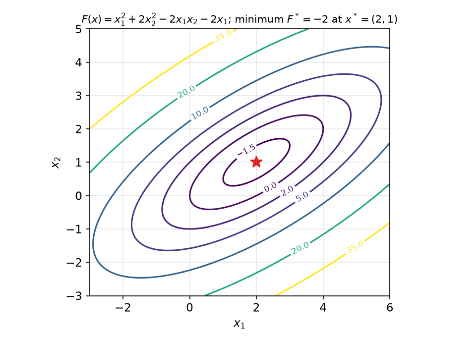
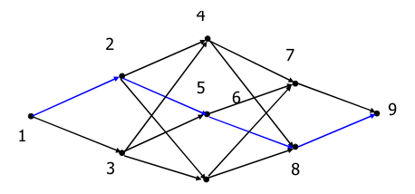
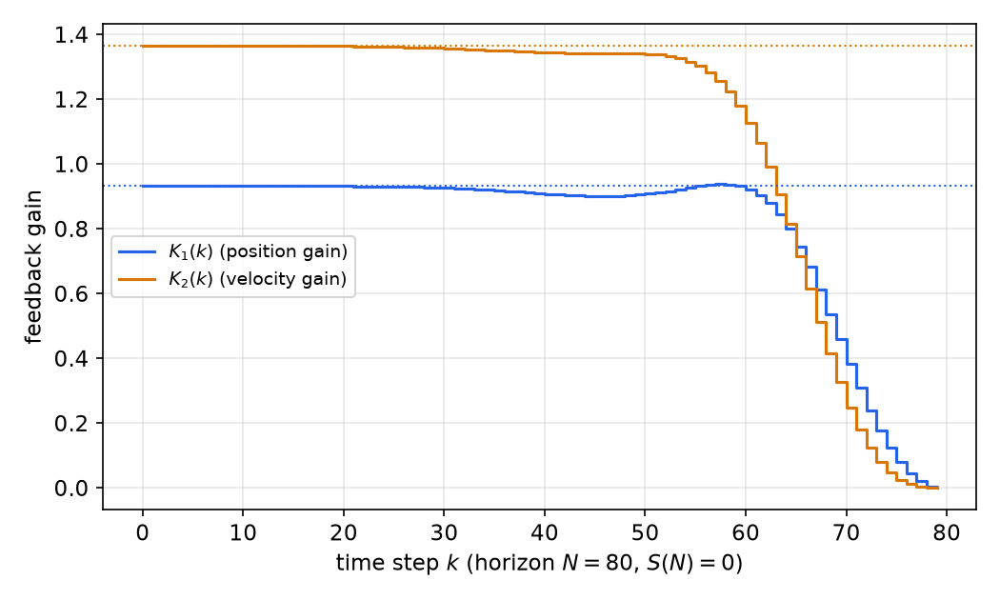
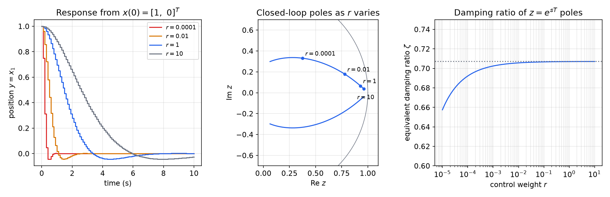

# Discrete-Time Linear Quadratic Regulation

Pole placement assigns closed-loop eigenvalues, but it does not say *where* they should go. For multi-input systems the gain that achieves a given set of poles is not even unique. The linear quadratic regulator (LQR) replaces the choice of poles by the choice of a cost. It minimizes a quadratic measure of state error and control effort, and the minimizer turns out to be a constant linear state feedback computed from a Riccati equation. This chapter derives the discrete-time LQR by dynamic programming: first the finite-horizon Riccati difference equation, then the infinite-horizon algebraic Riccati equation (ARE) and the conditions for its solution to exist and stabilize. It also covers the Hamiltonian-matrix method for computing the solution, and works through the double integrator in detail.

The plant is \\(x(k+1) = Gx(k) + Hu(k)\\) with \\(x \in \mathbb{R}^n\\), \\(u \in \mathbb{R}^m\\).

## Why Optimal Control

- Pole placement for multi-input systems has non-unique solutions, and the freedom is hard to use well.
- The best locations for the eigenvalues are difficult to determine. Fast poles cost large inputs, and the trade-off is invisible in the pole locations themselves.
- LQ optimal control minimizes a quadratic performance index computed from the time response, so the trade-off is stated directly.
- The solution is a state-feedback law \\(u = -Kx\\), so everything from [State Feedback Control](state-feedback.md) and [Combined Controller–Observer Design](controller-observer.md) still applies.

## Quadratic Forms and Positive Definiteness

A quadratic function of \\(n\\) variables can always be written as
\\[
q\_n(x) = \sum\_{i=1}^{n}\sum\_{j=1}^{n}m\_{ij}x\_ix\_j = x^TMx .
\\]
Only the symmetric part of \\(M\\) matters, since \\(x^TMx = x^T\tfrac12(M + M^T)x\\), so we always take the matrix symmetric, \\(P = P^T\\).

**Example 1.** \\(q\_2(x) = x\_1^2 + 2x\_2^2 - 3x\_1x\_2\\). Splitting the cross term equally between the two off-diagonal entries,
\\[
q\_2(x) = x^T\begin{bmatrix} 1 & -1.5 \\\\ -1.5 & 2 \end{bmatrix}x .
\\]

**Definition (Positive definiteness).** A symmetric \\(n \times n\\) matrix \\(P\\) is *positive definite*, \\(P > 0\\), if \\(x^TPx > 0\\) for all \\(x \neq 0\\). It is *positive semidefinite*, \\(P \ge 0\\), if \\(x^TPx \ge 0\\) for all \\(x\\).

**Theorem (Tests for definiteness).** For symmetric \\(P\\), the following are equivalent:

1. \\(P > 0\\);
2. all eigenvalues of \\(P\\) are strictly positive;
3. (Sylvester's test) all leading principal minors are strictly positive:
\\[
p\_{11} > 0,\qquad \begin{vmatrix} p\_{11} & p\_{12} \\\\ p\_{21} & p\_{22} \end{vmatrix} > 0,\qquad \dots,\qquad \det P > 0 .
\\]

*Proof of 1 ⇔ 2.* A symmetric matrix has an orthonormal eigenbasis, \\(P = U\Lambda U^T\\). With \\(w = U^Tx\\), \\(x^TPx = \sum\_i\lambda\_iw\_i^2\\), which is positive for every \\(w \neq 0\\) exactly when every \\(\lambda\_i > 0\\). ∎

In Example 1, \\(p\_{11} = 1 > 0\\) but \\(\det = 2 - 2.25 = -0.25 < 0\\), so the form is **indefinite**: \\(q\_2(1, 0) = 1 > 0\\), but \\(q\_2(1, 0.8) = 1 + 1.28 - 2.4 = -0.12 < 0\\).

## Minimizing a Quadratic Function

The whole LQR derivation rests on one lemma.

**Lemma (Quadratic minimization).** Let \\(F(u) = u^TAu + 2b^Tu + c\\) with \\(A = A^T > 0\\). Then \\(F\\) has the unique minimizer and minimum value
\\[
\boxed{u^\* = -A^{-1}b,\qquad F(u^\*) = c - b^TA^{-1}b .}
\\]

*Proof (completing the square).* Expanding the right-hand side below shows that, for every \\(u\\),
\\[
F(u) = (u + A^{-1}b)^TA(u + A^{-1}b) + c - b^TA^{-1}b .
\\]
The first term is nonnegative because \\(A > 0\\), and it is zero only when \\(u = -A^{-1}b\\). ∎

The same result follows from calculus. For symmetric \\(A\\), \\(\partial(u^TAu)/\partial u = 2u^TA\\) and \\(\partial(b^Tu)/\partial u = b^T\\), so the stationarity condition is \\(2u^TA + 2b^T = 0\\), giving \\(u^\* = -A^{-1}b\\). The Hessian is \\(2A > 0\\), so the stationary point is the global minimum.

**Example 2.** Minimize \\(F(x) = x\_1^2 + 2x\_2^2 - 2x\_1x\_2 - 2x\_1\\). Here
\\[
A = \begin{bmatrix} 1 & -1 \\\\ -1 & 2 \end{bmatrix} > 0,\qquad b = \begin{bmatrix} -1 \\\\ 0 \end{bmatrix},\qquad c = 0,
\\]
\\[
x^\* = -A^{-1}b = -\begin{bmatrix} 2 & 1 \\\\ 1 & 1 \end{bmatrix}\begin{bmatrix} -1 \\\\ 0 \end{bmatrix} = \begin{bmatrix} 2 \\\\ 1 \end{bmatrix},\qquad F^\* = -b^TA^{-1}b = -2 .
\\]



*Figure: contours of the quadratic in Example 2. Because \\(A > 0\\) the level sets are nested ellipses, a convex bowl, with the single minimum \\(F^\* = -2\\) at \\(x^\* = (2,1)\\). The ellipses are tilted because of the cross term \\(-2x\_1x\_2\\); their axes are the eigenvectors of \\(A\\).*

## The Discrete-Time LQ Problem

**Problem (Infinite-horizon LQR).** Given \\(x(k+1) = Gx(k) + Hu(k)\\) and \\(x(0)\\), find \\(u(k)\\) minimizing
\\[
J = \sum\_{k=0}^{\infty}\big[x^T(k)Qx(k) + u^T(k)Ru(k)\big],\qquad Q = Q^T \ge 0,\quad R = R^T > 0 .
\\]
The objective is to make \\(x\\) small while penalizing large inputs. The performance index makes a compromise between performance and control action. Making \\(x^TQx\\) decay quickly takes large \\(u\\), and the relative size of \\(Q\\) and \\(R\\) sets the balance. \\(R > 0\\) is essential: without an input penalty, the "optimal" input could be arbitrarily large. \\(Q\\) may be singular; often only the output is penalized, \\(Q = C^TC\\).

The **finite-horizon** version runs over \\(k = 0, \dots, N - 1\\) and adds a terminal penalty:
\\[
J\_N = x^T(N)S\_fx(N) + \sum\_{k=0}^{N-1}\big[x^T(k)Qx(k) + u^T(k)Ru(k)\big],\qquad S\_f \ge 0 .
\\]

## Dynamic Programming

**Principle of optimality (Bellman).** At any intermediate state \\(x\_i\\) on an optimal path from \\(x\_0\\) to \\(x\_f\\), the remaining policy, from \\(x\_i\\) to the goal \\(x\_f\\), must itself be optimal.

The argument is by contradiction. If a cheaper continuation from \\(x\_i\\) existed, splicing it onto the first part of the path would give a cheaper path from \\(x\_0\\), contradicting optimality.



*Figure: a staged decision network from node 1 to node 9, with the optimal path in blue (1 → 2 → 5 → 8 → 9). Whatever the arc costs are, the blue sub-path from any intermediate node (for example 5 → 8 → 9) must be the cheapest way from that node to 9. Working backward from the goal, each node needs to remember only its own best cost-to-go.*

The **cost-to-go** \\(V\_k(x)\\) is the minimum total cost from state \\(x\\) at time \\(k\\) to the end. The principle of optimality turns the minimization over whole input sequences into a recursion of one-step minimizations, the **Bellman equation**:
\\[
V\_k(x) = \min\_u\big[x^TQx + u^TRu + V\_{k+1}(Gx + Hu)\big],\qquad V\_N(x) = x^TS\_fx .
\\]

## Finite Horizon: the Riccati Difference Equation

**Theorem (Finite-horizon LQR).** The cost-to-go is quadratic, \\(V\_k(x) = x^TS(k)x\\), and the optimal control is the time-varying state feedback
\\[
u^\*(k) = -K(k)x(k),\qquad K(k) = \big(R + H^TS(k+1)H\big)^{-1}H^TS(k+1)G,
\\]
where \\(S(k)\\) is computed backward from \\(S(N) = S\_f\\) by the **Riccati difference equation**
\\[
\boxed{S(k) = Q + G^TS(k+1)G - G^TS(k+1)H\big(R + H^TS(k+1)H\big)^{-1}H^TS(k+1)G .}
\\]
The optimal cost is \\(J\_N^\* = x^T(0)S(0)x(0)\\).

*Proof (by backward induction).* At \\(k = N\\), \\(V\_N = x^TS\_fx\\) with \\(S\_f \ge 0\\). Suppose \\(V\_{k+1}(x) = x^TS(k+1)x\\) with \\(S(k+1) \ge 0\\). Writing \\(S = S(k+1)\\), the quantity to minimize in the Bellman equation is
\\[
F(u) = x^TQx + u^TRu + (Gx + Hu)^TS(Gx + Hu) = u^T\underbrace{(R + H^TSH)}\_{A}u + 2\underbrace{(H^TSGx)^T}\_{b^T}u + \underbrace{x^T(Q + G^TSG)x}\_{c}.
\\]
Since \\(R > 0\\) and \\(H^TSH \ge 0\\), \\(A > 0\\), and the lemma applies:
\\[
u^\* = -A^{-1}b = -(R + H^TSH)^{-1}H^TSGx,
\\]
\\[
V\_k(x) = c - b^TA^{-1}b = x^T\big[Q + G^TSG - G^TSH(R + H^TSH)^{-1}H^TSG\big]x .
\\]
The bracket is \\(S(k)\\). To see that \\(S(k) \ge 0\\), note that \\(V\_k(x)\\) is a minimum of nonnegative costs. ∎

A second, equivalent form is useful. Substituting \\(K = K(k)\\) and expanding shows
\\[
S(k) = Q + K^TRK + (G - HK)^TS(k+1)(G - HK),
\\]
which is the cost of applying the gain \\(K\\) for one step and then continuing optimally. Each term is visibly positive semidefinite, and this form is better conditioned numerically.



*Figure: the time-varying gains \\(K(k)\\) for the double integrator of the example below (\\(T = 0.1\\), \\(Q = \operatorname{diag}(1,0)\\), \\(R = 1\\)) over a horizon of \\(N = 80\\) steps with \\(S(N) = 0\\). Read the plot from right to left, in the direction the recursion runs. The gains start at zero (the last input cannot affect any penalized state, since \\(K(N-1) = 0\\) when \\(S(N) = 0\\)), and after about 60 backward steps they settle to the constant infinite-horizon gains (dotted lines).*

## Infinite Horizon: the Algebraic Riccati Equation

As \\(N \to \infty\\), the Riccati recursion converges (under the conditions below) to a constant \\(S\\), and the gain becomes constant. Equivalently, we look for a stationary solution of the Bellman equation directly.

### Derivation via the HJB (Bellman) equation

For the infinite horizon the cost-to-go no longer depends on \\(k\\), and the Bellman equation becomes
\\[
V(x) = \min\_u\big[\phi(x,u) + V(f(x,u))\big],\qquad \phi = x^TQx + u^TRu,\quad f = Gx + Hu .
\\]
Try \\(V(x) = x^TSx\\) with \\(S = S^T > 0\\) to be determined. The right-hand side is the same \\(F(u)\\) as above, now with a constant \\(S\\):
\\[
A = R + H^TSH,\qquad b = H^TSGx,\qquad c = x^TQx + x^TG^TSGx .
\\]
The lemma gives
\\[
u^\* = -(R + H^TSH)^{-1}H^TSGx,
\\]
\\[
F(u^\*) = x^TQx + x^TG^TSGx - x^TG^TSH(R + H^TSH)^{-1}H^TSGx .
\\]
The Bellman equation demands \\(V(x) = F(u^\*)\\):
\\[
x^T\Big[S - \big(Q + G^TSG - G^TSH(R + H^TSH)^{-1}H^TSG\big)\Big]x = 0 \quad\text{for all } x .
\\]
The bracket is symmetric, and a symmetric matrix whose quadratic form vanishes identically is zero. Therefore:

**Summary (Infinite-horizon LQR).** The optimal control is \\(u(k) = -Kx(k)\\) with
\\[
\boxed{K = (R + H^TSH)^{-1}H^TSG,}
\\]
where \\(S\\) solves the **discrete algebraic Riccati equation**
\\[
\boxed{S = G^TSG + Q - G^TSH(R + H^TSH)^{-1}H^TSG,}
\\]
and the value function (optimal cost) is \\(V(x) = J^\*(x) = x^TSx\\).

### Existence, uniqueness and stability

**Theorem.** If \\((G,H)\\) is controllable and \\((G,Q^{1/2})\\) is observable, where \\(Q = Q^{T/2}Q^{1/2}\\), then the ARE has a unique positive definite solution \\(S\\), and the closed loop \\(x^+ = (G - HK)x\\) is asymptotically stable.

*Reasons.*

- *Finiteness.* Because \\((G,H)\\) is controllable, some input (for example deadbeat control) drives any \\(x(0)\\) to zero in \\(n\\) steps with finite cost. So \\(J^\*\\) is finite, and the increasing sequence of finite-horizon costs (with \\(S\_f = 0\\)) is bounded and converges to a limit \\(S\\) satisfying the ARE.
- *Positivity.* Let \\(C = Q^{1/2}\\). If \\(J^\*(x\_0) = 0\\), then \\(u \equiv 0\\) and \\(Cx(k) = CG^kx\_0 = 0\\) for all \\(k\\). Observability forces \\(x\_0 = 0\\). So \\(J^\* > 0\\) for \\(x\_0 \neq 0\\), and \\(S > 0\\).
- *Stability.* With \\(G\_{cl} = G - HK\\), the second form of the Riccati equation gives the Lyapunov identity
\\[
S - G\_{cl}^TSG\_{cl} = Q + K^TRK \ge 0 .
\\]
So \\(V(x) = x^TSx\\) is nonincreasing along closed-loop trajectories. If it stayed constant along a trajectory, then \\(Qx(k) = 0\\) and \\(Kx(k) = 0\\) for all \\(k\\), hence \\(x(k+1) = Gx(k)\\) and \\(CG^kx(0) = 0\\), which by observability means \\(x(0) = 0\\). So \\(V\\) strictly decreases over every \\(n\\)-step window, and \\(x(k) \to 0\\).

The hypotheses can be weakened to stabilizability of \\((G,H)\\) and detectability of \\((G,Q^{1/2})\\). The ARE then has a unique positive *semi*definite stabilizing solution. The continuous-time counterpart is in [Linear Quadratic Regulator](../linear/lqr.md).

```matlab
[K,S,E] = dlqr(G,H,Q,R);   % K: gain, S: ARE solution, E: closed-loop eigenvalues
```

```python
import numpy as np
from scipy.linalg import solve_discrete_are
S = solve_discrete_are(G, H, Q, R)
K = np.linalg.solve(R + H.T @ S @ H, H.T @ S @ G)
```

## Example: LQR for the Double Integrator

**Example 3 (Unit mass).** A unit mass (\\(M = 1\\)) is pushed by a force \\(u\\). With position \\(x\_1 = y\\) and velocity \\(x\_2\\), \\(\dot x\_1 = x\_2\\), \\(\dot x\_2 = u\\). Sampled with a ZOH at \\(T = 0.1\\) s:
\\[
x^+ = \begin{bmatrix} 1 & T \\\\ 0 & 1 \end{bmatrix}x + \begin{bmatrix} T^2/2 \\\\ T \end{bmatrix}u .
\\]
Find the controller minimizing \\(J = \sum\_{k=0}^{\infty}\big[y^2(k) + ru^2(k)\big]\\).

*Weights.* \\(y^2 = x^T\begin{bmatrix} 1 & 0 \\\\ 0 & 0 \end{bmatrix}x\\), so \\(Q = \operatorname{diag}(1,0)\\) and \\(R = r\\). Here \\((G,H)\\) is controllable, and \\((G, [1\ \ 0])\\) is observable (position measurements determine velocity), so the theorem applies even though \\(Q\\) is singular.

*Solution for \\(r = 1\\).*
\\[
S = \begin{bmatrix} 14.651 & 10.000 \\\\ 10.000 & 14.151 \end{bmatrix},\qquad K = [0.9317\ \ 1.3651],
\\]
with closed-loop poles \\(0.9294 \pm 0.0658j\\) (magnitude 0.9317). Mapping back by \\(s = (\ln z)/T\\) gives \\(s = -0.707 \pm 0.707j\\): \\(\omega\_n = 1.00\\) rad/s and \\(\zeta = 0.707\\). The optimal cost from \\(x(0) = [1\ \ 0]^T\\) is \\(J^\* = S\_{11} = 14.65\\).

```matlab
% LQ optimal control of a double integrator
Ac=[0 1;0 0]; Bc=[0;1]; C=[1 0];
Ts=0.1; [G,H]=c2d(Ac,Bc,Ts);
Q=[1 0;0 0];                       % J = sum(y^2 + R*u^2)
R=[[1e-6:1e-5:0.0009] [0.001:0.01:1]]';   % sweep of control weights
KT=[0:Ts:10]'; Y=[];
for ii=1:length(R)
   Ri=R(ii);
   [Ki,Pi,Ei]=dlqr(G,H,Q,Ri);
   K(ii,:)=Ki; E(ii,:)=Ei(1);
   Yi=initial(ss(G-H*Ki,H,C,0,Ts),[1;0],KT);
   Y=[Y Yi];
end
```

*Effect of the control weight.*

| \\(r\\) | \\(K\\) | closed-loop poles | \\(\omega\_n\\) (rad/s) | \\(\zeta\\) |
|---|---|---|---|---|
| \\(10^{-4}\\) | \\([50.0\ \ 10.0]\\) | \\(0.375 \pm 0.331j\\) | 10.01 | 0.692 |
| \\(10^{-2}\\) | \\([8.00\ \ 4.00]\\) | \\(0.780 \pm 0.178j\\) | 3.162 | 0.706 |
| \\(1\\) | \\([0.932\ \ 1.365]\\) | \\(0.929 \pm 0.066j\\) | 1.000 | 0.707 |
| \\(10\\) | \\([0.304\ \ 0.780]\\) | \\(0.960 \pm 0.038j\\) | 0.562 | 0.707 |



*Figure: left, the position response from \\(x(0) = [1, 0]^T\\) for four control weights. A small \\(r\\) (cheap control) gives a fast response, a large \\(r\\) a slow one; all have the same small undershoot of about 4%. Center, the closed-loop pole pair as \\(r\\) varies from \\(10^{-5}\\) to 10: it starts deep inside the unit circle and moves along symmetric arcs toward \\(z = 1\\) as control becomes expensive. Right, the equivalent damping ratio is essentially constant at \\(1/\sqrt2 \approx 0.707\\), dipping only for very small \\(r\\), where the poles are far from \\(z = 1\\) and sampling effects dominate.*

**Interpretation.** As \\(r \to 0\\) the natural frequency grows without bound and the settling time goes to zero (a fast system). As \\(r \to \infty\\) the natural frequency goes to zero and the settling time grows without bound (a slow system). **The damping ratio is always about 0.707.** The continuous-time analog explains this. For \\(\dot x\_1 = x\_2\\), \\(\dot x\_2 = u\\) with \\(J = \int(y^2 + ru^2)dt\\), the continuous ARE gives \\(K = [r^{-1/2}\ \ \sqrt2\\,r^{-1/4}]\\), and the closed-loop polynomial is \\(s^2 + \sqrt2\\,r^{-1/4}s + r^{-1/2}\\): \\(\omega\_n = r^{-1/4}\\) and \\(\zeta = 1/\sqrt2\\) exactly. The table confirms \\(\omega\_n \approx r^{-1/4}\\) (10, 3.16, 1, 0.562). The weight \\(r\\) acts as a single "speed knob", while the optimality of the design fixes the shape of the response.

## Numerical Solution: the Hamiltonian Matrix

The ARE is nonlinear in \\(S\\), but it can be solved exactly by linear algebra, through an eigenvalue problem of twice the size.

### Derivation

Let \\(S\\) solve the ARE, let \\(K\\) be the optimal gain, and along an optimal trajectory define the **costate** \\(\lambda(k) := Sx(k)\\).

*Control in terms of the costate.* From \\((R + H^TSH)u = -H^TSGx\\),
\\[
Ru(k) = -H^TS\big(Gx(k) + Hu(k)\big) = -H^TSx(k+1) = -H^T\lambda(k+1),
\\]
so \\(u(k) = -R^{-1}H^T\lambda(k+1)\\), and the state equation becomes
\\[
x(k+1) = Gx(k) - HR^{-1}H^T\lambda(k+1).
\\]
*Costate equation.* The ARE in the form \\(S = Q + G^TSG\_{cl}\\) (which follows from \\(S = Q + G^TSG - G^TSHK\\)), applied to \\(x(k)\\), gives
\\[
\lambda(k) = Sx(k) = Qx(k) + G^TSx(k+1) = Qx(k) + G^T\lambda(k+1).
\\]
*Hamiltonian system.* Solving the state equation for \\(x(k) = G^{-1}x(k+1) + G^{-1}HR^{-1}H^T\lambda(k+1)\\), which needs \\(G\\) nonsingular (always true for a sampled continuous system, \\(G = e^{AT}\\)), and substituting into the costate equation:
\\[
\begin{bmatrix} x(k) \\\\ \lambda(k) \end{bmatrix} = \mathcal{P}\begin{bmatrix} x(k+1) \\\\ \lambda(k+1) \end{bmatrix},\qquad
\mathcal{P} = \begin{bmatrix} G^{-1} & G^{-1}HR^{-1}H^T \\\\ QG^{-1} & G^T + QG^{-1}HR^{-1}H^T \end{bmatrix}.
\\]
Running forward in time, \\(\begin{bmatrix} x(k+1) \\\\ \lambda(k+1) \end{bmatrix} = \mathcal{P}^{-1}\begin{bmatrix} x(k) \\\\ \lambda(k) \end{bmatrix}\\), with
\\[
\mathcal{P}^{-1} = \begin{bmatrix} G + HR^{-1}H^TG^{-T}Q & -HR^{-1}H^TG^{-T} \\\\ -G^{-T}Q & G^{-T} \end{bmatrix}.
\\]

### Reciprocal eigenvalues

Let \\(J = \begin{bmatrix} 0 & I \\\\ -I & 0 \end{bmatrix}\\). Using the symmetry of \\(Q\\) and \\(HR^{-1}H^T\\), one can check that \\(\mathcal{P}^TJ\mathcal{P} = J\\): \\(\mathcal{P}\\) is **symplectic**. Then \\(\mathcal{P}^{-1} = J^{-1}\mathcal{P}^TJ\\) is similar to \\(\mathcal{P}^T\\), which has the same eigenvalues as \\(\mathcal{P}\\). The eigenvalues of \\(\mathcal{P}^{-1}\\) are the reciprocals of those of \\(\mathcal{P}\\), so the spectrum of \\(\mathcal{P}^{-1}\\) is closed under \\(\lambda \mapsto 1/\lambda\\). Under the conditions of the existence theorem (stabilizability and detectability), no eigenvalue lies on the unit circle. Exactly \\(n\\) eigenvalues are then inside it and \\(n\\) outside, and the positive definite stabilizing solution exists.

### The eigenvector method

On the optimal trajectory \\(\lambda = Sx\\) and \\(x(k) \to 0\\), so the optimal trajectories live in the \\(n\\)-dimensional **stable invariant subspace** of \\(\mathcal{P}^{-1}\\). The closed-loop dynamics restricted to that subspace have eigenvalues equal to the stable eigenvalues of \\(\mathcal{P}^{-1}\\), the closed-loop poles. This gives the procedure:

1. Compute the eigenvalues of \\(\mathcal{P}^{-1}\\) and select the \\(n\\) with \\(\lvert\lambda\_i\rvert < 1\\).
2. Stack the corresponding eigenvectors into a \\(2n \times n\\) matrix and partition it:
\\[
[v\_1\ \cdots\ v\_n] = \begin{bmatrix} V \\\\ W \end{bmatrix},\qquad V, W \in \mathbb{C}^{n\times n}.
\\]
3. Every vector in the subspace has the form \\(x = Vc\\), \\(\lambda = Wc\\), hence \\(\lambda = WV^{-1}x\\), and
\\[
\boxed{S = WV^{-1}.}
\\]
The result is real even though \\(V\\) and \\(W\\) are complex. The selected eigenvalues are the closed-loop poles. Library routines (`dlqr`, `solve_discrete_are`) use numerically robust Schur-vector versions of the same idea.

**Example 4 (Hamiltonian solution for Example 3).** For \\(T = 0.1\\), \\(Q = \operatorname{diag}(1,0)\\), \\(r = 1\\),
\\[
\mathcal{P}^{-1} = \begin{bmatrix} 0.999975 & 0.1 & 0.000025 & -0.0005 \\\\ -0.0005 & 1 & 0.0005 & -0.01 \\\\ -1 & 0 & 1 & 0 \\\\ 0.1 & 0 & -0.1 & 1 \end{bmatrix}.
\\]
`[M,D] = eig(inv(P))` gives the eigenvalues
\\[
1.0706 \pm 0.0758j\quad(\text{unstable}),\qquad 0.9294 \pm 0.0658j\quad(\text{stable}).
\\]
These are reciprocal pairs, \\(\lvert 1.0706 + 0.0758j\rvert = 1.0733 = 1/0.9317\\). The stable pair coincides with the closed-loop poles of Example 3. Taking their eigenvectors and forming `S = W/V`:
\\[
S = WV^{-1} = \begin{bmatrix} 14.651 & 10 \\\\ 10 & 14.151 \end{bmatrix},
\\]
in agreement with `dlqr`.

> **Remark (corrected value).** A printed version of this example gives \\(S = \begin{bmatrix} 14.1598 & 9.3170 \\\\ 9.3170 & 13.1928 \end{bmatrix}\\). That matrix does not satisfy the ARE for these data: substituting it leaves a residual of about 0.12 in every entry. Recomputing with \\(T = 0.1\\), \\(Q = \operatorname{diag}(1,0)\\) and \\(R = 1\\), both by the Hamiltonian eigenvectors and by `dlqr`/`solve_discrete_are`, gives \\(S = \begin{bmatrix} 14.651 & 10 \\\\ 10 & 14.151 \end{bmatrix}\\), which satisfies the ARE to machine precision and is consistent with the eigenvalues listed (which do match). The corrected value is used throughout this chapter.

```python
import numpy as np
T = 0.1
G = np.array([[1, T], [0, 1]]); H = np.array([[T**2/2], [T]])
Q = np.diag([1.0, 0.0]); R = np.eye(1)
Gi = np.linalg.inv(G); Ri = np.linalg.inv(R)
P = np.block([[Gi, Gi @ H @ Ri @ H.T], [Q @ Gi, G.T + Q @ Gi @ H @ Ri @ H.T]])
lam, M = np.linalg.eig(np.linalg.inv(P))
stable = M[:, np.abs(lam) < 1]
V, W = stable[:2], stable[2:]
S = np.real(W @ np.linalg.inv(V))      # [[14.651, 10.0], [10.0, 14.151]]
```

## Summary

- **Quadratic minimization:** for \\(A > 0\\), \\(F(u) = u^TAu + 2b^Tu + c\\) is minimized by \\(u^\* = -A^{-1}b\\), with \\(F^\* = c - b^TA^{-1}b\\).
- **LQ problem:** minimize \\(\sum(x^TQx + u^TRu)\\) with \\(Q \ge 0\\), \\(R > 0\\).
- **Finite horizon:** \\(V\_k = x^TS(k)x\\), \\(K(k) = (R + H^TS(k+1)H)^{-1}H^TS(k+1)G\\), with the Riccati difference equation run backward from \\(S(N) = S\_f\\).
- **Infinite horizon:** \\(u = -Kx\\), \\(K = (R + H^TSH)^{-1}H^TSG\\), \\(S = G^TSG + Q - G^TSH(R + H^TSH)^{-1}H^TSG\\), \\(J^\* = x\_0^TSx\_0\\).
- **Existence:** \\((G,H)\\) controllable and \\((G,Q^{1/2})\\) observable give a unique \\(S > 0\\) and an asymptotically stable closed loop, via the Lyapunov identity \\(S - G\_{cl}^TSG\_{cl} = Q + K^TRK\\).
- **Hamiltonian method:** take the stable eigenvectors \\([V;W]\\) of \\(\mathcal{P}^{-1}\\); then \\(S = WV^{-1}\\), and the stable eigenvalues are the closed-loop poles. The eigenvalues come in reciprocal pairs.
- **Double integrator** with \\(J = \sum(y^2 + ru^2)\\): \\(\omega\_n \approx r^{-1/4}\\) and \\(\zeta \approx 0.707\\) for all \\(r\\). For \\(T = 0.1\\), \\(r = 1\\): \\(S = \begin{bmatrix} 14.651 & 10 \\\\ 10 & 14.151 \end{bmatrix}\\), \\(K = [0.9317\ \ 1.3651]\\).

## See Also

- [Dynamic Programming and Reinforcement Learning for Control](reinforcement-learning.md): value and policy iteration, including policy iteration for this LQR problem
- [State Feedback Control](state-feedback.md) and [Combined Controller–Observer Design](controller-observer.md)
- [Linear Quadratic Regulator (continuous time)](../linear/lqr.md) and [LQG and LTR](../linear/lqg.md)
- [Discrete-Time Optimal Control](../optimal-learning/discrete-optimal-control.md) and [Dynamic Programming](../optimal-learning/dynamic-programming.md)
- [Optimal Control overview](../optimal.md)
- [Eigenvalues and Eigenvectors](../../../math/linear-algebra/eigen.md)
