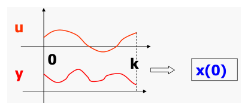
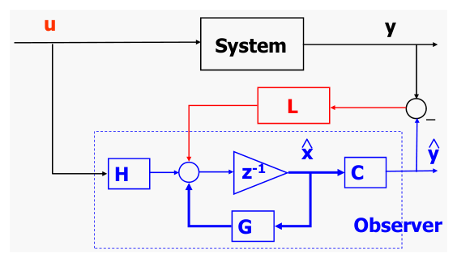
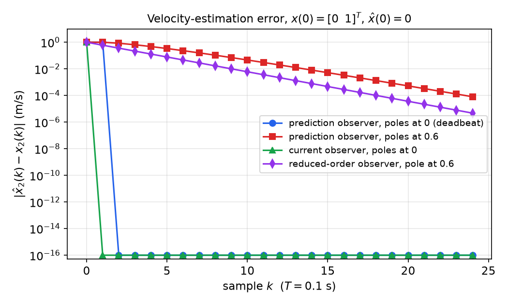
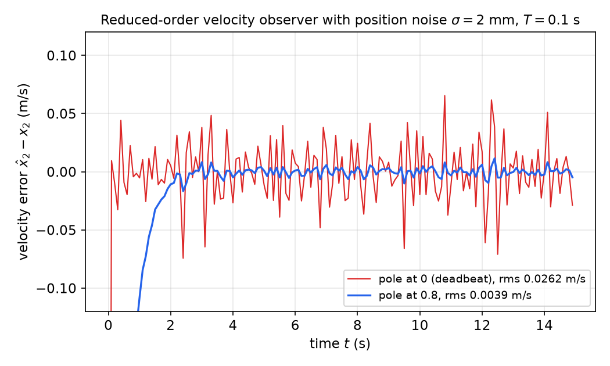

# Observers for Discrete Systems

[State feedback](state-feedback.md) assumes the whole state vector is measured, but in practice many state variables (velocities, internal temperatures, latent infections) are not. If the system is observable, its state can be reconstructed from the input and output records. An observer does this recursively: it runs a copy of the plant model and corrects it with the measured output error. This chapter develops discrete-time observability, the prediction (Luenberger) observer and its pole placement by duality, the current observer that uses the newest measurement, and the reduced-order observer that estimates only the unmeasured states. A velocity-estimation example runs throughout. The continuous-time theory is in [Observability](../linear/observability.md) and [Observers](../linear/observers.md). How the estimate is then used for feedback is the subject of [Combined Controller–Observer Design](controller-observer.md).

## Observability

**Definition (Observability).** An LTI system is *observable* if its initial state \\(x(0)\\) can be uniquely determined from the input \\(u\\) and output \\(y\\) over a finite interval \\(0, 1, \dots, k\\) (with \\(k \ge n - 1\\) suffices, as shown below).



*Figure: observability. Finite records of the input u and output y over samples 0 … k are enough to determine the initial state x(0) uniquely.*

Once \\(x(0)\\) is known, the state at every later time follows from the convolution formula, so recovering \\(x(0)\\) is equivalent to recovering the whole state trajectory.

### Reconstructing the initial state

For \\(x(k+1) = Gx + Hu\\), \\(y = Cx + Du\\), the output is
\\[
y(k) = CG^kx(0) + \sum\_{j=0}^{k-1}CG^{k-j-1}Hu(j) + Du(k), \qquad k = 0, 1, 2, \dots
\\]
The input terms are known. Move them to the left and stack the equations for \\(k = 0, \dots, K-1\\):
\\[
\Delta y := \begin{bmatrix} y(0) - Du(0) \\\\ y(1) - CHu(0) - Du(1) \\\\ \vdots \\\\ y(K-1) - \sum\_{j=0}^{K-2}CG^{K-j-2}Hu(j) - Du(K-1) \end{bmatrix}
= \underbrace{\begin{bmatrix} C \\\\ CG \\\\ \vdots \\\\ CG^{K-1} \end{bmatrix}}\_{N\_K} x(0).
\\]
This is a linear system of \\(pK\\) equations (\\(p\\) outputs) in the \\(n\\) unknowns of \\(x(0)\\). It has a unique solution if and only if \\(N\_K\\) has full column rank \\(n\\), which requires \\(pK \ge n\\). By Cayley–Hamilton, rows \\(CG^k\\) with \\(k \ge n\\) are combinations of earlier rows, so the rank does not grow beyond \\(K = n\\). When the rank is full, the solution (exact for consistent data, least-squares for noisy data) is
\\[
x(0) = (N\_K^TN\_K)^{-1}N\_K^T\\,\Delta y .
\\]

**Theorem (Observability rank test).** The system \\(x^+ = Gx + Hu\\), \\(y = Cx + Du\\), or the pair \\((G, C)\\), is observable if and only if
\\[
\boxed{\operatorname{rank} N = n, \qquad N = \begin{bmatrix} C \\\\ CG \\\\ \vdots \\\\ CG^{n-1} \end{bmatrix}.}
\\]
\\(H\\) and \\(D\\) play no role. The null space of \\(N\\) is the *unobservable subspace*: initial states in it produce exactly zero free output and so cannot be told apart from the origin.

**Duality.** \\(N^T = [\\,C^T \;\; G^TC^T \;\; \cdots \;\; (G^T)^{n-1}C^T\\,]\\) is the controllability matrix of \\((G^T, C^T)\\). Therefore
\\[
(G, C) \text{ observable} \iff (G^T, C^T) \text{ controllable}.
\\]
Every controllability result, and every pole-placement formula, has an observer twin.

**Example 1 (Double integrator).** For the ZOH double integrator \\(G = \begin{bmatrix} 1 & T \\\\ 0 & 1 \end{bmatrix}\\):

- Position measured, \\(C = [1 \;\; 0]\\): \\(N = \begin{bmatrix} 1 & 0 \\\\ 1 & T \end{bmatrix}\\), rank 2. Observable: two successive positions determine the velocity.
- Velocity measured, \\(C = [0 \;\; 1]\\): \\(N = \begin{bmatrix} 0 & 1 \\\\ 0 & 1 \end{bmatrix}\\), rank 1. Unobservable: a constant position offset is invisible.

**Example 2 (Observability lost by sampling).** For the oscillator \\(\dot x = \begin{bmatrix} 0 & 1 \\\\ -1 & 0 \end{bmatrix}x\\) with \\(y = x\_1\\) (observable in continuous time) sampled at \\(T = \pi\\), \\(G = -I\\) and \\(N = \begin{bmatrix} 1 & 0 \\\\ -1 & 0 \end{bmatrix}\\) has rank 1. The samples \\(x\_1(k) = (-1)^kx\_1(0)\\) carry no information about the velocity. As with controllability (see [State Feedback](state-feedback.md)), sampling must avoid making two modes alias onto the same \\(z\\).

The PBH test, the Kalman decomposition and minimal realizations are in [Structure of Linear Systems](../linear/structure.md). A system whose unobservable modes all lie inside the unit circle is *detectable*. Detectability is enough for a convergent observer, although those modes then converge at their own rate.

## The Prediction (Luenberger) Observer

Inverting \\(N\\) works, but it is a batch computation and sensitive to noise. A recursive estimator is more practical. A first idea is to simulate the model, \\(\hat x^+ = G\hat x + Hu\\). The error \\(\tilde x = \hat x - x\\) then obeys \\(\tilde x^+ = G\tilde x\\). It never decays if \\(G\\) has eigenvalues on or outside the unit circle, and it decays only at the plant's own rate otherwise. The Luenberger observer adds output-error feedback:
\\[
\boxed{\hat x(k+1) = G\hat x(k) + Hu(k) + L\big(y(k) - C\hat x(k)\big).}
\\]
Subtracting the plant equation \\(x^+ = Gx + Hu\\) and using \\(y = Cx\\):
\\[
\tilde x(k+1) = G\tilde x(k) - LC\tilde x(k) = (G - LC)\\,\tilde x(k).
\\]
The error dynamics are autonomous: they do not depend on \\(u\\), \\(x\\) or \\(y\\). If all eigenvalues of \\(G - LC\\) lie strictly inside the unit circle, then for any initial guess
\\[
\boxed{\lim\_{k\to\infty}\tilde x(k) = 0, \qquad\text{i.e.}\quad \hat x(k) \to x(k).}
\\]



*Figure: the prediction observer. A copy of the plant model (blue, dashed box) is driven by the same input u; its predicted output ŷ = Cx̂ is compared with the measured y, and the error is fed back through the gain L (red) to correct the model state.*

This is called a **prediction observer** because \\(\hat x(k+1)\\) is computed from data up to time \\(k\\): it predicts the next state. The estimate is available one full sample before it is needed, which leaves the whole sampling period for computation.

## Observer Pole Placement

**Problem.** Given \\((G, C)\\) and desired locations \\(\lambda\_1^{des}, \dots, \lambda\_n^{des}\\), find \\(L\\) such that \\(\underline G := G - LC\\) has these eigenvalues.

**Duality.** A matrix and its transpose have the same eigenvalues:
\\[
\operatorname{eig}(G - LC) = \operatorname{eig}(G - LC)^T = \operatorname{eig}(G^T - C^TL^T).
\\]
The right side is a state-feedback problem \\(G - HK\\) with \\(G \to G^T\\), \\(H \to C^T\\) and \\(K = L^T\\). Hence:

**Theorem (Observer pole assignment).** The eigenvalues of \\(G - LC\\) can be placed arbitrarily (as a self-conjugate set) if and only if \\((G, C)\\) is observable.

In MATLAB, solve the dual problem and transpose:

```matlab
L = acker(G',C',Pd)';   % single output
L = place(G',C',Pd)';   % general, numerically preferred
```

**Bass–Gura for observers.** Let \\(\Phi(z) = \det(zI - G) = z^n + a\_1z^{n-1} + \dots + a\_n\\) and \\(\Phi^{des}(z) = \prod(z - \lambda\_i^{des}) = z^n + a\_1^{des}z^{n-1} + \dots + a\_n^{des}\\). Transposing the Toeplitz form of the state-feedback formula, with \\(M \to N^T\\), gives
\\[
\boxed{L = \left(\begin{bmatrix} 1 & a\_1 & \cdots & a\_{n-1} \\\\ 0 & 1 & \cdots & a\_{n-2} \\\\ \vdots & & \ddots & \vdots \\\\ 0 & 0 & \cdots & 1 \end{bmatrix}^TN\right)^{-1}\begin{bmatrix} a\_1^{des} - a\_1 \\\\ \vdots \\\\ a\_{n-1}^{des} - a\_{n-1} \\\\ a\_n^{des} - a\_n \end{bmatrix},}
\\]
where \\(N\\) is the observability matrix. The dual of Ackermann's formula is
\\[
L = \Phi^{des}(G)\\,N^{-1}\begin{bmatrix} 0 \\\\ \vdots \\\\ 0 \\\\ 1 \end{bmatrix}.
\\]

**Choosing observer poles.** The estimate feeds the controller, so the observer should converge faster than the closed-loop dynamics it serves. A common rule is to make the observer poles several times faster than the controller poles, i.e. smaller in magnitude in the z-plane. Deadbeat observers (all poles at \\(z = 0\\)) are possible and reconstruct the state exactly in \\(n\\) steps. Fast observers, however, have large gains \\(L\\), which amplify measurement noise. The final choice trades convergence speed against noise sensitivity (Example 5 below). The [Kalman filter](../linear/kalman-filter.md) resolves this trade-off optimally given noise statistics. With the [separation principle](controller-observer.md), the observer poles and controller poles can be chosen independently.

## The Observer as a Dynamic System

Rearranged, the observer is a linear system with two inputs, \\(u\\) and \\(y\\), and output \\(\hat x\\):
\\[
\hat x^+ = \underline G\hat x + Hu + Ly, \qquad \underline G = G - LC .
\\]
Its transfer functions are
\\[
\hat X(z) = G\_u(z)U(z) + G\_y(z)Y(z), \qquad G\_u(z) = (zI - \underline G)^{-1}H, \qquad G\_y(z) = (zI - \underline G)^{-1}L .
\\]
Its poles are the observer poles. Viewed this way, the observer is simply a dynamic filter that combines the measured input and output into a state estimate. Combined with the gain \\(-K\\), it becomes the dynamic compensator of [Combined Controller–Observer Design](controller-observer.md).

## Example: Velocity Observer

Velocity is often estimated rather than measured. Suppose position \\(x\_1\\) is measured (an encoder) and acceleration \\(u\\) is measured or commanded (an accelerometer or a known force). With \\(x\_2\\) the velocity, \\(\dot x\_1 = x\_2\\), \\(\dot x\_2 = u\\). The ZOH model is
\\[
x^+ = \begin{bmatrix} 1 & T \\\\ 0 & 1 \end{bmatrix}x + \begin{bmatrix} T^2/2 \\\\ T \end{bmatrix}u, \qquad y = \begin{bmatrix} 1 & 0 \end{bmatrix}x .
\\]
Example 1 showed that this pair is observable. The observer is
\\[
\begin{bmatrix} \hat x\_1 \\\\ \hat x\_2 \end{bmatrix}^+ = \begin{bmatrix} 1 & T \\\\ 0 & 1 \end{bmatrix}\begin{bmatrix} \hat x\_1 \\\\ \hat x\_2 \end{bmatrix} + \begin{bmatrix} T^2/2 \\\\ T \end{bmatrix}u + \begin{bmatrix} L\_1 \\\\ L\_2 \end{bmatrix}(y - \hat x\_1),
\\]
with error matrix
\\[
\underline G = G - LC = \begin{bmatrix} 1 & T \\\\ 0 & 1 \end{bmatrix} - \begin{bmatrix} L\_1 \\\\ L\_2 \end{bmatrix}\begin{bmatrix} 1 & 0 \end{bmatrix} = \begin{bmatrix} 1 - L\_1 & T \\\\ -L\_2 & 1 \end{bmatrix}.
\\]

**Gain selection.** The characteristic polynomial is
\\[
\det(zI - \underline G) = (z - 1 + L\_1)(z - 1) + TL\_2 = z^2 + (L\_1 - 2)z + (TL\_2 - L\_1 + 1).
\\]
Matching \\(z^2 + a\_1^{des}z + a\_2^{des}\\) gives \\(L\_1 - 2 = a\_1^{des}\\) and \\(TL\_2 - L\_1 + 1 = a\_2^{des}\\), so
\\[
\boxed{L\_1 = a\_1^{des} + 2, \qquad L\_2 = \frac{a\_2^{des} + a\_1^{des} + 1}{T}.}
\\]

- *Deadbeat* (both poles at 0, \\(a\_1^{des} = a\_2^{des} = 0\\)): \\(L\_1 = 2\\), \\(L\_2 = 1/T\\).
- *Poles at 0.5 and 0.3, \\(T = 0.1\\)*: \\(\Phi^{des} = z^2 - 0.8z + 0.15\\), so \\(L\_1 = 1.2\\) and \\(L\_2 = (0.15 - 0.8 + 1)/0.1 = 3.5\\). Bass–Gura gives the same result. Here \\(a\_1 = -2\\), \\(a\_2 = 1\\) and
\\[
W\_t^TN = \begin{bmatrix} 1 & 0 \\\\ -2 & 1 \end{bmatrix}\begin{bmatrix} 1 & 0 \\\\ 1 & 0.1 \end{bmatrix} = \begin{bmatrix} 1 & 0 \\\\ -1 & 0.1 \end{bmatrix}.
\\]
Solving \\(\begin{bmatrix} 1 & 0 \\\\ -1 & 0.1 \end{bmatrix}L = \begin{bmatrix} 1.2 \\\\ -0.85 \end{bmatrix}\\) gives \\(L = [1.2 \;\; 3.5]^T\\).

**Interpretation.** Written as a two-input system, the observer is
\\[
\hat x^+ = \begin{bmatrix} 1 - L\_1 & T \\\\ -L\_2 & 1 \end{bmatrix}\hat x + \begin{bmatrix} T^2/2 \\\\ T \end{bmatrix}u + \begin{bmatrix} L\_1 \\\\ L\_2 \end{bmatrix}y,
\\]
or, in scalar form,
\\[
\begin{aligned}
\hat x\_1(k+1) &= \underbrace{\hat x\_1(k) + T\hat x\_2(k) + \tfrac{T^2}{2}u(k)}\_{\text{model prediction}} + \underbrace{L\_1\big(y(k) - \hat x\_1(k)\big)}\_{\text{feedback correction}}, \\\\
\hat x\_2(k+1) &= \hat x\_2(k) + Tu(k) + L\_2\big(y(k) - \hat x\_1(k)\big).
\end{aligned}
\\]
Each update is a kinematic prediction plus a correction proportional to the position error. The velocity estimate is corrected only through the position residual, which is how velocity information "leaks" out of the position measurements.

## The Current Observer

The prediction observer computes \\(\hat x(k)\\) from \\(y(k-1)\\). It never uses the most recent measurement \\(y(k)\\), even though that measurement is available when \\(u(k)\\) is computed. The **current observer** splits each step into a prediction and a correction that uses \\(y(k)\\):
\\[
\boxed{\begin{aligned}
\bar x(k) &= G\hat x(k-1) + Hu(k-1) &&\text{(prediction)}, \\\\
\hat x(k) &= \bar x(k) + L\big(y(k) - C\bar x(k)\big) &&\text{(correction with the current output).}
\end{aligned}}
\\]
For comparison, the prediction observer in the same notation is \\(\hat x(k) = G\hat x(k-1) + Hu(k-1) + L\big(y(k-1) - C\hat x(k-1)\big)\\).

**Error dynamics.** With \\(\tilde x = \hat x - x\\), the prediction error is \\(\bar x(k) - x(k) = G\tilde x(k-1)\\), and the innovation is \\(y(k) - C\bar x(k) = -CG\tilde x(k-1)\\). Therefore
\\[
\tilde x(k) = G\tilde x(k-1) - LCG\\,\tilde x(k-1) = (G - LCG)\\,\tilde x(k-1).
\\]
Pole placement is the same problem as before with the output matrix \\(C\\) replaced by \\(C' = CG\\): place the eigenvalues of \\(G - LC'\\). If \\(G\\) is nonsingular (always true for a sampled plant), \\((G, CG)\\) is observable iff \\((G, C)\\) is. Moreover \\(G - LCG = (I - LC)G\\) has the same eigenvalues as \\(G(I - LC) = G - (GL)C\\), so a current-observer gain can be obtained from a prediction-observer gain with the same poles: \\(L\_{cur} = G^{-1}L\_{pred}\\).

**Example 3 (Current velocity observer).** For the velocity problem,
\\[
G - LCG = \begin{bmatrix} 1 - L\_1 & T(1 - L\_1) \\\\ -L\_2 & 1 - TL\_2 \end{bmatrix}, \qquad \det(zI - G + LCG) = z^2 - (2 - L\_1 - TL\_2)z + (1 - L\_1),
\\]
so
\\[
L\_1 = 1 - a\_2^{des}, \qquad L\_2 = \frac{1 + a\_1^{des} + a\_2^{des}}{T}.
\\]
With poles at 0.5 and 0.3 and \\(T = 0.1\\), \\(L = [0.85 \;\; 3.5]^T\\), which is indeed \\(G^{-1}[1.2 \;\; 3.5]^T\\). The deadbeat gain is \\(L = [1 \;\; 1/T]^T\\). Then \\(\hat x\_1(k) = y(k)\\) exactly, and substituting the prediction gives
\\[
\hat x\_2(k) = \frac{y(k) - y(k-1)}{T} + \frac{T}{2}u(k-1),
\\]
a backward-difference velocity with an acceleration correction. The error vanishes after a *single* step, compared with two for the deadbeat prediction observer.

The price of the current observer is computational. \\(u(k)\\) depends on \\(y(k)\\) through \\(\hat x(k)\\), so the time between sampling \\(y(k)\\) and applying \\(u(k)\\) must be short compared with \\(T\\). Otherwise the delay should be modelled and the prediction form used.

## The Reduced-Order Observer

A full-order observer re-estimates states that are already measured. If the measurements are accurate, this is wasted effort: the estimates of measured states are only as good as the observer's filtering. The **reduced-order observer** (ROO) estimates only the \\(n - m\\) unmeasured states.

### Partitioned form

Assume the \\(m\\) outputs are the first \\(m\\) states:
\\[
\begin{bmatrix} x\_a \\\\ x\_b \end{bmatrix}^+ = \begin{bmatrix} G\_{aa} & G\_{ab} \\\\ G\_{ba} & G\_{bb} \end{bmatrix}\begin{bmatrix} x\_a \\\\ x\_b \end{bmatrix} + \begin{bmatrix} H\_a \\\\ H\_b \end{bmatrix}u, \qquad y = \begin{bmatrix} I\_{m} & 0 \end{bmatrix}\begin{bmatrix} x\_a \\\\ x\_b \end{bmatrix} = x\_a .
\\]
Any system with full-row-rank \\(C\\) can be put in this form by the transformation \\(\hat x = Tx\\), \\(T = \begin{bmatrix} C \\\\ R \end{bmatrix}\\), where the rows of \\(R\\) are chosen to make \\(T\\) invertible. Then \\(CT^{-1} = [I \;\; 0]\\).

### The reduced-order system

Write the two block rows separately:
\\[
x\_b^+ = G\_{bb}x\_b + \big(G\_{ba}x\_a + H\_bu\big), \qquad x\_a^+ - G\_{aa}x\_a - H\_au = G\_{ab}x\_b .
\\]
Everything in parentheses on the left is known, since \\(x\_a = y\\). Define the pseudo-input and pseudo-output
\\[
\bar u = G\_{ba}y + H\_bu, \qquad \bar y = y^+ - G\_{aa}y - H\_au .
\\]
Then \\(x\_b\\) obeys an \\((n - m)\\)-dimensional system with a measured "output":
\\[
x\_b^+ = G\_{bb}x\_b + \bar u, \qquad \bar y = G\_{ab}x\_b .
\\]

**Fact.** \\((G, C)\\) is observable if and only if \\((G\_{bb}, G\_{ab})\\) is observable.

*Proof sketch (PBH).* \\((G, C)\\) is unobservable iff some eigenvector \\(w\\) of \\(G\\) satisfies \\(Cw = 0\\). Such a \\(w\\) has the form \\(w = [0; v]\\) with \\(v \neq 0\\). Then \\(Gw = \lambda w\\) reads \\(G\_{ab}v = 0\\) and \\(G\_{bb}v = \lambda v\\), i.e. \\(v\\) is an eigenvector of \\(G\_{bb}\\) invisible to \\(G\_{ab}\\). The argument reverses. ∎

### Observer equations

Apply a Luenberger observer to the reduced system:
\\[
\hat x\_b^+ = G\_{bb}\hat x\_b + \bar u + L\big(\bar y - G\_{ab}\hat x\_b\big).
\\]
The error \\(\tilde x\_b = \hat x\_b - x\_b\\) obeys \\(\tilde x\_b^+ = (G\_{bb} - LG\_{ab})\tilde x\_b\\), so \\(L\\) is chosen to place the eigenvalues of
\\[
G\_r = G\_{bb} - LG\_{ab},
\\]
using any of the methods above with \\((G\_{bb}, G\_{ab})\\) in place of \\((G, C)\\).

As written, the observer needs the *future* output \\(y^+\\), through \\(\bar y\\):
\\[
\hat x\_b^+ = G\_r\hat x\_b + G\_{ba}y + H\_bu + L\big(y^+ - G\_{aa}y - H\_au\big).
\\]
Move the offending term into a new state, \\(\eta = \hat x\_b - Ly\\). Then \\(\eta^+ = \hat x\_b^+ - Ly^+\\), and the \\(Ly^+\\) terms cancel:
\\[
\eta^+ = G\_r(\eta + Ly) + G\_{ba}y + H\_bu - L(G\_{aa}y + H\_au).
\\]
Collecting terms gives the implementable form
\\[
\boxed{\begin{aligned}
\eta(k+1) &= G\_r\eta(k) + H\_uu(k) + H\_yy(k), \qquad \hat x\_b(k) = \eta(k) + Ly(k), \\\\
G\_r &= G\_{bb} - LG\_{ab}, \qquad H\_u = H\_b - LH\_a, \qquad H\_y = G\_rL + G\_{ba} - LG\_{aa}.
\end{aligned}}
\\]
As a dynamic system with inputs \\((u, y)\\) and output \\(\hat x\_b\\), the ROO has the state-space realization \\(\big(G\_r,\\; [H\_u \;\; H\_y],\\; I,\\; [0 \;\; L]\big)\\). It has a direct feedthrough from \\(y\\), so, like the current observer, it uses the current measurement. The full state estimate is \\(\hat x = [\\,y; \hat x\_b\\,]\\).

**Example 4 (Reduced-order velocity observer).** For the velocity problem, \\(x\_a = x\_1\\) (position, measured) and \\(x\_b = x\_2\\) (velocity), so
\\[
G\_{aa} = 1, \quad G\_{ab} = T, \quad G\_{ba} = 0, \quad G\_{bb} = 1, \quad H\_a = T^2/2, \quad H\_b = T .
\\]
The observer matrices are scalars:
\\[
G\_r = 1 - TL, \qquad H\_u = T - L\frac{T^2}{2}, \qquad H\_y = (1 - TL)L + 0 - L = -TL^2,
\\]
\\[
\eta(k+1) = (1 - TL)\eta(k) + \left(T - \frac{LT^2}{2}\right)u(k) - TL^2y(k), \qquad \hat x\_2(k) = \eta(k) + Ly(k).
\\]
The single observer pole is \\(1 - TL\\). For the deadbeat choice \\(L = 1/T\\), \\(G\_r = 0\\), \\(H\_u = T/2\\) and \\(H\_y = -1/T\\), so \\(\eta(k) = \tfrac{T}{2}u(k-1) - y(k-1)/T\\) and
\\[
\boxed{\hat x\_2(k) = \frac{y(k) - y(k-1)}{T} + \frac{T}{2}u(k-1).}
\\]
This is identical to the deadbeat current observer of Example 3. Both use the same two measurements and are exact for the double integrator: integrating \\(\dot x\_2 = u\\) over the last sample gives \\(x\_1(k) - x\_1(k-1) = Tx\_2(k) - \tfrac{T^2}{2}u(k-1)\\).

## Comparison by Simulation

**Example 5 (Convergence and noise).** Simulate the velocity problem with \\(T = 0.1\\) s, true initial state \\(x(0) = [0 \;\; 1]^T\\), observers started from \\(\hat x(0) = 0\\), and a known acceleration \\(u(t) = 2\sin(0.5t)\\).



*Figure: velocity-estimation error on a log scale (values below 10⁻¹⁶ are floating-point zero). The deadbeat prediction observer is exact after two samples, the deadbeat current observer after one. With poles at 0.6 the error decays geometrically, like 0.6ᵏ; the reduced-order observer with its single pole at 0.6 decays at the same rate but starts lower, since it does not have to correct the position estimate as well.*

Measurement noise reverses the ranking. Add white noise of standard deviation \\(\sigma = 2\\) mm to the position.



*Figure: velocity error of the reduced-order observer with noisy position. The deadbeat observer (red) differentiates the noise, giving an rms error of about 0.026 m/s ≈ √2σ/T. Moving the pole to 0.8 (blue) cuts the rms error to about 0.004 m/s, at the cost of a slower initial transient of roughly 2 s.*

The deadbeat estimate \\((y(k) - y(k-1))/T\\) has noise variance \\(2\sigma^2/T^2\\), which grows rapidly as the sampling period shrinks. A slower observer pole averages over several samples. The best compromise depends on the noise level and on how fast the estimate must react. The Kalman filter computes that compromise from the noise statistics.

### Which observer to use

| Observer | Order | Uses \\(y(k)\\) for \\(\hat x(k)\\)? | Error matrix | Notes |
|---|---|---|---|---|
| Prediction | \\(n\\) | no | \\(G - LC\\) | a full sample for computation |
| Current | \\(n\\) | yes | \\(G - LCG\\) | no delay; needs fast computation |
| Reduced-order | \\(n - m\\) | yes (feedthrough \\(L\\)) | \\(G\_{bb} - LG\_{ab}\\) | measured states taken as exact; passes their noise directly |

## Summary

- **Observability:** \\((G, C)\\) is observable iff \\(N = [C; CG; \dots; CG^{n-1}]\\) has rank \\(n\\). Then \\(x(0)\\) follows from \\(n\\) samples of input and output. It is dual to controllability of \\((G^T, C^T)\\), and it can be lost by pathological sampling.
- **Prediction observer:** \\(\hat x^+ = G\hat x + Hu + L(y - C\hat x)\\), with error \\(\tilde x^+ = (G - LC)\tilde x\\). Its poles can be placed arbitrarily iff \\((G, C)\\) is observable. Compute \\(L\\) by duality (`place(G',C',p)'`), Bass–Gura \\(L = (W\_t^TN)^{-1}(a^{des} - a)\\), or Ackermann \\(L = \Phi^{des}(G)N^{-1}e\_n\\).
- **Current observer:** \\(\hat x(k) = \bar x(k) + L(y(k) - C\bar x(k))\\) with \\(\bar x(k) = G\hat x(k-1) + Hu(k-1)\\). Its error matrix is \\(G - LCG\\), and \\(L\_{cur} = G^{-1}L\_{pred}\\) gives the same poles.
- **Reduced-order observer:** \\(\eta^+ = G\_r\eta + H\_uu + H\_yy\\), \\(\hat x\_b = \eta + Ly\\), with \\(G\_r = G\_{bb} - LG\_{ab}\\), \\(H\_u = H\_b - LH\_a\\), \\(H\_y = G\_rL + G\_{ba} - LG\_{aa}\\). It exists with arbitrary poles iff \\((G\_{bb}, G\_{ab})\\) (equivalently \\((G, C)\\)) is observable.
- **Velocity example:** prediction gains \\(L\_1 = a\_1^{des} + 2\\), \\(L\_2 = (1 + a\_1^{des} + a\_2^{des})/T\\). The deadbeat current and reduced-order observers both give \\(\hat v(k) = [y(k) - y(k-1)]/T + \tfrac{T}{2}u(k-1)\\).
- **Speed and noise:** fast (deadbeat) observers converge in a few steps but amplify noise roughly as \\(1/T\\). Slower poles filter noise.

## See Also

- [State Feedback and Pole Placement for Discrete Systems](state-feedback.md): the dual design problem.
- [Combined Controller–Observer Design](controller-observer.md): the separation principle and observer-based compensators.
- [Discrete-Time State-Space Models](state-space.md): models and discretization.
- [Observability](../linear/observability.md), [Observers](../linear/observers.md) and [Structure of Linear Systems](../linear/structure.md): the continuous-time theory.
- [Kalman Filter](../linear/kalman-filter.md): the optimal observer under noise.
- [Modern Control](../modern.md) and [State-Space Representation](../state-space.md): overviews.
