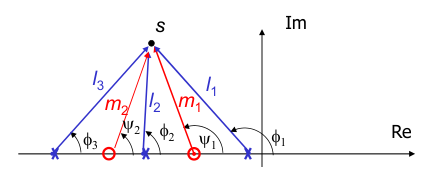
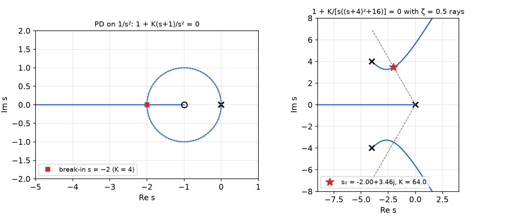
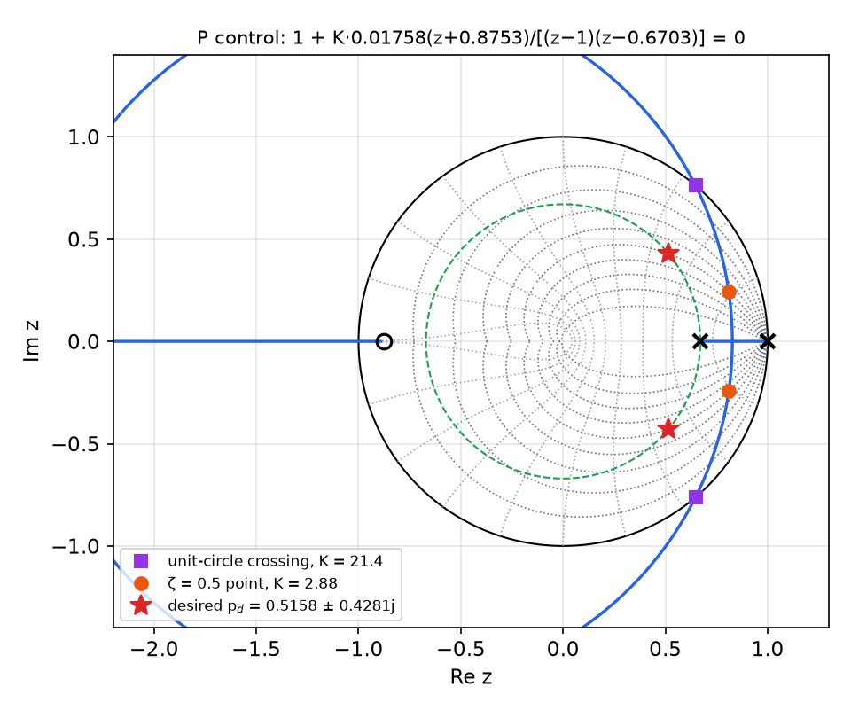
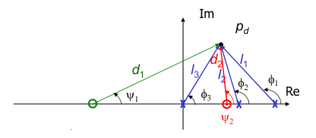
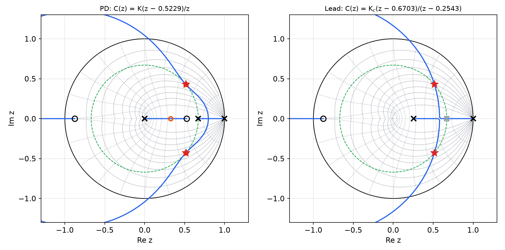
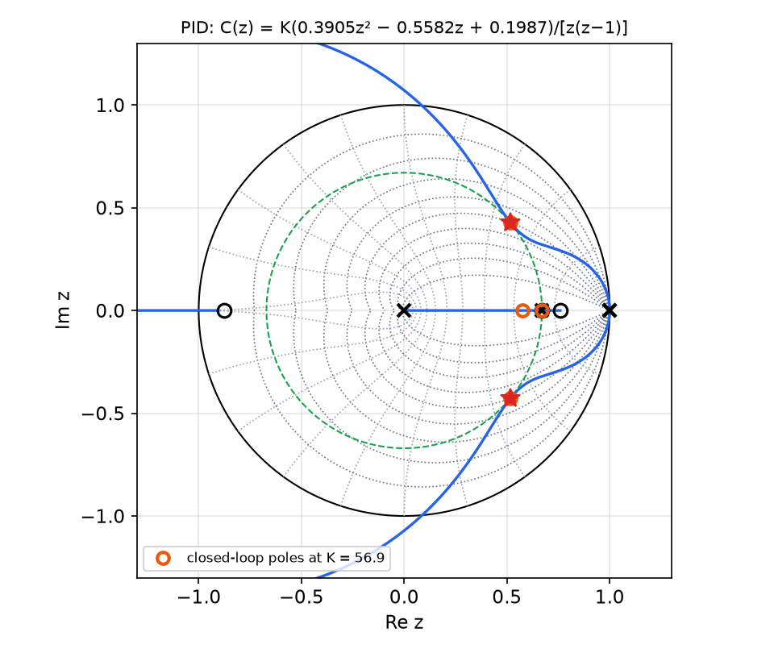
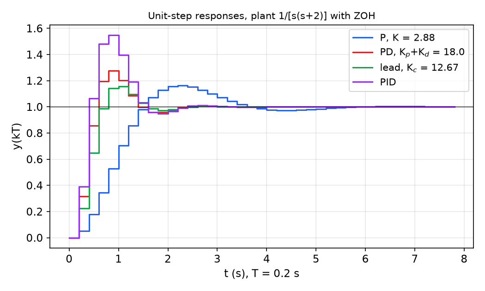

# Root-Locus Design of Digital Controllers

Pole placement by coefficient matching needs a controller with as many free parameters as the closed loop has poles. Most practical controllers (P, PD, lead, PI, PID) have one to three parameters, so the designer needs to see which closed-loop pole locations a given controller structure can reach at all. The **root locus** answers that question: it is the path traced by the closed-loop poles as one gain varies from zero to infinity. The construction rules are pure algebra on the characteristic equation \\(1 + KB/A = 0\\), so they hold unchanged in the z-plane; only the reading changes, since the stability boundary is now the unit circle and the targets are the z-plane regions of [Transient Specifications and the s-to-z Mapping](classical-design.md). The chapter develops the rules, illustrates them on continuous examples, and then designs P, PD, lead and PID controllers for one sampled plant to the same specification.

## Problem Statement

Consider the single feedback loop with forward path \\(G\\) and feedback path \\(H\\). The closed-loop transfer function is
\\[
\frac{Y}{R} = \frac{G}{1 + GH},
\\]
and its poles are the roots of the **characteristic equation** (CE) \\(1 + GH = 0\\). Write the loop transfer function in **root-locus form**, a gain times a ratio of monic polynomials:
\\[
G(s)H(s) = K\frac{B(s)}{A(s)} = K\frac{s^m + b\_1 s^{m-1} + \cdots + b\_m}{s^n + a\_1 s^{n-1} + \cdots + a\_n},
\qquad
G(z)H(z) = K\frac{B(z)}{A(z)} = K\frac{z^m + \cdots + b\_m}{z^n + \cdots + a\_n},
\\]
with \\(n \ge m\\) (the loop is proper). The CE becomes
\\[
A + KB = 0 .
\\]
**Definition (root locus).** The root locus is the set of all roots of \\(A + KB = 0\\) as \\(K\\) ranges over \\([0, \infty)\\).

Everything below is written with \\(s\\) as the variable; every statement holds verbatim with \\(z\\) in place of \\(s\\). The parameter \\(K\\) need not be a loop gain. Any CE that can be rearranged as \\(A + KB = 0\\) for a real parameter \\(K\\) has a root locus in \\(K\\) (an example with a derivative gain appears below).

## Angle and Magnitude Conditions

A point \\(s\\) is on the locus if and only if \\(B(s)/A(s) = -1/K\\) for some \\(K > 0\\), that is, if \\(GH(s)\\) is a negative real number. Separating modulus and argument:

- **Magnitude condition:** \\(\lvert G(s)H(s) \rvert = 1\\), i.e. \\(K = \lvert A(s) \rvert / \lvert B(s) \rvert\\).
- **Angle condition:** \\(\angle G(s)H(s) = \pm 180^\circ(2k+1)\\), i.e. \\(\angle A(s) - \angle B(s) = \pm 180^\circ(2k+1)\\).

The angle condition alone decides whether \\(s\\) is on the locus; the magnitude condition then gives the gain that puts a closed-loop pole there.

**Geometric form.** Factor \\(B(s) = \prod\_{j=1}^m (s - z\_j)\\) and \\(A(s) = \prod\_{i=1}^n (s - p\_i)\\). The complex number \\(s - p\\) is the vector from \\(p\\) to the test point \\(s\\); its angle \\(\phi = \angle(s-p)\\) is measured from the positive real direction and its length is \\(l = \lvert s - p \rvert\\). With \\(\phi\_i\\) the angles from the poles and \\(\psi\_j\\) the angles from the zeros,
\\[
\boxed{\sum\_{i=1}^n \phi\_i - \sum\_{j=1}^m \psi\_j = \pm 180^\circ(2k+1)}, \qquad
\boxed{K = \frac{\lvert s - p\_1 \rvert \cdots \lvert s - p\_n \rvert}{\lvert s - z\_1 \rvert \cdots \lvert s - z\_m \rvert} = \frac{\prod l\_i}{\prod m\_j}} .
\\]



*Figure: a test point s with three real poles (×) and two real zeros (○). The point is on the locus if φ₁ + φ₂ + φ₃ − ψ₁ − ψ₂ = 180°, and the gain there is K = l₁l₂l₃/(m₁m₂).*

## The Sketching Rules

The rules below locate the locus quickly without solving the CE. A computer draws the exact locus, but the rules explain its shape and tell the designer what a controller pole or zero will do.

**Rule 1 (start and end points).** The \\(n\\) branches start at the poles of \\(GH\\) (\\(K = 0\\)); \\(m\\) of them end at the zeros of \\(GH\\) (\\(K \to \infty\\)), and the remaining \\(n - m\\) go to infinity.

*Reason.* Write the CE as \\(B/A = -1/K\\). As \\(K \to 0\\), \\(\lvert B/A \rvert \to \infty\\), which happens only at roots of \\(A\\). As \\(K \to \infty\\), \\(B/A \to 0\\), which happens at roots of \\(B\\) or, since \\(n > m\\), as \\(s \to \infty\\) (Rule 3).

**Rule 2 (real-axis segments).** A point of the real axis is on the locus if and only if the total number of real poles and real zeros to its right is odd.

*Reason.* Take a real test point \\(s\_0\\). A complex-conjugate pair of poles or zeros contributes angles \\(\phi\\) and \\(-\phi\\), which cancel. A real pole or zero to the left of \\(s\_0\\) contributes \\(0^\circ\\); one to the right contributes \\(180^\circ\\). The angle condition requires the total to be an odd multiple of \\(180^\circ\\), so the count to the right must be odd.

**Rule 3 (asymptotes).** For large \\(K\\), the \\(n - m\\) branches that go to infinity approach straight lines radiating from a point \\(\sigma\\) of the real axis at angles
\\[
\boxed{\phi\_k = \pm\frac{(2k+1)180^\circ}{n - m}, \quad k = 0, 1, 2, \dots}, \qquad
\boxed{\sigma = \frac{\sum p\_i - \sum z\_j}{n - m}} .
\\]
*Derivation.* For large \\(\lvert s \rvert\\), long division gives
\\[
\frac{A(s)}{B(s)} = s^{n-m} + (a\_1 - b\_1)s^{n-m-1} + \cdots
\approx \left( s + \frac{a\_1 - b\_1}{n - m} \right)^{n-m} = (s - \sigma)^{n-m},
\\]
since the binomial expansion of \\((s - \sigma)^{n-m}\\) has the same two leading terms when \\(\sigma = -(a\_1 - b\_1)/(n - m)\\). The coefficients satisfy \\(a\_1 = -\sum p\_i\\) and \\(b\_1 = -\sum z\_j\\), which gives the formula for \\(\sigma\\). The CE becomes \\(1 + K/(s - \sigma)^{n-m} \approx 0\\), so \\((n - m)\angle(s - \sigma) = \pm 180^\circ(2k+1)\\): the far branches lie along rays from \\(\sigma\\) at the stated angles. When \\(n - m \ge 2\\), the sum of the closed-loop poles equals \\(-a\_1\\) for every \\(K\\) (the \\(s^{n-1}\\) coefficient of \\(A + KB\\) is unaffected by \\(K\\)), so the centroid \\(\sigma\\) is fixed. When \\(n - m = 1\\), the single far branch runs along the negative real axis.

| \\(n - m\\) | asymptote angles |
|---|---|
| 1 | \\(180^\circ\\) |
| 2 | \\(\pm 90^\circ\\) |
| 3 | \\(\pm 60^\circ,\ 180^\circ\\) |
| 4 | \\(\pm 45^\circ,\ \pm 135^\circ\\) |

**Rule 4 (multiple roots: breakaway and break-in points).** The locus has a multiple root at points where
\\[
\boxed{B\frac{dA}{ds} - A\frac{dB}{ds} = 0} .
\\]
At a root of multiplicity \\(q\\), the \\(q\\) branches arrive at angles separated by \\(360^\circ/q\\) and depart at angles separated by \\(360^\circ/q\\), rotated by \\(180^\circ/q\\) from the arriving ones. For \\(q = 2\\) on the real axis, branches arrive along the axis and leave at \\(\pm 90^\circ\\).

*Reason.* \\(s\_0\\) is a multiple root of \\(F(s) = A + KB\\) if and only if \\(F(s\_0) = 0\\) and \\(F'(s\_0) = 0\\). From the first, \\(K = -A/B\\); substituting into \\(A' + KB' = 0\\) gives \\(A' - (A/B)B' = 0\\), i.e. \\(BA' - AB' = 0\\). Equivalently, \\(dK/ds = d(-A/B)/ds = -(BA' - AB')/B^2 = 0\\): on the real axis, a breakaway point is where \\(K\\) reaches a local maximum along the segment between two poles. Only those roots of the condition that give a real positive \\(K\\) are on the locus.

**Rule 5 (departure and arrival angles).** The angle at which a branch leaves a complex pole \\(p\_l\\) is
\\[
\boxed{\phi\_{l,\text{dep}} = \sum\_j \psi\_j - \sum\_{i \ne l}\phi\_i \pm 180^\circ},
\\]
and the angle at which a branch arrives at a complex zero \\(z\_l\\) is
\\[
\boxed{\psi\_{l,\text{arr}} = \sum\_i \phi\_i - \sum\_{j \ne l}\psi\_j \pm 180^\circ} .
\\]
*Reason.* Put a test point \\(s\_0\\) on the locus infinitesimally close to \\(p\_l\\). The angles from every other pole and zero to \\(s\_0\\) equal their angles to \\(p\_l\\), while the angle from \\(p\_l\\) to \\(s\_0\\) is the unknown departure angle. Solving the angle condition \\(\phi\_{l,\text{dep}} + \sum\_{i \ne l}\phi\_i - \sum \psi\_j = \pm 180^\circ\\) gives the formula. For a pole or zero of multiplicity \\(q\\) the left-hand side contains \\(q\\) copies of the unknown angle, and the solutions are spaced by \\(360^\circ/q\\), as in Rule 3. In general a design point \\(s\_0\\) is any point at which \\(\angle B/A = 180^\circ\\); the rule is the special case \\(s\_0 \to p\_l\\).

**Rule 6 (stability-boundary crossings).** In the s-plane, the locus crosses the imaginary axis where \\(A(j\omega) + KB(j\omega) = 0\\); setting real and imaginary parts to zero gives two equations for \\(\omega\\) and \\(K\\). The Routh array gives the same critical gain (a row of zeros) and the crossing frequency (from the auxiliary polynomial). In the z-plane, the locus crosses the unit circle where \\(A(e^{j\theta}) + KB(e^{j\theta}) = 0\\); the critical gain can also be found with the Jury test, or, for a second-order CE \\(z^2 + c\_1 z + c\_0\\) with complex roots, from \\(c\_0 = 1\\) (the product of a complex pair is its squared modulus).

**Rule 7 (gain at a point).** Once a desired point \\(s\_0\\) on the locus is chosen, the gain that places a pole there follows from the magnitude condition:
\\[
K = \frac{\prod\_i \lvert s\_0 - p\_i \rvert}{\prod\_j \lvert s\_0 - z\_j \rvert} .
\\]

## Continuous-Time Examples

Two small continuous examples show the rules at work; the same reasoning will be applied in the z-plane.

**Example 1 (double integrator, P control).** A satellite's attitude obeys \\(G(s) = 1/s^2\\). With \\(D(s) = k\_p\\) the CE is \\(1 + k\_p/s^2 = 0\\).

- Rule 1: two branches start at \\(s = 0\\); there are no zeros.
- Rule 2: with both poles at the origin, every real point has either 0 or 2 poles to its right, so no part of the real axis is on the locus.
- Rule 3: \\(n - m = 2\\), asymptotes at \\(\pm 90^\circ\\) from \\(\sigma = 0\\).
- Rule 4: a double root at \\(s = 0\\), departing at \\(\pm 90^\circ\\).

The locus is the imaginary axis, \\(s = \pm j\sqrt{k\_p}\\): every gain gives an undamped oscillation. Proportional feedback alone cannot stabilize a double integrator.

**Example 2 (double integrator, PD control).** With \\(D(s) = k\_p + k\_D s\\), the CE is \\(1 + (k\_p + k\_D s)/s^2 = 0\\). Fix the ratio \\(k\_p/k\_D = 1\\) and use \\(K = k\_D\\) as the locus parameter:
\\[
1 + K\frac{s + 1}{s^2} = 0 \iff s^2 + Ks + K = 0 .
\\]
- Rule 1: two branches start at \\(s = 0\\); one ends at the zero \\(s = -1\\), the other goes to infinity.
- Rule 2: the real axis to the left of \\(-1\\) is on the locus.
- Rule 3: \\(n - m = 1\\): one asymptote, along the negative real axis.
- Rule 5: the branches leave the double pole at \\(\pm 90^\circ\\).
- Rule 6: the Routh array of \\(s^2 + Ks + K\\) has first column \\(1, K, K\\), with no sign change for \\(K > 0\\): the locus never enters the right half-plane.
- Rule 4: with \\(B = s + 1\\), \\(A = s^2\\): \\(BA' - AB' = (s+1)2s - s^2 = s^2 + 2s = 0\\), so \\(s \in \\{0, -2\\}\\). At \\(s = -2\\), \\(K = -A/B = 4\\).

The complex part of the locus is a circle. For \\(0 < K < 4\\) the roots are \\(s = \frac{1}{2}\left(-K \pm j\sqrt{4K - K^2}\right)\\), and
\\[
\lvert s + 1 \rvert^2 = \left(1 - \frac{K}{2}\right)^2 + \frac{4K - K^2}{4} = 1,
\\]
so the branches move on the unit circle centred at the zero \\(-1\\), from the double pole at 0 to the break-in point \\(-2\\); from there one branch moves right toward the zero and the other left toward \\(-\infty\\). A circle centred on a zero is the general shape of the locus for two real poles and one real zero.

**Example 3 (choosing the gain for a damping ratio).** For
\\[
L(s) = \frac{1}{s\left[(s+4)^2 + 16\right]} = \frac{1}{s(s + 4 + 4j)(s + 4 - 4j)}
\\]
(\\(n - m = 3\\), asymptotes at \\(\pm 60^\circ\\) and \\(180^\circ\\) from \\(\sigma = -8/3 \approx -2.7\\)), find the gain that gives closed-loop damping \\(\zeta = 0.5\\). The \\(\zeta = 0.5\\) rays make \\(60^\circ\\) with the negative real axis. The upper branch crosses that ray at \\(s\_0 = -2 + j3.464\\). The magnitude condition gives
\\[
K = \frac{1}{\lvert L(s\_0) \rvert} = \lvert s\_0 \rvert\\, \lvert s\_0 + 4 - 4j \rvert\\, \lvert s\_0 + 4 + 4j \rvert = 4 \times 2.071 \times 7.727 = 64,
\\]
(a graphical reading of the plot gives about 65). Check: \\(s^3 + 8s^2 + 32s + 64 = (s + 4)(s^2 + 4s + 16)\\), whose quadratic factor has \\(\omega\_n = 4\\), \\(\zeta = 0.5\\).



*Figure: left, the PD locus 1 + K(s+1)/s² = 0: a circle of radius 1 about the zero at −1, meeting the real axis at the break-in point −2 (K = 4). Right, the locus of 1/[s((s+4)²+16)] with the ζ = 0.5 rays; the star marks the design point s₀ = −2 + 3.46j, where K = 64.*

## Root Locus in the z-Plane

The CE of a digital loop, \\(1 + C(z)G(z) = 0\\), is a polynomial equation in \\(z\\), so Rules 1 to 7 apply as stated. Three things change in the interpretation:

1. **Stability** requires every closed-loop pole inside the unit circle. The critical gain is where a branch crosses \\(\lvert z \rvert = 1\\) (Rule 6 in its z-form), not the imaginary axis.
2. **Specifications** are read on the `zgrid` curves: a damping specification is the inside of a ζ-spiral, a settling-time specification the inside of a circle \\(\lvert z \rvert < e^{-\sigma T}\\).
3. **Extra poles at the origin** are common (a controller \\((z - a)/z\\), or a computation delay \\(z^{-1}\\)). They are harmless in themselves (the dead-beat location) but each adds angle to every test point and pulls branches toward instability. Sampled plants also commonly have a zero on the negative real axis near \\(-1\\) (the ZOH sampling zero), which attracts a branch.

**Example 4 (P control of a first-order plant).** For \\(G(z) = b/(z - p)\\) with \\(b > 0\\) and gain \\(K\\), the CE \\(z - p + Kb = 0\\) has the single root \\(z = p - Kb\\). The locus is the real axis to the left of \\(p\\) (Rule 2), traversed from \\(p\\) toward \\(-\infty\\). The root is inside the unit circle for \\((p - 1)/b < K < (p + 1)/b\\), and at the origin (dead-beat) for \\(K = p/b\\). Unlike the continuous first-order loop, the sampled loop becomes unstable at high gain: the root crosses \\(z = -1\\) and the response alternates in sign with growing amplitude.

### The design plant

The rest of the chapter designs controllers for one plant to one specification, so that the methods can be compared.

**Example 5 (servo with ZOH).** The plant \\(P(s) = 1/[s(s+2)]\\) is driven through a ZOH by a digital controller \\(C(z)\\), with unity feedback and \\(T = 0.2\\) s. Design a controller that gives closed-loop damping ratio \\(\zeta = 0.5\\) and 2% settling time \\(t\_s = 2\\) s.

*Sampled plant.* By partial fractions,
\\[
\frac{P(s)}{s} = \frac{1}{s^2(s+2)} = \frac{1/2}{s^2} - \frac{1/4}{s} + \frac{1/4}{s + 2},
\\]
so, with \\(a = e^{-2T} = e^{-0.4} = 0.6703\\),
\\[
G(z) = \frac{z-1}{z}\left[ \frac{(T/2)z}{(z-1)^2} - \frac{z/4}{z - 1} + \frac{z/4}{z - a} \right]
= \frac{T/2}{z - 1} - \frac14 + \frac{z - 1}{4(z - a)} .
\\]
Over the common denominator \\((z-1)(z-a)\\) the numerator is \\(\frac{T}{2}(z - a) + \frac14(z-1)(a - 1)\\), that is \\(\left[\frac{T}{2} + \frac{a-1}{4}\right]z - \left[\frac{aT}{2} + \frac{a-1}{4}\right] = 0.01758z + 0.01539\\). Hence
\\[
\boxed{G(z) = \frac{0.01758\\,(z + 0.8753)}{(z - 1)(z - 0.6703)}} .
\\]
(The zero is often quoted as \\(-0.876\\); the value to four figures is \\(-0.8753\\).)

*Desired poles.* \\(t\_s = 4/\sigma = 2\\) s gives \\(\sigma = \zeta\omega\_n = 2\\), so \\(\omega\_n = 4\\) rad/s and \\(\omega\_d = \omega\_n\sqrt{1 - \zeta^2} = 3.464\\) rad/s. In the s-plane \\(s\_d = -2 \pm j3.464\\); in the z-plane
\\[
p\_d = e^{s\_d T} = e^{-0.4}\left(\cos 0.6928 \pm j\sin 0.6928\right) = 0.5158 \pm j0.4281 ,
\\]
with \\(\lvert p\_d \rvert = e^{-\sigma T} = 0.6703\\) and \\(\lvert p\_d \rvert^2 = 0.4493\\). The desired dominant polynomial is \\(z^2 - 1.0316z + 0.4493\\).

### Proportional control

With \\(C(z) = K\\), the locus parameter is \\(K' = 0.01758K\\) and the CE is \\((z-1)(z - 0.6703) + K'(z + 0.8753) = 0\\).

- Branches start at 1 and 0.6703 (Rule 1); the real axis between them and to the left of \\(-0.8753\\) is on the locus (Rule 2).
- Breakaway and break-in (Rule 4): with \\(A = z^2 - 1.6703z + 0.6703\\), \\(B = z + 0.8753\\),
\\[
BA' - AB' = (z + 0.8753)(2z - 1.6703) - (z^2 - 1.6703z + 0.6703) = z^2 + 1.7506z - 2.1324 = 0,
\\]
so \\(z = 0.8272\\) (breakaway) and \\(z = -2.578\\) (break-in). As in Example 2, the complex part is a circle centred at the zero, of radius \\(0.8272 + 0.8753 = 1.7025\\).
- Unit-circle crossing (Rule 6): the CE is \\(z^2 + (K' - 1.6703)z + (0.6703 + 0.8753K')\\), and complex roots reach the unit circle when the constant term equals 1: \\(K' = 0.3297/0.8753 = 0.3767\\), i.e. \\(K = 21.4\\), with poles at \\(0.6468 \pm j0.7626\\). The loop is stable for \\(0 < K < 21.4\\).

The desired poles are **not** on this locus: \\(\lvert p\_d + 0.8753 \rvert = 1.4555 \ne 1.7025\\). The best a P controller can do at \\(\zeta = 0.5\\) is \\(K = 2.88\\), which puts the poles at \\(0.8098 \pm j0.2425\\), i.e. \\(\sigma = 0.84\\) s\\(^{-1}\\) and a settling time of about 4.8 s, well over twice the specification. A controller that bends the locus to the left is needed.



*Figure: P-control locus of Example 5. The branches leave the real axis at 0.827 and swing around the sampling zero at −0.875 on a circle of radius 1.70, leaving the unit circle at K = 21.4 (squares). The dashed circle |z| = 0.670 is the 2 s settling-time boundary; the desired poles (stars) lie off the locus. At ζ = 0.5 (dots, K = 2.88) the poles are far outside the settling-time circle.*

### PD control

A digital PD controller is
\\[
C(z) = K\_p + K\_d(1 - z^{-1}) = (K\_p + K\_d)\frac{z - a}{z}, \qquad a = \frac{K\_d}{K\_p + K\_d} .
\\]
It adds a zero at \\(a\\) (between 0 and 1 for positive gains) and a pole at the origin. The loop is
\\[
C(z)G(z) = K\frac{(z + 0.8753)(z - a)}{z(z-1)(z - 0.6703)}, \qquad K = 0.01758(K\_p + K\_d) .
\\]
*Placing the zero by the angle condition.* For \\(p\_d\\) to be on the locus, the angles from the three poles and two zeros must satisfy \\(\phi\_1 + \phi\_2 + \phi\_3 - \psi\_1 - \psi\_2 = 180^\circ\\). The known angles at \\(p\_d = 0.5158 + j0.4281\\) are
\\[
\angle(p\_d - 0) = 39.70^\circ, \quad \angle(p\_d - 1) = 138.52^\circ, \quad \angle(p\_d - 0.6703) = 109.85^\circ, \quad \angle(p\_d + 0.8753) = 17.11^\circ .
\\]
So the controller zero must contribute
\\[
\psi\_2 = 39.70^\circ + 138.52^\circ + 109.85^\circ - 17.11^\circ - 180^\circ = 90.95^\circ \approx 91^\circ,
\\]
i.e. it sits almost directly below \\(p\_d\\):
\\[
a = \operatorname{Re}p\_d - \frac{\operatorname{Im}p\_d}{\tan\psi\_2} = 0.5158 + 0.4281 \times 0.0166 = 0.5229 .
\\]



*Figure: the angles φ₁, φ₂, φ₃ from the plant poles at 1 and 0.6703 and the controller pole at 0, and ψ₁, ψ₂ from the sampling zero and the unknown controller zero, all measured at the desired pole p_d. The lengths l_i and d_j give the gain.*

*Gain by the magnitude condition.* With lengths \\(l\_1 = \lvert p\_d \rvert = 0.6703\\), \\(l\_2 = \lvert p\_d - 1 \rvert = 0.6463\\), \\(l\_3 = \lvert p\_d - 0.6703 \rvert = 0.4551\\), \\(d\_1 = \lvert p\_d + 0.8753 \rvert = 1.4555\\), \\(d\_2 = \lvert p\_d - 0.5229 \rvert = 0.4282\\):
\\[
K = \frac{l\_1 l\_2 l\_3}{d\_1 d\_2} = \frac{0.6703 \times 0.6463 \times 0.4551}{1.4555 \times 0.4282} = 0.3164,
\qquad K\_p + K\_d = \frac{K}{0.01758} = 18.0 .
\\]
Hence \\(K\_d = a(K\_p + K\_d) = 9.41\\) and \\(K\_p = 8.59\\):
\\[
\boxed{C(z) = 18.0\\,\frac{z - 0.5229}{z} = 8.59 + 9.41(1 - z^{-1})} .
\\]
The CE \\(z(z-1)(z-0.6703) + 0.3164(z + 0.8753)(z - 0.5229) = 0\\) has roots \\(0.5158 \pm j0.4281\\) (as designed) and a third real pole at 0.3223.

### Lead compensation by pole-zero cancellation

A first-order compensator
\\[
C(z) = K\_c\frac{z + \alpha}{z + \beta}
\\]
offers a second approach: use the zero to cancel the slow stable plant pole, \\(\alpha = -0.6703\\), so that the loop becomes
\\[
C(z)G(z) = \frac{K(z + 0.8753)}{(z - 1)(z + \beta)}, \qquad K = 0.01758K\_c,
\\]
and choose \\(K\\) and \\(\beta\\) so that the remaining second-order CE is the desired one. Matching
\\[
(z - 1)(z + \beta) + K(z + 0.8753) = z^2 + (\beta - 1 + K)z + (0.8753K - \beta) = z^2 - 1.0316z + 0.4493,
\\]
gives \\(K + \beta = -0.0316\\) and \\(0.8753K - \beta = 0.4493\\). Adding, \\(1.8753K = 0.4177\\), so
\\[
K = 0.2228, \qquad \beta = -0.2543, \qquad K\_c = \frac{0.2228}{0.01758} = 12.67,
\qquad \boxed{C(z) = 12.67\\,\frac{z - 0.6703}{z - 0.2543}} .
\\]
The compensator pole (0.2543) lies to the left of its zero (0.6703): it is a **lead** network, adding phase near \\(p\_d\\). The same result can be read from the root locus of the cancelled loop: a circle about \\(-0.8753\\) through \\(p\_d\\). Cancellation is safe here only because the cancelled pole is stable and well inside the unit circle; an imperfect cancellation leaves a slow closed-loop pole-zero pair near 0.67 with a small residue.



*Figure: left, the PD locus: the controller zero at 0.5229 and pole at 0 bend the branches through the desired poles (stars); the circle marks the third closed-loop pole at 0.322. Right, the lead locus after cancelling the plant pole at 0.6703 (grey): the branches from 1 and 0.2543 meet and pass through the desired poles.*

### PID control

A PID controller adds an integrator, which removes the steady-state error to ramps but raises the loop order to four. With
\\[
C(z) = K\_P + K\_I\frac{1}{1 - z^{-1}} + K\_D(1 - z^{-1}) = \frac{(K\_P + K\_I + K\_D)z^2 - (K\_P + 2K\_D)z + K\_D}{z(z - 1)},
\\]
write the controller as \\(G\_c(z) = 56.9\\,(\alpha z^2 + \beta z + \gamma)/[z(z-1)]\\). (The factor 56.9 only normalizes \\(56.9 \times 0.01758 \approx 1\\); the three coefficients carry the design.) The closed-loop CE is
\\[
z(z-1)^2(z - 0.6703) + 56.9 \times 0.01758\\,(z + 0.8753)(\alpha z^2 + \beta z + \gamma) = 0,
\\]
a quartic with three free coefficients. Choose the desired quartic: the dominant pair at \\(p\_d\\), a third pole at \\(0.6703 = e^{-\zeta\omega\_n T}\\) (on the settling-time circle), and a fourth pole \\(p\\) left free:
\\[
D(z) = \left[(z - 0.5158)^2 + 0.4281^2\right] (z - 0.6703)(z - p) .
\\]
Equating the coefficients of \\(z^3, z^2, z^1, z^0\\) gives four linear equations in \\(\alpha, \beta, \gamma, p\\), with solution
\\[
\alpha = 0.3905, \qquad \beta = -0.5582, \qquad \gamma = 0.1987, \qquad p = 0.578 .
\\]
(The polynomial is sometimes printed with \\((z + 0.5158)^2\\); the desired poles are at \\(+0.5158\\).) In PID form, \\(K\_D = 56.9\gamma = 11.31\\), \\(K\_P = -56.9\beta - 2K\_D = 9.15\\) and \\(K\_I = 56.9\alpha - K\_P - K\_D = 1.76\\). The controller zeros are at 0.759 and 0.670; the second almost cancels the closed-loop pole at 0.6703.



*Figure: root locus of the PID loop as the overall gain varies, with the open-loop poles at 0, 0.6703 and the double pole at 1, and zeros at −0.875, 0.670 and 0.759. At the design gain (circles) two poles sit at p_d (stars), one at 0.671 next to the zero at 0.670, and one at 0.577.*

### Comparing the designs

All four designs are type 1 or higher (the plant contains an integrator), so the step error is zero. Their step responses differ because of the closed-loop zeros.

| Controller | Closed-loop poles | Overshoot | 2% settling | \\(K\_v\\) (s\\(^{-1}\\)) |
|---|---|---|---|---|
| P, \\(K = 2.88\\) | \\(0.810 \pm j0.243\\) | 16% | ≈ 5.0 s | 1.44 |
| PD, \\(18.0(z - 0.5229)/z\\) | \\(p\_d\\), 0.322 | 28% | ≈ 2.2 s | 4.29 |
| lead, \\(12.67(z - 0.6703)/(z - 0.2543)\\) | \\(p\_d\\) | 15% | ≈ 2.2 s | 2.80 |
| PID | \\(p\_d\\), 0.671, 0.577 | 55% | ≈ 2.2 s | \\(\infty\\) |

Here \\(K\_v = \frac{1}{T}\lim\_{z \to 1}(z - 1)C(z)G(z)\\) is the velocity error constant; the ramp error is \\(1/K\_v\\). Settling times are quoted to the next sample, so 2.2 s is the first sample after the 2 s target.



*Figure: unit-step responses of the four designs (T = 0.2 s). P control meets the damping specification but is slow. The lead design, with only the dominant pair left after cancellation, matches the second-order prediction (16% overshoot). The PD and PID designs place the same dominant poles but overshoot more, because of their zeros at 0.523 and 0.759 near the dominant poles.*

The comparison repeats the lesson of the pole-placement example in [Transient Specifications and the s-to-z Mapping](classical-design.md): putting the dominant poles at \\(p\_d\\) guarantees the decay rate, but the overshoot is set jointly by poles and zeros. The lead design is cleanest because its only closed-loop zero is the far sampling zero at \\(-0.875\\). The PID design buys infinite \\(K\_v\\) with a slow zero at 0.759 inside the dominant pole radius; a designer would typically move that zero (by choosing the free pole differently) or add a prefilter on the reference to cancel it.

**Exercise (PID region design).** For \\(G(z) = (z + 0.7)/[(z - 1)(z - 0.5)]\\) and \\(G\_c(z) = K\_c(z - \alpha)(z - \beta)/[z(z - 1)]\\), require \\(t\_s < 10T\\) and \\(\zeta > 0.5\\). The admissible region is the inside of the circle \\(\lvert z \rvert < e^{-0.4} = 0.67\\) intersected with the inside of the \\(\zeta = 0.5\\) spiral. Placing the two PID zeros near 0.6 pulls the four branches (from the double pole at 1, from 0.5 and from 0) into the region; an interactive tool shows that all closed-loop poles can be brought inside it, near \\(0.40 \pm j0.42\\) and \\(0.58 \pm j0.21\\).

### Software

```matlab
G  = c2d(tf(1,[1 2 0]), 0.2);      % ZOH equivalent of 1/(s(s+2))
rlocus(G); zgrid                    % P-control root locus with zeta/wn grid
C  = 18.0*tf([1 -0.5229],[1 0],0.2); % PD design
rlocus(C*G)
[K,p] = rlocfind(C*G)               % pick a gain graphically
rltool(G)                           % interactive compensator design
step(feedback(C*G,1))
```

In Python, `scipy.signal.cont2discrete` gives the ZOH equivalent and the locus can be drawn by sweeping \\(K\\) and computing `numpy.roots(A + K*B)`; the `python-control` package provides `root_locus` and `zgrid` directly.

## Summary

- Root locus: roots of \\(A + KB = 0\\) for \\(K \ge 0\\); the same rules hold in \\(s\\) and \\(z\\).
- Angle condition \\(\sum\phi\_i - \sum\psi\_j = \pm 180^\circ(2k+1)\\); magnitude condition \\(K = \prod l\_i/\prod m\_j\\).
- Rules: start at poles, end at zeros or infinity; real axis left of an odd count; asymptotes at \\(\pm(2k+1)180^\circ/(n-m)\\) from \\(\sigma = (\sum p\_i - \sum z\_j)/(n-m)\\); multiple roots where \\(BA' - AB' = 0\\); departure \\(\phi\_{\text{dep}} = \sum\psi - \sum\_{i \ne l}\phi \pm 180^\circ\\); crossings by Routh (s) or the unit circle/Jury test (z).
- Two real poles and one real zero give a circular locus about the zero.
- Example \\(P(s) = 1/[s(s+2)]\\), ZOH, \\(T = 0.2\\): \\(G(z) = 0.01758(z + 0.8753)/[(z-1)(z - 0.6703)]\\), target \\(p\_d = 0.5158 \pm j0.4281\\).
  - P: stable for \\(K < 21.4\\); cannot reach \\(p\_d\\).
  - PD: zero at 0.5229 from the angle condition (\\(\psi\_2 \approx 91^\circ\\)), \\(K\_p + K\_d = 18.0\\) (\\(K\_p = 8.59\\), \\(K\_d = 9.41\\)).
  - Lead: \\(12.67(z - 0.6703)/(z - 0.2543)\\) by cancellation and matching.
  - PID: \\(\alpha = 0.3905\\), \\(\beta = -0.5582\\), \\(\gamma = 0.1987\\), fourth pole 0.578.
- Placing the dominant poles fixes the decay; zeros near them raise the overshoot.

## See Also

- [Transient Specifications and the s-to-z Mapping](classical-design.md): where the target poles come from.
- [Frequency-Response Analysis of Digital Systems](frequency-response.md): the same plant designed with phase-margin specifications.
- [Z-Plane Analysis](z-plane.md): pulse transfer functions and the ZOH equivalent.
- [Stability](../stability.md) and [PID Control](../pid.md): continuous-time background.
- [State Feedback](state-feedback.md): placing all poles at once with state models.
