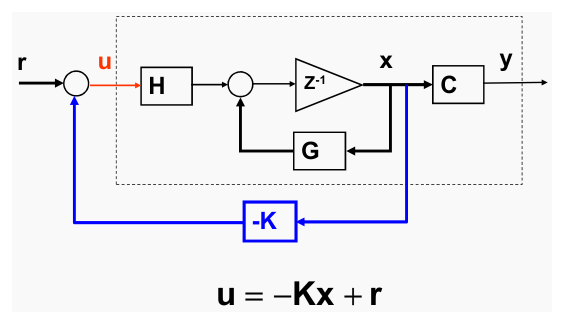
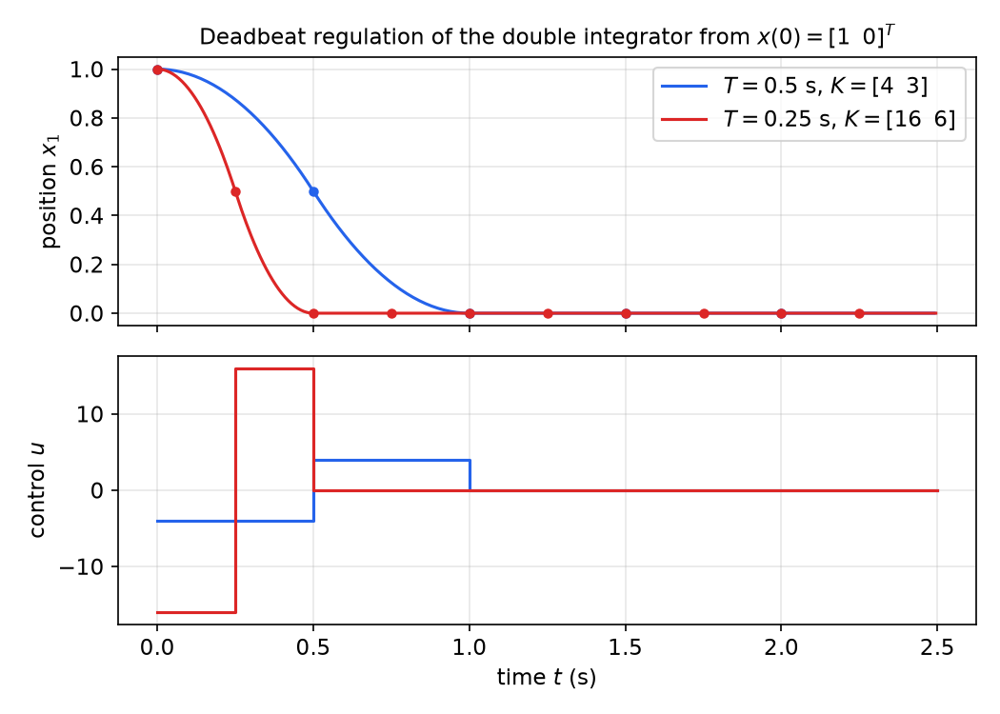
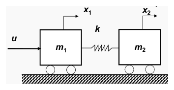
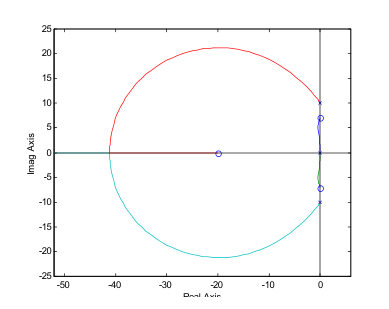
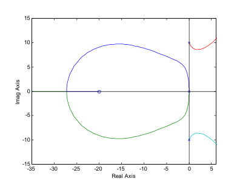
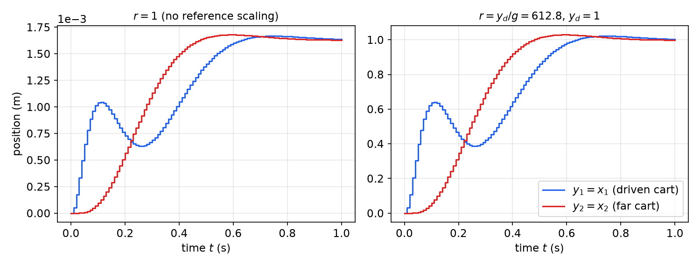
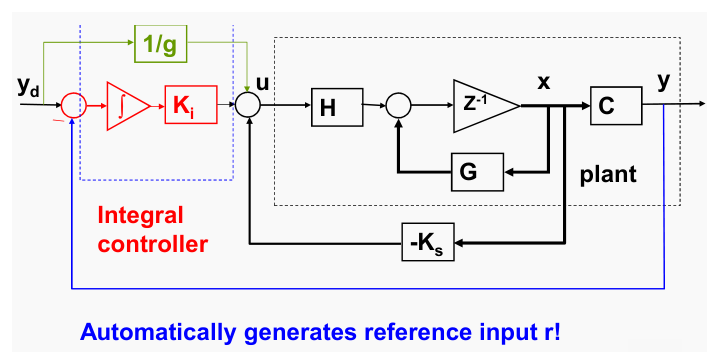
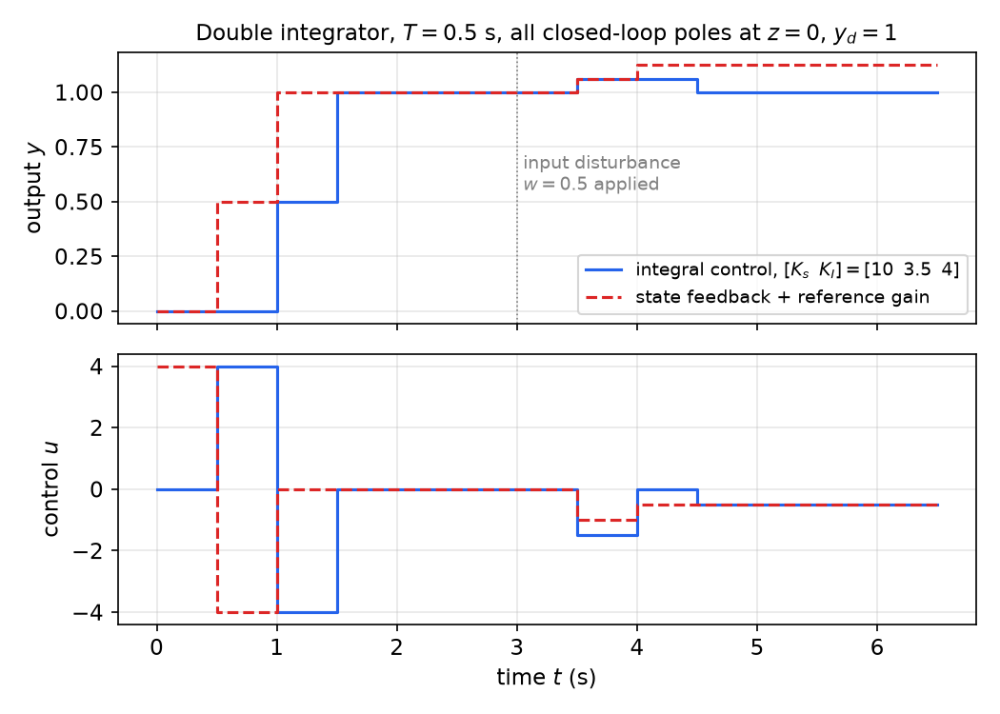

# State Feedback and Pole Placement for Discrete Systems

Most control systems exist to regulate or track an output by adjusting the input, within physical limits. With a [discrete-time state model](state-space.md) the most direct way to do this is to feed back the whole state through a constant gain matrix. Under a condition called controllability, that gain can place the closed-loop eigenvalues anywhere in the z-plane. This chapter develops discrete-time controllability, the Bass–Gura and Ackermann pole-placement formulas, deadbeat control (which has no continuous-time counterpart), reference scaling, integral action and model-inverse tracking. A flexible two-mass system runs through the chapter as the main example. The continuous-time theory is in [Controllability](../linear/controllability.md) and [State Feedback](../linear/state-feedback.md); this chapter concentrates on what is specific to sampled systems.

## Open-Loop and Closed-Loop Control

An *open-loop* controller computes the command input from the desired output alone (desired output → controller → system → output). A *closed-loop* controller compares the desired output with a measured output and acts on the difference, with a sensor in the feedback path.

Closed-loop control adjusts the input automatically, is less sensitive to plant variations and disturbances, and can stabilize an unstable plant. Its costs are added complexity (sensors and computation) and the possibility of making a stable plant unstable. State feedback is the closed-loop structure in which the "measurement" is the entire state vector. When only some states are measured, the state is estimated by an [observer](observers.md) and the two are combined as in [Combined Controller–Observer Design](controller-observer.md).

## Controllability

**Definition (Controllability).** The \\(n\\)th-order system \\(x(k+1) = Gx(k) + Hu(k)\\), or simply the pair \\((G, H)\\), is *controllable* if any initial state \\(x(0)\\) can be transferred to any final state \\(x(k\_f)\\) in a finite number of steps (we will see that \\(k\_f \le n\\) suffices) by some input sequence.

Some remarks on the definition:

- Controllability means the state can be steered in *any* direction of \\(\mathbb{R}^n\\).
- The steering input is generally not unique.
- For linear systems either end point may be taken as zero without loss of generality, because the response is a superposition of the free response and the forced response.
- In discrete time "reaching any state from zero" (*reachability*) and "reaching zero from any state" (*controllability to the origin*) are different when \\(G\\) is singular. For \\(x^+ = 0 \cdot x + 0 \cdot u\\), every state is driven to zero in one step with no input, yet nothing else can be reached. The definition above, any state to any state, is the reachability notion, and it is what the rank test below characterizes. For a sampled continuous plant \\(G = e^{AT}\\) is nonsingular and the distinction disappears.

**Example 1 (Three second-order systems).**

- *System 1:* \\(x\_1^+ = x\_2\\), \\(x\_2^+ = u\\). The input reaches \\(x\_2\\) directly and \\(x\_1\\) one step later. Controllable.
- *System 2:* \\(x\_1^+ = x\_1\\), \\(x\_2^+ = u\\). The input never affects \\(x\_1\\). Uncontrollable.
- *System 3:* \\(x\_1^+ = x\_1 + u\\), \\(x\_2^+ = x\_2 + u\\). The input affects both states, but identically: \\((x\_1 - x\_2)^+ = x\_1 - x\_2\\), so the difference can never be changed. Uncontrollable.

System 3 shows that "the input enters every equation" is not enough. The rank test below settles all three cases mechanically.

### The Cayley–Hamilton theorem

**Theorem (Cayley–Hamilton).** Every square matrix satisfies its own characteristic equation. If \\(p(\lambda) = \det(\lambda I - A) = \lambda^n + a\_1\lambda^{n-1} + \dots + a\_{n-1}\lambda + a\_n\\), then
\\[
\boxed{p(A) = A^n + a\_1A^{n-1} + \dots + a\_{n-1}A + a\_nI = 0 .}
\\]
Consequently \\(A^n\\), and by induction every higher power \\(A^{n+j}\\), is a linear combination of \\(I, A, \dots, A^{n-1}\\).

*Proof sketch.* The adjugate satisfies \\((\lambda I - A)\operatorname{adj}(\lambda I - A) = p(\lambda)I\\). Its entries are polynomials of degree at most \\(n-1\\) in \\(\lambda\\), so \\(\operatorname{adj}(\lambda I - A) = B\_0\lambda^{n-1} + B\_1\lambda^{n-2} + \dots + B\_{n-1}\\) with constant matrices \\(B\_i\\). Expand the left side and equate coefficients of each power of \\(\lambda\\) with those of \\(p(\lambda)I\\):
\\[
B\_0 = I, \quad B\_1 - AB\_0 = a\_1I, \quad \dots, \quad B\_{n-1} - AB\_{n-2} = a\_{n-1}I, \quad -AB\_{n-1} = a\_nI .
\\]
Multiply these equations on the left by \\(A^n, A^{n-1}, \dots, A, I\\) respectively and add. The left sides telescope to zero, and the right sides add up to \\(p(A)\\). ∎

### Computing a steering input

From the convolution formula with \\(\psi(k) = G^k\\),
\\[
x(k) = G^kx(0) + \sum\_{j=0}^{k-1}G^{k-j-1}Hu(j).
\\]
Define the required change \\(\Delta x = x(k) - G^kx(0)\\), the part of the target that the free response does not deliver. Then
\\[
\Delta x = M\_k\\, \mathbf{u} = \begin{bmatrix} H & GH & \cdots & G^{k-1}H \end{bmatrix}\begin{bmatrix} u(k-1) \\\\ u(k-2) \\\\ \vdots \\\\ u(0) \end{bmatrix}.
\\]
This is a linear map from the stacked input sequence (dimension \\(mk\\) for \\(m\\) inputs) into \\(\mathbb{R}^n\\): \\(n\\) equations in \\(mk\\) unknowns. A solution exists for every \\(\Delta x\\) if and only if \\(\operatorname{rank} M\_k = n\\). This requires \\(mk \ge n\\). By Cayley–Hamilton, the columns \\(G^kH\\) for \\(k \ge n\\) are combinations of the earlier ones, so \\(\operatorname{rank} M\_k\\) stops growing at \\(k = n\\). Waiting longer than \\(n\\) steps never makes an uncontrollable system controllable.

When a solution exists, the one of minimum Euclidean norm is \\(\mathbf{u} = M\_k^T(M\_kM\_k^T)^{-1}\Delta x\\). For a single input and \\(k = n\\), \\(M\_n\\) is square and the input sequence is unique.

**Theorem (Controllability rank test).** The pair \\((G, H)\\) is controllable if and only if the controllability matrix
\\[
\boxed{M = \begin{bmatrix} H & GH & G^2H & \cdots & G^{n-1}H \end{bmatrix}}
\\]
has rank \\(n\\). More generally, the range of \\(M\\) is the *controllable subspace*: the set of states reachable from the origin.

For the three systems of Example 1:
\\[
M\_1 = \begin{bmatrix} 0 & 1 \\\\ 1 & 0 \end{bmatrix} \;(\text{rank } 2), \qquad
M\_2 = \begin{bmatrix} 0 & 0 \\\\ 1 & 0 \end{bmatrix} \;(\text{rank } 1), \qquad
M\_3 = \begin{bmatrix} 1 & 1 \\\\ 1 & 1 \end{bmatrix} \;(\text{rank } 1).
\\]
For System 3 the controllable subspace is the line \\(x\_1 = x\_2\\).

The equivalent PBH test, \\(\operatorname{rank}[\\,zI - G \;\; H\\,] = n\\) at every eigenvalue \\(z\\) of \\(G\\), and the Kalman decomposition into controllable and uncontrollable parts are developed in [Structure of Linear Systems](../linear/structure.md).

**Example 2 (Two annuities).** Two variable-rate annuity accounts earn interest \\(r\\) and \\(s\\) per period. A fraction \\(a\\) of the interest from account 1 is reinvested in account 1 and the rest, \\(1-a\\), in account 2. Likewise a fraction \\(b\\) of account 2's interest stays in account 2 and \\(1-b\\) goes to account 1. An external deposit \\(u(k)\\) is added to each account every period. With \\(x\_i\\) the balance of account \\(i\\):
\\[
\begin{bmatrix} x\_1 \\\\ x\_2 \end{bmatrix}^+ = \underbrace{\begin{bmatrix} 1 + ar & (1-b)s \\\\ (1-a)r & 1 + bs \end{bmatrix}}\_{G}\begin{bmatrix} x\_1 \\\\ x\_2 \end{bmatrix} + \underbrace{\begin{bmatrix} 1 \\\\ 1 \end{bmatrix}}\_{H}u .
\\]
The controllability matrix and its determinant are
\\[
M = \begin{bmatrix} 1 & 1 + ar + (1-b)s \\\\ 1 & 1 + (1-a)r + bs \end{bmatrix}, \qquad \det M = (1 - 2a)r - (1 - 2b)s .
\\]
The system is uncontrollable exactly when \\((1-2a)r = (1-2b)s\\). That happens if \\(a = b = 0.5\\), or, for \\(a \ne 0.5\\), if \\(r/s = (1-2b)/(1-2a)\\). Note that \\(a = 0.5\\) alone is not sufficient (it leaves \\(\det M = -(1-2b)s\\)), and the ratio is \\((1-2b)/(1-2a)\\), not its reciprocal. In the uncontrollable case the investor can set the total balance but not how it is split between the accounts.

### Controllability can be lost by sampling

A ZOH-sampled plant \\((e^{AT}, \int\_0^Te^{At}B\\,dt)\\) can be uncontrollable even when \\((A, B)\\) is controllable. Sampling folds frequencies: two continuous modes whose frequencies differ by a multiple of the sampling frequency become indistinguishable at the samples.

**Example 3 (Pathological sampling of an oscillator).** Take \\(\dot x = \begin{bmatrix} 0 & 1 \\\\ -1 & 0 \end{bmatrix}x + \begin{bmatrix} 0 \\\\ 1 \end{bmatrix}u\\), a controllable oscillator with eigenvalues \\(\pm j\\). Here \\(e^{At}B = [\sin t \;\; \cos t]^T\\). With \\(T = \pi\\):
\\[
G = e^{A\pi} = -I, \qquad H = \int\_0^\pi \begin{bmatrix} \sin t \\\\ \cos t \end{bmatrix}dt = \begin{bmatrix} 2 \\\\ 0 \end{bmatrix}, \qquad M = \begin{bmatrix} 2 & -2 \\\\ 0 & 0 \end{bmatrix}.
\\]
\\(M\\) has rank 1. Both continuous eigenvalues \\(\pm j\\) map to \\(z = e^{\pm j\pi} = -1\\), and a single input cannot control two identical modes independently.

**Theorem (Controllability under sampling).** Let \\((A, B)\\) be controllable. If for every pair of eigenvalues of \\(A\\) with equal real parts, \\(\operatorname{Im}(\lambda\_i - \lambda\_j) \ne 2\pi q/T\\) for every nonzero integer \\(q\\), then the ZOH-sampled pair \\((G, H)\\) is controllable. (The condition is sufficient; for single-input systems it is also necessary.)

In practice this means: do not sample at exactly twice a lightly damped mode's frequency, or at integer fractions of that rate.

## State Feedback



*Figure: state feedback. The plant (dashed box) is the delay loop x⁺ = Gx + Hu with output y = Cx; the full state x is fed back through the gain −K and added to the external reference r to form u = −Kx + r.*

The control law is \\(u(k) = -Kx(k) + r(k)\\), with \\(K\\) an \\(m \times n\\) gain matrix. There are two design objectives:

- **Regulation:** drive the state to an equilibrium (usually the origin) with a desirable transient.
- **Tracking:** make the output \\(y\\) follow a desired trajectory \\(y\_d\\) with a desirable transient.

Substituting the control law into \\(x^+ = Gx + Hu\\), \\(y = Cx\\) gives the closed loop
\\[
\boxed{x(k+1) = (G - HK)x(k) + Hr(k), \qquad y(k) = Cx(k).}
\\]
The closed-loop behaviour is governed by the eigenvalues of \\(G - HK\\). For asymptotic stability they must lie strictly inside the unit circle. Their locations set the transient, through the s-to-z map \\(z = e^{sT}\\) of [classical design](classical-design.md).

## Pole Placement

**Problem (Pole placement).** Given \\((G, H)\\) and a desired set \\(\\{\lambda\_1^{des}, \dots, \lambda\_n^{des}\\}\\), closed under complex conjugation, find \\(K\\) such that the eigenvalues of \\(\bar G := G - HK\\) are exactly \\(\lambda\_1^{des}, \dots, \lambda\_n^{des}\\).

The derivation is easiest in controllable canonical form. A general system is then transformed to that form.

### Systems in controllable canonical form

Suppose \\(x^+ = G\_cx + H\_cu\\) with \\(G\_c\\), \\(H\_c\\) in the CCF of [the previous chapter](state-space.md):
\\[
G\_c = \begin{bmatrix} 0 & 1 & \cdots & 0 \\\\ \vdots & & \ddots & \vdots \\\\ 0 & 0 & \cdots & 1 \\\\ -a\_n & -a\_{n-1} & \cdots & -a\_1 \end{bmatrix}, \quad H\_c = \begin{bmatrix} 0 \\\\ \vdots \\\\ 0 \\\\ 1 \end{bmatrix}, \quad \det(zI - G\_c) = z^n + a\_1z^{n-1} + \dots + a\_n .
\\]
With \\(K = [k\_1 \;\; k\_2 \;\; \cdots \;\; k\_n]\\), the product \\(H\_cK\\) has \\(K\\) as its last row and zeros elsewhere. Feedback therefore changes only the last row of the companion matrix:
\\[
\bar G = G\_c - H\_cK = \begin{bmatrix} 0 & 1 & \cdots & 0 \\\\ \vdots & & \ddots & \vdots \\\\ 0 & 0 & \cdots & 1 \\\\ -a\_n - k\_1 & -a\_{n-1} - k\_2 & \cdots & -a\_1 - k\_n \end{bmatrix}.
\\]
\\(\bar G\\) is still a companion matrix, so its characteristic polynomial can be read off:
\\[
\det(zI - \bar G) = z^n + (a\_1 + k\_n)z^{n-1} + \dots + (a\_{n-1} + k\_2)z + (a\_n + k\_1).
\\]
Match it to the desired polynomial
\\[
\Phi^{des}(z) = \prod\_{i=1}^n(z - \lambda\_i^{des}) = z^n + a\_1^{des}z^{n-1} + \dots + a\_{n-1}^{des}z + a\_n^{des}.
\\]
Equating coefficients gives the gains:
\\[
\boxed{k\_i = a\_{n-i+1}^{des} - a\_{n-i+1}, \qquad i = 1, \dots, n, \qquad\text{i.e.}\quad K\_c = \begin{bmatrix} a\_n^{des} - a\_n & \cdots & a\_1^{des} - a\_1 \end{bmatrix}.}
\\]
Each gain is the amount by which one coefficient of the characteristic polynomial must be shifted. Leaving a pole where it already is costs nothing, and moving poles far costs large gains.

### Transformation to controllable canonical form

For a general controllable \\((G, H)\\), find a nonsingular \\(T\\) such that \\(\hat x = Tx\\) puts the system in CCF: \\(G\_c = TGT^{-1}\\), \\(H\_c = TH\\). Let \\(P = T^{-1} = [p\_1 \;\; p\_2 \;\; \cdots \;\; p\_n]\\) (columns). The conditions are equivalent to
\\[
PH\_c = H, \qquad PG\_c = GP .
\\]
The first says \\(p\_n = H\\), since \\(H\_c = e\_n\\). For the second, column \\(j\\) of \\(PG\_c\\) is \\(p\_{j-1} - a\_{n-j+1}p\_n\\) (with \\(p\_0 := 0\\)), and column \\(j\\) of \\(GP\\) is \\(Gp\_j\\). Working from the last column backwards:
\\[
\begin{aligned}
p\_{n-1} - a\_1p\_n &= Gp\_n &&\Rightarrow\; p\_{n-1} = a\_1H + GH, \\\\
p\_{n-2} - a\_2p\_n &= Gp\_{n-1} &&\Rightarrow\; p\_{n-2} = a\_2H + a\_1GH + G^2H, \\\\
&\\;\\;\vdots \\\\
p\_1 &= a\_{n-1}H + a\_{n-2}GH + \dots + a\_1G^{n-2}H + G^{n-1}H .
\end{aligned}
\\]
The one remaining condition (first column), \\(-a\_np\_n = Gp\_1\\), reads \\(G^nH + a\_1G^{n-1}H + \dots + a\_nH = 0\\). This holds by Cayley–Hamilton. Collecting the columns:
\\[
P = MW, \qquad M = \begin{bmatrix} H & GH & \cdots & G^{n-1}H \end{bmatrix}, \qquad
W = \begin{bmatrix} a\_{n-1} & a\_{n-2} & \cdots & a\_1 & 1 \\\\ a\_{n-2} & a\_{n-3} & \cdots & 1 & 0 \\\\ \vdots & & ⋰ & & \vdots \\\\ a\_1 & 1 & \cdots & 0 & 0 \\\\ 1 & 0 & \cdots & 0 & 0 \end{bmatrix}.
\\]
\\(W\\) is a Hankel matrix with unit anti-diagonal, so it is always invertible. Hence \\(T = (MW)^{-1}\\) **exists if and only if \\(M\\) is invertible, i.e. iff the system is controllable.** This proves the central theorem:

**Theorem (Pole assignment).** The eigenvalues of \\(G - HK\\) can be placed at any self-conjugate set of \\(n\\) locations by a suitable \\(K\\) if and only if \\((G, H)\\) is controllable. For a single input the gain is unique.

If \\((G, H)\\) is uncontrollable, the uncontrollable eigenvalues are unaffected by any \\(K\\). Stabilization is still possible if they lie inside the unit circle (*stabilizability*).

There is an alternative expression for \\(T\\). From \\(TG = G\_cT\\), the rows \\(t\_i\\) of \\(T\\) satisfy \\(t\_{i+1} = t\_iG\\) (the shift structure of \\(G\_c\\)). From \\(TH = e\_n\\), together with the observation that the last column of the symmetric matrix \\(W\\) is \\(e\_1\\), the first row is \\(t\_1 = e\_1^TW^{-1}M^{-1} = e\_n^TM^{-1}\\). Hence
\\[
T = P^{-1} = \begin{bmatrix} q \\\\ qG \\\\ \vdots \\\\ qG^{n-1} \end{bmatrix}, \qquad q = \begin{bmatrix} 0 & \cdots & 0 & 1 \end{bmatrix}M^{-1},
\\]
so \\(q\\) is the last row of the inverse controllability matrix.

### Bass–Gura formula

In CCF coordinates the control is \\(u = -\hat K\hat x + r\\) with \\(\hat K = [a\_n^{des} - a\_n \;\; \cdots \;\; a\_1^{des} - a\_1]\\). Since \\(\hat x = Tx\\), the gain in the original coordinates is \\(K = \hat KT\\):
\\[
\boxed{K = \begin{bmatrix} a\_n^{des} - a\_n & a\_{n-1}^{des} - a\_{n-1} & \cdots & a\_1^{des} - a\_1 \end{bmatrix}(MW)^{-1}.}
\\]
An equivalent form uses the natural coefficient order and an upper-triangular Toeplitz matrix:
\\[
\boxed{K = \begin{bmatrix} a\_1^{des} - a\_1 & \cdots & a\_{n-1}^{des} - a\_{n-1} & a\_n^{des} - a\_n \end{bmatrix}\left(M\begin{bmatrix} 1 & a\_1 & \cdots & a\_{n-1} \\\\ 0 & 1 & \cdots & a\_{n-2} \\\\ \vdots & & \ddots & \vdots \\\\ 0 & 0 & \cdots & 1 \end{bmatrix}\right)^{-1}.}
\\]
To see the equivalence, let \\(W\_t\\) be the Toeplitz matrix and \\(J\\) the exchange matrix. Reversing the columns of \\(W\_t\\) gives \\(W\\), so \\(W = W\_tJ\\). Then \\((MW)^{-1} = J(MW\_t)^{-1}\\), and the reversed coefficient row times \\(J\\) is the row in natural order.

### Ackermann's formula

Cayley–Hamilton gives a formula that avoids computing \\(W\\) and \\(T\\) explicitly. Since \\(\Phi(G\_c) = 0\\),
\\[
\Phi^{des}(G\_c) = \Phi^{des}(G\_c) - \Phi(G\_c) = \sum\_{i=1}^n (a\_i^{des} - a\_i)G\_c^{\\,n-i}.
\\]
The first row of a power of the companion matrix is a shifted unit vector: \\(e\_1^TG\_c^{\\,j} = e\_{j+1}^T\\) for \\(j < n\\). Hence
\\[
e\_1^T\Phi^{des}(G\_c) = \sum\_{i=1}^n (a\_i^{des} - a\_i)e\_{n-i+1}^T = \hat K .
\\]
Transforming back, \\(K = \hat KT = e\_1^T\Phi^{des}(TGT^{-1})T = e\_1^TT\\,\Phi^{des}(G)\\). The first row of \\(T\\) is \\(q = e\_n^TM^{-1}\\), so
\\[
\boxed{K = \begin{bmatrix} 0 & \cdots & 0 & 1 \end{bmatrix}M^{-1}\\,\Phi^{des}(G) \qquad\text{(Ackermann).}}
\\]
This is MATLAB's `acker(G,H,p)`. Both Ackermann and Bass–Gura invert \\(M\\), which is often badly conditioned (see Example 6). For anything but low-order problems the numerically robust `place` is preferred, and it also handles multiple inputs. In the multi-input case the gain is not unique. The extra freedom can shape eigenvectors or be resolved by optimization ([LQR](lqr.md)).

## Deadbeat Control

A possibility unique to discrete time is to put **all** closed-loop poles at \\(z = 0\\). Then \\(\Phi^{des}(z) = z^n\\), and by Cayley–Hamilton \\((G - HK)^n = 0\\): the closed-loop matrix is *nilpotent*. Every initial state reaches the origin in at most \\(n\\) steps:
\\[
x(n) = (G - HK)^nx(0) = 0 .
\\]
Continuous-time systems can only approach equilibrium asymptotically. A sampled system under deadbeat control arrives exactly, in finite time, at least at the sampling instants. By Ackermann the deadbeat gain is \\(K = e\_n^TM^{-1}G^n\\). For single-input systems it is the *minimum-time* controller: no input sequence reaches the origin from every initial state in fewer than \\(n\\) steps.

**Example 4 (Deadbeat control of the double integrator).** For the ZOH double integrator \\(G = \begin{bmatrix} 1 & T \\\\ 0 & 1 \end{bmatrix}\\), \\(H = \begin{bmatrix} T^2/2 \\\\ T \end{bmatrix}\\) and \\(K = [k\_1 \;\; k\_2]\\):
\\[
G - HK = \begin{bmatrix} 1 - \tfrac{T^2}{2}k\_1 & T - \tfrac{T^2}{2}k\_2 \\\\ -Tk\_1 & 1 - Tk\_2 \end{bmatrix},
\\]
\\[
\det(zI - G + HK) = z^2 - \left(2 - \tfrac{T^2}{2}k\_1 - Tk\_2\right)z + \left(1 - Tk\_2 + \tfrac{T^2}{2}k\_1\right).
\\]
For deadbeat both coefficients vanish: \\(\tfrac{T^2}{2}k\_1 + Tk\_2 = 2\\) and \\(\tfrac{T^2}{2}k\_1 - Tk\_2 = -1\\). Adding gives \\(T^2k\_1 = 1\\), so
\\[
K = \begin{bmatrix} \dfrac{1}{T^2} & \dfrac{3}{2T} \end{bmatrix}, \qquad T = 0.5:\; K = \begin{bmatrix} 4 & 3 \end{bmatrix}.
\\]

```matlab
T=0.5; lam=[0;0];
G=[1 T;0 1]; H=[T^2/2;T]; C=[1 0];
K=acker(G,H,lam);          % K = [4 3]
Gcl=G-H*K;
clsys=ss(Gcl,H,C,0,T);
step(clsys);
```



*Figure: deadbeat regulation from x(0) = [1 0]ᵀ for T = 0.5 s and T = 0.25 s, with the continuous position between samples (lines) and the samples (dots). The state reaches the origin in exactly two samples and stays there. Halving T halves the settling time but multiplies the peak control by four, since k₁ = 1/T².*

The figure shows the price of deadbeat control. The gains scale like \\(T^{-2}\\) and \\(T^{-1}\\), so fast sampling makes the control effort huge, and the design is sensitive to model error and noise. Deadbeat is attractive when the sampling period is long relative to the plant dynamics. Otherwise poles are placed at moderate radii instead. For the double integrator the intersample motion is benign (the plant is at rest once the samples are zero). For plants with lightly damped modes, a deadbeat design can leave *intersample ripple* that the samples do not show.

## Examples

### Infectious disease control

Return to the epidemic model of [the previous chapter](state-space.md), now with \\(k\\) counting days and \\(u\\) representing testing and isolation of infected people. Suppose only latent cases can be acted on, \\(u = -[0 \;\; K]x = -Kx\_L\\). The closed-loop matrix and its characteristic polynomial (in powers of \\(z - 1\\)) are
\\[
G - HK = \begin{bmatrix} 1 - r\_E & r\_0 \\\\ r\_E & 1 - r\_L - K \end{bmatrix}, \qquad
(z-1)^2 + (r\_E + r\_L + K)(z-1) + r\_E(r\_L + K - r\_0) = 0 .
\\]
For a second-order polynomial \\(p(z) = z^2 + \alpha\_1z + \alpha\_0\\), the Jury conditions for both roots to lie inside the unit circle are \\(p(1) > 0\\), \\(p(-1) > 0\\) and \\(\lvert \alpha\_0 \rvert < 1\\) (see [z-plane analysis](z-plane.md)). The first is
\\[
p(1) = r\_E(r\_L + K - r\_0) > 0 \quad\Longleftrightarrow\quad r\_L + K > r\_0 .
\\]
Isolation plus recovery must outpace reproduction. The remaining two conditions bound \\(K\\) from above: an overly aggressive daily removal would itself produce oscillation in this discrete model. For the moderate gains of practical interest, the binding constraint is the first one.

### Flexible two-mass system



*Figure: two carts of mass m₁ and m₂ joined by a spring k; the force u acts on m₁, and the positions are x₁ and x₂.*

Let \\(m\_1 = m\_2 = 1\\) kg and \\(k = 50\\) N/m. The equations of motion are \\(\ddot x\_1 = u - 50(x\_1 - x\_2)\\) and \\(\ddot x\_2 = 50(x\_1 - x\_2)\\). Eliminating \\(x\_2 = 50X\_1/(s^2 + 50)\\) gives the two transfer functions
\\[
\frac{X\_1(s)}{U(s)} = \frac{s^2 + 50}{s^2(s^2 + 100)}, \qquad \frac{X\_2(s)}{U(s)} = \frac{50}{s^2(s^2 + 100)} .
\\]
The rigid-body mode is the double pole at the origin. The flexible mode is \\(\pm j10\\) rad/s.

**Why output feedback struggles.** Consider PD control \\(G\_c = K(s + a)\\) with \\(a = 20\\).

- *Collocated* (sensor on the driven cart, measuring \\(x\_1\\)): the plant zeros \\(\pm j\sqrt{50} \approx \pm j7.07\\) alternate with the poles on the imaginary axis. The flexible branches leave \\(\pm j10\\) and bend into the left half-plane to end on the nearby zeros. The rigid-body branches circle around the PD zero at \\(-20\\) and meet the real axis near \\(-40\\). Every branch stays in the closed left half-plane, so the loop is stable for all \\(K > 0\\).
- *Non-collocated* (sensor on the far cart, measuring \\(x\_2\\)): there are no plant zeros to attract the flexible branches. They leave \\(\pm j10\\) directly into the **right half-plane**, and the loop is unstable for every gain.



*Figure: root locus of collocated PD control (sensor on x₁). The flexible poles at ±j10 move to the plant zeros at ±j7.07, and the rigid-body branches loop around the PD zero at −20; all branches stay in the left half-plane.*



*Figure: root locus of non-collocated PD control (sensor on x₂). The branches from the flexible poles at ±j10 enter the right half-plane immediately, so PD feedback of x₂ cannot stabilize the system.*

Full state feedback uses all four states and has no such limitation, because the system is controllable.

**Example 5 (Discrete model).** With \\(x = [x\_1, x\_2, \dot x\_1, \dot x\_2]^T\\):
\\[
\dot x = \begin{bmatrix} 0 & 0 & 1 & 0 \\\\ 0 & 0 & 0 & 1 \\\\ -50 & 50 & 0 & 0 \\\\ 50 & -50 & 0 & 0 \end{bmatrix}x + \begin{bmatrix} 0 \\\\ 0 \\\\ 1 \\\\ 0 \end{bmatrix}u .
\\]
ZOH discretization with \\(T = 0.01\\) s gives (to four decimals)
\\[
G = \begin{bmatrix} 0.9975 & 0.0025 & 0.0100 & 0.0000 \\\\ 0.0025 & 0.9975 & 0.0000 & 0.0100 \\\\ -0.4992 & 0.4992 & 0.9975 & 0.0025 \\\\ 0.4992 & -0.4992 & 0.0025 & 0.9975 \end{bmatrix}, \qquad
H = \begin{bmatrix} 5.00 \times 10^{-5} \\\\ 2.1 \times 10^{-8} \\\\ 0.00999 \\\\ 8.3 \times 10^{-6} \end{bmatrix}.
\\]
\\(G\\) inherits the symmetry of the spring coupling: the (4,2) entry is \\(-0.4992\\). \\(H\\) is not exactly \\([0, 0, 0.01, 0]^T\\). Over one sample the held force also moves cart 1 by about \\(T^2/2\\), and the spring passes a little of it to cart 2.

The characteristic polynomial is
\\[
\det(zI - G) = (z - 1)^2(z^2 - 1.99z + 1) = z^4 - 3.99z^3 + 5.98z^2 - 3.99z + 1 .
\\]
The rigid-body poles map to \\(z = 1\\), and the flexible pair to \\(e^{\pm j0.1}\\), which lies on the unit circle. The controllability matrix
\\[
M = \begin{bmatrix} 5.00 \times 10^{-5} & 1.50 \times 10^{-4} & 2.49 \times 10^{-4} & 3.46 \times 10^{-4} \\\\ 2.1 \times 10^{-8} & 3.1 \times 10^{-7} & 1.35 \times 10^{-6} & 3.62 \times 10^{-6} \\\\ 0.00999 & 0.00994 & 0.00984 & 0.00969 \\\\ 8.3 \times 10^{-6} & 5.82 \times 10^{-5} & 1.57 \times 10^{-4} & 3.05 \times 10^{-4} \end{bmatrix}
\\]
has full rank, but its condition number is about \\(1.7 \times 10^5\\). Its columns are nearly parallel because \\(G\\) is close to \\(I\\) at this fast sampling rate. This is the practical reason to prefer `place` over formula-based methods for fast-sampled, higher-order plants.

**Example 6 (Pole-placement design).** Place the closed-loop poles at the images of the continuous locations \\(-20, -20, 5\sqrt{2}(-1 \pm j)\\). Via \\(z = e^{sT}\\) with \\(T = 0.01\\):
\\[
e^{-0.2} = 0.8187, \qquad e^{0.0707(-1 \pm j)} = e^{-0.0707}(\cos 0.0707 \pm j\sin 0.0707) = 0.9294 \pm j0.0658,
\\]
\\[
\Phi^{des}(z) = (z - 0.8187)^2\big[(z - 0.9294)^2 + 0.0658^2\big] = z^4 - 3.4963z^3 + 4.5822z^2 - 2.6675z + 0.5819 .
\\]
For the Toeplitz form of Bass–Gura, the coefficient differences are
\\[
\begin{bmatrix} a\_1^{des} - a\_1 & a\_2^{des} - a\_2 & a\_3^{des} - a\_3 & a\_4^{des} - a\_4 \end{bmatrix} = \begin{bmatrix} 0.4937 & -1.3979 & 1.3225 & -0.4181 \end{bmatrix},
\\]
and the Toeplitz matrix is built from \\((1, -3.99, 5.98, -3.99)\\):
\\[
W\_t = \begin{bmatrix} 1 & -3.99 & 5.98 & -3.99 \\\\ 0 & 1 & -3.99 & 5.98 \\\\ 0 & 0 & 1 & -3.99 \\\\ 0 & 0 & 0 & 1 \end{bmatrix}.
\\]
Then \\(K = \left[\\,0.4937 \;\; {-1.3979} \;\; 1.3225 \;\; {-0.4181}\\,\right] (MW\_t)^{-1}\\), giving
\\[
\boxed{K = \begin{bmatrix} 757.0 & -144.17 & 45.54 & 105.75 \end{bmatrix}, \qquad u = -757.0x\_1 + 144.17x\_2 - 45.54\dot x\_1 - 105.75\dot x\_2 + r .}
\\]
Ackermann's formula and the Hankel form of Bass–Gura give the same gain, and the eigenvalues of \\(G - HK\\) recompute to \\(0.8187\\) (double) and \\(0.9294 \pm j0.0658\\).

```matlab
% System matrices
m1=1; m2=1; k=50; T=0.01;
A=[0 0 1 0;0 0 0 1;-k/m1 k/m1 0 0;k/m2 -k/m2 0 0];
B=[0; 0; 1/m1; 0];
C=[1 0 0 0;0 1 0 0]; D=zeros(2,1);
cplant=ss(A,B,C,D);
% Discrete-time plant
plant=c2d(cplant,T);
[G,H,C,D]=ssdata(plant);
% Desired closed-loop poles
pc=[-20;-20;-5*sqrt(2)*(1+j);-5*sqrt(2)*(1-j)];
pd=exp(T*pc);
% State feedback controller
K=acker(G,H,pd);
% Closed-loop system
clsys=ss(G-H*K,H,C,0,T);
step(clsys,1), grid
```



*Figure: closed-loop step responses of the two-mass system. Left, with r equal to a unit step: both carts settle near 1.63 × 10⁻³ m, not 1. Right, with the reference scaled by 1/g = 612.8: both outputs settle at 1. The driven cart (blue) surges ahead, is pulled back by the spring near 0.27 s, and then moves together with the far cart (red).*

The poles are placed as specified and the transient is well damped, but a unit reference produces a steady state of only \\(1.63 \times 10^{-3}\\). Pole placement fixes the dynamics, not the DC gain. The next section supplies the missing reference gain.

## Regulation to a Constant Output

### Reference scaling

The closed loop \\(x^+ = G\_{cl}x + Hr\\), \\(y = Cx\\), with \\(G\_{cl} = G - HK\\), has
\\[
Y(z) = C(zI - G\_{cl})^{-1}H\\,R(z).
\\]
For a constant reference \\(r(k) = r\\), the final value theorem (valid since \\(G\_{cl}\\) is stable) gives
\\[
y\_{ss} = \lim\_{z \to 1}(z - 1)\\,C(zI - G\_{cl})^{-1}H\frac{zr}{z - 1} = C(I - G\_{cl})^{-1}H\\, r .
\\]
To make \\(y\_{ss} = y\_d\\), choose
\\[
\boxed{r = \frac{y\_d}{g}, \qquad g = C(I - G\_{cl})^{-1}H \quad\text{(the closed-loop DC gain).}}
\\]
For multiple outputs with as many inputs, \\(g\\) is a square matrix and \\(r = g^{-1}y\_d\\).

**Equilibrium formulation.** The same result can be reached from the equilibrium. An equilibrium \\((x\_e, u\_e)\\) of \\(x^+ = Gx + Hu\\) satisfies \\(x\_e = Gx\_e + Hu\_e\\). Define deviations \\(w = x - x\_e\\), \\(v = u - u\_e\\). Subtracting the equilibrium equation gives \\(w^+ = Gw + Hv\\). Regulating the deviation, \\(v = -Kw\\), gives
\\[
u = -K(x - x\_e) + u\_e = -Kx + r, \qquad r = Kx\_e + u\_e,
\\]
and \\(w^+ = G\_{cl}w\\), so \\(w \to 0\\). This is particularly convenient when \\(u\_e = 0\\) and \\(x\_e\\) can be chosen freely: then \\(u = K(x\_e - x)\\).

For the flexible system, any position with both carts together and at rest is an equilibrium with \\(u\_e = 0\\): \\(x\_e = [y\_d, y\_d, 0, 0]^T\\). Hence
\\[
r = Kx\_e = (k\_1 + k\_2)\\,y\_d = (757.0 - 144.17)\\,y\_d = 612.8\\,y\_d,
\\]
which agrees with \\(1/g = 1/0.0016318 = 612.8\\). The right panel of the step-response figure uses this scaling: both carts now settle at exactly 1 after about 0.65 s.

Reference scaling is feedforward. It relies on the model being exact and on the absence of constant disturbances. A 1 % error in \\(g\\) gives a 1 % steady-state error, and a constant input disturbance shifts the equilibrium. Integral action removes both limitations.

## Integral Control



*Figure: integral state feedback. The tracking error y_d − y is summed by a discrete integrator and multiplied by K_I (red, dashed box), the optional feedforward y_d/g is added (green), and the state feedback −K_s x closes the inner loop. The integrator generates whatever constant reference r the plant needs.*

The control law adds a discrete integral of the tracking error \\(e = y\_d - y\\):
\\[
u(k) = -K\_sx(k) + K\_I\sum\_{j=0}^{k-1}e(j) + \frac{y\_d}{g},
\\]
where the feedforward term \\(y\_d/g\\) is optional and only speeds up the transient. The integrator *automatically generates* the reference input that reference scaling had to compute from the model.

### Augmented closed-loop system

Let the plant carry a constant unknown disturbance \\(d\\):
\\[
x(k+1) = Gx(k) + Hu(k) + d, \qquad y = Cx .
\\]
Define the integrator state with the sign convention \\(v(k+1) = v(k) - e(k) = v(k) + Cx(k) - y\_d\\), so that \\(v = -\sum e\\). The control law \\(u = r - K\_sx - K\_Iv\\) gives
\\[
\begin{bmatrix} x(k+1) \\\\ v(k+1) \end{bmatrix} = \left( \underbrace{\begin{bmatrix} G & 0 \\\\ C & I \end{bmatrix}}\_{\bar G} - \underbrace{\begin{bmatrix} H \\\\ 0 \end{bmatrix}}\_{\bar H}\begin{bmatrix} K\_s & K\_I \end{bmatrix} \right)\begin{bmatrix} x(k) \\\\ v(k) \end{bmatrix} + \begin{bmatrix} d + Hr \\\\ -y\_d \end{bmatrix}.
\\]
The design reduces to pole placement for the augmented pair \\((\bar G, \bar H)\\), of dimension \\(n + p\\).

**Zero steady-state error.** If the augmented closed loop is asymptotically stable and \\(d\\), \\(r\\), \\(y\_d\\) are constant, the state converges to a constant. In particular \\(v(k+1) = v(k)\\) in steady state, which forces \\(e = 0\\). This holds *regardless of \\(d\\)* and of modest errors in \\(G\\) and \\(H\\), since the argument used only stability.

**When can the augmented poles be placed?** By the PBH test, \\((\bar G, \bar H)\\) is controllable if and only if \\((G, H)\\) is controllable and
\\[
\operatorname{rank}\begin{bmatrix} G - I & H \\\\ C & 0 \end{bmatrix} = n + p .
\\]
For a square plant the second condition means it has no transmission zero at \\(z = 1\\). A zero there would block the constant input the integrator must supply.

**Example 7 (Deadbeat integral control of the double integrator).** Let \\(T = 0.5\\) and place all three augmented poles at zero.

```matlab
T=0.5; lam=[0;0;0];
G=[1 T;0 1]; H=[T^2/2;T]; C=[1 0];
Gbar=[G zeros(2,1);C 1];
Hbar=[H;0];
K=acker(Gbar,Hbar,lam);      % K = [Ks KI] = [10 3.5 4]
Gcl=Gbar-Hbar*K;
yd=1; r=0;                   % no feedforward: gain assumed unknown
clsys=ss(Gcl,[H*r;-yd],[C 0;-K],0,T);   % outputs: y and u
step(clsys);
```

The result is \\([K\_s \;\; K\_I] = [10 \;\; 3.5 \;\; 4]\\). With \\(y\_d = 1\\) and no feedforward, the output is \\(y = 0, 0, 0.5, 1, 1, \dots\\) at \\(t = 0, 0.5, 1, 1.5, \dots\\) s. It reaches the set point exactly in three samples without any knowledge of the DC gain. The control is \\(u = 0, 4, -4, 0, \dots\\).



*Figure: double integrator, T = 0.5 s, all closed-loop poles at z = 0. Blue: integral control. Red dashed: the deadbeat gain K = [4 3] with reference scaling r = 4y_d. Both reach y_d = 1 (scaling is one sample faster). At t = 3 s a constant input disturbance of 0.5 is applied. The integral controller removes it in three samples, while the scaled design settles with a permanent offset of w/k₁ = 0.125.*

## Tracking with State Feedback

Integral action handles constant set points. For an arbitrary desired trajectory \\(y\_d(k)\\), the goal is to find \\(K\\) and a reference sequence \\(r\\) such that the closed-loop poles are where we want them and \\(y\\) follows \\(y\_d\\), at least asymptotically.

### State feedback does not move zeros

The closed-loop transfer function of \\(x^+ = (G - HK)x + Hr\\), \\(y = Cx\\), is
\\[
\frac{Y(z)}{R(z)} = C(zI - G + HK)^{-1}H = \frac{N(z)}{D(z)}, \qquad D(z) = z^n + a\_1^{des}z^{n-1} + \dots + a\_n^{des},
\\]
\\[
N(z) = b\_0z^m + b\_1z^{m-1} + \dots + b\_m \quad\text{(the open-loop numerator).}
\\]
The denominator is whatever we placed. The numerator is unchanged by feedback. For a SISO plant this follows from the system-matrix identity
\\[
\begin{bmatrix} zI - G + HK & -H \\\\ C & 0 \end{bmatrix} = \begin{bmatrix} zI - G & -H \\\\ C & 0 \end{bmatrix}\begin{bmatrix} I & 0 \\\\ -K & 1 \end{bmatrix}.
\\]
The right factor has determinant 1, so both system matrices have the same determinant. That determinant equals \\(\det(zI - G)\cdot C(zI-G)^{-1}H\\), i.e. the numerator \\(N(z)\\). In CCF coordinates this is obvious: \\(K\\) changes only the last row of \\(G\_c\\), and the zeros live in \\(C\_c\\).

### Inverse-model tracking

If the plant is **minimum phase** (all zeros strictly inside the unit circle), the closed loop can be inverted with a stable inverse. Divide \\(D\\) by \\(N\\):
\\[
\frac{R(z)}{Y\_d(z)} = \frac{D(z)}{N(z)} = c\_0z^{n-m} + c\_1z^{n-m-1} + \dots + c\_{n-m} + \frac{D'(z)}{N(z)},
\\]
where \\(D'\\) is the remainder of the division. In the time domain,
\\[
r(k) = c\_0y\_d(k + n - m) + \dots + c\_{n-m-1}y\_d(k+1) + c\_{n-m}y\_d(k) + r\_d(k),
\\]
where \\(r\_d\\) is the output of the stable system \\(D'(z)/N(z)\\) driven by \\(y\_d\\). Then \\(Y = (N/D)R = Y\_d\\) exactly (after transients). Two requirements follow:

- \\(y\_d\\) must be known \\(n - m\\) steps ahead, the relative degree of the plant. This is natural in robotics and machining, where trajectories are planned in advance.
- The plant model must be exact, and the plant minimum phase. Otherwise \\(D'/N\\) is unstable and \\(r\\) grows without bound.

Sampled plants often violate the second requirement because of sampling zeros. The deadbeat double integrator of Example 4 has closed-loop transfer function \\(\tfrac{T^2}{2}(z + 1)/z^2\\). Its zero at \\(z = -1\\) lies *on* the unit circle, and the exact inverse would contain a persistent alternating component. Approximate inverses, zero-phase-error tracking (ZPET) and the internal-model generalization of integral action to periodic signals (repetitive control) address these cases in [Tracking and Disturbance Rejection](tracking.md).

## Summary

- **Controllability:** \\((G, H)\\) is controllable iff \\(\operatorname{rank}[H \;\; GH \;\; \cdots \;\; G^{n-1}H] = n\\). Any state can then be reached in at most \\(n\\) steps. Cayley–Hamilton (\\(p(G) = 0\\)) shows that longer horizons add nothing. Sampling can destroy controllability when \\(\operatorname{Im}(\lambda\_i - \lambda\_j) = 2\pi q/T\\).
- **State feedback** \\(u = -Kx + r\\) gives \\(x^+ = (G - HK)x + Hr\\). All poles can be placed iff \\((G, H)\\) is controllable, and the gain is unique for a single input.
- **CCF gains:** \\(k\_i = a\_{n-i+1}^{des} - a\_{n-i+1}\\). **Bass–Gura:** \\(K = [a^{des} - a]\\,(MW)^{-1}\\). **Ackermann:** \\(K = e\_n^TM^{-1}\Phi^{des}(G)\\). Prefer `place` numerically.
- **Deadbeat:** all poles at \\(z = 0\\), \\((G - HK)^n = 0\\), and the state reaches the origin in \\(n\\) steps. For the double integrator \\(K = [1/T^2, \; 3/(2T)]\\). Control effort grows rapidly as \\(T\\) shrinks.
- **Reference scaling:** \\(r = y\_d/g\\) with \\(g = C(I - G + HK)^{-1}H\\), equivalently \\(r = Kx\_e + u\_e\\). It is exact only for a perfect model and no disturbance.
- **Integral control:** augment \\(v^+ = v + Cx - y\_d\\) and place the poles of \\(\left(\begin{bmatrix} G & 0 \\\\ C & I \end{bmatrix}, \begin{bmatrix} H \\\\ 0 \end{bmatrix}\right)\\). This gives zero steady-state error for constant set points and disturbances, provided the plant has no zero at \\(z = 1\\).
- **Tracking:** state feedback leaves the zeros unchanged. Inverse-model reference generation needs a minimum-phase plant and preview of \\(y\_d\\).

## See Also

- [Discrete-Time State-Space Models](state-space.md): the models and the discretization used here.
- [Observers for Discrete Systems](observers.md) and [Combined Controller–Observer Design](controller-observer.md): implementing state feedback when only outputs are measured.
- [Tracking and Disturbance Rejection](tracking.md) and [Discrete-Time Linear Quadratic Regulation](lqr.md): ZPET, repetitive control, and optimal gain selection.
- [Controllability](../linear/controllability.md), [State Feedback](../linear/state-feedback.md) and [Structure of Linear Systems](../linear/structure.md): the continuous-time theory, PBH test and Kalman decomposition.
- [Transient Specifications and the s-to-z Mapping](classical-design.md): choosing desired pole locations.
- [Modern Control](../modern.md) and [State-Space Representation](../state-space.md): overviews.
