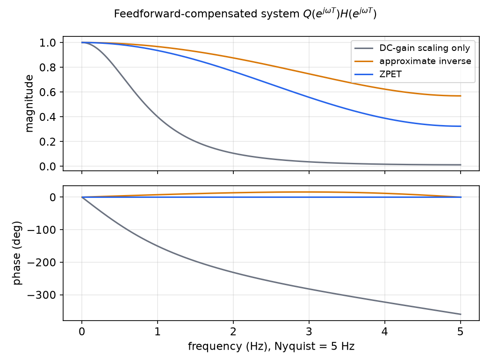
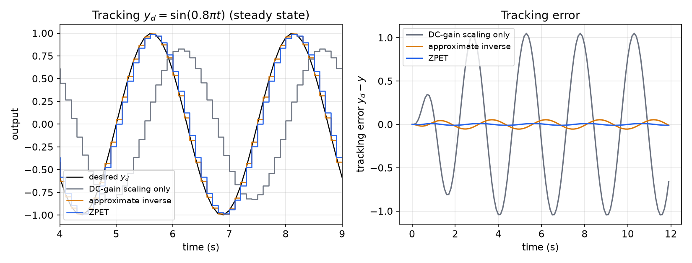
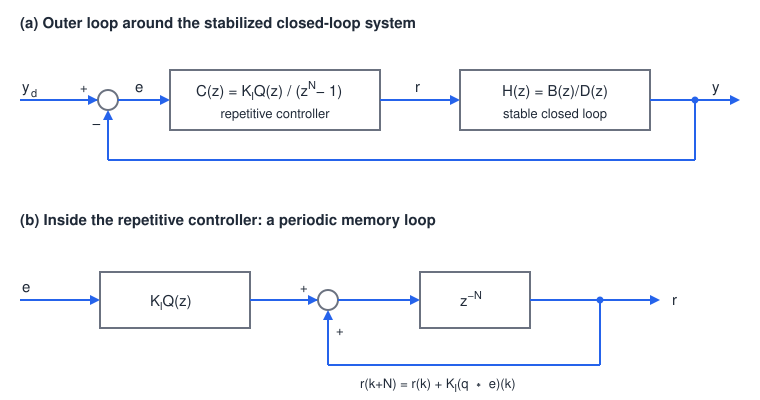
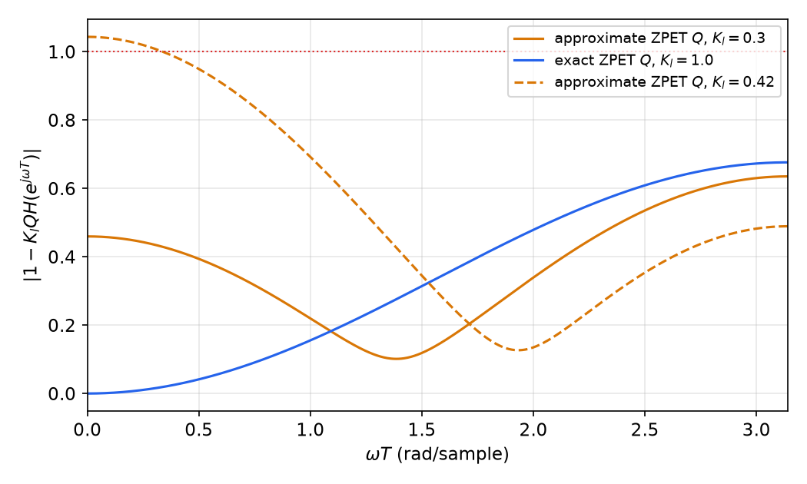
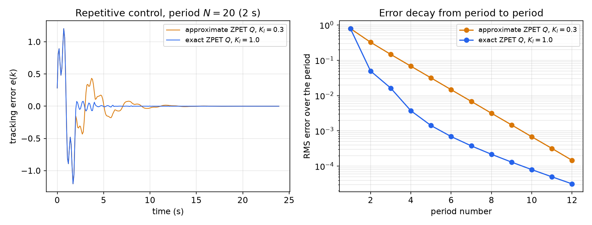

# Tracking and Disturbance Rejection

Feedback design (pole placement, observers, polynomial control) settles *how* the closed loop behaves. It does not by itself make the output follow an arbitrary command. This chapter takes a stable closed loop as given and asks how to make \\(y(k)\\) follow a desired sequence \\(y\_d(k)\\). There are two complementary answers. **Feedforward** shapes the reference by inverting the closed-loop model, exactly when the model is minimum phase and approximately (ZPET) when it is not. **Feedback with an internal model** puts a copy of the signal generator inside the loop, which yields integral control for steps and **repetitive control** for periodic signals. The second answer needs no exact plant knowledge, but it raises a stability question, which we settle with a small-gain argument.

## The Tracking Problem

Start from a dynamic compensator \\(U = F\_1(R - F\_2Y)\\) designed as in [Combined Controller–Observer Design](controller-observer.md), or from any stabilizing feedback. The closed loop from the reference \\(r\\) to the output is
\\[
\frac{Y(z)}{R(z)} = H(z) = \frac{B(z)}{D(z)},
\\]
where \\(D(z)\\) has all its roots inside the unit circle and \\(B(z)\\) contains the plant zeros (state feedback and observers do not move zeros).

**Problem.** Given an asymptotically stable \\(H(z) = B(z)/D(z)\\) and a desired output sequence \\(y\_d(k)\\), find a **bounded** reference \\(r(k)\\) such that \\(y(k)\\) follows \\(y\_d(k)\\), exactly or as closely as possible.

Boundedness is the crux. Any \\(r\\) that is the output of an unstable filter will eventually saturate the actuator.

## Inverse-Model Feedforward

If \\(H\\) is invertible, the natural choice is \\(R = H^{-1}Y\_d\\), which gives \\(Y = Y\_d\\) exactly.

### Derivation

Let \\(\deg D = n\\) and \\(\deg B = m < n\\). The inverse \\(D/B\\) is improper, with relative degree \\(n - m\\). Divide \\(D\\) by \\(B\\):
\\[
\frac{R(z)}{Y\_d(z)} = \frac{D(z)}{B(z)} = c\_0z^{n-m} + c\_1z^{n-m-1} + \dots + c\_{n-m} + \frac{D'(z)}{B(z)},
\\]
where \\(D'\\) is the remainder (\\(\deg D' < m\\)). Since \\(z^j\\) is a \\(j\\)-step advance, in the time domain
\\[
\boxed{r(k) = c\_0y\_d(k + n - m) + \dots + c\_{n-m-1}y\_d(k+1) + c\_{n-m}y\_d(k) + r\_d(k),}
\\]
where \\(r\_d\\) is the output of the strictly proper filter \\(D'(z)/B(z)\\) driven by \\(y\_d\\).

Two things are needed:

1. **Preview.** The desired trajectory must be known \\(n - m\\) steps ahead, the relative degree. This is natural in robotics and machining, where the whole path is planned in advance.
2. **Minimum phase.** The filter \\(D'/B\\) has the zeros of \\(H\\) as its poles. If any zero of \\(B\\) lies outside the unit circle, \\(r\_d\\), and hence \\(r\\), grows without bound.

### Why non-minimum-phase zeros are common in digital control

Discretization creates **sampling zeros**. For a continuous plant of relative degree \\(d\\), the ZOH equivalent acquires \\(d - 1\\) extra zeros, and as \\(T \to 0\\) these approach fixed limits that do not depend on the plant. For \\(d = 3\\) the limits are the roots of \\(z^2 + 4z + 1\\), namely \\(-3.732\\) and \\(-0.268\\) (Åström, Hagander and Sternby). One of them is always outside the unit circle.

The polynomial-control example of the previous chapter shows this. The plant \\(1/[s^2(s+1)]\\) has relative degree 3, and with \\(T = 0.1\\) s the closed loop is
\\[
H(z) = \frac{b(z - z\_1)(z - z\_2)}{(z - p)^3},\qquad p = 0.5,\ b = 1.626\times10^{-4},\ z\_1 = -0.261,\ z\_2 = -3.641 .
\\]
The zero \\(z\_2 = -3.641\\) is outside the unit circle. The exact inverse \\(D/B\\) has a pole there, and \\(r(k)\\) contains a mode \\((-3.641)^k\\). Driven by a smooth sinusoid, the computed reference reaches \\(\lvert r\rvert \approx 8\times10^{11}\\) after only 20 samples. Exact inversion is useless here.

## Approximate Inverse and ZPET Feedforward

Factor the numerator into the zeros that may be cancelled and those that may not:
\\[
H(z) = \frac{B^+(z)B^-(z)}{D(z)},
\\]
where \\(B^+\\) contains the "good" zeros (inside the unit circle, well damped) and \\(B^-\\) the zeros that must not be cancelled (outside or near the unit circle). In the example, \\(B^+ = b(z + 0.261)\\) and \\(B^- = z + 3.641\\).

### Approximate inverse

Cancel what may be cancelled and correct only the DC gain of the rest:
\\[
R(z) = \frac{D(z)}{B^+(z)B^-(1)}Y\_d(z)
\quad\Longrightarrow\quad
\frac{Y}{Y\_d} = \frac{B^-(z)}{B^-(1)} .
\\]
The tracking transfer function equals 1 at DC, so steps are followed exactly. At other frequencies it is not 1. For a single real zero \\(B^- = z - z\_2\\),
\\[
1 - \frac{e^{j\omega T} - z\_2}{1 - z\_2} = \frac{1 - e^{j\omega T}}{1 - z\_2},\qquad
\left\lvert 1 - \frac{B^-(e^{j\omega T})}{B^-(1)} \right\rvert = \frac{2\sin(\omega T/2)}{1 - z\_2}.
\\]
The error grows with frequency, and it comes mostly from **phase**.

### Zero-phase-error tracking (ZPET)

The ZPET controller (Tomizuka, 1987) also cancels the phase of \\(B^-\\), by appending its "mirror image":
\\[
\boxed{Q(z) = \frac{B^-(z^{-1})D(z)}{\big[B^-(1)\big]^2B^+(z)},\qquad R(z) = Q(z)Y\_d(z).}
\\]
The compensated system is
\\[
Q(z)H(z) = \frac{B^-(z)B^-(z^{-1})}{\big[B^-(1)\big]^2}.
\\]
**Theorem (Zero phase).** If \\(B^-\\) has real coefficients, then \\(Q(e^{j\omega T})H(e^{j\omega T})\\) is real and nonnegative for every \\(\omega\\), and equals 1 at \\(\omega = 0\\).

*Proof.* For real coefficients, \\(B^-(e^{-j\omega T}) = \overline{B^-(e^{j\omega T})}\\). Hence
\\[
Q(e^{j\omega T})H(e^{j\omega T}) = \frac{B^-(e^{j\omega T})\overline{B^-(e^{j\omega T})}}{[B^-(1)]^2} = \frac{\lvert B^-(e^{j\omega T})\rvert^2}{[B^-(1)]^2} \ge 0,
\\]
and at \\(\omega = 0\\) the ratio is 1. ∎

So the output follows \\(y\_d\\) with no phase lag at any frequency, only a magnitude error that is small at low frequencies. The factor \\(B^-(z^{-1})\\) contains positive powers of \\(z\\), so \\(Q\\) is non-causal. Like the exact inverse, it needs \\(y\_d\\) previewed a few steps ahead, which is available in trajectory-following applications.

**Example 1 (ZPET for the polynomial-control loop).** For \\(H\\) above, with \\(B^-(1) = 4.641\\),
\\[
Q(z) = \frac{(z - 0.5)^3(z^{-1} + 3.641)}{4.641^2\\,b\\,(z + 0.261)},\qquad
Q(z)H(z) = \frac{(z + 3.641)(z^{-1} + 3.641)}{4.641^2}.
\\]
On the unit circle, \\(QH = \big(14.255 + 7.281\cos\omega T\big)/21.536\\). This equals 1 at DC and falls to 0.324 at the Nyquist frequency, with zero phase throughout. \\(Q\\) has numerator degree 4 and denominator degree 2 (after writing \\(z^{-1} + 3.641 = (1 + 3.641z)/z\\)), so it needs two samples of preview: \\(r(k)\\) is computed from \\(y\_d(k+2), y\_d(k+1), \dots\\).

*Figure: \\(Q(e^{j\omega T})H(e^{j\omega T})\\) for three feedforward choices on the example loop (\\(T = 0.1\\) s). With DC-gain scaling only, the loop lags by about 150° at 1 Hz. The approximate inverse has nearly unit magnitude but a phase error of up to about 15°. ZPET has exactly zero phase, at the cost of magnitude roll-off to 0.32 at Nyquist.*

*Figure: tracking \\(y\_d = \sin(0.8\pi t)\\) (0.4 Hz, \\(\omega T = 0.251\\) rad). Left: steady-state outputs. Right: tracking errors. Scaling by the DC gain alone gives an error amplitude of 1.05, larger than the signal, because of the phase lag. The approximate inverse reduces it to 0.054 (\\(= 2\sin(0.126)/4.641\\)), and ZPET to 0.0106 (\\(= 1 - QH\\) at this frequency).*

The practical comparison: the approximate inverse is better in magnitude, ZPET in phase. For smooth, low-frequency trajectories the phase error dominates, so ZPET wins. Both depend on an accurate model, which motivates the feedback approach below.

## The Internal Model Principle

Feedforward needs an exact model. Feedback with the right *structure* does not. Close an outer loop around the stable closed-loop system, with a controller \\(N\_c(z)/D\_c(z)\\) generating the reference:
\\[
Y\_d \to \Sigma \to \frac{N\_c(z)}{D\_c(z)} \to R \to \frac{B(z)}{D(z)} \to Y,
\\]
with unity negative feedback of \\(Y\\) to the summing junction. Suppose the desired output is generated by a known linear model, \\(Y\_d(z) = N\_d(z)/D\_d(z)\\). Its poles, the roots of \\(D\_d\\), are on or outside the unit circle; otherwise \\(y\_d\\) decays and there is nothing to track.

**Theorem (Internal model principle).** The steady-state error \\(e(k) = y\_d(k) - y(k)\\) tends to zero if

1. all closed-loop poles of the overall system are inside the unit circle, and
2. \\(D\_d(z)\\) divides \\(D\_c(z)\\), that is, \\(D\_c(z) = D\_d(z)q(z)\\) for some polynomial \\(q(z)\\). The controller contains a model of the signal generator.

*Proof.* The error transfer function is
\\[
\frac{E}{Y\_d} = \frac{1}{1 + \dfrac{N\_c}{D\_c}\dfrac{B}{D}} = \frac{D\_cD}{D\_cD + N\_cB}.
\\]
With \\(D\_c = D\_dq\\),
\\[
E(z) = \frac{N\_d}{D\_d}\cdot\frac{D\_dqD}{D\_cD + N\_cB} = \frac{N\_d\\,q\\,D}{D\_cD + N\_cB}.
\\]
The unstable factor \\(D\_d\\) has cancelled exactly. The remaining poles are roots of the closed-loop characteristic polynomial \\(D\_cD + N\_cB\\), which by condition 1 lie inside the unit circle. Every term in the partial-fraction expansion of \\(E(z)\\) therefore decays, and \\(e(k) \to 0\\). ∎

The same argument applies to disturbances generated by \\(D\_d\\) that enter inside the loop. The cancellation is structural: it holds for any \\(B\\) and \\(D\\), so it is robust to plant errors as long as the loop remains stable.

| Signal to track or reject | Generator \\(D\_d(z)\\) | Internal model in the controller |
|---|---|---|
| Step | \\(z - 1\\) | integrator \\(1/(z - 1)\\) |
| Ramp | \\((z - 1)^2\\) | double integrator |
| Sinusoid of frequency \\(\omega\_0\\) | \\(z^2 - 2\cos(\omega\_0T)z + 1\\) | resonator |
| Any \\(N\\)-periodic sequence | \\(z^N - 1\\) | periodic memory (repetitive control) |

Integral control is the first row. The [integral action](controller-observer.md#polynomial-control-with-integral-action) of the previous chapter is an instance.

## Repetitive Control

In manufacturing and robotics the desired trajectory is often **repetitive**: the same motion every cycle. A repetitive controller *learns* the required input while it tracks the periodic trajectory. It follows directly from the internal model principle.

### The model of a periodic signal

Let \\(y\_d\\) be \\(N\\)-periodic, \\(y\_d(k + N) = y\_d(k)\\). By the time-advance property of the z-transform,
\\[
\mathcal{Z}\big[y\_d(k + N)\big] = z^N\Big[Y\_d(z) - \sum\_{k=0}^{N-1}y\_d(k)z^{-k}\Big] = Y\_d(z).
\\]
Solving for \\(Y\_d\\):
\\[
Y\_d(z) = \frac{N\_d(z)}{z^N - 1},\qquad N\_d(z) = \sum\_{k=0}^{N-1}y\_d(k)z^{N-k}.
\\]
Every periodic signal of period \\(N\\), whatever its shape, has the generator \\(z^N - 1\\). Its roots are the \\(N\\)-th roots of unity \\(e^{j2\pi i/N}\\), the fundamental and all harmonics that a sampled periodic signal can contain.

### The repetitive controller

By the internal model principle, the outer controller must contain \\(z^N - 1\\) in its denominator:
\\[
\boxed{C(z) = \frac{N\_c(z)}{D\_c(z)} = K\_l\frac{Q(z)}{z^N - 1},\qquad K\_l > 0,}
\\]
where \\(Q(z)\\) is a stable filter, usually designed from the plant model, chosen to make the loop stable.

*Time-domain form.* From \\(R = CE\\), \\((z^N - 1)R(z) = K\_lQ(z)E(z)\\), so
\\[
\boxed{r(k + N) = r(k) + K\_l\\,(q \ast e)(k),}
\\]
where \\(q\\) is the impulse response of \\(Q\\). The reference used in the next period equals the one used in this period, corrected by the filtered error. If the error is zero over a whole period, the input simply repeats: the controller has learned the input that produces \\(y\_d\\). For \\(N = 1\\) and \\(Q = 1\\) this reduces to the integral controller, \\(C = K\_l/(z - 1)\\), or \\(r(k+1) = r(k) + K\_le(k)\\), which can only learn a constant input.

*Figure: (a) the repetitive controller \\(C(z)\\) closes an outer loop around the stable closed-loop system \\(H(z) = B/D\\). (b) Internally, \\(C = K\_lQ\cdot z^{-N}/(1 - z^{-N})\\) is a positive-feedback loop around an \\(N\\)-step delay: a memory that stores one period of the reference and adds the filtered error to it each time around.*

**Advantages and disadvantages.** If the loop is stable, the repetitive controller generates the required input without exact knowledge of the plant dynamics or of periodic input disturbances, which it rejects in the same way. The difficulty is stability: \\(z^N - 1\\) puts \\(N\\) poles on the unit circle, so the loop is of high order (often hundreds of samples per period), and naive designs go unstable.

### Closed-loop transfer functions

With unity feedback around \\(C\\) and \\(H\\),
\\[
\frac{Y}{Y\_d} = \frac{K\_lQH}{z^N - 1 + K\_lQH(z)},\qquad
\frac{E}{Y\_d} = 1 - \frac{Y}{Y\_d} = \frac{z^N - 1}{z^N - 1 + K\_lQH(z)} .
\\]
The error transfer function vanishes at every \\(N\\)-th root of unity, so if the loop is stable the steady-state error for *any* \\(N\\)-periodic \\(y\_d\\) is zero.

### Stability analysis

Write \\(Q(z)H(z) = N\_q(z)/D\_q(z)\\) in lowest terms. Stable common factors, such as \\(D(z)\\) cancelled by a ZPET-type \\(Q\\), may be removed, since they contribute only stable modes. The characteristic polynomial is
\\[
p(z) = (z^N - 1)D\_q(z) + K\_lN\_q(z).
\\]

**Theorem (Repetitive-control stability).** Let \\(e\_i = \exp(j2\pi i/N)\\). The repetitive control system is asymptotically stable if

1. \\(\operatorname{Re}\big[Q(e\_i)H(e\_i)\big] > 0\\) for \\(i = 0, 1, \dots, N - 1\\), or equivalently the phase of \\(Q(e\_i)H(e\_i)\\) lies strictly between \\(-90°\\) and \\(+90°\\), and
2. the gain \\(K\_l\\) is small enough that \\(\big\lvert K\_lQH(e^{j\omega}) - 1\big\rvert < 1\\) for all \\(0 \le \omega \le \pi\\).

These are the conditions of Sadegh (1995). Here is a self-contained argument that shows what each condition does. Assume \\(D\_q\\) has all roots strictly inside the unit circle (\\(Q\\) and \\(H\\) stable) and \\(\deg N\_q \le N + \deg D\_q\\) (so the loop is realizable).

*Condition 2 is sufficient (Rouché's theorem).* Write \\(p(z) = z^ND\_q(z) - \big[D\_q(z) - K\_lN\_q(z)\big]\\). On \\(\lvert z\rvert = 1\\),
\\[
\big\lvert D\_q - K\_lN\_q \big\rvert = \lvert D\_q\rvert\\,\big\lvert 1 - K\_lQH \big\rvert < \lvert D\_q\rvert = \big\lvert z^ND\_q \big\rvert .
\\]
By Rouché's theorem, \\(p(z)\\) and \\(z^ND\_q(z)\\) have the same number of zeros inside the open unit disk. All \\(N + \deg D\_q\\) zeros of \\(z^ND\_q\\) are inside it, and the strict inequality rules out zeros on the circle. So every closed-loop pole is inside the unit circle. ∎

*Condition 1 is what makes condition 2 attainable.* Since \\(\lvert 1 - K\_lw\rvert^2 = 1 - 2K\_l\operatorname{Re}w + K\_l^2\lvert w\rvert^2\\), a small \\(K\_l\\) makes \\(\lvert 1 - K\_lw\rvert < 1\\) exactly when \\(\operatorname{Re}w > 0\\). A perturbation argument shows why the harmonic frequencies are the critical ones. For small \\(K\_l\\), the \\(N\\) roots of \\(z^N = 1 - K\_lQH(z)\\) start at the roots of unity \\(e\_i\\) and move to
\\[
z \approx e\_i\Big(1 - \frac{K\_l}{N}Q(e\_i)H(e\_i)\Big),\qquad
\lvert z\rvert \approx 1 - \frac{K\_l}{N}\operatorname{Re}\big[Q(e\_i)H(e\_i)\big].
\\]
Each of them moves inside the unit circle if and only if \\(\operatorname{Re}[Q(e\_i)H(e\_i)] > 0\\). The other roots start at the stable roots of \\(D\_q\\).

**Choosing \\(Q\\): ZPET.** The ZPET filter is a natural choice. With \\(H = B^+B^-/A\\) and
\\[
Q(z) = \frac{B^-(z^{-1})A(z)}{[B^-(1)]^2B^+(z)},\qquad Q(z)H(z) = \frac{B^-(z)B^-(z^{-1})}{[B^-(1)]^2},
\\]
\\(QH\\) is real and positive on the whole unit circle, so condition 1 holds at every \\(e\_i\\) whatever \\(N\\) is. Condition 2 then holds for \\(0 < K\_l < 2/\max\_\omega QH(e^{j\omega})\\). In practice only an approximate plant model is available, and condition 1 tolerates phase errors up to \\(\pm 90°\\), which is a generous robustness margin. The non-causality of \\(Q\\) costs nothing here: \\(C = K\_lQ/(z^N - 1)\\) is causal whenever the preview of \\(Q\\) is shorter than \\(N\\), because the controller uses errors from the previous period.

**Example 2 (Repetitive control of the polynomial-control loop).** Use the same \\(H(z)\\) (\\(p = 0.5\\), \\(b = 1.63\times10^{-4}\\), \\(z\_1 = -0.26\\), \\(z\_2 = -3.64\\)). To model uncertainty, \\(Q\\) is built from deliberately rounded zeros \\(-0.2\\) and \\(-3\\), an "approximate ZPET":
\\[
Q(z) = \frac{(z - 0.5)^3(z^{-1} + 3)}{4b(z + 0.2)},\qquad
C(z) = \frac{K\_l(z - 0.5)^3(1 + 3z)}{4b\\,z(z + 0.2)(z^N - 1)} .
\\]
Then \\(QH = (z^{-1} + 3)(z + 0.261)(z + 3.641)/[4(z + 0.2)]\\), up to the small mismatch in \\(b\\). Its DC value is 4.87 rather than 1, because the normalization \\(4b\\) is not \\([B^-(1)]^2b\\); \\(K\_l\\) absorbs the difference. Numerically, \\(\operatorname{Re}QH(e^{j\omega}) \ge 1.22 > 0\\) on the whole circle, so condition 1 holds. Condition 2 holds for \\(K\_l < 0.411\\).

- With \\(N = 20\\) (\\(T = 0.1\\) s, period 2 s) and \\(K\_l = 0.3\\), \\(\sup\_\omega\lvert 1 - K\_lQH\rvert = 0.635\\), and the largest closed-loop pole has magnitude 0.978.
- With \\(K\_l = 0.42\\), slightly above the bound, \\(\lvert 1 - K\_lQH\rvert\\) exceeds 1 near DC, and the loop is in fact unstable (largest pole magnitude 1.0017). For this example the sufficient condition is nearly tight.
- With the exact ZPET \\(Q\\) (zeros \\(-0.261\\), \\(-3.641\\), normalization \\(4.641^2b\\)) and \\(K\_l = 1\\), \\(\sup\lvert 1 - QH\rvert = 0.676\\); any \\(0 < K\_l < 2\\) satisfies condition 2.

*Figure: the small-gain quantity \\(\lvert 1 - K\_lQH(e^{j\omega T})\rvert\\). The design is guaranteed stable when the curve stays below 1 (red dotted line) at all frequencies. The approximate-ZPET design with \\(K\_l = 0.3\\) and the exact-ZPET design with \\(K\_l = 1\\) pass comfortably. With \\(K\_l = 0.42\\) the curve crosses 1 at low frequencies, and that loop is indeed unstable.*

*Figure: tracking \\(y\_d(k) = \sin(2\pi k/20) + 0.5\sin(6\pi k/20 + 0.6)\\) with \\(N = 20\\). Left: the error over 12 periods. Right: the RMS error in each period on a log scale. The error shrinks geometrically from period to period: by a factor of about 2.2 per period for the approximate ZPET filter (\\(K\_l = 0.3\\)) and much faster at first for the exact ZPET filter (\\(K\_l = 1\\)), falling below \\(10^{-4}\\) of its initial value within 12 periods. Neither design knew the plant exactly; the controller learned the input.*

A practical refinement, standard in the repetitive-control literature, replaces the pure internal model \\(z^N - 1\\) by \\(z^N - q(z)\\), with \\(q\\) a low-pass filter (\\(\lvert q\rvert \le 1\\)). This gives up perfect tracking of high harmonics, where the model is least reliable, in exchange for robustness.

## Summary

- **Problem:** given a stable closed loop \\(H = B/D\\), find a bounded \\(r\\) so that \\(y\\) follows \\(y\_d\\).
- **Inverse model:** \\(R = (D/B)Y\_d\\), which needs preview of \\(n - m\\) steps and a minimum-phase \\(B\\). Sampling zeros (for example \\(-3.73\\) for relative degree 3) usually violate the second requirement.
- **Approximate inverse:** \\(R = DY\_d/(B^+B^-(1))\\), giving \\(Y/Y\_d = B^-(z)/B^-(1)\\): unity DC gain, with a phase error.
- **ZPET:** \\(Q = B^-(z^{-1})D/([B^-(1)]^2B^+)\\), giving \\(QH = \lvert B^-(e^{j\omega T})\rvert^2/[B^-(1)]^2\\): zero phase, unity DC gain, magnitude roll-off.
- **Internal model principle:** if \\(Y\_d = N\_d/D\_d\\), a stable loop with \\(D\_d \mid D\_c\\) gives \\(e \to 0\\).
- **Repetitive control:** \\(C = K\_lQ/(z^N - 1)\\), equivalently \\(r(k + N) = r(k) + K\_l(q \ast e)(k)\\). It is stable if \\(\operatorname{Re}[Q(e\_i)H(e\_i)] > 0\\) and \\(\lvert 1 - K\_lQH(e^{j\omega})\rvert < 1\\) for all \\(\omega\\). A ZPET \\(Q\\) makes the phase condition automatic.

## See Also

- [Combined Controller–Observer Design](controller-observer.md): the inner loops these methods wrap around
- [State Feedback Control](state-feedback.md): reference gain, integral control and inverse-model tracking with state feedback
- [Frequency Response Methods](frequency-response.md) and [z-Plane Analysis](z-plane.md)
- [The z-Transform](../../../signals/z-transform.md) and [Sampling](../../../signals/sampling.md)
- [PID Control](../pid.md): integral action as the simplest internal model
