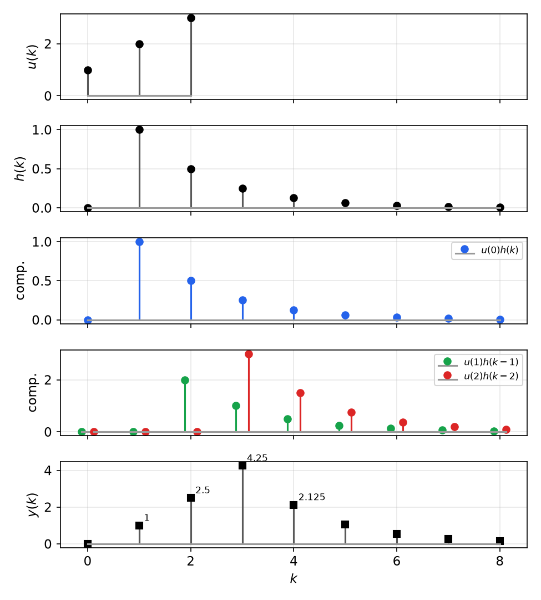
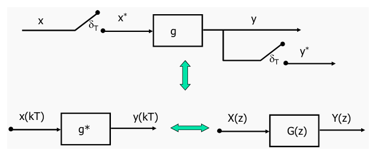
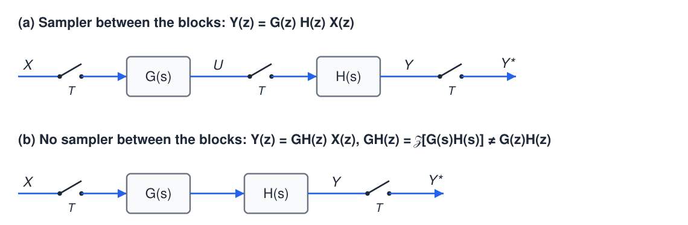
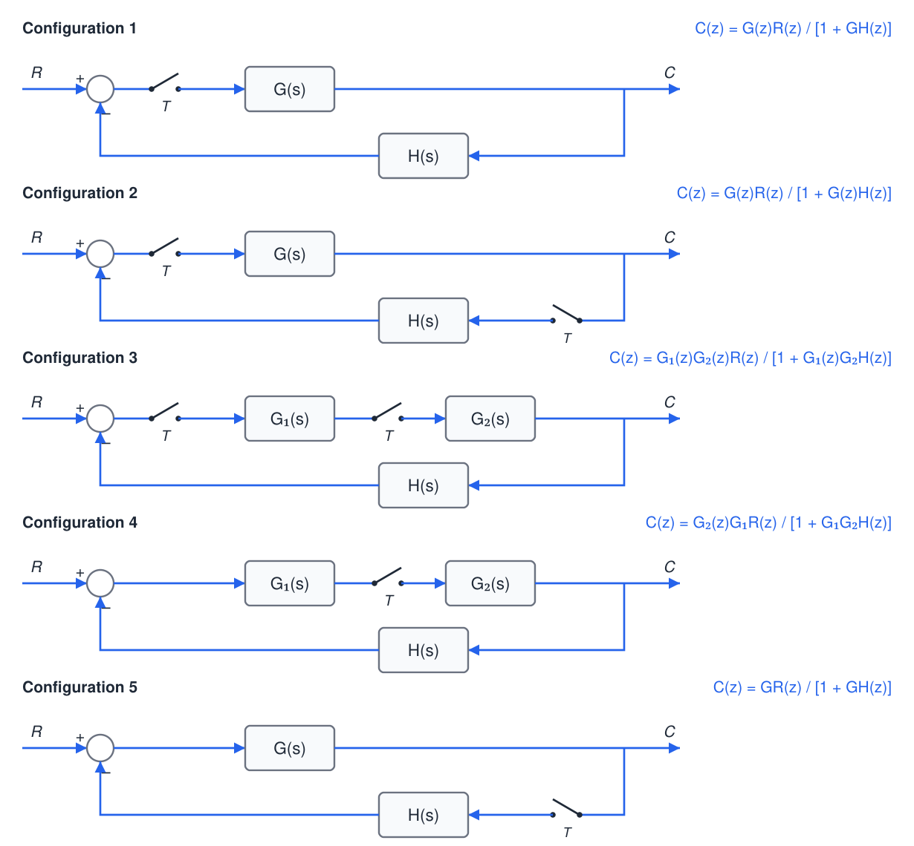
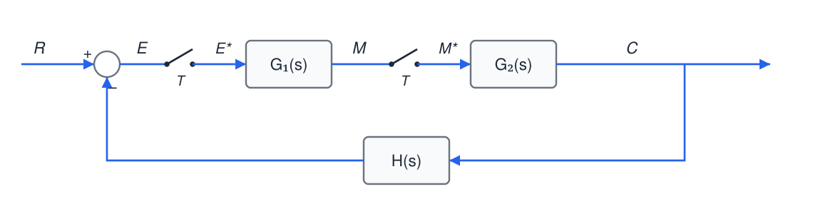
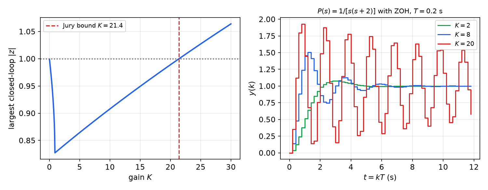
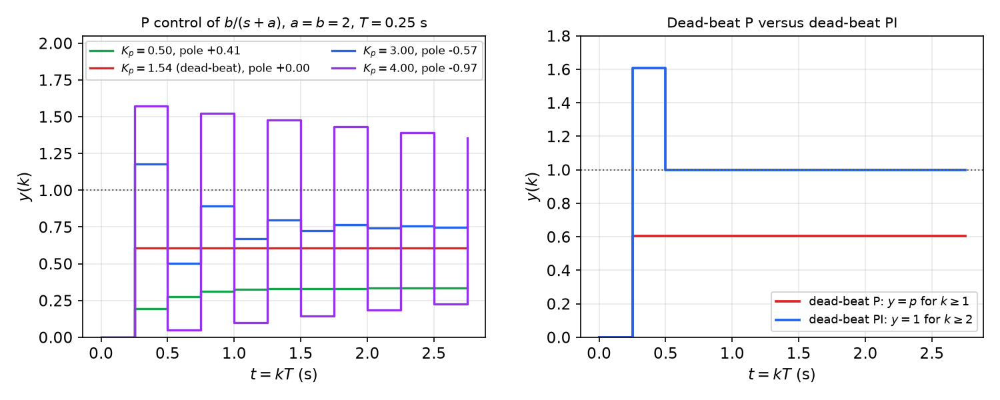

# Pulse Transfer Functions and z-Plane Analysis

A digital control loop mixes continuous blocks (plant, sensor, hold) with discrete ones (the control algorithm), joined by samplers. This chapter builds an exact discrete-time model of such a loop. It starts from discrete LTI systems and the convolution sum, introduces the **pulse transfer function** that relates sampled inputs to sampled outputs of a continuous block, and gives the rules for reducing block diagrams that contain samplers. With the loop reduced to a z-domain transfer function, the chapter derives the stability condition (poles inside the unit circle) with the Jury and bilinear–Routh tests, the steady-state error constants, the digital PID controller, and dead-beat control of a first-order plant.

## Discrete-Time LTI Systems

### Impulse response and the convolution sum

The definitions carry over from continuous time unchanged. A discrete system is **linear** if \\(u\_i \to y\_i\\) implies \\(\sum\_i\alpha\_iu\_i \to \sum\_i\alpha\_iy\_i\\), and **time-invariant** if \\(u(k) \to y(k)\\) implies \\(u(k-i) \to y(k-i)\\) for every shift \\(i\\).

The role of the Dirac impulse is played by the **Kronecker delta** \\(\delta(k)\\), equal to 1 at \\(k = 0\\) and 0 elsewhere. It is an ordinary sequence, with none of the subtleties of \\(\delta(t)\\). The **impulse response** \\(h(k)\\) is the response to \\(\delta(k)\\) from rest; by time invariance the response to \\(\delta(k-i)\\) is \\(h(k-i)\\). Every input sequence is a weighted sum of shifted deltas,
\\[
u(k) = \sum\_{i=-\infty}^\infty \delta(k-i)u(i),
\\]
so by linearity
\\[
\boxed{y(k) = \sum\_{i=-\infty}^\infty h(k-i)u(i) = (h \ast u)(k).}
\\]
Discrete convolution has the same algebraic properties as the continuous one (commutative, associative, distributive, with \\(\delta\\) as unit). For a **causal** system (\\(h(k) = 0\\) for \\(k < 0\\)) driven by an input that starts at \\(k = 0\\),
\\[
y(k) = \sum\_{i=0}^k h(k-i)u(i).
\\]
It can be computed directly or through the z-transform, since \\(\mathcal{Z}(h\ast u) = H(z)U(z)\\) ([The z-Transform and Difference Equations](z-transform.md)). The **transfer function** of a discrete LTI system is therefore the z-transform of its impulse response, \\(H(z) = \mathcal{Z}[h(k)] = Y(z)/U(z)\\).

**Example (convolution by superposition).** Let \\(u = \\{1, 2, 3, 0, 0, \ldots\\}\\) and \\(h(k) = (1/2)^{k-1}\\) for \\(k \ge 1\\), \\(h(0) = 0\\), so \\(h = \\{0, 1, 0.5, 0.25, \ldots\\}\\). Then
\\[
\begin{aligned}
y(0) &= u(0)h(0) = 0,\\\\
y(1) &= u(0)h(1) + u(1)h(0) = (1)(1) = 1,\\\\
y(2) &= u(0)h(2) + u(1)h(1) + u(2)h(0) = (1)(0.5) + (2)(1) = 2.5,\\\\
y(3) &= u(0)h(3) + u(1)h(2) + u(2)h(1) + u(3)h(0) = (1)(0.25) + (2)(0.5) + (3)(1) = 4.25,
\end{aligned}
\\]
and for \\(k \ge 3\\) the output halves each step: \\(2.125, 1.0625, \ldots\\). In the z-domain, \\(U(z) = 1 + 2z^{-1} + 3z^{-2}\\) and \\(H(z) = z^{-1}/(1 - 0.5z^{-1}) = 1/(z - 0.5)\\), and long division of \\(H(z)U(z)\\) gives the same numbers.

*Figure: discrete convolution as superposition. Each input sample \\(u(i)\\) launches a copy of \\(h\\) shifted by \\(i\\) and scaled by \\(u(i)\\) (middle rows); the output (bottom) is their sum.*

## The Laplace Transform of a Sampled Signal

From [Sampling, Reconstruction and Discretization](sampling.md), the impulse-sampled signal
\\[
x^{\ast}(t) = \sum\_k x(kT)\delta(t - kT) = x(t)\delta\_T(t), \qquad \delta\_T(t) = \sum\_k\delta(t-kT) = \frac1T\sum\_n e^{jn\omega\_st}, \quad \omega\_s = \frac{2\pi}{T},
\\]
has two expressions for its Laplace transform:
\\[
X^{\ast}(s) = \sum\_{k=0}^\infty x(kT)e^{-kTs} = X(z)\Big\|\_{z = e^{sT}}, \qquad
X^{\ast}(s) = \frac1T\sum\_{n=-\infty}^\infty X(s - jn\omega\_s).
\\]
The first is the definition of the z-transform. The second follows from \\(x^{\ast} = \frac1T\sum\_nx(t)e^{jn\omega\_st}\\) and the shift property \\(\mathcal{L}\\{x(t)e^{jn\omega\_st}\\} = X(s - jn\omega\_s)\\), valid for \\(x\\) continuous at the sampling instants.

**Lemma (periodicity).** \\(X^{\ast}(s)\\) is periodic in \\(s\\) with period \\(j\omega\_s\\):
\\[
X^{\ast}(s - jn\omega\_s) = \frac1T\sum\_p X\big(s - j(n+p)\omega\_s\big) = X^{\ast}(s),
\\]
since \\(p + n\\) runs over all integers as \\(p\\) does. Equivalently, \\(e^{(s - jn\omega\_s)T} = e^{sT}\\).

**Lemma (starring a product).** If \\(Y(s) = G(s)X^{\ast}(s)\\), then
\\[
Y^{\ast}(s) = G^{\ast}(s)X^{\ast}(s).
\\]
*Proof.* \\(Y^{\ast}(s) = \frac1T\sum\_n G(s - jn\omega\_s)X^{\ast}(s - jn\omega\_s) = X^{\ast}(s)\cdot\frac1T\sum\_nG(s - jn\omega\_s) = X^{\ast}(s)G^{\ast}(s)\\), using periodicity. \\(\square\\)

A starred (already sampled) factor passes through the star operation unchanged. An unstarred product does *not* factor: in general \\((GH)^{\ast} \ne G^{\ast}H^{\ast}\\). These two facts are all that block-diagram reduction with samplers requires.

## The Pulse Transfer Function

Consider a continuous LTI block \\(g\\) whose input is impulse-sampled and whose output is observed through a synchronous sampler. How is \\(y^{\ast}\\) related to \\(x^{\ast}\\)?

**Time domain.** \\(y = g\ast x^{\ast}\\), and with \\(x^{\ast}(t) = \sum\_nx(nT)\delta(t - nT)\\),
\\[
y(t) = \sum\_n x(nT)\left(g\ast\delta(t - nT)\right) = \sum\_n x(nT)g(t - nT)
\quad\Longrightarrow\quad
y(kT) = \sum\_{n=-\infty}^\infty g(kT - nT)x(nT) = g(kT)\ast x(kT).
\\]
For a causal block and a one-sided input, \\(y(kT) = \sum\_{n=0}^k g(kT - nT)x(nT)\\). The sampled output is the *discrete* convolution of the sampled impulse response with the input samples.

**Laplace domain.** \\(Y(s) = G(s)X^{\ast}(s)\\), and by the starring lemma
\\[
\boxed{Y(s) = G(s)X^{\ast}(s) \ \Longrightarrow\ Y^{\ast}(s) = G^{\ast}(s)X^{\ast}(s), \qquad Y(z) = G(z)X(z).}
\\]
**Definition (pulse transfer function).** \\(G(z) = \mathcal{Z}[g(kT)] = G^{\ast}(s)\rvert\_{e^{sT} = z}\\), the z-transform of the sampled impulse response, is the **pulse transfer function** of the block. The notation \\(G(z) = \mathcal{Z}[G(s)]\\) is shorthand for this: invert \\(G(s)\\), sample, transform.

*Figure: the pulse transfer function. A continuous block between synchronous samplers (top) behaves at the sampling instants like a discrete system with impulse response \\(g(kT)\\) (bottom left), described in the z-domain by \\(G(z) = \mathcal{Z}[g(kT)]\\) (bottom right).*

The pulse transfer function says nothing about \\(y(t)\\) *between* samples. For that one uses \\(Y(s) = G(s)X^{\ast}(s)\\) directly, or the modified z-transform. Also note a subtlety: if \\(g\\) jumps at \\(t = 0\\) (relative degree one), the convention \\(g(0) = g(0^+)\\) is used.

**Example (first-order block, with and without a hold).** Let \\(G(s) = 1/(s + p)\\).

*Sampled input applied directly:* \\(g(kT) = e^{-pkT}\\), so
\\[
G(z) = \frac{z}{z - e^{-pT}}.
\\]
*Sampled input through a ZOH* (\\(x \to \delta\_T \to \text{ZOH} \to g \to y \to \delta\_T\\)): the block is now \\(\frac{1 - e^{-sT}}{s}G(s)\\). The factor \\(e^{-sT}\\) is a pure delay of one period, so it becomes \\(z^{-1}\\):
\\[
G(z) = (1 - z^{-1})\\,\mathcal{Z}\left[\frac{1}{s(s+p)}\right] = \frac{z-1}{z}\cdot\frac{(1 - e^{-pT})z}{p(z-1)(z - e^{-pT})} = \frac{1 - e^{-pT}}{p\\,(z - e^{-pT})}.
\\]
This is the **ZOH equivalent** of [Sampling, Reconstruction and Discretization](sampling.md), and it is the model used for every plant driven by a D/A converter.

**Example (triangular impulse response behind a ZOH).** Find \\(Y(z)/U(z)\\) for \\(g(t) = 1 - t\\) on \\([0, 1]\\) (zero elsewhere), preceded by a ZOH, with \\(T = 1/2\\).

The step response is \\(s\_1(t) = \int\_0^t g = t - t^2/2\\) for \\(0 \le t \le 1\\) and \\(1/2\\) for \\(t \ge 1\\). Its samples are \\(s\_1(0) = 0\\), \\(s\_1(0.5) = 0.375\\), \\(s\_1(1) = 0.5\\), and \\(0.5\\) thereafter, so
\\[
\mathcal{Z}[s\_1(kT)] = 0.375z^{-1} + \frac{0.5z^{-2}}{1 - z^{-1}},
\qquad
\frac{Y(z)}{U(z)} = (1 - z^{-1})\mathcal{Z}[s\_1(kT)] = 0.375z^{-1} + 0.125z^{-2} = \frac{0.375z + 0.125}{z^2}.
\\]
The result is an FIR system: the continuous impulse response lasts one second, i.e. two sampling periods, so a held pulse affects only the next two output samples.

## Block-Diagram Reduction with Samplers

The rule is mechanical. Write the continuous relations for each signal, express every signal that enters a sampler in terms of starred quantities, star both sides using the starring lemma, and solve the resulting algebraic equations.

### Series connections

*Figure: series connections. (a) A sampler between \\(G\\) and \\(H\\) makes each block see a sampled input, and the pulse transfer functions multiply. (b) Without the intermediate sampler, the continuous product \\(G(s)H(s)\\) must be transformed as one block.*

- **Sampler between the blocks.** \\(U = GX^{\ast}\\), so \\(U^{\ast} = G^{\ast}X^{\ast}\\); \\(Y = HU^{\ast}\\), so \\(Y^{\ast} = H^{\ast}U^{\ast}\\). Hence
\\[
Y(z) = G(z)H(z)X(z).
\\]
- **No sampler between the blocks.** \\(Y = G H X^{\ast}\\), so \\(Y^{\ast} = (GH)^{\ast}X^{\ast}\\):
\\[
Y(z) = GH(z)X(z), \qquad GH(z) := \mathcal{Z}\left[G(s)H(s)\right] \ne G(z)H(z) \text{ in general}.
\\]

**Example.** \\(G(s) = 1/s\\), \\(H(s) = 1/(s+1)\\). With a sampler between them,
\\[
G(z)H(z) = \frac{z}{z-1}\cdot\frac{z}{z - e^{-T}} = \frac{z^2}{(z-1)(z - e^{-T})}.
\\]
Without one, \\(\frac{1}{s(s+1)} = \frac1s - \frac{1}{s+1}\\), so
\\[
GH(z) = \frac{z}{z-1} - \frac{z}{z - e^{-T}} = \frac{(1 - e^{-T})z}{(z-1)(z - e^{-T})}.
\\]
The poles agree (they always map by \\(z = e^{pT}\\)) but the zeros differ: where samplers sit changes the system.

### Feedback connections

For the five common sampler placements in a single loop with forward block(s) \\(G\\) and feedback \\(H\\), the output transform is:

*Figure: closed-loop output transforms for five sampler placements. Where the reference passes into a continuous block before being sampled (configurations 4 and 5), \\(R(z)\\) cannot be factored out and no closed-loop pulse transfer function \\(C(z)/R(z)\\) exists.*

| Configuration | Output transform |
|---|---|
| 1. Error sampled; \\(G\\) forward; \\(H\\) fed back from continuous output | \\(C(z) = \dfrac{G(z)R(z)}{1 + GH(z)}\\) |
| 2. Error sampled; output sampled before \\(H\\) | \\(C(z) = \dfrac{G(z)R(z)}{1 + G(z)H(z)}\\) |
| 3. Error sampled; sampler between \\(G\_1\\) and \\(G\_2\\) | \\(C(z) = \dfrac{G\_1(z)G\_2(z)R(z)}{1 + G\_1(z)G\_2H(z)}\\) |
| 4. No error sampler; sampler between \\(G\_1\\) and \\(G\_2\\) | \\(C(z) = \dfrac{G\_2(z)\\,G\_1R(z)}{1 + G\_1G\_2H(z)}\\) |
| 5. Continuous forward path; sampler only before \\(H\\) | \\(C(z) = \dfrac{GR(z)}{1 + GH(z)}\\) |

*Derivation of configuration 1.* \\(E = R - HC\\) and \\(C = GE^{\ast}\\), so \\(E = R - HGE^{\ast}\\). Starring, \\(E^{\ast} = R^{\ast} - (GH)^{\ast}E^{\ast}\\), so \\(E^{\ast} = R^{\ast}/(1 + GH^{\ast})\\) and \\(C^{\ast} = G^{\ast}E^{\ast}\\).

*Derivation of configuration 5.* \\(E = R - HC^{\ast}\\) and \\(C = GE = GR - GHC^{\ast}\\). Starring, \\(C^{\ast} = (GR)^{\ast} - (GH)^{\ast}C^{\ast}\\), so \\(C(z) = GR(z)/(1 + GH(z))\\). Here \\(GR(z) = \mathcal{Z}[G(s)R(s)]\\): the reference is filtered by \\(G\\) before it is sampled.

*Derivation of configuration 4.* \\(M = G\_1(R - HC)\\) and \\(C = G\_2M^{\ast}\\), so \\(M = G\_1R - G\_1HG\_2M^{\ast}\\). Starring, \\(M^{\ast} = G\_1R^{\ast} - (G\_1G\_2H)^{\ast}M^{\ast}\\), so \\(M(z) = G\_1R(z)/(1 + G\_1G\_2H(z))\\) and \\(C(z) = G\_2(z)M(z)\\).

**Example (a loop with two samplers).** In the loop below, find \\(C(z)/R(z)\\) and \\(C(s)\\).

*Figure: a feedback loop with two synchronous samplers, one on the error and one between \\(G\_1\\) and \\(G\_2\\) (configuration 3).*

The continuous relations are
\\[
E(s) = R(s) - H(s)C(s), \qquad M(s) = G\_1(s)E^{\ast}(s), \qquad C(s) = G\_2(s)M^{\ast}(s).
\\]
Eliminating \\(C\\): \\(E(s) = R(s) - HG\_2(s)M^{\ast}(s)\\). Starring every relation:
\\[
E^{\ast} = R^{\ast} - (HG\_2)^{\ast}M^{\ast}, \qquad M^{\ast} = G\_1^{\ast}E^{\ast}, \qquad C^{\ast} = G\_2^{\ast}M^{\ast}.
\\]
Substituting the first into the second, \\(M^{\ast} = G\_1^{\ast}R^{\ast} - G\_1^{\ast}(HG\_2)^{\ast}M^{\ast}\\), so
\\[
M^{\ast}(s) = \frac{G\_1^{\ast}(s)R^{\ast}(s)}{1 + G\_1^{\ast}(s)(HG\_2)^{\ast}(s)}, \qquad
C^{\ast}(s) = \frac{G\_2^{\ast}(s)G\_1^{\ast}(s)R^{\ast}(s)}{1 + G\_1^{\ast}(s)(HG\_2)^{\ast}(s)},
\\]
\\[
\boxed{\frac{C(z)}{R(z)} = \frac{G\_1(z)G\_2(z)}{1 + G\_1(z)HG\_2(z)}}, \qquad C(s) = G\_2(s)M^{\ast}(s) = \frac{G\_2(s)G\_1^{\ast}(s)R^{\ast}(s)}{1 + G\_1^{\ast}(s)(HG\_2)^{\ast}(s)}.
\\]
The expression for \\(C(s)\\) gives the continuous output between samples.

## The Basic Digital Feedback Loop

![Sampled-data loop with controller C(z), ZOH, plant P(s), sensor H(s) and output sampler, and its equivalent unity-feedback z-domain loop with G(z) = (1 - z^-1) Z[P H / s]](figures/zpl-loop.png)

*Figure: (a) the standard digital control loop: the computer forms \\(e(k) = r(k) - y(k)\\), computes \\(u(k)\\) with \\(C(z)\\), and the ZOH drives the plant; the sensor output is sampled. (b) Its exact z-domain equivalent at the sampling instants.*

In the standard loop, the controller output passes through a ZOH, the plant \\(P(s)\\) and the sensor \\(H(s)\\), with no sampler in between, and is then sampled. By the series rule this chain is a single block:
\\[
\boxed{G(z) = \mathcal{Z}\left[\frac{1 - e^{-sT}}{s}P(s)H(s)\right] = (1 - z^{-1})\\,\mathcal{Z}\left[\frac{P(s)H(s)}{s}\right].}
\\]
The loop is then an ordinary unity-feedback discrete system (with \\(Y\\) the measured output):
\\[
\frac{Y(z)}{R(z)} = \frac{C(z)G(z)}{1 + C(z)G(z)}, \qquad \frac{E(z)}{R(z)} = \frac{1}{1 + C(z)G(z)}.
\\]
This model is exact at the sampling instants. All the design methods of the following chapters work with it.

**Example (the recurring second-order plant).** \\(P(s) = 1/[s(s+2)]\\), \\(H = 1\\), \\(T = 0.2\\) s. Partial fractions give \\(\frac{1}{s^2(s+2)} = \frac{1}{2s^2} - \frac{1}{4s} + \frac{1}{4(s+2)}\\). Transforming with \\(\mathcal{Z}[1/s^2] = Tz/(z-1)^2\\) and multiplying by \\((z-1)/z\\):
\\[
G(z) = \frac{0.01758(z + 0.8753)}{(z-1)(z - 0.6703)},
\\]
with poles at \\(e^{0} = 1\\) and \\(e^{-2T} = 0.6703\\), and a sampling zero at \\(-0.875\\).

## Stability in the z-Plane

### BIBO stability

**Definition.** A discrete system is **bounded-input bounded-output (BIBO) stable** if every bounded input sequence produces a bounded output sequence.

**Theorem.** A causal discrete LTI system with impulse response \\(h\\) is BIBO stable if and only if \\(\sum\_{k=0}^\infty\lvert h(k)\rvert < \infty\\). If its transfer function \\(H(z)\\) is rational, this holds if and only if **all poles of \\(H(z)\\) lie strictly inside the unit circle**, \\(\lvert p\_i\rvert < 1\\).

*Proof.* If \\(\sum\lvert h\rvert = S < \infty\\) and \\(\lvert u(k)\rvert \le M\\), then \\(\lvert y(k)\rvert \le \sum\_i\lvert h(i)\rvert\lvert u(k-i)\rvert \le MS\\). Conversely, if \\(\sum\lvert h\rvert = \infty\\), the bounded input \\(u(k-i) = \operatorname{sign}h(i)\\) for \\(i = 0, \ldots, k\\) gives \\(y(k) = \sum\_{i=0}^k\lvert h(i)\rvert\\), which is unbounded. For rational \\(H\\), partial fractions write \\(h(k)\\) as a finite sum of modes \\(k^jp\_i^k\\) (plus finitely many impulses). Each mode is absolutely summable if and only if \\(\lvert p\_i\rvert < 1\\), and modes of distinct poles cannot cancel. \\(\square\\)

A system with simple poles on the unit circle and none outside is **marginally stable**: its impulse response stays bounded but does not decay, and a bounded input at the resonant frequency (a step for a pole at \\(z = 1\\)) produces an unbounded output.

**Connection with the s-plane.** Sampled continuous poles map by \\(z = e^{sT}\\). Writing \\(s = \sigma + j\omega\\), \\(\lvert z\rvert = e^{\sigma T}\\), so the left half s-plane (\\(\sigma < 0\\)) maps inside the unit circle, the imaginary axis onto it, and the right half-plane outside it. The strip \\(\lvert\omega\rvert < \omega\_s/2\\) covers the whole z-plane once; higher strips map onto the same points (aliasing of poles). The detailed geometry of damping and frequency contours is developed in [Classical Digital Control Design](classical-design.md).

For a feedback loop, stability means that the roots of the **characteristic equation** \\(1 + C(z)G(z) = 0\\) are inside the unit circle. As in continuous time, cancelling an unstable plant pole with a controller zero hides an unstable mode that still grows internally. Internal stability requires every closed-loop transfer function (from reference and disturbances to every signal) to be stable.

### The Jury test

The **Jury test** decides whether all roots of a real polynomial lie inside the unit circle without computing them, just as the Routh test does for the left half-plane. Write
\\[
P(z) = a\_nz^n + a\_{n-1}z^{n-1} + \cdots + a\_1z + a\_0, \qquad a\_n > 0 .
\\]
Form the table below. The first two rows are the coefficients in ascending and descending order. Each later pair of rows is computed from the pair above by 2×2 determinants and has one element fewer:

| Row | | | | | |
|---|---|---|---|---|---|
| 1 | \\(a\_0\\) | \\(a\_1\\) | \\(\cdots\\) | \\(a\_{n-1}\\) | \\(a\_n\\) |
| 2 | \\(a\_n\\) | \\(a\_{n-1}\\) | \\(\cdots\\) | \\(a\_1\\) | \\(a\_0\\) |
| 3 | \\(b\_0\\) | \\(b\_1\\) | \\(\cdots\\) | \\(b\_{n-1}\\) | |
| 4 | \\(b\_{n-1}\\) | \\(b\_{n-2}\\) | \\(\cdots\\) | \\(b\_0\\) | |
| 5 | \\(c\_0\\) | \\(c\_1\\) | \\(\cdots\\) | \\(c\_{n-2}\\) | |
| \\(\vdots\\) | | | | | |

\\[
b\_k = \det\begin{bmatrix} a\_0 & a\_{n-k} \\\\ a\_n & a\_k\end{bmatrix} = a\_0a\_k - a\_na\_{n-k}, \qquad
c\_k = \det\begin{bmatrix} b\_0 & b\_{n-1-k} \\\\ b\_{n-1} & b\_k\end{bmatrix} = b\_0b\_k - b\_{n-1}b\_{n-1-k}, \quad \ldots
\\]
The table stops at the row with three elements (\\(2n - 3\\) rows in all).

**Theorem (Jury stability criterion).** All roots of \\(P(z)\\) lie strictly inside the unit circle if and only if
1. \\(P(1) > 0\\);
2. \\((-1)^nP(-1) > 0\\);
3. \\(\lvert a\_0\rvert < a\_n\\);
4. \\(\lvert b\_0\rvert > \lvert b\_{n-1}\rvert\\), \\(\lvert c\_0\rvert > \lvert c\_{n-2}\rvert\\), and so on, down to the last row computed.

Conditions 1 and 2 are cheap necessary conditions and should be checked first. (A polynomial whose roots lie inside the circle has \\(P(1) > 0\\) because \\(P(1) = a\_n\prod(1 - p\_i)\\) and complex factors come in conjugate pairs.) For \\(n = 2\\) only conditions 1–3 apply.

**Second-order conditions by the bilinear map.** The map \\(z = (1 + w)/(1 - w)\\) sends the unit disk onto the left half w-plane, so Routh's test can be applied in \\(w\\). For \\(P(z) = z^2 + a\_1z + a\_0\\), multiplying by \\((1 - w)^2\\):
\\[
(1+w)^2 + a\_1(1+w)(1-w) + a\_0(1-w)^2 = (1 - a\_1 + a\_0)w^2 + 2(1 - a\_0)w + (1 + a\_1 + a\_0).
\\]
A quadratic has both roots in the left half-plane if and only if all its coefficients have the same sign:
\\[
P(1) = 1 + a\_1 + a\_0 > 0, \qquad P(-1) = 1 - a\_1 + a\_0 > 0, \qquad a\_0 < 1 .
\\]
Adding the first two gives \\(a\_0 > -1\\), so these are exactly Jury's conditions \\(P(1) > 0\\), \\(P(-1) > 0\\), \\(\lvert a\_0\rvert < 1\\). The same substitution with the full Routh array is an alternative to the Jury table for any order.

**Example (a third-order polynomial).** \\(P(z) = z^3 - 1.2z^2 + 0.45z - 0.05\\), so \\(a\_3 = 1\\), \\(a\_2 = -1.2\\), \\(a\_1 = 0.45\\), \\(a\_0 = -0.05\\).
1. \\(P(1) = 1 - 1.2 + 0.45 - 0.05 = 0.2 > 0\\).
2. \\((-1)^3P(-1) = -(-1 - 1.2 - 0.45 - 0.05) = 2.7 > 0\\).
3. \\(\lvert a\_0\rvert = 0.05 < 1 = a\_3\\).
4. \\(b\_0 = a\_0^2 - a\_3^2 = -0.9975\\), \\(b\_1 = a\_0a\_1 - a\_3a\_2 = -0.0225 + 1.2 = 1.1775\\), \\(b\_2 = a\_0a\_2 - a\_3a\_1 = 0.06 - 0.45 = -0.39\\). Then \\(\lvert b\_0\rvert = 0.9975 > 0.39 = \lvert b\_2\rvert\\).

All conditions hold, so the polynomial is stable. Indeed \\(P(z) = (z - 0.5)^2(z - 0.2)\\).

**Example (gain range under proportional control).** For the plant above (\\(P(s) = 1/[s(s+2)]\\), ZOH, \\(T = 0.2\\) s) with \\(C(z) = K\\), the characteristic polynomial is
\\[
(z-1)(z - 0.6703) + K(0.01758z + 0.01539) = z^2 + (0.01758K - 1.6703)z + (0.6703 + 0.01539K).
\\]
The second-order conditions give
\\[
\begin{aligned}
P(1) &= 0.03297K > 0 &&\Rightarrow\ K > 0,\\\\
P(-1) &= 3.3406 - 0.00219K > 0 &&\Rightarrow\ K < 1524,\\\\
a\_0 &= 0.6703 + 0.01539K < 1 &&\Rightarrow\ K < 21.4 .
\end{aligned}
\\]
The loop is stable for \\(0 < K < 21.4\\). The continuous loop \\(K/[s(s+2)]\\) is stable for every \\(K > 0\\); sampling and the hold's delay create a finite gain margin. At \\(K = 21.4\\) the complex closed-loop poles cross the unit circle (\\(a\_0 = \lvert z\rvert^2 = 1\\)).

*Figure: proportional control of \\(1/[s(s+2)]\\) through a ZOH with \\(T = 0.2\\) s. Left: the largest closed-loop pole radius falls until the two real poles meet (near \\(K \approx 0.9\\)), then rises as the complex pair moves outward, reaching the unit circle at the Jury bound \\(K = 21.4\\). Right: step responses become more oscillatory as \\(K\\) approaches the bound.*

## Steady-State Error

For the unity-feedback loop with loop transfer function \\(L(z) = C(z)G(z)\\), \\(E(z) = R(z)/(1 + L(z))\\). If the closed loop is stable, the final value theorem gives
\\[
e(\infty) = \lim\_{z\to1}(z-1)\frac{R(z)}{1 + L(z)}.
\\]
Classify \\(L\\) by its **type** \\(N\\), the number of poles at \\(z = 1\\) (discrete integrators), the counterpart of poles at \\(s = 0\\).

- **Step** \\(r(k) = 1\\), \\(R = z/(z-1)\\):
\\[
e(\infty) = \frac{1}{1 + K\_p}, \qquad K\_p = \lim\_{z\to1}L(z) \quad\text{(position error constant)}.
\\]
- **Ramp** \\(r(k) = kT\\), \\(R = Tz/(z-1)^2\\):
\\[
e(\infty) = \lim\_{z\to1}\frac{Tz}{(z-1)(1 + L)} = \frac{1}{K\_v}, \qquad K\_v = \frac1T\lim\_{z\to1}(z-1)L(z) \quad\text{(velocity error constant)}.
\\]
- **Parabola** \\(r(k) = (kT)^2/2\\), \\(R = T^2z(z+1)/[2(z-1)^3]\\):
\\[
e(\infty) = \frac{1}{K\_a}, \qquad K\_a = \frac{1}{T^2}\lim\_{z\to1}(z-1)^2L(z) \quad\text{(acceleration error constant)}.
\\]

| Type \\(N\\) | Step error | Ramp error | Parabola error |
|---|---|---|---|
| 0 | \\(1/(1+K\_p)\\) | \\(\infty\\) | \\(\infty\\) |
| 1 | 0 | \\(1/K\_v\\) | \\(\infty\\) |
| 2 | 0 | 0 | \\(1/K\_a\\) |

The factors \\(1/T\\) and \\(1/T^2\\) make the constants agree with their continuous counterparts. For the ZOH equivalent of a plant, \\(G(1) = P(0)\\), and \\((z-1)\\) near \\(z = 1\\) corresponds to \\(sT\\).

**Example.** For the proportional loop above, \\(L(z) = K\cdot0.01758(z + 0.8753)/[(z-1)(z - 0.6703)]\\) is type 1, so the step error is zero, and
\\[
K\_v = \frac{1}{0.2}\cdot\frac{K\cdot0.01758\cdot1.8753}{1 - 0.6703} = \frac{0.03297K}{0.2\times0.3297} = 0.5K, \qquad e\_{ramp}(\infty) = \frac{2}{K}.
\\]
This equals the continuous result \\(K\_v = \lim\_{s\to0}sK/[s(s+2)] = K/2\\). Within the stable range the smallest ramp error is about \\(2/21.4 \approx 0.09\\).

## Digital PID Control

A continuous PID law \\(u = K\_pe + K\_i\int e\\,dt + K\_d\dot e\\) is discretized by replacing the integral with a running sum (backward rectangle) and the derivative with a backward difference:
\\[
u(k) = K\_pe(k) + K\_iT\sum\_{i=0}^k e(i) + K\_d\frac{e(k) - e(k-1)}{T}.
\\]
With the accumulation and delay properties,
\\[
\boxed{C(z) = K\_p + K\_I\frac{1}{1 - z^{-1}} + K\_D(1 - z^{-1}), \qquad K\_I = TK\_i, \quad K\_D = \frac{K\_d}{T}.}
\\]
Over a common denominator,
\\[
C(z) = \frac{(K\_p + K\_I + K\_D)z^2 - (K\_p + 2K\_D)z + K\_D}{z(z-1)},
\\]
a pole at \\(z = 1\\) (the integrator, making the loop at least type 1), a pole at \\(z = 0\\) (from the difference), and two adjustable zeros. Subtracting \\(u(k-1)\\) from \\(u(k)\\) gives the **velocity (incremental) form**
\\[
u(k) = u(k-1) + K\_p\left[e(k) - e(k-1)\right] + K\_Ie(k) + K\_D\left[e(k) - 2e(k-1) + e(k-2)\right],
\\]
which needs no explicit sum, transfers smoothly between manual and automatic modes, and makes anti-windup simple: just clip \\(u(k)\\). In practice the derivative is applied to the measurement rather than the error (to avoid kicks at set-point changes) and low-pass filtered, since \\(K\_D = K\_d/T\\) amplifies noise as \\(T\\) shrinks. The gains are tuned by the classical z-domain methods of the next chapters; see also [PID Control](../pid.md).

## Digital Control of a First-Order Plant

**Model.** Let \\(P(s)H(s) = b/(s+a)\\). With the ZOH,
\\[
G(z) = (1 - z^{-1})\mathcal{Z}\left[\frac{b}{s(s+a)}\right] = \frac{c}{z - p}, \qquad p = e^{-aT}, \quad c = \frac{b(1-p)}{a}.
\\]

### Proportional control

With \\(C(z) = K\_p\\),
\\[
\frac{Y(z)}{R(z)} = \frac{cK\_p}{z - p + cK\_p},
\\]
a single closed-loop pole at \\(z = p - cK\_p\\).

- **Stability.** \\(\lvert p - cK\_p\rvert < 1\\), that is
\\[
\frac{p-1}{c} < K\_p < \frac{p+1}{c}.
\\]
The lower bound equals \\(-a/b\\), the same as in continuous time. The upper bound is new: a continuous first-order loop is stable for every positive gain, but here too much gain pushes the pole past \\(z = -1\\), and the response alternates in sign with growing amplitude.
- **Steady state.** For a unit step, the final value theorem gives the output \\(\dfrac{cK\_p}{1 - p + cK\_p}\\) and the error
\\[
e(\infty) = \frac{1 - p}{1 - p + cK\_p}.
\\]
The error decreases with \\(K\_p\\). Its smallest value within the stable range is approached as \\(K\_p \to (p+1)/c\\): \\(e \to (1-p)/2\\).
- **Fastest response: dead-beat control.** The pole is at the origin when \\(K\_p = p/c\\). Then \\(Y/R = p/z\\), i.e. \\(y(k) = p\\,r(k-1)\\). For a step of size \\(r\\), \\(y(0) = 0\\) and \\(y(k) = pr\\) for all \\(k \ge 1\\): the output reaches its final value in **one sample** and stays there, with steady-state error \\((1 - p)r\\). A closed loop whose poles are all at \\(z = 0\\) has a finite impulse response and settles exactly in a finite number of steps. This **dead-beat** behaviour has no continuous-time counterpart.

**Example.** \\(a = b = 2\\), \\(T = 0.25\\) s: \\(p = e^{-0.5} = 0.6065\\) and \\(c = 0.3935\\). The stable range is \\(-1 < K\_p < 4.083\\). Dead-beat gain: \\(K\_p = p/c = 1.541\\), with a steady-state error of \\(1 - p = 0.393\\). The best achievable error, at the edge of instability, is \\((1-p)/2 = 0.197\\), but with a pole near \\(-1\\) and a violently oscillating response.

### Dead-beat PI control

Proportional control always leaves a steady-state error, because \\(G\\) has no pole at \\(z = 1\\). Add an integrator, \\(C(z) = K\_p + K\_I\frac{z}{z-1} = \frac{(K\_p + K\_I)z - K\_p}{z - 1}\\). The closed-loop characteristic polynomial is
\\[
(z-1)(z-p) + c\left[(K\_p + K\_I)z - K\_p\right] = z^2 + \left[c(K\_p + K\_I) - 1 - p\right]z + (p - cK\_p).
\\]
For dead-beat response, set it equal to \\(z^n\\) with \\(n = 2\\), the closed-loop order:
\\[
p - cK\_p = 0, \quad c(K\_p + K\_I) = 1 + p \qquad\Longrightarrow\qquad K\_p = \frac pc, \quad K\_I = \frac1c .
\\]
The closed loop is then
\\[
\frac{Y(z)}{R(z)} = \frac{(1+p)z - p}{z^2} = (1+p)z^{-1} - pz^{-2}.
\\]
Its DC gain is \\((1 + p) - p = 1\\), so the **steady-state error is zero**. The unit-step response is
\\[
y(0) = 0, \qquad y(1) = 1 + p, \qquad y(k) = (1 + p) - p = 1 \quad (k \ge 2):
\\]
exact settling in two samples, with an overshoot of \\(p\\) at the first sample. The control sequence follows from \\(e = \\{1, -p, 0, 0, \ldots\\}\\): \\(u(0) = (1+p)/c\\), \\(u(1) = (1 - p - p^2)/c\\), and \\(u(k) = (1 - p)/c = a/b\\) for \\(k \ge 2\\), the input that holds the plant at unit output. With the numbers above (\\(K\_p = 1.541\\), \\(K\_I = 2.541\\)), the first control value is \\(u(0) = 4.08\\), four times the steady value.

*Figure: digital control of \\(2/(s+2)\\) with \\(T = 0.25\\) s. Left: proportional control. The closed-loop pole \\(p - cK\_p\\) moves from 0.41 (sluggish) through 0 (dead-beat, final value in one step) to negative values (alternating), approaching instability at \\(K\_p = 4.08\\); the steady-state error never vanishes. Right: the dead-beat PI controller trades one sample of overshoot for zero steady-state error, settling exactly at \\(k = 2\\).*

**Cautions about dead-beat design.** Placing all poles at the origin gives the fastest response *at the sampling instants*, but:
- the control effort is large (it grows as \\(T\\) shrinks, since \\(c \approx bT\\)), so actuators may saturate;
- for higher-order plants the continuous output can ripple *between* samples even when the samples have settled, if the controller cancels lightly damped or sampling zeros;
- the design is sensitive to model errors, because nothing in it adds robustness.

Dead-beat design is therefore used with care, usually with a sampling period chosen long enough to keep the control moves reasonable. The pole-placement viewpoint it illustrates (choose the closed-loop characteristic polynomial, then solve for the gains) is developed systematically in [Classical Digital Control Design](classical-design.md) and in state-space form in [State Feedback](state-feedback.md).

## Summary

- Discrete LTI systems: \\(y(k) = \sum\_i h(k-i)u(i)\\), and the transfer function is \\(H(z) = \mathcal{Z}[h]\\).
- Sampled signals: \\(X^{\ast}(s) = X(z)\rvert\_{z=e^{sT}} = \frac1T\sum X(s - jn\omega\_s)\\), which is periodic in \\(s\\). Starring rule: \\((GX^{\ast})^{\ast} = G^{\ast}X^{\ast}\\), but \\((GH)^{\ast} \ne G^{\ast}H^{\ast}\\).
- Pulse transfer function: \\(G(z) = \mathcal{Z}[g(kT)]\\), with \\(Y(z) = G(z)X(z)\\) for synchronous samplers. Through a ZOH, \\(G(z) = (1 - z^{-1})\mathcal{Z}[G(s)/s]\\); for \\(1/(s+p)\\) this is \\((1 - e^{-pT})/[p(z - e^{-pT})]\\).
- Series: a sampler between blocks gives \\(G(z)H(z)\\); none gives \\(GH(z)\\). In loops, star every relation and solve. If the reference enters a continuous block before a sampler, only \\(C(z)\\) in terms of \\(GR(z)\\) exists.
- Standard loop: \\(G(z) = (1 - z^{-1})\mathcal{Z}[PH/s]\\) and \\(Y/R = CG/(1 + CG)\\).
- Stability: BIBO if and only if \\(\sum\lvert h\rvert < \infty\\), if and only if all poles satisfy \\(\lvert z\rvert < 1\\). Jury test; for second order, \\(P(1) > 0\\), \\(P(-1) > 0\\), \\(\lvert a\_0\rvert < 1\\). Or map \\(z = (1+w)/(1-w)\\) and apply Routh. Example: \\(1/[s(s+2)]\\) with ZOH and \\(T = 0.2\\) is stable for \\(0 < K < 21.4\\).
- Error constants: \\(K\_p = L(1)\\), \\(K\_v = \frac1T\lim(z-1)L\\), \\(K\_a = \frac1{T^2}\lim(z-1)^2L\\).
- Digital PID: \\(C(z) = K\_p + K\_I/(1 - z^{-1}) + K\_D(1 - z^{-1})\\) with \\(K\_I = TK\_i\\) and \\(K\_D = K\_d/T\\).
- First-order plant \\(c/(z-p)\\): P control is stable for \\((p-1)/c < K\_p < (p+1)/c\\), and is dead-beat at \\(K\_p = p/c\\) (error \\(1 - p\\)). Dead-beat PI uses \\(K\_p = p/c\\), \\(K\_I = 1/c\\) and settles exactly in two steps with zero error.

## See Also

- [The z-Transform and Difference Equations](z-transform.md)
- [Sampling, Reconstruction and Discretization](sampling.md)
- [Digital Control Systems: Architecture and Hardware](introduction.md)
- [Classical Digital Control Design](classical-design.md)
- [Root-Locus Design](root-locus.md)
- [Frequency-Response Analysis and Design](frequency-response.md)
- [State-Space Models of Digital Systems](state-space.md)
- [Stability (control overview)](../stability.md)
- [PID Control](../pid.md)
- [Z-Transform (signals overview)](../../../signals/z-transform.md)
