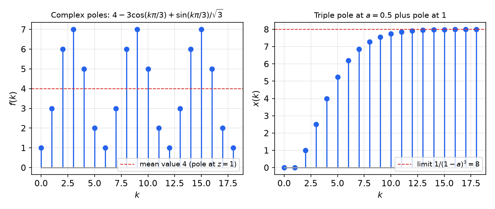
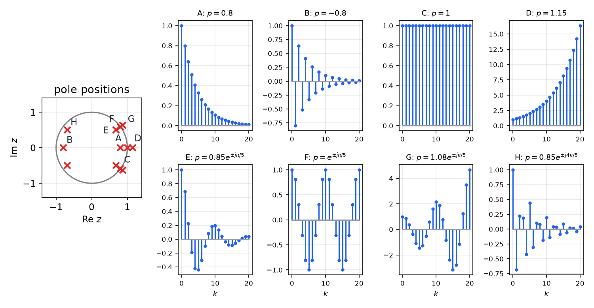
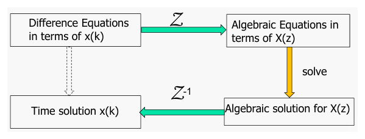
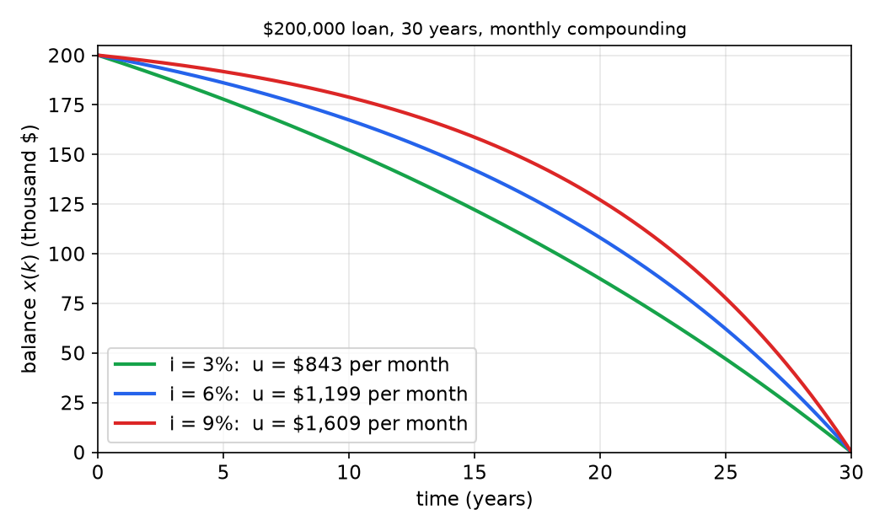

# The z-Transform and Difference Equations

A digital controller is a difference equation: each new output is computed from the current input and stored past values. The z-transform does for difference equations what the Laplace transform does for differential equations. It turns them into algebraic equations, defines the transfer function of a discrete-time system, and ties the location of poles to the behaviour of sequences. This chapter develops the one-sided z-transform in depth: its definition and convergence, a table of transform pairs derived from first principles, its properties including the initial and final value theorems, three methods of inversion, and its use in solving difference equations. A shorter overview, including the two-sided transform used in signal processing, is in [Z-Transform](../../../signals/z-transform.md).

## From Laplace to z

### Laplace transform review

For a continuous-time signal \\(f(t)\\) defined for \\(t \ge 0\\),
\\[
F(s) = \mathcal{L}\\{f(t)\\} = \int\_0^\infty f(t)e^{-st}\\,dt, \qquad s = \sigma + j\omega,
\\]
with inverse
\\[
f(t) = \mathcal{L}^{-1}\\{F(s)\\} = \frac{1}{2\pi j}\int\_{\gamma - j\infty}^{\gamma + j\infty} F(s)e^{st}\\,ds .
\\]
Its main properties are:

1. Linearity: \\(\mathcal{L}\\{af(t) \pm bg(t)\\} = aF(s) \pm bG(s)\\).
2. Multiplication by an exponential: \\(\mathcal{L}\\{e^{-at}f(t)\\} = F(s+a)\\).
3. Translation: \\(\mathcal{L}\\{f(t-\alpha)1(t-\alpha)\\} = e^{-\alpha s}F(s)\\) for \\(\alpha \ge 0\\).
4. Differentiation: \\(\mathcal{L}\\{\dot f(t)\\} = sF(s) - f(0)\\).
5. Integration: \\(\mathcal{L}\\{\int\_0^t f(\tau)\\,d\tau\\} = F(s)/s\\).

Differentiation becomes multiplication by \\(s\\), so a linear constant-coefficient differential equation becomes an algebraic equation. For the mass–spring–damper \\(m\ddot x + c\dot x + kx = f\\) with zero initial conditions,
\\[
G(s) = \frac{X(s)}{F(s)} = \frac{1}{ms^2 + cs + k}.
\\]
The **transfer function** expresses the dynamics as an algebraic relation. It depends only on the constant parameters of the system, not on the input, and it corresponds one-to-one with the differential equation. (See [Transfer Functions](../transfer.md) and [The Laplace Method](../../../math/diffeq/laplace-method.md).)

### Discrete-time signals

A discrete-time signal is a sequence \\(f(0), f(1), f(2), \ldots\\). In digital control it usually arises by sampling a continuous signal, \\(f(k) = f(kT)\\), but it may also be generated directly by a computer program, or count something, as in the examples at the end of this chapter. A discrete-time system relates input and output sequences through a **difference equation**, in which shifts \\(k \to k+1\\) take the place of derivatives. The z-transform turns a shift into multiplication by \\(z\\).

## Definition and Region of Convergence

**Definition (one-sided z-transform).** The z-transform of a sequence \\(f(k)\\), \\(k = 0, 1, 2, \ldots\\), is the power series in \\(z^{-1}\\)
\\[
F(z) = \mathcal{Z}\left[f(k)\right] = \sum\_{k=0}^{\infty} f(k)z^{-k} = f(0) + f(1)z^{-1} + f(2)z^{-2} + \cdots,
\\]
where \\(z\\) is a complex variable, playing the role of \\(s\\) in the Laplace transform.

The one-sided transform ignores \\(f(k)\\) for \\(k < 0\\). This is the natural choice for control problems that start at \\(k = 0\\) with given initial conditions. The coefficient of \\(z^{-k}\\) is the sample at time \\(k\\), so \\(z^{-1}\\) can be read as a **one-step delay**.

**Definition (region of convergence).** \\(f(k)\\) is *z-transformable* if the series converges for all \\(z\\) in some region of the complex plane, called the **region of convergence** (ROC).

**Theorem (sufficient condition for existence).** If \\(f(k)\\) grows at most exponentially, that is, \\(\lvert f(k)\rvert < Ma^k\\) for all \\(k \ge 0\\) and some real \\(M, a > 0\\), then \\(F(z)\\) converges absolutely for \\(\lvert z\rvert > a\\).

*Proof.* For \\(\lvert z\rvert > a\\), \\(\lvert f(k)z^{-k}\rvert < M(a/\lvert z\rvert)^k\\), and the geometric series \\(\sum M(a/\lvert z\rvert)^k\\) converges because \\(a/\lvert z\rvert < 1\\). The comparison test gives absolute convergence. \\(\square\\)

The ROC of a one-sided transform is therefore the *exterior* of a circle, \\(\lvert z\rvert > a\\), and contains the point at infinity. Inside the ROC the series defines an analytic function. Its analytic continuation, usually a rational function, is what we manipulate algebraically, and all its poles lie inside the circle \\(\lvert z\rvert \le a\\). Sequences that grow faster than any exponential, such as \\(k!\\) or \\(a^{k^2}\\), have no z-transform; they never arise from linear time-invariant systems.

## Basic Transform Pairs

Each pair below follows from the definition and the geometric series \\(\sum\_{k\ge0} w^k = 1/(1-w)\\), \\(\lvert w\rvert < 1\\).

**Kronecker delta.** \\(\delta(k) = 1\\) for \\(k = 0\\) and 0 otherwise: \\(F(z) = 1\\) for all \\(z\\). The delayed impulse \\(\delta(k-n)\\) gives \\(z^{-n}\\).

**Unit step.** \\(1(k) = 1\\) for \\(k \ge 0\\):
\\[
\mathcal{Z}\left[1(k)\right] = \sum\_{k=0}^\infty z^{-k} = \frac{1}{1 - z^{-1}} = \frac{z}{z-1}, \qquad \lvert z\rvert > 1 .
\\]

**Exponential (geometric) sequence.** \\(f(k) = a^k\\), \\(k \ge 0\\):
\\[
\mathcal{Z}\left[a^k\right] = \sum\_{k=0}^\infty (az^{-1})^k = \frac{1}{1 - az^{-1}} = \frac{z}{z-a}, \qquad \lvert z\rvert > \lvert a\rvert .
\\]
\\(a\\) may be complex. A sampled exponential \\(e^{-\alpha kT}\\) is the case \\(a = e^{-\alpha T}\\), which gives \\(z/(z - e^{-\alpha T})\\). This is the first appearance of the map \\(z = e^{sT}\\) between a continuous pole \\(s = -\alpha\\) and a discrete pole.

**Sinusoids.** Write \\(\cos bk = (e^{jbk} + e^{-jbk})/2\\) and \\(\sin bk = (e^{jbk} - e^{-jbk})/(2j)\\), and apply the exponential pair with \\(a = e^{\pm jb}\\):
\\[
\mathcal{Z}\left[\cos bk\right] = \frac12\left(\frac{z}{z - e^{jb}} + \frac{z}{z - e^{-jb}}\right) = \frac{z(z - \cos b)}{z^2 - 2z\cos b + 1},
\\]
\\[
\mathcal{Z}\left[\sin bk\right] = \frac{1}{2j}\left(\frac{z}{z - e^{jb}} - \frac{z}{z - e^{-jb}}\right) = \frac{z\sin b}{z^2 - 2z\cos b + 1},
\\]
using \\((z - e^{jb})(z - e^{-jb}) = z^2 - 2z\cos b + 1\\).

**Damped sinusoids.** Replacing \\(e^{\pm jb}\\) by \\(ae^{\pm jb}\\) (or using the multiplication-by-\\(a^k\\) property below) gives the pairs used repeatedly for complex poles:
\\[
a^k\cos bk \ \leftrightarrow\ \frac{z(z - a\cos b)}{z^2 - 2az\cos b + a^2}, \qquad
a^k\sin bk \ \leftrightarrow\ \frac{az\sin b}{z^2 - 2az\cos b + a^2}.
\\]
The poles are \\(z = ae^{\pm jb}\\): the radius \\(a\\) sets the decay per step and the angle \\(b\\) the oscillation frequency in radians per step.

**Ramp and polynomial-times-exponential sequences.** Differentiating \\(\sum a^k z^{-k} = z/(z-a)\\) with respect to \\(a\\) gives \\(\sum ka^{k-1}z^{-k} = z/(z-a)^2\\). Repeating,
\\[
ka^{k-1} \leftrightarrow \frac{z}{(z-a)^2}, \qquad \frac{k(k-1)}{2!}a^{k-2} \leftrightarrow \frac{z}{(z-a)^3}, \qquad
\binom{k}{r-1}a^{k-r+1} \leftrightarrow \frac{z}{(z-a)^{r}} .
\\]
With \\(a = 1\\): \\(k \leftrightarrow z/(z-1)^2\\).

| \\(f(k)\\), \\(k \ge 0\\) | \\(F(z)\\) | in powers of \\(z^{-1}\\) |
|---|---|---|
| \\(\delta(k)\\) | \\(1\\) | \\(1\\) |
| \\(\delta(k-n)\\) | \\(z^{-n}\\) | \\(z^{-n}\\) |
| \\(1(k)\\) | \\(\dfrac{z}{z-1}\\) | \\(\dfrac{1}{1-z^{-1}}\\) |
| \\(k\\) | \\(\dfrac{z}{(z-1)^2}\\) | \\(\dfrac{z^{-1}}{(1-z^{-1})^2}\\) |
| \\(a^k\\) | \\(\dfrac{z}{z-a}\\) | \\(\dfrac{1}{1-az^{-1}}\\) |
| \\(a^{k-1}\\), \\(k \ge 1\\) (0 at \\(k=0\\)) | \\(\dfrac{1}{z-a}\\) | \\(\dfrac{z^{-1}}{1-az^{-1}}\\) |
| \\(ka^{k-1}\\) | \\(\dfrac{z}{(z-a)^2}\\) | \\(\dfrac{z^{-1}}{(1-az^{-1})^2}\\) |
| \\(k^2a^{k-1}\\) | \\(\dfrac{z(z+a)}{(z-a)^3}\\) | \\(\dfrac{z^{-1}(1+az^{-1})}{(1-az^{-1})^3}\\) |
| \\(e^{-\alpha kT}\\) | \\(\dfrac{z}{z - e^{-\alpha T}}\\) | \\(\dfrac{1}{1 - e^{-\alpha T}z^{-1}}\\) |
| \\(\cos bk\\) | \\(\dfrac{z(z-\cos b)}{z^2 - 2z\cos b + 1}\\) | |
| \\(\sin bk\\) | \\(\dfrac{z\sin b}{z^2 - 2z\cos b + 1}\\) | |
| \\(a^k\cos bk\\) | \\(\dfrac{z(z-a\cos b)}{z^2 - 2az\cos b + a^2}\\) | |
| \\(a^k\sin bk\\) | \\(\dfrac{az\sin b}{z^2 - 2az\cos b + a^2}\\) | |

## Properties

Throughout, \\(F(z) = \mathcal{Z}[f(k)]\\) and \\(G(z) = \mathcal{Z}[g(k)]\\), and sequences are taken as zero for \\(k < 0\\) where shifts require it.

**Linearity.** \\(\mathcal{Z}[af(k) + bg(k)] = aF(z) + bG(z)\\), immediate from the definition.

**Time delay.** For a causal sequence (\\(f(k) = 0\\) for \\(k < 0\\)) and \\(n \ge 0\\),
\\[
\mathcal{Z}\left[f(k-n)\right] = z^{-n}F(z).
\\]
*Proof.* \\(\sum\_{k\ge0} f(k-n)z^{-k} = \sum\_{m\ge -n} f(m)z^{-m-n} = z^{-n}\sum\_{m\ge0} f(m)z^{-m}\\), since the terms with \\(m < 0\\) vanish. \\(\square\\)

**Time advance.** For \\(n \ge 1\\),
\\[
\mathcal{Z}\left[f(k+n)\right] = z^n\left[F(z) - \sum\_{k=0}^{n-1} f(k)z^{-k}\right].
\\]
*Proof.* \\(\sum\_{k\ge0} f(k+n)z^{-k} = z^n\sum\_{m\ge n} f(m)z^{-m} = z^n\left[F(z) - \sum\_{m=0}^{n-1}f(m)z^{-m}\right]\\). \\(\square\\)

In particular \\(\mathcal{Z}[f(k+1)] = zF(z) - zf(0)\\) and \\(\mathcal{Z}[f(k+2)] = z^2F(z) - z^2f(0) - zf(1)\\). The subtracted terms carry the **initial conditions**, exactly as \\(-f(0)\\) does in the Laplace rule for derivatives.

**Accumulation (discrete "integration").**
\\[
\mathcal{Z}\left[\sum\_{i=0}^{k} f(i)\right] = \frac{F(z)}{1 - z^{-1}} = \frac{z}{z-1}F(z).
\\]
*Proof.* Let \\(g(k) = \sum\_{i=0}^k f(i)\\). Then \\(g(k) - g(k-1) = f(k)\\), and by linearity and the delay property \\((1 - z^{-1})G(z) = F(z)\\). \\(\square\\)

Accumulation is convolution with the unit step, and the factor \\(z/(z-1)\\) is the transform of the step. This is the discrete integrator used in digital PI and PID control.

**Multiplication by \\(a^k\\) (scaling in z).**
\\[
\mathcal{Z}\left[a^kf(k)\right] = F(a^{-1}z).
\\]
*Proof.* \\(\sum a^kf(k)z^{-k} = \sum f(k)(z/a)^{-k}\\). \\(\square\\) Poles of \\(F\\) at \\(p\\) move to \\(ap\\), so multiplication by \\(a^k\\) scales the pole radius by \\(a\\).

**Multiplication by \\(k\\).**
\\[
\mathcal{Z}\left[kf(k)\right] = -z\frac{dF(z)}{dz}.
\\]
*Proof.* Differentiate the series term by term inside the ROC: \\(dF/dz = \sum -kf(k)z^{-k-1}\\), and multiply by \\(-z\\). \\(\square\\)

**Convolution.** The convolution of two causal sequences is \\((f\ast g)(k) = \sum\_{i=0}^{k} f(k-i)g(i)\\). Then
\\[
\mathcal{Z}\left[(f\ast g)(k)\right] = F(z)G(z).
\\]
*Proof.* \\(\sum\_k\sum\_{i} f(k-i)g(i)z^{-k} = \sum\_i g(i)z^{-i}\sum\_k f(k-i)z^{-(k-i)} = G(z)F(z)\\), where the inner sum is over \\(m = k - i \ge 0\\) by causality, and the interchange is justified by absolute convergence in the common ROC. \\(\square\\) This is why the output of a discrete LTI system is the product of its transfer function and the input transform; see [Pulse Transfer Functions and z-Plane Analysis](z-plane.md).

**Initial value theorem.** If \\(F(z)\\) exists, then
\\[
f(0) = \lim\_{z\to\infty} F(z).
\\]
*Proof.* Every term \\(f(k)z^{-k}\\) with \\(k \ge 1\\) vanishes as \\(z \to \infty\\). \\(\square\\) Applying it to \\(z(F(z) - f(0))\\) gives \\(f(1)\\), and so on. A rational \\(F(z)\\) of a causal sequence therefore cannot have a numerator of higher degree than its denominator.

### The final value theorem

**Theorem (final value theorem).** Let \\(f(k)\\) be z-transformable and suppose \\(\lim\_{k\to\infty} f(k)\\) exists. Then
\\[
\boxed{\lim\_{k\to\infty} f(k) = \lim\_{z\to 1}\\,(1 - z^{-1})F(z) = \lim\_{z\to1}\\,(z-1)F(z).}
\\]

*Proof.* Consider the first difference \\(f(k+1) - f(k)\\). By the advance property,
\\[
\sum\_{k=0}^\infty \left[f(k+1) - f(k)\right]z^{-k} = zF(z) - zf(0) - F(z) = (z-1)F(z) - zf(0).
\\]
Because \\(f(k)\\) converges, it is bounded, so the ROC contains \\(\lvert z\rvert > 1\\). Let \\(z \to 1\\) from outside the unit circle. The partial sums of the left side are \\(\sum\_{k=0}^{N}[f(k+1) - f(k)] = f(N+1) - f(0)\\), which converge to \\(f(\infty) - f(0)\\). By Abel's theorem on power series, the left side therefore tends to \\(f(\infty) - f(0)\\). The right side tends to \\(\lim\_{z\to1}(z-1)F(z) - f(0)\\). Equating, \\(f(\infty) = \lim\_{z\to1}(z-1)F(z)\\), and \\((z-1)\\) may be replaced by \\((1 - z^{-1}) = (z-1)/z\\) since \\(z \to 1\\). \\(\square\\)

**The hypothesis is essential.** For rational \\(F(z)\\), the limit exists exactly when every pole of \\((z-1)F(z)\\) lies strictly inside the unit circle, that is, all poles of \\(F\\) are inside the unit circle except possibly a simple pole at \\(z = 1\\). If the hypothesis fails, the formula still produces a number, but a meaningless one:

- \\(f(k) = 2^k\\): \\(F = z/(z-2)\\), and \\(\lim\_{z\to1}(z-1)F(z) = 0\\), although \\(f(k) \to \infty\\).
- \\(f(k) = (-1)^k\\): \\(F = z/(z+1)\\), giving 0, although \\(f\\) oscillates forever.

**Example (final value).** \\(F(z) = \dfrac{z}{(z-1)(z-0.5)}\\). The poles of \\((z-1)F(z) = z/(z - 0.5)\\) are inside the unit circle, so the theorem applies: \\(f(\infty) = 1/(1 - 0.5) = 2\\). Indeed, partial fractions give \\(f(k) = 2(1 - 0.5^k) \to 2\\).

In control, the final value theorem gives the steady-state error of a stable loop directly from its z-domain transfer function, without computing the time response ([Pulse Transfer Functions and z-Plane Analysis](z-plane.md)).

### Summary of properties

| Property | Sequence | Transform |
|---|---|---|
| Linearity | \\(af(k) + bg(k)\\) | \\(aF(z) + bG(z)\\) |
| Delay | \\(f(k-n)\\) | \\(z^{-n}F(z)\\) |
| Advance | \\(f(k+n)\\) | \\(z^n\left[F(z) - \sum\_{k=0}^{n-1}f(k)z^{-k}\right]\\) |
| Accumulation | \\(\sum\_{i=0}^k f(i)\\) | \\(F(z)/(1 - z^{-1})\\) |
| Scaling | \\(a^kf(k)\\) | \\(F(z/a)\\) |
| Multiplication by \\(k\\) | \\(kf(k)\\) | \\(-z\\,dF/dz\\) |
| Convolution | \\(\sum\_{i=0}^k f(k-i)g(i)\\) | \\(F(z)G(z)\\) |
| Initial value | \\(f(0)\\) | \\(\lim\_{z\to\infty}F(z)\\) |
| Final value | \\(\lim\_{k\to\infty}f(k)\\) (if it exists) | \\(\lim\_{z\to1}(z-1)F(z)\\) |

## The Inverse z-Transform

Given \\(F(z)\\), the **inverse z-transform** (IZT) is the sequence \\(f(k)\\) with \\(\mathcal{Z}[f(k)] = F(z)\\). For one-sided transforms with a specified ROC it is unique. There are three standard methods: complex integration, which gives a general formula; synthetic (long) division, which gives the numbers one at a time; and partial-fraction expansion, which gives closed forms.

### Complex integration

Start from the series and multiply by \\(z^{k-1}\\):
\\[
F(z)z^{k-1} = f(0)z^{k-1} + f(1)z^{k-2} + \cdots + f(k)z^{-1} + f(k+1)z^{-2} + \cdots .
\\]
Integrate around a circle \\(C\\) centred at the origin inside the ROC, term by term (permitted because the series converges uniformly on \\(C\\)):
\\[
\oint\_C F(z)z^{k-1}\\,dz = f(0)\oint\_C z^{k-1}dz + \cdots + f(k)\oint\_C z^{-1}dz + f(k+1)\oint\_C z^{-2}dz + \cdots .
\\]
On \\(z = Re^{j\theta}\\), \\(dz = jRe^{j\theta}d\theta\\), so
\\[
\oint\_C z^m\\,dz = jR^{m+1}\int\_0^{2\pi} e^{j(m+1)\theta}\\,d\theta =
\begin{cases} 0, & m \ne -1, \\\\ 2\pi j, & m = -1. \end{cases}
\\]
Only the term with \\(z^{-1}\\) survives, the one multiplying \\(f(k)\\). Hence the **inversion formula**
\\[
\boxed{f(k) = \frac{1}{2\pi j}\oint\_C F(z)z^{k-1}\\,dz,}
\\]
where \\(C\\) lies in the ROC and so encloses all poles of \\(F(z)\\). By the residue theorem, for rational \\(F\\),
\\[
f(k) = \sum\_{\text{poles } p\_i \text{ of } F(z)z^{k-1}} \operatorname{Res}\left[F(z)z^{k-1}, p\_i\right].
\\]
Care is needed at \\(k = 0\\): \\(z^{k-1}\\) then has a pole at the origin that must be included.

**Example.** \\(F(z) = \dfrac{z(z+1)}{(z-1)(z-2)}\\). For \\(k \ge 0\\), \\(F(z)z^{k-1} = z^k(z+1)/((z-1)(z-2))\\) has simple poles at 1 and 2 only. The residues are \\(1^k\cdot 2/(1-2) = -2\\) and \\(2^k\cdot 3/(2-1) = 3\cdot 2^k\\), so \\(f(k) = -2 + 3\cdot2^k\\). The partial-fraction method below gives the same answer.

### Synthetic (long) division

Dividing the numerator of \\(F\\) by its denominator, both arranged in descending powers of \\(z\\), produces the series in \\(z^{-1}\\) directly, and its coefficients are the samples.

**Example (long division).**
\\[
H(z) = \frac{z^3 - \frac12 z^2}{z^3 - \frac{15}{12}z^2 + \frac{17}{36}z - \frac{1}{18}}.
\\]
- The first quotient term is 1. Subtracting \\(1\times\\) the denominator leaves \\(\frac34 z^2 - \frac{17}{36}z + \frac1{18}\\).
- The next quotient term is \\(\frac34 z^{-1}\\). Subtracting \\(\frac34 z^{-1}\times\\) the denominator, \\(\frac34 z^2 - \frac{15}{16}z + \frac{17}{48} - \frac{1}{24}z^{-1}\\), leaves \\(\frac{67}{144}z - \frac{43}{144} + \frac{1}{24}z^{-1}\\).
- The next quotient term is \\(\frac{67}{144}z^{-2}\\), and so on.

\\[
H(z) = 1 + \tfrac34 z^{-1} + \tfrac{67}{144}z^{-2} + \cdots \quad\Longrightarrow\quad h(0) = 1,\ h(1) = \tfrac34,\ h(2) = \tfrac{67}{144} \approx 0.465, \ldots
\\]
Long division always works and needs nothing but arithmetic, but it gives numbers rather than a closed form. In practice it is the same computation as running the difference equation \\(A(z)h = B(z)\delta\\) forward from rest, which is how MATLAB's `filter` or `impulse` produce the sequence.

### Partial-fraction expansion

The closed-form method expands \\(F(z)\\) as a sum of terms that appear in the table. Every table entry for a pole \\(p\\) has the form \\(z/(z-p)^r\\), with a factor \\(z\\) in the numerator. It is therefore convenient to expand
\\[
\tilde F(z) = z^{-1}F(z) = \frac{B(z)}{A(z)} = \frac{b\_0z^m + b\_1z^{m-1} + \cdots + b\_m}{z^n + a\_1z^{n-1} + \cdots + a\_n}, \qquad n > m,
\\]
and multiply back by \\(z\\) at the end. (If \\(F\\) has no zero at the origin, \\(\tilde F\\) gains a pole at \\(z = 0\\), which simply contributes a term \\(c\_0\\) and hence \\(c\_0\delta(k)\\).) The procedure depends on the type and multiplicity of the roots of \\(A(z) = 0\\).

#### Case i: simple poles

If \\(A(z) = (z-p\_1)(z-p\_2)\cdots(z-p\_n)\\) with distinct \\(p\_i\\),
\\[
z^{-1}F(z) = \sum\_{i=1}^n \frac{c\_i}{z-p\_i}, \qquad
F(z) = \sum\_{i=1}^n c\_i\frac{z}{z-p\_i}, \qquad
\boxed{f(k) = \sum\_{i=1}^n c\_ip\_i^k .}
\\]
**Method of residues.** Multiply \\(\tilde F\\) by \\((z - p\_i)\\) and set \\(z = p\_i\\). All terms except the \\(i\\)th vanish, so
\\[
c\_i = (z-p\_i)\tilde F(z)\big\|\_{z=p\_i}.
\\]
Alternatively, put the expansion over a common denominator, equate numerator coefficients and solve the resulting linear equations.

**Example (simple real poles).** \\(F(z) = \dfrac{z^2 + z}{z^2 - 3z + 2}\\). Then
\\[
z^{-1}F(z) = \frac{z+1}{(z-1)(z-2)} = \frac{c\_1}{z-1} + \frac{c\_2}{z-2},
\\]
\\[
c\_1 = \frac{z+1}{z-2}\Big\|\_{z=1} = \frac{2}{-1} = -2, \qquad
c\_2 = \frac{z+1}{z-1}\Big\|\_{z=2} = 3,
\\]
\\[
F(z) = -2\frac{z}{z-1} + 3\frac{z}{z-2} \quad\Longrightarrow\quad f(k) = -2 + 3\cdot 2^k, \quad k \ge 0 .
\\]
Check: \\(f(0) = 1\\), and the initial value theorem gives \\(\lim\_{z\to\infty}F = 1\\).

#### Complex poles

Residues work for complex poles, but they require complex arithmetic. Because \\(A(z)\\) has real coefficients, complex poles come in conjugate pairs \\(p\_{i+1} = \bar p\_i\\), and then
\\[
c\_{i+1} = (z - \bar p\_i)\tilde F(z)\big\|\_{z=\bar p\_i} = \bar c\_i .
\\]
To avoid complex algebra, combine each conjugate pair into one real quadratic term:
\\[
\frac{c\_i}{z-p\_i} + \frac{\bar c\_i}{z - \bar p\_i} = \frac{(c\_i + \bar c\_i)z - (c\_i\bar p\_i + \bar c\_ip\_i)}{z^2 - (p\_i + \bar p\_i)z + p\_i\bar p\_i} = \frac{\gamma z + \eta}{z^2 - \alpha z + \beta},
\\]
with \\(\alpha, \beta, \gamma, \eta\\) real. After multiplying by \\(z\\), the term to invert is
\\[
\frac{z(\gamma z + \eta)}{z^2 - \alpha z + \beta}.
\\]
**Inversion by comparison with the table.** Write the pair as \\(ae^{\pm jb}\\), so that \\(z^2 - \alpha z + \beta = z^2 - 2az\cos b + a^2\\):
\\[
a = \sqrt{\beta}, \qquad b = \cos^{-1}\left(\frac{\alpha}{2\sqrt\beta}\right).
\\]
Seek the inverse as \\(a^k(\gamma\cos bk + \lambda\sin bk)\\). By the damped-sinusoid pairs its transform is
\\[
\frac{z\left[\gamma(z - a\cos b) + \lambda a\sin b\right]}{z^2 - 2az\cos b + a^2}.
\\]
Matching the numerator with \\(z(\gamma z + \eta)\\) requires \\(-\gamma a\cos b + \lambda a\sin b = \eta\\), so
\\[
\boxed{\frac{z(\gamma z + \eta)}{z^2 - \alpha z + \beta} \ \leftrightarrow\ a^k\left(\gamma\cos bk + \lambda\sin bk\right), \qquad \lambda = \frac{\eta + \gamma a\cos b}{a\sin b}.}
\\]

**Example (complex poles).**
\\[
F(z) = \frac{z(z^2 + z + 2)}{(z-1)(z^2 - z + 1)} .
\\]
The poles are \\(z = 1\\) and the roots of \\(z^2 - z + 1\\), namely \\(0.5 \pm j0.866 = e^{\pm j\pi/3}\\), on the unit circle. Expand
\\[
z^{-1}F(z) = \frac{z^2 + z + 2}{(z-1)(z^2 - z + 1)} = \frac{A}{z-1} + \frac{Bz + C}{z^2 - z + 1}.
\\]
The residue at \\(z = 1\\) is \\(A = (1 + 1 + 2)/(1 - 1 + 1) = 4\\). Clearing denominators, \\(z^2 + z + 2 = A(z^2 - z + 1) + (Bz + C)(z - 1)\\). Comparing \\(z^2\\) coefficients gives \\(1 = A + B\\), so \\(B = -3\\); comparing constants gives \\(2 = A - C\\), so \\(C = 2\\). Hence
\\[
F(z) = \frac{4z}{z-1} + \frac{z(-3z + 2)}{z^2 - z + 1}, \qquad f(k) = 4 + g(k).
\\]
For \\(g\\): \\(\alpha = 1\\), \\(\beta = 1\\), so \\(a = 1\\) and \\(b = \cos^{-1}(1/2) = \pi/3\\); \\(\gamma = -3\\), \\(\eta = 2\\), and
\\[
\lambda = \frac{2 + (-3)(1)(1/2)}{\sin(\pi/3)} = \frac{0.5}{\sqrt3/2} = \frac{1}{\sqrt3}.
\\]
\\[
\boxed{f(k) = 4 - 3\cos\frac{k\pi}{3} + \frac{1}{\sqrt3}\sin\frac{k\pi}{3}, \qquad k \ge 0.}
\\]
Check by long division: \\(f(0) = 4 - 3 = 1\\), \\(f(1) = 4 - 1.5 + 0.5 = 3\\), \\(f(2) = 4 + 1.5 + 0.5 = 6\\), which agree with dividing \\(z^3 + z^2 + 2z\\) by \\(z^3 - 2z^2 + 2z - 1\\). The poles on the unit circle produce an undamped oscillation of period 6 about the mean 4 contributed by the pole at \\(z = 1\\).

**Variant (a one-step delay).** If instead
\\[
X(z) = \frac{z^2 + z + 2}{(z-1)(z^2 - z + 1)} = z^{-1}F(z),
\\]
the delay property gives \\(x(k) = f(k-1)\\) for \\(k \ge 1\\), and \\(x(0) = 0\\). A numerator of lower degree than the denominator signals a delay; there is no need to redo the expansion.

#### Case ii: repeated poles

Suppose \\(A(z) = (z - p\_1)^{m\_1}\cdots(z - p\_r)^{m\_r}\\) with \\(m\_1 + \cdots + m\_r = n\\). Each pole of multiplicity \\(m\_i\\) contributes \\(m\_i\\) terms:
\\[
z^{-1}F(z) = \sum\_{i=1}^r\sum\_{q=1}^{m\_i}\frac{c\_{iq}}{(z-p\_i)^{m\_i - q + 1}}.
\\]
**Residue formula.** Multiply by \\((z-p\_i)^{m\_i}\\). The result \\(\phi\_i(z) = (z-p\_i)^{m\_i}\tilde F(z)\\) is analytic at \\(p\_i\\), and its Taylor expansion about \\(p\_i\\) is
\\[
\phi\_i(z) = c\_{i1} + c\_{i2}(z-p\_i) + \cdots + c\_{im\_i}(z-p\_i)^{m\_i-1} + (\text{terms that vanish at } p\_i \text{ to higher order}).
\\]
Reading off the Taylor coefficients gives
\\[
c\_{iq} = \frac{1}{(q-1)!}\frac{d^{\\,q-1}}{dz^{q-1}}\left[(z-p\_i)^{m\_i}\tilde F(z)\right]\_{z=p\_i}, \qquad q = 1, \ldots, m\_i .
\\]
**Inversion.** With \\(r = m\_i - q + 1\\), the pair \\(z/(z-p)^r \leftrightarrow \binom{k}{r-1}p^{k-r+1}\\) gives
\\[
f(k) = \sum\_{i=1}^r\sum\_{q=1}^{m\_i} c\_{iq}\\,\frac{k(k-1)\cdots(k - m\_i + q + 1)}{(m\_i - q)!}\\,p\_i^{\\,k - m\_i + q}.
\\]
The product in the numerator has \\(m\_i - q\\) factors and vanishes automatically for \\(0 \le k < m\_i - q\\), so the formula holds for all \\(k \ge 0\\). A repeated pole multiplies the geometric mode \\(p^k\\) by a polynomial in \\(k\\), just as repeated roots of a differential equation give \\(t^je^{pt}\\).

**Example (a triple pole).**
\\[
X(z) = \frac{z^2}{(z-1)(z-a)^3}, \qquad
\tilde X(z) = \frac{X(z)}{z} = \frac{c\_1}{z-1} + \frac{c\_{21}}{(z-a)^3} + \frac{c\_{22}}{(z-a)^2} + \frac{c\_{23}}{z-a}.
\\]
Here \\((z-a)^3\tilde X = z/(z-1)\\), so
\\[
c\_1 = \frac{z}{(z-a)^3}\Big\|\_{z=1} = \frac{1}{(1-a)^3}, \qquad
c\_{21} = \frac{z}{z-1}\Big\|\_{z=a} = \frac{a}{a-1},
\\]
\\[
c\_{22} = \frac{d}{dz}\left[\frac{z}{z-1}\right]\_{z=a} = \frac{-1}{(a-1)^2}, \qquad
c\_{23} = \frac12\frac{d^2}{dz^2}\left[\frac{z}{z-1}\right]\_{z=a} = \frac12\frac{d}{dz}\left[\frac{-1}{(z-1)^2}\right]\_{z=a} = \frac{1}{(a-1)^3}.
\\]
Writing every coefficient over \\((1-a)^3\\):
\\[
X(z) = \frac{1}{(1-a)^3}\left[\frac{z}{z-1} - \frac{a(1-a)^2z}{(z-a)^3} - \frac{(1-a)z}{(z-a)^2} - \frac{z}{z-a}\right],
\\]
and inverting each term (\\(z/(z-a)^3 \leftrightarrow \tfrac12 k(k-1)a^{k-2}\\), \\(z/(z-a)^2 \leftrightarrow ka^{k-1}\\)):
\\[
x(k) = \frac{1}{(1-a)^3}\left[1 - \tfrac12(1-a)^2k(k-1)a^{k-1} - (1-a)ka^{k-1} - a^k\right], \quad k \ge 0,
\\]
and \\(x(k) = 0\\) for \\(k < 0\\). For \\(a = 0.5\\) this gives \\(0, 0, 1, 2.5, 4, 5.25, \ldots \to 8\\), in agreement with long division and with the final value theorem, \\(\lim\_{z\to1}(z-1)X(z) = 1/(1-a)^3 = 8\\).

**Example (double pole at 1 and a complex pair).** Find the inverse of
\\[
G(z) = \frac{z^2}{(z-1)^2(z^2 - z + 1)}.
\\]
Expand \\(z^{-1}G = \dfrac{z}{(z-1)^2(z^2-z+1)} = \dfrac{c\_{11}}{(z-1)^2} + \dfrac{c\_{12}}{z-1} + \dfrac{\gamma z + \eta}{z^2 - z + 1}\\). With \\(\phi(z) = z/(z^2 - z + 1)\\):
\\[
c\_{11} = \phi(1) = 1, \qquad c\_{12} = \phi'(1) = \frac{(z^2 - z + 1) - z(2z - 1)}{(z^2 - z + 1)^2}\Big\|\_{z=1} = \frac{1 - z^2}{(z^2-z+1)^2}\Big\|\_{z=1} = 0 .
\\]
Clearing denominators, \\(z = (z^2 - z + 1) + (\gamma z + \eta)(z-1)^2\\). The \\(z^3\\) coefficient gives \\(\gamma = 0\\), and the constant term gives \\(0 = 1 + \eta\\), so \\(\eta = -1\\). Hence
\\[
G(z) = \frac{z}{(z-1)^2} - \frac{z}{z^2 - z + 1}.
\\]
The first term is the ramp \\(k\\). For the second, \\(a = 1\\), \\(b = \pi/3\\), \\(\gamma = 0\\), \\(\eta = -1\\), so \\(\lambda = -1/\sin(\pi/3) = -2/\sqrt3\\):
\\[
g(k) = k - \frac{2}{\sqrt3}\sin\frac{k\pi}{3}, \qquad k \ge 0,
\\]
which gives \\(0, 0, 1, 3, 5, 6, 6, 7, \ldots\\), in agreement with long division of \\(z^2\\) by \\(z^4 - 3z^3 + 4z^2 - 3z + 1\\).



*Figure: left, \\(f(k) = 4 - 3\cos(k\pi/3) + \sin(k\pi/3)/\sqrt3\\): the pole at \\(z = 1\\) gives the constant 4, and the poles \\(e^{\pm j\pi/3}\\) on the unit circle give a sustained oscillation of period 6 samples. Right, the triple-pole example with \\(a = 0.5\\): the polynomial-times-geometric terms die out and \\(x(k)\\) settles at \\(1/(1-a)^3 = 8\\).*

### Pole location and the shape of a sequence

Partial fractions show that every sequence with a rational transform is a sum of **modes** \\(k^jp^k\\), one family for each pole \\(p\\). The pole location alone fixes the qualitative behaviour of its mode:

- \\(\lvert p\rvert < 1\\): the mode decays geometrically, faster the closer \\(p\\) is to the origin. A pole at \\(z = 0\\) gives a mode that vanishes after a finite number of steps.
- \\(\lvert p\rvert = 1\\): a simple pole gives a mode that neither decays nor grows (constant for \\(p = 1\\), alternating for \\(p = -1\\), sinusoidal otherwise). A repeated pole on the circle grows polynomially.
- \\(\lvert p\rvert > 1\\): the mode grows geometrically.
- A positive real pole gives a monotone mode. A negative real pole alternates sign every step, an oscillation at the highest frequency a sampled signal can have (period 2 samples). A complex pair \\(ae^{\pm jb}\\) oscillates with \\(2\pi/b\\) samples per period.



*Figure: pole position (left) and the corresponding mode (right panels; the real part \\(r^k\cos bk\\) is shown for complex pairs). Inside the unit circle the modes decay (A, B, E, H); on it they persist (C, F); outside they grow (D, G). Negative real parts produce sign alternation (B, H).*

This is the discrete counterpart of the s-plane picture, with the unit circle in place of the imaginary axis. It is the basis for stability analysis in [Pulse Transfer Functions and z-Plane Analysis](z-plane.md) and for the transient-response design charts in [Classical Digital Control Design](classical-design.md).

### Software

```matlab
% residues of F(z)/z, then multiply back by z
b = [1 1 2];  a = conv([1 -1],[1 -1 1]);   % z^-1 F(z) of the complex-pole example
[r, p, k] = residue(b, a)                  % c_i and p_i
f = impz([1 1 2 0], a, 10)                  % first 10 samples of F(z) (long division)
syms z n; iztrans(z*(z^2+z+2)/((z-1)*(z^2-z+1)), z, n)   % symbolic inverse
```

```python
import numpy as np, scipy.signal as sg
num, den = [1, 1, 2, 0], np.polymul([1, -1], [1, -1, 1])      # F(z) in powers of z
_, (f,) = sg.dimpulse((num, den, 1), n=10)                      # samples f(0..9)
r, p, k = sg.residue([1, 1, 2], den)                            # expansion of F(z)/z
```

## Solving Difference Equations

The main application of the z-transform in this subsection is to linear constant-coefficient difference equations. It is also used for transfer-function modelling, classical design, stability analysis, and sampling and discretization of continuous systems. The procedure mirrors the Laplace method for differential equations.



*Figure: solving a difference equation with the z-transform. Transform, solve algebraically for \\(X(z)\\), and invert. The dashed arrow is the direct time-domain route (recursion or characteristic roots), which gives numbers but rarely insight.*

### The general input–output equation

An \\(n\\)th-order linear time-invariant difference equation has the form
\\[
x(k+n) + a\_1x(k+n-1) + \cdots + a\_{n-1}x(k+1) + a\_nx(k) = b\_0u(k+m) + b\_1u(k+m-1) + \cdots + b\_mu(k),
\\]
with \\(m \le n\\) for causality: the output at time \\(k+n\\) cannot depend on inputs later than \\(k+n\\). Transforming term by term with the advance property, the initial values \\(x(0), \ldots, x(n-1)\\) (and \\(u(0), \ldots, u(m-1)\\)) appear as polynomial terms in \\(z\\). Collecting them,
\\[
A(z)X(z) = B(z)U(z) + Q(z), \qquad A(z) = z^n + a\_1z^{n-1} + \cdots + a\_n, \quad B(z) = b\_0z^m + \cdots + b\_m,
\\]
where \\(Q(z)\\) is a polynomial of degree at most \\(n\\) built from the initial conditions. Hence
\\[
X(z) = \underbrace{\frac{Q(z)}{A(z)}}\_{\text{initial-condition response}} + \underbrace{G(z)U(z)}\_{\text{forced response}}, \qquad G(z) = \frac{B(z)}{A(z)},
\\]
which is the form \\(X(z) = Y(z) + G(z)U(z)\\), with \\(Y\\) the free response. The solution is the inverse transform of \\(X(z)\\). \\(G(z)\\) is the **transfer function**: the ratio of output to input transforms with zero initial conditions. Its poles, the roots of \\(A(z) = 0\\), are the **characteristic roots** and determine the modes of both parts of the response. The same idea extends to systems of difference equations, and in state-space form \\(x(k+1) = Ax(k) + Bu(k)\\) it gives \\(X(z) = (zI - A)^{-1}[zx(0) + BU(z)]\\) (see [Discrete-Time Systems](../linear/discrete-time.md)).

For a second-order equation, written out:
\\[
\mathcal{Z}\left[x(k+2) + a\_1x(k+1) + a\_2x(k)\right] = (z^2 + a\_1z + a\_2)X(z) - z^2x(0) - zx(1) - a\_1zx(0),
\\]
so \\(Q(z) = x(0)z^2 + \left[x(1) + a\_1x(0)\right]z\\) when the right-hand side is zero.

**Example (loan payment).** A sum of \\(P\\) dollars is borrowed at annual interest rate \\(i\\), compounded monthly, and is to be repaid in \\(n\\) years, that is \\(N = 12n\\) months, with equal monthly payments. What is the payment?

Let \\(k\\) be the month, \\(x(k)\\) the balance owed at the start of month \\(k\\), and \\(u(k)\\) the payment. Each month the balance grows by the interest \\((i/12)x(k)\\) and shrinks by the payment:
\\[
x(k+1) = x(k) + \frac{i}{12}x(k) - u(k) \quad\Longrightarrow\quad x(k+1) = ax(k) - u(k), \qquad a = 1 + \frac{i}{12},
\\]
with \\(x(0) = P\\). Transforming,
\\[
zX(z) - zx(0) = aX(z) - U(z) \quad\Longrightarrow\quad X(z) = x(0)\frac{z}{z-a} - \frac{U(z)}{z-a},
\\]
\\[
x(k) = Pa^k - \mathcal{Z}^{-1}\left[\frac{U(z)}{z-a}\right].
\\]
For a uniform payment \\(u(k) = u\cdot 1(k)\\), \\(U(z) = uz/(z-1)\\), and
\\[
\frac{U(z)}{z-a} = \frac{uz}{(z-1)(z-a)} = \frac{u}{a-1}\left(\frac{z}{z-a} - \frac{z}{z-1}\right)
\quad\Longrightarrow\quad
\mathcal{Z}^{-1}\left[\frac{U(z)}{z-a}\right] = \frac{a^k - 1}{a-1}\\,u .
\\]
The balance is therefore
\\[
x(k) = Pa^k - \left(\frac{a^k - 1}{a-1}\right)u .
\\]
The first term is the debt growing with compound interest; the second is the accumulated value of the payments. Requiring \\(x(N) = 0\\):
\\[
\boxed{u = \frac{a-1}{1 - a^{-N}}\\,P.}
\\]
*Numbers.* For \\(P = \\$200{,}000\\), \\(i = 6\\%\\) (\\(a = 1.005\\)) and \\(n = 30\\) years (\\(N = 360\\)): \\(u = 0.005 \times 200{,}000/(1 - 1.005^{-360}) = \\$1{,}199.10\\) per month, a total of about \\(\\$431{,}700\\). The pole \\(a > 1\\) is outside the unit circle: left alone, the debt is an unstable mode, and the payments are a control input that drives the state to zero at \\(k = N\\).



*Figure: balance \\(x(k)\\) of a $200,000, 30-year loan at three interest rates. Higher rates need larger payments, and the balance stays high longer because early payments go mostly to interest.*

**Example (free response).** Solve \\(x(k+2) + 3x(k+1) + 2x(k) = 0\\) with \\(x(0) = 0\\), \\(x(1) = 1\\).

\\(\mathcal{Z}[x(k+2)] = z^2X - z^2\left[x(0) + z^{-1}x(1)\right] = z^2X - z\\), and \\(\mathcal{Z}[x(k+1)] = zX - zx(0) = zX\\). Hence
\\[
(z^2 + 3z + 2)X(z) - z = 0 \quad\Longrightarrow\quad X(z) = \frac{z}{(z+1)(z+2)} = \frac{z}{z+1} - \frac{z}{z+2},
\\]
\\[
x(k) = (-1)^k - (-2)^k .
\\]
Check: \\(x(0) = 0\\), \\(x(1) = -1 + 2 = 1\\), \\(x(2) = 1 - 4 = -3 = -3x(1) - 2x(0)\\). The characteristic roots \\(-1\\) and \\(-2\\) give an alternating, growing response.

**Example (counting arrangements).** Packages of type A occupy one space; types B and C occupy two spaces each. In how many ways \\(x(k)\\) can a row of \\(k\\) spaces be filled? By enumeration, \\(k = 1\\): A; \\(k = 2\\): AA, B, C; \\(k = 3\\): AAA, AB, BA, AC, CA.

*Recurrence.* Classify the arrangements of \\(k+2\\) spaces by their last package. If it is an A, the first \\(k+1\\) spaces can be any of the \\(x(k+1)\\) arrangements. If it is a B or a C, the first \\(k\\) spaces can be any of the \\(x(k)\\) arrangements, for each of the two choices. Hence
\\[
x(k+2) = x(k+1) + 2x(k), \qquad x(0) = x(1) = 1 .
\\]
\\(x(0) = 1\\) because there is exactly one way to fill no spaces: the empty arrangement. This value is also what makes the recurrence give \\(x(2) = x(1) + 2x(0) = 3\\).

*Solution.* Transforming,
\\[
z^2\left[X - x(0) - z^{-1}x(1)\right] = z\left[X - x(0)\right] + 2X
\quad\Longrightarrow\quad
(z^2 - z - 2)X = z^2,
\\]
\\[
X(z) = \frac{z^2}{(z+1)(z-2)} = \frac13\left[\frac{z}{z+1} + \frac{2z}{z-2}\right],
\qquad
x(k) = \frac13\left[(-1)^k + 2^{k+1}\right].
\\]
Check: \\(1, 1, 3, 5, 11, 21, \ldots\\), matching the enumeration. The dominant root 2 shows that the count roughly doubles with each extra space.

## Summary

- One-sided z-transform: \\(F(z) = \sum\_{k\ge0}f(k)z^{-k}\\). It converges outside a circle \\(\lvert z\rvert > a\\) if \\(\lvert f(k)\rvert < Ma^k\\), and \\(z^{-1}\\) acts as a one-step delay.
- Key pairs: \\(\delta \leftrightarrow 1\\), \\(1(k) \leftrightarrow z/(z-1)\\), \\(a^k \leftrightarrow z/(z-a)\\), \\(ka^{k-1} \leftrightarrow z/(z-a)^2\\), and the damped sinusoids \\(a^k\cos bk\\), \\(a^k\sin bk\\) with denominator \\(z^2 - 2az\cos b + a^2\\).
- Properties: delay \\(z^{-n}F\\); advance \\(z^n[F - \sum\_{k<n}f(k)z^{-k}]\\), which brings in the initial conditions; accumulation \\(F/(1 - z^{-1})\\); scaling \\(F(z/a)\\); \\(kf \leftrightarrow -zF'\\); convolution \\(\leftrightarrow\\) product.
- Initial value \\(f(0) = \lim\_{z\to\infty}F\\). Final value \\(f(\infty) = \lim\_{z\to1}(z-1)F(z)\\), valid only when the limit exists (all poles of \\((z-1)F\\) inside the unit circle).
- Inversion: \\(f(k) = \frac{1}{2\pi j}\oint F(z)z^{k-1}dz\\) (sum of residues); long division (numbers, always works); partial fractions of \\(F(z)/z\\) with residues \\(c\_i = (z-p\_i)\tilde F\rvert\_{p\_i}\\), complex pairs via \\(a = \sqrt\beta\\), \\(b = \cos^{-1}(\alpha/2\sqrt\beta)\\), \\(\lambda = (\eta + \gamma a\cos b)/(a\sin b)\\), and repeated poles via derivatives.
- Each pole \\(p\\) contributes a mode \\(p^k\\) (times a polynomial in \\(k\\) if repeated): it decays inside the unit circle, persists on it and grows outside it.
- Difference equations transform to \\(A(z)X = B(z)U + Q(z)\\), so \\(X = Q/A + GU\\) with transfer function \\(G = B/A\\). Loan example: \\(u = (a-1)P/(1 - a^{-N})\\).

## See Also

- [Z-Transform (signals overview)](../../../signals/z-transform.md)
- [Digital Control Systems: Architecture and Hardware](introduction.md)
- [Sampling, Reconstruction and Discretization](sampling.md)
- [Pulse Transfer Functions and z-Plane Analysis](z-plane.md)
- [Classical Digital Control Design](classical-design.md)
- [Laplace Transform](../../../signals/laplace-transform.md)
- [The Laplace Method for ODEs](../../../math/diffeq/laplace-method.md)
- [Transfer Functions](../transfer.md)
- [Discrete-Time Systems (state space)](../linear/discrete-time.md)
