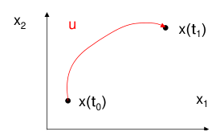
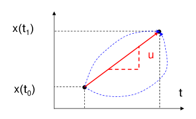
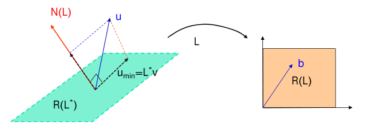
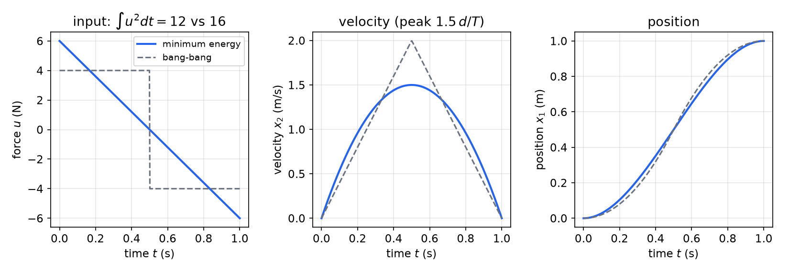
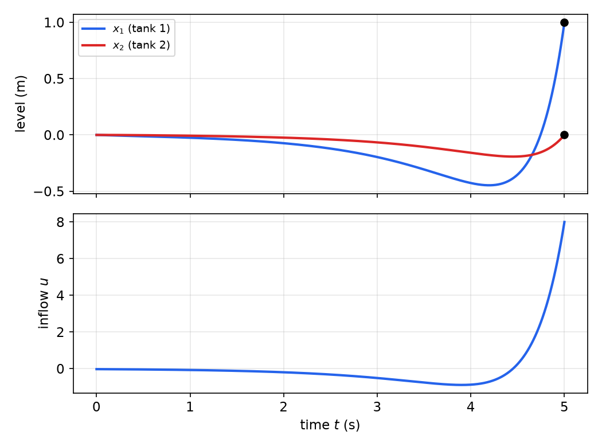
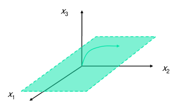
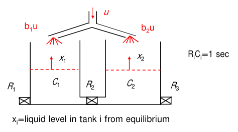
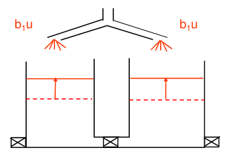

# Controllability

Before designing a controller it is worth asking a prior question: can the actuators move the state where we want it at all? A system is controllable if some input transfers any initial state to any final state in finite time. This chapter turns that question into linear algebra. The transfer problem is an underdetermined linear equation, its minimum-norm solution is the minimum-energy input, and its solvability is decided by a single matrix, the controllability Gramian. For time-invariant systems the Gramian test collapses to the famous rank test on \\([B\ \ AB\ \cdots\ A^{n-1}B]\\). Controllability is the hypothesis behind pole placement in [State Feedback and Pole Placement](state-feedback.md), and its dual, observability, is the subject of [Observability](observability.md).

## The Controllability Problem

Controllability analysis is used in three ways in practice:

- **Feedback design.** Arbitrary eigenvalue assignment by state feedback is possible exactly when the system is controllable.
- **Feedforward computation.** The minimum-norm input derived below is an open-loop control that performs a prescribed state transfer, for example a rest-to-rest move of a positioning stage.
- **Actuator placement.** Comparing the controllability of candidate actuator locations (rank, or how well conditioned the Gramian is) tells the designer where actuators are effective.

For linear systems all three rest on closed-form tests, which is what makes the concept so useful.

**Definition (controllability).** A dynamic system is **controllable over \\([t\_0, t\_1]\\)** if for every initial state \\(x(t\_0)\\) and every final state \\(x(t\_1)\\) there exists an input \\(u(t)\\), \\(t\_0 \le t \le t\_1\\), that transfers \\(x(t\_0)\\) to \\(x(t\_1)\\). The system is **completely controllable** if it is controllable over every interval \\([t\_0, t\_1]\\) with \\(t\_1 > t\_0\\).



*Figure: controllability in the \\((x\_1, x\_2)\\) plane. An input \\(u\\) steers the state from an arbitrary \\(x(t\_0)\\) to an arbitrary \\(x(t\_1)\\) in the allotted time.*

Three remarks on the definition:

1. Controllability means the state can be pushed in **every direction** of the state space, not just that some states can be reached.
2. The input that performs the transfer is **not unique** in general. There are usually infinitely many, which is why it makes sense to ask for the best one (minimum energy) below.
3. For **linear** systems either endpoint may be taken to be the origin. The state at \\(t\_1\\) is \\(x(t\_1) = \Phi(t\_1, t\_0)x(t\_0) + \int\_{t\_0}^{t\_1}\Phi(t\_1,\tau)B(\tau)u(\tau)\\,d\tau\\), so transferring \\(x(t\_0)\\) to \\(x(t\_1)\\) is the same as transferring the origin to \\(\Delta x = x(t\_1) - \Phi(t\_1,t\_0)x(t\_0)\\). Since the state transition matrix \\(\Phi\\) is invertible, \\(\Delta x\\) ranges over all of \\(\mathbb{R}^n\\) as \\(x(t\_1)\\) does. "Controllable from the origin" (reachability) and "controllable to the origin" are therefore both equivalent to controllability for continuous-time linear systems. (In discrete time this fails when \\(A\\) is singular; see the last section.)

### First examples

**Example 1 (integrator).** Is \\(\dot x = u\\) controllable? Try a constant input. Then \\(x(t\_1) = x(t\_0) + u\\,(t\_1 - t\_0)\\), and the choice
\\[
u = \frac{x(t\_1) - x(t\_0)}{t\_1 - t\_0}
\\]
performs any desired transfer. The system is controllable. The constant input is only one choice among infinitely many: any input with the same integral \\(\int\_{t\_0}^{t\_1}u\\,dt = x(t\_1) - x(t\_0)\\) works.



*Figure: for \\(\dot x = u\\) the constant input produces the straight line (red, slope \\(u\\)) from \\(x(t\_0)\\) to \\(x(t\_1)\\). The dashed blue curves are other admissible trajectories between the same endpoints, produced by other inputs with the same integral.*

**Example 2 (double integrator).** Show that \\(\dot x\_1 = x\_2\\), \\(\dot x\_2 = u\\) is controllable. Try an input that is affine in time, \\(u = a(t - t\_0) + b\\), and write \\(T = t\_1 - t\_0\\). Integrating \\(\ddot x\_1 = u\\) twice gives
\\[
\begin{aligned}
x\_2(t\_1) &= x\_2(t\_0) + \frac{aT^2}{2} + bT,\\\\
x\_1(t\_1) &= x\_1(t\_0) + x\_2(t\_0)T + \frac{aT^3}{6} + \frac{bT^2}{2}.
\end{aligned}
\\]
These are two linear equations in the two unknowns \\(a, b\\):
\\[
\begin{bmatrix} T^3/6 & T^2/2 \\\\ T^2/2 & T \end{bmatrix}\begin{bmatrix} a \\\\ b \end{bmatrix}
= \begin{bmatrix} x\_1(t\_1) - x\_1(t\_0) - x\_2(t\_0)T \\\\ x\_2(t\_1) - x\_2(t\_0) \end{bmatrix}.
\\]
The determinant of the coefficient matrix is \\(T^4/6 - T^4/4 = -T^4/12 \neq 0\\) for every \\(T > 0\\), so \\(a\\) and \\(b\\) can always be found. The double integrator is completely controllable.

**Example 3 (two uncontrollable systems).**

- \\(\dot x\_1 = u\\), \\(\dot x\_2 = x\_2\\). The input does not affect the second state at all: \\(x\_2(t) = e^{t - t\_0}x\_2(t\_0)\\) whatever \\(u\\) is.
- \\(\dot x\_1 = x\_1 + u\\), \\(\dot x\_2 = x\_2 + u\\). Here the input affects both states, but the two states cannot be controlled **independently**. Their difference obeys \\(\frac{d}{dt}(x\_1 - x\_2) = x\_1 - x\_2\\) regardless of \\(u\\), so \\(x\_1 - x\_2\\) evolves as \\(e^{t}\\) times its initial value.

The second example is the more instructive one. Uncontrollability does not require a state that the input never touches. It only requires a **direction** (here \\(x\_1 - x\_2\\)) whose evolution is independent of the input.

## Controllability as a Linear Equation

Consider the linear time-varying (LTV) system
\\[
\dot x(t) = A(t)x(t) + B(t)u(t), \qquad x \in \mathbb{R}^n,\ u \in \mathbb{R}^m .
\\]
By the variation-of-constants formula (see [Time Response of Linear Systems](time-response.md)),
\\[
x(t\_1) = \Phi(t\_1, t\_0)x(t\_0) + \int\_{t\_0}^{t\_1}\Phi(t\_1, \tau)B(\tau)u(\tau)\\,d\tau .
\\]
Move the free response to the left and define the linear operator \\(L\\) that maps an input function on \\([t\_0,t\_1]\\) to a vector in \\(\mathbb{R}^n\\):
\\[
\boxed{\Delta x = Lu := \int\_{t\_0}^{t\_1}\Phi(t\_1,\tau)B(\tau)u(\tau)\\,d\tau}, \qquad \Delta x = x(t\_1) - \Phi(t\_1,t\_0)x(t\_0).
\\]
Controllability asks whether \\(Lu = \Delta x\\) has a solution \\(u\\) for **every** \\(\Delta x \in \mathbb{R}^n\\). This is a system of \\(n\\) equations in infinitely many unknowns (the values of \\(u\\) at every instant): an extreme case of an underdetermined linear system.

### Digression: minimum-norm solutions

Consider first the finite-dimensional problem \\(Ax = b\\) with \\(A \in \mathbb{R}^{m \times n}\\), \\(n > m\\) (more unknowns than equations).

- A solution exists for every \\(b\\) if and only if \\(\mathcal{R}(A) = \mathbb{R}^m\\), that is \\(\operatorname{rank}A = m\\), which is equivalent to \\(AA^T\\) being nonsingular.
- **Claim.** Every solution has the form \\(x = A^Tv + w\\) with \\(v \in \mathbb{R}^m\\) and \\(w \in \mathcal{N}(A) = \mathcal{R}(A^T)^\perp\\). This is the fundamental theorem of linear algebra: \\(\mathbb{R}^n = \mathcal{R}(A^T) \oplus \mathcal{N}(A)\\), an orthogonal direct sum.
- Since the two pieces are orthogonal, \\(\lVert x\rVert^2 = \lVert A^Tv\rVert^2 + \lVert w\rVert^2\\). The null-space part adds length without changing \\(Ax\\), so the shortest solution has \\(w = 0\\). Then \\(AA^Tv = b\\), and
\\[
x\_{\min} = A^+b = A^T(AA^T)^{-1}b .
\\]

The same geometry holds for the operator \\(L\\), with the transpose replaced by the **adjoint** \\(L^\*\\).



*Figure: geometry of the minimum-norm input. Any solution \\(u\\) of \\(Lu = b\\) (blue) splits into a component in \\(\mathcal{R}(L^\*)\\) (the green plane) and a component in \\(\mathcal{N}(L)\\) (red normal). Only the first component reaches \\(\mathcal{R}(L)\\) (orange box), so \\(u\_{\min} = L^\*v = L^+b\\), with \\(L^+ = L^\*(LL^\*)^{-1}\\), is the projection of any solution onto \\(\mathcal{R}(L^\*)\\). A solution exists for every \\(b\\) iff \\(\mathcal{R}(L) = \mathbb{R}^n\\), i.e. iff \\(LL^\*\\) is nonsingular.*

**The adjoint of \\(L\\).** Give the input space the \\(L^2\\) inner product \\(\langle u, w\rangle = \int\_{t\_0}^{t\_1}u(\tau)^Tw(\tau)\\,d\tau\\) and \\(\mathbb{R}^n\\) the usual dot product. For \\(v \in \mathbb{R}^n\\),
\\[
\langle Lu, v\rangle = v^T\int\_{t\_0}^{t\_1}\Phi(t\_1,\tau)B(\tau)u(\tau)\\,d\tau = \int\_{t\_0}^{t\_1}\left[B(\tau)^T\Phi(t\_1,\tau)^Tv\right]^Tu(\tau)\\,d\tau = \langle u, L^\*v\rangle,
\\]
so \\((L^\*v)(\tau) = B(\tau)^T\Phi(t\_1,\tau)^Tv\\). Composing,
\\[
LL^\*v = \int\_{t\_0}^{t\_1}\Phi(t\_1,\tau)B(\tau)B(\tau)^T\Phi(t\_1,\tau)^T\\,d\tau\\;v ,
\\]
an \\(n \times n\\) matrix acting on \\(v\\). This matrix is the controllability Gramian. The results below are the minimum-norm formula \\(u\_{\min} = L^\*(LL^\*)^{-1}\Delta x\\) written out. The finite-dimensional background is in [Linear Algebra for Systems Theory](linear-algebra.md).

## The Controllability Gramian Theorem

**Theorem (controllability Gramian).** Let \\(A(t)\\) and \\(B(t)\\) be continuous on \\([t\_0, t\_1]\\). The system \\(\dot x = A(t)x + B(t)u\\) is controllable over \\([t\_0, t\_1]\\) if and only if the **controllability Gramian**
\\[
\boxed{G\_c(t\_0, t\_1) := \int\_{t\_0}^{t\_1}\Phi(t\_1,\tau)B(\tau)B(\tau)^T\Phi(t\_1,\tau)^T\\,d\tau}
\\]
is nonsingular. In that case the **minimum-norm input** that transfers \\(x(t\_0)\\) to \\(x(t\_1)\\) is
\\[
\boxed{u\_{\min}(t) = B(t)^T\Phi(t\_1, t)^T G\_c^{-1}(t\_0, t\_1)\\,\Delta x}, \qquad \Delta x = x(t\_1) - \Phi(t\_1, t\_0)x(t\_0).
\\]

*Proof of sufficiency.* Suppose \\(G\_c\\) is nonsingular. Then \\(u\_{\min}\\) is well defined. Substituting it into \\(L\\),
\\[
Lu\_{\min} = \int\_{t\_0}^{t\_1}\Phi(t\_1,\tau)B(\tau)B(\tau)^T\Phi(t\_1,\tau)^T\\,d\tau\\;G\_c^{-1}\Delta x = G\_cG\_c^{-1}\Delta x = \Delta x .
\\]
Every \\(\Delta x\\), and hence every pair of endpoints, is achieved.

*Proof of necessity.* Suppose the system is controllable but \\(G\_c\\) is singular. Then there is \\(v \neq 0\\) with \\(G\_cv = 0\\), and therefore
\\[
0 = v^TG\_cv = \int\_{t\_0}^{t\_1}v^T\Phi(t\_1,\tau)B(\tau)B(\tau)^T\Phi(t\_1,\tau)^Tv\\,d\tau = \int\_{t\_0}^{t\_1}\lVert B(\tau)^T\Phi(t\_1,\tau)^Tv\rVert^2\\,d\tau .
\\]
The integrand is continuous and nonnegative, so \\(v^T\Phi(t\_1,\tau)B(\tau) = 0\\) for all \\(\tau \in [t\_0, t\_1]\\). By controllability there is an input with \\(Lu = v\\). Premultiplying by \\(v^T\\),
\\[
\lVert v\rVert^2 = v^TLu = \int\_{t\_0}^{t\_1}\underbrace{v^T\Phi(t\_1,\tau)B(\tau)}\_{=0}u(\tau)\\,d\tau = 0,
\\]
which contradicts \\(v \neq 0\\). \\(\square\\)

The necessity proof has a clear geometric meaning. A null vector \\(v\\) of the Gramian is a direction that the input can never push: every column of \\(\Phi(t\_1,\tau)B(\tau)\\), the "direction of influence" of the input applied at time \\(\tau\\), is orthogonal to \\(v\\).

### Why \\(u\_{\min}\\) is optimal, and the minimum energy

Let \\(u\\) be any input that achieves the same transfer, \\(Lu = \Delta x\\). Then
\\[
\int\_{t\_0}^{t\_1}(u - u\_{\min})^Tu\_{\min}\\,dt = \left[\int\_{t\_0}^{t\_1}\Phi(t\_1,t)B(t)\big(u(t) - u\_{\min}(t)\big)dt\right]^TG\_c^{-1}\Delta x = (\Delta x - \Delta x)^TG\_c^{-1}\Delta x = 0,
\\]
so \\(u - u\_{\min}\\) is orthogonal to \\(u\_{\min}\\) and
\\[
\int\_{t\_0}^{t\_1}\lVert u\rVert^2dt = \int\_{t\_0}^{t\_1}\lVert u\_{\min}\rVert^2dt + \int\_{t\_0}^{t\_1}\lVert u - u\_{\min}\rVert^2dt .
\\]
No input uses less "energy" \\(\int\lVert u\rVert^2dt\\), and \\(u\_{\min}\\) is the unique minimizer. Its energy is
\\[
\boxed{E\_{\min} = \int\_{t\_0}^{t\_1}\lVert u\_{\min}\rVert^2dt = \Delta x^TG\_c^{-1}\Delta x}.
\\]
This gives a quantitative reading of the Gramian. Directions along eigenvectors of \\(G\_c\\) with small eigenvalues are expensive to reach (energy \\(\propto 1/\lambda\\)), and a null direction is unreachable at any price. A nearly singular Gramian means a system that is controllable on paper but needs enormous inputs in practice, which is why the condition number of \\(G\_c\\) is used to compare actuator placements.

### Properties of the Gramian

- \\(G\_c(t\_0,t\_1)\\) is symmetric and positive semidefinite, since \\(v^TG\_cv = \int\lVert B^T\Phi^Tv\rVert^2d\tau \ge 0\\). Controllability over \\([t\_0,t\_1]\\) is the statement that it is positive definite.
- Differentiating the definition with respect to the upper limit, using \\(\partial\Phi(t\_1,\tau)/\partial t\_1 = A(t\_1)\Phi(t\_1,\tau)\\), shows that \\(G\_c(t\_0, t)\\) solves the matrix differential equation
\\[
\frac{d}{dt}G\_c(t\_0,t) = A(t)G\_c(t\_0,t) + G\_c(t\_0,t)A(t)^T + B(t)B(t)^T, \qquad G\_c(t\_0,t\_0) = 0,
\\]
which is a convenient way to compute it numerically.
- For an LTI system with \\(A\\) asymptotically stable, \\(G\_c(0,T)\\) converges as \\(T \to \infty\\) to the solution \\(W\\) of the Lyapunov equation \\(AW + WA^T + BB^T = 0\\) (set the derivative to zero). See [Stability of Linear Systems](stability.md).

## Controllability of LTI Systems

For \\(\dot x = Ax + Bu\\), \\(\Phi(t,\tau) = e^{A(t - \tau)}\\) and
\\[
G\_c(t\_0,t\_1) = \int\_{t\_0}^{t\_1}e^{A(t\_1 - \tau)}BB^Te^{A^T(t\_1 - \tau)}\\,d\tau .
\\]
The change of variable \\(t = t\_1 - \tau\\) removes the dependence on the absolute times:
\\[
\boxed{G\_c(t\_0,t\_1) = \int\_0^{t\_1 - t\_0}e^{At}BB^Te^{A^Tt}\\,dt}, \qquad u\_{\min}(t) = B^Te^{A^T(t\_1 - t)}G\_c^{-1}\Delta x .
\\]
The Gramian depends only on the length of the interval. We will see shortly that its invertibility does not even depend on that.

**Example 4 (minimum-energy rest-to-rest move).** A unit mass \\(m = 1\\) on a frictionless surface is pushed by a force \\(u\\). Find the minimum-norm force that moves it a distance \\(d\\) in \\(T\\) seconds, starting and ending at rest.

*Model.* With \\(x\_1 = x\\) (position) and \\(x\_2 = \dot x\\) (velocity),
\\[
\frac{d}{dt}\begin{bmatrix} x\_1 \\\\ x\_2 \end{bmatrix} = \underbrace{\begin{bmatrix} 0 & 1 \\\\ 0 & 0 \end{bmatrix}}\_{A}\begin{bmatrix} x\_1 \\\\ x\_2 \end{bmatrix} + \underbrace{\begin{bmatrix} 0 \\\\ 1 \end{bmatrix}}\_{B}u,
\qquad e^{At} = \begin{bmatrix} 1 & t \\\\ 0 & 1 \end{bmatrix},\qquad e^{At}B = \begin{bmatrix} t \\\\ 1 \end{bmatrix}.
\\]
(\\(A\\) is nilpotent, \\(A^2 = 0\\), so the exponential series stops after two terms.)

*Gramian.*
\\[
G\_c(0,T) = \int\_0^T\begin{bmatrix} t \\\\ 1 \end{bmatrix}\begin{bmatrix} t & 1 \end{bmatrix}dt = \int\_0^T\begin{bmatrix} t^2 & t \\\\ t & 1 \end{bmatrix}dt = \begin{bmatrix} T^3/3 & T^2/2 \\\\ T^2/2 & T \end{bmatrix} = \frac{T}{6}\begin{bmatrix} 2T^2 & 3T \\\\ 3T & 6 \end{bmatrix}.
\\]
Its determinant is \\(T^4/3 - T^4/4 = T^4/12 > 0\\), so the double integrator is controllable over every interval (consistent with Example 2), and
\\[
G\_c(0,T)^{-1} = \frac{12}{T^4}\begin{bmatrix} T & -T^2/2 \\\\ -T^2/2 & T^3/3 \end{bmatrix} = \frac{2}{T^3}\begin{bmatrix} 6 & -3T \\\\ -3T & 2T^2 \end{bmatrix}.
\\]

*Control.* The initial state is zero, so \\(\Delta x = [d,\ 0]^T\\). With \\(B^Te^{A^T(T - t)} = [T - t\ \ \ 1]\\),
\\[
u\_{\min}(t) = \begin{bmatrix} T - t & 1 \end{bmatrix}\frac{2}{T^3}\begin{bmatrix} 6 & -3T \\\\ -3T & 2T^2 \end{bmatrix}\begin{bmatrix} d \\\\ 0 \end{bmatrix}
= \frac{2d}{T^3}\big[6(T - t) - 3T\big] = \frac{6d}{T^2}\left(1 - \frac{2t}{T}\right).
\\]

*Trajectory.* Integrating once and twice from rest,
\\[
x\_2(t) = \frac{6d}{T^2}\left(t - \frac{t^2}{T}\right), \qquad x\_1(t) = d\left[3\left(\frac{t}{T}\right)^2 - 2\left(\frac{t}{T}\right)^3\right].
\\]
The force is a linear ramp from \\(+6d/T^2\\) to \\(-6d/T^2\\), crossing zero at \\(T/2\\): accelerate, then brake symmetrically. The velocity is a parabola that peaks at \\(t = T/2\\) with value \\(x\_2(T/2) = \frac{6d}{T^2}\cdot\frac{T}{4} = \frac{3d}{2T}\\). (The peak equals the area under the positive half of the ramp, \\(\frac12\cdot\frac{T}{2}\cdot\frac{6d}{T^2}\\).) The position is the smooth cubic S-curve familiar from motion planning, reaching \\(d\\) at \\(T\\) with zero velocity.

*Energy.* \\(E\_{\min} = \Delta x^TG\_c^{-1}\Delta x = \frac{2}{T^3}\cdot 6d^2 = \frac{12d^2}{T^3}\\), which agrees with \\(\int\_0^T u\_{\min}^2dt = \frac{36d^2}{T^4}\cdot\frac{T}{3}\\). For comparison, the bang-bang input \\(u = \pm 4d/T^2\\) (switching at \\(T/2\\)) also performs the move and costs \\(16d^2/T^3\\), a third more. Note the steep dependence on the allotted time: halving \\(T\\) multiplies the minimum energy by eight.



*Figure: the minimum-energy rest-to-rest move for \\(d = 1\\) m, \\(T = 1\\) s (solid blue), compared with the bang-bang input of the same duration (dashed gray). The minimum-energy force is a linear ramp, the velocity a parabola with peak \\(1.5\\,d/T\\), and the position a cubic S-curve. The bang-bang move costs \\(\int u^2dt = 16\\), against 12 for the minimum-energy ramp.*

**Example 5 (minimum-energy transfer of a two-tank system).** Two interconnected tanks with liquid levels \\(x\_1, x\_2\\) (measured from equilibrium) and inflow \\(u\\) into tank 1 only obey
\\[
\dot x = \begin{bmatrix} -2 & 1 \\\\ 1 & -2 \end{bmatrix}x + \begin{bmatrix} 1 \\\\ 0 \end{bmatrix}u .
\\]
Find the minimum-norm input that takes \\(x(0) = 0\\) to \\(x(5) = [1,\ 0]^T\\): raise tank 1 by one unit while tank 2 ends exactly at equilibrium.

*Step 1: matrix exponential.* From \\((sI - A)^{-1} = \frac{1}{(s+2)^2 - 1}\begin{bmatrix} s + 2 & 1 \\\\ 1 & s + 2 \end{bmatrix}\\) and partial fractions,
\\[
e^{At} = e^{-2t}\begin{bmatrix} \cosh t & \sinh t \\\\ \sinh t & \cosh t \end{bmatrix},\qquad e^{At}B = e^{-2t}\begin{bmatrix} \cosh t \\\\ \sinh t \end{bmatrix} = \frac12\begin{bmatrix} e^{-t} + e^{-3t} \\\\ e^{-t} - e^{-3t} \end{bmatrix}.
\\]
The eigenvalues are \\(-1\\) (eigenvector \\([1,\ 1]^T\\), both tanks moving together) and \\(-3\\) (eigenvector \\([1,\ -1]^T\\)).

*Step 2: Gramian.*
\\[
G\_c(0,5) = \int\_0^5 e^{-4\tau}\begin{bmatrix} \cosh^2\tau & \cosh\tau\sinh\tau \\\\ \cosh\tau\sinh\tau & \sinh^2\tau \end{bmatrix}d\tau .
\\]
Using \\(\cosh^2\tau = \frac12(1 + \cosh 2\tau)\\), \\(\sinh^2\tau = \frac12(\cosh 2\tau - 1)\\), \\(\cosh\tau\sinh\tau = \frac12\sinh 2\tau\\), and \\(\int\_0^\infty e^{-2\tau}d\tau = \frac12\\), \\(\int\_0^\infty e^{-6\tau}d\tau = \frac16\\) (the neglected tails are of order \\(e^{-10}\\)):
\\[
G\_{11} = \tfrac18 + \tfrac16 = \tfrac{7}{24} = 0.2917,\qquad G\_{12} = \tfrac14\left(\tfrac12 - \tfrac16\right) = \tfrac{1}{12} = 0.0833,\qquad G\_{22} = \tfrac16 - \tfrac18 = \tfrac{1}{24} = 0.0417 .
\\]
These are, to four digits, the infinite-horizon values, which also follow from the Lyapunov equation \\(AW + WA^T + BB^T = 0\\).

*Step 3: input.* \\(\det G\_c = \frac{7}{576} - \frac{4}{576} = \frac{1}{192} = 0.005208\\), so
\\[
G\_c^{-1} = \begin{bmatrix} 8 & -16 \\\\ -16 & 56 \end{bmatrix},\qquad G\_c^{-1}x\_f = \begin{bmatrix} 8 \\\\ -16 \end{bmatrix}.
\\]
With \\(\tau = 5 - t\\) the time remaining,
\\[
u^\*(t) = B^Te^{A^T\tau}\begin{bmatrix} 8 \\\\ -16 \end{bmatrix} = e^{-2\tau}(8\cosh\tau - 16\sinh\tau) = 12e^{-3(5 - t)} - 4e^{-(5 - t)}, \qquad 0 \le t \le 5 .
\\]

*Step 4: energy and verification.* \\(E\_{\min} = x\_f^TG\_c^{-1}x\_f = 8\\). Simulating the system with this input (MATLAB `lsim(ss(A,B,eye(2),0),u,t,[0;0])`, or the Python below) confirms \\(x(5) = [1,\ 0]^T\\). If the target is instead \\(x\_1(5) = 0.5\\), everything scales linearly: \\(u^\*(t) = 6e^{-3(5-t)} - 2e^{-(5-t)}\\), with energy 2.



*Figure: the minimum-energy transfer of the two-tank system to \\(x(5) = [1,\ 0]^T\\). The input (bottom) is close to zero for most of the interval, dips to its minimum \\(-0.89\\) at \\(t = 5 - \ln 3 \approx 3.9\\) s, and then rises steeply to \\(u(5) = 8\\). Both levels first sag below equilibrium (tank 1 to about \\(-0.45\\) near \\(t = 4.2\\) s, tank 2 to about \\(-0.19\\) near \\(t = 4.45\\) s) and then meet their targets exactly at \\(t = 5\\).*

The shape of the solution is typical of stable systems. The optimal input is a combination of the "adjoint modes" \\(e^{-(5-t)}\\) and \\(e^{-3(5-t)}\\), which grow toward the final time. Effort spent early would simply decay away before \\(t = 5\\), so the minimum-energy strategy waits and acts late. The negative excursion first pulls the symmetric and antisymmetric modes into the right proportions so that the final push leaves tank 2 exactly at zero.

```python
import numpy as np
from scipy.linalg import expm
from scipy.integrate import quad, solve_ivp

A = np.array([[-2., 1], [1, -2]]); B = np.array([[1.], [0]]); tf = 5
Gc = np.array([[quad(lambda s: (expm(A*s) @ B @ B.T @ expm(A.T*s))[i, j], 0, tf)[0]
                for j in range(2)] for i in range(2)])
eta = np.linalg.solve(Gc, [1, 0])                     # [8, -16]
u = lambda t: (B.T @ expm(A.T*(tf - t)) @ eta)[0]
sol = solve_ivp(lambda t, x: A @ x + B[:, 0]*u(t), [0, tf], [0, 0], rtol=1e-9)
print(sol.y[:, -1])                                   # ~[1, 0]
```

## The Rank Test

Computing a Gramian requires the matrix exponential and an integral. For LTI systems there is a purely algebraic test.

**Theorem (controllability rank test).** The LTI system \\(\dot x = Ax + Bu\\), or simply the pair \\((A, B)\\), is completely controllable if and only if
\\[
\boxed{\operatorname{rank}P = n, \qquad P = \begin{bmatrix} B & AB & A^2B & \cdots & A^{n-1}B \end{bmatrix}}
\\]
where \\(P\\) (\\(n \times nm\\)) is the **controllability matrix**.

*Proof.* By the Gramian theorem it suffices to show that \\(\operatorname{rank}P < n\\) if and only if \\(G\_c = \int\_0^{t\_1 - t\_0}e^{At}BB^Te^{A^Tt}dt\\) is singular, for any \\(t\_1 > t\_0\\).

(\\(\Rightarrow\\)) If \\(\operatorname{rank}P < n\\), there is \\(v \neq 0\\) with \\(v^TP = 0\\), that is \\(v^TA^iB = 0\\) for \\(i = 0, 1, \dots, n-1\\). By the Cayley–Hamilton theorem every power \\(A^i\\) with \\(i \ge n\\) is a linear combination of \\(I, A, \dots, A^{n-1}\\), so \\(v^TA^iB = 0\\) for **all** \\(i \ge 0\\). Then
\\[
v^Te^{At}B = \sum\_{i=0}^{\infty}\frac{t^i}{i!}v^TA^iB = 0 \quad\text{for all } t,
\\]
hence \\(v^TG\_c = \int\_0^{t\_1 - t\_0}(v^Te^{At}B)B^Te^{A^Tt}dt = 0\\) and \\(G\_c\\) is singular.

(\\(\Leftarrow\\)) If \\(G\_c\\) is singular, there is \\(v \neq 0\\) with
\\[
0 = v^TG\_cv = \int\_0^{t\_1 - t\_0}\lVert v^Te^{At}B\rVert^2dt ,
\\]
so \\(v^Te^{At}B = 0\\) for all \\(t \in [0, t\_1 - t\_0]\\). At \\(t = 0\\) this gives \\(v^TB = 0\\). The function is identically zero on an interval, so all its derivatives vanish there too:
\\[
\left.\frac{d^i}{dt^i}v^Te^{At}B\right\|\_{t=0} = v^TA^iB = 0, \qquad i = 1, 2, \dots
\\]
Hence \\(v^TP = 0\\) and \\(\operatorname{rank}P < n\\). \\(\square\\)

Two consequences deserve emphasis.

- **The interval does not matter.** The rank of \\(P\\) does not involve \\(t\_1 - t\_0\\). An LTI system that is controllable over one interval of positive length is controllable over every interval, so for LTI systems "controllable" and "completely controllable" coincide. (The cost of a short interval shows up in the size of \\(G\_c^{-1}\\), as in the \\(12d^2/T^3\\) of Example 4, not in its existence.)
- **Why stop at \\(A^{n-1}B\\).** The columns \\(A^iB\\) for \\(i \ge n\\) add nothing new, by Cayley–Hamilton. Intuitively, \\(B\\) gives the directions the input pushes directly, \\(AB\\) the directions reached one integration later as the dynamics carry those pushes along, and so on. After \\(n\\) steps no new directions can appear.

In MATLAB, `P = ctrb(A,B); rank(P)`. In Python with the python-control package, `control.ctrb(A, B)` and `np.linalg.matrix_rank`. For poorly scaled or large systems, rank decisions on \\(P\\) are numerically fragile (the columns \\(A^iB\\) grow or shrink geometrically). The PBH test of [Structural Decompositions and Minimal Realizations](structure.md), or the singular values of the Gramian, are more reliable in that case.

**Example 6 (three two-state systems).** Apply the rank test \\(P = [B\ \ AB]\\).

- \\(A = \begin{bmatrix} 0 & 1 \\\\ -1 & -3 \end{bmatrix}\\), \\(B = \begin{bmatrix} 1 \\\\ 0 \end{bmatrix}\\): \\(AB = [0,\ -1]^T\\), \\(P = \begin{bmatrix} 1 & 0 \\\\ 0 & -1 \end{bmatrix}\\), rank 2, **controllable**.
- Same \\(A\\), \\(B = 0\\): \\(P = 0\\), rank 0, **uncontrollable** (trivially).
- \\(A = \begin{bmatrix} -3 & 1 \\\\ 1 & -3 \end{bmatrix}\\), \\(B = \begin{bmatrix} 1 \\\\ 1 \end{bmatrix}\\): \\(AB = [-2,\ -2]^T = -2B\\), rank 1, **uncontrollable**. Here \\(B\\) is itself an eigenvector of \\(A\\) (eigenvalue \\(-2\\), the symmetric mode), so \\(A^iB = (-2)^iB\\) never leaves the line through \\(B\\). The antisymmetric mode \\([1,\ -1]^T\\) (eigenvalue \\(-4\\)) can never be excited.

The last case shows a general principle: if \\(B\\) lies in an invariant subspace of \\(A\\) of dimension less than \\(n\\), the system is uncontrollable.

**Example 7 (parallel RC circuit).** A voltage source \\(v\_g\\) drives two parallel branches, \\(R\_1\\) in series with \\(C\_1\\) and \\(R\_2\\) in series with \\(C\_2\\). The capacitor voltages are the states. Kirchhoff's current law in each branch, \\(C\_i\dot v\_i = (v\_g - v\_i)/R\_i\\), gives, with \\(\tau\_i = R\_iC\_i\\),
\\[
\begin{bmatrix} \dot v\_1 \\\\ \dot v\_2 \end{bmatrix} = \begin{bmatrix} -1/\tau\_1 & 0 \\\\ 0 & -1/\tau\_2 \end{bmatrix}\begin{bmatrix} v\_1 \\\\ v\_2 \end{bmatrix} + \begin{bmatrix} 1/\tau\_1 \\\\ 1/\tau\_2 \end{bmatrix}v\_g ,
\qquad
P = \begin{bmatrix} 1/\tau\_1 & -1/\tau\_1^2 \\\\ 1/\tau\_2 & -1/\tau\_2^2 \end{bmatrix}.
\\]
\\(\det P = \frac{1}{\tau\_1\tau\_2}\left(\frac{1}{\tau\_1} - \frac{1}{\tau\_2}\right)\\), so the circuit is **uncontrollable if and only if \\(R\_1C\_1 = R\_2C\_2\\)**. Each transfer function is \\(V\_i/V\_g = 1/(\tau\_is + 1)\\). When the time constants match, the two are identical, so from zero initial conditions \\(v\_1(t) = v\_2(t)\\) for every input: the source cannot set the two voltages independently, and the difference \\(v\_1 - v\_2\\) decays on its own at rate \\(1/\tau\\). Each scalar transfer function is still first order, so the loss of controllability is invisible in either one alone. It appears only in the vector transfer function \\([V\_1;\ V\_2]/V\_g\\), whose order drops from 2 to 1.

**Example 8 (satellite with a failed thruster).** The motion of a satellite near a circular orbit of angular rate \\(\omega\\), linearized and normalized to unit radius, has states \\(x\_1\\) (radius perturbation), \\(x\_2\\) (radial velocity), \\(x\_3\\) (angle perturbation) and \\(x\_4\\) (angular velocity perturbation), with a radial thruster \\(u\_1\\) and a tangential thruster \\(u\_2\\):
\\[
A = \begin{bmatrix} 0 & 1 & 0 & 0 \\\\ 3\omega^2 & 0 & 0 & 2\omega \\\\ 0 & 0 & 0 & 1 \\\\ 0 & -2\omega & 0 & 0 \end{bmatrix},\qquad B = \begin{bmatrix} 0 & 0 \\\\ 1 & 0 \\\\ 0 & 0 \\\\ 0 & 1 \end{bmatrix}.
\\]
With both thrusters the rank of \\(P\\) is 4, so the satellite is controllable. Suppose the tangential thruster fails, leaving \\(b = e\_2\\):
\\[
P\_{\text{radial}} = \begin{bmatrix} 0 & 1 & 0 & -\omega^2 \\\\ 1 & 0 & -\omega^2 & 0 \\\\ 0 & 0 & -2\omega & 0 \\\\ 0 & -2\omega & 0 & 2\omega^3 \end{bmatrix},
\\]
whose rank is 3: **uncontrollable**. The vector \\(w = [2\omega,\ 0,\ 0,\ 1]^T\\) satisfies \\(w^TP = 0\\) and also \\(w^TA = 0\\), so the combination \\(2\omega x\_1 + x\_4\\) is constant whatever the radial thruster does. It is the linearized angular momentum, which a purely radial force cannot change. If instead the radial thruster fails (\\(b = e\_4\\)),
\\[
P\_{\text{tangential}} = \begin{bmatrix} 0 & 0 & 2\omega & 0 \\\\ 0 & 2\omega & 0 & -2\omega^3 \\\\ 0 & 1 & 0 & -4\omega^2 \\\\ 1 & 0 & -4\omega^2 & 0 \end{bmatrix},\qquad \det P\_{\text{tangential}} = -12\omega^4 \neq 0,
\\]
and the satellite is **still controllable**. The tangential thruster alone suffices; the radial one alone does not.

## The Controllable Subspace

When the rank test fails, it is natural to ask which states *can* be reached.

**Definition (controllable subspace).** The controllable (reachable) subspace of an LTI system is the set of states that can be reached from the origin in finite time.

**Theorem.** The controllable subspace equals the range of the controllability matrix, \\(\mathcal{R}(P)\\).

*Proof.* Starting from \\(x(0) = 0\\),
\\[
x(t\_1) = \int\_0^{t\_1}e^{A(t\_1 - \tau)}Bu(\tau)\\,d\tau = \sum\_{k=0}^{n-1}A^kB\int\_0^{t\_1}\alpha\_k(t\_1 - \tau)u(\tau)\\,d\tau ,
\\]
where, by Cayley–Hamilton, \\(e^{At} = \sum\_{k=0}^{n-1}\alpha\_k(t)A^k\\) for scalar functions \\(\alpha\_k\\). Every reachable state is therefore a combination of the columns of \\(P\\). Conversely, the rank-test proof showed that \\(v^TP = 0\\) if and only if \\(v^TG\_c = 0\\); that is, \\(\mathcal{N}(P^T) = \mathcal{N}(G\_c)\\), and taking orthogonal complements, \\(\mathcal{R}(P) = \mathcal{R}(G\_c)\\). For any target \\(x\_f = G\_c\eta\\) in this range, the input \\(u(t) = B^Te^{A^T(t\_1 - t)}\eta\\) gives \\(Lu = G\_c\eta = x\_f\\). So every point of \\(\mathcal{R}(P)\\) is reachable. \\(\square\\)

The controllable subspace is **invariant under \\(A\\)**: \\(A\mathcal{R}(P) \subseteq \mathcal{R}(P)\\), because \\(A\\) maps \\(A^kB\\) to \\(A^{k+1}B\\), and \\(A^nB\\) is a combination of the lower powers. A trajectory that starts in \\(\mathcal{R}(P)\\) therefore stays there for every input. This invariance is what the Kalman decomposition of [Structural Decompositions and Minimal Realizations](structure.md) exploits to split a system into controllable and uncontrollable parts.



*Figure: the controllable subspace \\(\mathcal{R}(P)\\), here a plane in \\(\mathbb{R}^3\\). Every trajectory that starts at the origin stays in the plane, whatever input is applied; states off the plane cannot be reached.*

**Example 9 (two tanks with a split inflow).** Two tanks with capacitances \\(C\_1, C\_2\\), outlet valves \\(R\_1, R\_3\\) and an interconnecting valve \\(R\_2\\) are fed by a single inflow \\(u\\) that a Y-pipe splits into \\(b\_1u\\) into tank 1 and \\(b\_2u\\) into tank 2. With \\(R\_iC\_i = 1\\) s and levels \\(x\_1, x\_2\\) measured from equilibrium,
\\[
\frac{d}{dt}\begin{bmatrix} x\_1 \\\\ x\_2 \end{bmatrix} = \begin{bmatrix} -2 & 1 \\\\ 1 & -2 \end{bmatrix}\begin{bmatrix} x\_1 \\\\ x\_2 \end{bmatrix} + \begin{bmatrix} b\_1 \\\\ b\_2 \end{bmatrix}u .
\\]



*Figure: the two-tank system. A single inflow \\(u\\) is split between the tanks in the ratio \\(b\_1 : b\_2\\); \\(x\_i\\) is the level in tank \\(i\\) measured from equilibrium.*

*Rank test.*
\\[
P = \begin{bmatrix} B & AB \end{bmatrix} = \begin{bmatrix} b\_1 & -2b\_1 + b\_2 \\\\ b\_2 & -2b\_2 + b\_1 \end{bmatrix},\qquad \det P = b\_1(b\_1 - 2b\_2) - b\_2(b\_2 - 2b\_1) = b\_1^2 - b\_2^2 .
\\]

- The system is controllable if and only if \\(b\_1 \neq \pm b\_2\\).
- It is uncontrollable for \\(b\_1 = b\_2\\), and for \\(b\_1 = -b\_2\\). The second case is physically unrealizable with a passive splitter, since it would require a negative inflow into one tank.
- For \\(b\_1 = b\_2\\), \\(P = b\_1\begin{bmatrix} 1 & -1 \\\\ 1 & -1 \end{bmatrix}\\) and the controllable subspace is \\(\mathcal{R}(P) = \operatorname{span}\\{[1,\ 1]^T\\}\\).

*Physical interpretation.* \\(A\\) has eigenvalues \\(-1\\) (eigenvector \\([1,\ 1]^T\\): both levels move together) and \\(-3\\) (eigenvector \\([1,\ -1]^T\\): one rises as the other falls). With \\(b\_1 = b\_2\\) the system is symmetric under exchanging the tanks, and so is the input. Starting from equilibrium the two levels therefore remain equal forever. Only the symmetric mode is excited; the antisymmetric mode is uncontrollable. Indeed \\(\frac{d}{dt}(x\_1 - x\_2) = -3(x\_1 - x\_2)\\), independent of \\(u\\).



*Figure: with an equal split (\\(b\_1 = b\_2\\)) the levels in both tanks rise by the same amount. No input can make them differ, so the antisymmetric mode \\([1,\ -1]^T\\) is uncontrollable.*

```matlab
A = [-2 1; 1 -2]; B = [1; 1];
P = ctrb(A,B)      % P = [1 -1; 1 -1]
rank(P)            % 1
orth(P)            % [0.7071; 0.7071]: orthonormal basis of the controllable subspace
```

**Example 10 (parameter values that destroy controllability).** Consider
\\[
A = \begin{bmatrix} -a & 1 & 0 \\\\ 1 & -3 & 1 \\\\ 0 & 1 & -2 \end{bmatrix},\qquad B = \begin{bmatrix} 1 \\\\ 0 \\\\ 1 \end{bmatrix},
\\]
a chain of three first-order compartments with the input entering the two ends. For which \\(a\\) is it uncontrollable?

\\(AB = [-a,\ 2,\ -2]^T\\) and \\(A^2B = A(AB) = [a^2 + 2,\ -(a + 8),\ 6]^T\\), so
\\[
P = \begin{bmatrix} 1 & -a & a^2 + 2 \\\\ 0 & 2 & -(a + 8) \\\\ 1 & -2 & 6 \end{bmatrix},\qquad \det P = -a^2 + 6a - 8 = -(a - 2)(a - 4).
\\]
The system is uncontrollable exactly for \\(a = 2\\) and \\(a = 4\\).

- \\(a = 2\\): \\(P = \begin{bmatrix} 1 & -2 & 6 \\\\ 0 & 2 & -10 \\\\ 1 & -2 & 6 \end{bmatrix}\\), with reduced row echelon form \\(\begin{bmatrix} 1 & 0 & -4 \\\\ 0 & 1 & -5 \\\\ 0 & 0 & 0 \end{bmatrix}\\). The controllable subspace is \\(\operatorname{span}\\{[1,\ 0,\ 1]^T, [0,\ 1,\ 0]^T\\}\\). The vector \\(w = [1,\ 0,\ -1]^T\\) annihilates \\(P\\) and satisfies \\(w^TA = -2w^T\\), so \\(x\_1 - x\_3\\) obeys \\(\frac{d}{dt}(x\_1 - x\_3) = -2(x\_1 - x\_3)\\) whatever the input. Physically, with \\(a = 2\\) the first and third states obey identical equations, \\(\dot x\_i = -2x\_i + x\_2 + u\\), and receive the same input, so they cannot be steered apart.
- \\(a = 4\\): \\(P = \begin{bmatrix} 1 & -4 & 18 \\\\ 0 & 2 & -12 \\\\ 1 & -2 & 6 \end{bmatrix}\\), with reduced row echelon form \\(\begin{bmatrix} 1 & 0 & -6 \\\\ 0 & 1 & -6 \\\\ 0 & 0 & 0 \end{bmatrix}\\). The controllable subspace is \\(\operatorname{span}\\{[1,\ 0,\ 1]^T, [-4,\ 2,\ -2]^T\\}\\). Here \\(w = [1,\ 1,\ -1]^T\\) satisfies \\(w^TB = 0\\) and \\(w^TA = -3w^T\\): the uncontrollable mode has eigenvalue \\(-3\\). The symmetry is less obvious, but the algebra is the same.

The same system reappears in [Observability](observability.md) and in [Structural Decompositions and Minimal Realizations](structure.md), where the lost modes are seen to cancel in the transfer function.

In each example, an uncontrollable system was associated with a vector \\(w\\) satisfying both \\(w^TB = 0\\) and \\(w^TA = \lambda w^T\\): a **left eigenvector of \\(A\\) orthogonal to \\(B\\)**. This is not an accident. It is the content of the PBH test, proved in [Structural Decompositions and Minimal Realizations](structure.md).

## Discrete-Time and Time-Varying Systems

### Discrete time

For \\(x[k+1] = Ax[k] + Bu[k]\\), iterating \\(N\\) steps gives
\\[
x[N] = A^Nx[0] + \sum\_{j=0}^{N-1}A^{N-1-j}Bu[j] = A^Nx[0] + \begin{bmatrix} B & AB & \cdots & A^{N-1}B \end{bmatrix}\begin{bmatrix} u[N-1] \\\\ u[N-2] \\\\ \vdots \\\\ u[0] \end{bmatrix}.
\\]
The transfer problem is now a *finite* underdetermined system, and the continuous-time results carry over with sums in place of integrals.

- Every state can be reached from the origin (the pair is **reachable**) if and only if \\(\operatorname{rank}[B\ \ AB\ \cdots\ A^{n-1}B] = n\\), the same rank test. By Cayley–Hamilton, nothing new is gained by taking more than \\(n\\) steps, and with \\(m\\) inputs fewer steps may suffice.
- The minimum-norm input sequence is the pseudo-inverse solution, expressed through the discrete Gramian \\(W\_N = \sum\_{k=0}^{N-1}A^kBB^T(A^T)^k\\): \\(u[j] = B^T(A^T)^{N-1-j}W\_N^{-1}\big(x[N] - A^Nx[0]\big)\\).
- A reachable discrete system can be driven to any target in at most \\(n\\) steps: an input of finite length achieves an exact transfer. Taking the target to be zero gives **deadbeat** control, discussed in [Discrete-Time Linear Systems](discrete-time.md) and [Digital State Feedback](../digital/state-feedback.md).
- **Caveat.** "Controllable to the origin" is weaker than reachability when \\(A\\) is singular. For example \\(A = 0\\), \\(B = 0\\) is not reachable, yet every state goes to the origin in one step. In continuous time this distinction does not arise, because \\(\Phi\\) is always invertible.

### Time-varying systems

The Gramian theorem was proved for LTV systems and holds as stated. Two differences from the LTI case matter.

- **Controllability depends on the interval.** If, for instance, \\(B(t) = 0\\) for \\(t < 1\\), the system is uncontrollable over \\([0, 1]\\) but may be controllable over \\([0, 2]\\). Only for LTI systems is the interval irrelevant.
- **The rank test does not apply directly.** The matrix \\([B(t)\ \ A(t)B(t)\ \cdots]\\) has no meaning for time-varying \\(A\\). The correct generalization uses the sequence \\(M\_0(t) = B(t)\\), \\(M\_{k+1}(t) = -A(t)M\_k(t) + \dot M\_k(t)\\). If \\(A\\) and \\(B\\) are \\(n - 1\\) times continuously differentiable and \\(\operatorname{rank}[M\_0(t\_c)\ \ M\_1(t\_c)\ \cdots\ M\_{n-1}(t\_c)] = n\\) at some \\(t\_c \in (t\_0, t\_1)\\), the system is controllable over \\([t\_0, t\_1]\\). This condition is sufficient but not necessary. For constant \\(A, B\\) it reduces, up to signs, to the rank test.

For example, \\(\dot x = \begin{bmatrix} 0 & 1 \\\\ 0 & -\tanh t \end{bmatrix}x + \begin{bmatrix} 0 \\\\ 1 \end{bmatrix}u\\) has \\(M\_0 = [0,\ 1]^T\\) and \\(M\_1 = -AM\_0 = [-1,\ \tanh t]^T\\). The matrix \\([M\_0\ \ M\_1]\\) has determinant \\(1\\) at every \\(t\\), so the system is controllable over every interval. When the sufficient test is inconclusive, one falls back on the Gramian.

## Summary

- **Definition.** Controllable over \\([t\_0,t\_1]\\): some input transfers any \\(x(t\_0)\\) to any \\(x(t\_1)\\). For linear systems it suffices to reach every \\(\Delta x\\) from the origin.
- **Linear equation.** \\(\Delta x = Lu = \int\_{t\_0}^{t\_1}\Phi(t\_1,\tau)B(\tau)u(\tau)d\tau\\): \\(n\\) equations in infinitely many unknowns, with adjoint \\((L^\*v)(\tau) = B^T(\tau)\Phi(t\_1,\tau)^Tv\\).
- **Gramian theorem.** Controllable iff \\(G\_c(t\_0,t\_1) = \int\_{t\_0}^{t\_1}\Phi(t\_1,\tau)BB^T\Phi(t\_1,\tau)^Td\tau = LL^\*\\) is nonsingular.
- **Minimum-energy input.** \\(u\_{\min}(t) = B^T(t)\Phi(t\_1,t)^TG\_c^{-1}\Delta x\\), with energy \\(\Delta x^TG\_c^{-1}\Delta x\\).
- **LTI Gramian.** \\(G\_c = \int\_0^{t\_1 - t\_0}e^{At}BB^Te^{A^Tt}dt\\). For stable \\(A\\) and long horizons it tends to the solution of \\(AW + WA^T + BB^T = 0\\).
- **Rank test.** \\((A,B)\\) controllable iff \\(\operatorname{rank}[B\ \ AB\ \cdots\ A^{n-1}B] = n\\). The interval length is irrelevant for LTI systems.
- **Controllable subspace.** \\(\mathcal{R}(P) = \mathcal{R}(G\_c)\\), an \\(A\\)-invariant subspace containing every trajectory that starts at the origin.
- **Rest-to-rest move of a unit mass.** \\(u = \frac{6d}{T^2}(1 - \frac{2t}{T})\\), peak velocity \\(\frac{3d}{2T}\\), energy \\(\frac{12d^2}{T^3}\\).
- **Symmetry destroys controllability.** Equal splits into identical tanks, equal RC time constants, identical compartments: a symmetric input cannot excite an antisymmetric mode.
- **Discrete time.** Same rank test. A reachable system can be steered exactly in at most \\(n\\) steps.

## See Also

- [Linear Algebra for Systems Theory](linear-algebra.md): minimum-norm solutions, adjoints and the fundamental theorem
- [Time Response of Linear Systems](time-response.md): the state transition matrix and the variation-of-constants formula
- [Modal Decomposition and the Jordan Form](modal-decomposition.md): eigenvectors, modes and the Cayley–Hamilton theorem
- [Observability](observability.md): the dual problem of reconstructing the state from the output
- [Structural Decompositions and Minimal Realizations](structure.md): the PBH test, Kalman decomposition, stabilizability
- [State Feedback and Pole Placement](state-feedback.md): what controllability buys
- [The Linear Quadratic Regulator](lqr.md): minimum-energy control generalized to weighted state and input costs
- [Nonlinear Controllability](../nonlinear/controllability.md): Lie brackets and the limits of linearization
- [State-Space Representation](../state-space.md): the short overview
