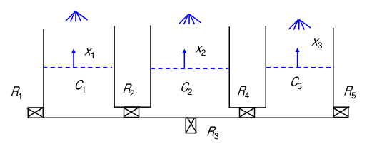
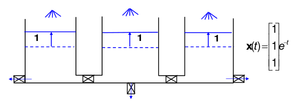
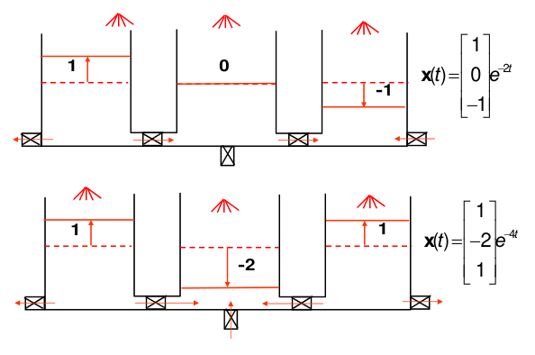
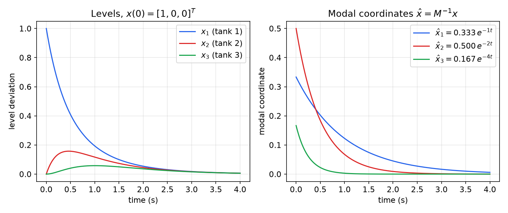
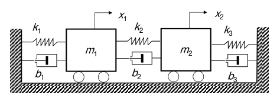
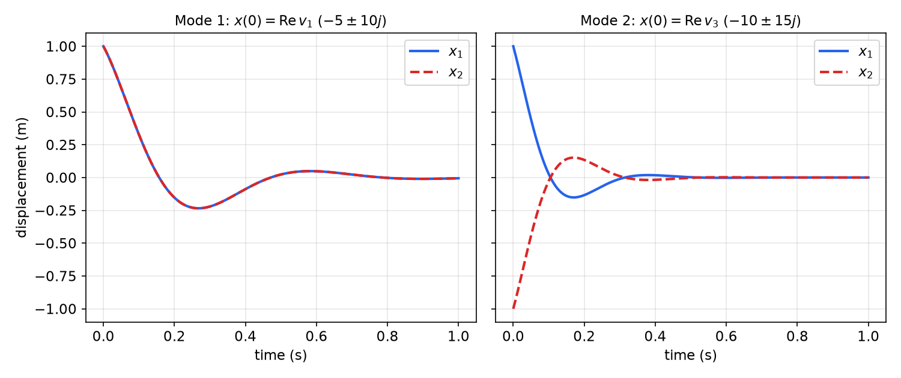
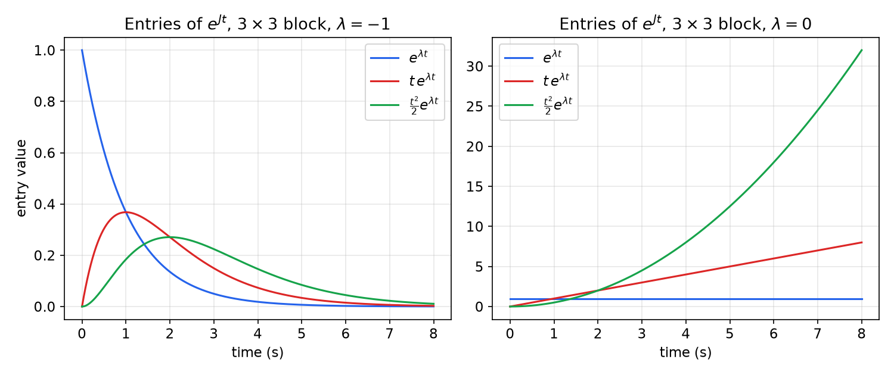
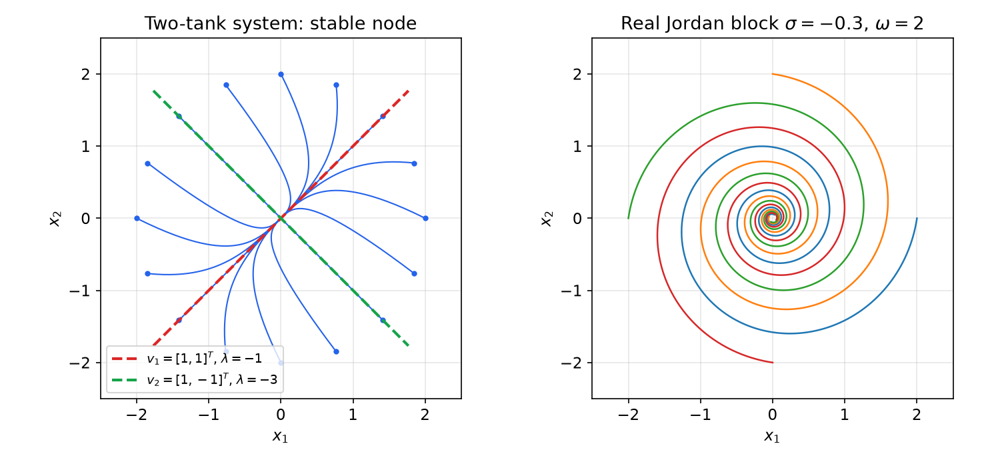

# Modal Decomposition and the Jordan Form

An \\(n\\)-th order system \\(\dot x = Ax\\) couples every state to every other through the off-diagonal entries of \\(A\\). Modal decomposition looks for state coordinates in which that coupling disappears, so the system splits into independent first-order (or small) subsystems called **modes**. When \\(A\\) has a full set of eigenvectors this is diagonalization. When it does not, the best possible result is the **Jordan form**, which is block diagonal with a precise and simple structure. This chapter develops both, gives the real version for matrices with complex eigenvalues, and applies the result to the matrix exponential, the Cayley–Hamilton theorem and the physical interpretation of free responses. These are the tools behind the stability tests of [Stability of Linear Systems](stability.md) and the rank tests of [Controllability](controllability.md).

Modal decomposition is used for:

- decoupling LTI systems into independent modes;
- stability and modal analysis (each mode's eigenvalue sets its decay rate and frequency);
- model reduction (discarding fast or weakly excited modes);
- system design (placing or shaping modes; see [State Feedback](state-feedback.md)).

Background on eigenvalues is in [Eigenvalues and Eigenvectors](../../../math/linear-algebra/eigen.md).

## The Decoupling Problem

Given the LTI system \\(\dot x = Ax + Bu\\), can we find a state transformation \\(\hat x = Tx\\) that turns it into
\\[
\dot{\hat x} = \hat A \hat x + \hat B u, \qquad \hat A = TAT^{-1} = \operatorname{diag}(\lambda\_1, \lambda\_2, \dots, \lambda\_n)\ ?
\\]
In the new coordinates each state obeys its own scalar equation \\(\dot{\hat x}\_i = \lambda\_i \hat x\_i + \hat b\_i u\\), where \\(\hat b\_i\\) is the \\(i\\)-th row of \\(\hat B = TB\\).

**The decoupling transformation.** Write \\(M = T^{-1} = [v\_1\ v\_2\ \cdots\ v\_n]\\), so that \\(x = M\hat x\\) and \\(\hat A = M^{-1}AM\\). Multiplying by \\(M\\) gives \\(AM = M\hat A\\), and column by column
\\[
A\\,[v\_1\ \cdots\ v\_n] = [v\_1\ \cdots\ v\_n]\operatorname{diag}(\lambda\_i)
\quad\Longleftrightarrow\quad
[Av\_1\ \cdots\ Av\_n] = [\lambda\_1 v\_1\ \cdots\ \lambda\_n v\_n].
\\]
So the columns of \\(M\\) must satisfy the **eigenvalue problem**
\\[
\boxed{A v = \lambda v ,}
\\]
and \\(M\\) must be invertible. Diagonalization is possible exactly when \\(A\\) has \\(n\\) linearly independent eigenvectors. \\(M\\) is called the **modal matrix**.

## The Eigenvalue Problem

Rewrite \\(Av = \lambda v\\) as \\((A - \lambda I)v = 0\\). A nonzero solution exists if and only if \\(A - \lambda I\\) is singular, which gives the **characteristic equation**
\\[
\det(\lambda I - A) = \lambda^n + a\_1\lambda^{n-1} + a\_2\lambda^{n-2} + \cdots + a\_{n-1}\lambda + a\_n = 0 .
\\]

**Properties.**

- An \\(n \times n\\) matrix always has \\(n\\) eigenvalues, counted with multiplicity (fundamental theorem of algebra). Some may be repeated and some may be complex.
- For real \\(A\\), complex eigenvalues come in conjugate pairs, and so do their eigenvectors: \\(Av = \lambda v \Rightarrow A\bar v = \bar\lambda \bar v\\).
- \\(A\\) and \\(A^T\\) have the same eigenvalues, because \\(\det(\lambda I - A) = \det(\lambda I - A)^T = \det(\lambda I - A^T)\\).
- Similar matrices have the same eigenvalues: if \\(\hat A = TAT^{-1}\\), then \\(\det(\lambda I - \hat A) = \det(T(\lambda I - A)T^{-1}) = \det(\lambda I - A)\\), and the eigenvectors transform as \\(\hat v = Tv\\).
- \\(\det A = \prod\_i \lambda\_i\\) and \\(\operatorname{tr}A = \sum\_i \lambda\_i\\). If \\(A\\) is invertible, \\(A^{-1}\\) has eigenvalues \\(1/\lambda\_i\\) with the same eigenvectors, and \\(A^k\\) has eigenvalues \\(\lambda\_i^k\\).
- The eigenvectors of \\(A^T\\) are the **left eigenvectors** of \\(A\\) (\\(w^T A = \lambda w^T\\)). If \\(M^{-1}AM = \Lambda\\), transposing gives \\(M^T A^T M^{-T} = \Lambda\\), so the rows of \\(M^{-1}\\) are left eigenvectors of \\(A\\).

**Theorem (Hermitian matrices).** If \\(A = A^\*\\) (real symmetric, in the real case), then all eigenvalues of \\(A\\) are real, and eigenvectors belonging to distinct eigenvalues are orthogonal.

*Proof.* Let \\(Av = \lambda v\\) with \\(v \neq 0\\). Then \\(v^\* A v = \lambda \lVert v\rVert^2\\). Taking the conjugate transpose of this scalar gives \\(v^\* A^\* v = \bar\lambda\lVert v\rVert^2\\). But \\(A^\* = A\\), so the left-hand sides are equal and \\(\lambda = \bar\lambda\\). For orthogonality, let \\(Av\_1 = \lambda\_1 v\_1\\) and \\(Av\_2 = \lambda\_2 v\_2\\) with \\(\lambda\_1 \neq \lambda\_2\\), both real. Then \\(\lambda\_2 v\_1^\* v\_2 = v\_1^\* A v\_2 = (Av\_1)^\* v\_2 = \lambda\_1 v\_1^\* v\_2\\), so \\((\lambda\_2 - \lambda\_1)v\_1^\* v\_2 = 0\\) and \\(v\_1^\* v\_2 = 0\\). \\(\square\\)

A symmetric matrix is in fact always diagonalizable by an orthogonal (unitary) modal matrix, \\(M^{-1} = M^T\\), even when it has repeated eigenvalues. This is the spectral theorem.

**Eigenvectors.** The eigenvectors for \\(\lambda\_i\\) span the **eigenspace** \\(\mathcal{N}(\lambda\_i I - A)\\). Two cases arise:

- **Case 1 (distinct eigenvalues):** there are \\(n\\) linearly independent eigenvectors, and \\(A\\) is diagonalizable.
- **Case 2 (repeated eigenvalues):** there may be fewer than \\(n\\) independent eigenvectors.

*Why distinct eigenvalues give independent eigenvectors.* Suppose \\(v\_1, \dots, v\_k\\) (with distinct \\(\lambda\_i\\)) were dependent, and take a shortest nontrivial relation \\(\sum\_{i=1}^{k} c\_i v\_i = 0\\). Applying \\(A - \lambda\_k I\\) gives \\(\sum\_{i<k} c\_i(\lambda\_i - \lambda\_k)v\_i = 0\\). This is a shorter relation, and it is nontrivial because the \\(\lambda\_i - \lambda\_k\\) are nonzero. That contradicts minimality.

## Case 1: Distinct Eigenvalues

With \\(\lambda\_1, \dots, \lambda\_n\\) distinct, the modal matrix \\(M = T^{-1} = [v\_1\ \cdots\ v\_n]\\) is invertible, and the system decouples into
\\[
\dot{\hat x}\_i = \lambda\_i \hat x\_i + \hat b\_i u, \qquad i = 1, \dots, n .
\\]

**Physical interpretation of modes.** If the initial state lies along an eigenvector \\(v\_i\\), the free response stays along \\(v\_i\\) for all time.

*Proof.* Since \\(x = M\hat x\\), \\(x(0) = \alpha v\_i\\) if and only if \\(\hat x\_i(0) = \alpha\\) and \\(\hat x\_j(0) = 0\\) for \\(j \neq i\\). With \\(u = 0\\) the decoupled equations keep \\(\hat x\_j \equiv 0\\) and give \\(\hat x\_i(t) = \alpha e^{\lambda\_i t}\\). Therefore \\(x(t) = \alpha e^{\lambda\_i t} v\_i\\). \\(\square\\)

The eigenvector is the **mode shape**, the fixed pattern in which the states move together. The eigenvalue is the mode's rate (and, if complex, its frequency). A general initial condition is a superposition of modes, \\(x(0) = \sum\_i \hat x\_i(0) v\_i\\) with \\(\hat x(0) = M^{-1}x(0)\\), so
\\[
x(t) = \sum\_{i=1}^{n} \hat x\_i(0)\\,e^{\lambda\_i t} v\_i .
\\]

### Example: the three-tank system



*Figure: three tanks with capacitances \\(C\_1, C\_2, C\_3\\) and level deviations \\(x\_1, x\_2, x\_3\\) from equilibrium. Valves \\(R\_1\\) and \\(R\_5\\) drain the outer tanks, \\(R\_3\\) drains the connecting pipe, and \\(R\_2\\), \\(R\_4\\) connect neighbouring tanks.*

**Example 1 (three-tank modes).** With all \\(R\_i = C\_j = 1\\) (in consistent units), conservation of volume at each tank gives
\\[
\frac{d}{dt}\begin{bmatrix} x\_1 \\\\ x\_2 \\\\ x\_3 \end{bmatrix} =
\begin{bmatrix} -2 & 1 & 0 \\\\ 1 & -3 & 1 \\\\ 0 & 1 & -2 \end{bmatrix}
\begin{bmatrix} x\_1 \\\\ x\_2 \\\\ x\_3 \end{bmatrix}.
\\]
Find the eigenvalues and mode shapes, and interpret them.

*Eigenvalues.* Expanding along the first row,
\\[
\lvert\lambda I - A\rvert = \begin{vmatrix} \lambda + 2 & -1 & 0 \\\\ -1 & \lambda + 3 & -1 \\\\ 0 & -1 & \lambda + 2 \end{vmatrix}
= (\lambda + 2)\left[(\lambda + 3)(\lambda + 2) - 1\right] - (\lambda + 2)
= (\lambda + 2)(\lambda^2 + 5\lambda + 4),
\\]
so \\(\lvert\lambda I - A\rvert = (\lambda + 1)(\lambda + 2)(\lambda + 4)\\) and \\(\lambda\_1 = -1\\), \\(\lambda\_2 = -2\\), \\(\lambda\_3 = -4\\).

*First eigenvector.*
\\[
(\lambda\_1 I - A)v\_1 = \begin{bmatrix} 1 & -1 & 0 \\\\ -1 & 2 & -1 \\\\ 0 & -1 & 1 \end{bmatrix} v\_1 = 0
\quad\Rightarrow\quad v\_{11} = v\_{12} = v\_{13}
\quad\Rightarrow\quad v\_1 \in \operatorname{span}\\{[1, 1, 1]^T\\}.
\\]
If at \\(t = 0\\) all three levels are raised by 1 (\\(x = v\_1\\), so \\(\hat x\_1 = 1\\) and \\(\hat x\_2 = \hat x\_3 = 0\\)), then \\(x(t) = v\_1 e^{-t}\\). The levels stay equal, no liquid flows through \\(R\_2\\) or \\(R\_4\\), and each tank drains only through the outlets. This is the slowest mode.



*Figure: mode 1, \\(x(t) = [1, 1, 1]^T e^{-t}\\). Equal levels mean no flow between tanks. Liquid leaves only through the outlet valves (arrows).*

*Other eigenvectors.* Solving \\((\lambda\_2 I - A)v\_2 = 0\\) and \\((\lambda\_3 I - A)v\_3 = 0\\) in the same way gives
\\[
v\_2 \in \operatorname{span}\\{[1, 0, -1]^T\\}, \qquad v\_3 \in \operatorname{span}\\{[1, -2, 1]^T\\}.
\\]
Mode 2 is an antisymmetric slosh: tank 1 is up, tank 3 is down by the same amount, and tank 2 stays at equilibrium. It decays as \\(e^{-2t}\\). Mode 3 has the outer tanks up and the middle tank down twice as far. Every interconnecting valve now carries flow, so it is the fastest mode, \\(e^{-4t}\\).



*Figure: mode 2 (top), \\(x(t) = [1, 0, -1]^T e^{-2t}\\), and mode 3 (bottom), \\(x(t) = [1, -2, 1]^T e^{-4t}\\). Arrows show the flows at each valve. The more the neighbouring levels differ, the more paths carry flow and the faster the mode decays.*

Because \\(A\\) is symmetric, the three eigenvectors are mutually orthogonal (check: \\([1,1,1]\cdot[1,0,-1] = 0\\), \\([1,1,1]\cdot[1,-2,1] = 0\\), \\([1,0,-1]\cdot[1,-2,1] = 0\\)), as the theorem above requires. MATLAB returns the normalized versions:

```matlab
A = [-2 1 0; 1 -3 1; 0 1 -2];
[V, D] = eig(A)
% V =  0.5774  -0.7071  -0.4082
%      0.5774   0.0000   0.8165
%      0.5774   0.7071  -0.4082
% D = diag(-1, -2, -4)
```

The columns are \\([1,1,1]^T/\sqrt3\\), \\(-[1,0,-1]^T/\sqrt2\\) and \\(-[1,-2,1]^T/\sqrt6\\). Eigenvectors are defined only up to scale (and sign).

*A superposition.* Suppose only tank 1 is raised, \\(x(0) = [1, 0, 0]^T\\). Solving \\(M\hat x(0) = x(0)\\) with \\(M = [v\_1\ v\_2\ v\_3]\\) gives \\(\hat x(0) = [\tfrac13, \tfrac12, \tfrac16]^T\\), so
\\[
x(t) = \tfrac13 e^{-t}\begin{bmatrix} 1 \\\\ 1 \\\\ 1 \end{bmatrix} + \tfrac12 e^{-2t}\begin{bmatrix} 1 \\\\ 0 \\\\ -1 \end{bmatrix} + \tfrac16 e^{-4t}\begin{bmatrix} 1 \\\\ -2 \\\\ 1 \end{bmatrix}.
\\]
At \\(t = 0\\) the three contributions cancel in tanks 2 and 3. As time passes the fast modes die out and the levels approach the equal-level shape of mode 1.



*Figure: free response of the three-tank system from \\(x(0) = [1, 0, 0]^T\\). Left: the tank levels interact (tanks 2 and 3 first rise, then fall). Right: in modal coordinates each component is a single decaying exponential. After about 1 s only the slow mode \\(e^{-t}\\) remains, and all three levels are nearly equal.*

**Example 2 (tanks with no outlets).** Remove the outlets \\(R\_1, R\_3, R\_5\\) and keep only the interconnecting valves \\(R\_2, R\_4\\) (all \\(R = C = 1\\)). Then
\\[
A = \begin{bmatrix} -1 & 1 & 0 \\\\ 1 & -2 & 1 \\\\ 0 & 1 & -1 \end{bmatrix},\qquad \lvert\lambda I - A\rvert = \lambda(\lambda + 1)(\lambda + 3),
\\]
with eigenvalues \\(0, -1, -3\\) and the same mode shapes \\([1,1,1]^T\\), \\([1,0,-1]^T\\), \\([1,-2,1]^T\\). The zero eigenvalue with eigenvector \\([1,1,1]^T\\) expresses conservation of the total liquid. With nowhere to drain, an equal rise in all tanks simply persists.

## Case 2: Repeated Eigenvalues

In general
\\[
\lvert\lambda I - A\rvert = (\lambda - \lambda\_1)^{m\_1}(\lambda - \lambda\_2)^{m\_2}\cdots(\lambda - \lambda\_k)^{m\_k},\qquad m\_1 + \cdots + m\_k = n,
\\]
where \\(k\\) is the number of distinct eigenvalues and \\(m\_i\\) is the **algebraic multiplicity** of \\(\lambda\_i\\). The **geometric multiplicity** is the number of independent eigenvectors,
\\[
g\_i = \dim\mathcal{N}(\lambda\_i I - A) = n - \operatorname{rank}(\lambda\_i I - A), \qquad 1 \le g\_i \le m\_i .
\\]

- **Case 2a:** \\(g\_i = m\_i\\) for all \\(i\\). Then \\(A\\) has \\(n\\) independent eigenvectors and can be diagonalized. A symmetric matrix always falls in this case, with mutually orthogonal eigenvectors.
- **Case 2b:** \\(g\_i < m\_i\\) for some \\(i\\). Then \\(A\\) is **defective** (has an eigenvector deficiency) and cannot be diagonalized.

### A diagonalizable matrix with a repeated eigenvalue

**Example 3 (symmetric, repeated eigenvalue).**
\\[
A = \begin{bmatrix} 7 & 4 & -4 \\\\ 4 & -8 & -1 \\\\ -4 & -1 & -8 \end{bmatrix},\qquad
\lvert\lambda I - A\rvert = \begin{vmatrix} \lambda - 7 & -4 & 4 \\\\ -4 & \lambda + 8 & 1 \\\\ 4 & 1 & \lambda + 8 \end{vmatrix} = (\lambda - 9)(\lambda + 9)^2 .
\\]
So \\(\lambda\_1 = 9\\) with \\(m\_1 = 1\\), and \\(\lambda\_2 = -9\\) with \\(m\_2 = 2\\).

*For \\(\lambda\_1 = 9\\):*
\\[
(\lambda\_1 I - A)v\_1 = \begin{bmatrix} 2 & -4 & 4 \\\\ -4 & 17 & 1 \\\\ 4 & 1 & 17 \end{bmatrix} v\_1 = 0 .
\\]
Gaussian elimination and normalization give \\(v\_1 = \frac{1}{3\sqrt2}[4, 1, -1]^T\\). (Check the first row: \\(8 - 4 - 4 = 0\\).)

*For \\(\lambda\_2 = -9\\):*
\\[
(\lambda\_2 I - A)v = \begin{bmatrix} -16 & -4 & 4 \\\\ -4 & -1 & 1 \\\\ 4 & 1 & -1 \end{bmatrix} v = 0
\ \rightarrow\
\begin{bmatrix} -16 & -4 & 4 \\\\ 0 & 0 & 0 \\\\ 0 & 0 & 0 \end{bmatrix} v = 0 .
\\]
The rank is 1, so \\(g\_2 = 3 - 1 = 2 = m\_2\\). The eigenspace is the plane \\(-4v\_1 - v\_2 + v\_3 = 0\\), and any two independent vectors in it will do. Choose \\(v\_2 = \frac{1}{\sqrt2}[0, 1, 1]^T\\). To keep the modal matrix orthogonal, choose \\(v\_3\\) in the plane and orthogonal to \\(v\_2\\): \\(-4v\_{31} - v\_{32} + v\_{33} = 0\\) and \\(v\_{32} + v\_{33} = 0\\) give \\(v\_3 = \frac13[1, -2, 2]^T\\). Then
\\[
M = \begin{bmatrix} 2\sqrt2/3 & 0 & 1/3 \\\\ \sqrt2/6 & \sqrt2/2 & -2/3 \\\\ -\sqrt2/6 & \sqrt2/2 & 2/3 \end{bmatrix},\qquad M^T M = I,\qquad M^{-1}AM = M^T A M = \operatorname{diag}(9, -9, -9).
\\]
The modal matrix is not unique: any orthonormal basis of the \\(-9\\) eigenspace works. MATLAB picks a different one:

```matlab
A = [7 4 -4; 4 -8 -1; -4 -1 -8];
[V, D] = eig(A)
% V = -0.2268   0.2443  -0.9428
%      0.9718  -0.0075  -0.2357
%      0.0646   0.9697   0.2357
% D = diag(-9, -9, 9)
```

**Example 4 (non-symmetric but diagonalizable).** \\(A\_2 = \begin{bmatrix} 1 & -3 & 3 \\\\ 3 & -5 & 3 \\\\ 3 & -3 & 1 \end{bmatrix}\\) has \\(\lvert\lambda I - A\_2\rvert = (\lambda - 1)(\lambda + 2)^2\\). For \\(\lambda = 1\\) the eigenvector is \\([1,1,1]^T\\). For \\(\lambda = -2\\), every row of \\(A\_2 + 2I\\) equals \\([3, -3, 3]\\), so the rank is 1 and \\(g = 2 = m\\). Two eigenvectors are \\([1,1,0]^T\\) and \\([0,1,1]^T\\) (any vectors with \\(x\_1 - x\_2 + x\_3 = 0\\)). Similarly,
\\[
\begin{bmatrix} 7 & 4 & -1 \\\\ 4 & 7 & -1 \\\\ -4 & -4 & 4 \end{bmatrix}\ \text{has}\ (\lambda - 12)(\lambda - 3)^2,\qquad
\begin{bmatrix} 1 & 3 & 3 \\\\ 3 & 1 & 3 \\\\ -3 & -3 & -5 \end{bmatrix}\ \text{has}\ (\lambda - 1)(\lambda + 2)^2,
\\]
and in both cases \\(A - \lambda I\\) has rank 1 at the repeated eigenvalue, so both are diagonalizable. The lesson: **a repeated eigenvalue does not by itself imply a Jordan block. Check \\(\operatorname{rank}(A - \lambda I)\\).**

## Defective Matrices and Generalized Eigenvectors

**Example 5 (a defective matrix).**
\\[
A = \begin{bmatrix} 1 & 1 & 1 \\\\ 0 & 1 & 1 \\\\ 0 & 0 & 1 \end{bmatrix},\qquad \lvert\lambda I - A\rvert = (\lambda - 1)^3 .
\\]
So \\(\lambda\_1 = 1\\) with \\(m\_1 = 3\\). Since \\(\operatorname{rank}(\lambda\_1 I - A) = 2\\), \\(g\_1 = 3 - 2 = 1 < m\_1\\). \\(A\\) has only one eigenvector and cannot be diagonalized.

**The key property.** Look at the powers of \\(A - \lambda\_1 I\\):
\\[
A - \lambda\_1 I = \begin{bmatrix} 0 & 1 & 1 \\\\ 0 & 0 & 1 \\\\ 0 & 0 & 0 \end{bmatrix},\quad
(A - \lambda\_1 I)^2 = \begin{bmatrix} 0 & 0 & 1 \\\\ 0 & 0 & 0 \\\\ 0 & 0 & 0 \end{bmatrix},\quad
(A - \lambda\_1 I)^3 = 0 .
\\]
The ranks are 2, 1, 0, so the null spaces have dimensions 1, 2, 3. They grow with the power until they fill the whole \\(m\_1\\)-dimensional **generalized eigenspace**. The missing directions are found in the null spaces of the higher powers.

**Generalized eigenvectors.** The eigenvector solves \\((A - \lambda\_1 I)v\_1 = 0\\), giving \\(v\_1 = [1, 0, 0]^T\\). The generalized eigenvectors \\(v\_2\\) and \\(v\_3\\) come from the null spaces of \\((A - \lambda\_1 I)^2\\) and \\((A - \lambda\_1 I)^3\\):

- \\(v\_2\\): \\((A - \lambda\_1 I)^2 v\_2 = 0\\) but \\((A - \lambda\_1 I)v\_2 \neq 0\\);
- \\(v\_3\\): \\((A - \lambda\_1 I)^3 v\_3 = 0\\) but \\((A - \lambda\_1 I)^2 v\_3 \neq 0\\).

It is most convenient to link them in a **chain**:
\\[
(A - \lambda\_1 I)v\_2 = v\_1, \qquad (A - \lambda\_1 I)v\_3 = v\_2 .
\\]
Applying \\((A - \lambda\_1 I)\\) repeatedly walks down the chain, \\(v\_3 \mapsto v\_2 \mapsto v\_1 \mapsto 0\\), so these vectors automatically satisfy the null-space conditions above. For this \\(A\\):

- \\((A - I)v\_2 = v\_1\\) means \\(v\_{22} + v\_{23} = 1\\) and \\(v\_{23} = 0\\). This gives \\(v\_2 = [0, 1, 0]^T\\) (the first entry is free; taking it as zero is a choice).
- \\((A - I)v\_3 = v\_2\\) means \\(v\_{32} + v\_{33} = 0\\) and \\(v\_{33} = 1\\). This gives \\(v\_3 = [0, -1, 1]^T\\).

**The Jordan form appears.** Rewrite the chain equations:
\\[
\begin{cases} (A - \lambda\_1 I)v\_1 = 0 \\\\ (A - \lambda\_1 I)v\_2 = v\_1 \\\\ (A - \lambda\_1 I)v\_3 = v\_2 \end{cases}
\Rightarrow
\begin{cases} Av\_1 = \lambda\_1 v\_1 \\\\ Av\_2 = v\_1 + \lambda\_1 v\_2 \\\\ Av\_3 = v\_2 + \lambda\_1 v\_3 \end{cases}
\Rightarrow
A\underbrace{[v\_1\ v\_2\ v\_3]}\_{M} = \underbrace{[v\_1\ v\_2\ v\_3]}\_{M}\underbrace{\begin{bmatrix} \lambda\_1 & 1 & 0 \\\\ 0 & \lambda\_1 & 1 \\\\ 0 & 0 & \lambda\_1 \end{bmatrix}}\_{J}.
\\]
So \\(M^{-1}AM = J\\). Here
\\[
M = \begin{bmatrix} 1 & 0 & 0 \\\\ 0 & 1 & -1 \\\\ 0 & 0 & 1 \end{bmatrix},\qquad J = \begin{bmatrix} 1 & 1 & 0 \\\\ 0 & 1 & 1 \\\\ 0 & 0 & 1 \end{bmatrix}.
\\]
Each 1 on the superdiagonal records that the corresponding column is mapped by \\(A - \lambda I\\) onto the column before it.

**Example 6 (shifted eigenvalue).** For \\(A = \begin{bmatrix} 2 & 1 & 1 \\\\ 0 & 2 & 1 \\\\ 0 & 0 & 2 \end{bmatrix}\\), \\(A - 2I\\) is the same nilpotent matrix as above, so the same chain \\(v\_1 = [1,0,0]^T\\), \\(v\_2 = [0,1,0]^T\\), \\(v\_3 = [0,-1,1]^T\\) gives \\(J = \begin{bmatrix} 2 & 1 & 0 \\\\ 0 & 2 & 1 \\\\ 0 & 0 & 2 \end{bmatrix}\\). Once you know the triple eigenvalue and that \\(g\_1 = 1\\), you can write down the Jordan form without computing anything else: one eigenvector means one block, so there are two 1's on the superdiagonal. The vectors are needed only for \\(M\\).

**The generalized modal matrix.** Given \\(A\\) with eigenvalues \\(\lambda\_i\\) and multiplicities \\(m\_i\\) and \\(g\_i\\), for each \\(i = 1, \dots, k\\):

1. find \\(g\_i\\) independent eigenvectors of \\(\lambda\_i\\). Each one heads a chain, so \\(\lambda\_i\\) has \\(g\_i\\) Jordan blocks;
2. extend the chains with generalized eigenvectors, \\((A - \lambda\_i I)v^{j+1} = v^{j}\\), until the chain lengths add up to \\(m\_i\\). Each chain must start from an eigenvector that lies in the range of \\(A - \lambda\_i I\\), otherwise the next equation has no solution, so in practice the eigenvector at the head of a long chain has to be chosen with care;
3. form \\(M = [v\_1^1\ \cdots\ v\_1^{m\_1}\ \cdots\ v\_k^1\ \cdots\ v\_k^{m\_k}]\\), keeping each chain's vectors together in order.

**Counting the blocks.** The block sizes follow from ranks alone. For eigenvalue \\(\lambda\\) of an \\(n \times n\\) matrix,
\\[
\\#\\{\text{blocks}\\} = n - \operatorname{rank}(A - \lambda I),\qquad
\\#\\{\text{blocks of size} \ge k\\} = \operatorname{rank}(A - \lambda I)^{k-1} - \operatorname{rank}(A - \lambda I)^{k} .
\\]
In Example 5 the ranks 3, 2, 1, 0 (for powers 0 to 3) give one block of size \\(\ge 1\\), one of size \\(\ge 2\\) and one of size \\(\ge 3\\): a single \\(3 \times 3\\) block.

**Example 7 (a \\(4 \times 4\\) matrix with two blocks for one eigenvalue).**
\\[
A = \begin{bmatrix} 4 & -3 & 4 & -4 \\\\ 1 & 0 & 2 & -2 \\\\ 1 & -1 & 3 & -2 \\\\ 2 & -2 & 3 & -2 \end{bmatrix},\qquad \lvert\lambda I - A\rvert = (\lambda - 1)^3(\lambda - 2).
\\]
For \\(\lambda = 1\\),
\\[
A - I = \begin{bmatrix} 3 & -3 & 4 & -4 \\\\ 1 & -1 & 2 & -2 \\\\ 1 & -1 & 2 & -2 \\\\ 2 & -2 & 3 & -3 \end{bmatrix}
\xrightarrow{\text{rref}}
\begin{bmatrix} 1 & -1 & 0 & 0 \\\\ 0 & 0 & 1 & -1 \\\\ 0 & 0 & 0 & 0 \\\\ 0 & 0 & 0 & 0 \end{bmatrix},
\\]
which has rank 2. So \\(g = 4 - 2 = 2\\) while \\(m = 3\\): two Jordan blocks, of sizes 2 and 1, and one generalized eigenvector. The eigenspace is spanned by \\([1,1,0,0]^T\\) and \\([0,0,1,1]^T\\). One valid modal matrix, with columns \\(v\_1\\), a generalized vector \\(v\_1'\\) with \\((A - I)v\_1' = v\_1\\), a second eigenvector \\(v\_2\\), and the eigenvector of \\(\lambda = 2\\), is
\\[
M = \begin{bmatrix} 1 & -1 & 1 & 2 \\\\ 1 & 0 & 1 & 0 \\\\ 1 & 1 & 0 & 0 \\\\ 1 & 0 & 0 & 1 \end{bmatrix},\qquad
J = M^{-1}AM = \begin{bmatrix} 1 & 1 & 0 & 0 \\\\ 0 & 1 & 0 & 0 \\\\ 0 & 0 & 1 & 0 \\\\ 0 & 0 & 0 & 2 \end{bmatrix}.
\\]
Here the head of the chain is \\(v\_1 = [1,1,1,1]^T\\), the sum of the two basis eigenvectors. Neither basis vector alone lies in \\(\mathcal{R}(A - I)\\), which is the subtlety mentioned in step 2.

## The Jordan Decomposition Theorem

**Theorem (Jordan decomposition).** Let \\(A\\) be a real \\(n \times n\\) matrix with eigenvalues \\(\lambda\_i\\) of algebraic multiplicity \\(m\_i\\), \\(i = 1, \dots, k\\). There exists an invertible (in general complex) \\(n \times n\\) matrix \\(M\\) such that
\\[
M^{-1}AM = J = \begin{bmatrix} J\_1 & & 0 \\\\ & \ddots & \\\\ 0 & & J\_k \end{bmatrix},\qquad
J\_i = \begin{bmatrix} \lambda\_i & \gamma\_i^1 & & 0 \\\\ & \lambda\_i & \gamma\_i^2 & \\\\ & & \ddots & \gamma\_i^{m\_i - 1} \\\\ 0 & & & \lambda\_i \end{bmatrix},
\\]
where each \\(J\_i\\) is \\(m\_i \times m\_i\\) and each superdiagonal element \\(\gamma\_i^j\\) is 1 or 0.

A zero \\(\gamma\_i^j\\) splits \\(J\_i\\) into smaller **elementary Jordan blocks** (a single \\(\lambda\\) on the diagonal and 1's directly above it). The theorem is often stated in terms of these, and the decomposition into elementary blocks is unique up to their order.

**Comments.**

- A defective matrix can only be block-diagonalized, never diagonalized.
- The columns of the modal matrix are regular and generalized eigenvectors.
- The algebraic multiplicity \\(m\_i\\) sets the size of \\(J\_i\\).
- The number of superdiagonal 1's in \\(J\_i\\) equals the number of generalized eigenvectors for \\(\lambda\_i\\), which is \\(m\_i - g\_i\\). The number of elementary blocks inside \\(J\_i\\) is \\(g\_i\\).
- A diagonalizable matrix is the special case where all \\(\gamma\_i^j = 0\\).

**Example 8 (Jordan forms from multiplicities).** Let \\(n = 5\\), \\(m\_1 = 1\\), \\(m\_2 = 4\\), \\(g\_2 = 2\\). Then \\(\lambda\_2\\) has two elementary blocks whose sizes add to 4, and there are \\(4 - 2 = 2\\) superdiagonal 1's. One possibility is blocks of sizes 1 and 3:
\\[
J = \begin{bmatrix} \lambda\_1 & 0 & 0 & 0 & 0 \\\\ 0 & \lambda\_2 & 0 & 0 & 0 \\\\ 0 & 0 & \lambda\_2 & 1 & 0 \\\\ 0 & 0 & 0 & \lambda\_2 & 1 \\\\ 0 & 0 & 0 & 0 & \lambda\_2 \end{bmatrix}.
\\]
Sizes 2 and 2 also give \\(g\_2 = 2\\) (with the 1's in positions (2,3) and (4,5)), so the multiplicities alone do not fix the form. Deciding between them needs \\(\operatorname{rank}(A - \lambda\_2 I)^2\\): it is 2 for sizes 1 + 3 and 1 for sizes 2 + 2. For the other values of \\(g\_2\\): \\(g\_2 = 1\\) gives a single \\(4 \times 4\\) block (three 1's), \\(g\_2 = 3\\) gives sizes 2 + 1 + 1 (one 1), and \\(g\_2 = 4\\) gives a diagonal matrix.

With \\(n = 4\\), \\(m\_1 = 1\\), \\(m\_2 = 3\\) and \\(g\_2 = 2\\), the only option is block sizes 2 and 1:
\\[
J = \begin{bmatrix} \lambda\_1 & 0 & 0 & 0 \\\\ 0 & \lambda\_2 & 0 & 0 \\\\ 0 & 0 & \lambda\_2 & 1 \\\\ 0 & 0 & 0 & \lambda\_2 \end{bmatrix}.
\\]

**A numerical caution.** The Jordan form is a discontinuous function of the matrix entries. An arbitrarily small perturbation can split a repeated eigenvalue into distinct ones and make a defective matrix diagonalizable, with a nearly singular modal matrix. Numerical software therefore does not compute Jordan forms in floating point. MATLAB's `jordan` requires the Symbolic Math Toolbox and exact arithmetic. Case (c) of the mass–spring–damper example below shows this.

## Complex Eigenvalues and the Real Jordan Form

For a real matrix with complex eigenvalues, the modal matrix and the Jordan form above are complex. Complex state variables are inconvenient for simulation and physical interpretation, so we change the basis inside each conjugate pair. The result is a real Jordan form. **It is not diagonal**: each complex pair becomes a \\(2 \times 2\\) real block.

**Real modal matrix.** Let \\(\lambda\_{i,i+1} = \sigma\_i \pm j\omega\_i\\) with eigenvectors \\(v\_{i,i+1} = u\_i \pm jz\_i\\). Replace the pair of complex columns by their real and imaginary parts:
\\[
M^{\text{complex}} = [\cdots\ v\_i\ \ v\_{i+1}\ \cdots] \quad\Longleftrightarrow\quad M^{\text{real}} = [\cdots\ u\_i\ \ z\_i\ \cdots].
\\]
Since \\(u\_i = (v\_i + \bar v\_i)/2\\) and \\(z\_i = (v\_i - \bar v\_i)/(2j)\\), this is an invertible change of basis within the span of the pair.

**Real Jordan block.** Separate \\(Av\_i = \lambda\_i v\_i\\) into real and imaginary parts:
\\[
Au\_i + jAz\_i = (\sigma\_i + j\omega\_i)(u\_i + jz\_i) = (\sigma\_i u\_i - \omega\_i z\_i) + j(\omega\_i u\_i + \sigma\_i z\_i),
\\]
so \\(Au\_i = \sigma\_i u\_i - \omega\_i z\_i\\) and \\(Az\_i = \omega\_i u\_i + \sigma\_i z\_i\\), that is
\\[
A\\,[u\_i\ \ z\_i] = [u\_i\ \ z\_i]\begin{bmatrix} \sigma\_i & \omega\_i \\\\ -\omega\_i & \sigma\_i \end{bmatrix}.
\\]
(Using \\(-z\_i\\) in place of \\(z\_i\\) flips the signs of the off-diagonal entries. Both conventions appear in software output.)

**Theorem (real Jordan decomposition).** Let \\(A\\) be a real \\(n \times n\\) matrix with eigenvalues \\(\lambda\_i\\) of multiplicity \\(m\_i\\). There exists an invertible **real** matrix \\(M\\) such that \\(M^{-1}AM = \operatorname{blockdiag}(J\_1, \dots, J\_k)\\), where \\(k\\) now counts real eigenvalues and complex-conjugate pairs. If \\(\lambda\_i\\) is real, \\(J\_i\\) is as in the Jordan decomposition theorem. If \\(\lambda\_i = \sigma\_i + j\omega\_i\\) is complex, its pair contributes a \\(2m\_i \times 2m\_i\\) block
\\[
J\_i = \begin{bmatrix} \Lambda\_i & \Gamma\_i^1 & & 0 \\\\ & \Lambda\_i & \Gamma\_i^2 & \\\\ & & \ddots & \Gamma\_i^{m\_i - 1} \\\\ 0 & & & \Lambda\_i \end{bmatrix},\qquad
\Lambda\_i = \begin{bmatrix} \sigma\_i & \omega\_i \\\\ -\omega\_i & \sigma\_i \end{bmatrix},\qquad
\Gamma\_i^j = \begin{bmatrix} 1 & 0 \\\\ 0 & 1 \end{bmatrix}\ \text{or}\ \begin{bmatrix} 0 & 0 \\\\ 0 & 0 \end{bmatrix}.
\\]

**Example 9 (companion matrix with a complex pair).** \\(A = \begin{bmatrix} 0 & 1 & 0 \\\\ 0 & 0 & 1 \\\\ -1 & -1 & -9 \end{bmatrix}\\) has characteristic polynomial \\(\lambda^3 + 9\lambda^2 + \lambda + 1\\), with roots \\(\lambda\_{1,2} = -0.0499 \pm 0.3315j\\) and \\(\lambda\_3 = -8.9003\\). With \\(M = [\operatorname{Re}v\_1\ \ \operatorname{Im}v\_1\ \ v\_3]\\),
\\[
J = M^{-1}AM = \begin{bmatrix} -0.0499 & 0.3315 & 0 \\\\ -0.3315 & -0.0499 & 0 \\\\ 0 & 0 & -8.9003 \end{bmatrix}.
\\]
The system has a slow, lightly damped oscillation and a fast real decay.

## Physical Example: A Two-Degree-of-Freedom Mass–Spring–Damper



*Figure: two unit masses on rollers. Wall–\\(m\_1\\): spring \\(k\_1\\), damper \\(b\_1\\). \\(m\_1\\)–\\(m\_2\\): \\(k\_2\\), \\(b\_2\\). \\(m\_2\\)–wall: \\(k\_3\\), \\(b\_3\\). The displacements \\(x\_1\\), \\(x\_2\\) are measured to the right.*

With \\(m\_1 = m\_2 = 1\\), Newton's law gives \\(\ddot x\_1 = -k\_1x\_1 - b\_1\dot x\_1 + k\_2(x\_2 - x\_1) + b\_2(\dot x\_2 - \dot x\_1)\\) and \\(\ddot x\_2 = -k\_2(x\_2 - x\_1) - b\_2(\dot x\_2 - \dot x\_1) - k\_3x\_2 - b\_3\dot x\_2\\). With \\(x\_3 = \dot x\_1\\) and \\(x\_4 = \dot x\_2\\),
\\[
\dot x = \begin{bmatrix} 0 & 0 & 1 & 0 \\\\ 0 & 0 & 0 & 1 \\\\ -(k\_1 + k\_2) & k\_2 & -(b\_1 + b\_2) & b\_2 \\\\ k\_2 & -(k\_2 + k\_3) & b\_2 & -(b\_2 + b\_3) \end{bmatrix} x .
\\]
The characteristic polynomial is \\(\lvert\lambda I - A\rvert = \sum\_{i=0}^{4} a\_i\lambda^{4-i}\\) with
\\[
\begin{aligned}
a\_0 &= 1, \qquad a\_1 = b\_1 + 2b\_2 + b\_3, \qquad a\_2 = k\_1 + 2k\_2 + k\_3 + b\_1b\_2 + b\_1b\_3 + b\_2b\_3,\\\\
a\_3 &= k\_1b\_2 + k\_1b\_3 + k\_2b\_1 + k\_2b\_3 + k\_3b\_1 + k\_3b\_2, \qquad a\_4 = k\_1k\_2 + k\_1k\_3 + k\_2k\_3 .
\end{aligned}
\\]
Four parameter sets produce four different Jordan structures:

| Case | \\(k\_1, k\_2, k\_3\\) | \\(b\_1, b\_2, b\_3\\) | Eigenvalues | Structure |
|---|---|---|---|---|
| (a) | 125, 100, 125 | 10, 5, 10 | \\(-5 \pm 10j\\), \\(-10 \pm 15j\\) | distinct complex pairs |
| (b) | 0, 25, 125 | 5, 5, 5 | \\(-5\\) (double, \\(g = 1\\)), \\(-5 \pm 10j\\) | defective real eigenvalue |
| (c) | 164, 25, 61 (nominal) | 5, 5, 5 | \\(-5 \pm 10j\\) (double, \\(g = 1\\)) | defective complex pair |
| (d) | 75, 50, 50 | 15, 5, 15 | \\(-10\\) (fourfold, \\(g = 1\\)) | single \\(4 \times 4\\) block |

**Case (a): distinct complex pairs.** \\(a\_1 = 30\\), \\(a\_2 = 650\\), \\(a\_3 = 5750\\), \\(a\_4 = 40625\\). (The value \\(a\_3 = 6750\\) that sometimes appears for this case is an arithmetic slip: \\(125\cdot5 + 125\cdot10 + 100\cdot10 + 100\cdot10 + 125\cdot10 + 125\cdot5 = 5750\\).) The polynomial factors as
\\[
\lvert\lambda I - A\rvert = (\lambda^2 + 10\lambda + 125)(\lambda^2 + 20\lambda + 325),\qquad \lambda\_{1,2} = -5 \pm 10j,\quad \lambda\_{3,4} = -10 \pm 15j .
\\]
For the first eigenvector, Gaussian elimination on \\(A - \lambda\_1 I\\) gives
\\[
\begin{bmatrix} 5 - 10j & 0 & 1 & 0 \\\\ 0 & 5 - 10j & 0 & 1 \\\\ -225 & 100 & -10 - 10j & 5 \\\\ 100 & -225 & 5 & -10 - 10j \end{bmatrix} v\_1 = 0
\ \rightarrow\
\begin{bmatrix} 5 - 10j & 0 & 1 & 0 \\\\ 0 & 5 - 10j & 0 & 1 \\\\ 0 & 0 & -1 + 8j & 1 - 8j \\\\ 0 & 0 & 0 & 0 \end{bmatrix} v\_1 = 0 ,
\\]
so \\(v\_{13} = v\_{14}\\), \\(v\_{11} = v\_{12}\\), and the velocity entries are \\(\lambda\_1\\) times the position entries:
\\[
v\_1 = \begin{bmatrix} 1 \\\\ 1 \\\\ -5 + 10j \\\\ -5 + 10j \end{bmatrix},\quad v\_2 = \bar v\_1,\qquad
v\_3 = \begin{bmatrix} 1 \\\\ -1 \\\\ -10 + 15j \\\\ 10 - 15j \end{bmatrix},\quad v\_4 = \bar v\_3 .
\\]
Mode 1 is **in phase**: the masses move together, the middle spring and damper are not deformed, and the mode sees only \\(k\_1 = 125\\) and \\(b\_1 = 10\\), hence \\(\lambda^2 + 10\lambda + 125\\). Mode 2 is **out of phase**: the masses move oppositely, the middle elements are deformed twice as much, and the mode sees \\(k\_1 + 2k\_2 = 325\\) and \\(b\_1 + 2b\_2 = 20\\). It is stiffer and more heavily damped.

With \\(M\_c = [v\_1\ \bar v\_1\ v\_3\ \bar v\_3]\\), the complex Jordan form is \\(J = M\_c^{-1}AM\_c = \operatorname{diag}(-5 + 10j,\ -5 - 10j,\ -10 + 15j,\ -10 - 15j)\\). The real modal matrix is
\\[
M = [\operatorname{Re}v\_1\ \ \operatorname{Im}v\_1\ \ \operatorname{Re}v\_3\ \ \operatorname{Im}v\_3] = \begin{bmatrix} 1 & 0 & 1 & 0 \\\\ 1 & 0 & -1 & 0 \\\\ -5 & 10 & -10 & 15 \\\\ -5 & 10 & 10 & -15 \end{bmatrix},
\qquad
J = M^{-1}AM = \begin{bmatrix} -5 & 10 & 0 & 0 \\\\ -10 & -5 & 0 & 0 \\\\ 0 & 0 & -10 & 15 \\\\ 0 & 0 & -15 & -10 \end{bmatrix}.
\\]
(The second row of \\(M\\) must read \\([1, 0, -1, 0]\\), from \\(v\_3\\). A version with \\(+1\\) in the third column does not reproduce \\(J\\).)



*Figure: case (a) free responses. Left: starting from \\(x(0) = \operatorname{Re}v\_1 = [1, 1, -5, -5]^T\\), the two masses move identically (the curves overlap) and oscillate at 10 rad/s with decay rate 5. Right: starting from \\(\operatorname{Re}v\_3 = [1, -1, -10, 10]^T\\), they move as mirror images, faster (15 rad/s) and decaying faster (rate 10). A real initial state in the plane of one complex mode stays in that plane.*

In MATLAB:

```matlab
k1=125; k2=100; k3=125; b1=10; b2=5; b3=10;
A = [0 0 1 0; 0 0 0 1; -(k1+k2) k2 -(b1+b2) b2; k2 -(k2+k3) b2 -(b2+b3)];
[Mc, Jc] = eig(A);  v1 = Mc(:,1);  v3 = Mc(:,3);
M = [real(v1) imag(v1) real(v3) imag(v3)];
J = M\A*M
% J = -10  15   0   0
%     -15 -10   0   0
%       0   0  -5  10
%       0   0 -10  -5
```

MATLAB happens to order the faster pair first, and it normalizes the eigenvectors (its first column of \\(M\\) is \\([-0.0385, 0.0385, 0.4959, -0.4959]^T\\)). The structure is the same: the real modal matrix is not unique.

**Case (b): a defective real eigenvalue.** With \\(k\_1 = 0\\), mass 1 is not anchored to the wall. Then \\(a = \\{20, 250, 1500, 3125\\}\\) and
\\[
\lvert\lambda I - A\rvert = (\lambda + 5)^2(\lambda^2 + 10\lambda + 125),\qquad \lambda\_1 = -5\ (m\_1 = 2,\ g\_1 = 1),\quad \lambda\_{2,3} = -5 \pm 10j .
\\]
The eigenvector and the chain are:

- \\((A + 5I)v\_1^1 = 0\\) gives \\(v\_1^1 = [1, 0, -5, 0]^T\\). Mass 1 moves alone with a critically damped motion \\(e^{-5t}\\). Its spring and damper forces on mass 2, \\(k\_2x\_1 + b\_2\dot x\_1 = 25 - 25 = 0\\) per unit amplitude, cancel exactly, so mass 2 stays still.
- \\((A + 5I)v\_1^2 = v\_1^1\\) has solutions \\(v\_1^2 = [1 - p/5,\ 0.04,\ p,\ -0.2]^T\\) for any \\(p\\). Choosing \\(p = -4\\) gives \\(v\_1^2 = [1, 0.04, -4, -0.2]^T\\).
- For \\(\lambda\_2 = -5 + 10j\\), scaled so that the \\(x\_2\\) entry is 1, \\(v\_2 = [-0.5j,\ 1,\ 5 + 2.5j,\ -5 + 10j]^T\\), and \\(v\_3 = \bar v\_2\\).

The real modal matrix and real Jordan form are
\\[
M = [v\_1^1\ \ v\_1^2\ \ \operatorname{Re}v\_2\ \ \operatorname{Im}v\_2] = \begin{bmatrix} 1 & 1 & 0 & -0.5 \\\\ 0 & 0.04 & 1 & 0 \\\\ -5 & -4 & 5 & 2.5 \\\\ 0 & -0.2 & -5 & 10 \end{bmatrix},\qquad
J = \begin{bmatrix} -5 & 1 & 0 & 0 \\\\ 0 & -5 & 0 & 0 \\\\ 0 & 0 & -5 & 10 \\\\ 0 & 0 & -10 & -5 \end{bmatrix}.
\\]
(Versions of this example that print the generalized eigenvector as \\([1, 0.029, -4, -0.143]^T\\) do not satisfy the chain equation. The vector above does, and \\(M^{-1}AM\\) then reproduces \\(J\\) exactly.)

**Case (c): a defective complex pair.** The intended characteristic polynomial is \\((\lambda^2 + 10\lambda + 125)^2 = \lambda^4 + 20\lambda^3 + 350\lambda^2 + 2500\lambda + 15625\\), a repeated pair \\(-5 \pm 10j\\) with \\(m = 2\\) and \\(g = 1\\). With \\(b\_i = 5\\) and \\(k\_2 = 25\\), matching \\(a\_2\\) and \\(a\_4\\) requires \\(k\_1 + k\_3 = 225\\) and \\(k\_1k\_3 = 10000\\), so
\\[
k\_{1,3} = \frac{225 \pm \sqrt{10625}}{2} \approx 164.04,\ 60.96 .
\\]
The nominal values \\(k\_1 = 164\\), \\(k\_3 = 61\\) are these numbers rounded. That small rounding gives \\(a\_4 = 15629\\) instead of 15625, and it splits the double pair into \\(-5.1 \pm 10.0j\\) and \\(-4.9 \pm 10.0j\\). The matrix becomes diagonalizable, though with a badly conditioned modal matrix. This is the fragility of the Jordan structure in action. With the exact stiffnesses, the chain \\((A - \lambda\_1 I)v\_1^1 = 0\\), \\((A - \lambda\_1 I)v\_1^2 = v\_1^1\\) (with the conjugates for \\(\bar\lambda\_1\\)) gives
\\[
v\_1^1 = \begin{bmatrix} 1 \\\\ -1.281j \\\\ -5 + 10j \\\\ 12.81 + 6.404j \end{bmatrix},\qquad
v\_1^2 = \begin{bmatrix} 1 \\\\ 0.528 - 1.281j \\\\ -4 + 10j \\\\ 10.17 + 10.40j \end{bmatrix},
\\]
\\[
M = [\operatorname{Re}v\_1^1\ \ \operatorname{Im}v\_1^1\ \ \operatorname{Re}v\_1^2\ \ \operatorname{Im}v\_1^2] = \begin{bmatrix} 1 & 0 & 1 & 0 \\\\ 0 & -1.281 & 0.528 & -1.281 \\\\ -5 & 10 & -4 & 10 \\\\ 12.81 & 6.404 & 10.17 & 10.40 \end{bmatrix},\qquad
J = \begin{bmatrix} -5 & 10 & 1 & 0 \\\\ -10 & -5 & 0 & 1 \\\\ 0 & 0 & -5 & 10 \\\\ 0 & 0 & -10 & -5 \end{bmatrix}.
\\]
The \\(2 \times 2\\) identity block above the diagonal couples the two copies of the complex block, exactly as the real Jordan theorem predicts. (The \\((4,4)\\) entry of \\(M\\) is \\(+10.40\\). A printed value of \\(-10.4\\) breaks the chain equation.)

**Case (d): a single \\(4 \times 4\\) block.** Here \\(a = \\{40, 600, 4000, 10000\\}\\), which is exactly \\((\lambda + 10)^4\\). The ranks of \\((A + 10I)^k\\) for \\(k = 1, 2, 3, 4\\) are \\(3, 2, 1, 0\\), so \\(g\_1 = 1\\) and there is one chain of length 4. One valid generalized modal matrix and the Jordan form are
\\[
M = [v\_1^1\ v\_1^2\ v\_1^3\ v\_1^4] = \begin{bmatrix} 0 & 0.2 & 0.2 & 0.192 \\\\ 1 & 1 & 1 & 1 \\\\ 0 & -2 & -1.8 & -1.72 \\\\ -10 & -9 & -9 & -9 \end{bmatrix},\qquad
J = \begin{bmatrix} -10 & 1 & 0 & 0 \\\\ 0 & -10 & 1 & 0 \\\\ 0 & 0 & -10 & 1 \\\\ 0 & 0 & 0 & -10 \end{bmatrix}.
\\]
The eigenvector \\(v\_1^1 = [0, 1, 0, -10]^T\\) is mass 2 moving alone with \\(e^{-10t}\\) while mass 1 stays still. The free response contains \\(e^{-10t}\\), \\(te^{-10t}\\), \\(t^2e^{-10t}\\) and \\(t^3e^{-10t}\\). The system is maximally "critically damped", with all four roots coincident.

**Example 10 (a damped two-mass system with a rigid-body mode).** A damper \\(c = 10\\) N·s/m connects the wall to \\(M\_1\\), and a spring \\(K = 100\\) N/m connects \\(M\_1\\) to \\(M\_2\\) (\\(M\_1 = M\_2 = 1\\) kg). There is no spring to ground:
\\[
A = \begin{bmatrix} 0 & 0 & 1 & 0 \\\\ 0 & 0 & 0 & 1 \\\\ -100 & 100 & -10 & 0 \\\\ 100 & -100 & 0 & 0 \end{bmatrix},\qquad \lambda = -2.1508 \pm 13.0714j,\ 0,\ -5.6984 .
\\]
The zero eigenvalue has eigenvector \\([1, 1, 0, 0]^T/\sqrt2\\). This is a rigid-body displacement of both masses, which nothing restores. With \\(M = [\operatorname{Re}v\ \ \operatorname{Im}v\ \ v\_0\ \ v\_{-5.70}]\\), where \\(v\\) is the eigenvector of \\(-2.1508 + 13.0714j\\),
\\[
J = M^{-1}AM = \begin{bmatrix} -2.1508 & 13.0714 & 0 & 0 \\\\ -13.0714 & -2.1508 & 0 & 0 \\\\ 0 & 0 & 0 & 0 \\\\ 0 & 0 & 0 & -5.6984 \end{bmatrix}.
\\]
In MATLAB: `[V,e] = eig(A); M = [real(V(:,1)) imag(V(:,1)) V(:,3) V(:,4)]; J = M\A*M`. The order of the eigenvalues returned by `eig` should be checked before indexing.

## Applications

### The state-transition matrix

For \\(\dot x = Ax\\) the state-transition matrix is \\(\Phi(t, t\_0) = e^{A(t - t\_0)}\\) (see [Time Response and the State-Transition Matrix](time-response.md)). With \\(A = MJM^{-1}\\), every power satisfies \\(A^k = (MJM^{-1})(MJM^{-1})\cdots = MJ^kM^{-1}\\), because the inner factors \\(M^{-1}M\\) cancel. Substituting into the series \\(e^{At} = \sum\_k A^kt^k/k!\\) gives
\\[
e^{At} = Me^{Jt}M^{-1} = M\begin{bmatrix} e^{J\_1t} & & 0 \\\\ & \ddots & \\\\ 0 & & e^{J\_mt} \end{bmatrix}M^{-1}.
\\]
The exponential of a block-diagonal matrix is block diagonal, so it is enough to know the exponential of one elementary block.

**Exponential of a Jordan block.** Write an \\(m \times m\\) elementary block as \\(J = \lambda I + N\\), where \\(N\\) has 1's on the superdiagonal. \\(N\\) is nilpotent: each power shifts the 1's one diagonal higher, and \\(N^m = 0\\). Since \\(\lambda I\\) commutes with \\(N\\), \\(e^{Jt} = e^{\lambda t}e^{Nt}\\), and the series for \\(e^{Nt}\\) stops after \\(m\\) terms:
\\[
e^{Jt} = e^{\lambda t}\Big(I + Nt + \frac{N^2t^2}{2!} + \cdots + \frac{N^{m-1}t^{m-1}}{(m-1)!}\Big)
= \begin{bmatrix}
e^{\lambda t} & te^{\lambda t} & \frac{t^2}{2!}e^{\lambda t} & \cdots & \frac{t^{m-1}}{(m-1)!}e^{\lambda t} \\\\
0 & e^{\lambda t} & te^{\lambda t} & \cdots & \frac{t^{m-2}}{(m-2)!}e^{\lambda t} \\\\
\vdots & & \ddots & \ddots & \vdots \\\\
0 & \cdots & 0 & e^{\lambda t} & te^{\lambda t} \\\\
0 & \cdots & 0 & 0 & e^{\lambda t}
\end{bmatrix}.
\\]
The same result follows from \\(e^{Jt} = \mathcal{L}^{-1}[(sI - J)^{-1}]\\). The inverse of the upper-triangular \\(sI - J\\) has \\((i, i+j)\\) entry \\(1/(s - \lambda)^{j+1}\\), whose inverse Laplace transform is \\(t^je^{\lambda t}/j!\\).

The discrete-time analogue, needed for \\(x(k+1) = Ax(k)\\), follows from the binomial theorem applied to \\((\lambda I + N)^k\\): \\((J^k)\_{i,i+j} = \binom{k}{j}\lambda^{k-j}\\). The first row is \\(\lambda^k,\ k\lambda^{k-1},\ \tfrac{1}{2!}k(k-1)\lambda^{k-2}, \dots\\).



*Figure: entries of \\(e^{Jt}\\) for a \\(3 \times 3\\) Jordan block. Left, \\(\lambda = -1\\): the terms \\(te^{-t}\\) and \\(\tfrac{t^2}{2}e^{-t}\\) first grow (to peaks of \\(e^{-1} \approx 0.37\\) at \\(t = 1\\) and \\(2e^{-2} \approx 0.27\\) at \\(t = 2\\)) before the exponential wins. A defective stable matrix can show a large transient before decaying. Right, \\(\lambda = 0\\): the entries \\(t\\) and \\(t^2/2\\) grow without bound, even though the eigenvalue has zero real part. A defective eigenvalue on the stability boundary means instability.*

**Exponential of a real complex block.** For \\(J = \begin{bmatrix} \sigma & \omega \\\\ -\omega & \sigma \end{bmatrix} = \sigma I + \omega S\\) with \\(S = \begin{bmatrix} 0 & 1 \\\\ -1 & 0 \end{bmatrix}\\), we have \\(S^2 = -I\\). So \\(e^{\omega St} = I\cos\omega t + S\sin\omega t\\), as for \\(e^{j\omega t}\\), and
\\[
e^{Jt} = \begin{bmatrix} e^{\sigma t}\cos\omega t & e^{\sigma t}\sin\omega t \\\\ -e^{\sigma t}\sin\omega t & e^{\sigma t}\cos\omega t \end{bmatrix}.
\\]
This is a rotation (clockwise for \\(\omega > 0\\)) combined with a scaling by \\(e^{\sigma t}\\).

**Example 11 (\\(e^{At}\\) of the defective matrix).** For Example 5, \\(A = I + N\\) with \\(N = A - I\\) and \\(N^2 = \begin{bmatrix} 0 & 0 & 1 \\\\ 0 & 0 & 0 \\\\ 0 & 0 & 0 \end{bmatrix}\\). Here \\(A\\) is already upper triangular with a single eigenvalue, so the modal matrix is not even needed:
\\[
e^{At} = e^{t}\Big(I + Nt + \frac{N^2t^2}{2}\Big) = e^{t}\begin{bmatrix} 1 & t & t + \tfrac{t^2}{2} \\\\ 0 & 1 & t \\\\ 0 & 0 & 1 \end{bmatrix}.
\\]

**Example 12 (\\(e^{At}\\) through the modal matrix).** For \\(A = \begin{bmatrix} 7 & 4 & -1 \\\\ 4 & 7 & -1 \\\\ -4 & -4 & 4 \end{bmatrix}\\) (Example 4), with \\(M = \begin{bmatrix} -1 & -1 & 1/4 \\\\ -1 & 1 & 0 \\\\ 1 & 0 & 1 \end{bmatrix}\\) and \\(J = \operatorname{diag}(12, 3, 3)\\),
\\[
e^{At} = Me^{Jt}M^{-1} = \frac{1}{9}\begin{bmatrix} 5e^{3t} + 4e^{12t} & 4e^{12t} - 4e^{3t} & e^{3t} - e^{12t} \\\\ 4e^{12t} - 4e^{3t} & 5e^{3t} + 4e^{12t} & e^{3t} - e^{12t} \\\\ 4e^{3t} - 4e^{12t} & 4e^{3t} - 4e^{12t} & 8e^{3t} + e^{12t} \end{bmatrix}.
\\]
Each entry is a combination of the modal exponentials, and at \\(t = 0\\) the matrix reduces to \\(I\\).

### Modal interpretation of the free response

Let \\(A\\) be diagonalizable with right eigenvectors \\(v\_i\\) (the columns of \\(M\\)) and left eigenvectors \\(w\_i^T\\) (the rows of \\(M^{-1}\\)), normalized so that \\(w\_i^T v\_j = \delta\_{ij}\\). Then
\\[
e^{At} = \sum\_{i=1}^{n} e^{\lambda\_i t}\\,v\_i w\_i^T,\qquad x(t) = \sum\_{i=1}^{n} \big(w\_i^T x(0)\big)\\,e^{\lambda\_i t}\\,v\_i .
\\]
The response is a sum of modes. Each mode has a **shape** \\(v\_i\\), a **time history** \\(e^{\lambda\_i t}\\), and an **excitation** \\(w\_i^T x(0)\\) set by the initial condition. Three consequences follow:

- The slowest eigenvalue (the one closest to the imaginary axis) dominates the late response. After the fast modes have died out, the state lines up with the slow mode shape, as in the tank example.
- An initial condition orthogonal to \\(w\_i\\) does not excite mode \\(i\\) at all. With inputs, \\(w\_i^T B = 0\\) means the input cannot excite mode \\(i\\) (it is uncontrollable). With outputs, \\(Cv\_i = 0\\) means mode \\(i\\) never appears in the output (it is unobservable). This modal view of controllability and observability is made precise by the PBH test in [Structural Properties](structure.md).
- For a symmetric \\(A\\) the left and right eigenvectors coincide, and \\(e^{At} = \sum e^{\lambda\_i t}v\_iv\_i^T/\lVert v\_i\rVert^2\\).

For defective \\(A\\) the same picture holds chain by chain, with the polynomial-times-exponential time histories of \\(e^{Jt}\\).

**Phase portraits.** For a second-order system the free response can be drawn as a curve in the \\((x\_1, x\_2)\\) plane, and the type of eigenvalues determines the type of portrait. Consider two tanks with all \\(R\_iC\_i = 1\\) s, \\(A = \begin{bmatrix} -2 & 1 \\\\ 1 & -2 \end{bmatrix}\\). It has \\(\lambda\_1 = -1\\) with \\(v\_1 = [1, 1]^T\\) (equal levels, no flow between the tanks: the slow mode) and \\(\lambda\_2 = -3\\) with \\(v\_2 = [1, -1]^T\\) (opposite levels, so the connecting valve speeds the decay). Its transition matrix is
\\[
e^{At} = \frac12\begin{bmatrix} e^{-t} + e^{-3t} & e^{-t} - e^{-3t} \\\\ e^{-t} - e^{-3t} & e^{-t} + e^{-3t} \end{bmatrix}.
\\]
Trajectories lie on straight lines along the eigenvectors, and every other trajectory bends toward \\(v\_1\\) as the fast \\(v\_2\\) component dies out: a **stable node**. For the real Jordan block of a complex pair, the solution
\\[
x(t) = e^{\sigma t}\begin{bmatrix} \cos\omega t & \sin\omega t \\\\ -\sin\omega t & \cos\omega t \end{bmatrix}x(0) = \lVert x(0)\rVert\\,e^{\sigma t}\begin{bmatrix} \cos(\theta\_0 - \omega t) \\\\ \sin(\theta\_0 - \omega t) \end{bmatrix},\qquad \theta\_0 = \tan^{-1}\frac{x\_2(0)}{x\_1(0)},
\\]
has, after eliminating \\(t\\) through \\(\theta = \theta\_0 - \omega t\\), the polar form \\(\lVert x\rVert = \lVert x(0)\rVert e^{\zeta(\theta - \theta\_0)}\\) with \\(\zeta = -\sigma/\omega\\). This is a **logarithmic spiral**. For higher-order systems, modal decomposition produces one such plane per mode.



*Figure: left, the two-tank system. Trajectories from a circle of initial states approach the origin tangent to the slow eigenvector \\(v\_1\\), except those starting exactly on \\(v\_2\\). Right, a real Jordan block with \\(\sigma = -0.3\\), \\(\omega = 2\\). Trajectories are clockwise logarithmic spirals.*

## The Cayley–Hamilton Theorem

**Theorem (Cayley–Hamilton).** Every square matrix satisfies its own characteristic equation. If
\\[
p(\lambda) := \lvert\lambda I - A\rvert = \lambda^n + a\_1\lambda^{n-1} + \cdots + a\_{n-1}\lambda + a\_n ,
\\]
then
\\[
p(A) = A^n + a\_1A^{n-1} + \cdots + a\_{n-1}A + a\_nI = 0 .
\\]

*Proof.* Factor \\(p(\lambda) = \prod\_{i=1}^{k}(\lambda - \lambda\_i)^{m\_i}\\), so \\(p(A) = \prod\_{i=1}^{k}(A - \lambda\_iI)^{m\_i}\\) (the factors commute). With \\(A = MJM^{-1}\\), \\(p(A) = Mp(J)M^{-1}\\), and \\(p(J) = \operatorname{blockdiag}(p(J\_1), \dots, p(J\_k))\\). In block \\(i\\), the factor \\((J\_i - \lambda\_iI)^{m\_i}\\) is the \\(m\_i\\)-th power of a nilpotent \\(m\_i \times m\_i\\) matrix, so it is zero. Hence \\(p(J\_i) = 0\\) for every \\(i\\), and \\(p(A) = 0\\). Equivalently, \\((A - \lambda\_iI)^{m\_i}\\) annihilates the \\(m\_i\\)-dimensional generalized eigenspace of \\(\lambda\_i\\). These spaces together have dimension \\(m\_1 + \cdots + m\_k = n\\), so \\(\dim\mathcal{N}[p(A)] = n\\) and \\(p(A) = 0\\). \\(\square\\)

**Consequences.**

- \\(A^n\\) is a linear combination of \\(I, A, \dots, A^{n-1}\\): \\(A^n = -a\_1A^{n-1} - \cdots - a\_nI\\). By induction, so is every higher power, and so is any convergent power series in \\(A\\). In particular \\(e^{At} = \sum\_{i=0}^{n-1}\alpha\_i(t)A^i\\) for suitable scalar functions \\(\alpha\_i(t)\\). This is why the controllability matrix \\([B\ \ AB\ \cdots\ A^{n-1}B]\\) stops at \\(A^{n-1}\\): higher powers add no new directions. See [Controllability](controllability.md).
- **Inverse via Cayley–Hamilton.** If \\(a\_n = (-1)^n\det A \neq 0\\), multiply \\(p(A) = 0\\) by \\(A^{-1}\\):
\\[
A^{n-1} + a\_1A^{n-2} + \cdots + a\_{n-1}I + a\_nA^{-1} = 0
\quad\Rightarrow\quad
A^{-1} = -\frac{1}{a\_n}\left(A^{n-1} + a\_1A^{n-2} + \cdots + a\_{n-1}I\right).
\\]

**Example 13 (inverse of the three-tank matrix).** For the three-tank \\(A\\), \\(p(\lambda) = (\lambda + 1)(\lambda + 2)(\lambda + 4) = \lambda^3 + 7\lambda^2 + 14\lambda + 8\\). Compute
\\[
A^2 = \begin{bmatrix} 5 & -5 & 1 \\\\ -5 & 11 & -5 \\\\ 1 & -5 & 5 \end{bmatrix},\qquad
A^2 + 7A + 14I = \begin{bmatrix} 5 & 2 & 1 \\\\ 2 & 4 & 2 \\\\ 1 & 2 & 5 \end{bmatrix},
\\]
so
\\[
A^{-1} = -\frac{1}{8}\begin{bmatrix} 5 & 2 & 1 \\\\ 2 & 4 & 2 \\\\ 1 & 2 & 5 \end{bmatrix}.
\\]
Check one entry: the first row of \\(A\\) times the first column gives \\((-2)(5) + (1)(2) + 0 = -8\\), and \\(-\tfrac18(-8) = 1\\).

**MATLAB check.** `ss2tf` returns the characteristic-polynomial coefficients as its denominator (`poly(A)` does the same):

```matlab
A = rand(5,5);
[z, a] = ss2tf(A, zeros(5,1), zeros(1,5), 0);   % a = coefficients of |sI - A|
a(1)*A^5 + a(2)*A^4 + a(3)*A^3 + a(4)*A^2 + a(5)*A + a(6)*eye(5)
% ans = 1.0e-13 * (entries of order 0.1 to 0.4)   -> zero to rounding
polyvalm(poly(A), A)                              % the same check in one line
```

## Summary

- Decoupling \\(\dot x = Ax + Bu\\) by \\(\hat x = M^{-1}x\\) requires \\(AM = M\Lambda\\): the columns of \\(M\\) are eigenvectors, \\((A - \lambda I)v = 0\\), \\(\lvert\lambda I - A\rvert = 0\\).
- Distinct eigenvalues give independent eigenvectors and a diagonal form. A state started along \\(v\_i\\) stays there: \\(x(t) = \alpha e^{\lambda\_it}v\_i\\).
- Symmetric matrices have real eigenvalues and orthogonal eigenvectors, and are always diagonalizable.
- Algebraic multiplicity \\(m\_i\\), geometric multiplicity \\(g\_i = n - \operatorname{rank}(A - \lambda\_iI)\\). \\(A\\) is diagonalizable if and only if \\(g\_i = m\_i\\) for all \\(i\\). Otherwise it is defective.
- Generalized eigenvector chains \\((A - \lambda I)v^{j+1} = v^j\\) give \\(M^{-1}AM = J\\). There are \\(g\_i\\) blocks for \\(\lambda\_i\\), \\(m\_i - g\_i\\) superdiagonal 1's, and \\(\operatorname{rank}(A - \lambda I)^{k-1} - \operatorname{rank}(A - \lambda I)^k\\) blocks of size \\(\ge k\\).
- Real Jordan form: a complex pair \\(\sigma \pm j\omega\\) with \\(v = u \pm jz\\) gives the block \\(\begin{bmatrix} \sigma & \omega \\\\ -\omega & \sigma \end{bmatrix}\\) in the basis \\([u\ z]\\). Repeated pairs are coupled by \\(I\_2\\) blocks.
- \\(e^{At} = Me^{Jt}M^{-1}\\). A Jordan block gives \\(t^je^{\lambda t}/j!\\) terms, and a complex block gives \\(e^{\sigma t}\\) times a rotation. Discrete time: \\(\binom{k}{j}\lambda^{k-j}\\).
- \\(x(t) = \sum (w\_i^Tx(0))e^{\lambda\_it}v\_i\\): mode shape, time history, excitation.
- Cayley–Hamilton: \\(p(A) = 0\\). Powers \\(A^{k \ge n}\\) reduce to \\(I, \dots, A^{n-1}\\), and \\(A^{-1} = -\frac{1}{a\_n}(A^{n-1} + \cdots + a\_{n-1}I)\\).
- The Jordan form is numerically fragile: tiny perturbations split repeated eigenvalues.

## See Also

- [Eigenvalues and Eigenvectors](../../../math/linear-algebra/eigen.md), [Matrices](../../../math/linear-algebra/matrices.md)
- [Linear Algebra for Systems Theory](linear-algebra.md): null spaces, rank and orthogonality
- [Time Response and the State-Transition Matrix](time-response.md): \\(e^{At}\\) and the STM
- [State Transformations and Canonical Forms](realizations.md): similarity transformations and Jordan-form realizations
- [Stability of Linear Systems](stability.md): eigenvalue and Jordan-block conditions for stability
- [Controllability](controllability.md) and [Structural Properties](structure.md): Cayley–Hamilton in the rank test, and the modal (PBH) view
- [Systems of Linear ODEs](../../../math/diffeq/systems.md)
