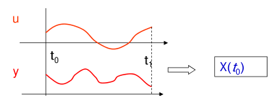
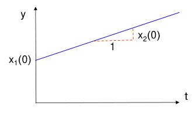
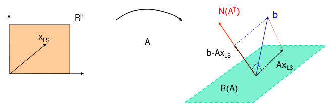
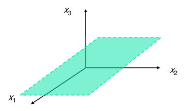
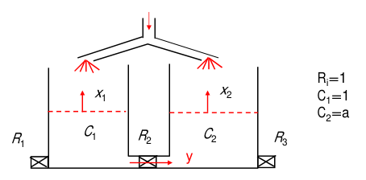
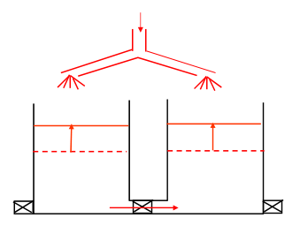

# Observability

Feedback laws such as \\(u = -Kx\\) assume the whole state is available, but in practice only a few outputs are measured. Observability asks whether those measurements, together with the known input, determine the state uniquely. It is the mirror image of [Controllability](controllability.md). Controllability led to an underdetermined linear equation and its minimum-norm solution; observability leads to an *overdetermined* one and its least-squares solution. Both are settled by a Gramian, and for time-invariant systems both reduce to a rank test. Observability is the hypothesis behind the state estimators of [Observers](observers.md) and [Optimal Estimation and the Kalman Filter](kalman-filter.md).

## The Observability Problem

Observability is the ability to estimate the states from output measurements. Its analysis matters for state estimation (observer and Kalman filter design), for sensor fusion (deciding which combinations of sensors determine the state), and for sensor placement. As with controllability, linear systems admit closed-form tests.

**Definition (observability).** A dynamic system is **observable on \\([t\_0, t\_1]\\)** if the initial state \\(x(t\_0)\\) can be **uniquely** determined from the input \\(u(t)\\) and the output \\(y(t)\\), \\(t\_0 \le t \le t\_1\\). It is **completely observable** if it is observable on every interval \\([t\_0, t\_1]\\) with \\(t\_1 > t\_0\\).



*Figure: observability. The input and output records on \\([t\_0, t\_1]\\) must pin down a unique initial state \\(x(t\_0)\\).*

Remarks:

1. Once \\(x(t\_0)\\) is known, the **current** state follows: \\(x(t) = \Phi(t,t\_0)x(t\_0) + \int\_{t\_0}^{t}\Phi(t,\tau)B(\tau)u(\tau)d\tau\\). Reconstructing the initial state and reconstructing the present state are equivalent problems.
2. **Uniqueness** is the essential requirement. If two different initial states produce the same output, no algorithm can tell them apart, however clever.
3. For linear systems the input can be assumed **zero**. The output is
\\[
y(t) = C(t)\Phi(t,t\_0)x(t\_0) + \underbrace{\int\_{t\_0}^{t}C(t)\Phi(t,\tau)B(\tau)u(\tau)d\tau + D(t)u(t)}\_{f(u)\text{: known}},
\\]
and the input term \\(f(u)\\) can be computed from the known input and subtracted. The redefined output \\(y\_{\text{new}}(t) = y(t) - f(u)(t) = C(t)\Phi(t,t\_0)x(t\_0)\\) is the zero-input response, and observability is a property of the pair \\((A, C)\\) alone.

### First examples

**Example 1 (double integrator with position measurement).** \\(\dot x\_1 = x\_2\\), \\(\dot x\_2 = u\\), \\(y = x\_1\\). Then \\(\ddot y = u\\) and
\\[
y(t) = x\_1(0) + t\\,x\_2(0) + \int\_0^t\\!\\!\int\_0^s u(\sigma)\\,d\sigma\\,ds .
\\]
The double integral is known. What remains is a straight line whose intercept is \\(x\_1(0)\\) and whose slope is \\(x\_2(0)\\), so both initial states are determined from the input and output: the system is observable.



*Figure: free response (\\(u = 0\\)) of the double integrator with \\(y = x\_1\\). The output is a straight line; its intercept reveals the initial position \\(x\_1(0)\\) and its slope the initial velocity \\(x\_2(0)\\).*

**Example 2 (two unobservable systems).**

- \\(\dot x\_1 = x\_1\\), \\(\dot x\_2 = x\_1 + x\_2\\), \\(y = x\_1\\). The state \\(x\_2\\) never affects \\(y\\) (nor \\(x\_1\\)), so \\(x\_2(0)\\) cannot be recovered.
- \\(\dot x\_1 = x\_1\\), \\(\dot x\_2 = x\_2\\), \\(y = x\_1 + x\_2\\). Both states influence the output, but they have identical dynamics, so \\(y(t) = e^t\big(x\_1(0) + x\_2(0)\big)\\). Only the sum is seen; the states cannot be distinguished.

These mirror the uncontrollable examples of [Controllability](controllability.md): a state disconnected from the output, or two states the output cannot tell apart.

## Observation as a Linear Equation

For \\(\dot x = A(t)x + B(t)u\\), \\(y = C(t)x + D(t)u\\), with the input term removed,
\\[
y(t) = C(t)\Phi(t,t\_0)x(t\_0) =: (L\_ox(t\_0))(t), \qquad t\_0 \le t \le t\_1 .
\\]
The operator \\(L\_o\\) maps \\(\mathbb{R}^n\\) into the space of output functions on \\([t\_0,t\_1]\\). The system is observable if and only if \\(L\_o\\) is one-to-one. Now there are \\(n\\) unknowns and a continuum of equations (one for each instant): an extreme case of an overdetermined system. With exact data the equations are consistent. With noisy data they are not, and the natural answer is the least-squares solution.

### Digression: least squares

Consider \\(Ax = b\\) with \\(A \in \mathbb{R}^{m \times n}\\), \\(n < m\\) (more equations than unknowns).

- A solution exists if and only if \\(b \in \mathcal{R}(A)\\). It is unique if and only if \\(\mathcal{N}(A) = \\{0\\}\\), that is \\(\operatorname{rank}A = n\\), which is equivalent to \\(A^TA\\) being nonsingular.
- **Claim.** The vector \\(x\_{LS}\\) that minimizes \\(\lVert Ax - b\rVert\\) satisfies the normal equations \\(A^T(Ax\_{LS} - b) = 0\\). Indeed, for any \\(x\\), write \\(x = x\_{LS} + \delta\\). Then
\\[
\lVert Ax - b\rVert^2 = \lVert Ax\_{LS} - b\rVert^2 + 2\delta^TA^T(Ax\_{LS} - b) + \lVert A\delta\rVert^2,
\\]
and the middle term vanishes exactly when the normal equations hold, leaving a sum of the minimum and a nonnegative term.
- If \\(\operatorname{rank}A = n\\),
\\[
x\_{LS} = A^+b = (A^TA)^{-1}A^Tb ,
\\]
and \\(x\_{LS}\\) is the exact (unique) solution whenever one exists.



*Figure: least-squares geometry for an overdetermined system (\\(n < m\\), \\(\operatorname{rank}A = n\\)). \\(A\\) maps \\(\mathbb{R}^n\\) onto the plane \\(\mathcal{R}(A)\\). The best fit \\(Ax\_{LS}\\) is the orthogonal projection of \\(b\\) onto that plane, and the residual \\(b - Ax\_{LS}\\) lies along \\(\mathcal{N}(A^T)\\), the normal to the plane. The estimate is unique iff \\(A^TA\\) is nonsingular.*

**The adjoint of \\(L\_o\\).** With the \\(L^2\\) inner product on output functions,
\\[
\langle L\_ox, y\rangle = \int\_{t\_0}^{t\_1}\big(C(t)\Phi(t,t\_0)x\big)^Ty(t)\\,dt = x^T\int\_{t\_0}^{t\_1}\Phi(t,t\_0)^TC(t)^Ty(t)\\,dt ,
\\]
so \\(L\_o^\*y = \int\_{t\_0}^{t\_1}\Phi(t,t\_0)^TC(t)^Ty(t)\\,dt\\), and \\(L\_o^\*L\_o\\) is the \\(n \times n\\) matrix defined next. The finite-dimensional background is in [Linear Algebra for Systems Theory](linear-algebra.md).

## The Observability Gramian Theorem

**Theorem (observability Gramian).** Let \\(A(t)\\) and \\(C(t)\\) be continuous on \\([t\_0,t\_1]\\). The system \\(\dot x = A(t)x + B(t)u\\), \\(y = C(t)x + D(t)u\\) is observable on \\([t\_0, t\_1]\\) if and only if the **observability Gramian**
\\[
\boxed{G\_o(t\_0, t\_1) := \int\_{t\_0}^{t\_1}\Phi(t, t\_0)^TC(t)^TC(t)\Phi(t, t\_0)\\,dt}
\\]
is nonsingular. In that case the initial state is
\\[
\boxed{x(t\_0) = G\_o(t\_0,t\_1)^{-1}\int\_{t\_0}^{t\_1}\Phi(t,t\_0)^TC(t)^Ty(t)\\,dt},
\\]
where \\(y\\) is the zero-input output. With noisy measurements the same formula gives the least-squares estimate.

*Proof of sufficiency.* With \\(u = 0\\), \\(y(t) = C(t)\Phi(t,t\_0)x(t\_0)\\). Premultiply by \\(\Phi(t,t\_0)^TC(t)^T\\) and integrate over \\([t\_0, t\_1]\\):
\\[
\int\_{t\_0}^{t\_1}\Phi(t,t\_0)^TC(t)^Ty(t)\\,dt = \left[\int\_{t\_0}^{t\_1}\Phi(t,t\_0)^TC(t)^TC(t)\Phi(t,t\_0)\\,dt\right]x(t\_0) = G\_o(t\_0,t\_1)\\,x(t\_0) .
\\]
The left side is computable from the data. If \\(G\_o\\) is nonsingular, \\(x(t\_0)\\) is determined uniquely by the boxed formula.

*Proof of necessity.* Suppose the system is observable but \\(G\_o\\) is singular. Then there is \\(v \neq 0\\) with \\(G\_ov = 0\\), and
\\[
0 = v^TG\_ov = \int\_{t\_0}^{t\_1}v^T\Phi^TC^TC\Phi v\\,dt = \int\_{t\_0}^{t\_1}\lVert C(t)\Phi(t,t\_0)v\rVert^2dt ,
\\]
so \\(C(t)\Phi(t,t\_0)v = 0\\) for all \\(t \in [t\_0,t\_1]\\). The initial state \\(x(t\_0) = v \neq 0\\) therefore produces the output \\(y(t) = C(t)\Phi(t,t\_0)v \equiv 0\\), exactly the same output as \\(x(t\_0) = 0\\). The two initial states cannot be distinguished, which contradicts observability. \\(\square\\)

### Interpretation

- **Least squares.** With measured output \\(y\_m(t) = C(t)\Phi(t,t\_0)x\_0 + \text{noise}\\), the cost \\(J(\xi) = \int\_{t\_0}^{t\_1}\lVert y\_m(t) - C(t)\Phi(t,t\_0)\xi\rVert^2dt\\) is minimized by \\(\xi = (L\_o^\*L\_o)^{-1}L\_o^\*y\_m\\), which is the boxed formula. The Gramian plays the role of \\(A^TA\\) in the normal equations.
- **Output energy.** For the zero-input response, \\(\int\_{t\_0}^{t\_1}\lVert y(t)\rVert^2dt = x(t\_0)^TG\_o\\,x(t\_0)\\). Initial states along eigenvectors of \\(G\_o\\) with small eigenvalues produce little output and are hard to estimate in the presence of noise (the estimation error variance in those directions scales like \\(1/\lambda\\)). A null direction produces no output at all. This is the dual of the controllability statement that small Gramian eigenvalues mean expensive directions.
- **Properties.** \\(G\_o\\) is symmetric positive semidefinite. For an LTI system with \\(A\\) asymptotically stable, \\(G\_o(0,T)\\) converges as \\(T \to \infty\\) to the solution \\(W\_o\\) of the Lyapunov equation \\(A^TW\_o + W\_oA + C^TC = 0\\) (see [Stability of Linear Systems](stability.md)).

## Observability of LTI Systems

For \\(\dot x = Ax + Bu\\), \\(y = Cx + Du\\), \\(\Phi(t,t\_0) = e^{A(t - t\_0)}\\) and
\\[
G\_o(t\_0,t\_1) = \int\_{t\_0}^{t\_1}e^{A^T(t - t\_0)}C^TCe^{A(t - t\_0)}\\,dt .
\\]
Shifting the time variable, \\(t \leftarrow t - t\_0\\),
\\[
\boxed{G\_o(t\_0,t\_1) = \int\_0^{t\_1 - t\_0}e^{A^Tt}C^TCe^{At}\\,dt}.
\\]

### Duality

Compare this with the LTI controllability Gramian \\(\int\_0^{T}e^{At}BB^Te^{A^Tt}dt\\). Replacing \\(A\\) by \\(A^T\\) and \\(B\\) by \\(C^T\\) in the controllability Gramian gives exactly \\(\int\_0^Te^{A^Tt}C^TCe^{At}dt\\), the observability Gramian of \\((A, C)\\). Hence:

**Theorem (duality).** \\((A, C)\\) is observable if and only if \\((A^T, C^T)\\) is controllable. Equivalently, \\((A, B)\\) is controllable if and only if \\((A^T, B^T)\\) is observable.

The dual system \\(\dot z = A^Tz + C^Tv\\), \\(w = B^Tz\\) swaps the roles of inputs and outputs. Every controllability result has an observability twin, obtained by transposing:

| Controllability of \\((A, B)\\) | Observability of \\((A, C)\\) |
|---|---|
| \\(G\_c = \int\_0^Te^{At}BB^Te^{A^Tt}dt\\) | \\(G\_o = \int\_0^Te^{A^Tt}C^TCe^{At}dt\\) |
| \\(P = [B\ \ AB\ \cdots\ A^{n-1}B]\\) | \\(Q = [C;\ CA;\ \cdots;\ CA^{n-1}]\\) |
| controllable subspace \\(\mathcal{R}(P)\\) | unobservable subspace \\(\mathcal{N}(Q)\\) |
| minimum-norm input | least-squares initial state |
| uncontrollable mode: \\(w^TA = \lambda w^T\\), \\(w^TB = 0\\) | unobservable mode: \\(Av = \lambda v\\), \\(Cv = 0\\) |
| state feedback \\(A - BK\\) | observer \\(A - LC\\) |

The last row is the reason observer design reduces to pole placement for the dual system: the eigenvalues of \\(A - LC\\) equal those of \\(A^T - C^TL^T\\). See [Observers](observers.md).

### The rank test

**Theorem (observability rank test).** \\((A, C)\\) is completely observable if and only if
\\[
\boxed{\operatorname{rank}Q = n, \qquad Q = \begin{bmatrix} C \\\\ CA \\\\ \vdots \\\\ CA^{n-1} \end{bmatrix}}
\\]
where \\(Q\\) (\\(np \times n\\) for \\(p\\) outputs) is the **observability matrix**.

*Proof.* By duality, \\((A,C)\\) is observable iff \\((A^T,C^T)\\) is controllable, iff \\(\operatorname{rank}[C^T\ \ A^TC^T\ \cdots\ (A^T)^{n-1}C^T] = n\\). That matrix is \\(Q^T\\), and a matrix and its transpose have the same rank. \\(\square\\)

A direct argument is also illuminating. With zero input, differentiate the output repeatedly at \\(t = 0\\):
\\[
\begin{bmatrix} y(0) \\\\ \dot y(0) \\\\ \vdots \\\\ y^{(n-1)}(0) \end{bmatrix} = \begin{bmatrix} C \\\\ CA \\\\ \vdots \\\\ CA^{n-1} \end{bmatrix}x(0) = Q\\,x(0) .
\\]
If \\(Q\\) has full column rank, \\(x(0) = (Q^TQ)^{-1}Q^T[y(0);\ \dot y(0);\ \dots]\\). Conversely, if \\(Qv = 0\\) then \\(CA^kv = 0\\) for all \\(k\\) (Cayley–Hamilton), so \\(Ce^{At}v \equiv 0\\) and \\(v\\) is invisible. This "differentiate the output" reconstruction is exact but useless in practice, since differentiation amplifies measurement noise. The Gramian formula integrates instead of differentiating, and observers do the same thing recursively.

As for controllability, the rank of \\(Q\\) does not depend on the length of the interval: an LTI system observable on one interval is observable on all. MATLAB provides `obsv(A,C)`; equivalently `ctrb(A',C')'` by duality.

## The Unobservable Subspace

**Definition (unobservable subspace).** The unobservable subspace of an LTI system is the set of initial states that produce zero output (with zero input) for all \\(t \ge 0\\).

**Theorem.** The unobservable subspace is the null space of the observability matrix, \\(\mathcal{N}(Q)\\).

*Proof.* If \\(Qv = 0\\), the direct argument above shows \\(Ce^{At}v \equiv 0\\). Conversely, if \\(Ce^{At}v \equiv 0\\), differentiating at \\(t = 0\\) gives \\(CA^kv = 0\\) for every \\(k\\), so \\(Qv = 0\\). \\(\square\\)

Three consequences:

- **Indistinguishable states.** Two initial states \\(x\_0\\) and \\(x\_0'\\) produce identical outputs (for every input) if and only if \\(x\_0 - x\_0' \in \mathcal{N}(Q)\\). From the output, the initial state can be known only up to the unobservable subspace.
- **Invariance.** \\(\mathcal{N}(Q)\\) is \\(A\\)-invariant: if \\(Qv = 0\\) then \\(QAv = 0\\), because the rows \\(CA^{k+1}\\) are rows of \\(Q\\) or (for \\(k + 1 = n\\)) combinations of them. A free trajectory that starts in the unobservable subspace stays there and never shows up in the output.
- **The observable part.** The orthogonal complement \\(\mathcal{N}(Q)^\perp = \mathcal{R}(Q^T)\\), the row space of \\(Q\\), contains the components of the state that the output determines.



*Figure: the unobservable subspace \\(\mathcal{N}(Q)\\), drawn as a plane in \\(\mathbb{R}^3\\). Initial states in the plane produce zero output; initial states that differ by a vector in the plane produce identical outputs.*

## Examples

**Example 3 (double integrator, by the rank test).** For \\(A = \begin{bmatrix} 0 & 1 \\\\ 0 & 0 \end{bmatrix}\\):

- \\(C = [1\ \ 0]\\) (position): \\(Q = \begin{bmatrix} 1 & 0 \\\\ 0 & 1 \end{bmatrix}\\), rank 2, observable, as found in Example 1.
- \\(C = [0\ \ 1]\\) (velocity): \\(Q = \begin{bmatrix} 0 & 1 \\\\ 0 & 0 \end{bmatrix}\\), rank 1, unobservable, with \\(\mathcal{N}(Q) = \operatorname{span}\\{[1,\ 0]^T\\}\\). A velocity sensor cannot recover the absolute position; integrating velocity gives position only up to an unknown constant.

**Example 4 (two tanks, inter-tank flow measured).** Return to the two-tank system of [Controllability](controllability.md), now with outlet valves \\(R\_1, R\_3\\), interconnecting valve \\(R\_2\\), all \\(R\_i = 1\\), and capacitances \\(C\_1 = 1\\), \\(C\_2 = a\\). The measured output is the flow through the connecting valve, proportional to the level difference:
\\[
\frac{d}{dt}\begin{bmatrix} x\_1 \\\\ x\_2 \end{bmatrix} = \begin{bmatrix} -2 & 1 \\\\ a^{-1} & -2a^{-1} \end{bmatrix}\begin{bmatrix} x\_1 \\\\ x\_2 \end{bmatrix} \\;(+\\,Bu), \qquad y = x\_1 - x\_2 .
\\]



*Figure: the two-tank system with the inter-tank flow through \\(R\_2\\) as the measured output \\(y\\). Tank 2 has capacitance \\(C\_2 = a\\).*

*Rank test.* \\(CA = [1\ \ -1]A = [-2 - a^{-1}\ \ \ 1 + 2a^{-1}]\\), so
\\[
Q = \begin{bmatrix} C \\\\ CA \end{bmatrix} = \begin{bmatrix} 1 & -1 \\\\ -2 - a^{-1} & 1 + 2a^{-1} \end{bmatrix},\qquad \det Q = (1 + 2a^{-1}) - (2 + a^{-1}) = a^{-1} - 1 .
\\]

- The system is observable if and only if \\(a \neq 1\\).
- It is unobservable for \\(a = 1\\), identical tanks. Then \\(Q = \begin{bmatrix} 1 & -1 \\\\ -3 & 3 \end{bmatrix}\\) and the unobservable subspace is \\(\mathcal{N}(Q) = \operatorname{span}\\{[1,\ 1]^T\\}\\).

*Physical interpretation.* With identical tanks and equal initial levels, \\(x\_1(0) = x\_2(0)\\), the two tanks drain symmetrically through their outlets and the levels stay equal. No liquid ever flows through \\(R\_2\\), so the output is identically zero: the symmetric mode (eigenvalue \\(-1\\)) is invisible to this sensor. The flow measurement sees only the antisymmetric mode (eigenvalue \\(-3\\)). This is the exact dual of Example 9 in [Controllability](controllability.md), where a symmetric *input* could not excite the antisymmetric mode.



*Figure: when \\(a = 1\\) and \\(x\_1(0) = x\_2(0)\\), both levels fall together and the measured flow through \\(R\_2\\) is zero for all time; the common level cannot be inferred from \\(y\\).*

```matlab
A = [-2 1; 1 -2]; C = [1 -1];      % a = 1
Q = ctrb(A',C')'                   % = obsv(A,C) = [1 -1; -3 3]
rank(Q)                            % 1
null(Q)                            % [0.7071; 0.7071]: the unobservable direction
```

For \\(a \neq 1\\) the Gramian formula reconstructs the initial levels from the flow record. The figure below uses \\(a = 2\\), whose eigenvalues are \\(-2.37\\) and \\(-0.63\\), true initial state \\([1,\ 0.3]^T\\), four seconds of data sampled every 0.01 s, and additive measurement noise of standard deviation 0.03. The least-squares estimate is \\(\hat x(0) = [0.980,\ 0.285]^T\\). The eigenvalues of \\(G\_o(0, 4)\\) are 0.47 and 0.0099: the second direction produces fifty times less output energy, and that is where most of the estimation error lies.

![Least-squares reconstruction from noisy flow data (a=2), and identical outputs for initial states differing along [1,1] (a=1)](figures/obsv-reconstruction.png)

*Figure: left, \\(a = 2\\) (observable). The noisy flow measurement (dots), the true output (blue) and the output regenerated from the least-squares estimate \\(\hat x(0) = G\_o^{-1}\int e^{A^Tt}C^Ty\\,dt\\) (red dashed) are nearly indistinguishable. Right, \\(a = 1\\) (unobservable). The initial states \\([1,\ 0.3]^T\\) and \\([1.5,\ 0.8]^T\\) differ by \\(0.5[1,\ 1]^T\\) and produce exactly the same output, and \\([0.5,\ 0.5]^T\\) produces none at all.*

```python
import numpy as np
from scipy.linalg import expm

a = 2.0
A = np.array([[-2, 1], [1/a, -2/a]]); C = np.array([[1., -1]])
t = np.linspace(0, 4, 401); dt = t[1] - t[0]
Phi = [expm(A*s) for s in t]
y = np.array([(C @ P @ [1.0, 0.3])[0] for P in Phi]) + 0.03*np.random.randn(len(t))
Go  = sum(P.T @ C.T @ C @ P for P in Phi) * dt
rhs = sum((P.T @ C.T)[:, 0] * yk for P, yk in zip(Phi, y)) * dt
x0_hat = np.linalg.solve(Go, rhs)
```

**Example 5 (a parameter that destroys observability).** The three-compartment system of Example 10 in [Controllability](controllability.md),
\\[
A = \begin{bmatrix} -a & 1 & 0 \\\\ 1 & -3 & 1 \\\\ 0 & 1 & -2 \end{bmatrix},\qquad C = \begin{bmatrix} 0 & 1 & 0 \end{bmatrix},
\\]
measures only the middle state. Then \\(CA = [1,\ -3,\ 1]\\) and \\(CA^2 = [-(a + 3),\ 11,\ -5]\\), so
\\[
Q = \begin{bmatrix} 0 & 1 & 0 \\\\ 1 & -3 & 1 \\\\ -(a + 3) & 11 & -5 \end{bmatrix},\qquad \det Q = 2 - a .
\\]
The system is unobservable only for \\(a = 2\\). There
\\[
\operatorname{rref}(Q) = \begin{bmatrix} 1 & 0 & 1 \\\\ 0 & 1 & 0 \\\\ 0 & 0 & 0 \end{bmatrix},\qquad \mathcal{N}(Q) = \operatorname{span}\\{[1,\ 0,\ -1]^T\\},
\\]
and the observable directions are the row space \\(\operatorname{span}\\{[0,\ 1,\ 0],\ [1,\ -3,\ 1]\\}\\). Physically, with \\(a = 2\\) the end compartments obey identical equations and feed the middle one symmetrically, so \\(y = x\_2\\) sees only the sum \\(x\_1 + x\_3\\). Initial states with \\((x\_1, x\_3) = (5, 2)\\) and \\((2, 5)\\) (same \\(x\_2\\)) differ by \\(3[1,\ 0,\ -1]^T \in \mathcal{N}(Q)\\) and give identical outputs. Notice that \\(a = 2\\) also made the system uncontrollable, with the same mode \\(x\_1 - x\_3\\) (eigenvalue \\(-2\\)). At \\(a = 4\\), by contrast, the system is observable but uncontrollable. The consequences for the transfer function are worked out in [Structural Decompositions and Minimal Realizations](structure.md).

**Example 6 (which single sensor?).** An inverted pendulum on a driven cart has states \\(x = [\theta,\ \dot\theta,\ x\_c,\ \dot x\_c]^T\\) (pendulum angle and rate, cart position and velocity) and linearized dynamics
\\[
A = \begin{bmatrix} 0 & 1 & 0 & 0 \\\\ 30 & 0 & 0 & 20 \\\\ 0 & 0 & 0 & 1 \\\\ -2 & 0 & 0 & -10 \end{bmatrix},
\\]
with characteristic polynomial \\(s^4 + 10s^3 - 30s^2 - 260s\\) and eigenvalues \\(0,\ 5.23,\ -4.73,\ -10.50\\). Three sensors are available: the angle, the cart position and the cart velocity. Can the state be reconstructed from a single one? Computing \\(\operatorname{rank}[c;\ cA;\ cA^2;\ cA^3]\\) for each:

| sensor | rank of \\(Q\\) | unobservable direction |
|---|---|---|
| angle \\(\theta\\) | 3 | \\([0,\ 0,\ 1,\ 0]^T\\) |
| cart position \\(x\_c\\) | 4 | none |
| cart velocity \\(\dot x\_c\\) | 3 | \\([0,\ 0,\ 1,\ 0]^T\\) |

Only the cart position makes the system observable. The reason is visible in \\(A\\): its third column is zero, so the cart position \\(x\_c\\) influences no other state. It is a pure integrator of \\(\dot x\_c\\) (the eigenvalue 0), and a sensor that does not measure it directly can never recover it, exactly as the velocity sensor of Example 3 could not recover position.

## Discrete-Time and Time-Varying Systems

**Discrete time.** For \\(x[k+1] = Ax[k]\\), \\(y[k] = Cx[k]\\), stacking \\(n\\) samples gives
\\[
\begin{bmatrix} y[0] \\\\ y[1] \\\\ \vdots \\\\ y[n-1] \end{bmatrix} = \begin{bmatrix} C \\\\ CA \\\\ \vdots \\\\ CA^{n-1} \end{bmatrix}x[0] = Q\\,x[0] .
\\]
The observability matrix appears directly, without any differentiation, and the initial state is recovered from \\(n\\) samples whenever \\(\operatorname{rank}Q = n\\). Unlike reachability, observability has no singular-\\(A\\) subtlety for the initial state. With noisy samples one uses least squares, which leads to the recursive estimators of [Optimal Estimation and the Kalman Filter](kalman-filter.md). The discrete-time observer is in [Digital Observers](../digital/observers.md).

**Time-varying systems.** The Gramian theorem holds as proved. As for controllability, observability now depends on the interval, and the rank test must be replaced. With \\(N\_0(t) = C(t)\\) and \\(N\_{k+1}(t) = N\_k(t)A(t) + \dot N\_k(t)\\), if \\(A\\) and \\(C\\) are \\(n - 1\\) times continuously differentiable and the stacked matrix \\([N\_0(t\_c);\ N\_1(t\_c);\ \dots;\ N\_{n-1}(t\_c)]\\) has rank \\(n\\) at some \\(t\_c \in (t\_0,t\_1)\\), the system is observable on \\([t\_0,t\_1]\\). This is the dual of the time-varying controllability condition, and again it is sufficient but not necessary. (The rows \\(N\_k\\) are what one gets by differentiating \\(y = C(t)x\\) with \\(\dot x = A(t)x\\): \\(y^{(k)} = N\_k(t)x\\).)

## Summary

- **Definition.** Observable on \\([t\_0,t\_1]\\): the input and output records determine \\(x(t\_0)\\) uniquely. For linear systems the input can be set to zero.
- **Linear equation.** \\(y(t) = C(t)\Phi(t,t\_0)x(t\_0)\\): \\(n\\) unknowns and a continuum of equations, solved by least squares.
- **Gramian theorem.** Observable iff \\(G\_o(t\_0,t\_1) = \int\_{t\_0}^{t\_1}\Phi(t,t\_0)^TC^TC\Phi(t,t\_0)dt = L\_o^\*L\_o\\) is nonsingular. Then \\(x(t\_0) = G\_o^{-1}\int\_{t\_0}^{t\_1}\Phi(t,t\_0)^TC^Ty\\,dt\\).
- **Output energy.** \\(\int\lVert y\rVert^2dt = x\_0^TG\_ox\_0\\); weakly observable directions are hard to estimate in noise.
- **LTI Gramian.** \\(G\_o = \int\_0^{t\_1 - t\_0}e^{A^Tt}C^TCe^{At}dt\\).
- **Duality.** \\((A,C)\\) observable iff \\((A^T,C^T)\\) controllable.
- **Rank test.** \\((A,C)\\) observable iff \\(\operatorname{rank}[C;\ CA;\ \cdots;\ CA^{n-1}] = n\\).
- **Unobservable subspace.** \\(\mathcal{N}(Q)\\), \\(A\\)-invariant; states differing by an element of it are indistinguishable.
- **Symmetry destroys observability.** A sensor that responds only to antisymmetric motion (the inter-tank flow) cannot see the symmetric mode of identical tanks.
- **Sensor choice.** A state that feeds no other state (an integrator) is observable only if it is measured directly.

## See Also

- [Controllability](controllability.md): the dual problem, the minimum-norm input and the controllable subspace
- [Linear Algebra for Systems Theory](linear-algebra.md): least squares and the normal equations
- [Structural Decompositions and Minimal Realizations](structure.md): PBH test, Kalman decomposition, detectability
- [Observers](observers.md): reconstructing the state recursively, \\(A - LC\\)
- [Optimal Estimation and the Kalman Filter](kalman-filter.md): least squares with noise statistics
- [Stability of Linear Systems](stability.md): the Lyapunov equation for the infinite-horizon Gramian
- [State-Space Representation](../state-space.md): the short overview
