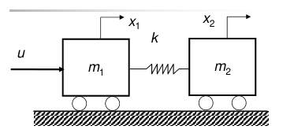
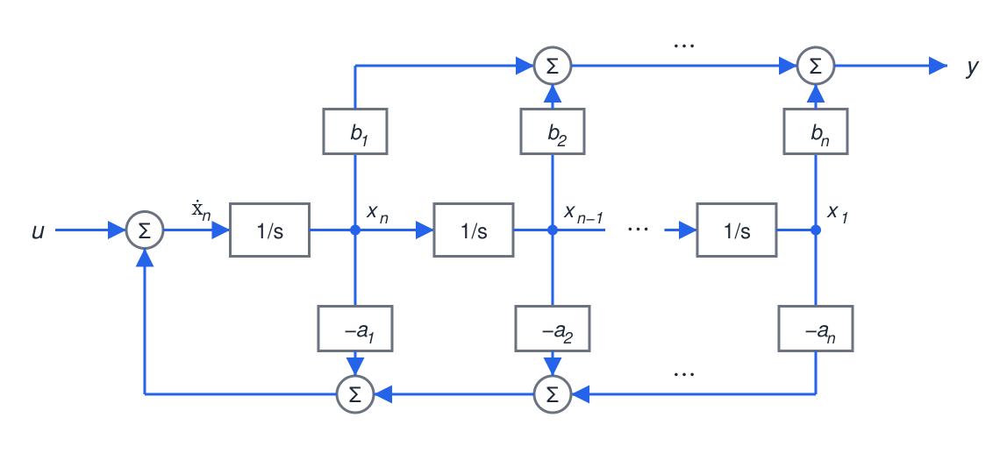
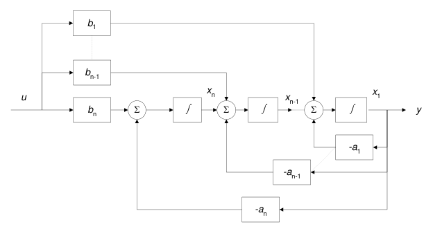
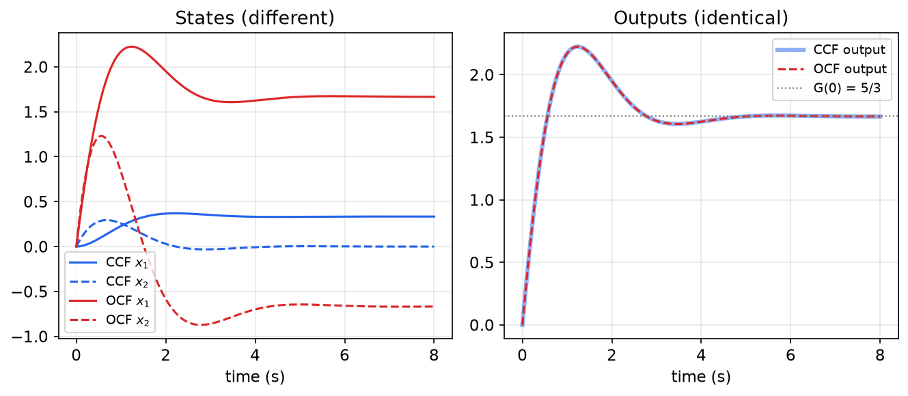
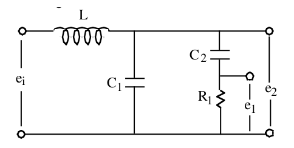
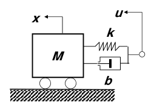

# State Transformations and Canonical Realizations

A dynamic system has many state-space descriptions. The state vector can be rescaled, rotated or mixed by any invertible matrix and the input–output behavior does not change. This chapter studies such **similarity transformations**, identifies the quantities they leave **invariant**, and uses the freedom to solve the reverse of the problem in [Modeling and Linearization](modeling.md): given a transfer function, find a state model, called a **realization**. Three standard choices, the **controllable**, **observable** and **Jordan (modal)** canonical forms, are derived with examples. They reappear throughout the book: the controllable form in pole placement, the observable form in observer design, and the modal form in stability and modal analysis.

## Nonuniqueness of the State-Space Representation

The state of a system is not unique. The simplest illustration is a scaling: if \\(\dot x = x + u\\) and we define \\(\hat x = 2x\\), then
\\[
\dot x = x + u \quad\overset{\hat x = 2x}{\Longleftrightarrow}\quad \dot{\hat x} = \hat x + 2u .
\\]
Both are valid first-order models of the same system. They differ only in the units in which the state is measured. In general, *any* invertible linear combination of state variables is again a set of state variables, because it carries exactly the same information about the past.

Choosing the coordinates well can reveal structure that the original coordinates hide.

**Example 2.1 (Rigid and elastic coordinates).** Two carts \\(m\_1\\) and \\(m\_2\\), at positions \\(x\_1\\) and \\(x\_2\\), are connected by a spring \\(k\\). A force \\(u\\) acts on \\(m\_1\\).



*Figure: two carts joined by a spring, with the force u applied to m₁. The motion splits into a rigid translation of the pair and an elastic stretching of the spring.*

The equations of motion are
\\[
m\_1\ddot x\_1 + k(x\_1 - x\_2) = u, \qquad m\_2\ddot x\_2 + k(x\_2 - x\_1) = 0 ,
\\]
and with \\(x = [x\_1,\ x\_2,\ \dot x\_1,\ \dot x\_2]^T\\) the state equation is
\\[
\dot x = \begin{bmatrix}
0 & 0 & 1 & 0 \\\\ 0 & 0 & 0 & 1 \\\\
-\frac{k}{m\_1} & \frac{k}{m\_1} & 0 & 0 \\\\
\frac{k}{m\_2} & -\frac{k}{m\_2} & 0 & 0
\end{bmatrix}x + \begin{bmatrix}0 \\\\ 0 \\\\ \frac{1}{m\_1} \\\\ 0\end{bmatrix}u .
\\]
Every state is coupled to the others. Now describe the motion by the **center of mass** (rigid coordinate) and the **spring stretch** (elastic coordinate):
\\[
\hat x\_1 = \frac{m\_1x\_1 + m\_2x\_2}{m\_1 + m\_2}, \qquad \hat x\_3 = x\_1 - x\_2 .
\\]
Adding the two equations of motion eliminates the spring force: \\((m\_1+m\_2)\ddot{\hat x}\_1 = u\\). Dividing the first equation by \\(m\_1\\), the second by \\(m\_2\\), and subtracting gives
\\[
\ddot{\hat x}\_3 + \Big(\frac{k}{m\_1} + \frac{k}{m\_2}\Big)\hat x\_3 = \frac{u}{m\_1}.
\\]
With \\(\hat x\_2 = \dot{\hat x}\_1\\) and \\(\hat x\_4 = \dot{\hat x}\_3\\), the new state equation is block diagonal:
\\[
\dot{\hat x} = \left[\begin{array}{cc\|cc}
0 & 1 & 0 & 0 \\\\ 0 & 0 & 0 & 0 \\\\ \hline
0 & 0 & 0 & 1 \\\\ 0 & 0 & -\big(\frac{k}{m\_1} + \frac{k}{m\_2}\big) & 0
\end{array}\right]\hat x + \begin{bmatrix}0 \\\\ \frac{1}{m\_1 + m\_2} \\\\ 0 \\\\ \frac{1}{m\_1}\end{bmatrix}u .
\\]
The (4,3) entry is *negative*: the elastic coordinate is a spring–mass oscillator with natural frequency \\(\sqrt{k/m\_1 + k/m\_2}\\), and a positive entry would describe an unstable, exponentially stretching spring. The rigid-body mode (a double integrator) and the flexible mode are now **decoupled**. This is useful for physical insight and for **model-order reduction**: if the spring is very stiff, the flexible block can be dropped and the system treated as a single mass \\(m\_1 + m\_2\\).

## Similarity Transformations

### Transformation formulas

Let \\(T\\) be a nonsingular \\(n\times n\\) matrix and define new coordinates \\(\hat x = Tx\\). Starting from \\(\dot x = Ax + Bu\\), \\(y = Cx + Du\\), multiply the state equation by \\(T\\) and substitute \\(x = T^{-1}\hat x\\):
\\[
T\dot x = TAx + TBu \quad\Longrightarrow\quad \dot{\hat x} = TAT^{-1}\hat x + TBu, \qquad y = CT^{-1}\hat x + Du .
\\]
**Transformation formulas.** \\((A,B,C,D)\overset{T}{\longmapsto}(\hat A,\hat B,\hat C,\hat D)\\) with
\\[
\boxed{\hat A = TAT^{-1}, \qquad \hat B = TB, \qquad \hat C = CT^{-1}, \qquad \hat D = D .}
\\]
Two realizations related in this way are called **similar** or **algebraically equivalent**. The columns of \\(T^{-1}\\) are the old-coordinate representations of the new basis vectors: \\(x = T^{-1}\hat x = \sum\_i \hat x\_i\\,(T^{-1})\_{:,i}\\).

**Example 2.1 (continued).** With \\(a = m\_1/(m\_1+m\_2)\\), and the new state ordered as [rigid position, rigid velocity, elastic position, elastic velocity],
\\[
\begin{bmatrix}\hat x\_1 \\\\ \hat x\_2 \\\\ \hat x\_3 \\\\ \hat x\_4\end{bmatrix}
= \underbrace{\begin{bmatrix}
a & 1-a & 0 & 0 \\\\ 0 & 0 & a & 1-a \\\\ 1 & -1 & 0 & 0 \\\\ 0 & 0 & 1 & -1
\end{bmatrix}}\_{T}
\begin{bmatrix}x\_1 \\\\ x\_2 \\\\ x\_3 \\\\ x\_4\end{bmatrix}.
\\]
Computing \\(TAT^{-1}\\) and \\(TB\\) reproduces the block-diagonal model above, including \\(\hat B = [0,\ 1/(m\_1+m\_2),\ 0,\ 1/m\_1]^T\\). The rows of \\(T\\) must be ordered the same way as the new state. If instead the rows are ordered [rigid position, elastic position, rigid velocity, elastic velocity], the result is the same model with states 2 and 3 swapped. That is a permutation similarity, not a different system, but mixing the two orderings produces a matrix that looks wrong.

### Invariants

Similar realizations describe the same physical system, so everything with physical meaning must be invariant.

**Theorem (Invariants of similarity).** If \\((\hat A,\hat B,\hat C,\hat D)\\) is obtained from \\((A,B,C,D)\\) by \\(\hat x = Tx\\), then:

1. \\(\det(sI - \hat A) = \det(sI - A)\\): the characteristic polynomial, hence the eigenvalues, trace and determinant of \\(A\\), are invariant.
2. \\(\hat C(sI - \hat A)^{-1}\hat B + \hat D = C(sI - A)^{-1}B + D\\): the transfer function is invariant.
3. \\(\hat C\hat A^k\hat B = CA^kB\\) for all \\(k \ge 0\\): the **Markov parameters** (the coefficients of the impulse response \\(Ce^{At}B = \sum\_k CA^kB\\,t^k/k!\\)) are invariant.
4. \\(\hat A^k = TA^kT^{-1}\\) and \\(e^{\hat At} = Te^{At}T^{-1}\\).

*Proof.* (1) \\(sI - TAT^{-1} = T(sI - A)T^{-1}\\), and \\(\det T\det T^{-1} = 1\\). (2) Using the same factorization, \\((sI - \hat A)^{-1} = T(sI - A)^{-1}T^{-1}\\), so
\\[
\hat C(sI-\hat A)^{-1}\hat B = CT^{-1}\\,T(sI-A)^{-1}T^{-1}\\,TB = C(sI-A)^{-1}B .
\\]
(3) and (4) follow because \\((TAT^{-1})^k = TA^kT^{-1}\\), since the inner factors \\(T^{-1}T\\) cancel. Summing the exponential series term by term gives \\(e^{\hat At} = Te^{At}T^{-1}\\). ∎

The eigen*vectors* are not invariant (they transform as \\(\hat v = Tv\\)), nor are the individual entries of the matrices. Structural properties such as controllability and observability are invariant too, as shown in [Controllability](controllability.md) and [Observability](observability.md).

**Example 2.2 (A transformation that decouples the dynamics).** Consider
\\[
\dot x = \begin{bmatrix}-3 & 2 & 1 \\\\ 1 & -4 & -1 \\\\ -1 & -2 & -5\end{bmatrix}x + \begin{bmatrix}1 & 0 \\\\ 0 & 2 \\\\ 1 & 1\end{bmatrix}u ,
\\]
and the new variables \\(\hat x\_1 = x\_1 + x\_2\\), \\(\hat x\_2 = x\_1 + x\_3\\), \\(\hat x\_3 = x\_2 + x\_3\\). (a) Find the transformed model. (b) Find \\(x(t)\\) for \\(u = 0\\), \\(x(0) = [1,\ 0,\ 1]^T\\).

(a) The transformation matrix and its inverse are
\\[
T = \begin{bmatrix}1 & 1 & 0 \\\\ 1 & 0 & 1 \\\\ 0 & 1 & 1\end{bmatrix}, \quad \det T = -2, \qquad
T^{-1} = \frac12\begin{bmatrix}1 & 1 & -1 \\\\ 1 & -1 & 1 \\\\ -1 & 1 & 1\end{bmatrix}.
\\]
Multiplying out,
\\[
\hat A = TAT^{-1} = \begin{bmatrix}-2 & 0 & 0 \\\\ 0 & -4 & 0 \\\\ 0 & 0 & -6\end{bmatrix}, \qquad
\hat B = TB = \begin{bmatrix}1 & 2 \\\\ 2 & 1 \\\\ 1 & 3\end{bmatrix}.
\\]
The new model is diagonal. This happens because the rows of \\(T\\) are **left eigenvectors** of \\(A\\): for instance \\([1\ 1\ 0]A = [-2\ -2\ 0] = -2\\,[1\ 1\ 0]\\). Diagonalization is studied systematically in [Modal Decomposition and the Jordan Form](modal-decomposition.md).

(b) In the new coordinates each state evolves on its own, \\(\hat x\_i(t) = e^{\lambda\_it}\hat x\_i(0)\\), with \\(\hat x(0) = Tx(0) = [1,\ 2,\ 1]^T\\). So \\(\hat x(t) = [e^{-2t},\ 2e^{-4t},\ e^{-6t}]^T\\). Transforming back with \\(x = T^{-1}\hat x\\):
\\[
x\_1 = \tfrac12\big(e^{-2t} + 2e^{-4t} - e^{-6t}\big), \quad
x\_2 = \tfrac12\big(e^{-2t} - 2e^{-4t} + e^{-6t}\big), \quad
x\_3 = \tfrac12\big(-e^{-2t} + 2e^{-4t} + e^{-6t}\big).
\\]
At \\(t = 0\\) these give \\([1,\ 0,\ 1]^T\\), as they must. In MATLAB: `T=[1 1 0;1 0 1;0 1 1]; Ahat=T*A/T; Bhat=T*B;`.

## The Realization Problem

Going from a state model to a transfer function is unique: \\(G(s) = C(sI-A)^{-1}B + D\\). Going back is not, because every similarity transformation of one realization is another realization, and realizations of different orders can also exist (see [Kalman Decomposition and Minimal Realizations](structure.md)). To get a definite answer, a **form** is specified in advance. The three canonical forms below are each determined directly by the coefficients or the partial-fraction expansion of \\(G(s)\\).

Throughout, consider the SISO transfer function
\\[
G(s) = \frac{Y(s)}{U(s)} = \frac{b\_1s^{n-1} + b\_2s^{n-2} + \cdots + b\_{n-1}s + b\_n}{s^n + a\_1s^{n-1} + \cdots + a\_{n-1}s + a\_n} + d .
\\]
A state model always produces a proper transfer function, so only proper \\(G\\) can be realized. If \\(G\\) is proper but not strictly proper (numerator and denominator of equal degree), long division first splits off the constant \\(d = G(\infty)\\), which becomes \\(D\\). The strictly proper remainder is realized with \\(A, B, C\\). For example, \\(\frac{s+3}{s+1} = 1 + \frac{2}{s+1}\\) gives \\(D = 1\\), \\(A = -1\\), \\(B = 1\\), \\(C = 2\\).

## Controllable Canonical Form

### Motivating examples

**Example 2.3 (No numerator dynamics).** \\(\dfrac{Y}{U} = \dfrac{1}{s^2 + 2s + 3}\\) corresponds to the ODE \\(\ddot y + 2\dot y + 3y = u\\). The phase variables \\(x\_1 = y\\), \\(x\_2 = \dot y\\) give \\(\dot x\_1 = x\_2\\), \\(\dot x\_2 = -3x\_1 - 2x\_2 + u\\):
\\[
\dot x = \begin{bmatrix}0 & 1 \\\\ -3 & -2\end{bmatrix}x + \begin{bmatrix}0 \\\\ 1\end{bmatrix}u, \qquad y = \begin{bmatrix}1 & 0\end{bmatrix}x .
\\]

**Example 2.4 (With a numerator: the wrong way).** \\(\dfrac{Y}{U} = \dfrac{4s + 5}{s^2 + 2s + 3}\\) corresponds to \\(\ddot y + 2\dot y + 3y = 4\dot u + 5u\\). Trying the same phase variables \\(x\_1 = y\\), \\(x\_2 = \dot y\\) gives
\\[
\dot x = \begin{bmatrix}0 & 1 \\\\ -3 & -2\end{bmatrix}x + \begin{bmatrix}0 \\\\ 1\end{bmatrix}(4\dot u + 5u), \qquad y = \begin{bmatrix}1 & 0\end{bmatrix}x .
\\]
This is **not a valid state model**: the input derivative \\(\dot u\\) appears on the right-hand side. A state model may involve only the present input. Otherwise a step input would require an impulse in \\(\dot x\\), and the state could no longer summarize the past.

**Example 2.5 (The right way: an intermediate variable).** Split the transfer function in two with an intermediate variable \\(Z\\):
\\[
\frac{Z}{U} = \frac{1}{s^2 + 2s + 3}, \qquad \frac{Y}{Z} = 4s + 5 .
\\]
The input-to-\\(z\\) part is \\(\ddot z + 2\dot z + 3z = u\\), exactly Example 2.3. The output is a combination of \\(z\\) and its derivative, \\(y = 4\dot z + 5z\\). With \\(x\_1 = z\\), \\(x\_2 = \dot z\\):
\\[
\dot x = \begin{bmatrix}0 & 1 \\\\ -3 & -2\end{bmatrix}x + \begin{bmatrix}0 \\\\ 1\end{bmatrix}u, \qquad y = \begin{bmatrix}5 & 4\end{bmatrix}x .
\\]
The numerator now appears only in the output matrix, and no input derivative is needed.

### General form

The same construction works for any order. Let \\(Z(s) = U(s)/\big(s^n + a\_1s^{n-1} + \cdots + a\_n\big)\\), so that
\\[
z^{(n)} + a\_1z^{(n-1)} + \cdots + a\_{n-1}\dot z + a\_nz = u, \qquad y = b\_1z^{(n-1)} + b\_2z^{(n-2)} + \cdots + b\_n z .
\\]
Choose \\(x\_1 = z,\ x\_2 = \dot z,\ \dots,\ x\_n = z^{(n-1)}\\). Then \\(\dot x\_i = x\_{i+1}\\) for \\(i < n\\), and the last equation is the ODE solved for \\(z^{(n)}\\). This gives the **controllable canonical form (CCF)** \\(\dot x = A\_cx + B\_cu\\), \\(y = C\_cx + du\\):
\\[
\boxed{
A\_c = \begin{bmatrix}
0 & 1 & 0 & \cdots & 0 \\\\
0 & 0 & 1 & \cdots & 0 \\\\
\vdots & & & \ddots & \vdots \\\\
0 & 0 & \cdots & 0 & 1 \\\\
-a\_n & -a\_{n-1} & \cdots & -a\_2 & -a\_1
\end{bmatrix},\quad
B\_c = \begin{bmatrix}0 \\\\ 0 \\\\ \vdots \\\\ 0 \\\\ 1\end{bmatrix},\quad
C\_c = \begin{bmatrix}b\_n & b\_{n-1} & \cdots & b\_2 & b\_1\end{bmatrix}.}
\\]
\\(A\_c\\) is a **companion matrix**. Its characteristic polynomial can be read off its last row:
\\[
\det(sI - A\_c) = s^n + a\_1s^{n-1} + \cdots + a\_{n-1}s + a\_n .
\\]
(Expanding the determinant along the last row proves this, or note that \\(A\_c\\) was built to realize the ODE with that characteristic equation.) The name comes from the fact that this realization is always controllable, which makes it the natural coordinate system for pole placement (see [State Feedback](state-feedback.md)).

**Verification.** Let \\(v(s) = [1,\ s,\ \dots,\ s^{n-1}]^T\\). The first \\(n-1\\) rows of \\((sI - A\_c)v(s)\\) are \\(s\cdot s^{i-1} - s^{i} = 0\\). The last row is \\(s\cdot s^{n-1} + a\_n + a\_{n-1}s + \cdots + a\_1s^{n-1} = a(s)\\), the denominator polynomial. Hence \\((sI - A\_c)v(s) = a(s)B\_c\\), so \\((sI - A\_c)^{-1}B\_c = v(s)/a(s)\\), and
\\[
C\_c(sI - A\_c)^{-1}B\_c = \frac{b\_n + b\_{n-1}s + \cdots + b\_1s^{n-1}}{a(s)} ,
\\]
as required.

**Block diagram.** The CCF is a chain of \\(n\\) integrators. The input enters only at the head of the chain. Every integrator output is fed back to the input summer, with \\(x\_n\\) weighted by \\(-a\_1\\) down to \\(x\_1\\) weighted by \\(-a\_n\\). The output is formed by feeding the integrator outputs forward with weights \\(b\_1\\) (from \\(x\_n\\)) down to \\(b\_n\\) (from \\(x\_1\\)).



*Figure: controllable canonical form. The input u enters the summer at the head of a chain of n integrators whose outputs are xₙ, xₙ₋₁, …, x₁. The bottom row feeds the states back with gains −a₁ (from xₙ) through −aₙ (from x₁). The top row combines them with gains b₁ (from xₙ) through bₙ (from x₁) to form y. Each gain pairs with the state whose derivative order matches the power of s it multiplies. A common mistake is to attach −aₙ to xₙ.*

## Observable Canonical Form

### Example by nested integration

**Example 2.6.** Take again \\(\dfrac{Y}{U} = \dfrac{4s + 5}{s^2 + 2s + 3}\\). Cross-multiplying, \\(s^2Y + 2sY + 3Y = 4sU + 5U\\). Divide by \\(s^2\\) and collect by powers of \\(1/s\\):
\\[
Y = \frac{1}{s}\Big(-2Y + 4U + \underbrace{\frac{1}{s}\big(-3Y + 5U\big)}\_{X\_2}\Big), \qquad X\_1 = Y .
\\]
Each \\(1/s\\) is an integrator, and its output is chosen as a state. Reading off the time-domain equations, \\(\dot x\_1 = -2y + x\_2 + 4u\\) and \\(\dot x\_2 = -3y + 5u\\) with \\(y = x\_1\\):
\\[
\dot x = \begin{bmatrix}-2 & 1 \\\\ -3 & 0\end{bmatrix}x + \begin{bmatrix}4 \\\\ 5\end{bmatrix}u, \qquad y = \begin{bmatrix}1 & 0\end{bmatrix}x .
\\]
Now the numerator coefficients sit in the input matrix and the output is simply the first state.

### General form

Repeating the construction for order \\(n\\) gives the **observable canonical form (OCF)** \\(\dot x = A\_ox + B\_ou\\), \\(y = C\_ox + du\\):
\\[
\boxed{
A\_o = \begin{bmatrix}
-a\_1 & 1 & 0 & \cdots & 0 \\\\
-a\_2 & 0 & 1 & \cdots & 0 \\\\
\vdots & \vdots & & \ddots & \vdots \\\\
-a\_{n-1} & 0 & \cdots & 0 & 1 \\\\
-a\_n & 0 & \cdots & 0 & 0
\end{bmatrix},\quad
B\_o = \begin{bmatrix}b\_1 \\\\ b\_2 \\\\ \vdots \\\\ b\_{n-1} \\\\ b\_n\end{bmatrix},\quad
C\_o = \begin{bmatrix}1 & 0 & \cdots & 0 & 0\end{bmatrix}.}
\\]
The entries of \\(B\_o\\) run in natural order, \\(b\_1\\) at the top and \\(b\_n\\) at the bottom, matching the powers \\(s^{n-1}, \dots, s^0\\). This realization is always observable (see [Observability](observability.md)).

**Block diagram.** The input is fed through the gains \\(b\_n, b\_{n-1}, \dots, b\_1\\) into a chain of summers, each followed by an integrator. The last integrator's output is \\(x\_1 = y\\), which is fed back through \\(-a\_n, \dots, -a\_1\\) to every summer.



*Figure: observable canonical form. The output y = x₁ is fed back to every summer through −a₁ … −aₙ, while the input is fed forward through b₁ … bₙ. Compare with the controllable form: the arrows are reversed and the roles of the a-gains and b-gains are exchanged.*

**Duality.** Let \\(P\\) be the reversal permutation (ones on the anti-diagonal, \\(P = P^{-1} = P^T\\)). Then
\\[
A\_o = PA\_c^TP, \qquad B\_o = PC\_c^T, \qquad C\_o = B\_c^TP .
\\]
Transposing a realization, \\((A,B,C)\mapsto(A^T,C^T,B^T)\\), leaves a scalar transfer function unchanged, because \\(G(s)^T = B^T(sI - A^T)^{-1}C^T\\) and a scalar equals its transpose. So the OCF is the **dual** (transpose) of the CCF, up to reordering the states. The same duality links controllability and observability, and later state feedback and observers.

### MATLAB

```matlab
num=[0 4 5]; den=[1 2 3];
[A,B,C,D]=tf2ss(num,den)
% A = [-2 -3; 1 0],  B = [1; 0],  C = [4 5],  D = 0
A=[-2 1;-3 0]; B=[4;5]; C=[1 0]; D=0;      % the OCF of Example 2.6
[num,den]=ss2tf(A,B,C,D)
% num = [0 4 5],  den = [1 2 3]
```

MATLAB's `tf2ss` returns a variant of the controllable form with the companion row on top and the chain of integrators running upward. It is the CCF with the states numbered in reverse order. Python's `scipy.signal.tf2ss` uses the same convention.

The figure confirms that the two realizations of Example 2.5 and Example 2.6 have different states but identical outputs.



*Figure: unit step responses of the controllable (blue) and observable (red) realizations of G(s) = (4s + 5)/(s² + 2s + 3). Left: the internal states are completely different. Right: the outputs coincide and settle at the DC gain G(0) = 5/3.*

### Worked examples

**Example 2.7 (LC ladder circuit).** An inductor \\(L\\) in series connects the input voltage \\(e\_i\\) to node A. From node A to ground there are two branches: a capacitor \\(C\_1\\), and a series branch of capacitor \\(C\_2\\) and resistor \\(R\_1\\). The output \\(e\_2\\) is the voltage of node A. Find \\(E\_2/E\_i\\) and its controllable and observable realizations.



*Figure: ladder circuit. The series inductor L feeds node A. C₁ and the C₂–R₁ branch shunt node A to ground, and the output e₂ is taken across them. (The voltage e₁ across R₁ is not used here.)*

Use impedances: \\(Ls\\) for the inductor, \\(1/(C\_1s)\\) for \\(C\_1\\), and \\(R\_e = R\_1 + 1/(C\_2s)\\) for the series branch. With mesh currents \\(I\_1\\) (through \\(L\\)), \\(I\_2\\) (through \\(C\_1\\)) and \\(I\_3\\) (through \\(R\_e\\)):
\\[
E\_i = LsI\_1 + \frac{1}{C\_1s}I\_2, \qquad \frac{1}{C\_1s}I\_2 = R\_eI\_3, \qquad I\_1 = I\_2 + I\_3, \qquad E\_2 = R\_eI\_3 .
\\]
From the second equation \\(I\_2 = C\_1sR\_eI\_3\\), so \\(I\_1 = (1 + C\_1sR\_e)I\_3\\). Substituting into the first:
\\[
E\_i = \big[Ls(1 + C\_1sR\_e) + R\_e\big]I\_3 = \big(LC\_1R\_es^2 + Ls + R\_e\big)I\_3 .
\\]
Hence \\(E\_2/E\_i = R\_e/(LC\_1R\_es^2 + Ls + R\_e)\\). Substituting \\(R\_e\\) and multiplying numerator and denominator by \\(C\_2s\\):
\\[
\boxed{\frac{E\_2}{E\_i} = \frac{R\_1C\_2s + 1}{LC\_1C\_2R\_1s^3 + L(C\_1 + C\_2)s^2 + R\_1C\_2s + 1}.}
\\]
The DC gain is 1, as expected: at DC the capacitors are open and the inductor is a short. Normalize by the leading coefficient \\(LC\_1C\_2R\_1\\):
\\[
a\_1 = \frac{C\_1 + C\_2}{R\_1C\_1C\_2}, \quad a\_2 = \frac{1}{LC\_1}, \quad a\_3 = \frac{1}{LR\_1C\_1C\_2}; \qquad b\_1 = 0, \quad b\_2 = \frac{1}{LC\_1}, \quad b\_3 = \frac{1}{LR\_1C\_1C\_2}.
\\]
The controllable and observable forms are
\\[
A\_c = \begin{bmatrix}0 & 1 & 0 \\\\ 0 & 0 & 1 \\\\ -a\_3 & -a\_2 & -a\_1\end{bmatrix}, \ B\_c = \begin{bmatrix}0 \\\\ 0 \\\\ 1\end{bmatrix}, \ C\_c = \begin{bmatrix}b\_3 & b\_2 & 0\end{bmatrix};
\qquad
A\_o = \begin{bmatrix}-a\_1 & 1 & 0 \\\\ -a\_2 & 0 & 1 \\\\ -a\_3 & 0 & 0\end{bmatrix}, \ B\_o = \begin{bmatrix}0 \\\\ b\_2 \\\\ b\_3\end{bmatrix}, \ C\_o = \begin{bmatrix}1 & 0 & 0\end{bmatrix}.
\\]
Note \\(b\_2 = a\_2\\) and \\(b\_3 = a\_3\\). Neither realization uses the physical states (inductor current and capacitor voltages); they trade physical meaning for a standard structure.

**Example 2.8 (A transfer function with repeated and zero poles).** Realize \\(G(s) = \dfrac{as^2 + bs + c}{s(s+p)^2}\\). The denominator is \\(s^3 + 2ps^2 + p^2s\\), so \\(a\_1 = 2p\\), \\(a\_2 = p^2\\), \\(a\_3 = 0\\), and \\(b\_1 = a\\), \\(b\_2 = b\\), \\(b\_3 = c\\):
\\[
A\_c = \begin{bmatrix}0 & 1 & 0 \\\\ 0 & 0 & 1 \\\\ 0 & -p^2 & -2p\end{bmatrix}, \ B\_c = \begin{bmatrix}0 \\\\ 0 \\\\ 1\end{bmatrix}, \ C\_c = \begin{bmatrix}c & b & a\end{bmatrix};
\qquad
A\_o = \begin{bmatrix}-2p & 1 & 0 \\\\ -p^2 & 0 & 1 \\\\ 0 & 0 & 0\end{bmatrix}, \ B\_o = \begin{bmatrix}a \\\\ b \\\\ c\end{bmatrix}, \ C\_o = \begin{bmatrix}1 & 0 & 0\end{bmatrix}.
\\]

**Example 2.9 (Base-excited mass–spring–damper: physical meaning of the states).** A mass \\(M\\) at position \\(x\\) is connected by a spring \\(k\\) and a damper \\(b\\) in parallel to a support whose displacement \\(u\\) is the input.



*Figure: mass M connected through a parallel spring k and damper b to a moving support with displacement u.*

Newton's law gives \\(M\ddot x = k(u - x) + b(\dot u - \dot x)\\), so
\\[
\frac{X(s)}{U(s)} = \frac{bs + k}{Ms^2 + bs + k} = \frac{(b/M)s + k/M}{s^2 + (b/M)s + k/M}.
\\]
The ODE contains \\(\dot u\\), so the obvious states \\((x,\dot x)\\) do not give a valid state model. The canonical forms avoid the problem.

- *CCF:* \\(A\_c = \begin{bmatrix}0 & 1 \\\\ -k/M & -b/M\end{bmatrix}\\), \\(B\_c = \begin{bmatrix}0 \\\\ 1\end{bmatrix}\\), \\(C\_c = \begin{bmatrix}k/M & b/M\end{bmatrix}\\). The states are \\(z\\) and \\(\dot z\\), where \\(M\ddot z + b\dot z + kz = Mu\\): the motion the mass *would* have if \\(Mu\\) were applied as a force with the support fixed. The true position is the combination \\(x = (k z + b\dot z)/M\\). These states are mathematical rather than physical.
- *OCF:* \\(A\_o = \begin{bmatrix}-b/M & 1 \\\\ -k/M & 0\end{bmatrix}\\), \\(B\_o = \begin{bmatrix}b/M \\\\ k/M\end{bmatrix}\\), \\(C\_o = \begin{bmatrix}1 & 0\end{bmatrix}\\). Here \\(x\_1 = x\\), the actual position. From the first row, \\(x\_2 = \dot x + \frac{b}{M}(x - u)\\), and from the second, \\(\dot x\_2 = \frac{k}{M}(u - x)\\). So \\(Mx\_2\\) is the momentum \\(M\dot x\\) plus the damper term \\(b(x - u)\\), and its rate of change is the spring force. The OCF states are physically meaningful.

**Example 2.10 (Half-car suspension: avoiding input derivatives in a MIMO model).** A half-car model has heave \\(y\\) and pitch \\(\theta\\), and road inputs \\(u\_1, u\_2\\) at the front and rear axles (spring and damper constants \\(k\_i, c\_i\\), axle distances \\(L\_1, L\_2\\) from the center of mass). Its equations are
\\[
m\ddot y + c\dot y + ky - \tilde c\dot\theta - \tilde k\theta = c\_1\dot u\_1 + c\_2\dot u\_2 + k\_1u\_1 + k\_2u\_2,
\\]
\\[
I\ddot\theta + \bar c\dot\theta + \bar k\theta - \tilde c\dot y - \tilde ky = -c\_1L\_1\dot u\_1 + c\_2L\_2\dot u\_2 - k\_1L\_1u\_1 + k\_2L\_2u\_2,
\\]
with \\(k = k\_1 + k\_2\\), \\(c = c\_1 + c\_2\\), \\(\bar k = k\_1L\_1^2 + k\_2L\_2^2\\), \\(\bar c = c\_1L\_1^2 + c\_2L\_2^2\\), \\(\tilde k = k\_1L\_1 - k\_2L\_2\\) and \\(\tilde c = c\_1L\_1 - c\_2L\_2\\). The input derivatives can be removed with the observable-form trick, applied to each equation. Divide the first equation by \\(ms^2\\) and nest the integrals:
\\[
Y = \frac{1}{ms}\Big[-cY + \tilde c\Theta + c\_1U\_1 + c\_2U\_2 + \frac{1}{s}\big(-kY + \tilde k\Theta + k\_1U\_1 + k\_2U\_2\big)\Big],
\\]
and similarly for \\(\Theta\\). Choose \\(x\_1 = y\\), \\(x\_2 =\\) the inner integral for \\(y\\), \\(x\_3 = \theta\\), and \\(x\_4 =\\) the inner integral for \\(\theta\\):
\\[
\dot x = \begin{bmatrix}
-c/m & 1/m & \tilde c/m & 0 \\\\
-k & 0 & \tilde k & 0 \\\\
\tilde c/I & 0 & -\bar c/I & 1/I \\\\
\tilde k & 0 & -\bar k & 0
\end{bmatrix}x + \begin{bmatrix}
c\_1/m & c\_2/m \\\\ k\_1 & k\_2 \\\\ -c\_1L\_1/I & c\_2L\_2/I \\\\ -k\_1L\_1 & k\_2L\_2
\end{bmatrix}
\begin{bmatrix}u\_1 \\\\ u\_2\end{bmatrix},
\qquad
\begin{bmatrix}y \\\\ \theta\end{bmatrix} = \begin{bmatrix}1 & 0 & 0 & 0 \\\\ 0 & 0 & 1 & 0\end{bmatrix}x .
\\]
As in Example 2.9, \\(x\_2 = m\dot y + cy - \tilde c\theta - c\_1u\_1 - c\_2u\_2\\) is a momentum-like variable that absorbs the damper terms, so no input derivative appears.

## Jordan (Modal) Canonical Form

### Distinct poles: the parallel (diagonal) realization

**Example 2.11.** \\(\dfrac{Y}{U} = \dfrac{s+3}{(s+1)(s+2)}\\). The partial-fraction expansion is
\\[
\frac{Y}{U} = 2\underbrace{\frac{1}{s+1}}\_{X\_1/U} - \underbrace{\frac{1}{s+2}}\_{X\_2/U} .
\\]
Each first-order term is realized by one state driven by the input: \\(\dot x\_1 = -x\_1 + u\\), \\(\dot x\_2 = -2x\_2 + u\\), and the output is the weighted sum \\(y = 2x\_1 - x\_2\\):
\\[
\dot x = \begin{bmatrix}-1 & 0 \\\\ 0 & -2\end{bmatrix}x + \begin{bmatrix}1 \\\\ 1\end{bmatrix}u, \qquad y = \begin{bmatrix}2 & -1\end{bmatrix}x .
\\]

In general, if the denominator has distinct roots \\(\lambda\_1, \dots, \lambda\_n\\) and
\\[
G(s) = d + \sum\_{i=1}^n \frac{r\_i}{s - \lambda\_i}, \qquad r\_i = \lim\_{s\to\lambda\_i}(s - \lambda\_i)G(s),
\\]
then \\(A = \operatorname{diag}(\lambda\_1, \dots, \lambda\_n)\\), \\(B = [1, \dots, 1]^T\\), \\(C = [r\_1, \dots, r\_n]\\), \\(D = d\\) is a realization. The system is a **parallel connection of first-order modes**, each evolving independently. Any split \\(B\_i C\_i = r\_i\\) also works (for example \\(B = [r\_1, \dots, r\_n]^T\\), \\(C = [1, \dots, 1]\\)). This is the **diagonal** or **modal** form, and its states are the **modal coordinates**. A state model with distinct eigenvalues can be brought to this form by the transformation \\(T = M^{-1}\\), where the columns of the **modal matrix** \\(M\\) are eigenvectors of \\(A\\). Example 2.2 was such a case.

### Repeated poles: Jordan blocks

A repeated pole \\(\lambda\\) of multiplicity \\(k\\) contributes terms \\(\frac{r\_1}{(s-\lambda)^k} + \cdots + \frac{r\_k}{s-\lambda}\\). These are realized by a **chain**: one state \\(x\_k\\) with \\(X\_k = U/(s-\lambda)\\) driven by the input, and each preceding state driven by the next, \\(X\_{j} = X\_{j+1}/(s-\lambda)\\), so that \\(X\_j = U/(s-\lambda)^{k-j+1}\\). In the time domain, \\(\dot x\_j = \lambda x\_j + x\_{j+1}\\). The state matrix of the chain is a **Jordan block**, with \\(\lambda\\) on the diagonal and ones on the superdiagonal.

**Example 2.12 (Jordan realization of a block diagram).** The input passes through \\(\frac{1}{s+\omega}\\) to give \\(y\_1\\). Then \\(y\_1\\) drives two blocks in parallel, \\(\frac{1}{s^2}\\) (output \\(y\_2\\)) and \\(\frac{s}{s+\omega}\\) (output \\(y\_3\\)), and \\(y = y\_2 + y\_3\\). Find a realization with \\(A\\) in Jordan form.

The overall transfer function is
\\[
G(s) = \frac{1}{s^2(s+\omega)} + \frac{s}{(s+\omega)^2} = \frac{s^3 + s + \omega}{s^2(s+\omega)^2},
\\]
of order 4 with no cancellation. Its partial-fraction expansion is
\\[
G(s) = \frac{1/\omega}{s^2} - \frac{1/\omega^2}{s} + \frac{1 + 1/\omega^2}{s + \omega} - \frac{\omega}{(s+\omega)^2}.
\\]
Build two chains. For the double pole at 0: \\(x\_1 = U/s^2\\), \\(x\_2 = U/s\\), so \\(\dot x\_1 = x\_2\\) and \\(\dot x\_2 = u\\). For the double pole at \\(-\omega\\): \\(x\_3 = U/(s+\omega)^2\\), \\(x\_4 = U/(s+\omega)\\), so \\(\dot x\_3 = -\omega x\_3 + x\_4\\) and \\(\dot x\_4 = -\omega x\_4 + u\\). The output weights are the partial-fraction coefficients:
\\[
A = \begin{bmatrix}0 & 1 & 0 & 0 \\\\ 0 & 0 & 0 & 0 \\\\ 0 & 0 & -\omega & 1 \\\\ 0 & 0 & 0 & -\omega\end{bmatrix}, \quad
B = \begin{bmatrix}0 \\\\ 1 \\\\ 0 \\\\ 1\end{bmatrix}, \quad
C = \begin{bmatrix}\frac{1}{\omega} & -\frac{1}{\omega^2} & -\omega & 1 + \frac{1}{\omega^2}\end{bmatrix}, \quad D = 0 .
\\]
Each coefficient goes with the state that realizes the corresponding power of the factor. Placing them in the wrong positions, or ordering the chain inconsistently, produces a matrix that is not in Jordan form or a transfer function that does not match.

**Complex poles.** A pair \\(\sigma \pm j\omega\\) can be realized with complex states, but a real realization is usually preferred. The corresponding real \\(2\times 2\\) block is \\(\begin{bmatrix}\sigma & \omega \\\\ -\omega & \sigma\end{bmatrix}\\). The general theory, including how many Jordan blocks a repeated eigenvalue produces and how to compute the modal matrix, is in [Modal Decomposition and the Jordan Form](modal-decomposition.md).

## Transforming a Given Model to Controllable Canonical Form

The canonical forms above were built from a transfer function. Often the starting point is instead a state model \\((A, b, c)\\) in physical coordinates (single input), and we want the transformation \\(z = Tx\\) that puts it into CCF. This is the key step in deriving pole-placement formulas.

Write the first new state as \\(z\_1 = px\\), with \\(p\\) an unknown row vector. In CCF each state is the derivative of the previous one, and only the last equation contains the input:
\\[
\begin{aligned}
z\_2 &= \dot z\_1 = pAx + (pb)u, & &\text{requires } pb = 0,\\\\
z\_3 &= \dot z\_2 = pA^2x + (pAb)u, & &\text{requires } pAb = 0,\\\\
&\ \ \vdots\\\\
\dot z\_n &= pA^nx + (pA^{n-1}b)u, & &\text{requires } pA^{n-1}b = 1 .
\end{aligned}
\\]
Collecting the conditions:
\\[
p\\,\big[b\ \ Ab\ \ \cdots\ \ A^{n-1}b\big] = \big[0\ \ \cdots\ \ 0\ \ 1\big].
\\]
The matrix \\(P = [b\ \ Ab\ \cdots\ A^{n-1}b]\\) is the **controllability matrix**. If it is invertible, that is, if the system is **controllable**, then \\(p\\) is the last row of \\(P^{-1}\\), and
\\[
T = \begin{bmatrix}p \\\\ pA \\\\ \vdots \\\\ pA^{n-1}\end{bmatrix}.
\\]
\\(T\\) is invertible because \\(TP\\) is triangular with ones on the anti-diagonal: its \\((i,j)\\) entry \\(pA^{i+j-2}b\\) vanishes for \\(i + j \le n\\) and equals 1 for \\(i + j = n+1\\). An equivalent closed form is \\(T = (PW)^{-1}\\), where \\(W\\) is the Hankel matrix of characteristic-polynomial coefficients with first row \\([a\_1\ \ a\_2\ \cdots\ a\_{n-1}\ \ 1]\\) (in the convention \\(\det(sI-A) = s^n + a\_{n-1}s^{n-1} + \cdots + a\_0\\)), constant along anti-diagonals and zero below the main anti-diagonal. The full derivation and its use in Ackermann's and the Bass–Gura formulas are in [State Feedback](state-feedback.md). The dual construction, with the observability matrix, gives the transformation to observable form.

The result shows when a transformation to CCF exists at all: exactly when the system is controllable. A system that is not controllable has no CCF, which is the first hint that the canonical forms encode structural properties and not just a convenient layout.

## Summary

- State coordinates are not unique. Under \\(\hat x = Tx\\): \\(\hat A = TAT^{-1}\\), \\(\hat B = TB\\), \\(\hat C = CT^{-1}\\), \\(\hat D = D\\).
- Invariant under similarity: the characteristic polynomial and eigenvalues, the transfer function, the Markov parameters \\(CA^kB\\), and controllability/observability. Not invariant: eigenvectors and individual matrix entries.
- Good coordinates decouple dynamics (rigid/elastic modes, modal coordinates), which aids insight and model reduction.
- Realization: every proper rational \\(G(s)\\) has state models, and none of them requires input derivatives. Split off \\(D = G(\infty)\\) first.
- CCF: companion \\(A\_c\\) with \\(-a\_n, \dots, -a\_1\\) in the last row, \\(B\_c = e\_n\\), \\(C\_c = [b\_n\ \cdots\ b\_1]\\). OCF: \\(-a\_1, \dots, -a\_n\\) in the first column, \\(B\_o = [b\_1\ \cdots\ b\_n]^T\\), \\(C\_o = e\_1^T\\). The two are dual.
- Jordan/modal form: from partial fractions; one state per simple pole, one chain (Jordan block) per repeated pole.
- A single-input model can be transformed to CCF if and only if it is controllable: \\(p\\) is the last row of \\(P^{-1}\\), and \\(T = [p;\ pA;\ \dots;\ pA^{n-1}]\\).

## See Also

- [Modeling and Linearization of Dynamic Systems](modeling.md): where the state models come from.
- [Time Response of Linear Systems](time-response.md): \\(e^{\hat At} = Te^{At}T^{-1}\\) in action.
- [Modal Decomposition and the Jordan Form](modal-decomposition.md): diagonalization and Jordan chains in full.
- [Controllability](controllability.md), [Observability](observability.md) and [Kalman Decomposition and Minimal Realizations](structure.md): which realizations are minimal.
- [State Feedback](state-feedback.md): pole placement in controllable canonical coordinates.
- [State-Space Representation](../state-space.md) and [Transfer Functions](../transfer.md): the overview chapters.
- [Eigenvalues and Eigenvectors](../../../math/linear-algebra/eigen.md) and [Matrices](../../../math/linear-algebra/matrices.md).
