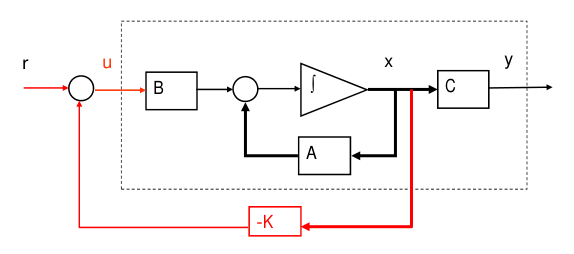
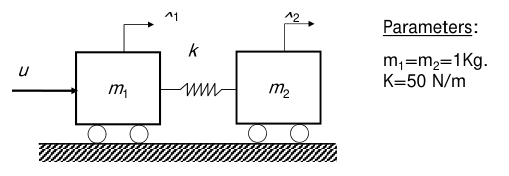
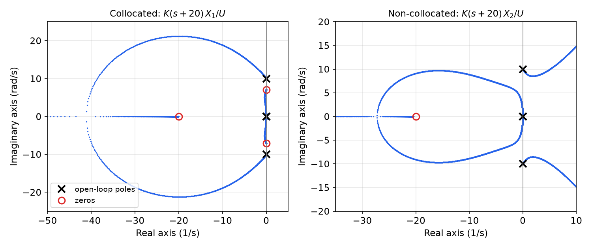
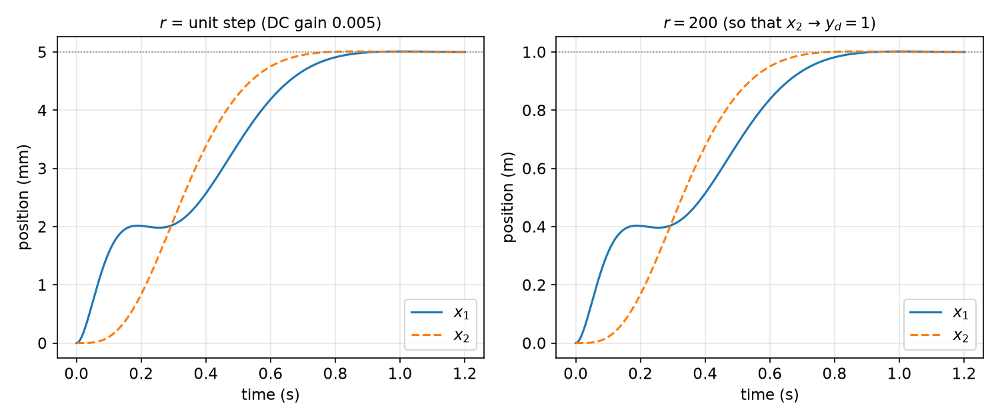
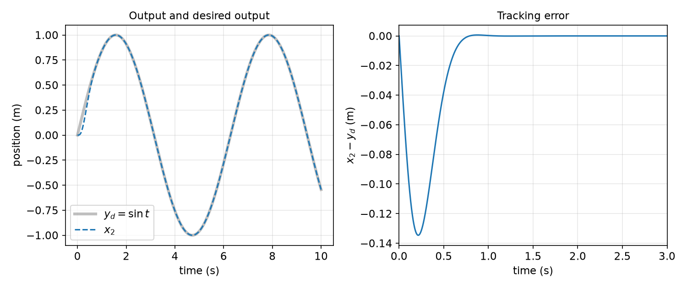
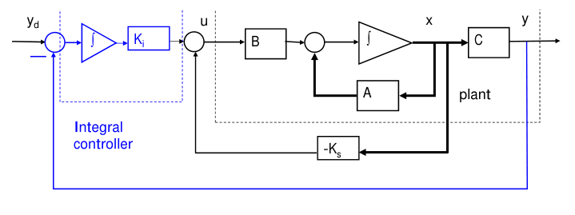
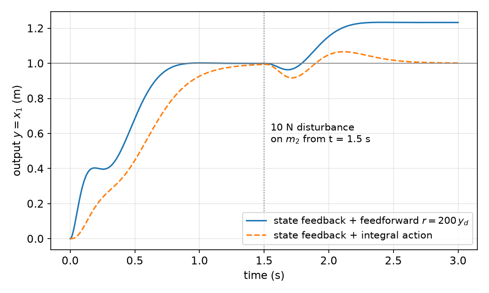
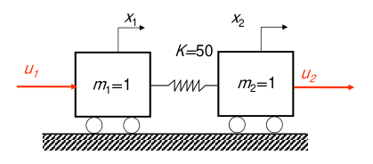
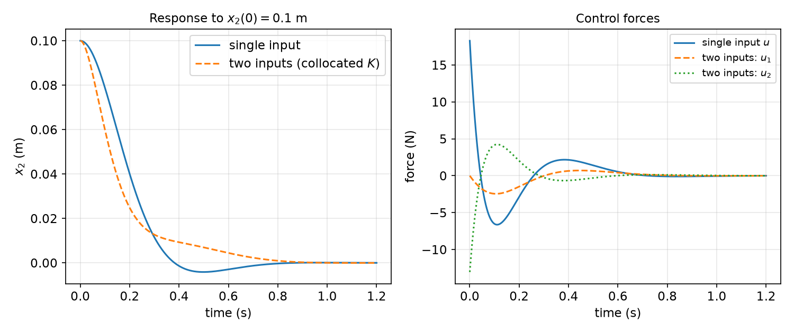

# State Feedback and Pole Placement

The analysis chapters answered two questions about a linear system: which modes the input can influence ([Controllability](controllability.md)) and which modes the output reveals ([Observability](observability.md)). This chapter turns the first answer into a design method. If every state is measured and the pair \\((A,B)\\) is controllable, the linear feedback law \\(u = -Kx + r\\) can move the closed-loop eigenvalues to *any* desired locations. We derive the gain in canonical coordinates, transform it back with the Bass–Gura and Ackermann formulas, add a reference input so the output tracks a command, add integral action so the tracking survives disturbances and model error, and extend the method to systems with several inputs. A two-mass flexible system, where classical PD control fails, runs through the chapter as the main example. The next two chapters remove the assumption that the full state is measured ([Observers](observers.md)) and combine the two designs ([Combined Controller–Observer Design](separation.md)).

## Feedback Control Objectives

In most applications the purpose of a control system is to **regulate or track** an output by adjusting the input, subject to physical limits on that input. There are two ways to do it.

- **Open-loop control** computes the command input from the desired output alone: desired output → controller → system → output. It works only as well as the model is accurate, and it cannot react to disturbances.
- **Closed-loop (feedback) control** measures the output with a sensor and feeds it back, so the controller acts on the difference between desired and actual behavior.

Feedback has clear advantages. It adjusts the input automatically, it makes the system less sensitive to parameter variations and disturbances, and it can stabilize a system that is unstable on its own. It also has costs. It adds complexity (sensors, wiring, computation), and badly designed feedback can *destabilize* a system that was stable in open loop. The overview chapters [Feedback Control and PID](../pid.md) and [Modern Control](../modern.md) discuss these trade-offs in the classical setting; here we work with the full state.

### State feedback

For the plant
\\[
\dot x = Ax + Bu, \qquad y = Cx, \qquad x \in \mathbb{R}^n,\ u \in \mathbb{R}^m,
\\]
a **state-feedback control law** is
\\[
u = -Kx + r ,
\\]
where \\(K \in \mathbb{R}^{m \times n}\\) is the **feedback gain** and \\(r\\) is a new external input, the **reference input**.



*Figure: state feedback. The plant (dashed box) is the integrator loop with A, input matrix B and output matrix C. The red path feeds the entire state x back through the gain −K and adds it to the reference r to form the control u.*

State feedback serves two objectives:

- **Regulation:** drive the state to an equilibrium (usually \\(x = 0\\)) with a desirable transient response.
- **Tracking:** make the output \\(y\\) follow a desired output \\(y\_d(t)\\) with a desirable transient response.

Throughout this chapter the sign convention is \\(u = -Kx + r\\), so that the closed-loop matrix is \\(A - BK\\) and MATLAB's `acker` and `place` return \\(K\\) directly. Some texts write \\(u = Kx + r\\) and \\(A + BK\\); the gains then differ by a sign.

## The Pole-Placement Problem

Substituting the control law into the plant gives the closed-loop system
\\[
\dot x = (A - BK)\\,x + Br, \qquad y = Cx .
\\]
Its natural modes are governed by the eigenvalues of \\(\bar A := A - BK\\), the **closed-loop poles**.

**Definition (Pole placement).** Given desired locations \\(\lambda\_1^{des},\dots,\lambda\_n^{des}\\) (a set closed under complex conjugation), find a gain \\(K\\) such that the eigenvalues of \\(A - BK\\) are exactly \\(\lambda\_1^{des},\dots,\lambda\_n^{des}\\). Equivalently, \\(K\\) must make the closed-loop characteristic polynomial equal to the **desired characteristic polynomial**
\\[
\Phi^{des}(s) = \prod\_{i=1}^n (s - \lambda\_i^{des}) = s^n + d\_1 s^{n-1} + \cdots + d\_{n-1}s + d\_n .
\\]

**Theorem (Eigenvalue assignment).** The eigenvalues of \\(A - BK\\) can be placed at any set of \\(n\\) locations (closed under conjugation) by a suitable real \\(K\\) if and only if \\((A,B)\\) is controllable.

*Proof.* Sufficiency is constructive; the sections below compute \\(K\\) for the single-input case, and the multi-input section reduces the general case to it. For necessity, suppose \\((A,B)\\) is not controllable. By the Kalman controllability decomposition (see [Structural Decompositions](structure.md)) there is an invertible \\(T\\) with
\\[
TAT^{-1} = \begin{bmatrix} A\_c & A\_{12} \\\\ 0 & A\_{\bar c} \end{bmatrix}, \qquad TB = \begin{bmatrix} B\_c \\\\ 0 \end{bmatrix}.
\\]
Writing \\(KT^{-1} = [K\_1\ \ K\_2]\\),
\\[
T(A - BK)T^{-1} = \begin{bmatrix} A\_c - B\_cK\_1 & A\_{12} - B\_cK\_2 \\\\ 0 & A\_{\bar c} \end{bmatrix},
\\]
which is block upper triangular. The eigenvalues of \\(A\_{\bar c}\\) appear among the closed-loop eigenvalues for every \\(K\\), so they cannot be moved. \\(\square\\)

The proof also shows the weaker statement that matters in practice: the closed loop can be made asymptotically stable if and only if the uncontrollable eigenvalues (those of \\(A\_{\bar c}\\)) already lie in the open left half-plane, that is, if and only if \\((A,B)\\) is **stabilizable**.

For low-order systems the gain can be found by brute force: write \\(\det(sI - A + BK)\\) in terms of the unknown entries of \\(K\\) and match coefficients with \\(\Phi^{des}\\).

**Example 11.1 (Double integrator with damping and settling-time specifications).** A unit mass obeys \\(\ddot x = u\\). Design state feedback that gives an underdamped response with damping ratio \\(\zeta\\) and 2% settling time \\(t\_s\\).

*Solution.* With \\(x\_1 = x\\), \\(x\_2 = \dot x\\),
\\[
A = \begin{bmatrix} 0 & 1 \\\\ 0 & 0 \end{bmatrix}, \quad B = \begin{bmatrix} 0 \\\\ 1 \end{bmatrix}, \quad
A - BK = \begin{bmatrix} 0 & 1 \\\\ -k\_1 & -k\_2 \end{bmatrix}, \quad
\det(sI - A + BK) = s^2 + k\_2 s + k\_1 .
\\]
The specifications fix the desired polynomial \\(s^2 + 2\zeta\omega\_n s + \omega\_n^2\\) with \\(t\_s \approx 4/(\zeta\omega\_n)\\), so \\(\omega\_n = 4/(\zeta t\_s)\\). Matching coefficients,
\\[
k\_1 = \omega\_n^2 = \frac{16}{\zeta^2 t\_s^2}, \qquad k\_2 = 2\zeta\omega\_n = \frac{8}{t\_s}.
\\]
The position gain \\(k\_1\\) acts as a virtual spring and the velocity gain \\(k\_2\\) as a virtual damper. The settling time is set by the damper alone.

**Example 11.2 (Coefficient matching for a general 2-state system).** Place the eigenvalues of
\\[
\dot x = \begin{bmatrix} 2 & 1 \\\\ -1 & 1 \end{bmatrix}x + \begin{bmatrix} 1 \\\\ 2 \end{bmatrix}u
\\]
at \\(-1\\) and \\(-2\\).

*Solution.* The desired polynomial is \\((s+1)(s+2) = s^2 + 3s + 2\\). With \\(K = [k\_1\ \ k\_2]\\),
\\[
A - BK = \begin{bmatrix} 2 - k\_1 & 1 - k\_2 \\\\ -1 - 2k\_1 & 1 - 2k\_2 \end{bmatrix},
\\]
whose trace is \\(3 - k\_1 - 2k\_2\\) and whose determinant is \\((2-k\_1)(1-2k\_2) + (1-k\_2)(1+2k\_1) = 3 + k\_1 - 5k\_2\\). Hence
\\[
\det(sI - A + BK) = s^2 + (k\_1 + 2k\_2 - 3)s + (3 + k\_1 - 5k\_2).
\\]
Matching gives \\(k\_1 + 2k\_2 = 6\\) and \\(k\_1 - 5k\_2 = -1\\), so \\(k\_2 = 1\\), \\(k\_1 = 4\\), and \\(K = [4\ \ 1]\\). Check: \\(A - BK = \begin{bmatrix} -2 & 0 \\\\ -9 & -1 \end{bmatrix}\\), with eigenvalues \\(-2, -1\\).

Coefficient matching produces nonlinear-looking but actually *linear* equations in \\(K\\) for single-input systems. The cleanest way to see this, and to get a closed-form gain for any \\(n\\), is to use a canonical form.

## Pole Placement in Controllable Canonical Form

A single-input system is in **controllable canonical form** when its matrices are companion matrices (see [State Transformations and Canonical Realizations](realizations.md)). Two versions are common. With \\(\Phi(s) = \det(sI - A) = s^n + a\_1 s^{n-1} + \cdots + a\_{n-1}s + a\_n\\),
\\[
\text{CCF I:}\quad A\_c = \begin{bmatrix} 0 & 1 & 0 & \cdots & 0 \\\\ 0 & 0 & 1 & \cdots & 0 \\\\ \vdots & & & \ddots & \vdots \\\\ 0 & 0 & \cdots & 0 & 1 \\\\ -a\_n & -a\_{n-1} & \cdots & -a\_2 & -a\_1 \end{bmatrix}, \quad B\_c = \begin{bmatrix} 0 \\\\ 0 \\\\ \vdots \\\\ 0 \\\\ 1 \end{bmatrix};
\\]
\\[
\text{CCF II:}\quad A\_c = \begin{bmatrix} -a\_1 & -a\_2 & \cdots & -a\_{n-1} & -a\_n \\\\ 1 & 0 & \cdots & 0 & 0 \\\\ 0 & 1 & \cdots & 0 & 0 \\\\ \vdots & & \ddots & & \vdots \\\\ 0 & 0 & \cdots & 1 & 0 \end{bmatrix}, \quad B\_c = \begin{bmatrix} 1 \\\\ 0 \\\\ \vdots \\\\ 0 \end{bmatrix}.
\\]
Both have characteristic polynomial \\(\Phi(s)\\); the coefficients can be read off a single row.

Take CCF II and \\(u = -K\_c x + r\\) with \\(K\_c = [k\_1\ \cdots\ k\_n]\\). Because \\(B\_c = e\_1\\), the product \\(B\_cK\_c\\) is zero except for its first row, which is \\(K\_c\\). The closed-loop matrix is therefore
\\[
A\_c - B\_cK\_c = \begin{bmatrix} -(a\_1 + k\_1) & -(a\_2 + k\_2) & \cdots & -(a\_{n-1} + k\_{n-1}) & -(a\_n + k\_n) \\\\ 1 & 0 & \cdots & 0 & 0 \\\\ 0 & 1 & \cdots & 0 & 0 \\\\ \vdots & & \ddots & & \vdots \\\\ 0 & 0 & \cdots & 1 & 0 \end{bmatrix}.
\\]
It is still in CCF II, so its characteristic polynomial can be read from the first row:
\\[
\det(sI - A\_c + B\_cK\_c) = s^n + (a\_1 + k\_1)s^{n-1} + \cdots + (a\_{n-1} + k\_{n-1})s + (a\_n + k\_n).
\\]
Matching with \\(\Phi^{des}\\) gives each gain separately:
\\[
\boxed{k\_i = d\_i - a\_i,\quad i = 1,\dots,n, \qquad K\_c = (d - a)^T}
\\]
with \\(a = [a\_1,\dots,a\_n]^T\\) and \\(d = [d\_1,\dots,d\_n]^T\\). In canonical coordinates, each feedback gain shifts exactly one coefficient of the characteristic polynomial. The gain needed is large when the desired coefficients are far from the open-loop ones, which is the first hint of the cost of aggressive pole placement.

## Transformation to Canonical Form: the Bass–Gura Formula

A general controllable system is not in canonical form, but it can be brought there by a change of coordinates \\(\hat x = Tx\\). If \\(\dot{\hat x} = A\_c\hat x + B\_c u\\), then the canonical-form gain \\(K\_c\\) gives \\(u = -K\_c\hat x + r = -K\_cTx + r\\), so the gain in the original coordinates is
\\[
K = K\_c T .
\\]
It remains to find \\(T\\).

Let \\(P = [B\ \ AB\ \cdots\ A^{n-1}B]\\) be the controllability matrix of \\((A,B)\\), and \\(P\_c\\) that of \\((A\_c,B\_c)\\). Under \\(\hat x = Tx\\), \\(A\_c = TAT^{-1}\\) and \\(B\_c = TB\\), so \\(A\_c^kB\_c = TA^kB\\) and
\\[
P\_c = TP .
\\]
If \\((A,B)\\) is controllable, \\(P\\) is invertible and \\(T = P\_cP^{-1}\\). The controllability matrix of a canonical form depends only on the coefficients \\(a\_i\\), and its inverse has a simple structure.

**Lemma.** For CCF II, \\(P\_c^{-1} = W\\), the upper-triangular Toeplitz matrix
\\[
W = \begin{bmatrix} 1 & a\_1 & a\_2 & \cdots & a\_{n-1} \\\\ 0 & 1 & a\_1 & \cdots & a\_{n-2} \\\\ \vdots & & \ddots & \ddots & \vdots \\\\ 0 & 0 & \cdots & 1 & a\_1 \\\\ 0 & 0 & \cdots & 0 & 1 \end{bmatrix}, \qquad W\_{ij} = a\_{j-i}\ (a\_0 := 1,\ a\_k := 0 \text{ for } k < 0).
\\]

*Proof.* We show \\(P\_cW = I\\). Column \\(j\\) of \\(P\_cW\\) is
\\[
v\_j = \sum\_{i=1}^{j} a\_{j-i}A\_c^{i-1}e\_1 = \left(A\_c^{j-1} + a\_1A\_c^{j-2} + \cdots + a\_{j-1}I\right)e\_1 .
\\]
Clearly \\(v\_1 = e\_1\\), and the sums satisfy the recursion \\(v\_{j+1} = A\_cv\_j + a\_je\_1\\). Column \\(j\\) of \\(A\_c\\) in CCF II is \\(-a\_je\_1 + e\_{j+1}\\) for \\(j < n\\), so if \\(v\_j = e\_j\\) then \\(v\_{j+1} = -a\_je\_1 + e\_{j+1} + a\_je\_1 = e\_{j+1}\\). By induction \\(v\_j = e\_j\\) for all \\(j\\). \\(\square\\)

Therefore \\(T = P\_cP^{-1} = W^{-1}P^{-1}\\), that is,
\\[
T = (PW)^{-1}.
\\]

**Theorem (Bass–Gura formula).** If the single-input pair \\((A,B)\\) is controllable, the gain
\\[
\boxed{K = (d - a)^T\\,(PW)^{-1} = (d - a)^T \left( P \begin{bmatrix} 1 & a\_1 & \cdots & a\_{n-1} \\\\ 0 & 1 & \cdots & a\_{n-2} \\\\ \vdots & & \ddots & \vdots \\\\ 0 & 0 & \cdots & 1 \end{bmatrix} \right)^{-1}}
\\]
places the eigenvalues of \\(A - BK\\) at the roots of \\(\Phi^{des}\\). For a single input this gain is unique.

Uniqueness follows because the map \\(K \mapsto K\_c = KT^{-1}\\) is one-to-one and \\(K\_c\\) is uniquely determined by \\(k\_i = d\_i - a\_i\\).

### A direct construction of the transformation

The same transformation can be built row by row, which also explains where the controllability condition enters. We look for \\(z = Tx\\) that puts the system in CCF I, \\(\dot z\_1 = z\_2,\ \dots,\ \dot z\_{n-1} = z\_n,\ \dot z\_n = -a\_nz\_1 - \cdots - a\_1z\_n + u\\). Let the first new state be \\(z\_1 = px\\) for a row vector \\(p\\). Differentiating along solutions,
\\[
\begin{aligned}
\dot z\_1 &= pAx + pBu, && \text{need } pB = 0 \text{ so that } z\_2 = pAx, \\\\
\dot z\_2 &= pA^2x + pABu, && \text{need } pAB = 0, \\\\
&\ \ \vdots \\\\
\dot z\_{n-1} &= pA^{n-1}x + pA^{n-2}Bu, && \text{need } pA^{n-2}B = 0, \\\\
\dot z\_n &= pA^nx + pA^{n-1}Bu, && \text{need } pA^{n-1}B = 1 .
\end{aligned}
\\]
These conditions say \\(p\\,[B\ \ AB\ \cdots\ A^{n-1}B] = [0\ \cdots\ 0\ \ 1]\\), so \\(p\\) exists (uniquely) if and only if \\(P\\) is invertible: **\\(p\\) is the last row of \\(P^{-1}\\)**. Then
\\[
T = \begin{bmatrix} p \\\\ pA \\\\ \vdots \\\\ pA^{n-1} \end{bmatrix}.
\\]
\\(T\\) is invertible because \\(TP\\) is triangular with respect to the anti-diagonal: entry \\((i,j)\\) is \\(pA^{i+j-2}B\\), which vanishes for \\(i + j \le n\\) and equals 1 for \\(i + j = n + 1\\). By the Cayley–Hamilton theorem the last equation becomes \\(\dot z\_n = pA^nx + u = -(a\_n p + a\_{n-1}pA + \cdots + a\_1pA^{n-1})x + u\\), which is exactly the CCF I last row.

## Ackermann's Formula

The Bass–Gura formula needs the open-loop coefficients \\(a\_i\\). Ackermann's formula avoids them.

**Theorem (Ackermann's formula).** If the single-input pair \\((A,B)\\) is controllable, the pole-placement gain is
\\[
\boxed{K = [0\ \ 0\ \cdots\ 0\ \ 1]\\,P^{-1}\\,\Phi^{des}(A)}, \qquad \Phi^{des}(A) = A^n + d\_1A^{n-1} + \cdots + d\_{n-1}A + d\_nI .
\\]

*Proof.* Let \\(\bar A = A - BK\\). By induction on \\(k\\),
\\[
\bar A^k = A^k - \sum\_{j=0}^{k-1} A^jBK\bar A^{k-1-j}.
\\]
(For the step, \\(\bar A^{k+1} = A\bar A^k - BK\bar A^k\\); substituting the formula for \\(\bar A^k\\) shifts every power of \\(A\\) up by one and the new term \\(-BK\bar A^k\\) is the \\(j = 0\\) term.) Multiply by \\(d\_{n-k}\\) (with \\(d\_0 = 1\\)) and sum over \\(k = 0,\dots,n\\). Collecting the terms that start with \\(A^jB\\),
\\[
\Phi^{des}(\bar A) = \Phi^{des}(A) - \sum\_{j=0}^{n-1} A^jB\\,w\_j, \qquad w\_j = \sum\_{k=j+1}^{n} d\_{n-k}K\bar A^{k-1-j}.
\\]
In particular \\(w\_{n-1} = d\_0K = K\\). If \\(K\\) places the poles at the roots of \\(\Phi^{des}\\), the Cayley–Hamilton theorem gives \\(\Phi^{des}(\bar A) = 0\\), so
\\[
\Phi^{des}(A) = P\begin{bmatrix} w\_0 \\\\ \vdots \\\\ w\_{n-1} \end{bmatrix}.
\\]
Multiplying by \\(P^{-1}\\) and taking the last row gives \\(K = w\_{n-1} = e\_n^TP^{-1}\Phi^{des}(A)\\). Since the pole-placing gain exists (Bass–Gura) and is unique, this formula computes it. \\(\square\\)

In terms of the row vector \\(p\\) of the previous section, Ackermann's formula reads \\(K = p\\,\Phi^{des}(A)\\). It is elegant and convenient for symbolic work, but numerically it relies on inverting \\(P\\) and forming powers of \\(A\\), which is poorly conditioned for large \\(n\\). Production software (MATLAB's `place`, `scipy.signal.place_poles`) uses orthogonal transformations instead.

**Example 11.3 (Third-order system with complex poles).** For
\\[
A = \begin{bmatrix} 1 & 1 & -2 \\\\ 0 & 1 & 1 \\\\ 0 & 0 & 1 \end{bmatrix}, \qquad B = \begin{bmatrix} 1 \\\\ 0 \\\\ 1 \end{bmatrix},
\\]
place the poles at \\(-2\\) and \\(-1 \pm j\\). The open loop has a triple eigenvalue at \\(+1\\). Ackermann's formula with \\(\Phi^{des}(s) = (s+2)(s^2+2s+2) = s^3 + 4s^2 + 6s + 4\\) (MATLAB `K=acker(A,B,[-2;-1+j;-1-j])`) gives
\\[
K = [15\ \ 47\ \ -8],
\\]
and the eigenvalues of \\(A - BK\\) are indeed \\(\\{-2, -1 \pm j\\}\\).

**Example 11.4 (Inverted pendulum on a cart: a symbolic gain).** A linearized pendulum–cart model with state \\([\theta,\ \dot\theta,\ x,\ \dot x]\\) and a parameter \\(\beta\\) is
\\[
\dot x = \begin{bmatrix} 0 & 1 & 0 & 0 \\\\ 1 & 0 & 0 & 0 \\\\ 0 & 0 & 0 & 1 \\\\ -\beta & 0 & 0 & 0 \end{bmatrix}x + \begin{bmatrix} 0 \\\\ -1 \\\\ 0 \\\\ 1 \end{bmatrix}u .
\\]
Place the closed-loop poles at \\(-1, -1, -1 \pm j\\).

*Solution.*
1. \\(\det(sI - A) = s^4 - s^2\\), independent of \\(\beta\\), so \\(a = [0,\ -1,\ 0,\ 0]^T\\).
2. \\(\Phi^{des}(s) = (s+1)^2(s^2 + 2s + 2) = s^4 + 4s^3 + 7s^2 + 6s + 2\\), so \\(d - a = [4,\ 8,\ 6,\ 2]^T\\).
3. The controllability matrix is
\\[
P = \begin{bmatrix} 0 & -1 & 0 & -1 \\\\ -1 & 0 & -1 & 0 \\\\ 0 & 1 & 0 & \beta \\\\ 1 & 0 & \beta & 0 \end{bmatrix}, \qquad \det P = (\beta - 1)^2 ,
\\]
so the system is controllable if and only if \\(\beta \ne 1\\).
4. Bass–Gura with \\(W = \begin{bmatrix} 1 & 0 & -1 & 0 \\\\ 0 & 1 & 0 & -1 \\\\ 0 & 0 & 1 & 0 \\\\ 0 & 0 & 0 & 1 \end{bmatrix}\\) gives
\\[
K = \left[\frac{2}{\beta - 1} - 8,\ \ \frac{6}{\beta - 1} - 4,\ \ \frac{2}{\beta - 1},\ \ \frac{6}{\beta - 1}\right].
\\]
The gains blow up as \\(\beta \to 1\\). This is a general phenomenon: as a system approaches loss of controllability, the effort needed to move its poles grows without bound.

## Example: The Two-Mass Flexible System

Two carts of mass \\(m\_1 = m\_2 = 1\\) kg roll on a track, joined by a spring of stiffness \\(k = 50\\) N/m. A force \\(u\\) acts on the first cart; the positions are \\(x\_1\\) and \\(x\_2\\). This is the simplest model of a flexible structure (a robot arm with a compliant link, a disk-drive head on a flexible suspension), and it exposes the main weakness of classical output feedback.



*Figure: the two-mass flexible system. The actuator force u acts on m₁; the spring k couples the carts; x₁ and x₂ are the cart positions measured from the unstretched configuration.*

### State model

With \\(x\_3 = \dot x\_1\\) and \\(x\_4 = \dot x\_2\\), Newton's law for each cart gives
\\[
\frac{d}{dt}\begin{bmatrix} x\_1 \\\\ x\_2 \\\\ x\_3 \\\\ x\_4 \end{bmatrix} = \begin{bmatrix} 0 & 0 & 1 & 0 \\\\ 0 & 0 & 0 & 1 \\\\ -50 & 50 & 0 & 0 \\\\ 50 & -50 & 0 & 0 \end{bmatrix}\begin{bmatrix} x\_1 \\\\ x\_2 \\\\ x\_3 \\\\ x\_4 \end{bmatrix} + \begin{bmatrix} 0 \\\\ 0 \\\\ 1 \\\\ 0 \end{bmatrix}u .
\\]
The controllability matrix, computed column by column as \\(P = [B\ \ AB\ \ A(AB)\ \ A(A^2B)]\\), is
\\[
P = \begin{bmatrix} 0 & 1 & 0 & -50 \\\\ 0 & 0 & 0 & 50 \\\\ 1 & 0 & -50 & 0 \\\\ 0 & 0 & 50 & 0 \end{bmatrix},
\\]
which has full rank: the system is controllable. Its open-loop characteristic polynomial is \\(\Phi(s) = s^4 + 100s^2 = s^2(s^2 + 100)\\): a double pole at the origin (the rigid-body motion of both carts together) and a pair at \\(\pm 10j\\) (the flexible mode, in which the carts vibrate against each other at \\(\sqrt{k(1/m\_1 + 1/m\_2)} = 10\\) rad/s).

### Why PD control is not enough

The two possible position measurements give different transfer functions:
\\[
\text{collocated (sensor on } m\_1\text{):}\quad \frac{X\_1(s)}{U(s)} = \frac{s^2 + 50}{s^2(s^2 + 100)}, \qquad
\text{non-collocated (sensor on } m\_2\text{):}\quad \frac{X\_2(s)}{U(s)} = \frac{50}{s^2(s^2 + 100)} .
\\]
Try the PD controller \\(G\_c(s) = K(s + 20)\\) on each.



*Figure: root loci of PD control K(s+20) for 0 < K < 10⁴. Left: with the collocated sensor, the open-loop zeros at ±j√50 ≈ ±7.07j sit between the rigid-body poles and the flexible poles at ±10j, so the flexible branches travel a short arc into the left half-plane and the system is stable for every K > 0, although the flexible mode stays lightly damped. Right: with the non-collocated sensor there are no imaginary zeros; the flexible-mode branches leave ±10j toward the right half-plane, and the loop is unstable.*

The collocated case shows **pole–zero interlacing**: along the imaginary axis, poles and zeros alternate (\\(0, 0\\), then \\(\pm 7.07j\\), then \\(\pm 10j\\)). Interlacing is the generic property of collocated sensor–actuator pairs on lightly damped structures, and it is why collocated control is robustly stable. In the non-collocated case the relative degree is 4; a PD controller supplies only 90° of phase lead, which is not enough, and the root-locus asymptotes at \\(\pm 60°\\) pull the flexible branches into the right half-plane. Measuring only \\(x\_2\\) and differentiating it cannot stabilize the system. Feeding back all four states can.

### State-feedback design

Place the closed-loop poles at \\(-10, -10, 5\sqrt2(-1 \pm j)\\). The open-loop coefficients are \\(a = [0,\ 100,\ 0,\ 0]^T\\), and
\\[
\Phi^{des}(s) = (s + 10)^2\left((s + 5\sqrt2)^2 + 50\right) = s^4 + 34.14s^3 + 482.8s^2 + 3414s + 10000 .
\\]
Bass–Gura gives
\\[
K = \begin{bmatrix} 34.14 - 0 \\\\ 482.8 - 100 \\\\ 3414 - 0 \\\\ 10000 - 0 \end{bmatrix}^T \left( P\begin{bmatrix} 1 & 0 & 100 & 0 \\\\ 0 & 1 & 0 & 100 \\\\ 0 & 0 & 1 & 0 \\\\ 0 & 0 & 0 & 1 \end{bmatrix} \right)^{-1}
\\]
\\[
\boxed{K = [382.8\ \ -182.8\ \ 34.14\ \ 34.14], \qquad u = -382.8x\_1 + 182.8x\_2 - 34.14x\_3 - 34.14x\_4 + r .}
\\]
Ackermann's formula gives the same gain, and the eigenvalues of \\(A - BK\\) are exactly \\(-10, -10, -7.07 \pm 7.07j\\). Rounding the polynomial to \\(s^4 + 34s^3 + 483s^2 + 3414s + 10000\\) and the gain to \\([382\ \ -183\ \ 34\ \ 34]\\) is tempting but moves the poles noticeably, to about \\(-7.22 \pm 7.01j\\) and \\(-9.78 \pm 1.61j\\): a repeated pole is very sensitive to perturbations of the coefficients, because a double root of a polynomial moves like the square root of a coefficient error.

The gains have a physical reading. The term \\(-382.8x\_1 + 182.8x\_2 = -200x\_1 - 182.8(x\_1 - x\_2)\\) combines a virtual spring to ground (stiffness 200) with a feedback term proportional to the spring stretch \\(x\_1 - x\_2\\), and the two velocity gains add damping to both the rigid and the flexible motion. The controller uses the measured state of the far mass to add damping to the flexible mode, which no collocated PD controller can do as effectively.

```matlab
% System matrices
A=[0 0 1 0;0 0 0 1;-50 50 0 0;50 -50 0 0];
B=[0; 0; 1; 0];
C=[1 0 0 0;0 1 0 0]; D=zeros(2,1);
% PD root loci
syst=ss(A,B,C,D); [num,den]=tfdata(syst);
pd=[1 20];
rlocus(tf(conv(pd,num{1}),den{1}));   % collocated
rlocus(tf(conv(pd,num{2}),den{2}));   % non-collocated
% State feedback
P=[-10;-10;-5*sqrt(2)*(1+j);-5*sqrt(2)*(1-j)];
K=acker(A,B,P);
clsys=ss(A-B*K,B,C,D);
step(clsys);
```

A Python equivalent uses `scipy.signal.place_poles` (which, like `place`, does not accept a pole repeated more times than the number of inputs) or the `acker` function of the python-control package:

```python
import numpy as np, control as ct
A = np.array([[0,0,1,0],[0,0,0,1],[-50,50,0,0],[50,-50,0,0]])
B = np.array([[0],[0],[1],[0]])
p = [-10, -10, 5*np.sqrt(2)*(-1+1j), 5*np.sqrt(2)*(-1-1j)]
K = ct.acker(A, B, p)          # [[382.84, -182.84, 34.14, 34.14]]
```

### The cost of state feedback

State feedback is powerful, but it is not free. It requires every state to be measured (or estimated, as in the next chapter); here that means two position sensors and two velocity sensors. The gains grow quickly as the desired poles move away from the open-loop poles, so aggressive designs saturate actuators and amplify sensor noise. And the closed-loop poles are placed for the *model*: a repeated pole, as above, is particularly sensitive to model error. For multi-input systems the freedom left after pole placement can be used to reduce these costs, and the [Linear Quadratic Regulator](lqr.md) resolves the choice of pole locations through an explicit trade-off between state error and control effort.

## Tracking

State feedback places the poles but says nothing about the steady-state value of the output. For the flexible system, the step response with \\(r\\) a unit step settles at \\(x\_1 = x\_2 = 0.005\\), not 1.



*Figure: step responses of the flexible system under the pole-placement gain. Left: r is a unit step, and both cart positions settle at the closed-loop DC gain 0.005 (5 mm). The first cart responds first and shows a shoulder while the spring stretches; the second follows smoothly. Right: scaling the reference to r = 200 brings x₂ (and x₁) to 1 m in about 0.9 s without overshoot.*

The objective of **state-feedback tracking** is to find both \\(K\\) and a reference input \\(r\\) such that (i) the closed-loop poles are at the specified locations and (ii) the output \\(y\\) follows a given desired output \\(y\_d\\), at least asymptotically. The gain \\(K\\) handles (i). The reference input must be designed to achieve (ii).

### Constant set points

Let \\(y\_d\\) be constant and let \\(x\_d\\) be the corresponding steady state of the closed loop. At steady state \\(\dot x = 0\\):
\\[
0 = (A - BK)x\_d + Br, \qquad y\_d = Cx\_d .
\\]
Since \\(A - BK\\) is Hurwitz it is invertible, and
\\[
\boxed{x\_d = -(A - BK)^{-1}Br, \qquad r = -\left(C(A - BK)^{-1}B\right)^{-1}y\_d .}
\\]
The matrix \\(G\_{cl}(0) = -C(A - BK)^{-1}B\\) is the closed-loop DC gain; it must be square and invertible (as many independent inputs as outputs to be set). If the desired state is an equilibrium of the open-loop plant (\\(Ax\_d = 0\\)), then \\(r = Kx\_d\\) and the control law becomes \\(u = K(x\_d - x)\\): the controller feeds back the state error.

**Example 11.5 (Set-point control of the flexible system).** Move \\(y = x\_2\\) from 0 to \\(y\_d = 1\\) with the poles at \\(-10, -10, 5\sqrt2(-1 \pm j)\\).

*Solution.* The DC gain is \\(-C(A - BK)^{-1}B = 0.005\\). This also follows from the transfer function: state feedback leaves the numerator 50 unchanged and replaces the denominator by \\(\Phi^{des}\\), so \\(X\_2/R = 50/\Phi^{des}(s)\\) and the DC gain is \\(50/10000\\). Hence \\(r = 1/0.005 = 200\\) (`step(200*clsys)`), which gives the right panel of the figure above. Since \\(X\_1/R = (s^2 + 50)/\Phi^{des}(s)\\) also has DC gain 0.005, both carts end at 1 m and the spring is unstretched, as it must be with no external force.

This feedforward requires exact knowledge of the plant; the section on integral action removes that requirement.

### Invariance of zeros under state feedback

To track a time-varying \\(y\_d\\) we need the closed-loop transfer function. For a SISO plant write
\\[
\frac{Y(s)}{R(s)} = C(sI - A + BK)^{-1}B = \frac{N(s)}{D(s)}, \qquad D(s) = \Phi^{des}(s) = s^n + d\_1s^{n-1} + \cdots + d\_n .
\\]

**Proposition (State feedback does not move zeros).** \\(N(s)\\) is the numerator \\(b\_0s^m + \cdots + b\_m\\) of the open-loop transfer function \\(C(sI - A)^{-1}B\\).

*Proof.* The zeros are the values of \\(s\\) where the Rosenbrock system matrix drops rank, and
\\[
\begin{bmatrix} sI - A + BK & B \\\\ C & 0 \end{bmatrix} = \begin{bmatrix} sI - A & B \\\\ C & 0 \end{bmatrix}\begin{bmatrix} I & 0 \\\\ K & I \end{bmatrix}.
\\]
The right factor is invertible, so both matrices lose rank at the same \\(s\\). For a SISO system, \\(C(sI - A)^{-1}B = \det\begin{bmatrix} sI - A & B \\\\ C & 0 \end{bmatrix}\big/ \det(sI - A)\\) up to sign, and the identity shows that the numerator determinant is the same for both. \\(\square\\)

State feedback moves the poles freely but leaves the zeros where they are. A plant zero cannot be removed except by cancelling it with a pole, which makes the corresponding mode unobservable.

### Tracking arbitrary outputs by model inversion

To make \\(y\\) follow an arbitrary \\(y\_d\\) exactly, choose \\(R(s) = \frac{D(s)}{N(s)}Y\_d(s)\\), so that \\(Y = Y\_d\\). Divide \\(D\\) (degree \\(n\\)) by \\(N\\) (degree \\(m\\)):
\\[
\frac{R(s)}{Y\_d(s)} = \frac{D(s)}{N(s)} = c\_{n-m}s^{n-m} + c\_{n-m-1}s^{n-m-1} + \cdots + c\_0 + \frac{D'(s)}{N(s)},
\\]
where \\(D'\\) is the remainder (degree less than \\(m\\)). In the time domain
\\[
\boxed{r(t) = c\_{n-m}\frac{d^{n-m}y\_d}{dt^{n-m}} + \cdots + c\_1\frac{dy\_d}{dt} + c\_0y\_d + r\_d(t),}
\\]
where \\(r\_d\\) is the output of the system \\(D'(s)/N(s)\\) driven by \\(y\_d\\). Two conditions are needed:

- \\(y\_d\\) must be smooth, with \\(n - m\\) derivatives available (the relative degree is the number of integrations between \\(u\\) and \\(y\\)).
- The plant must be **minimum phase**: \\(N(s)\\) must have all its roots in the open left half-plane, otherwise \\(D'/N\\) is unstable and \\(r\_d\\) grows without bound. For non-minimum-phase plants exact tracking of arbitrary signals is impossible with a bounded input; only approximate or preview-based schemes work.

If the initial state does not match \\(y\_d\\) and its derivatives at \\(t = 0\\), the mismatch decays with the closed-loop poles, which is why they are still placed.

**Example 11.6 (Tracking a sinusoid with the flexible system).** Make \\(x\_2\\) follow a smooth \\(y\_d(t)\\), with the same poles.

*Solution.* The open-loop transfer function \\(X\_2/U = 50/(s^2(s^2 + 100))\\) has no finite zeros (\\(m = 0\\), trivially minimum phase), so \\(N = 50\\), \\(D' = 0\\), and
\\[
\frac{R(s)}{Y\_d(s)} = \frac{s^4 + 34.14s^3 + 482.8s^2 + 3414s + 10000}{50},
\\]
\\[
\boxed{r(t) = \tfrac{1}{50}\left(y\_d^{(4)} + 34.14\\,\dddot y\_d + 482.8\\,\ddot y\_d + 3414\\,\dot y\_d + 10000\\,y\_d\right).}
\\]
For \\(y\_d = \sin t\\) the derivatives are \\(\cos t, -\sin t, -\cos t, \sin t\\), and the reference input is a weighted sum of them:

```matlab
Pd=[-10;-10;-5*sqrt(2)*(1+j);-5*sqrt(2)*(1-j)];
K=acker(A,B,Pd);
clsys=ss(A-B*K,B,C,D);
[num,den]=tfdata(clsys); num=num{2}; den=den{2};
T=[0:0.01:20]'; st=sin(T); ct=cos(T);
R=[st -ct -st ct st]*den'/num(5);   % [yd'''' yd''' yd'' yd' yd]*den/50
Y=lsim(clsys,R,T);
plot(T,Y(:,2)-st); xlabel('Time (sec)'); ylabel('Error')
```



*Figure: tracking y_d = sin t with the model-inversion reference. Left: x₂ overlays the desired output after a short start-up. Right: the error dips to about −0.135 m at t ≈ 0.21 s and is zero after about 0.8 s. The transient exists only because the system starts at rest while ẏ_d(0) = 1; after it decays, tracking is exact.*

**Example 11.7 (Speed control of a two-mass system and a common mistake).** Two unit masses are joined by a spring of stiffness \\(K\\); write \\(\omega = \sqrt{2K}\\). With \\(x\_1 = v\_1\\), \\(x\_2 = v\_2\\) (the cart velocities) and \\(x\_3\\) the spring deflection, and the force applied to the second mass,
\\[
\dot x = \begin{bmatrix} 0 & 0 & -\omega^2/2 \\\\ 0 & 0 & \omega^2/2 \\\\ 1 & -1 & 0 \end{bmatrix}x + \begin{bmatrix} 0 \\\\ 1 \\\\ 0 \end{bmatrix}u, \qquad y = x\_1 .
\\]
(a) Place the poles at \\(-\omega, -\omega \pm \omega j\\). (b) Find \\(r\\) so that \\(y \to y\_d = 1 - \cos\omega t\\).

*Solution.* (a) \\(\det(sI - A) = s^3 + \omega^2s\\) and \\(P(s) = \dfrac{\omega^2/2}{s(s^2 + \omega^2)}\\). The desired polynomial is \\((s + \omega)(s^2 + 2\omega s + 2\omega^2) = s^3 + 3\omega s^2 + 4\omega^2s + 2\omega^3\\). Bass–Gura gives
\\[
K = [\omega,\ \ 3\omega,\ \ -3\omega^2], \qquad \frac{Y}{R} = \frac{\omega^2/2}{(s + \omega)(s^2 + 2\omega s + 2\omega^2)} .
\\]
(b) The DC gain is \\(1/(4\omega)\\), so the constant part of \\(y\_d\\) needs \\(r = 4\omega\\). It is tempting to write \\(r = 4\omega(1 - \cos\omega t)\\), but this is **wrong**: a static gain inverts the closed loop only at \\(s = 0\\). At the frequency \\(\omega\\) the inverse closed-loop gain is
\\[
\frac{1}{G\_{cl}(j\omega)} = \frac{(j\omega + \omega)\left((j\omega)^2 + 2\omega(j\omega) + 2\omega^2\right)}{\omega^2/2} = \omega(-2 + 6j),
\\]
so the input producing \\(-\cos\omega t\\) at the output is \\(-\mathrm{Re}\\{\omega(-2 + 6j)e^{j\omega t}\\} = 2\omega\cos\omega t + 6\omega\sin\omega t\\). Equivalently, apply the inverse dynamics \\(r = \tfrac{2}{\omega^2}(\dddot y\_d + 3\omega\ddot y\_d + 4\omega^2\dot y\_d + 2\omega^3y\_d)\\). Either way,
\\[
r(t) = 4\omega + 2\omega\cos\omega t + 6\omega\sin\omega t ,
\\]
and \\(y(t) \to 1 - \cos\omega t\\) exactly in steady state.

## Integral Action

The feedforward \\(r = -(C(A - BK)^{-1}B)^{-1}y\_d\\) is exact only if the model is exact and no disturbance acts. With a constant disturbance \\(w\\) entering as \\(\dot x = Ax + Bu + w\\), the steady state becomes \\(y\_d = -C(A - BK)^{-1}(Br + w)\\), so the correct reference would be \\(r = G\_{cl}(0)^{-1}\left(y\_d + C(A - BK)^{-1}w\right)\\). Computing it needs the disturbance, which is unknown. For constant or slowly varying \\(y\_d\\) the reference can instead be generated *automatically* by integrating the tracking error.

### The integral control law

Let \\(e = y - y\_d\\) and introduce the **integral state** \\(x\_I = \int\_0^t e(\tau)\\,d\tau\\). The control law is
\\[
u = -K\_sx - K\_I\int\_0^t e(\tau)\\,d\tau = -K\_sx - K\_Ix\_I .
\\]



*Figure: state feedback with integral action. The tracking error between y_d and the measured output y is integrated and multiplied by K_I (blue dashed box); the result replaces the hand-computed reference r. The inner loop is ordinary state feedback with gain −K_s.*

With the disturbance, the plant and integrator together are
\\[
\frac{d}{dt}\begin{bmatrix} x \\\\ x\_I \end{bmatrix} = \underbrace{\begin{bmatrix} A & 0 \\\\ C & 0 \end{bmatrix}}\_{\bar A}\begin{bmatrix} x \\\\ x\_I \end{bmatrix} + \underbrace{\begin{bmatrix} B \\\\ 0 \end{bmatrix}}\_{\bar B}u + \begin{bmatrix} w \\\\ -y\_d \end{bmatrix},
\qquad u = -[K\_s\ \ K\_I]\begin{bmatrix} x \\\\ x\_I \end{bmatrix},
\\]
so the closed-loop matrix is \\(\bar A - \bar B[K\_s\ \ K\_I]\\). The design is ordinary pole placement for the augmented pair \\((\bar A, \bar B)\\) of dimension \\(n + p\\), where \\(p\\) is the number of outputs: `K=acker(Abar,Bbar,Pd)` for a single input, `K=place(Abar,Bbar,Pd)` for several.

**Theorem (Zero steady-state error).** If \\(K = [K\_s\ \ K\_I]\\) makes \\(\bar A - \bar BK\\) Hurwitz, then for every constant disturbance \\(w\\) and constant set point \\(y\_d\\), \\(\lim\_{t\to\infty} e(t) = 0\\).

*Proof.* The closed loop is an asymptotically stable linear system driven by the constant input \\((w, -y\_d)\\), so every state converges to a constant. In particular \\(x\_I(t)\\) converges, so its derivative \\(\dot x\_I = e\\) tends to zero. \\(\square\\)

The argument uses no knowledge of \\(A\\), \\(B\\), \\(w\\) beyond the stability of the closed loop. It survives any model error that does not destroy stability, which is the robustness property that makes integral action universal in practice (it is the "I" of PID control).

**Proposition (When can the augmented poles be placed?).** \\((\bar A, \bar B)\\) is controllable if and only if \\((A, B)\\) is controllable and
\\[
\operatorname{rank}\begin{bmatrix} A & B \\\\ C & 0 \end{bmatrix} = n + p .
\\]

*Proof.* Apply the PBH test. For \\(\lambda \ne 0\\),
\\[
\operatorname{rank}[\bar A - \lambda I\ \ \bar B] = \operatorname{rank}\begin{bmatrix} A - \lambda I & 0 & B \\\\ C & -\lambda I & 0 \end{bmatrix} = p + \operatorname{rank}[A - \lambda I\ \ B],
\\]
which equals \\(n + p\\) exactly when \\(\lambda\\) is not an uncontrollable eigenvalue of \\((A,B)\\). For \\(\lambda = 0\\) the middle block column vanishes and the rank is that of \\(\begin{bmatrix} A & B \\\\ C & 0 \end{bmatrix}\\). \\(\square\\)

For a square plant the rank condition says that the plant has **no zero at \\(s = 0\\)**. A zero at the origin would cancel the integrator, which could then not be controlled: a plant that differentiates its input cannot hold a constant output with a bounded input.

**Example 11.8 (Integral control of the flexible system with a disturbance).** For the flexible system with the force on \\(m\_1\\), the output \\(y = x\_1\\), and a constant 10 N disturbance force on \\(m\_2\\), design an integral controller placing the five poles at \\(-10, -10, -5, 5\sqrt2(-1 \pm j)\\).

*Solution.* The augmented system has \\(\bar A = \begin{bmatrix} A & 0 \\\\ C & 0 \end{bmatrix}\\) (5×5), \\(\bar B = [0\ 0\ 1\ 0\ 0]^T\\), and the exogenous inputs enter through \\([0\ 0\ 0\ 10\ -1]^T\\) (10 N on the \\(\dot x\_4\\) equation and \\(-y\_d\\) on the integrator). The plant \\(X\_1/U = (s^2 + 50)/(s^2(s^2 + 100))\\) has no zero at the origin, so \\((\bar A, \bar B)\\) is controllable. Ackermann's formula gives
\\[
K = [K\_s\ \ K\_I] = [553.6\ \ -12.13\ \ 39.14\ \ 57.43\ \ 1000],
\\]
with closed-loop poles exactly as specified. In steady state \\(x\_1 = 1\\), \\(x\_2 = 1.2\\) (the spring is stretched by 0.2 m so that it transmits the 10 N disturbance force back to the actuator), and the integrator holds \\(x\_I = -0.529\\), which supplies the needed constant force.

```matlab
A=[0 0 1 0;0 0 0 1;-50 50 0 0;50 -50 0 0];
B=[0;0;1;0]; C=[1 0 0 0]; D=0;
Pd=[-5;-10;-10;-5*sqrt(2)*(1+j);-5*sqrt(2)*(1-j)];
Abar=[A zeros(4,1);C 0];
Bbar=[B;0]; Bwbar=[0;0;0;10;-1];   % 10 N disturbance force on m2, and -y_d
Cbar=[C 0];
K=acker(Abar,Bbar,Pd);
clsys=ss(Abar-Bbar*K,Bwbar,Cbar,D);
step(clsys,[0:0.01:20]);
```



*Figure: response of y = x₁ to a unit set point, with a 10 N disturbance force applied to m₂ from t = 1.5 s. The feedforward design (r = 200 y_d with the gain of the previous section) is faster at first but settles at 1.23 m once the disturbance acts. The integral controller is slower, because of its extra pole at −5, but returns the output to exactly 1.*

**Example 11.9 (Hover model: reference scaling, disturbance and integral action).** A helicopter-like hover model has horizontal velocity \\(x\_1\\), pitch rate \\(x\_2\\), pitch angle \\(x\_3\\), and a disturbance \\(w\\):
\\[
\dot x = \begin{bmatrix} -0.2 & -5 & 10 \\\\ -0.1 & -1 & 0 \\\\ 0 & 1 & 0 \end{bmatrix}x + \begin{bmatrix} 10 \\\\ 8 \\\\ 0 \end{bmatrix}u + \begin{bmatrix} -0.2 \\\\ -0.1 \\\\ 0 \end{bmatrix}w, \qquad y = [1\ 0\ 0]\\,x .
\\]

*Solution.*
1. The open-loop eigenvalues are \\(-1.715\\) and \\(0.258 \pm 0.719j\\): unstable.
2. Placing the poles at \\(-2, -\sqrt2 \pm \sqrt2 j\\) (\\(\omega\_n = 2\\), \\(\zeta = 0.707\\)) gives \\(K = [0.0762\ \ 0.3583\ \ 1.5036]\\).
3. Reference scaling: \\(r = Nv\_d\\) with \\(N = -\left(C(A - BK)^{-1}B\right)^{-1} = 0.1\\). Without disturbance \\(x\_1 \to v\_d\\); the response first dips slightly because the plant is non-minimum phase.
4. With a constant \\(w = 10\\) and \\(v\_d = 1\\), the steady state is \\(x\_1(\infty) = -C(A - BK)^{-1}(BN + B\_w \cdot 10) = -1.38\\), far from the target.
5. With integral action and the four poles \\(-2, -2, -\sqrt2 \pm \sqrt2 j\\), Ackermann's formula on the augmented system gives \\([K\_s\ \ K\_I] = [0.3769\ \ 0.2324\ \ 3.5978\ \ 0.2000]\\), and \\(x\_1 \to 1\\) with zero steady-state error, with or without the disturbance (with \\(w = 10\\) there is an initial excursion to about \\(-0.8\\) before it recovers, settling in about 4 s).

## Multi-Input Systems

Pole placement applies equally to systems with several inputs. If \\((A,B)\\) is controllable, \\(u = -Kx + r\\) can place the eigenvalues of \\(A - BK\\) arbitrarily. The new feature is that **the gain is not unique**: \\(K\\) has \\(mn\\) entries but only \\(n\\) eigenvalues are specified. The extra freedom can shape the eigenvectors, decouple subsystems, or reduce the gains. Numerical algorithms such as MATLAB's `place` (robust eigenstructure assignment) use it to make the closed-loop eigenvalues insensitive to perturbations; the [LQR](lqr.md) uses it to minimize a quadratic cost.

### Controllability indices and the multi-input canonical form

Let \\(b\_1,\dots,b\_m\\) be the columns of \\(B\\). The \\(n \times mn\\) controllability matrix \\(P = [B\ \ AB\ \cdots\ A^{n-1}B]\\) has rank \\(n\\). Scan its columns from left to right, \\(b\_1, \dots, b\_m, Ab\_1, \dots, Ab\_m, A^2b\_1, \dots\\), keeping each column that is linearly independent of those already kept, until \\(n\\) columns are found. If \\(A^kb\_i\\) depends on earlier columns, so does every \\(A^{k+j}b\_i\\), so the kept columns can be rearranged as
\\[
M = [\\,b\_1\ \ Ab\_1\ \cdots\ A^{\mu\_1 - 1}b\_1\ \ \cdots\ \ b\_m\ \ Ab\_m\ \cdots\ A^{\mu\_m - 1}b\_m\\,],
\\]
The integers \\(\mu\_i\\), with \\(\sum\_i\mu\_i = n\\), are the **controllability indices**. The largest of them is the smallest \\(k\\) for which \\([B\ \ AB\ \cdots\ A^{k-1}B]\\) has rank \\(n\\).

Partition the rows of \\(M^{-1}\\) into blocks of sizes \\(\mu\_1,\dots,\mu\_m\\), and let \\(m\_i\\) be the **last** row of block \\(i\\). By construction \\(m\_iA^jb\_k\\) equals 1 for \\(k = i\\), \\(j = \mu\_i - 1\\) and vanishes for the other columns of \\(M\\). Exactly as in the single-input construction, the rows
\\[
T = \begin{bmatrix} m\_1 \\\\ m\_1A \\\\ \vdots \\\\ m\_1A^{\mu\_1 - 1} \\\\ \vdots \\\\ m\_m \\\\ \vdots \\\\ m\_mA^{\mu\_m - 1} \end{bmatrix}
\\]
define \\(z = Tx\\) in which the state splits into \\(m\\) chains of integrators,
\\[
\dot z\_{i,1} = z\_{i,2},\ \dots,\ \dot z\_{i,\mu\_i - 1} = z\_{i,\mu\_i}, \qquad \dot z\_{i,\mu\_i} = \alpha\_iz + \beta\_iu ,
\\]
where \\(\alpha\_i\\) and \\(\beta\_i = m\_iA^{\mu\_i - 1}B\\) are row vectors. The matrix with rows \\(\beta\_i\\) is upper triangular with unit diagonal, hence invertible. This is the **multi-input controllable canonical form** (MICF): \\(A\_c = TAT^{-1}\\) is block diagonal with companion blocks of sizes \\(\mu\_i\\), plus coupling entries in the last row of each block, and \\(B\_c = TB\\) is nonzero only in those last rows.

The design procedure is:

1. Transform to MICF with \\(z = Tx\\).
2. Choose \\(K\_c\\) to place the poles of \\(A\_c - B\_cK\_c\\). Each block's last row can be set at will, because the \\(\beta\_i\\) are independent; one may cancel the coupling and place the poles of each block separately, or chain the blocks into a single companion matrix.
3. Return to the original coordinates with \\(K = K\_cT\\).

### Example: the two-input flexible system

Add a second actuator, a force \\(u\_2\\) on \\(m\_2\\).



*Figure: the flexible system with two actuators, u₁ on m₁ and u₂ on m₂, both positive to the right.*

The state matrix is unchanged and
\\[
B = \begin{bmatrix} 0 & 0 \\\\ 0 & 0 \\\\ 1 & 0 \\\\ 0 & 1 \end{bmatrix}, \qquad
A - BK = \begin{bmatrix} 0 & 0 & 1 & 0 \\\\ 0 & 0 & 0 & 1 \\\\ -50 - k\_{11} & 50 - k\_{12} & -k\_{13} & -k\_{14} \\\\ 50 - k\_{21} & -50 - k\_{22} & -k\_{23} & -k\_{24} \end{bmatrix}.
\\]
Place the poles again at \\(-10, -10, 5\sqrt2(-1 \pm j)\\).

**Design 1: collocated structure.** Restrict each actuator to its own cart's position and velocity,
\\[
K = \begin{bmatrix} k\_1 & 0 & k\_3 & 0 \\\\ 0 & k\_2 & 0 & k\_4 \end{bmatrix}.
\\]
Then
\\[
\det(sI - A + BK) = s^4 + (k\_3 + k\_4)s^3 + (k\_1 + k\_2 + k\_3k\_4 + 100)s^2 + (50k\_3 + 50k\_4 + k\_1k\_4 + k\_2k\_3)s + 50k\_1 + 50k\_2 + k\_1k\_2 .
\\]
Equating to \\(\Phi^{des}\\) gives four polynomial equations in four unknowns. A real solution is
\\[
k\_1 = 19.28,\quad k\_2 = 130.43,\quad k\_3 = 9.44,\quad k\_4 = 24.71
\\]
(with the rounded coefficients \\(34, 483, 3414\\) one gets \\(19.15, 130.75, 9.52, 24.48\\)). These gains are much **smaller than the single-input gains** (the largest is 130 instead of 383), and each actuator needs only local sensors.

**Design 2: the multi-input canonical form.** Here \\(b\_1 = e\_3\\), \\(Ab\_1 = e\_1\\), \\(b\_2 = e\_4\\), \\(Ab\_2 = e\_2\\), so the first four columns of \\(P\\) are independent and \\(\mu\_1 = \mu\_2 = 2\\). Then \\(M = [e\_3\ \ e\_1\ \ e\_4\ \ e\_2]\\) is a permutation, \\(M^{-1} = M^T\\), the last rows of its two blocks are \\(m\_1 = e\_1^T\\) and \\(m\_2 = e\_2^T\\), and
\\[
T = \begin{bmatrix} m\_1 \\\\ m\_1A \\\\ m\_2 \\\\ m\_2A \end{bmatrix} = \begin{bmatrix} 1 & 0 & 0 & 0 \\\\ 0 & 0 & 1 & 0 \\\\ 0 & 1 & 0 & 0 \\\\ 0 & 0 & 0 & 1 \end{bmatrix}, \qquad z = (x\_1,\ \dot x\_1,\ x\_2,\ \dot x\_2).
\\]
In these coordinates
\\[
A\_c = \left[\begin{array}{cc\|cc} 0 & 1 & 0 & 0 \\\\ -50 & 0 & 50 & 0 \\\\ \hline 0 & 0 & 0 & 1 \\\\ 50 & 0 & -50 & 0 \end{array}\right], \quad B\_c = \begin{bmatrix} 0 & 0 \\\\ 1 & 0 \\\\ 0 & 0 \\\\ 0 & 1 \end{bmatrix}, \quad
A\_c - B\_cK\_c = \left[\begin{array}{cc\|cc} 0 & 1 & 0 & 0 \\\\ -50 - k\_{11} & -k\_{12} & 50 - k\_{13} & -k\_{14} \\\\ \hline 0 & 0 & 0 & 1 \\\\ 50 - k\_{21} & -k\_{22} & -50 - k\_{23} & -k\_{24} \end{array}\right].
\\]
Two natural structures follow.

- *Two-block (decoupling) design.* Cancel the coupling with \\(k\_{13} = k\_{21} = 50\\), \\(k\_{14} = k\_{22} = 0\\), and give each block its own pair of poles: \\(s^2 + k\_{12}s + (50 + k\_{11}) = (s + 10)^2\\) gives \\(k\_{11} = 50\\), \\(k\_{12} = 20\\); \\(s^2 + k\_{24}s + (50 + k\_{23}) = (s + 5\sqrt2)^2 + 50\\) gives \\(k\_{23} = 50\\), \\(k\_{24} = 10\sqrt2\\). In original coordinates
\\[
K = K\_cT = \begin{bmatrix} 50 & 50 & 20 & 0 \\\\ 50 & 50 & 0 & 14.14 \end{bmatrix}.
\\]
Each actuator cancels the spring force on its own cart and then controls an isolated mass.
- *Single-block design.* Make the second row of the closed loop \\([0\ 0\ 1\ 0]\\) (\\(k\_{11} = -50\\), \\(k\_{12} = 0\\), \\(k\_{13} = 49\\), \\(k\_{14} = 0\\)), so that the four states form a single chain of integrators, and set the last row to \\(-[d\_4\ \ d\_3\ \ d\_2\ \ d\_1]\\): \\(k\_{21} = 10050\\), \\(k\_{22} = 3414\\), \\(k\_{23} = 432.8\\), \\(k\_{24} = 34.14\\). In original coordinates
\\[
K = \begin{bmatrix} -50 & 49 & 0 & 0 \\\\ 10050 & 432.8 & 3414 & 34.14 \end{bmatrix}.
\\]
The poles are right, but the gains are of order \\(10^4\\): forcing a two-input system to behave like a single chain wastes the second actuator.

**Design 3: numerical placement.** MATLAB's `place` cannot assign a pole with multiplicity greater than \\(\operatorname{rank}B\\), so one pole is moved to \\(-9\\):

```matlab
A=[0 0 1 0;0 0 0 1;-50 50 0 0;50 -50 0 0];
B=[0 0;0 0;1 0;0 1];
Pd=[-9;-10;-5*sqrt(2)*(1+j);-5*sqrt(2)*(1-j)];
K=place(A,B,Pd)
%   21.2102  -17.2637   16.8146   -6.7262
%  116.8102   13.2788    7.3846   16.3276
```

The eigenvalues of \\(A - BK\\) are \\(-9, -10, -7.07 \pm 7.07j\\), with gains comparable to the collocated design.



*Figure: regulation of the flexible system from x₂(0) = 0.1 m with the same closed-loop poles. Left: position of the second cart. Right: control forces. The single-input controller needs an initial force of 18 N on m₁ to pull the far cart back through the spring; with two actuators the collocated design pushes m₂ directly, and the peak forces drop to 2.4 N and 13 N.*

The lesson is that in multi-input design the pole locations do not determine the controller. Good designs use the remaining freedom to keep the gains small (collocated structure, `place`, or LQR); poor ones (the single-block design) satisfy the specification at enormous cost.

**Example 11.10 (MIMO pole placement with a reference precompensator).** A two-input, two-output plant is described by the coupled equations \\(\dddot y\_1 = 2\ddot y\_1 + \dot y\_1 - 3y\_1 + 3y\_2 + u\_1 + 2u\_2\\) and \\(\dot y\_2 = \dot y\_1 + 2y\_1 + 2u\_2\\). Place the poles at \\(-4 \pm 3j\\), \\(-5 \pm 4j\\) and choose a reference gain so that both outputs reach \\(y\_d\\).

*Solution.* With state \\([y\_1,\ \dot y\_1,\ \ddot y\_1,\ y\_2]\\),
\\[
A = \begin{bmatrix} 0 & 1 & 0 & 0 \\\\ 0 & 0 & 1 & 0 \\\\ -3 & 1 & 2 & 3 \\\\ 2 & 1 & 0 & 0 \end{bmatrix}, \quad B = \begin{bmatrix} 0 & 0 \\\\ 0 & 0 \\\\ 1 & 2 \\\\ 0 & 2 \end{bmatrix}, \quad C = \begin{bmatrix} 1 & 0 & 0 & 0 \\\\ 0 & 0 & 0 & 1 \end{bmatrix}.
\\]
The open-loop eigenvalues \\(-1.326,\ 0.321 \pm 1.258j,\ 2.683\\) show an unstable plant. `place` returns
\\[
K = \begin{bmatrix} -320.12 & -68.28 & -1.044 & -3.186 \\\\ 216.57 & 66.60 & 7.916 & 2.606 \end{bmatrix},
\\]
and the precompensator \\(u = -Kx + Rr\\) with \\(R = -\left(C(A - BK)^{-1}B\right)^{-1} = \begin{bmatrix} -315.12 & -6.186 \\\\ 215.57 & 2.606 \end{bmatrix}\\) gives unit DC gain from each reference to its output. The square matrix \\(C(A - BK)^{-1}B\\) is invertible, so the two outputs can be commanded independently.

## Computation

| Task | MATLAB | Python |
|---|---|---|
| Single-input placement (allows repeated poles) | `K=acker(A,B,p)` | `control.acker(A,B,p)` |
| Robust placement, single or multi-input | `K=place(A,B,p)` | `scipy.signal.place_poles(A,B,p).gain_matrix` |
| Controllability matrix | `ctrb(A,B)` | `control.ctrb(A,B)` |
| Closed-loop DC gain | `-C/(A-B*K)*B` | `-C @ np.linalg.solve(A-B@K, B)` |

For the discrete-time counterparts of all these results (pole placement for \\(x\_{k+1} = Ax\_k + Bu\_k\\), deadbeat control, and servo design with a digital integrator) see [Digital State Feedback](../digital/state-feedback.md).

## Summary

- The control law \\(u = -Kx + r\\) gives the closed loop \\(\dot x = (A - BK)x + Br\\). Its eigenvalues can be placed arbitrarily **if and only if \\((A,B)\\) is controllable**; uncontrollable eigenvalues are invariant, and stabilization needs only stabilizability.
- In CCF, \\(k\_i = d\_i - a\_i\\): each gain shifts one coefficient of the characteristic polynomial.
- **Bass–Gura:** \\(K = (d - a)^T(PW)^{-1}\\), with \\(P\\) the controllability matrix and \\(W\\) the upper-triangular Toeplitz matrix of the open-loop coefficients; the transformation to CCF is \\(T = (PW)^{-1}\\).
- **Ackermann:** \\(K = e\_n^TP^{-1}\Phi^{des}(A)\\); convenient symbolically, poorly conditioned numerically.
- State feedback moves poles but **not zeros**. A constant set point needs \\(r = -(C(A - BK)^{-1}B)^{-1}y\_d\\); arbitrary trajectories of a minimum-phase plant need the model-inversion feedforward \\(R = (D/N)Y\_d\\), which uses \\(n - m\\) derivatives of \\(y\_d\\).
- **Integral action** augments the state with \\(x\_I = \int (y - y\_d)\\,dt\\); any stabilizing gain for \\(\begin{bmatrix} A & 0 \\\\ C & 0 \end{bmatrix}, \begin{bmatrix} B \\\\ 0 \end{bmatrix}\\) gives zero steady-state error for constant set points and disturbances. The augmented pair is controllable iff \\((A,B)\\) is controllable and the plant has no zero at \\(s = 0\\).
- With several inputs the gain is not unique. The controllability indices and the MICF give a systematic design; structured, numerical (`place`) or optimal (LQR) choices keep the gains small.
- For the flexible two-mass example: \\(K = [382.8\ \ -182.8\ \ 34.14\ \ 34.14]\\), closed-loop DC gain 0.005, so \\(r = 200\\) for a unit set point.

## See Also

- [Controllability](controllability.md): the rank and PBH tests behind the eigenvalue-assignment theorem.
- [State Transformations and Canonical Realizations](realizations.md): controllable canonical forms and similarity transformations.
- [Observers](observers.md): estimating the state when it is not measured; the dual of this chapter.
- [Combined Controller–Observer Design](separation.md): using the estimated state in the feedback law.
- [The Linear Quadratic Regulator](lqr.md): choosing \\(K\\) by optimization instead of by pole locations.
- [Digital State Feedback](../digital/state-feedback.md): the discrete-time version.
- [Modern Control](../modern.md) and [Feedback Control and PID](../pid.md): the overview chapters.
- [Eigenvalues and Eigenvectors](../../../math/linear-algebra/eigen.md): Cayley–Hamilton theorem and characteristic polynomials.
