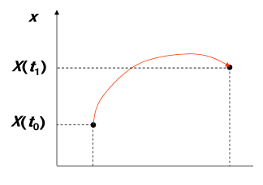
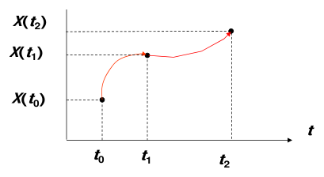
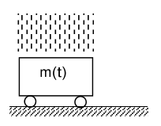
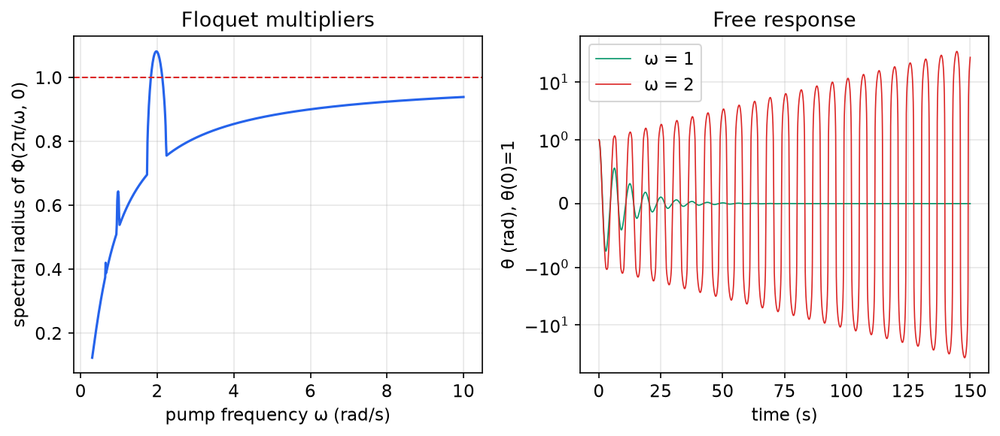
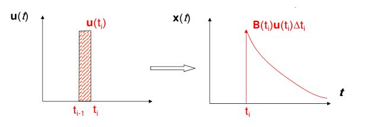
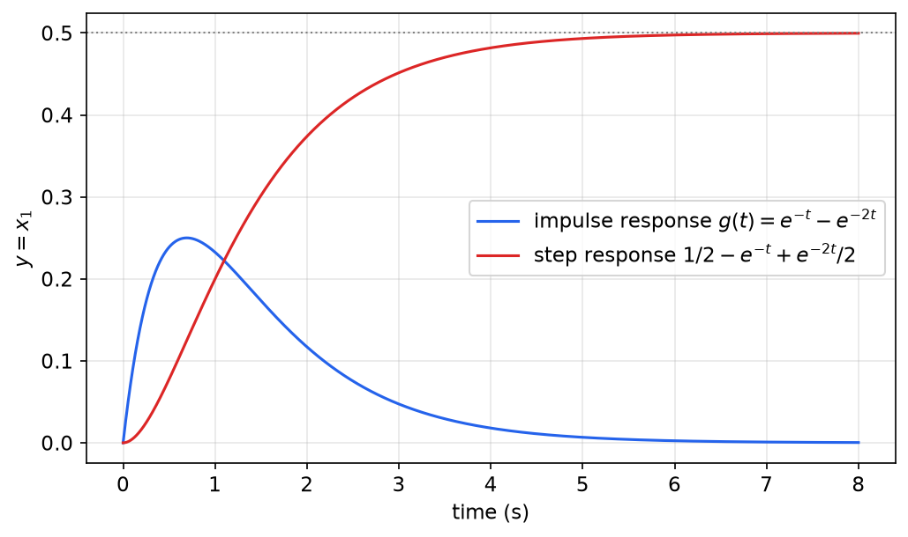
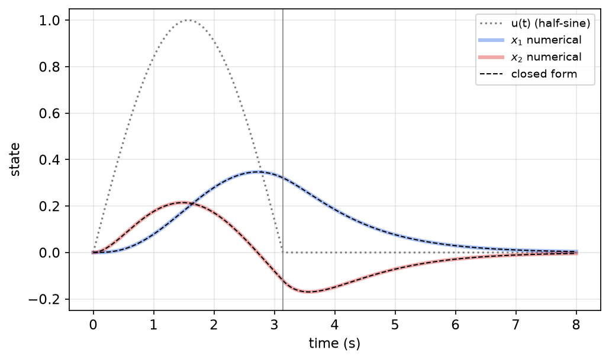
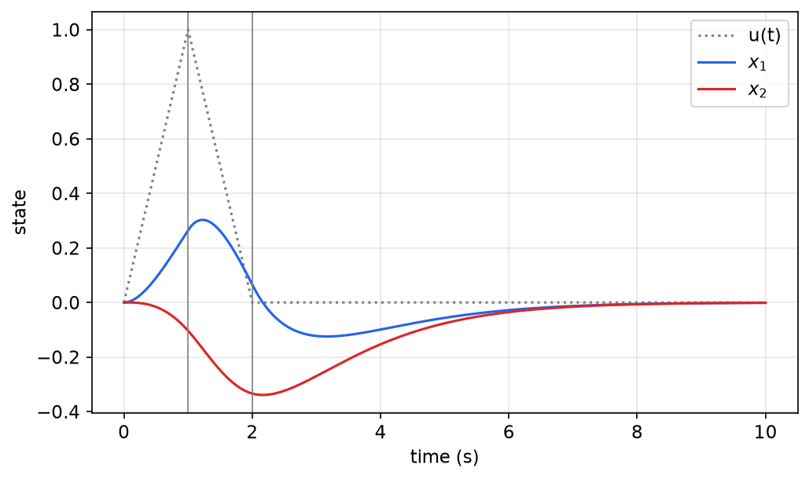
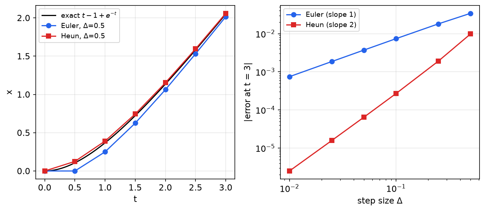

# Time Response of Linear Systems

The time response of a system is the time history of its states and outputs, given the initial state and the input. It is what we use to predict behavior, to analyze a design, and to verify a controller. For linear systems the response has a closed-form structure: a **state-transition matrix** carries the initial state forward in time, and a convolution integral adds the effect of the input. This chapter develops that structure for time-varying systems, specializes it to the matrix exponential \\(e^{At}\\) for time-invariant ones, presents four ways to compute \\(e^{At}\\), works several complete examples, and ends with the numerical methods used when closed forms are impractical.

## Existence and Uniqueness

**Theorem (Existence and uniqueness).** If the entries of the square matrix \\(A(t)\\) are bounded (more precisely, piecewise continuous) functions of time for \\(t \ge t\_0\\), then for each initial state \\(x\_0\\) there exists a **unique** solution \\(x(t)\\) of
\\[
\dot x(t) = A(t)x(t), \qquad x(t\_0) = x\_0 .
\\]
The same holds for \\(\dot x = A(t)x + B(t)u(t)\\) when \\(B(t)u(t)\\) is piecewise continuous.

The proof is the standard Picard iteration: the right-hand side is globally Lipschitz in \\(x\\) with constant \\(\sup\lVert A(t)\rVert\\), so solutions exist on every finite interval and cannot escape to infinity (see [Systems of Differential Equations](../../../math/diffeq/systems.md)). For our purposes the theorem has a very practical consequence.

**Remark.** If we somehow find or guess a function that satisfies the differential equation and the initial condition, it *is* the solution. Every formula in this chapter is proven this way: we propose a candidate and check that it satisfies the equation.

## Free Response of LTI Systems: the Matrix Exponential

**Scalar case.** For \\(\dot x = ax\\), separating variables gives \\(\int dx/x = \int a\\,dt\\), so \\(\ln x = at + c\\) and
\\[
x(t) = e^{a(t-t\_0)}x(t\_0).
\\]

**Vector case.** For \\(\dot x = Ax\\) with constant \\(A\in\mathbb{R}^{n\times n}\\), the solution has the same form,
\\[
\boxed{x(t) = e^{A(t-t\_0)}x(t\_0), \qquad e^{At} = I + At + A^2\frac{t^2}{2!} + \cdots + A^k\frac{t^k}{k!} + \cdots}
\\]

*Proof.* The series converges absolutely for every \\(t\\), since \\(\lVert A^kt^k/k!\rVert \le (\lVert A\rVert\\,\lvert t\rvert)^k/k!\\) and \\(\sum (\lVert A\rVert\lvert t\rvert)^k/k! = e^{\lVert A\rVert\lvert t\rvert}\\). It converges uniformly on bounded intervals, as does the series of term-by-term derivatives, so it can be differentiated term by term:
\\[
\frac{d}{dt}e^{At} = A + A^2t + A^3\frac{t^2}{2!} + \cdots = A\Big(I + At + A^2\frac{t^2}{2!} + \cdots\Big) = Ae^{At}.
\\]
Hence \\(x(t) = e^{A(t-t\_0)}x(t\_0)\\) satisfies \\(\dot x = Ax\\), and at \\(t = t\_0\\) it equals \\(e^{0}x(t\_0) = x(t\_0)\\). By uniqueness it is the solution. ∎

**Properties of the matrix exponential.** For constant square matrices:

1. \\(e^{A\cdot 0} = I\\) and \\(\frac{d}{dt}e^{At} = Ae^{At} = e^{At}A\\) (\\(A\\) commutes with every power of itself).
2. \\(e^{A(t+s)} = e^{At}e^{As}\\). Both sides solve \\(\dot X = AX\\) in \\(t\\) with the value \\(e^{As}\\) at \\(t = 0\\).
3. \\(e^{At}\\) is always invertible, with \\((e^{At})^{-1} = e^{-At}\\): set \\(s = -t\\) in property 2.
4. \\(e^{(A+B)t} = e^{At}e^{Bt}\\) for all \\(t\\) **if and only if** \\(AB = BA\\). In general the exponential of a sum is *not* the product of exponentials.
5. \\((e^{At})^T = e^{A^Tt}\\), and \\(e^{TAT^{-1}t} = Te^{At}T^{-1}\\).
6. \\(\det e^{At} = e^{\operatorname{tr}(A)\\,t}\\), and the eigenvalues of \\(e^{At}\\) are \\(e^{\lambda\_it}\\), where \\(\lambda\_i\\) are the eigenvalues of \\(A\\).

## The State-Transition Matrix of LTV Systems

For \\(\dot x(t) = A(t)x(t)\\) the matrix exponential of \\(A(t)\\) is *not* the solution in general. The response still has a similar structure, however. The solution is unique and the equation is linear, so the state at time \\(t\\) must be a linear function of the initial state:
\\[
\boxed{x(t) = \Phi(t,t\_0)\\,x(t\_0).}
\\]
The \\(n\times n\\) matrix \\(\Phi(t,t\_0)\\) is the **state-transition matrix (STM)**. Unlike \\(e^{At}\\), it depends on two arguments, the initial and the final time, because a time-varying system behaves differently depending on *when* it starts. Its \\(j\\)-th column is the solution that starts from the \\(j\\)-th unit vector \\(e\_j\\) at \\(t\_0\\).



*Figure: a state trajectory from x(t₀) to x(t₁). The STM premultiplies the initial state to give the final state, x(t₁) = Φ(t₁, t₀) x(t₀). The response is linear in the initial state.*

### The STM differential equation

Differentiate \\(x(t) = \Phi(t,t\_0)x(t\_0)\\) with respect to \\(t\\) and compare with the state equation:
\\[
\dot x(t) = \frac{\partial\Phi(t,t\_0)}{\partial t}x(t\_0) \qquad\text{and}\qquad \dot x(t) = A(t)x(t) = A(t)\Phi(t,t\_0)x(t\_0).
\\]
Since this holds for every \\(x(t\_0)\\),
\\[
\boxed{\frac{\partial\Phi(t,t\_0)}{\partial t} = A(t)\Phi(t,t\_0), \qquad \Phi(t\_0,t\_0) = I .}
\\]
The STM is the solution of the state equation in matrix form, with the identity as initial condition. For an LTI system, \\(\Phi(t,t\_0) = e^{A(t-t\_0)}\\), which depends only on the elapsed time.

### Semigroup property

**Proposition.** For any \\(t\_0, t\_1, t\_2\\), \\(\Phi(t\_2,t\_1)\Phi(t\_1,t\_0) = \Phi(t\_2,t\_0)\\).

*Proof.* Going directly, \\(x(t\_2) = \Phi(t\_2,t\_0)x(t\_0)\\). Going in two steps, \\(x(t\_2) = \Phi(t\_2,t\_1)x(t\_1) = \Phi(t\_2,t\_1)\Phi(t\_1,t\_0)x(t\_0)\\). The two expressions agree for every \\(x(t\_0)\\). (Equivalently, both sides solve \\(\partial X/\partial t\_2 = A(t\_2)X\\) with the value \\(\Phi(t\_1,t\_0)\\) at \\(t\_2 = t\_1\\).) ∎



*Figure: a trajectory passing through x(t₀), x(t₁) and x(t₂). Transitioning from t₀ to t₁ and then from t₁ to t₂ is the same as transitioning directly from t₀ to t₂.*

### Invertibility

**Theorem (Invertibility of the STM).** \\(\Phi(t,t\_0)\\) is invertible for all \\(t, t\_0\\), and
\\[
\Phi(t,t\_0)^{-1} = \Psi^T(t,t\_0),
\\]
where \\(\Psi\\) is the STM of the **adjoint system** \\(\dot z = -A^T(t)z\\).

*Proof.* We show that \\(\Psi^T(t,t\_0)\Phi(t,t\_0) = I\\). Let \\(Z(t) = \Psi^T(t,t\_0)\Phi(t,t\_0)\\). From \\(\dot\Psi = -A^T\Psi\\) we get \\(\dot\Psi^T = -\Psi^TA\\), so
\\[
\dot Z = \dot\Psi^T\Phi + \Psi^T\dot\Phi = -\Psi^T(t,t\_0)A(t)\Phi(t,t\_0) + \Psi^T(t,t\_0)A(t)\Phi(t,t\_0) = 0 .
\\]
Hence \\(Z\\) is constant. Since \\(Z(t\_0) = I\cdot I = I\\), \\(Z(t) = I\\) for all \\(t\\). ∎

A second proof uses the determinant. By Jacobi's formula, \\(\frac{d}{dt}\det\Phi = \operatorname{tr}\big(\operatorname{adj}(\Phi)\dot\Phi\big) = \operatorname{tr}\big(\operatorname{adj}(\Phi)A\Phi\big) = \operatorname{tr}(A)\det\Phi\\). This gives **Liouville's formula**
\\[
\det\Phi(t,t\_0) = \exp\Big(\int\_{t\_0}^t \operatorname{tr}A(\sigma)\\,d\sigma\Big),
\\]
which is never zero. Liouville's formula also has a geometric reading: the trace of \\(A\\) is the rate at which the flow expands volumes in state space.

**Backward transition.** Invertibility lets us run the system backward. Forward, \\(x(t\_1) = \Phi(t\_1,t\_0)x(t\_0)\\) for \\(t\_1 > t\_0\\). Hence \\(x(t\_0) = \Phi(t\_1,t\_0)^{-1}x(t\_1)\\). Defining
\\[
\Phi(t\_0,t\_1) = \Phi(t\_1,t\_0)^{-1} = \Psi^T(t\_0,t\_1)
\\]
extends \\(\Phi\\) consistently to backward transitions, \\(x(t\_0) = \Phi(t\_0,t\_1)x(t\_1)\\). This is consistent with the semigroup property: \\(\Phi(t\_0,t\_1)\Phi(t\_1,t\_0) = \Phi(t\_0,t\_0) = I\\). Linear systems never merge two trajectories into one, and the present state determines the past as well as the future.

### Summary of STM properties

| Property | Formula |
|---|---|
| Differential equation in \\(t\\) | \\(\dfrac{\partial\Phi(t,\tau)}{\partial t} = A(t)\Phi(t,\tau)\\) |
| Differential equation in \\(\tau\\) | \\(\dfrac{\partial\Phi(t,\tau)}{\partial\tau} = -\Phi(t,\tau)A(\tau)\\) |
| Initial value | \\(\Phi(t,t) = I\\) |
| Semigroup | \\(\Phi(t\_2,t\_1)\Phi(t\_1,t\_0) = \Phi(t\_2,t\_0)\\) |
| Inverse | \\(\Phi(\tau,t) = \Phi(t,\tau)^{-1}\\) |
| Fundamental matrix | \\(\Phi(t,\tau) = X(t)X(\tau)^{-1}\\) with \\(X(t) = \Phi(t,0)\\) |
| Determinant | \\(\det\Phi(t,\tau) = \exp\int\_\tau^t\operatorname{tr}A(\sigma)\\,d\sigma\\) |

The fundamental-matrix formula combines the inverse and semigroup properties: \\(\Phi(t,\tau) = \Phi(t,0)\Phi(0,\tau) = X(t)X(\tau)^{-1}\\). More generally, **any** matrix \\(X(t)\\) whose \\(n\\) columns are linearly independent solutions of \\(\dot x = A(t)x\\) (a **fundamental matrix**) gives \\(\Phi(t,\tau) = X(t)X(\tau)^{-1}\\). The \\(\tau\\)-derivative follows: \\(\frac{\partial}{\partial\tau}X(\tau)^{-1} = -X(\tau)^{-1}\dot X(\tau)X(\tau)^{-1} = -X(\tau)^{-1}A(\tau)\\).

**A special case.** If \\(A(t)\\) commutes with its own integral, \\(A(t)\int\_\tau^tA(\sigma)\\,d\sigma = \big(\int\_\tau^tA(\sigma)\\,d\sigma\big)A(t)\\) for all \\(t, \tau\\) (for instance if \\(A(t) = \alpha(t)A\_0\\), or if \\(A(t)\\) is diagonal), then
\\[
\Phi(t,\tau) = \exp\Big(\int\_\tau^tA(\sigma)\\,d\sigma\Big).
\\]
Without the commutation condition this formula is **wrong**, and using it anyway is a classic mistake.

### Computing the STM of time-varying systems

There is no general closed-form method. When \\(A(t)\\) is triangular, however, the STM equations can be solved entry by entry by back-substitution, starting from the decoupled equations. Otherwise one looks for \\(n\\) independent solutions (a fundamental matrix), or integrates numerically.

**Example 3.1 (Cart with time-varying mass).** A cart rolls without friction while material falls into it, so its mass grows: \\(m(t) = \alpha t + \beta\\) with \\(\alpha, \beta > 0\\). The falling material has no horizontal velocity, so the horizontal momentum is conserved, \\(\frac{d}{dt}(m\dot x) = 0\\).



*Figure: a cart of mass m(t) on rollers with material falling into it.*

Choose the position and the momentum as states, \\(x\_1 = x\\), \\(x\_2 = m\dot x\\):
\\[
\frac{d}{dt}\begin{bmatrix}x\_1 \\\\ x\_2\end{bmatrix} = \underbrace{\begin{bmatrix}0 & 1/m(t) \\\\ 0 & 0\end{bmatrix}}\_{A(t)}\begin{bmatrix}x\_1 \\\\ x\_2\end{bmatrix}.
\\]
*Step 1: write \\(\dot\Phi = A\Phi\\) entry by entry.*
\\[
\begin{bmatrix}\dot\Phi\_{11} & \dot\Phi\_{12} \\\\ \dot\Phi\_{21} & \dot\Phi\_{22}\end{bmatrix}
= \begin{bmatrix}0 & 1/m(t) \\\\ 0 & 0\end{bmatrix}\begin{bmatrix}\Phi\_{11} & \Phi\_{12} \\\\ \Phi\_{21} & \Phi\_{22}\end{bmatrix}
= \begin{bmatrix}\Phi\_{21}/m(t) & \Phi\_{22}/m(t) \\\\ 0 & 0\end{bmatrix}.
\\]
(Here the dot is \\(\partial/\partial t\\), and the entries are functions of \\((t,t\_0)\\).)

*Step 2: initial conditions from \\(\Phi(t\_0,t\_0) = I\\).* This gives four scalar problems:
\\[
\begin{aligned}
&(1)\ \dot\Phi\_{11} = \Phi\_{21}/m, \ \Phi\_{11}(t\_0,t\_0) = 1; &\quad &(2)\ \dot\Phi\_{12} = \Phi\_{22}/m, \ \Phi\_{12}(t\_0,t\_0) = 0;\\\\
&(3)\ \dot\Phi\_{21} = 0, \ \Phi\_{21}(t\_0,t\_0) = 0; &\quad &(4)\ \dot\Phi\_{22} = 0, \ \Phi\_{22}(t\_0,t\_0) = 1 .
\end{aligned}
\\]
*Step 3: solve the decoupled equations first, then back-substitute.* Equations (3) and (4) give constants, \\(\Phi\_{21} = 0\\) and \\(\Phi\_{22} = 1\\). Then (1) becomes \\(\dot\Phi\_{11} = 0\\), so \\(\Phi\_{11} = 1\\). Equation (2) becomes \\(\dot\Phi\_{12} = 1/(\alpha t + \beta)\\). Integrating, \\(\Phi\_{12} = \frac{1}{\alpha}\ln(\alpha t + \beta) + c\\), and the initial condition \\(\Phi\_{12}(t\_0,t\_0) = 0\\) fixes \\(c = -\frac{1}{\alpha}\ln(\alpha t\_0 + \beta)\\). Therefore
\\[
\boxed{\Phi(t,t\_0) = \begin{bmatrix}1 & \dfrac{1}{\alpha}\ln\Big(\dfrac{\alpha t + \beta}{\alpha t\_0 + \beta}\Big) \\\\ 0 & 1\end{bmatrix}.}
\\]
Check: the momentum stays constant (\\(\Phi\_{22} = 1\\)), and the position grows only logarithmically because the cart keeps getting heavier. Here every \\(A(t)\\) has the same strictly upper-triangular structure, so all of them commute, and the special-case formula applies too: \\(\exp\int\_{t\_0}^tA = I + \int\_{t\_0}^tA\\), which is the same matrix.

**Example 3.2 (Two triangular LTV systems).** Compute \\(\Phi(t,t\_0)\\) for
\\[
\text{(a)}\ A(t) = \begin{bmatrix}0 & 1 & t^2 \\\\ 0 & 0 & t \\\\ 0 & 0 & 0\end{bmatrix}, \qquad \text{(b)}\ A(t) = \begin{bmatrix}0 & 0 \\\\ 2t & 2t\end{bmatrix}.
\\]
Because \\(A\\) is not constant, the Laplace transform cannot be used. The equations are solved row by row instead.

(a) Upper triangular: start from the last row. Row 3 has zero derivative, so it keeps its initial value \\([0\ 0\ 1]\\). In row 2, \\(\dot\Phi\_{21} = \dot\Phi\_{22} = 0\\) and \\(\dot\Phi\_{23} = t\Phi\_{33} = t\\), so \\(\Phi\_{21} = 0\\), \\(\Phi\_{22} = 1\\) and \\(\Phi\_{23} = (t^2 - t\_0^2)/2\\). In row 1, \\(\dot\Phi\_{11} = 0\\) and \\(\dot\Phi\_{12} = \Phi\_{22} = 1\\), while
\\[
\dot\Phi\_{13} = \Phi\_{23} + t^2\Phi\_{33} = \frac{t^2 - t\_0^2}{2} + t^2 = \frac{3t^2 - t\_0^2}{2}
\quad\Longrightarrow\quad \Phi\_{13} = \frac{t(t^2 - t\_0^2)}{2}
\\]
(the right-hand side vanishes at \\(t = t\_0\\), as required). Hence
\\[
\Phi(t,t\_0) = \begin{bmatrix}1 & t - t\_0 & \tfrac12 t(t^2 - t\_0^2) \\\\ 0 & 1 & \tfrac12(t^2 - t\_0^2) \\\\ 0 & 0 & 1\end{bmatrix}.
\\]
*Semigroup check.* The (1,3) entry of \\(\Phi(t\_2,t\_1)\Phi(t\_1,t\_0)\\) is
\\[
\tfrac12 t\_1(t\_1^2 - t\_0^2) + (t\_2 - t\_1)\tfrac12(t\_1^2 - t\_0^2) + \tfrac12 t\_2(t\_2^2 - t\_1^2) = \tfrac12 t\_2(t\_2^2 - t\_0^2),
\\]
which equals the (1,3) entry of \\(\Phi(t\_2,t\_0)\\).

(b) Lower triangular: start from row 1. \\(\dot\Phi\_{11} = \dot\Phi\_{12} = 0\\), so \\(\Phi\_{11} = 1\\) and \\(\Phi\_{12} = 0\\). Row 2 gives \\(\dot\Phi\_{21} = 2t\Phi\_{11} + 2t\Phi\_{21} = 2t + 2t\Phi\_{21}\\). Multiply by the integrating factor \\(e^{-t^2}\\): \\(\frac{d}{dt}(e^{-t^2}\Phi\_{21}) = 2te^{-t^2}\\), so \\(e^{-t^2}\Phi\_{21} = -e^{-t^2} + c\_1\\). Similarly \\(\dot\Phi\_{22} = 2t\Phi\_{22}\\) gives \\(e^{-t^2}\Phi\_{22} = c\_2\\). The initial conditions \\(\Phi\_{21}(t\_0,t\_0) = 0\\) and \\(\Phi\_{22}(t\_0,t\_0) = 1\\) give \\(c\_1 = c\_2 = e^{-t\_0^2}\\):
\\[
\Phi(t,t\_0) = \begin{bmatrix}1 & 0 \\\\ e^{t^2 - t\_0^2} - 1 & e^{t^2 - t\_0^2}\end{bmatrix}.
\\]
Semigroup check: the (2,1) entry of the product is \\(\big(e^{t\_2^2 - t\_1^2} - 1\big) + e^{t\_2^2 - t\_1^2}\big(e^{t\_1^2 - t\_0^2} - 1\big) = e^{t\_2^2 - t\_0^2} - 1\\). As a further check, \\(\operatorname{tr}A = 2t\\), and Liouville's formula gives \\(\det\Phi = e^{t^2 - t\_0^2}\\), as it should.

**Example 3.3 (STM from a fundamental matrix).** Consider
\\[
\dot x = \begin{bmatrix}0 & 1 \\\\ 0 & -\tanh t\end{bmatrix}x + \begin{bmatrix}0 \\\\ 1\end{bmatrix}u .
\\]
(a) Find \\(\Phi(t,\tau)\\). (b) Find \\(x\_1(t)\\), \\(t \ge 0\\), for \\(u = 1\\) and \\(x(0) = [1\ \ 0]^T\\).

(a) The \\(A(t)\\) matrices do not commute here, so the exponential of the integral is not valid. Solve the free system directly. The second equation \\(\dot x\_2 = -\tanh(t)\\,x\_2\\) separates: \\(d\ln x\_2/dt = -\tanh t = -d\ln\cosh t/dt\\), so
\\[
x\_2(t) = \frac{x\_2(0)}{\cosh t}.
\\]
Then \\(\dot x\_1 = x\_2\\) gives \\(x\_1(t) = x\_1(0) + x\_2(0)\int\_0^t\frac{d\sigma}{\cosh\sigma} = x\_1(0) + x\_2(0)\big(2\tan^{-1}e^t - \tfrac{\pi}{2}\big)\\), using \\(\int\frac{d\sigma}{\cosh\sigma} = 2\tan^{-1}e^\sigma\\). The initial conditions \\([1,0]^T\\) and \\([0,1]^T\\) give the fundamental matrix \\(X(t) = \Phi(t,0)\\) and hence the STM:
\\[
X(t) = \begin{bmatrix}1 & 2\tan^{-1}(e^t) - \frac{\pi}{2} \\\\ 0 & \frac{1}{\cosh t}\end{bmatrix},
\qquad
\Phi(t,\tau) = X(t)X(\tau)^{-1} = \begin{bmatrix}1 & 2\cosh\tau\\,\big[\tan^{-1}(e^t) - \tan^{-1}(e^\tau)\big] \\\\ 0 & \dfrac{\cosh\tau}{\cosh t}\end{bmatrix}.
\\]
(b) With the variation-of-constants formula derived below, \\(x(t) = \Phi(t,0)x\_0 + \int\_0^t\Phi(t,\tau)B\\,d\tau\\). The second component is
\\[
x\_2(t) = \frac{1}{\cosh t}\int\_0^t\cosh\tau\\,d\tau = \frac{\sinh t}{\cosh t} = \tanh t .
\\]
The first component could be computed from the (1,2) entry of \\(\Phi\\). That route leads to \\(1 + 2\tan^{-1}(e^t)\sinh t - 2\int\_0^t\cosh\tau\tan^{-1}(e^\tau)\\,d\tau\\), which integration by parts reduces to the same answer. It is much quicker to use \\(\dot x\_1 = x\_2\\):
\\[
x\_1(t) = 1 + \int\_0^t\tanh\sigma\\,d\sigma = 1 + \ln\cosh t .
\\]
Check: \\(\dot x\_2 + \tanh(t)x\_2 = \operatorname{sech}^2t + \tanh^2t = 1 = u\\). For large \\(t\\), \\(x\_1 \approx 1 + t - \ln 2\\): the "friction" \\(\tanh t\\) tends to 1, and the velocity settles at 1.

**Example 3.4 (Parametrically excited pendulum: a fundamental matrix computed numerically).** A pendulum whose pivot is shaken vertically with acceleration \\(a(t) = 0.5\sin\omega t\\) obeys, for small angles,
\\[
\ddot\theta + 2\zeta\omega\_n\dot\theta + \omega\_n^2\big(1 + a(t)\big)\theta = 0
\\]
(a damped Mathieu equation). With \\(x = [\theta,\ \dot\theta]^T\\):
\\[
\dot x = \begin{bmatrix}0 & 1 \\\\ -\omega\_n^2(1 + 0.5\sin\omega t) & -2\zeta\omega\_n\end{bmatrix}x .
\\]
No closed form exists, so the fundamental matrix \\(X(t) = \Phi(t,0)\\) is computed numerically, one column at a time from \\(x(0) = e\_1\\) and \\(x(0) = e\_2\\):

```matlab
wn=1; zeta=0.1; w=2;
f=@(t,x) [x(2); -(1+0.5*sin(w*t))*wn^2*x(1) - 2*zeta*wn*x(2)];
[t,x1]=ode45(f,0:0.1:150,[1 0]);  [t,x2]=ode45(f,0:0.1:150,[0 1]);
% X(t) = [x1(k,:)' x2(k,:)'] at each time t(k)
```

\\(A(t)\\) is periodic with period \\(T = 2\pi/\omega\\). For such systems the STM satisfies \\(\Phi(t + T, \tau + T) = \Phi(t,\tau)\\). Hence \\(x(kT) = \Phi(T,0)^kx(0)\\), and the system is asymptotically stable if and only if all eigenvalues of the **monodromy matrix** \\(\Phi(T,0)\\) (the **Floquet multipliers**) lie strictly inside the unit circle. With \\(\omega\_n = 1\\) and \\(\zeta = 0.1\\), the spectral radius \\(\rho\\) of \\(\Phi(T,0)\\) is 0.596 at \\(\omega = 1\\), 0.982 at \\(\omega = 1.82\\), **1.080** at \\(\omega = 2\\), 0.979 at \\(\omega = 2.15\\), and 0.924 at \\(\omega = 8\\). A fine scan shows \\(\rho > 1\\) only for \\(\omega \approx 1.84\\) to \\(2.13\\).



*Figure: parametrically excited pendulum (ω_n = 1, ζ = 0.1). Left: spectral radius of the monodromy matrix versus pump frequency. It exceeds 1 only in a narrow band around ω = 2ω_n. Right: free response from θ(0) = 1 (symmetric log scale). At ω = 1 the swing decays within about 40 s. At ω = 2 it grows to about 40 rad by t = 150 s, so the small-angle model is invalid long before then and only the instability is meaningful.*

This is **parametric resonance**. When the pivot is pumped at twice the natural frequency, the effective stiffness increases in step with the swing, and energy is injected twice per cycle. The "frozen-time" matrix \\(A(t)\\) has eigenvalues with negative real part for *every* fixed \\(t\\) (its stiffness \\(\omega\_n^2(1 + 0.5\sin\omega t)\\) is always positive), yet the system is unstable. Frozen-time eigenvalues do not determine the stability of LTV systems; see [Stability](stability.md).

## Forced Response: Variation of Constants

Now add the input: \\(\dot x = A(t)x + B(t)u(t)\\).

### Derivation by input decomposition

Approximate the input by a train of narrow pulses. On the interval \\([t\_{i-1}, t\_i]\\), of width \\(\Delta t\_i = t\_i - t\_{i-1}\\), replace \\(u\\) by the constant \\(u(t\_i)\\). Over such a short interval the input's effect is simply to add \\(B(t\_i)u(t\_i)\Delta t\_i\\) to the state, a jump at \\(t\_i\\). After the jump, the increment evolves freely, so at a later time \\(t\\) it has become
\\[
x\_i(t) = \Phi(t,t\_i)B(t\_i)u(t\_i)\Delta t\_i .
\\]



*Figure: one strip of the input, of height u(tᵢ) on [tᵢ₋₁, tᵢ], produces a state jump B(tᵢ)u(tᵢ)Δtᵢ at tᵢ that then evolves freely. The forced response is the sum of all such pulse responses.*

By linearity the responses superpose:
\\[
x(t) \cong \sum\_i \Phi(t,t\_i)B(t\_i)u(t\_i)\Delta t\_i \quad\xrightarrow{\ \Delta t\_i\to 0\ }\quad x(t) = \int\_{t\_0}^t\Phi(t,\tau)B(\tau)u(\tau)\\,d\tau .
\\]
Adding the free response from a nonzero initial state gives the complete response.

**Theorem (Variation of constants).** The unique solution of \\(\dot x = A(t)x + B(t)u\\), \\(x(t\_0) = x\_0\\), is
\\[
\boxed{x(t) = \Phi(t,t\_0)x\_0 + \int\_{t\_0}^t\Phi(t,\tau)B(\tau)u(\tau)\\,d\tau ,}
\\]
and the output is
\\[
y(t) = C(t)\Phi(t,t\_0)x\_0 + \int\_{t\_0}^tC(t)\Phi(t,\tau)B(\tau)u(\tau)\\,d\tau + D(t)u(t).
\\]

*Proof.* At \\(t = t\_0\\) the integral vanishes and \\(\Phi(t\_0,t\_0) = I\\), so \\(x(t\_0) = x\_0\\). Differentiate with Leibniz's rule (the upper limit and the integrand both depend on \\(t\\)):
\\[
\dot x(t) = A(t)\Phi(t,t\_0)x\_0 + \underbrace{\Phi(t,t)}\_{I}B(t)u(t) + \int\_{t\_0}^tA(t)\Phi(t,\tau)B(\tau)u(\tau)\\,d\tau = A(t)x(t) + B(t)u(t).
\\]
By uniqueness this is the solution. ∎

*Constructive derivation.* The name comes from writing \\(x(t) = \Phi(t,t\_0)c(t)\\), where the "constant" \\(c\\) is allowed to vary. Substituting gives \\(\Phi\dot c = Bu\\), so \\(\dot c = \Phi(t\_0,t)B(t)u(t)\\). Integrating, \\(c(t) = x\_0 + \int\_{t\_0}^t\Phi(t\_0,\tau)B(\tau)u(\tau)\\,d\tau\\), and multiplying by \\(\Phi(t,t\_0)\\) with the semigroup property gives the boxed formula.

The function \\(H(t,\tau) = C(t)\Phi(t,\tau)B(\tau)\\) for \\(t \ge \tau\\) (plus \\(D(t)\delta(t - \tau)\\)) is the **impulse response matrix**: its \\(j\\)-th column is the output at time \\(t\\) caused by a unit impulse in input \\(j\\) applied at time \\(\tau\\).

**Example 3.5 (Cart with time-varying mass, pushed).** Apply a constant horizontal force \\(f\\) to the cart of Example 3.1, starting at rest at \\(t\_0 = 0\\). The force changes the momentum, so \\(B = [0\ \ 1]^T\\), and
\\[
x(t) = \int\_0^t\Phi(t,\tau)\begin{bmatrix}0 \\\\ 1\end{bmatrix}f\\,d\tau = f\int\_0^t\begin{bmatrix}\frac{1}{\alpha}\ln\frac{\alpha t + \beta}{\alpha\tau + \beta} \\\\ 1\end{bmatrix}d\tau .
\\]
The momentum is \\(x\_2 = ft\\), as Newton's law for a body absorbing zero-momentum mass requires. For the position, use \\(\int\_0^t\ln(\alpha\tau + \beta)\\,d\tau = \frac{1}{\alpha}\big[(\alpha t + \beta)\ln(\alpha t + \beta) - \beta\ln\beta\big] - t\\):
\\[
x\_1(t) = \frac{f}{\alpha}\Big[t\ln(\alpha t + \beta) - \frac{(\alpha t + \beta)\ln(\alpha t + \beta) - \beta\ln\beta}{\alpha} + t\Big]
= \frac{f}{\alpha}\Big[t - \frac{\beta}{\alpha}\ln\frac{\alpha t + \beta}{\beta}\Big].
\\]
For example, with \\(\alpha = f = 1\\) and \\(\beta = 2\\), \\(x\_1(4) = 4 - 2\ln 3 = 1.803\\), which agrees with a numerical simulation. For small \\(t\\), expanding the logarithm gives \\(x\_1 \approx ft^2/(2\beta)\\), the constant-mass result.

## Time Response of LTI Systems

For constant matrices, \\(\Phi(t,\tau) = e^{A(t-\tau)}\\), and the variation-of-constants formula becomes
\\[
\boxed{x(t) = e^{A(t-t\_0)}x(t\_0) + \int\_{t\_0}^te^{A(t-\tau)}Bu(\tau)\\,d\tau .}
\\]
The forced part is a **convolution** of the input with \\(e^{At}B\\). The matrix exponential is the key to computing the response.

**Laplace form.** Transforming the state equation with \\(t\_0 = 0\\) gives \\(sX(s) - x(0) = AX(s) + BU(s)\\), so
\\[
X(s) = (sI - A)^{-1}\big(x(0) + BU(s)\big), \qquad x(t) = \mathcal{L}^{-1}\big[(sI - A)^{-1}\big(x(0) + BU(s)\big)\big].
\\]
Comparing the free part with the time-domain formula shows that \\(\mathcal{L}\\{e^{At}\\} = (sI - A)^{-1}\\). With zero initial state,
\\[
y(t) = \mathcal{L}^{-1}\big[G(s)U(s)\big] = \int\_0^tg(t - \tau)u(\tau)\\,d\tau, \qquad g(t) = \mathcal{L}^{-1}[G(s)] = Ce^{At}B + D\delta(t).
\\]
Here \\(g(t)\\) is the **impulse response**: the output for \\(u = \delta\\) with zero initial state. The step response is its integral.

## Computing the Matrix Exponential

### Method 1: Laplace transform

\\[
\boxed{e^{At} = \mathcal{L}^{-1}\big[(sI - A)^{-1}\big].}
\\]
Invert \\(sI - A\\) symbolically, expand each entry in partial fractions, and invert term by term.

**Example 3.6.** \\(A = \begin{bmatrix}0 & 1 \\\\ -2 & -3\end{bmatrix}\\). Then
\\[
(sI - A)^{-1} = \begin{bmatrix}s & -1 \\\\ 2 & s+3\end{bmatrix}^{-1} = \frac{1}{(s+1)(s+2)}\begin{bmatrix}s+3 & 1 \\\\ -2 & s\end{bmatrix}.
\\]
The partial fractions are \\(\frac{s+3}{(s+1)(s+2)} = \frac{2}{s+1} - \frac{1}{s+2}\\), \\(\frac{1}{(s+1)(s+2)} = \frac{1}{s+1} - \frac{1}{s+2}\\), \\(\frac{-2}{(s+1)(s+2)} = \frac{-2}{s+1} + \frac{2}{s+2}\\) and \\(\frac{s}{(s+1)(s+2)} = \frac{-1}{s+1} + \frac{2}{s+2}\\). Hence
\\[
e^{At} = \begin{bmatrix}2e^{-t} - e^{-2t} & e^{-t} - e^{-2t} \\\\ 2e^{-2t} - 2e^{-t} & 2e^{-2t} - e^{-t}\end{bmatrix}.
\\]
At \\(t = 0\\) this is \\(I\\), and its derivative there is \\(A\\), two quick checks worth doing every time.

**Example 3.7 (Upper-triangular \\(A\\); semigroup check).** \\(A = \begin{bmatrix}-8 & -6 \\\\ 0 & -2\end{bmatrix}\\). The eigenvalues are \\(-8\\) and \\(-2\\), and
\\[
(sI - A)^{-1} = \begin{bmatrix}\frac{1}{s+8} & \frac{-6}{(s+8)(s+2)} \\\\ 0 & \frac{1}{s+2}\end{bmatrix}, \qquad \frac{-6}{(s+8)(s+2)} = \frac{1}{s+8} - \frac{1}{s+2},
\\]
\\[
\Phi(t,t\_0) = e^{A(t-t\_0)} = \begin{bmatrix}e^{-8(t-t\_0)} & e^{-8(t-t\_0)} - e^{-2(t-t\_0)} \\\\ 0 & e^{-2(t-t\_0)}\end{bmatrix}.
\\]
Semigroup check, (1,2) entry: \\(e^{-8(t\_2-t\_1)}\big(e^{-8(t\_1-t\_0)} - e^{-2(t\_1-t\_0)}\big) + \big(e^{-8(t\_2-t\_1)} - e^{-2(t\_2-t\_1)}\big)e^{-2(t\_1-t\_0)} = e^{-8(t\_2-t\_0)} - e^{-2(t\_2-t\_0)}\\). A sign slip that writes \\(sI - A\\) with \\(s - 2\\) instead of \\(s + 2\\) produces a spurious growing term \\(e^{2t}\\) and the wrong partial-fraction weight 0.6. The eigenvalue check (the exponents must be the eigenvalues of \\(A\\)) catches this immediately.

### Method 2: Diagonalization (eigenvectors)

If \\(A\\) has \\(n\\) linearly independent eigenvectors \\(v\_1, \dots, v\_n\\) with eigenvalues \\(\lambda\_1, \dots, \lambda\_n\\), let \\(M = [v\_1\ \cdots\ v\_n]\\) be the modal matrix. Then \\(A = M\Lambda M^{-1}\\) with \\(\Lambda = \operatorname{diag}(\lambda\_i)\\), so \\(A^k = M\Lambda^kM^{-1}\\), and summing the series,
\\[
\boxed{e^{At} = Me^{\Lambda t}M^{-1} = M\operatorname{diag}\big(e^{\lambda\_1t}, \dots, e^{\lambda\_nt}\big)M^{-1}.}
\\]
The free response is then a sum of **modes**: \\(x(t) = \sum\_i c\_ie^{\lambda\_it}v\_i\\), with \\(c = M^{-1}x(0)\\). Each eigenvector is a direction in state space along which the motion is a pure exponential.

**Example 3.6 (again).** The eigenvalues of \\(A = \begin{bmatrix}0 & 1 \\\\ -2 & -3\end{bmatrix}\\) are \\(-1\\) and \\(-2\\), with eigenvectors \\(v\_1 = [1,\ -1]^T\\) and \\(v\_2 = [1,\ -2]^T\\). So \\(M = \begin{bmatrix}1 & 1 \\\\ -1 & -2\end{bmatrix}\\) and \\(M^{-1} = \begin{bmatrix}2 & 1 \\\\ -1 & -1\end{bmatrix}\\), and
\\[
e^{At} = \begin{bmatrix}1 & 1 \\\\ -1 & -2\end{bmatrix}\begin{bmatrix}e^{-t} & 0 \\\\ 0 & e^{-2t}\end{bmatrix}\begin{bmatrix}2 & 1 \\\\ -1 & -1\end{bmatrix}
= \begin{bmatrix}2e^{-t} - e^{-2t} & e^{-t} - e^{-2t} \\\\ -2e^{-t} + 2e^{-2t} & -e^{-t} + 2e^{-2t}\end{bmatrix},
\\]
the same as before.

When \\(A\\) is not diagonalizable, the Jordan form \\(A = MJM^{-1}\\) is used instead, with \\(e^{At} = Me^{Jt}M^{-1}\\). For an \\(m\times m\\) Jordan block (eigenvalue \\(\lambda\\) on the diagonal, ones on the superdiagonal),
\\[
e^{Jt} = e^{\lambda t}\begin{bmatrix}
1 & t & \frac{t^2}{2!} & \cdots & \frac{t^{m-1}}{(m-1)!} \\\\
0 & 1 & t & \cdots & \frac{t^{m-2}}{(m-2)!} \\\\
\vdots & & \ddots & \ddots & \vdots \\\\
0 & \cdots & 0 & 1 & t \\\\
0 & \cdots & 0 & 0 & 1
\end{bmatrix},
\\]
which follows from \\(J = \lambda I + N\\) with \\(N\\) nilpotent (\\(N^m = 0\\)) and the fact that \\(\lambda I\\) commutes with \\(N\\), so \\(e^{Jt} = e^{\lambda t}e^{Nt}\\) and the series for \\(e^{Nt}\\) terminates. Repeated eigenvalues with too few eigenvectors therefore produce terms like \\(te^{\lambda t}\\). For a complex pair written in real form, \\(J = \begin{bmatrix}\sigma & \omega \\\\ -\omega & \sigma\end{bmatrix}\\) gives \\(e^{Jt} = e^{\sigma t}\begin{bmatrix}\cos\omega t & \sin\omega t \\\\ -\sin\omega t & \cos\omega t\end{bmatrix}\\). The full theory is in [Modal Decomposition and the Jordan Form](modal-decomposition.md).

### Method 3: Cayley–Hamilton

**Theorem (Cayley–Hamilton).** Every square matrix satisfies its own characteristic equation. If \\(p(\lambda) = \det(\lambda I - A) = \lambda^n + a\_1\lambda^{n-1} + \cdots + a\_{n-1}\lambda + a\_n\\), then
\\[
p(A) = A^n + a\_1A^{n-1} + \cdots + a\_{n-1}A + a\_nI = 0 .
\\]
(For a diagonalizable \\(A\\) this is immediate: \\(p(A) = Mp(\Lambda)M^{-1}\\), and \\(p(\lambda\_i) = 0\\). The general case follows from the Jordan form or from the identity \\((\lambda I - A)\operatorname{adj}(\lambda I - A) = p(\lambda)I\\).)

**Consequences.** \\(A^n\\) is a linear combination of \\(I, A, \dots, A^{n-1}\\), and by induction so is every higher power. Hence any convergent power series in \\(A\\), and \\(e^{At}\\) in particular, can be written as
\\[
e^{At} = \alpha\_0(t)I + \alpha\_1(t)A + \cdots + \alpha\_{n-1}(t)A^{n-1}.
\\]
The same identity must hold for each eigenvalue in place of \\(A\\), which gives \\(n\\) equations for the \\(n\\) coefficients:
\\[
e^{\lambda\_it} = \alpha\_0(t) + \alpha\_1(t)\lambda\_i + \cdots + \alpha\_{n-1}(t)\lambda\_i^{n-1}, \qquad i = 1, \dots, n .
\\]
For an eigenvalue of multiplicity \\(k\\), the missing equations come from differentiating with respect to \\(\lambda\\) up to \\(k - 1\\) times (for example \\(te^{\lambda t} = \alpha\_1 + 2\alpha\_2\lambda + \cdots\\)). Another consequence is a formula for the inverse: multiplying \\(p(A) = 0\\) by \\(A^{-1}\\),
\\[
A^{-1} = -\frac{1}{a\_n}\big(A^{n-1} + a\_1A^{n-2} + \cdots + a\_{n-1}I\big), \qquad a\_n = (-1)^n\det A \ne 0 .
\\]

**Example 3.6 (by Cayley–Hamilton).** With \\(\lambda = -1, -2\\): \\(\alpha\_0 - \alpha\_1 = e^{-t}\\) and \\(\alpha\_0 - 2\alpha\_1 = e^{-2t}\\). Hence \\(\alpha\_1 = e^{-t} - e^{-2t}\\) and \\(\alpha\_0 = 2e^{-t} - e^{-2t}\\), and
\\[
e^{At} = \alpha\_0I + \alpha\_1A = \begin{bmatrix}\alpha\_0 & \alpha\_1 \\\\ -2\alpha\_1 & \alpha\_0 - 3\alpha\_1\end{bmatrix} = \begin{bmatrix}2e^{-t} - e^{-2t} & e^{-t} - e^{-2t} \\\\ -2e^{-t} + 2e^{-2t} & -e^{-t} + 2e^{-2t}\end{bmatrix}.
\\]
This method needs only the eigenvalues, not the eigenvectors.

### Method 4: Power series and numerical computation

The defining series is exact when it terminates. For a nilpotent matrix such as \\(A = \begin{bmatrix}0 & 1 \\\\ 0 & 0\end{bmatrix}\\) (the double integrator), \\(A^2 = 0\\) and \\(e^{At} = I + At = \begin{bmatrix}1 & t \\\\ 0 & 1\end{bmatrix}\\). Truncating the series is a poor numerical method in general, however: when \\(\lVert At\rVert\\) is large the terms grow enormously before they shrink, and cancellation destroys accuracy. Production codes (MATLAB `expm`, `scipy.linalg.expm`) use **scaling and squaring**: compute \\(e^{At/2^k}\\) with a Padé approximant for a \\(k\\) large enough that \\(\lVert At/2^k\rVert\\) is small, then square the result \\(k\\) times, using \\(e^{At} = (e^{At/2^k})^{2^k}\\).

## Worked Examples of LTI Responses

**Example 3.8 (Impulse and step responses).** For \\(A = \begin{bmatrix}0 & 1 \\\\ -2 & -3\end{bmatrix}\\), \\(B = \begin{bmatrix}0 \\\\ 1\end{bmatrix}\\) and \\(y = x\_1\\), the transfer function is \\(G(s) = 1/\big((s+1)(s+2)\big)\\). The impulse response is the (1,2) entry of \\(e^{At}\\), and the step response is its integral:
\\[
g(t) = Ce^{At}B = e^{-t} - e^{-2t}, \qquad y\_{\text{step}}(t) = \int\_0^tg(\tau)\\,d\tau = \tfrac12 - e^{-t} + \tfrac12e^{-2t}.
\\]



*Figure: impulse response g(t) = Ce^{At}B and unit step response of G(s) = 1/((s + 1)(s + 2)). The impulse response rises from zero (the system is second order with relative degree 2), peaks at t = ln 2 with value 1/4, and decays. The step response settles to the DC gain G(0) = 1/2 without overshoot, because both poles are real.*

**Example 3.9 (Response to a half-sine pulse).** Find the response of
\\[
\dot x = \begin{bmatrix}0 & 1 \\\\ -2 & -3\end{bmatrix}x + \begin{bmatrix}0 \\\\ 1\end{bmatrix}u, \quad x(0) = 0, \qquad
u(t) = \begin{cases}\sin t, & 0 \le t \le \pi, \\\\ 0, & \text{otherwise.}\end{cases}
\\]
*Interval \\(0 \le t < \pi\\).* The needed column is \\(e^{A(t-\tau)}B\\), the second column of the matrix exponential of Example 3.6:
\\[
x(t) = \int\_0^t\begin{bmatrix}e^{-(t-\tau)} - e^{-2(t-\tau)} \\\\ 2e^{-2(t-\tau)} - e^{-(t-\tau)}\end{bmatrix}\sin\tau\\,d\tau
= \begin{bmatrix}a(t)e^{-t} - b(t)e^{-2t} \\\\ 2b(t)e^{-2t} - a(t)e^{-t}\end{bmatrix},
\\]
\\[
a(t) = \int\_0^te^{\tau}\sin\tau\\,d\tau, \qquad b(t) = \int\_0^te^{2\tau}\sin\tau\\,d\tau .
\\]
With the standard integral \\(\int e^{\sigma\tau}\sin\omega\tau\\,d\tau = \frac{e^{\sigma\tau}}{\sigma^2 + \omega^2}(\sigma\sin\omega\tau - \omega\cos\omega\tau)\\):
\\[
a(t) = \frac{e^t(\sin t - \cos t) + 1}{2}, \qquad b(t) = \frac{e^{2t}(2\sin t - \cos t) + 1}{5}.
\\]
Substituting and collecting terms:
\\[
x(t) = \begin{bmatrix}\frac12e^{-t} - \frac15e^{-2t} + \frac{1}{10}\sin t - \frac{3}{10}\cos t \\\\ \frac25e^{-2t} - \frac12e^{-t} + \frac{3}{10}\sin t + \frac{1}{10}\cos t\end{bmatrix}, \qquad 0 \le t < \pi .
\\]
*Checks.* At \\(t = 0\\): \\(x\_1 = \frac12 - \frac15 - \frac{3}{10} = 0\\) and \\(x\_2 = \frac25 - \frac12 + \frac{1}{10} = 0\\). The sinusoidal part is the steady-state response to \\(\sin t\\). For \\(x\_1\\) it equals \\(\operatorname{Im}\big[G(j)e^{jt}\big]\\) with \\(G(j) = 1/(1 + 3j) = (1 - 3j)/10\\), giving \\(\frac{1}{10}\sin t - \frac{3}{10}\cos t\\). The exponential parts are the transients excited by switching the sinusoid on.

*Interval \\(t \ge \pi\\).* The input is zero, so the state evolves freely from \\(x(\pi) = [0.3212,\ -0.1209]^T\\):
\\[
x(t) = e^{A(t-\pi)}x(\pi), \qquad t \ge \pi .
\\]

The same problem in MATLAB:

```matlab
A=[0 1;-2 -3]; B=[0;1]; C=eye(2); D=zeros(2,1);
sys=ss(A,B,C,D);
T1=[0:999]'*pi/1000; T=[T1;pi+T1];          % 0 to 2*pi
U=[sin(T1);zeros(1000,1)];
lsim(sys,U,T);
```



*Figure: response of the second-order system to a half-sine pulse (dotted). The thick curves are a numerical simulation, and the dashed black curves are the closed-form solution (piecewise, switching at t = π, marked by the vertical line). x₁ peaks at about 0.347 near t = 2.7 s. x₂ peaks at about 0.215 near t = 1.5 s, crosses zero where x₁ peaks, dips to about −0.17 near t = 3.6 s, and both decay to zero.*

**Example 3.10 (Triangular pulse: three methods).** Find the response of
\\[
\dot x = \begin{bmatrix}-2 & 1 \\\\ -1 & 0\end{bmatrix}x + \begin{bmatrix}1 \\\\ 0\end{bmatrix}u, \qquad x(0) = 0, \qquad
u(t) = \begin{cases}t, & 0 \le t < 1, \\\\ 2 - t, & 1 \le t < 2, \\\\ 0, & t \ge 2.\end{cases}
\\]
*Matrix exponential.* \\(\det(sI - A) = s^2 + 2s + 1 = (s+1)^2\\), a repeated eigenvalue at \\(-1\\), and
\\[
(sI - A)^{-1} = \frac{1}{(s+1)^2}\begin{bmatrix}s & 1 \\\\ -1 & s+2\end{bmatrix}
\quad\Longrightarrow\quad
e^{At} = \begin{bmatrix}(1 - t)e^{-t} & te^{-t} \\\\ -te^{-t} & (1 + t)e^{-t}\end{bmatrix},
\\]
using \\(\frac{s}{(s+1)^2} = \frac{1}{s+1} - \frac{1}{(s+1)^2}\\). (A repeated eigenvalue with a single eigenvector produces the \\(te^{-t}\\) terms.) The convolution kernel is the first column:
\\[
e^{A(t-\tau)}B = \begin{bmatrix}(1 - t + \tau)e^{-(t-\tau)} \\\\ -(t - \tau)e^{-(t-\tau)}\end{bmatrix}.
\\]

*Method 1: piecewise, restarting at each breakpoint.*

1. \\(0 \le t < 1\\): \\(x(t) = \int\_0^te^{A(t-\tau)}B\\,\tau\\,d\tau = \begin{bmatrix}1 - (1 + t)e^{-t} \\\\ (2 - t) - (2 + t)e^{-t}\end{bmatrix}\\), so \\(x(1) = \begin{bmatrix}1 - 2e^{-1} \\\\ 1 - 3e^{-1}\end{bmatrix} = \begin{bmatrix}0.2642 \\\\ -0.1036\end{bmatrix}\\).
2. \\(1 \le t < 2\\): restart from \\(x(1)\\), so that \\(x(t) = e^{A(t-1)}x(1) + \int\_1^te^{A(t-\tau)}B(2 - \tau)\\,d\tau\\). This gives
\\[
x(t) = \begin{bmatrix}2te^{1-t} - (1 + t)e^{-t} - 1 \\\\ 2(1 + t)e^{1-t} - (2 + t)e^{-t} - 4 + t\end{bmatrix}, \qquad
x(2) = \begin{bmatrix}4e^{-1} - 3e^{-2} - 1 \\\\ 6e^{-1} - 4e^{-2} - 2\end{bmatrix} = \begin{bmatrix}0.0655 \\\\ -0.3341\end{bmatrix}.
\\]
3. \\(t \ge 2\\): free response, \\(x(t) = e^{A(t-2)}x(2)\\), which works out to
\\[
x(t) = \begin{bmatrix}(1 - t)e^{2-t} + 2te^{1-t} - (1 + t)e^{-t} \\\\ -te^{2-t} + 2(t + 1)e^{1-t} - (2 + t)e^{-t}\end{bmatrix}.
\\]

*Method 2: one convolution from \\(t\_0 = 0\\), split at the breakpoints.* \\(x(t) = \int\_0^1e^{A(t-\tau)}B\tau\\,d\tau + \int\_1^{\min(t,2)}e^{A(t-\tau)}B(2 - \tau)\\,d\tau\\), with the second integral absent for \\(t < 1\\), and the integration stopping at 2 because \\(u = 0\\) afterwards. For instance \\(\int\_0^1e^{A(t-\tau)}B\tau\\,d\tau = \begin{bmatrix}e^{1-t} - (1 + t)e^{-t} \\\\ e^{1-t} - (2 + t)e^{-t}\end{bmatrix}\\). The result is identical to Method 1.

*Method 3: Laplace transform with shifted steps.* Write the input with unit steps \\(1(\cdot)\\) as \\(u(t) = t\\,1(t) - 2(t - 1)\\,1(t - 1) + (t - 2)\\,1(t - 2)\\), so \\(U(s) = \frac{1}{s^2}\big(1 - 2e^{-s} + e^{-2s}\big)\\), and
\\[
X(s) = (sI - A)^{-1}BU(s) = \begin{bmatrix}\dfrac{1 - 2e^{-s} + e^{-2s}}{s(s+1)^2} \\\\ -\dfrac{1 - 2e^{-s} + e^{-2s}}{s^2(s+1)^2}\end{bmatrix}.
\\]
Using \\(\frac{1}{s(s+1)^2} \to 1 - e^{-t} - te^{-t}\\) and \\(\frac{1}{s^2(s+1)^2} \to t - 2 + 2e^{-t} + te^{-t}\\), each \\(e^{-ks}\\) factor produces a copy delayed by \\(k\\) seconds:
\\[
x\_1(t) = f\_1(t) - 2f\_1(t - 1)\\,1(t - 1) + f\_1(t - 2)\\,1(t - 2), \qquad f\_1(t) = 1 - (1 + t)e^{-t},
\\]
\\[
x\_2(t) = f\_2(t) - 2f\_2(t - 1)\\,1(t - 1) + f\_2(t - 2)\\,1(t - 2), \qquad f\_2(t) = 2 - t - (2 + t)e^{-t}.
\\]
The leading term of \\(x\_2\\) is \\(2 - t\\), not \\(1 - t\\) (a slip that is easy to make). Method 1 at \\(t < 1\\) confirms it.

A simulation agrees with the closed form to four decimals at \\(t = 0.5, 1, 1.5, 2, 3\\):

```matlab
t=0:0.01:10; u=zeros(size(t));
u(1:100)=t(1:100); u(101:200)=2-t(101:200);
sys=ss([-2 1;-1 0],[1;0],eye(2),[0;0]);
lsim(sys,u,t,[0;0]);
```



*Figure: response of the critically damped system (double eigenvalue at −1) to a triangular pulse. x₁ rises to about 0.30 near t = 1.2 s, undershoots to about −0.12 near t = 3.2 s, and decays. x₂ reaches about −0.34 near t = 2.2 s and decays to zero by about t = 8 s. The vertical lines mark the breakpoints of the input.*

**Example 3.11 (Resonant forcing of an undamped oscillator).** For \\(\dot x = \begin{bmatrix}0 & 1 \\\\ -1 & 0\end{bmatrix}x + \begin{bmatrix}0 \\\\ 1\end{bmatrix}u\\), the Laplace method gives
\\[
e^{At} = \mathcal{L}^{-1}\Big\\{\frac{1}{s^2 + 1}\begin{bmatrix}s & 1 \\\\ -1 & s\end{bmatrix}\Big\\} = \begin{bmatrix}\cos t & \sin t \\\\ -\sin t & \cos t\end{bmatrix}.
\\]
Drive it from rest with the same half-sine \\(u = \sin t\\) on \\([0,\pi]\\). The input frequency equals the natural frequency, so for \\(0 \le t < \pi\\)
\\[
x(t) = \int\_0^t\begin{bmatrix}\sin(t - \tau) \\\\ \cos(t - \tau)\end{bmatrix}\sin\tau\\,d\tau = \begin{bmatrix}\frac12(\sin t - t\cos t) \\\\ \frac12t\sin t\end{bmatrix}.
\\]
The secular term \\(t\cos t\\) is the signature of resonance: the amplitude grows linearly while the forcing lasts. At \\(t = \pi\\), \\(x(\pi) = [\pi/2,\ 0]^T\\). Afterwards the oscillator swings freely, \\(x(t) = \frac{\pi}{2}\big[\cos(t - \pi),\ -\sin(t - \pi)\big]^T\\), forever with amplitude \\(\pi/2\\). This system is discretized in [Discrete-Time Linear Systems](discrete-time.md).

## Numerical Solution

Closed forms are not always available (time-varying or nonlinear systems) or worth deriving. The alternative is numerical integration of \\(\dot x = f(x,t)\\), \\(x(t\_0) = x\_0\\). Discretize time as \\(t\_0, t\_1 = t\_0 + \Delta, \dots\\). A **one-step method** computes \\(x\_{i+1}\\) from \\(x\_i\\) alone, \\(x\_{i+1} = x\_i + (\text{an increment computed from } x\_i, t\_i)\\). Every scalar method extends directly to vector \\(x\\) and \\(f\\).

- **Euler's method** follows the tangent line: \\(x\_{i+1} = x\_i + \Delta\\,f(x\_i,t\_i)\\). Its local error per step is \\(O(\Delta^2)\\), and its global error over a fixed interval is \\(O(\Delta)\\). For a concave solution the tangent overshoots, and the error accumulates.
- **Modified Euler (Heun)** is a predictor–corrector. It first predicts \\(x^0\_{i+1} = x\_i + \Delta\\,f(x\_i,t\_i)\\), then corrects with the average of the slopes at both ends of the step:
\\[
x\_{i+1} = x\_i + \frac{\Delta}{2}\Big[f(x\_i,t\_i) + f\big(x^0\_{i+1},\\,t\_{i+1}\big)\Big].
\\]
The corrector slope is evaluated at the *new* time \\(t\_{i+1}\\). Using \\(t\_i\\) there loses the second-order accuracy for time-varying \\(f\\). The global error is \\(O(\Delta^2)\\).
- **Runge–Kutta 4/5 with adaptive steps** (MATLAB `ode45`, SciPy `solve_ivp` with method `RK45`) combines fourth- and fifth-order formulas to estimate the local error and adjust \\(\Delta\\) automatically. It is the default for non-stiff problems. Stiff problems, those with widely separated time constants, call for implicit solvers (`ode15s`, `Radau`, `BDF`). See [Numerical Methods for ODEs](../../../math/numerical/odes.md).

**Example 3.12 (Order of accuracy).** \\(\dot x = -x + t\\), \\(x(0) = 0\\), has the exact solution \\(x = t - 1 + e^{-t}\\), so \\(x(3) = 2.0498\\). In MATLAB:

```matlab
[T,X]=ode45(@(t,x) -x+t,[0 3],0);     % X(end) = 2.0498
```

With fixed steps, the errors at \\(t = 3\\) are:

| \\(\Delta\\) | 0.5 | 0.1 | 0.01 |
|---|---|---|---|
| Euler | 0.034 | 0.0074 | 0.00075 |
| Heun | 0.0098 | 0.00027 | 0.0000025 |

Dividing the step by 10 divides the Euler error by about 10 and the Heun error by about 100: first- and second-order convergence.



*Figure: left, Euler and Heun solutions of ẋ = −x + t with Δ = 0.5 compared with the exact solution. Euler lags noticeably, while Heun is close. Right: error at t = 3 versus step size on log–log axes. The slopes of 1 and 2 show the orders of the methods.*

**Example 3.13 (A time-varying ODE).** \\(\ddot y + \dot y + y\sin t = 0\\), \\(y(0) = 1\\), \\(\dot y(0) = 0\\), has a time-varying stiffness that is negative half the time, and no closed-form solution. In state form, \\(x = [y,\ \dot y]^T\\):

```matlab
f=@(t,x) [x(2); -x(1)*sin(t)-x(2)];
[T,X]=ode45(f,[0 10],[1;0]);
```

```python
from scipy.integrate import solve_ivp
import numpy as np
sol = solve_ivp(lambda t, x: [x[1], -x[0]*np.sin(t) - x[1]], [0, 10], [1, 0], rtol=1e-8)
```

The solution decays from 1 and reaches about \\(-0.57\\) near \\(t = 7\\), while \\(\dot y\\) has its minimum of about \\(-0.5\\) near \\(t = 1.8\\). For LTI systems, `lsim` (MATLAB) and `scipy.signal.lsim` are preferable to general ODE solvers. They discretize exactly with the matrix exponential, treating the input as piecewise constant or piecewise linear between samples, which is the idea developed in the next chapter.

## Summary

- Existence and uniqueness: \\(\dot x = A(t)x\\) has exactly one solution for bounded \\(A(t)\\), so any guessed solution that satisfies the equation is *the* solution.
- LTI free response: \\(x(t) = e^{A(t-t\_0)}x(t\_0)\\), \\(e^{At} = \sum A^kt^k/k!\\), \\(\frac{d}{dt}e^{At} = Ae^{At}\\), \\((e^{At})^{-1} = e^{-At}\\), and \\(e^{(A+B)t} = e^{At}e^{Bt}\\) only if \\(AB = BA\\).
- LTV: \\(x(t) = \Phi(t,t\_0)x(t\_0)\\), with \\(\partial\_t\Phi = A(t)\Phi\\), \\(\Phi(t,t) = I\\), \\(\Phi(t\_2,t\_1)\Phi(t\_1,t\_0) = \Phi(t\_2,t\_0)\\), \\(\Phi(t,\tau)^{-1} = \Phi(\tau,t) = \Psi^T(t,\tau)\\) (adjoint system), \\(\Phi(t,\tau) = X(t)X(\tau)^{-1}\\), \\(\det\Phi = \exp\int\operatorname{tr}A\\).
- Triangular \\(A(t)\\): solve the STM equations by back-substitution. Otherwise find a fundamental matrix, or integrate numerically.
- Variation of constants: \\(x(t) = \Phi(t,t\_0)x\_0 + \int\_{t\_0}^t\Phi(t,\tau)B(\tau)u(\tau)\\,d\tau\\). For LTI systems this is a convolution with \\(e^{At}B\\), and \\(g(t) = Ce^{At}B + D\delta(t)\\).
- Computing \\(e^{At}\\): \\(\mathcal{L}^{-1}[(sI - A)^{-1}]\\); \\(Me^{\Lambda t}M^{-1}\\) (or \\(Me^{Jt}M^{-1}\\)); Cayley–Hamilton \\(\sum\alpha\_i(t)A^i\\) matched at the eigenvalues; the series for nilpotent matrices; scaling and squaring numerically.
- Periodic \\(A(t)\\): stability is decided by the eigenvalues of the monodromy matrix \\(\Phi(T,0)\\), not by the frozen-time eigenvalues.
- Numerical integration: Euler \\(O(\Delta)\\), Heun \\(O(\Delta^2)\\), adaptive RK45 for general use, implicit methods for stiff problems.

## See Also

- [Modeling and Linearization of Dynamic Systems](modeling.md): the LTV models (e.g. linearization about trajectories) whose STM is needed here.
- [State Transformations and Canonical Realizations](realizations.md): \\(e^{TAT^{-1}t} = Te^{At}T^{-1}\\).
- [Discrete-Time Linear Systems](discrete-time.md): sampling the solution formula over one period.
- [Modal Decomposition and the Jordan Form](modal-decomposition.md): modes, Jordan blocks and phase portraits.
- [Stability](stability.md): asymptotic stability from the eigenvalues of \\(A\\) and from the STM.
- [State-Space Representation](../state-space.md): overview of the matrix-exponential solution.
- [Systems of Differential Equations](../../../math/diffeq/systems.md), [Laplace Transform Methods for ODEs](../../../math/diffeq/laplace-method.md) and [Numerical Methods for ODEs](../../../math/numerical/odes.md).
