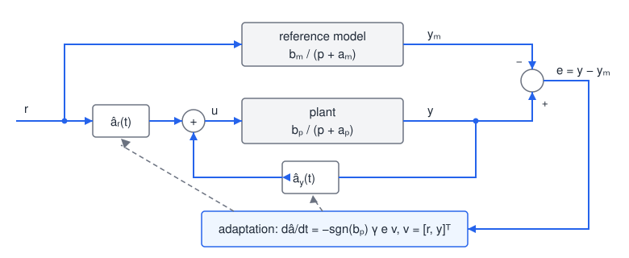
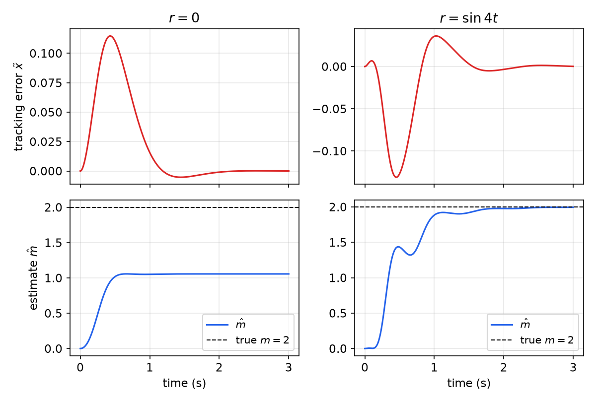
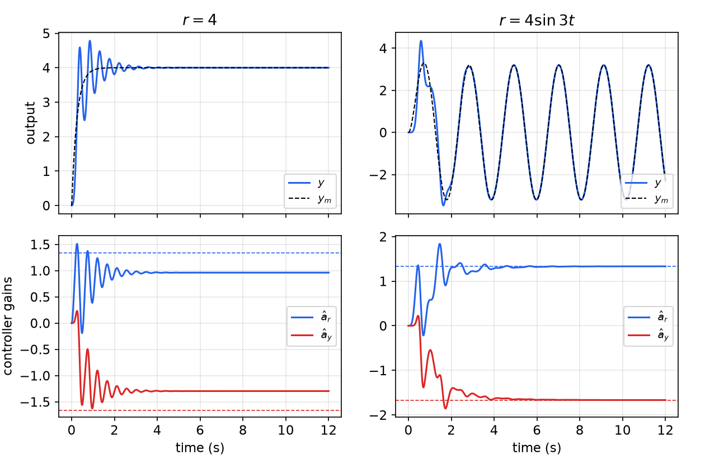
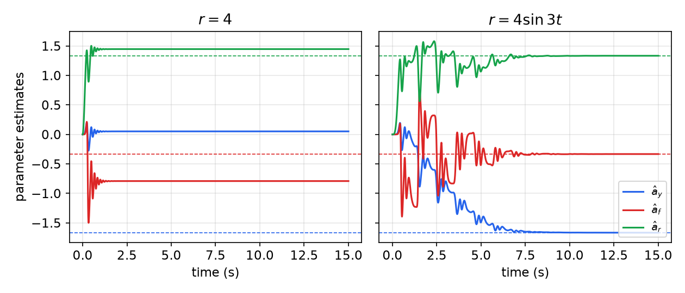
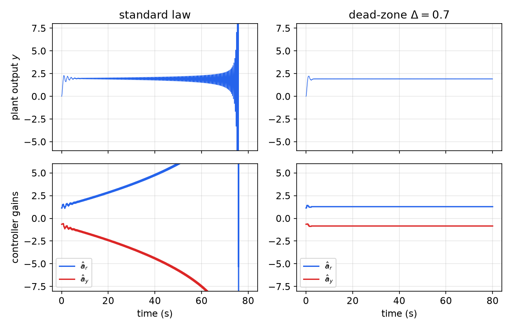
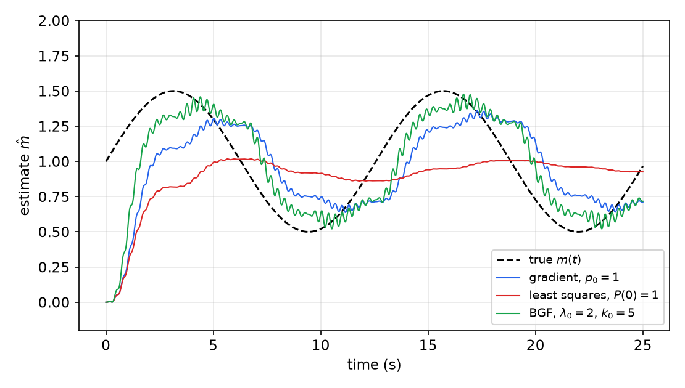
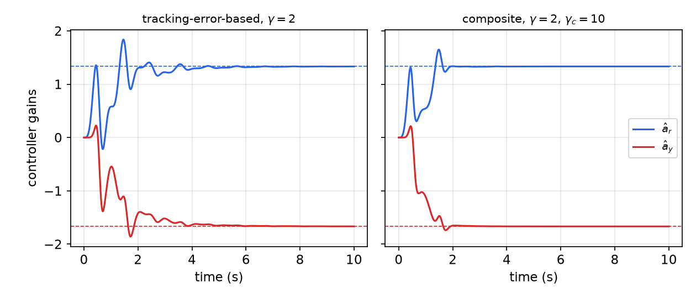

# Adaptive Control

Many systems have parameters that are constant, or change only slowly, but are not known in advance. Examples include a robot picking up loads of unknown mass, a ship whose dynamics change with loading and sea state, an aircraft whose dynamics vary by a factor of 10 to 50 over its flight envelope, and a chemical process that differs from batch to batch. Robust control, such as [Sliding Control](sliding-control.md), dominates such uncertainty with large gains. Adaptive control instead *learns* the parameters on line and adjusts the controller as it goes. The result is a controller that is inherently nonlinear, even for a linear plant, because the parameter estimates multiply the signals. Its analysis therefore relies on Lyapunov theory, Barbalat's lemma ([Invariant Sets and LaSalle's Principle](invariance.md)) and the positive-real lemma. The chapter develops model-reference adaptive control for progressively harder plants, then on-line parameter estimation, robustness, and composite adaptation that combines the two.

## Basic Concepts

### Why adaptive control?

The goal is to keep performance consistent when parameters are uncertain or vary. Typical applications:

- **Robot manipulation**: an arm must follow a fast trajectory among obstacles while carrying a load whose mass and inertia are unknown. A fixed controller tuned for no load becomes sluggish or inaccurate with a heavy one.
- **Ship steering**: the steering dynamics of a freighter depend on its loading and on wind and waves.
- **Aircraft control**: the dynamics change with speed, altitude and angle of attack; gain scheduling is the classical answer, and adaptive control a more systematic one.
- **Process control**: batch-to-batch variation of raw materials; adaptation reduces manual retuning.

The analysis assumes constant parameters. In practice it suffices that the parameters vary much more slowly than the adaptation converges; fast parameter variation usually indicates that the model is missing something important.

**Adaptive versus robust control.** For constant or slowly varying parameters, adaptive control is usually superior: it improves with experience and needs little prior information about the parameter values. Robust control handles what adaptation cannot: disturbances, rapidly varying parameters and unmodeled dynamics. The two are often combined into **robust adaptive control**. Almost all existing nonlinear adaptive methods require the unknown parameters to appear **linearly** in the dynamics (linear parametrization).

### Model-reference adaptive control

A **model-reference adaptive control** (MRAC) system has four parts:

1. **The plant**, with known structure and unknown parameters.
2. **A reference model**, which specifies the ideal response \\(y\_m\\) to the command \\(r(t)\\). It encodes the specifications (rise time, settling time, overshoot) and must be achievable by the plant, which constrains its order and relative degree.
3. **A controller with adjustable parameters.** It must have **perfect tracking capacity**: for the true (unknown) parameter values there must be controller parameters that make the plant output equal the model output. For the methods below, the controller must also be linearly parametrized.
4. **An adaptation law** that updates the controller parameters to drive the tracking error \\(e = y - y\_m\\) to zero while keeping all signals bounded. Lyapunov theory, hyperstability and passivity are the main design tools.

*Figure: MRAC structure, drawn for the first-order plant treated below. The command \\(r\\) drives both the reference model and the plant; the controller gains \\(\hat a\_r\\) (feedforward) and \\(\hat a\_y\\) (feedback) are adjusted by the adaptation law, which correlates the tracking error \\(e = y - y\_m\\) with the signals \\(v = [r, y]^T\\) multiplying the gains.*

**Example 1 (MRAC of an unknown mass).** A mass moves under a control force,
\\[
m\ddot x = u ,
\\]
and we want its position to follow the output of the second-order reference model
\\[
\ddot x\_m + \lambda\_1\dot x\_m + \lambda\_2 x\_m = \lambda\_2\\,r(t),
\\]
with \\(\lambda\_1, \lambda\_2 > 0\\). Let \\(\tilde x = x - x\_m\\). If \\(m\\) were known, the control
\\[
u = m\left(\ddot x\_m - 2\lambda\dot{\tilde x} - \lambda^2\tilde x\right), \qquad \lambda > 0,
\\]
would give the exponentially stable error dynamics \\(\ddot{\tilde x} + 2\lambda\dot{\tilde x} + \lambda^2\tilde x = 0\\). With \\(m\\) unknown, use the same law with an estimate \\(\hat m(t)\\):
\\[
u = \hat m\\,v, \qquad v = \ddot x\_m - 2\lambda\dot{\tilde x} - \lambda^2\tilde x .
\\]
Define the combined error \\(s = \dot{\tilde x} + \lambda\tilde x\\) and the parameter error \\(\tilde m = \hat m - m\\). Since \\(m\ddot x = \hat m v\\),
\\[
m\left(\ddot x - v\right) = \tilde m\\,v,
\qquad
\ddot x - v = \ddot{\tilde x} + 2\lambda\dot{\tilde x} + \lambda^2\tilde x = \dot s + \lambda s ,
\\]
so the closed loop is
\\[
m\dot s + \lambda m s = \tilde m\\,v .
\\]
The parameter error acts as an input to a stable first-order system in \\(s\\). Choose the adaptation law
\\[
\boxed{\dot{\hat m} = -\gamma\\,v\\,s,}
\\]
with adaptation gain \\(\gamma > 0\\), and consider
\\[
V = \frac{1}{2}\left[m s^2 + \frac{1}{\gamma}\tilde m^2\right].
\\]
Because \\(m\\) is constant, \\(\dot{\tilde m} = \dot{\hat m}\\), and
\\[
\dot V = m s\dot s + \frac{1}{\gamma}\tilde m\dot{\hat m} = s\left(\tilde m v - \lambda m s\right) - \tilde m v s = -\lambda m s^2 \le 0 .
\\]
The adaptation law was chosen precisely to cancel the indefinite cross term \\(s\tilde m v\\).

*Convergence via Barbalat's lemma.* \\(V \ge 0\\) and \\(\dot V \le 0\\), so \\(V\\) has a finite limit and \\(s\\), \\(\tilde m\\) are bounded. Bounded \\(s\\) implies bounded \\(\tilde x\\), \\(\dot{\tilde x}\\), because \\(\tilde x\\) is \\(s\\) filtered by the stable \\(1/(p + \lambda)\\). With a bounded reference, \\(v\\) is bounded, so \\(\dot s = \tilde m v/m - \lambda s\\) is bounded, and therefore \\(\ddot V = -2\lambda m s\dot s\\) is bounded. A bounded \\(\ddot V\\) makes \\(\dot V\\) uniformly continuous, so by Barbalat's lemma \\(\dot V \to 0\\), that is, \\(s \to 0\\), and hence \\(\tilde x \to 0\\) and \\(\dot{\tilde x} \to 0\\). (The needed property is that \\(\dot V\\) be uniformly continuous, which follows from \\(\ddot V\\) being bounded.)

*Figure: Example 1 re-simulated with \\(m = 2\\), \\(\hat m(0) = 0\\), \\(\gamma = 0.5\\), \\(\lambda\_1 = 10\\), \\(\lambda\_2 = 25\\), \\(\lambda = 6\\), and \\(x(0) = x\_m(0) = 0\\), \\(\dot x(0) = \dot x\_m(0) = 0.5\\). Left, \\(r = 0\\): the tracking error goes to zero within about 1.5 s, but \\(\hat m\\) settles near 1.06, not at the true value 2. Right, \\(r = \sin 4t\\): both the tracking error and the parameter error go to zero (\\(\hat m \approx 1.995\\) at 3 s).*

The figure shows a theme that runs through the whole chapter. Tracking convergence is guaranteed; parameter convergence is not. When the task is simple, many parameter values achieve it, and the adaptation stops as soon as the tracking error is zero. When the task is rich enough, only the true parameter achieves it.

### Self-tuning controllers

A **self-tuning controller** (STC) separates the two functions: an *estimator* computes parameter estimates \\(\hat a\\) from input-output data, and the controller is computed as if the estimates were the true values, an idea called **certainty equivalence**. In an *indirect* scheme, the plant parameters are estimated and the controller parameters computed from them; in a *direct* scheme, the plant model is reparametrized directly in terms of the controller parameters, which are estimated.

**Example 2 (self-tuning control of the mass).** Suppose the acceleration \\(\ddot x\\) can be measured. The naive estimate \\(\hat m = u/\ddot x\\) is useless whenever the acceleration is small or noisy. Instead, minimize the accumulated squared prediction error
\\[
J = \int\_0^t e^2(r)\\,dr, \qquad e = \hat m(t)\\,\ddot x - u ,
\\]
whose minimizer is the least-squares estimate
\\[
\hat m(t) = \frac{\int\_0^t w\\,u\\,dr}{\int\_0^t w^2\\,dr}, \qquad w = \ddot x .
\\]
It can be computed recursively. Define \\(P(t) = \left[\int\_0^t w^2 dr\right]^{-1}\\), so that \\(\frac{d}{dt}\left[P^{-1}\right] = w^2\\). Differentiating \\(P^{-1}\hat m = \int\_0^t wu\\,dr\\) gives \\(w^2\hat m + P^{-1}\dot{\hat m} = wu\\), that is,
\\[
\dot{\hat m} = -P(t)\\,w\\,e .
\\]
The need to measure acceleration is removed by filtering, as shown in the section on parameter estimation.

**MRAC versus self-tuning.** MRAC adjusts the parameters to minimize the *tracking* error; self-tuning adjusts them to minimize the *data-fitting* (prediction) error. Both have an inner control loop and an outer estimation loop, and they can be unified. MRAC guarantees stability and tracking convergence regardless of how rich the signals are. Self-tuning is more flexible, since any estimator can be paired with any controller design, and estimation is unaffected by, for example, input saturation, but its convergence analysis is harder and often requires rich signals. Historically MRAC was developed in continuous time for deterministic servo problems, and self-tuning in discrete time for stochastic regulation.

### How to design adaptive controllers

The design proceeds in three steps: choose a control law containing adjustable parameters, choose an adaptation law, and prove convergence. For MRAC the Lyapunov function often guides the choice of the adaptation law, as in Example 1, where it was picked to cancel the cross term. The following lemma packages this argument for a large class of error equations.

## The Key Lemma: Strictly Positive Real Error Equations

**Definition (positive real).** A rational transfer function \\(H(p)\\) with real coefficients is **positive real** if \\(\mathrm{Re}\\,H(p) \ge 0\\) whenever \\(\mathrm{Re}\\,p \ge 0\\). It is **strictly positive real** (SPR) if \\(H(p - \epsilon)\\) is positive real for some \\(\epsilon > 0\\). For the transfer functions used here, SPR means that \\(H\\) is stable (all poles in the open left half-plane), \\(\mathrm{Re}\\,H(j\omega) > 0\\) for all \\(\omega\\), and the relative degree is 0 or 1. For example, \\(1/(p + a)\\) with \\(a > 0\\) is SPR, while \\(1/(p+a)^2\\) is not, since its phase reaches \\(-180^\circ\\).

**Lemma (Kalman–Yakubovich).** Let \\(\dot x = Ax + b\\,u\\), \\(y = c^Tx\\) be a controllable realization of \\(H(p) = c^T(pI - A)^{-1}b\\). Then \\(H\\) is SPR if and only if there exist symmetric positive definite matrices \\(P\\) and \\(Q\\) such that
\\[
A^TP + PA = -Q, \qquad Pb = c .
\\]
The lemma links a frequency-domain property to a Lyapunov function, and its second condition is what makes the cross terms cancel. (The realization may be non-minimal if the hidden modes are stable; this is the Meyer–Kalman–Yakubovich version.)

**Lemma 8.1 (SPR adaptation).** Consider two signals related by
\\[
e(t) = H(p)\left[k\\,\phi^T(t)\\,v(t)\right],
\\]
where \\(e\\) is a scalar output, \\(H(p)\\) is strictly positive real, \\(k\\) is an unknown constant with **known sign**, \\(\phi(t)\\) is an \\(m \times 1\\) vector of functions of time, and \\(v(t)\\) is a measurable \\(m \times 1\\) vector. If \\(\phi\\) varies according to
\\[
\boxed{\dot\phi = -\mathrm{sgn}(k)\\,\gamma\\,e\\,v(t), \qquad \gamma > 0,}
\\]
then \\(e(t)\\) and \\(\phi(t)\\) are globally bounded. If, in addition, \\(v\\) is bounded, then \\(e(t) \to 0\\) as \\(t \to \infty\\).

*Proof.* Take a state-space realization of \\(H\\),
\\[
\dot x = Ax + b\left[k\\,\phi^Tv\right], \qquad e = c^Tx .
\\]
Since \\(H\\) is SPR, the Kalman–Yakubovich lemma gives \\(P = P^T > 0\\) and \\(Q = Q^T > 0\\) with \\(A^TP + PA = -Q\\) and \\(Pb = c\\). Consider
\\[
V = x^TPx + \frac{\lvert k\rvert}{\gamma}\phi^T\phi .
\\]
Then
\\[
\dot V = x^T\left(A^TP + PA\right)x + 2x^TPb\\,k\\,\phi^Tv + \frac{2\lvert k\rvert}{\gamma}\phi^T\dot\phi
= -x^TQx + 2e\\,k\\,\phi^Tv - 2\lvert k\rvert\\,\mathrm{sgn}(k)\\,\phi^T e\\,v
= -x^TQx \le 0,
\\]
using \\(x^TPb = x^Tc = e\\) and \\(\lvert k\rvert\\,\mathrm{sgn}(k) = k\\). Hence \\(V\\) is bounded and so are \\(x\\) and \\(\phi\\), and therefore \\(e = c^Tx\\). If \\(v\\) is bounded, \\(\dot x\\) is bounded, so \\(\ddot V = -2x^TQ\dot x\\) is bounded and \\(\dot V\\) is uniformly continuous. Barbalat's lemma gives \\(\dot V \to 0\\), so \\(x \to 0\\) and \\(e \to 0\\). \\(\blacksquare\\)

The lemma has a feedback interpretation: an SPR block, with input \\(k\phi^Tv\\) and output \\(e\\), is connected in feedback with the adaptation block, which multiplies \\(e\\) by \\(-\mathrm{sgn}(k)\gamma v(t)\\), integrates, and multiplies again by \\(v^T\\). Both blocks are passive, and the interconnection of passive systems is stable (see [Passivity](passivity.md)). Example 1 fits the lemma: the closed loop \\(m\dot s + \lambda m s = \tilde m v\\) is \\(s = \frac{1/m}{p + \lambda}[\tilde m v]\\), an SPR transfer function, and \\(\dot{\hat m} = -\gamma vs\\) is the lemma's law.

## Adaptive Control of First-Order Systems

### Design

Consider the first-order plant
\\[
\dot y = -a\_p\\,y + b\_p\\,u ,
\\]
where \\(a\_p\\) and \\(b\_p\\) are unknown constants but the **sign of \\(b\_p\\) is known**. Many processes have this form: a braking vehicle, a capacitor discharging through a flash tube, a tank emptying through an orifice (after linearization). The reference model is
\\[
\dot y\_m = -a\_m\\,y\_m + b\_m\\,r(t), \qquad a\_m > 0,\; b\_m > 0,
\qquad M(p) = \frac{b\_m}{p + a\_m}\\ \text{(SPR)}.
\\]
**Control law.** Use a feedforward gain on the command and a feedback gain on the output,
\\[
u = \hat a\_r(t)\\,r + \hat a\_y(t)\\,y ,
\\]
which gives the closed loop \\(\dot y = -(a\_p - \hat a\_y b\_p)\\,y + \hat a\_r b\_p\\,r\\). Comparing with the reference model, perfect matching is achieved by the ideal gains
\\[
\boxed{a\_r^\* = \frac{b\_m}{b\_p}, \qquad a\_y^\* = \frac{a\_p - a\_m}{b\_p}.}
\\]
**Adaptation law.** Let \\(e = y - y\_m\\), \\(\tilde a\_r = \hat a\_r - a\_r^\*\\), \\(\tilde a\_y = \hat a\_y - a\_y^\*\\). Subtracting the model from the closed loop and adding and subtracting the ideal terms,
\\[
\dot e = -a\_m e + b\_p\left(\tilde a\_r r + \tilde a\_y y\right),
\qquad\text{so}\qquad
e = \frac{b\_p}{p + a\_m}\left[\tilde a\_r r + \tilde a\_y y\right] = \frac{1}{a\_r^\*}M(p)\left[\tilde a\_r r + \tilde a\_y y\right].
\\]
This is exactly the form of Lemma 8.1 with \\(k = 1/a\_r^\*\\) (whose sign is that of \\(b\_p\\)), \\(\phi = [\tilde a\_r, \tilde a\_y]^T\\) and \\(v = [r, y]^T\\). The lemma's law is
\\[
\boxed{\dot{\hat a}\_r = -\mathrm{sgn}(b\_p)\\,\gamma\\,e\\,r, \qquad \dot{\hat a}\_y = -\mathrm{sgn}(b\_p)\\,\gamma\\,e\\,y .}
\\]
**Tracking convergence**, directly: with
\\[
V = \frac{1}{2}e^2 + \frac{1}{2\gamma}\lvert b\_p\rvert\left(\tilde a\_r^2 + \tilde a\_y^2\right),
\qquad
\dot V = -a\_m e^2 + b\_p e\left(\tilde a\_r r + \tilde a\_y y\right) - \lvert b\_p\rvert\\,\mathrm{sgn}(b\_p)\\,e\left(\tilde a\_r r + \tilde a\_y y\right) = -a\_m e^2 \le 0 .
\\]
So \\(e\\), \\(\hat a\_r\\), \\(\hat a\_y\\) are bounded; with \\(r\\) bounded, \\(y = y\_m + e\\) is bounded, so \\(\dot e\\) and \\(\ddot V = -2a\_m e\dot e\\) are bounded, and Barbalat's lemma gives \\(e \to 0\\).

The laws have a simple intuitive reading. Suppose \\(b\_p > 0\\) and \\(e < 0\\) (the output is too small). Then the control should increase; if \\(r > 0\\) that means increasing \\(\hat a\_r\\), which is what \\(\dot{\hat a}\_r = -\gamma e r > 0\\) does.

**Example 3 (unstable first-order plant).** The plant \\(\dot y = y + 3u\\) (\\(a\_p = -1\\), \\(b\_p = 3\\), both treated as unknown) is open-loop unstable. The reference model is \\(\dot y\_m = -4y\_m + 4r\\) (\\(a\_m = b\_m = 4\\)), the adaptation gain \\(\gamma = 2\\), and all initial parameters and states are zero. The ideal gains are \\(a\_r^\* = 4/3\\) and \\(a\_y^\* = (-1 - 4)/3 = -5/3\\).

*Figure: Example 3, re-simulated. Left, \\(r = 4\\): after an oscillatory transient the output tracks the model, but the gains converge to about \\(0.96\\) and \\(-1.30\\), not to \\(4/3\\) and \\(-5/3\\) (dashed). The two parameter errors are equal in magnitude and opposite in sign. Right, \\(r = 4\sin 3t\\): tracking converges within a few seconds and both gains converge to their ideal values over about 10 s.*

The adaptation gain \\(\gamma\\) sets the speed. A small \\(\gamma\\) gives slow adaptation and large transient errors; a large \\(\gamma\\) gives fast but oscillatory parameter estimates, whose high-frequency content may excite unmodeled dynamics.

### Parameter convergence and persistent excitation

Why do the parameters converge in one case and not the other? For large \\(t\\), the tracking error is zero and the parameter errors are nearly constant, so the error equation forces
\\[
v^T(t)\\,\tilde a = 0, \qquad v = [r, y]^T, \quad \tilde a = [\tilde a\_r, \tilde a\_y]^T .
\\]
With a constant command \\(r = r\_0\\), \\(y \to \alpha r\_0\\), where \\(\alpha\\) is the DC gain of the reference model, and the condition becomes
\\[
\tilde a\_r + \alpha\\,\tilde a\_y = 0 ,
\\]
a single equation for two unknowns: the parameters converge to *some* point on a line in parameter space. For Example 3, \\(\alpha = 1\\), so the parameter errors are equal and opposite, as the simulation shows (\\(0.96 - 4/3 = -0.37\\) and \\(-1.30 + 5/3 = +0.37\\)).

**Definition (persistent excitation).** A vector signal \\(v(t)\\) is **persistently exciting** (PE) if there exist \\(\alpha\_1 > 0\\) and \\(T > 0\\) such that for all \\(t \ge 0\\)
\\[
\int\_t^{t+T}v(r)\\,v^T(r)\\,dr \ge \alpha\_1 I .
\\]
If \\(v\\) is PE, multiply \\(v^T\tilde a = 0\\) by \\(v\\) and integrate over \\([t, t+T]\\): \\(\left[\int\_t^{t+T}vv^Tdr\right]\tilde a = 0\\), and the matrix is invertible, so \\(\tilde a = 0\\). PE means that over every window of length \\(T\\), \\(v\\) visits all directions of \\(\mathbb{R}^m\\). For the first-order plant, a command containing at least one sinusoid makes \\([r, y]^T\\) PE. For linear plants in general, each sinusoid in the input contributes two spectral lines and can identify two parameters, so \\(m\\) parameters require at least \\(m/2\\) sinusoids.

### Nonlinear first-order plants

The same approach handles a known nonlinearity entering linearly:
\\[
\dot y = -a\_p y - c\_p f(y) + b\_p u ,
\\]
with \\(f\\) known and \\(a\_p\\), \\(c\_p\\), \\(b\_p\\) unknown. Use
\\[
u = \hat a\_y y + \hat a\_f f(y) + \hat a\_r r,
\qquad
e = \frac{1}{a\_r^\*}M(p)\left[\tilde a\_y y + \tilde a\_f f(y) + \tilde a\_r r\right],
\qquad a\_f^\* = \frac{c\_p}{b\_p},
\\]
and adapt with
\\[
\dot{\hat a}\_y = -\mathrm{sgn}(b\_p)\gamma e y, \qquad \dot{\hat a}\_f = -\mathrm{sgn}(b\_p)\gamma e f, \qquad \dot{\hat a}\_r = -\mathrm{sgn}(b\_p)\gamma e r .
\\]
The same Lyapunov argument gives \\(e \to 0\\) with bounded parameters. With a constant command the parameters converge to a line in the three-dimensional parameter space, and parameter convergence requires \\(v = [r, y, f(y)]^T\\) to be PE. For linear plants the number of sinusoids needed is known; for nonlinear plants no general rule exists.

**Example 4 (a quadratic nonlinearity).** The plant is
\\[
\dot y = y + y^2 + 3u ,
\\]
so \\(a\_p = -1\\), \\(c\_p = -1\\), \\(b\_p = 3\\), and \\(a\_y^\* = -5/3\\), \\(a\_f^\* = -1/3\\), \\(a\_r^\* = 4/3\\). Use the same reference model, gain and initial values as Example 3.

*Figure: Example 4, re-simulated. Left, \\(r = 4\\): the tracking error vanishes but the three estimates only stay bounded, ending near \\((0.05, -0.79, 1.45)\\). Right, \\(r = 4\sin 3t\\): all three estimates converge to their ideal values (dashed) within about 10 s, more oscillatory than in the linear case.*

Why does a single sinusoid identify three parameters here? In steady state \\(y\_{ss} = 4A\sin(3t + \varphi)\\), where \\(A\\) and \\(\varphi\\) are the gain and phase of the model at \\(\omega = 3\\), and
\\[
f\_{ss} = y\_{ss}^2 = 16A^2\sin^2(3t + \varphi) = 8A^2\left(1 - \cos(6t + 2\varphi)\right).
\\]
The nonlinearity generates a constant and a second frequency, enough spectral content for three parameters.

**Example 5 (adaptive stabilization, analyzed with LaSalle).** For the scalar plant \\(\dot y = ay + u\\) with \\(a\\) an unknown constant, use the adaptive high-gain law
\\[
u = -k\\,y, \qquad \dot k = \gamma y^2, \qquad \gamma > 0 .
\\]
With \\(x\_1 = y\\), \\(x\_2 = k\\), the closed loop is \\(\dot x\_1 = -(x\_2 - a)x\_1\\), \\(\dot x\_2 = \gamma x\_1^2\\). Pick any constant \\(b > a\\) and the radially unbounded function
\\[
V = \frac{1}{2}x\_1^2 + \frac{1}{2\gamma}(x\_2 - b)^2,
\qquad
\dot V = -(x\_2 - a)x\_1^2 + (x\_2 - b)x\_1^2 = -(b - a)\\,x\_1^2 \le 0 .
\\]
All trajectories are bounded, so \\(k\\) is bounded. The set where \\(\dot V = 0\\) is \\(\\{x\_1 = 0\\}\\); on it \\(\dot x\_2 = 0\\), so every point of the \\(k\\)-axis is an equilibrium and the whole set is invariant. LaSalle's invariance principle gives \\(y \to 0\\); and since \\(k\\) is nondecreasing and bounded, \\(k \to k\_\infty\\), a finite constant. The unknown parameter appears in the Lyapunov function only through the analysis constant \\(b\\), never in the controller.

## Linear Systems with Full-State Feedback

Consider the \\(n\\)th-order plant
\\[
a\_n y^{(n)} + a\_{n-1}y^{(n-1)} + \dots + a\_0 y = u ,
\\]
with all states \\(y, \dot y, \dots, y^{(n-1)}\\) measured (for example \\(m\ddot y + c\dot y + ky = u\\) with an encoder and a tachometer), the coefficients unknown, and the sign of \\(a\_n\\) known. The reference model is \\(\alpha\_n y\_m^{(n)} + \dots + \alpha\_0 y\_m = r(t)\\). Let \\(e = y - y\_m\\) and define
\\[
z(t) = y\_m^{(n)} - \beta\_{n-1}e^{(n-1)} - \dots - \beta\_0 e,
\\]
where \\(p^n + \beta\_{n-1}p^{n-1} + \dots + \beta\_0\\) is Hurwitz. Rewriting the plant as \\(a\_n\left[y^{(n)} - z\right] + a\_{n-1}y^{(n-1)} + \dots + a\_0 y = u - a\_n z\\) suggests the control
\\[
u = \hat a\_n z + \hat a\_{n-1}y^{(n-1)} + \dots + \hat a\_0 y = v^T(t)\\,\hat a(t),
\qquad v = [z, y^{(n-1)}, \dots, \dot y, y]^T,
\\]
which with exact parameters places the closed-loop error poles at the roots of the \\(\beta\\) polynomial. With estimates, the error dynamics are
\\[
a\_n\left[e^{(n)} + \beta\_{n-1}e^{(n-1)} + \dots + \beta\_0 e\right] = v^T\tilde a .
\\]
In state space, with \\(x = [e, \dot e, \dots, e^{(n-1)}]^T\\),
\\[
\dot x = Ax + b\left[\frac{1}{a\_n}v^T\tilde a\right], \qquad e = c^Tx,
\\]
where \\(A\\) is the companion matrix with last row \\([-\beta\_0, \dots, -\beta\_{n-1}]\\), \\(b = [0, \dots, 0, 1]^T\\) and \\(c = [1, 0, \dots, 0]^T\\). Take symmetric positive definite \\(\Gamma\\), \\(P\\), \\(Q\\) with \\(PA + A^TP = -Q\\) and
\\[
V = a\_n x^TPx + \tilde a^T\Gamma^{-1}\tilde a \qquad (a\_n > 0;\ \text{otherwise use } \lvert a\_n\rvert).
\\]
Then \\(\dot V = -a\_n x^TQx + 2\tilde a^Tv\\,b^TPx + 2\tilde a^T\Gamma^{-1}\dot{\hat a}\\), and the adaptation law
\\[
\boxed{\dot{\hat a} = -\Gamma\\,v\\,b^TPx}
\\]
gives \\(\dot V = -a\_n x^TQx \le 0\\). Barbalat's lemma then shows that \\(e\\) and its derivatives tend to zero. Here the full state is available, so no SPR condition is needed: the Lyapunov equation is solved for any Hurwitz \\(A\\), and the signal \\(b^TPx\\) plays the role of a filtered error. The parameters converge if and only if \\(v\\) is persistently exciting. The same design extends to nonlinear systems in companion form, as shown below.

## Linear Systems with Output Feedback

Now only the output \\(y\\) is measured, and differentiating it is not allowed. Let the plant be
\\[
W\_p(p) = k\_p\frac{Z\_p(p)}{R\_p(p)}, \qquad Z\_p = p^m + b\_{m-1}p^{m-1} + \dots + b\_0, \qquad R\_p = p^n + a\_{n-1}p^{n-1} + \dots + a\_0,
\\]
where \\(k\_p\\) is the **high-frequency gain** (\\(\lvert W\_p(j\omega)\rvert \approx k\_p/\omega^{n-m}\\) at high frequency) and \\(n - m\\) the relative degree. The reference model is
\\[
W\_m(p) = k\_m\frac{Z\_m(p)}{R\_m(p)}, \qquad k\_m > 0,\ Z\_m, R\_m \text{ monic Hurwitz},
\\]
with relative degree at least that of the plant. The standard assumptions are: the order \\(n\\) is known; the relative degree is known; the sign of \\(k\_p\\) is known; and the plant is **minimum phase** (because the controller will cancel the plant zeros).

### Relative degree one

**Example 6 (a controller with perfect tracking capacity).** Take a second-order plant and model of relative degree one,
\\[
y = \frac{k\_p(p + b\_p)}{p^2 + a\_{p1}p + a\_{p2}}\\,u, \qquad y\_m = \frac{k\_m(p + b\_m)}{p^2 + a\_{m1}p + a\_{m2}}\\,r .
\\]
Without differentiating \\(y\\), build the controller from first-order filters with the model zero as pole:
\\[
u = \alpha\_1 z + \frac{\beta\_1 p + \beta\_2}{p + b\_m}\\,y + k\\,r, \qquad z = \frac{u}{p + b\_m}.
\\]
It works in three steps. (1) The local loop \\(u = \alpha\_1 u/(p + b\_m) + u\_1\\) gives \\(u = \frac{p + b\_m}{p + b\_m - \alpha\_1}u\_1\\); choosing \\(\alpha\_1 = b\_m - b\_p\\) makes this \\(\frac{p + b\_m}{p + b\_p}\\), so the plant zero is replaced by the model zero,
\\[
W\_{u\_1y} = \frac{p + b\_m}{p + b\_p}\cdot\frac{k\_p(p + b\_p)}{p^2 + a\_{p1}p + a\_{p2}} = \frac{k\_p(p + b\_m)}{p^2 + a\_{p1}p + a\_{p2}} .
\\]
(2) The output feedback \\(\frac{\beta\_1p + \beta\_2}{p + b\_m}y\\) then moves the poles:
\\[
W\_{u\_0y} = \frac{k\_p(p + b\_m)}{p^2 + (a\_{p1} - \beta\_1 k\_p)p + (a\_{p2} - \beta\_2 k\_p)},
\\]
so \\(\beta\_1 = (a\_{p1} - a\_{m1})/k\_p\\) and \\(\beta\_2 = (a\_{p2} - a\_{m2})/k\_p\\) place them at the model poles (with the sign convention \\(u = u\_0 + \text{feedback}\\)). (3) The gain \\(k = k\_m/k\_p\\) replaces the high-frequency gain. Then \\(W\_{ry} = W\_m\\). The minimum-phase assumption is needed because step (1) cancels the plant zero \\(-b\_p\\) by a controller pole.

**General structure.** For an \\(n\\)th-order plant, use two \\((n-1)\\)-dimensional filters driven by the input and the output,
\\[
\dot\omega\_1 = \Lambda\omega\_1 + h\\,u, \qquad \dot\omega\_2 = \Lambda\omega\_2 + h\\,y, \qquad \det(pI - \Lambda) = Z\_m(p),
\\]
with \\((\Lambda, h)\\) controllable. The controller
\\[
u^\* = k^\*r + \theta\_1^{\*T}\omega\_1 + \theta\_2^{\*T}\omega\_2 + \theta\_0^\*y, \qquad k^\* = k\_m/k\_p,
\\]
has perfect tracking capacity: \\(\theta\_1^\*\\) cancels the plant zeros, and \\(\theta\_2^\*\\), \\(\theta\_0^\*\\) place the poles, so that \\(y = W\_m(p)r\\). The adaptive version replaces the constants by estimates,
\\[
u = \theta^T(t)\\,\omega(t), \qquad \theta = [k, \theta\_1^T, \theta\_2^T, \theta\_0]^T, \qquad \omega = [r, \omega\_1^T, \omega\_2^T, y]^T,
\\]
both \\(2n\\)-dimensional. Writing \\(u = \theta^{\*T}\omega + \phi^T\omega\\) with \\(\phi = \theta - \theta^\*\\), the closed loop is the ideal one driven by the extra input \\(\phi^T\omega/k^\*\\):
\\[
y = W\_m(p)\left[r + \frac{1}{k^\*}\phi^T\omega\right], \qquad e = y - y\_m = W\_m(p)\left[\frac{1}{k^\*}\phi^T(t)\\,\omega(t)\right].
\\]
For relative degree one, \\(W\_m\\) can be chosen SPR, and Lemma 8.1 gives the adaptation law
\\[
\dot\theta = -\mathrm{sgn}(k\_p)\\,\gamma\\,e\\,\omega
\\]
(since \\(\mathrm{sgn}\\,k^\* = \mathrm{sgn}\\,k\_p\\)). Boundedness of \\(\omega\\) is not given in advance here, since it contains plant signals; an additional signal-growth argument establishes it, and then \\(e \to 0\\).

### Higher relative degree

**Example 7 (relative degree two).** For \\(y = \frac{k\_p}{p^2 + a\_{p1}p + a\_{p2}}u\\) and \\(y\_m = \frac{k\_m}{p^2 + a\_{m1}p + a\_{m2}}r\\), there is no model zero to use as filter pole. Use instead an arbitrary stable pole \\(-\lambda\_0\\): \\(u = \frac{\alpha\_1}{p + \lambda\_0}u + \frac{\beta\_1p + \beta\_2}{p + \lambda\_0}y + kr\\). Clearing the filters, the closed-loop denominator is \\((p + \lambda\_0 - \alpha\_1)(p^2 + a\_{p1}p + a\_{p2}) - k\_p(\beta\_1 p + \beta\_2)\\), and matching requires
\\[
(p + \lambda\_0 - \alpha\_1)(p^2 + a\_{p1}p + a\_{p2}) - k\_p(\beta\_1p + \beta\_2) = (p + \lambda\_0)(p^2 + a\_{m1}p + a\_{m2}), \qquad k = \frac{k\_m}{k\_p},
\\]
so the extra factor \\((p + \lambda\_0)\\) cancels in \\(W\_{ry}\\). Comparing coefficients of \\(p^2\\), \\(p\\) and \\(1\\) gives three linear equations for \\(\alpha\_1\\), \\(\beta\_1\\), \\(\beta\_2\\), with a unique solution.

In general the filter order stays \\(n - 1\\), with
\\[
\Lambda(p) = \det(pI - \Lambda) = \Lambda\_0(p)\\,Z\_m(p),
\\]
\\(\Lambda\_0\\) Hurwitz of degree \\(n - 1 - m\\). If the feedforward part of the controller is \\(\frac{\Lambda}{\Lambda + C}\\) (with \\(C\\) built from \\(\theta\_1\\)) and the feedback part \\(\frac{D}{\Lambda}\\) (with \\(D\\) from \\(\theta\_0\\), \\(\theta\_2\\)), then
\\[
W\_{ry} = \frac{k\\,k\_p\\,Z\_p\\,\Lambda\_0\\,Z\_m}{R\_p(\Lambda + C) + k\_p Z\_p D},
\\]
and matching requires
\\[
R\_p(\Lambda + C) + k\_pZ\_pD = \Lambda\_0\\,Z\_p\\,R\_m .
\\]
**Lemma 8.2 (Bezout identity).** If the polynomials \\(A(p)\\) and \\(B(p)\\) are relatively prime, then for any polynomial \\(A^\*(p)\\) there exist polynomials \\(M(p)\\), \\(N(p)\\) such that \\(AM + BN = A^\*\\).

Since \\(R\_p\\) and \\(k\_pZ\_p\\) are coprime (no pole-zero cancellations in the plant), the lemma guarantees that ideal parameters exist. The adaptive controller \\(u = \theta^T\omega\\) again gives
\\[
e = W\_m(p)\left[\frac{1}{k^\*}\phi^T\omega\right],
\\]
but now \\(W\_m\\), of relative degree two or more, cannot be SPR, and the simple law fails.

**Error augmentation.** The trick is to build a new error signal that is related *algebraically* to the parameter error. Define the auxiliary signal
\\[
\eta(t) = \theta^T(t)\\,W\_m(p)\left[\omega\right] - W\_m(p)\left[\theta^T(t)\\,\omega(t)\right],
\\]
which is computable on line (filter \\(\omega\\) and filter \\(u = \theta^T\omega\\)) and vanishes when \\(\theta\\) is constant, because then the filter and the multiplication commute. Since \\(\theta^\*\\) is constant, \\(\eta = \phi^T W\_m[\omega] - W\_m[\phi^T\omega]\\). Form the **augmented error**
\\[
\varepsilon(t) = e(t) + \alpha(t)\\,\eta(t), \qquad \alpha = \frac{1}{k^\*} + \phi\_\alpha ,
\\]
where \\(\alpha(t)\\) is an additional adaptive gain and \\(\phi\_\alpha\\) its error. Substituting,
\\[
\varepsilon(t) = \frac{1}{k^\*}\phi^T(t)\\,\bar\omega(t) + \phi\_\alpha\\,\eta(t), \qquad \bar\omega = W\_m(p)\left[\omega\right].
\\]
The augmented error is linear in the parameter errors with known regressors, the standard form of a prediction error, so a normalized gradient law can be used:
\\[
\dot\theta = -\frac{\mathrm{sgn}(k\_p)\\,\gamma\\,\varepsilon\\,\bar\omega}{1 + \bar\omega^T\bar\omega}, \qquad
\dot\alpha = -\frac{\gamma\\,\varepsilon\\,\eta}{1 + \bar\omega^T\bar\omega} .
\\]
The normalization keeps the adaptation rate bounded even though \\(\bar\omega\\) is not known to be bounded in advance. Global convergence of the tracking error can be proved, though the proof is lengthy. An alternative relates the augmented error to \\(\phi\\) through a chosen SPR transfer function, so that Lemma 8.1 applies.

## Adaptive Control of Nonlinear Systems

Three conditions make the following design possible: the unknown parameters enter linearly, the full state is measured, and the nonlinearities can be cancelled stably by the control. Consider the companion-form class
\\[
y^{(n)} + \sum\_{i=1}^{n}\alpha\_i f\_i(\mathbf{x}, t) = b\\,u ,
\\]
where the \\(f\_i\\) are known functions, \\(\alpha\_i\\) and \\(b\\) unknown constants, and the sign of \\(b\\) known. An example is the mass-spring-damper with nonlinear damping and spring, \\(m\ddot x + c\\,f\_1(\dot x) + k\\,f\_2(x) = u\\). Divide by \\(b\\):
\\[
h\\,y^{(n)} + \sum\_i a\_i f\_i(\mathbf{x}, t) = u, \qquad h = \frac{1}{b},\quad a\_i = \frac{\alpha\_i}{b}.
\\]
Define the sliding-type combined error
\\[
s = e^{(n-1)} + \lambda\_{n-2}e^{(n-2)} + \dots + \lambda\_0 e = \Delta(p)\\,e, \qquad e = y - y\_d,
\\]
with \\(\Delta(p)\\) Hurwitz, and write it as \\(s = y^{(n-1)} - y\_r^{(n-1)}\\), where \\(y\_r^{(n-1)} = y\_d^{(n-1)} - \lambda\_{n-2}e^{(n-2)} - \dots - \lambda\_0 e\\), so that
\\[
y\_r^{(n)} = y\_d^{(n)} - \lambda\_{n-2}e^{(n-1)} - \dots - \lambda\_0\dot e .
\\]
With known parameters, the control \\(u = h\\,y\_r^{(n)} - k\\,s + \sum a\_i f\_i\\), with \\(k\\) of the same sign as \\(h\\), yields \\(h\dot s + ks = 0\\), so \\(s \to 0\\) exponentially and then \\(e \to 0\\). The adaptive version is
\\[
u = \hat h\\,y\_r^{(n)} - k\\,s + \sum\_i\hat a\_i f\_i(\mathbf{x}, t),
\\]
which gives
\\[
h\dot s + ks = \tilde h\\,y\_r^{(n)} + \sum\_i\tilde a\_i f\_i,
\qquad\text{i.e.}\qquad
s = \frac{1/h}{p + k/h}\left[\tilde h\\,y\_r^{(n)} + \sum\_i\tilde a\_i f\_i\right].
\\]
The transfer function is SPR, and Lemma 8.1 gives
\\[
\boxed{\dot{\hat h} = -\gamma\\,\mathrm{sgn}(h)\\,s\\,y\_r^{(n)}, \qquad \dot{\hat a}\_i = -\gamma\\,\mathrm{sgn}(h)\\,s\\,f\_i .}
\\]
Directly: \\(V = \lvert h\rvert s^2 + \gamma^{-1}\left[\tilde h^2 + \sum\tilde a\_i^2\right]\\) has \\(\dot V = -2\lvert k\rvert s^2\\), which yields global tracking convergence. Separate gains \\(\gamma\_i\\) for each parameter are allowed. If, in addition, the coefficients have fast-varying bounded parts, \\(h y^{(n)} + \sum\left[a\_i + a\_{iv}(t)\right]f\_i = u\\), the adaptive part handles the constant \\(a\_i\\) and a sliding term handles \\(a\_{iv}\\), a combination of the two chapters. With a boundary layer, it is natural to adapt on \\(s\_\Delta = s - \Phi\\,\mathrm{sat}(s/\Phi)\\) instead of \\(s\\): adaptation then stops inside the boundary layer, which acts as a built-in dead-zone (see the robustness section).

**Example 8 (time-varying, linearly parametrized dynamics).** Make \\(x\_1\\) track \\(x\_d(t)\\) for
\\[
\dot x\_1 = \sin x\_2 + \sqrt{t + 1}\\,x\_2, \qquad \dot x\_2 = \alpha\_1 x\_1^4\cos x\_2 + \alpha\_2 x\_1x\_2\sin x\_2 + u,
\\]
with \\(\alpha\_1\\), \\(\alpha\_2\\) unknown constants. The input does not appear in \\(\dot x\_1\\), so differentiate once more:
\\[
\ddot x\_1 = \left(\cos x\_2 + \sqrt{t + 1}\right)\dot x\_2 + \frac{x\_2}{2\sqrt{t + 1}} = c(x, t)\left(\alpha\_1 x\_1^4\cos x\_2 + \alpha\_2x\_1x\_2\sin x\_2 + u\right) + \frac{x\_2}{2\sqrt{t + 1}},
\\]
with \\(c = \cos x\_2 + \sqrt{t + 1} > 0\\) for \\(t > 0\\). Choose
\\[
u = \frac{1}{c}\left(w - \frac{x\_2}{2\sqrt{t + 1}}\right)
\quad\Longrightarrow\quad
\ddot x\_1 = \alpha\_1 Y\_1 + \alpha\_2 Y\_2 + w, \qquad Y\_1 = c\\,x\_1^4\cos x\_2,\quad Y\_2 = c\\,x\_1x\_2\sin x\_2 .
\\]
With \\(s = \dot{\tilde x}\_1 + \lambda\tilde x\_1\\) and \\(\ddot x\_r = \ddot x\_d - \lambda\dot{\tilde x}\_1\\), let \\(w = \ddot x\_r - ks - \hat\alpha\_1Y\_1 - \hat\alpha\_2Y\_2\\). Then \\(\dot s = \ddot x\_1 - \ddot x\_r = -ks - \tilde\alpha^TY\\), where \\(\tilde\alpha = \hat\alpha - \alpha\\), and with
\\[
V = \frac{1}{2}s^2 + \frac{1}{2\gamma}\tilde\alpha^T\tilde\alpha, \qquad \dot{\hat\alpha}\_i = \gamma\\,s\\,Y\_i ,
\\]
\\(\dot V = -ks^2\\). Barbalat's lemma gives \\(s \to 0\\) and hence \\(\tilde x\_1 \to 0\\), provided the signals stay bounded along the trajectory so that \\(\dot s\\) is bounded.

## Adaptive Control Viewed as PID

**Example 9 (adaptive compensation of a constant disturbance).** Consider \\(m\ddot x = u + d\\) with \\(m\\) known and \\(d\\) an unknown constant disturbance. With \\(\tilde x = x - x\_d\\), \\(s = \dot{\tilde x} + \lambda\tilde x\\), choose
\\[
u = m\left(\ddot x\_d - \lambda\dot{\tilde x}\right) - k\_D s - \hat d .
\\]
Then \\(m\dot s = m(\ddot x - \ddot x\_d + \lambda\dot{\tilde x}) = -k\_Ds + (d - \hat d)\\). With
\\[
V = \frac{1}{2}m s^2 + \frac{1}{2\gamma}(\hat d - d)^2,
\qquad
\dot V = -k\_D s^2 + (\hat d - d)\left(\frac{\dot{\hat d}}{\gamma} - s\right),
\\]
the adaptation law \\(\dot{\hat d} = \gamma s\\) gives \\(\dot V = -k\_D s^2\\). Now integrate the adaptation law:
\\[
\hat d = \gamma\int\_0^t s\\,d\tau + \hat d(0) = \gamma\left(\tilde x + \lambda\int\_0^t\tilde x\\,d\tau\right) + \hat d(0) - \gamma\tilde x(0).
\\]
Substituting into the control,
\\[
\boxed{u = m\ddot x\_d - (m\lambda + k\_D)\\,\dot{\tilde x} - (k\_D\lambda + \gamma)\\,\tilde x - \gamma\lambda\int\_0^t\tilde x\\,d\tau + \text{const}.}
\\]
This is feedforward plus a **PID controller** on the tracking error; for a set point (\\(\ddot x\_d = 0\\)) it is exactly a PID. Integral action in [PID Control](../pid.md) is thus adaptive estimation of a constant disturbance, and the adaptive design supplies both the gain relations and a Lyapunov proof. In terms of \\(e = -\tilde x\\), the PID gains are \\(K\_d = m\lambda + k\_D\\), \\(K\_p = k\_D\lambda + \gamma\\) and \\(K\_I = \gamma\lambda\\).

## Robustness of Adaptive Control

The theory so far assumed that the only uncertainty is in the parameters. Real systems also have non-parametric uncertainty: high-frequency unmodeled dynamics (actuators, structural modes), low-frequency effects (Coulomb friction, stiction), measurement noise, round-off and sampling delays. With persistent excitation, adaptive systems retain some robustness. Without it, small disturbances can cause disaster.

**Example 10 (Rohrs's example).** The nominal design assumes a first-order plant \\(H\_0 = k\_p/(p + a\_p)\\) and uses the SPR reference model
\\[
M(p) = \frac{k\_m}{p + a\_m} = \frac{3}{p + 3} .
\\]
The real plant has two lightly damped unmodeled poles at \\(-15 \pm j2\\):
\\[
y = \frac{2}{p + 1}\cdot\frac{229}{p^2 + 30p + 229}\\,u .
\\]
The command is constant, \\(r = 2\\), and the measured output contains the noise \\(n(t) = 0.5\sin(16.1\\,t)\\). The first-order MRAC laws of the previous section are used with the noisy measurement.

*Figure: Example 10, re-simulated with \\(\gamma = 1\\) and initial gains \\(\hat a\_r(0) = 1.14\\), \\(\hat a\_y(0) = -0.65\\) (the nominal ideal gains are \\(1.5\\) and \\(-1\\)). Left: the output first settles near 2 and looks fine for a long time, while the gains drift steadily apart; around 60 s a growing oscillation appears, and the loop goes unstable at about 75 s. Right: with a dead-zone \\(\Delta = 0.7\\) the gains freeze after the initial transient and the output stays near 2 for the whole run.*

**Parameter drift.** A constant command carries information about only one combination of the parameters (a line in parameter space, as shown above). Noise pushes the estimates along this line, where the tracking error stays small and therefore nothing opposes the motion. As the gains drift, the closed-loop poles of the true (higher-order) system move, until they cross into the right half-plane. Drift occurs without persistent excitation, is mainly caused by measurement noise, is invisible in the tracking error until the system fails, and ends by exciting the unmodeled dynamics. A related problem is that a large \\(\gamma\\) or a large command makes the parameter estimates oscillate at frequencies that may fall in the band of the unmodeled dynamics. Normalizing the regressor (dividing the update by \\(1 + v^Tv\\)) and composite adaptation (below) help with the latter.

**Dead-zone.** Since small errors carry little reliable information when noise is present, stop adapting when the error is small:
\\[
\dot{\hat a} = \begin{cases} -\gamma\\,v\\,e, & \lvert e\rvert > \Delta, \\\\ 0, & \lvert e\rvert \le \Delta . \end{cases}
\\]
The threshold \\(\Delta\\) should exceed the noise level. In Rohrs's example, \\(\Delta = 0.7\\) eliminates the drift while the output stays near the command.

**Other remedies.**

- **\\(\sigma\\)-modification**: replace the pure integrator of the adaptation law by a leaky one, \\(\dot{\hat a} = -\gamma ve - \sigma\hat a\\), which keeps the estimates bounded at the cost of a small bias.
- **Regressor replacement**: with noise \\(n\\) in the measurement \\(y\_1 + n\\), the feedback-gain update becomes
\\[
\dot{\hat a}\_y = -\mathrm{sgn}(b)\\,\gamma\\,(y\_1 + n - y\_m)(y\_1 + n) = -\mathrm{sgn}(b)\\,\gamma\left[(y\_1 - y\_m)y\_1 + n(2y\_1 - y\_m) + n^2\right].
\\]
The term \\(n^2\\) has nonzero mean and causes drift even when tracking is perfect. Using the noise-free model output \\(y\_m\\) in place of \\(y\\) in the regressor removes it (once tracking has converged, \\(y \approx y\_m\\)).
- **Projection**: if bounds on the parameters are known, stop the adaptation when an estimate reaches its bound.

## On-Line Parameter Estimation

Estimation is the core of self-tuning control and the second ingredient of composite adaptation. Its theory is cleaner than that of MRAC because the estimator is analyzed in isolation.

### Linear parametrization

The starting point is a model of the form
\\[
y(t) = W(t)\\,a ,
\\]
where the \\(n \times 1\\) vector \\(y\\) and the \\(n \times m\\) matrix \\(W\\) are computable from measurements and \\(a\\) is the unknown parameter vector. Off-line, \\(a\\) is found by least squares on stored data; on-line, it is updated recursively as data arrive.

**Example 11 (filtering linear dynamics).** The plant \\(\dot y = -a\_1y + b\_1u\\) contains \\(\dot y\\), which is not measured. Filter both sides by \\(1/(p + \lambda\_f)\\), \\(\lambda\_f > 0\\): since \\(\frac{p}{p + \lambda\_f} = 1 - \frac{\lambda\_f}{p + \lambda\_f}\\),
\\[
y = (\lambda\_f - a\_1)\\,y\_f + b\_1\\,u\_f, \qquad y\_f = \frac{y}{p + \lambda\_f},\quad u\_f = \frac{u}{p + \lambda\_f}
\\]
(up to an exponentially decaying initial-condition term), which is linear in the parameters with computable regressors. In general, for \\(A(p)y = B(p)u\\) of order \\(n\\), divide by a known monic Hurwitz polynomial \\(A\_0(p) = p^n + \alpha\_{n-1}p^{n-1} + \dots + \alpha\_0\\):
\\[
y = \frac{A\_0 - A}{A\_0}\\,y + \frac{B}{A\_0}\\,u
\;\Longrightarrow\;
y = \theta^Tw(t),
\\]
\\[
\theta = \left[\alpha\_0 - a\_0, \dots, \alpha\_{n-1} - a\_{n-1}, b\_0, \dots, b\_{n-1}\right]^T, \qquad
w = \left[\frac{y}{A\_0}, \frac{py}{A\_0}, \dots, \frac{p^{n-1}y}{A\_0}, \frac{u}{A\_0}, \dots, \frac{p^{n-1}u}{A\_0}\right]^T .
\\]
The filter \\(A\_0\\) should have bandwidth above that of the plant (to keep information) but below that of the noise.

**Example 12 (robot dynamics are linear in the mass properties).** For the two-link planar arm of [Feedback Linearization](feedback-linearization.md), define
\\[
a\_1 = m\_2, \quad a\_2 = m\_2l\_{c2}, \quad a\_3 = I\_1 + m\_1l\_{c1}^2, \quad a\_4 = I\_2 + m\_2l\_{c2}^2 .
\\]
Then \\(H\_{11} = a\_3 + a\_4 + a\_1l\_1^2 + 2a\_2l\_1\cos q\_2\\), \\(H\_{22} = a\_4\\), \\(H\_{12} = H\_{21} = a\_2l\_1\cos q\_2 + a\_4\\), and every term of the dynamics is linear in \\(a\\):
\\[
\tau = Y\_1(q, \dot q, \ddot q)\\,a .
\\]
This holds for any mechanical system once mass properties are referred to the joint axes. To avoid measuring \\(\ddot q\\), convolve both sides with the impulse response \\(w(t)\\) of a stable filter (for example \\(\lambda e^{-\lambda t}\\), the response of \\(\lambda/(p + \lambda)\\)) and integrate the inertial term by parts:
\\[
\int\_0^t w(t - r)H\ddot q\\,dr = w(0)H(q)\dot q - w(t)H[q(0)]\\,\dot q(0) - \int\_0^t\frac{d}{dr}\left[w(t - r)H\right]\dot q\\,dr .
\\]
The result is a model \\(y(t) = W(q, \dot q)\\,a\\), with \\(y\\) the filtered torque and \\(W\\) computable from \\(q\\) and \\(\dot q\\) only.

**Example 13 (energy-based estimation model).** The power delivered by the actuators equals the rate of change of the total energy, \\(\tau^T\dot q = dE/dt\\), and \\(E = v(q, \dot q)\\,a\\) is linear in the parameters. Filtering by \\(1/(p + \lambda\_f)\\),
\\[
y = \frac{1}{p + \lambda\_f}\left[\tau^T\dot q\right], \qquad w = v - \frac{\lambda\_f\\,v}{p + \lambda\_f}, \qquad y = w\\,a .
\\]
This is a single scalar equation regardless of the number of links, and it needs no Coriolis terms.

### Prediction error

Given an estimate \\(\hat a\\), the predicted output and the **prediction error** are
\\[
\hat y = W\hat a, \qquad e\_1 = \hat y - y = W\tilde a, \qquad \tilde a = \hat a - a .
\\]
All estimators below drive \\(e\_1\\) to zero; whether \\(\tilde a\\) follows depends on the excitation.

### Gradient estimator

Descend the gradient of the instantaneous squared prediction error:
\\[
\dot{\hat a} = -p\_0\\,\frac{\partial\left[e\_1^Te\_1\right]}{2\\,\partial\hat a} = -p\_0\\,W^Te\_1, \qquad p\_0 > 0 .
\\]
Then \\(\dot{\tilde a} = -p\_0W^TW\tilde a\\), and \\(V = \tilde a^T\tilde a\\) gives \\(\dot V = -2p\_0\tilde a^TW^TW\tilde a \le 0\\): the estimator is always stable and the parameter error norm never increases.

**Example 14 (single parameter).** For \\(y = wa\\), \\(\dot{\tilde a} = -p\_0w^2\tilde a\\), so
\\[
\tilde a(t) = \tilde a(0)\exp\left[-\int\_0^t p\_0\\,w^2(r)\\,dr\right].
\\]
The error converges if and only if \\(\int\_0^\infty w^2 = \infty\\), and exponentially if \\(w\\) is PE, \\(\int\_t^{t+T}w^2 \ge \alpha\_1\\), with rate at least \\(p\_0\alpha\_1/T\\). A constant nonzero \\(w\\) suffices; \\(w = e^{-t}\\) does not, and the estimate stops short of the true value.

For several parameters, if \\(W\\) is persistently exciting,
\\[
\int\_t^{t+T}W^TW\\,dr \ge \alpha\_1 I \qquad \forall t \ge 0,
\\]
the parameter error converges exponentially. A matrix gain \\(P\_0\\) may replace \\(p\_0\\), with \\(V = \tilde a^TP\_0^{-1}\tilde a\\). The effect of the gain differs with the number of parameters: for a single parameter the convergence rate is proportional to \\(p\_0\\), but for several parameters increasing the gain speeds convergence only up to a point, after which the estimates oscillate and convergence slows, as in gradient descent with too large a step.

**Robustness.** With a disturbance and a time-varying parameter, \\(y(t) = m(t)w(t) + d(t)\\), the prediction error is \\(e\_1 = \tilde m w - d\\), and
\\[
\dot{\tilde a} = -p\_0w^2\tilde a - \dot a + p\_0\\,w\\,d .
\\]
The estimator acts as a time-varying low-pass filter: a larger \\(p\_0\\) lets more noise through but reduces the lag error in following a varying parameter (for constant \\(w\\), the steady lag is \\(\dot a/(p\_0w^2)\\)).

### Standard least squares

Minimize the total squared prediction error over all past data,
\\[
J = \int\_0^t\left\lVert y(r) - W(r)\\,\hat a(t)\right\rVert^2dr
\quad\Longrightarrow\quad
\left[\int\_0^t W^TW\\,dr\right]\hat a(t) = \int\_0^t W^Ty\\,dr .
\\]
Define the gain matrix
\\[
P(t) = \left[\int\_0^tW^TW\\,dr\right]^{-1}, \qquad \frac{d}{dt}\left[P^{-1}\right] = W^TW .
\\]
Differentiating the normal equations and using \\(\frac{d}{dt}\left[PP^{-1}\right] = 0\\) gives the recursive form
\\[
\boxed{\dot{\hat a} = -P\\,W^Te\_1, \qquad \dot P = -P\\,W^TW\\,P .}
\\]
In practice \\(P(0)\\) is a finite positive definite matrix, as large as the noise permits, and \\(\hat a(0)\\) the best prior guess. (In the Kalman-filter interpretation, \\(P(0)\\) is the covariance of the initial estimate.) To analyze convergence, note that
\\[
\frac{d}{dt}\left[P^{-1}\tilde a\right] = W^TW\tilde a + P^{-1}\left(-PW^TW\tilde a\right) = 0
\quad\Longrightarrow\quad
\tilde a(t) = P(t)\\,P^{-1}(0)\\,\tilde a(0) .
\\]
If \\(\lambda\_{\min}\left[\int\_0^tW^TW\\,dr\right] \to \infty\\), an "infinite integral" condition weaker than PE (PE implies \\(\int\_0^{kT}W^TW \ge k\alpha\_1 I\\)), then \\(P \to 0\\) and \\(\tilde a \to 0\\), asymptotically but usually not exponentially. With \\(P(0) = p\_0I\\),
\\[
\tilde a(t) = \left[I + p\_0\int\_0^tW^TW\\,dr\right]^{-1}\tilde a(0).
\\]
Least squares averages: it is very robust to noise, but because its gain decays to zero it fits *all* past data equally and cannot follow time-varying parameters.

### Least squares with exponential forgetting

Discount old data:
\\[
J = \int\_0^t\exp\left[-\int\_r^t\lambda(v)\\,dv\right]\left\lVert y(r) - W(r)\hat a(t)\right\rVert^2dr ,
\\]
which leads to
\\[
\dot{\hat a} = -P\\,W^Te\_1, \qquad \frac{d}{dt}\left[P^{-1}\right] = -\lambda(t)P^{-1} + W^TW, \qquad \dot P = \lambda(t)P - PW^TWP .
\\]
Explicitly,
\\[
P^{-1}(t) = P^{-1}(0)\exp\left[-\int\_0^t\lambda\\,dr\right] + \int\_0^t\exp\left[-\int\_r^t\lambda(v)\\,dv\right]W^TW\\,dr .
\\]
Now \\(\frac{d}{dt}\left[P^{-1}\tilde a\right] = -\lambda(t)P^{-1}\tilde a\\), so
\\[
\tilde a(t) = \exp\left[-\int\_0^t\lambda\\,dr\right]P(t)\\,P^{-1}(0)\\,\tilde a(0).
\\]
Forgetting therefore always improves convergence over standard least squares; with \\(\lambda(t) \ge \lambda\_0 > 0\\) and PE, convergence is exponential with rate at least \\(\lambda\_0\\). The danger is **gain windup**: without excitation, \\(P^{-1}\\) decays in the unexcited directions and \\(P\\) grows without bound, so that the next bit of noise produces violent parameter swings. For a single parameter with constant \\(\lambda\_0\\), \\(P^{-1}(t) = P^{-1}(0)e^{-\lambda\_0t} + \int\_0^te^{-\lambda\_0(t-r)}w^2dr\\); a PE \\(w\\) keeps \\(P\\) bounded, but \\(w = e^{-t}\\) gives \\(P^{-1} \to 0\\) and \\(P \to \infty\\).

### Bounded-gain forgetting

Make the forgetting factor shrink as the gain grows:
\\[
\lambda(t) = \lambda\_0\left(1 - \frac{\lVert P\rVert}{k\_0}\right),
\\]
where \\(\lambda\_0\\) is the maximum forgetting rate, \\(k\_0\\) a prespecified bound on the gain, and \\(\lVert P(0)\rVert \le k\_0\\). Using \\(\lVert P\rVert P^{-1} \ge I\\) in the \\(P^{-1}\\) equation gives
\\[
P^{-1}(t) \ge \left(P^{-1}(0) - k\_0^{-1}I\right)e^{-\lambda\_0t} + k\_0^{-1}I + \int\_0^te^{-\lambda\_0(t-r)}W^TW\\,dr \ge k\_0^{-1}I,
\\]
so \\(P(t) \le k\_0I\\) and \\(\lambda(t) \ge 0\\) for all time: the gain can never wind up. If \\(W\\) is PE, the integral term keeps \\(P^{-1}\\) bounded below by a positive multiple of \\(I\\), hence \\(\lVert P\rVert\\) stays strictly below \\(k\_0\\) and \\(\lambda(t) \ge \lambda\_1 > 0\\) (close to \\(\lambda\_0\\) for strong excitation), which gives exponential convergence.

**Theorem (bounded-gain forgetting).** In the bounded-gain-forgetting estimator, the parameter errors and the gain matrix are always bounded. If \\(W\\) is persistently exciting, the estimates converge exponentially, and \\(P(t)\\) is uniformly bounded above and below by positive definite matrices, \\(k\_2 I \le P \le k\_1 I\\) with \\(0 < k\_2 < k\_1 < k\_0\\).

Compared with the gradient estimator, the estimates are smoother, which permits a larger gain and hence faster convergence. A variant uses \\(\frac{d}{dt}P^{-1} = -\lambda(t)(P^{-1} - K\_0^{-1}) + W^TW\\) with \\(\lambda\_0 \le \lambda(t) \le \lambda\_1\\). For robustness, in the single-parameter case
\\[
\frac{d}{dt}\left[P^{-1}\tilde a\right] + \lambda(t)P^{-1}\tilde a = -P^{-1}\dot a + w\\,d ,
\\]
a first-order filter of bandwidth \\(\lambda(t)\\): with PE, bounded disturbances and bounded parameter variation rates give bounded parameter errors; without PE, at least \\(P\\) stays bounded. A dead-zone on the prediction error, set above the noise level, adds protection when excitation is poor.

*Figure: estimating \\(m(t) = 1 + 0.5\sin(0.5t)\\) from \\(y = m(t)\\,w(t) + d(t)\\) with \\(w = \sin t\\) and noise \\(d = 0.5\sin 20t\\), all estimates starting at 0. Least squares (red) averages the noise well but its gain decays, so it cannot follow the variation. The gradient estimator (blue) follows with a lag and some noise. Bounded-gain forgetting (green) follows the variation best, its gain kept alive by forgetting and bounded by \\(k\_0\\).*

### Choosing an estimator

Persistent excitation is essential for all estimators. The gradient estimator is simple but slow; standard least squares is robust to noise but cannot track time variation; least squares with forgetting tracks but winds up without excitation; bounded-gain forgetting combines tracking ability with bounded gain. The practical choices are the filter bandwidth (above the plant bandwidth, below the noise), the initial estimates and gain, the forgetting rate and gain bound (larger noise calls for a smaller bound), and the excitation signals (enough spectral lines, within the plant bandwidth). The parameters must vary much more slowly than the plant responds.

## Composite Adaptation

Tracking-error-based adaptation (MRAC) uses the tracking error \\(s\\) or \\(e\\); estimation uses the prediction error \\(e\_1\\). Both carry information about the parameters, and **composite adaptation** uses both.

**The mass.** With \\(u = \hat m v\\), the MRAC law is \\(\dot{\hat m} = -\gamma vs\\) and a prediction-error estimator is \\(\dot{\hat m} = -\gamma we\_1\\) (with \\(w\\) the filtered acceleration and \\(e\_1 = \tilde m w\\)). The composite law is
\\[
\dot{\hat m} = -P\left[v\\,s + w\\,e\_1\right].
\\]
With \\(V = \frac{1}{2}\left[ms^2 + P^{-1}\tilde m^2\right]\\) and constant \\(P\\),
\\[
\dot V = -\lambda m s^2 - w^2\tilde m^2 ,
\\]
so both \\(s \to 0\\) and \\(e\_1 \to 0\\). With a bounded-gain-forgetting \\(P\\), \\(\dot V = -\lambda ms^2 - \frac{1}{2}w^2\tilde m^2 - \frac{1}{2}\lambda(t)P^{-1}\tilde m^2\\), and with PE both \\(s\\) and \\(\tilde m\\) converge exponentially.

**First-order plants.** The tracking-error law is \\(u = v^T\hat a\\), \\(\dot{\hat a} = -\mathrm{sgn}(b\_p)\gamma v e\\), \\(v = [r, y]^T\\). For a prediction model in terms of the same controller parameters, add \\(a\_m y\\) to both sides of the plant equation:
\\[
\dot y + a\_m y = -(a\_p - a\_m)y + b\_pu
\quad\Longrightarrow\quad
u = \frac{(p + a\_m)y}{b\_p} + \frac{a\_p - a\_m}{b\_p}\\,y = a\_r^\*\frac{(p + a\_m)y}{b\_m} + a\_y^\*y .
\\]
Filtering by \\(1/(p + a\_m)\\) removes the derivative:
\\[
u\_1 = w^Ta, \qquad u\_1 = \frac{u}{p + a\_m}, \qquad w = \left[\frac{y}{b\_m}, \frac{y}{p + a\_m}\right]^T, \qquad a = [a\_r^\*, a\_y^\*]^T,
\\]
with prediction error \\(e\_1 = w^T\hat a - u\_1 = w^T\tilde a\\). The composite law is
\\[
\boxed{\dot{\hat a} = -P\left[\mathrm{sgn}(b\_p)\\,v\\,e + \alpha(t)\\,w\\,e\_1\right],}
\\]
with \\(\alpha(t) > 0\\) a weighting. With constant \\(P = \gamma I\\) and the Lyapunov function of the first-order section, \\(\dot V = -a\_me^2 - \alpha\lvert b\_p\rvert\tilde a^Tww^T\tilde a \le 0\\), so both \\(e\\) and \\(e\_1\\) tend to zero; a least-squares-type \\(P\\) works similarly with \\(V = \frac{1}{2}\left[e^2 + \tilde a^TP^{-1}\tilde a\right]\\)-type functions.

*Figure: Example 3 with \\(r = 4\sin 3t\\). Left: the tracking-error-based law (\\(\gamma = 2\\)) brings the gains to their ideal values after oscillating for about 6 s. Right: adding the prediction-error term (weight \\(\gamma\_c = \gamma\alpha = 10\\)) gives much smoother estimates that settle within about 2 s.*

**Interpretation.** With \\(P = \gamma I\\) and \\(\alpha = 1\\), the parameter error obeys
\\[
\dot{\tilde a} + \gamma\\,ww^T\tilde a = -\gamma\\,v\\,e ,
\\]
whereas the tracking-error law gives \\(\dot{\tilde a} = -\gamma ve\\). The pure integrator of MRAC becomes a time-varying low-pass filter (of bandwidth \\(\gamma w^2\\) for constant scalar \\(w\\)). The parameter search follows a filtered, averaged direction, which explains the smoothness, and allows higher adaptation gains without oscillation. Composite adaptation requires that the plant and the controller share a common parametrization, which holds for the first-order plant above and for robot manipulators ([Control of Multi-Input Physical Systems](multi-input.md)).

## Summary

- **MRAC of a mass**: \\(u = \hat m v\\), \\(\dot{\hat m} = -\gamma vs\\), \\(V = \tfrac{1}{2}[ms^2 + \tilde m^2/\gamma]\\), \\(\dot V = -\lambda ms^2\\); Barbalat gives \\(s \to 0\\).
- **Lemma 8.1**: if \\(e = H(p)[k\phi^Tv]\\) with \\(H\\) SPR and \\(\mathrm{sgn}\\,k\\) known, then \\(\dot\phi = -\mathrm{sgn}(k)\gamma ev\\) keeps everything bounded and gives \\(e \to 0\\) for bounded \\(v\\). The proof uses the Kalman–Yakubovich lemma (\\(A^TP + PA = -Q\\), \\(Pb = c\\)).
- **First-order MRAC**: \\(u = \hat a\_r r + \hat a\_y y\\), \\(a\_r^\* = b\_m/b\_p\\), \\(a\_y^\* = (a\_p - a\_m)/b\_p\\), \\(\dot{\hat a} = -\mathrm{sgn}(b\_p)\gamma e[r, y]^T\\).
- **Persistent excitation** \\(\int\_t^{t+T}vv^T \ge \alpha\_1 I\\) is needed for parameter convergence; tracking converges regardless. \\(m\\) parameters need roughly \\(m/2\\) sinusoids for linear plants.
- **Full-state** design: \\(\dot{\hat a} = -\Gamma v\\,b^TPx\\). **Output feedback**: \\(u = \theta^T\omega\\) with \\(2n\\) parameters; relative degree one uses SPR \\(W\_m\\); higher relative degree needs error augmentation and normalized gradient laws.
- **Nonlinear companion form**: \\(u = \hat hy\_r^{(n)} - ks + \sum\hat a\_if\_i\\), \\(\dot{\hat h} = -\gamma\\,\mathrm{sgn}(h)sy\_r^{(n)}\\), \\(\dot{\hat a}\_i = -\gamma\\,\mathrm{sgn}(h)sf\_i\\).
- **Adaptive disturbance compensation = PID**.
- **Robustness**: without PE, noise causes parameter drift and eventually instability (Rohrs); remedies are dead-zones, \\(\sigma\\)-modification, normalization, regressor replacement, projection.
- **Estimators**: gradient \\(\dot{\hat a} = -p\_0W^Te\_1\\); least squares \\(\dot{\hat a} = -PW^Te\_1\\), \\(\dot P = -PW^TWP\\); forgetting \\(\dot P = \lambda P - PW^TWP\\); bounded-gain forgetting \\(\lambda = \lambda\_0(1 - \lVert P\rVert/k\_0)\\).
- **Composite adaptation**: \\(\dot{\hat a} = -P[\mathrm{sgn}(b\_p)ve + \alpha we\_1]\\): a filtered parameter search, smoother and faster.

## See Also

- [Sliding Control](sliding-control.md): the robust alternative, and the boundary layer used as an adaptation dead-zone.
- [Control of Multi-Input Physical Systems](multi-input.md): adaptive control of robots and spacecraft.
- [Invariant Sets and LaSalle's Principle](invariance.md): Barbalat's lemma and the invariance principle used throughout.
- [Passivity](passivity.md): positive-real systems and the feedback interpretation of adaptation.
- [Lyapunov's Direct Method](lyapunov.md) and [Advanced Lyapunov Theory](lyapunov-advanced.md).
- [Kalman Filter](../linear/kalman-filter.md): the stochastic interpretation of recursive least squares.
- [PID Control](../pid.md) and [Modern Control Overview](../modern.md).
- [Reinforcement Learning for Control](../optimal-learning/reinforcement-learning.md): learning-based control from a different angle.
