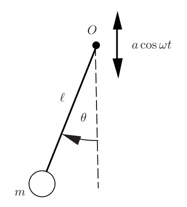
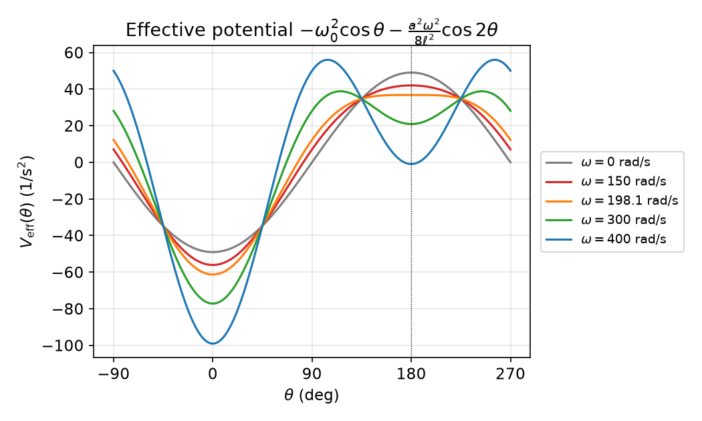
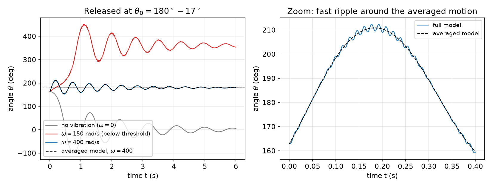
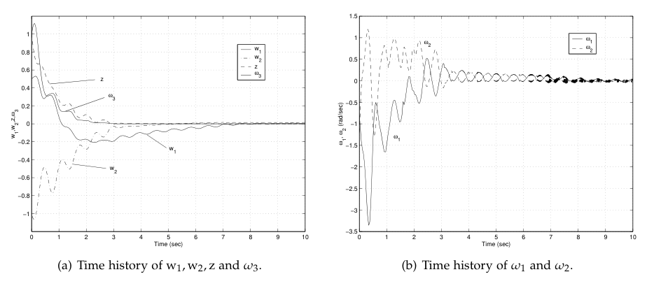
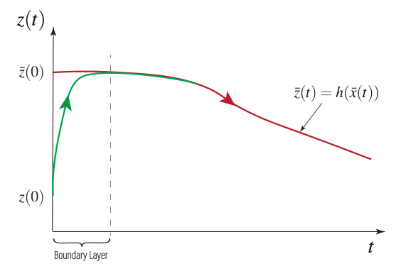
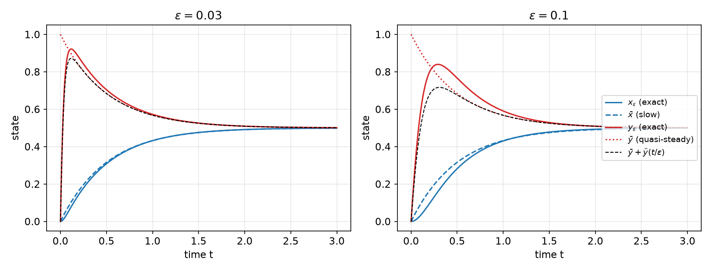
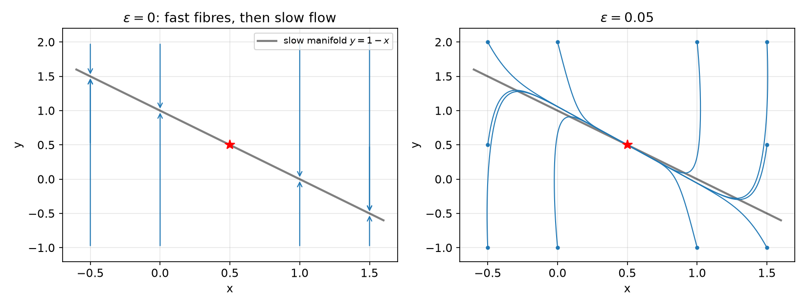
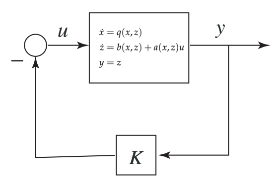
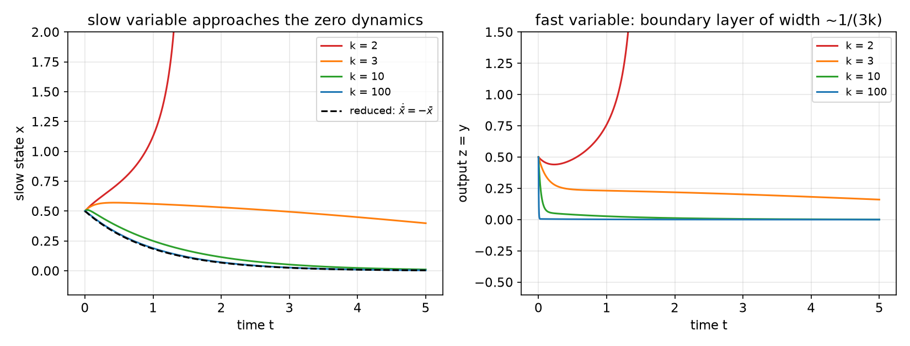

# Averaging and Singular Perturbations

Many physical and engineered systems evolve on two very different time scales: a rapidly oscillating forcing acting on slowly drifting states, or fast actuator, elastic or electrical dynamics coupled to slow mechanical motion. Both situations contain a small parameter \\(\varepsilon\\) that measures the ratio of the time scales, and both admit a simpler model obtained by letting \\(\varepsilon \to 0\\). **Averaging** replaces a fast time-periodic (or time-varying) vector field by its mean and shows that the mean dynamics predict the true ones, including their stability. **Singular perturbation** theory removes fast transient states by replacing them with their quasi-steady values and treats the fast transient separately in a boundary layer. This chapter develops both theories with full statements and proofs or proof sketches, and applies them to the Kapitza pendulum (an inverted pendulum stabilized by vibration), vibrational control of an underactuated spacecraft, flexible structures, and high-gain feedback. It uses the stability notions of [Advanced Lyapunov Theory](lyapunov-advanced.md) and complements the local analysis of [Center Manifold Theory](center-manifold.md).

## Two Kinds of Time-Scale Separation

Both theories concern equations with a small parameter \\(\varepsilon>0\\), but the parameter enters in different places.

- In the **averaging** setting
\\[
\dot x = \varepsilon f(t,x,\varepsilon),
\\]
  the right-hand side is small, so \\(x\\) moves slowly compared with the time variation of \\(f\\). Over one period of \\(f\\) the state hardly changes, and it "sees" only the average of the forcing. The dependence on \\(\varepsilon\\) is regular: setting \\(\varepsilon = 0\\) gives \\(\dot x = 0\\), a perfectly good (if trivial) differential equation, and the interesting behaviour appears on the long time scale \\(t \sim 1/\varepsilon\\).
- In the **singular perturbation** setting
\\[
\dot x = f(x,z,\varepsilon), \qquad \varepsilon\dot z = g(x,z,\varepsilon),
\\]
  the small parameter multiplies a *derivative*. Setting \\(\varepsilon = 0\\) changes the nature of the problem: the differential equation for \\(z\\) degenerates to an algebraic equation, the order drops from \\(n+m\\) to \\(n\\), and the initial condition \\(z(0)\\) can no longer be imposed. The solution depends on \\(\varepsilon\\) discontinuously near \\(t=0\\).

The two are related: substituting the fast time \\(\tau = t/\varepsilon\\) into a singularly perturbed system gives \\(dx/d\tau = \varepsilon f\\), which is the averaging form for the slow variable. Conversely, rapidly oscillating systems \\(\dot x = F(x, t/\varepsilon)\\) become averaging problems in the time \\(\tau = t/\varepsilon\\).

## Periodic Averaging

### The standard form

Consider
\\[
\dot x = \varepsilon f(t,x,\varepsilon), \qquad x \in D \subseteq \mathbb{R}^n, \tag{1}
\\]
where \\(\varepsilon > 0\\) is small and \\(f : [0,\infty)\times D\times[0,\varepsilon\_0] \to \mathbb{R}^n\\) is **\\(T\\)-periodic** in \\(t\\):
\\[
f(t+T,x,\varepsilon) = f(t,x,\varepsilon) \quad \text{for all } (t,x,\varepsilon).
\\]
We assume that \\(f\\) and its partial derivatives with respect to \\((x,\varepsilon)\\) up to second order are continuous and bounded on \\([0,\infty)\times D\_0\times[0,\varepsilon\_0]\\) for every compact \\(D\_0 \subseteq D\\). The **averaged system** is
\\[
\dot x = \varepsilon f\_{av}(x), \qquad f\_{av}(x) = \frac{1}{T}\int\_0^T f(\tau,x,0)\\,d\tau . \tag{2}
\\]
The averaged system is autonomous: the explicit time dependence has been integrated out. Since both (1) and (2) are slow, it is natural to compare their solutions over time intervals of length \\(O(1/\varepsilon)\\), on which the state changes by \\(O(1)\\).

### Why averaging works: the near-identity transformation

The key to the theory is a change of variables that removes the oscillating part of \\(f\\) to first order. Let
\\[
h(t,x) = f(t,x,0) - f\_{av}(x), \qquad u(t,x) = \int\_0^t h(\tau,x)\\,d\tau .
\\]
Because \\(h\\) is \\(T\\)-periodic with zero mean, \\(u\\) is also \\(T\\)-periodic (the integral over each full period is zero), hence bounded, together with its derivatives. Define new coordinates \\(y\\) by
\\[
x = y + \varepsilon u(t,y).
\\]
For small \\(\varepsilon\\) the matrix \\(I + \varepsilon\\,\partial u/\partial y\\) is invertible, so this is a valid near-identity change of coordinates. Differentiating,
\\[
\dot x = \dot y + \varepsilon \frac{\partial u}{\partial t}(t,y) + \varepsilon\frac{\partial u}{\partial y}(t,y)\\,\dot y
= \Big(I + \varepsilon\frac{\partial u}{\partial y}\Big)\dot y + \varepsilon\big[f(t,y,0) - f\_{av}(y)\big].
\\]
Equating with \\(\dot x = \varepsilon f(t, y+\varepsilon u, \varepsilon)\\) and expanding \\(f(t,y+\varepsilon u,\varepsilon) = f(t,y,0) + O(\varepsilon)\\):
\\[
\Big(I + \varepsilon\frac{\partial u}{\partial y}\Big)\dot y = \varepsilon f\_{av}(y) + \varepsilon\big[f(t,y+\varepsilon u,\varepsilon) - f(t,y,0)\big]
= \varepsilon f\_{av}(y) + \varepsilon^2 p(t,y,\varepsilon),
\\]
and inverting \\(I+\varepsilon\\,\partial u/\partial y = I - \varepsilon\\,\partial u/\partial y + O(\varepsilon^2)\\) gives
\\[
\dot y = \varepsilon f\_{av}(y) + \varepsilon^2 q(t,y,\varepsilon), \tag{3}
\\]
with \\(q\\) bounded and \\(T\\)-periodic in \\(t\\). In the \\(y\\) coordinates the system is the averaged system plus an \\(O(\varepsilon^2)\\) perturbation, and \\(x - y = O(\varepsilon)\\). Over a time interval of length \\(b/\varepsilon\\), an \\(O(\varepsilon^2)\\) perturbation accumulates to an \\(O(\varepsilon)\\) error (Gronwall's inequality), which is the content of part (i) below. If the averaged system has an exponentially stable equilibrium, the perturbation in (3) is a vanishing or non-vanishing perturbation of an exponentially stable system in the sense of [Advanced Lyapunov Theory](lyapunov-advanced.md), and the error stays \\(O(\varepsilon)\\) forever; this gives parts (ii) and (iii).

### The averaging theorem

**Theorem 1 (Periodic averaging).** Let \\(f\\) satisfy the assumptions above, let \\(x(t,\varepsilon)\\) and \\(x\_{av}(\varepsilon t)\\) be the solutions of (1) and (2), and let \\(b>0\\).

1. *(Finite horizon.)* If \\(x\_{av}(\varepsilon t) \in D\\) for all \\(t \in [0, b/\varepsilon]\\) and \\(x(0,\varepsilon) - x\_{av}(0) = O(\varepsilon)\\), then there is \\(\varepsilon^\* > 0\\) such that for all \\(0 < \varepsilon < \varepsilon^\*\\), \\(x(t,\varepsilon)\\) is defined and
\\[
x(t,\varepsilon) - x\_{av}(\varepsilon t) = O(\varepsilon) \quad \text{on } [0, b/\varepsilon].
\\]
2. *(Infinite horizon.)* If the origin \\(x=0 \in D\\) is an exponentially stable equilibrium of the averaged system (2), \\(\Omega \subseteq D\\) is a compact subset of its region of attraction, \\(x\_{av}(0) \in \Omega\\) and \\(x(0,\varepsilon) - x\_{av}(0) = O(\varepsilon)\\), then there is \\(\varepsilon^\*>0\\) such that for \\(0<\varepsilon<\varepsilon^\*\\), \\(x(t,\varepsilon)\\) is defined and
\\[
x(t,\varepsilon) - x\_{av}(\varepsilon t) = O(\varepsilon) \quad \text{for all } t \in [0,\infty).
\\]
3. *(Periodic orbits.)* If the origin is an exponentially stable equilibrium of (2), there are \\(k>0\\) and \\(\varepsilon^\*>0\\) such that for \\(0<\varepsilon<\varepsilon^\*\\), system (1) has a unique exponentially stable \\(T\\)-periodic solution \\(\bar x(t,\varepsilon)\\) in a neighbourhood of the origin, with \\(\lVert \bar x(t,\varepsilon)\rVert \le k\varepsilon\\).

Part 3 says that an exponentially stable equilibrium of the average corresponds to a small exponentially stable periodic orbit of the original system: the state keeps oscillating, with amplitude \\(O(\varepsilon)\\), at the forcing period. If the origin is itself an equilibrium of (1), that is \\(f(t,0,\varepsilon) = 0\\) for all \\(t\\) and \\(\varepsilon\\), then \\(x \equiv 0\\) is a \\(T\\)-periodic solution in the \\(O(\varepsilon)\\) neighbourhood, and uniqueness forces \\(\bar x \equiv 0\\):

**Corollary 2.** If \\(x = 0\\) is an equilibrium of (1) and an exponentially stable equilibrium of the averaged system (2), then for all sufficiently small \\(\varepsilon>0\\) it is an exponentially stable equilibrium of (1).

Exponential stability is essential. If the averaged system is only asymptotically stable (for instance \\(\dot x = -\varepsilon x^3\\)), the \\(O(\varepsilon^2)\\) residual in (3) may destroy convergence.

**Example 3 (Linear periodic systems).** Consider
\\[
\dot x = \varepsilon A(t) x, \qquad A(t+T) = A(t),
\\]
and let \\(A\_{av} = \frac{1}{T}\int\_0^T A(\tau)\\,d\tau\\). The averaged system \\(\dot x = \varepsilon A\_{av}x\\) has an exponentially stable origin if and only if \\(A\_{av}\\) is Hurwitz. Since \\(x = 0\\) is an equilibrium of the original system, Corollary 2 gives: *if \\(A\_{av}\\) is Hurwitz, then for sufficiently small \\(\varepsilon\\) the origin of \\(\dot x = \varepsilon A(t)x\\) is exponentially stable.* The unique \\(T\\)-periodic solution in the \\(O(\varepsilon)\\) neighbourhood of the origin is the trivial one. For linear periodic systems, Floquet theory gives an exact test (the eigenvalues of the monodromy matrix), but it requires the state transition matrix over a period; averaging gives a sufficient test from the mean of \\(A\\) alone. The smallness of \\(\varepsilon\\) cannot be dropped: pointwise or average Hurwitz properties of \\(A(t)\\) do not by themselves guarantee stability for slow variations, as the counterexamples in [Advanced Lyapunov Theory](lyapunov-advanced.md) show.

## The Kapitza Pendulum

A pendulum whose suspension point is shaken vertically at high frequency can balance in the *inverted* position. This classical observation (Stephenson 1908, explained by Kapitza in 1951) is the most famous application of averaging, and the model for a whole family of "vibrational control" strategies.



*Figure: the Kapitza pendulum. The pivot O moves vertically as a cos(ωt); the bob of mass m is at distance ℓ from the pivot and θ is measured from the downward vertical, so θ = π is the inverted position.*

### Equation of motion

Let the pivot move as \\(a\cos\omega t\\) along the vertical, with small amplitude \\(a\\) and high frequency \\(\omega\\). In the accelerating frame of the pivot the bob feels the extra vertical inertial force \\(-m\ddot y\_O = m a\omega^2\cos\omega t\\); with a viscous drag \\(k\\) on the bob, the equation of motion takes the form
\\[
m\big(\ell\ddot\theta - a\omega^2\sin\omega t\\,\sin\theta\big) = -mg\sin\theta - k\big(\ell\dot\theta + a\omega\cos\omega t\\,\sin\theta\big). \tag{4}
\\]
(The phase of the excitation is immaterial; (4) corresponds to the pivot displacement written so that its acceleration enters as \\(a\omega^2\sin\omega t\\).) Introduce \\(\omega\_0 = \sqrt{g/\ell}\\), the natural frequency of the undisturbed pendulum, and assume
\\[
\frac{a}{\ell} \ll 1, \qquad \frac{\omega\_0}{\omega} \ll 1 .
\\]
To make both small quantities proportional to the same parameter, set
\\[
\varepsilon = \frac{a}{\ell}, \qquad \frac{\omega\_0}{\omega} = \alpha\varepsilon, \qquad \alpha = \frac{\omega\_0\ell}{\omega a}, \qquad \beta = \frac{k}{m\omega\_0},
\\]
and use the dimensionless time \\(\tau = \omega t\\), so that \\(d/dt = \omega\\,d/d\tau\\). Dividing (4) by \\(m\ell\omega^2\\),
\\[
\frac{d^2\theta}{d\tau^2} - \frac{a}{\ell}\sin\tau\\,\sin\theta = -\frac{\omega\_0^2}{\omega^2}\sin\theta - \frac{k}{m\omega}\frac{d\theta}{d\tau} - \frac{k}{m\omega}\frac{a}{\ell}\cos\tau\\,\sin\theta .
\\]
With \\(\omega\_0^2/\omega^2 = \alpha^2\varepsilon^2\\) and \\(k/(m\omega) = \beta\omega\_0/\omega = \alpha\beta\varepsilon\\) this becomes
\\[
\frac{d^2\theta}{d\tau^2} + \alpha\beta\varepsilon\frac{d\theta}{d\tau} + \big(\alpha^2\varepsilon^2 - \varepsilon\sin\tau\big)\sin\theta + \alpha\beta\varepsilon^2\cos\tau\\,\sin\theta = 0 . \tag{5}
\\]
(In some printings the last term appears with \\(\cot\tau\\); the derivation shows it is \\(\cos\tau\\).)

### Bringing the equation to standard form

Equation (5) is not yet of the form \\(dx/d\tau = \varepsilon f\\), because \\(d^2\theta/d\tau^2\\) contains the \\(O(\varepsilon)\\) term \\(\varepsilon\sin\tau\sin\theta\\) multiplying an \\(O(1)\\) function, and \\(d\theta/d\tau\\) is itself \\(O(\varepsilon)\\). The trick is to scale the velocity by \\(1/\varepsilon\\) and to subtract the part of it that is driven directly by the oscillation:
\\[
x\_1 = \theta, \qquad x\_2 = \frac{1}{\varepsilon}\frac{d\theta}{d\tau} + \cos\tau\\,\sin\theta .
\\]
Then \\(d\theta/d\tau = \varepsilon(x\_2 - \cos\tau\sin x\_1)\\), so
\\[
\frac{dx\_1}{d\tau} = \varepsilon\big(x\_2 - \sin x\_1\cos\tau\big).
\\]
For \\(x\_2\\), differentiate and substitute (5):
\\[
\frac{dx\_2}{d\tau} = \frac{1}{\varepsilon}\frac{d^2\theta}{d\tau^2} - \sin\tau\sin\theta + \cos\tau\cos\theta\\,\frac{d\theta}{d\tau}
\\]
\\[
= -\alpha\beta\frac{d\theta}{d\tau} - \alpha^2\varepsilon\sin\theta + \sin\tau\sin\theta - \alpha\beta\varepsilon\cos\tau\sin\theta - \sin\tau\sin\theta + \cos\tau\cos\theta\\,\frac{d\theta}{d\tau}.
\\]
The \\(\sin\tau\sin\theta\\) terms cancel; this is exactly why the \\(\cos\tau\sin\theta\\) correction was put into \\(x\_2\\). Substituting \\(d\theta/d\tau = \varepsilon(x\_2 - \cos\tau\sin x\_1)\\), the damping terms combine to \\(-\alpha\beta\varepsilon x\_2\\), and
\\[
\frac{dx}{d\tau} = \varepsilon f(\tau,x) = \varepsilon\begin{bmatrix} x\_2 - \sin x\_1\cos\tau \\\\ -\alpha\beta x\_2 - \alpha^2\sin x\_1 + x\_2\cos x\_1\cos\tau - \sin x\_1\cos x\_1\cos^2\tau \end{bmatrix},
\\]
which is \\(2\pi\\)-periodic in \\(\tau\\) and in the standard form (1).

### The averaged system and stability of the inverted position

Averaging over \\(\tau \in [0,2\pi]\\) with \\(\overline{\cos\tau} = 0\\), \\(\overline{\cos^2\tau} = \tfrac12\\) and \\(\sin x\_1\cos x\_1 = \tfrac12\sin 2x\_1\\):
\\[
f\_{av,1}(x) = x\_2, \qquad f\_{av,2}(x) = -\alpha\beta x\_2 - \alpha^2\sin x\_1 - \tfrac14\sin 2x\_1 . \tag{6}
\\]
The averaged system has equilibria at \\((0,0)\\) and \\((\pi,0)\\), with Jacobian
\\[
\frac{\partial f\_{av}}{\partial x} = \begin{bmatrix} 0 & 1 \\\\ -\alpha^2\cos x\_1 - \tfrac12\cos 2x\_1 & -\alpha\beta \end{bmatrix}.
\\]

- At the hanging position \\((0,0)\\): \\(\begin{bmatrix} 0 & 1 \\\\ -\alpha^2-\tfrac12 & -\alpha\beta\end{bmatrix}\\). A \\(2\times2\\) matrix \\(\begin{bmatrix}0 & 1\\\\ -c & -d\end{bmatrix}\\) is Hurwitz iff \\(c>0\\) and \\(d>0\\), so this is Hurwitz for all \\(\alpha,\beta>0\\): the lower equilibrium remains exponentially stable.
- At the inverted position \\((\pi,0)\\): \\(\cos\pi = -1\\), \\(\cos 2\pi = 1\\), giving \\(\begin{bmatrix} 0 & 1 \\\\ \alpha^2 - \tfrac12 & -\alpha\beta\end{bmatrix}\\), which is Hurwitz iff
\\[
0 < \alpha < \frac{1}{\sqrt2}, \qquad \beta > 0 .
\\]

Both equilibria are also equilibria of the original system (\\(\sin x\_1 = 0\\) and \\(x\_2 = 0\\) make \\(f(\tau,x) = 0\\) for all \\(\tau\\)), so Corollary 2 applies: **for sufficiently small \\(\varepsilon\\), the inverted pendulum is exponentially stabilized by small-amplitude, high-frequency vertical vibration of the pivot whenever \\(\alpha < 1/\sqrt2\\).** In physical variables, \\(\alpha^2 < 1/2\\) reads
\\[
\frac{\omega\_0^2\ell^2}{\omega^2a^2} < \frac12 \quad\Longleftrightarrow\quad a\omega > \sqrt{2g\ell}:
\\]
the peak velocity of the pivot must exceed \\(\sqrt{2g\ell}\\). Damping is needed for asymptotic stability, but its size is irrelevant to the stability condition.

### Effective potential

Returning to the original time and variables, the averaged model (6) is equivalent to the second-order equation (use \\(\theta\_t = \omega\varepsilon x\_2\\) on the average and \\(\omega^2\varepsilon^2\alpha^2 = \omega\_0^2\\))
\\[
\ddot\theta + \frac{k}{m}\dot\theta + \omega\_0^2\sin\theta + \frac{a^2\omega^2}{4\ell^2}\sin 2\theta = 0
\quad\Longleftrightarrow\quad
\ddot\theta + \frac{k}{m}\dot\theta + \frac{dV\_{\mathrm{eff}}}{d\theta} = 0,
\\]
with the **effective potential**
\\[
V\_{\mathrm{eff}}(\theta) = -\omega\_0^2\cos\theta - \frac{a^2\omega^2}{8\ell^2}\cos 2\theta .
\\]
The vibration adds a potential well of period \\(\pi\\) whose depth grows with \\((a\omega)^2\\). At \\(\theta = \pi\\), \\(V\_{\mathrm{eff}}'' = -\omega\_0^2 + a^2\omega^2/(2\ell^2)\\), which is positive (a local minimum) exactly when \\(a\omega > \sqrt{2g\ell}\\), recovering the condition above.



*Figure: effective potential for ℓ = 0.2 m, a = 0.01 m. Without vibration (gray) the inverted position θ = 180° is a maximum. At the threshold ω = √(2gℓ)/a ≈ 198 rad/s the curvature at 180° vanishes (orange); above it a local well forms around the inverted position (green, blue).*

### Simulation

Take \\(\ell = 0.2\\) m, \\(g = 9.81\\) m/s², \\(a = 0.01\\) m (so \\(\varepsilon = 0.05\\)), \\(k/m = 1\\) s\\(^{-1}\\) and release the pendulum at rest from \\(\theta\_0 = 163^\circ\\), 17° away from the inverted position. The threshold frequency is \\(\sqrt{2g\ell}/a \approx 198\\) rad/s. The full equation (4) is integrated with a step much smaller than the excitation period, and compared with the averaged model.



*Figure: left, θ(t) without vibration (gray: the pendulum falls and settles at 0), with ω = 150 rad/s below the threshold (red: it falls over the top and settles at 360°, the hanging position), and with ω = 400 rad/s, α ≈ 0.35 (blue: it oscillates about 180° and converges to the inverted position). The averaged model (dashed) is indistinguishable at this scale. Right: the first 0.4 s, showing the O(ε) ripple at the excitation frequency superimposed on the averaged motion.*

One detail matters in the comparison. Theorem 1 requires \\(x(0,\varepsilon) - x\_{av}(0) = O(\varepsilon)\\) *in the transformed coordinates*. Releasing the pendulum at rest at \\(\tau=0\\) gives \\(x\_2(0) = \cos 0\cdot\sin\theta\_0 = \sin\theta\_0\\), not zero; in physical units the averaged model must start with \\(\dot\theta\_{av}(0) = (a\omega/\ell)\sin\theta\_0\\). Starting the averaged model at rest instead produces a visible phase error. The averaged state is the "guiding centre" of the motion, not its instantaneous value.

```python
import numpy as np
from scipy.integrate import solve_ivp
g, l, a, c, w = 9.81, 0.2, 0.01, 1.0, 400.0     # c = k/m
w0 = np.sqrt(g/l)
def full(t, s):
    th, om = s
    return [om, (a*w**2/l*np.sin(w*t) - w0**2)*np.sin(th) - c*om
                - c*a*w/l*np.cos(w*t)*np.sin(th)]
def avg(t, s):
    th, om = s
    return [om, -c*om - w0**2*np.sin(th) - (a*w/l)**2/4*np.sin(2*th)]
th0 = np.pi - 0.3
sf = solve_ivp(full, (0, 6), [th0, 0], max_step=2e-4, rtol=1e-9)
sa = solve_ivp(avg, (0, 6), [th0, a*w/l*np.sin(th0)], max_step=1e-3)
```

## Vibrational Control

The Kapitza pendulum illustrates a general principle: **zero-mean, high-frequency excitation can change the qualitative behaviour of a system**, because nonlinear terms rectify the oscillation into a nonzero average. Using this deliberately is called **vibrational control**. Its attraction is that it needs no measurement of the state: an open-loop periodic signal changes the averaged dynamics. Its second use is more subtle and very relevant to underactuated systems: products of oscillating inputs have nonzero averages, so dithering two inputs at the same frequency creates an averaged control authority in a direction that neither input can reach directly. This is the averaging counterpart of the Lie-bracket directions of [Nonlinear Controllability](controllability.md).

### Example: an underactuated rigid spacecraft

**Example 4 (Averaging creates an extra control input).** Consider a rigid spacecraft with torques about only two of its principal axes. Euler's equations are
\\[
\dot\omega\_1 = u\_1, \qquad \dot\omega\_2 = u\_2, \qquad \dot\omega\_3 = \beta\omega\_1\omega\_2, \qquad \beta = \frac{I\_1-I\_2}{I\_3},
\\]
after absorbing the gyroscopic terms of the actuated axes into \\(u\_1,u\_2\\). Without loss of generality \\(\beta > 0\\) (\\(\beta = 0\\) is the axisymmetric case, in which \\(\omega\_3\\) cannot be changed at all). The attitude is described by stereographic-type coordinates \\((w\_1,w\_2,z)\\), where \\((w\_1,w\_2)\\) parameterize the direction of the unactuated body axis and \\(z\\) the rotation about it, with kinematics
\\[
\begin{aligned}
\dot w\_1 &= \omega\_3 w\_2 + \tfrac12(1+w\_1^2-w\_2^2)\\,\omega\_1 + w\_1w\_2\\,\omega\_2,\\\\
\dot w\_2 &= -\omega\_3 w\_1 + \tfrac12(1-w\_1^2+w\_2^2)\\,\omega\_2 + w\_1w\_2\\,\omega\_1,\\\\
\dot z &= \omega\_3 + w\_1\omega\_2 - w\_2\omega\_1 .
\end{aligned}
\\]
Treat \\(\omega\_1,\omega\_2\\) as virtual controls (a backstepping step then recovers \\(u\_1,u\_2\\)). If \\(\omega\_3 = 0\\), the kinematics become a driftless system with two inputs and three states,
\\[
\dot w\_1 = \tfrac12(1+w\_1^2-w\_2^2)\omega\_1 + w\_1w\_2\omega\_2, \quad
\dot w\_2 = \tfrac12(1-w\_1^2+w\_2^2)\omega\_2 + w\_1w\_2\omega\_1, \quad
\dot z = w\_1\omega\_2 - w\_2\omega\_1, \tag{7}
\\]
which violates Brockett's necessary condition (see [Nonlinear Controllability](controllability.md)); no continuous time-invariant feedback can stabilize it. It is nevertheless exponentially stabilized by the discontinuous (but bounded) law
\\[
\omega\_1 = -\kappa w\_1 + \mu\frac{z}{w\_1^2+w\_2^2}\\,w\_2, \qquad
\omega\_2 = -\kappa w\_2 - \mu\frac{z}{w\_1^2+w\_2^2}\\,w\_1, \qquad \mu > \kappa/2 > 0, \tag{8}
\\]
with Lyapunov function \\(V = \tfrac12(w\_1^2+w\_2^2+z^2)\\). The difficulty is \\(\omega\_3\\): it must first be driven to zero, but it is reachable only through the product \\(\omega\_1\omega\_2\\).

**Injecting a dither.** Let \\(0 < \epsilon \ll 1\\) and choose
\\[
\omega\_1 = v\_1 + \lvert v\rvert^{1/2}\cos(t/\epsilon), \qquad
\omega\_2 = v\_2 + \mathrm{sgn}(v)\lvert v\rvert^{1/2}\cos(t/\epsilon),
\\]
with new inputs \\(v\_1, v\_2, v\\). In the fast time \\(\tau = t/\epsilon\\) the system is in the averaging form \\(dx/d\tau = \epsilon F(\tau,x)\\). The product appearing in the \\(\omega\_3\\) equation is
\\[
\omega\_1\omega\_2 = v\_1v\_2 + \big(v\_1\mathrm{sgn}(v) + v\_2\big)\lvert v\rvert^{1/2}\cos\tau + \mathrm{sgn}(v)\lvert v\rvert\cos^2\tau ,
\\]
and with \\(\overline{\cos\tau} = 0\\), \\(\overline{\cos^2\tau} = \tfrac12\\) and \\(\mathrm{sgn}(v)\lvert v\rvert = v\\), its average is \\(v\_1v\_2 + v/2\\). In the kinematic equations the dither enters linearly and averages to zero. The averaged system is therefore
\\[
\begin{aligned}
\dot{\bar\omega}\_3 &= \beta\big(v\_1v\_2 + \tfrac{v}{2}\big),\\\\
\dot{\bar w}\_1 &= \bar\omega\_3\bar w\_2 + \tfrac12(1+\bar w\_1^2-\bar w\_2^2)v\_1 + \bar w\_1\bar w\_2 v\_2,\\\\
\dot{\bar w}\_2 &= -\bar\omega\_3\bar w\_1 + \tfrac12(1-\bar w\_1^2+\bar w\_2^2)v\_2 + \bar w\_1\bar w\_2 v\_1,\\\\
\dot{\bar z} &= \bar\omega\_3 + \bar w\_1v\_2 - \bar w\_2v\_1 .
\end{aligned}
\\]
The dither has produced a **third input** \\(v\\) acting directly on \\(\bar\omega\_3\\).

**Design on the averaged system.** First drive \\(\bar\omega\_3\\) to zero in finite time with
\\[
v = -2v\_1v\_2 - 2\alpha\\,\mathrm{sgn}(\beta\bar\omega\_3)\lvert\bar\omega\_3\rvert^{1/2}, \qquad \alpha > 0,
\\]
which gives
\\[
\dot{\bar\omega}\_3 = -\alpha\beta\\,\mathrm{sgn}(\beta\bar\omega\_3)\lvert\bar\omega\_3\rvert^{1/2}.
\\]
The right-hand side is not Lipschitz at \\(\bar\omega\_3 = 0\\), which is what allows finite-time convergence: for \\(\beta > 0\\), \\(\frac{d}{dt}\lvert\bar\omega\_3\rvert^{1/2} = -\alpha\beta/2\\) while \\(\bar\omega\_3 \neq 0\\), so \\(\bar\omega\_3\\) reaches zero at \\(t\_c = 2\lvert\bar\omega\_3(0)\rvert^{1/2}/(\alpha\beta)\\) and stays there. After \\(t\_c\\), the \\((\bar w\_1,\bar w\_2,\bar z)\\) equations are exactly (7) with inputs \\(v\_1,v\_2\\), and the law (8) applied to the averaged variables makes them converge exponentially. The averaging theorem is then invoked to conclude that the original system inherits the convergence of its average, up to the \\(O(\epsilon)\\) ripple. (Strictly, the feedback laws are discontinuous, so the smoothness hypotheses of Theorem 1 are not met at the origin; the conclusion should be read as convergence to a neighbourhood of size \\(O(\epsilon)\\), which is what the simulation shows.)



*Figure: simulation with μ = 2, κ = 1, β = 0.2. (a) w₁, w₂, z and ω₃ converge to a small neighbourhood of zero within about 3–7 s, with a small high-frequency ripple. (b) The actuated rates ω₁, ω₂ show large initial excursions (down to about −3.3 rad/s) and a persistent high-frequency dither around zero: the dither is the price of the third, averaged input.*

## Generalized Averaging

Periodicity is not essential. What averaging needs is that the time average of \\(f\\) over long windows exists, uniformly in the starting time.

**Definition 5 (Average of a time-varying function).** A continuous, bounded function \\(f : [0,\infty)\times D \to \mathbb{R}^n\\) has the **average** \\(f\_{av}(x)\\) if the limit
\\[
f\_{av}(x) = \lim\_{T\to\infty}\frac{1}{T}\int\_t^{t+T} f(\tau,x)\\,d\tau
\\]
exists and
\\[
\Big\lVert \frac{1}{T}\int\_t^{t+T} f(\tau,x)\\,d\tau - f\_{av}(x)\Big\rVert \le k\\,\sigma(T) \quad \text{for all } t \ge 0,\ x \in D\_0,
\\]
for every compact \\(D\_0 \subseteq D\\), where \\(k>0\\) may depend on \\(D\_0\\) and \\(\sigma : [0,\infty) \to [0,\infty)\\) is a strictly decreasing, continuous, bounded **convergence function** with \\(\sigma(T)\to 0\\) as \\(T\to\infty\\).

For a \\(T\\)-periodic function the window average over a whole number of periods is exact, and the error over an arbitrary window is at most one period's worth divided by its length, so \\(\sigma(T) = O(1/T)\\).

**Example 6 (Almost periodic functions).** Let \\(f(t,x) = \sum\_{k=1}^N f\_k(t,x)\\), with each \\(f\_k\\) periodic of period \\(T\_k\\) and the periods incommensurate. Then \\(f\\) is not periodic, but it has the average
\\[
f\_{av}(x) = \sum\_{k=1}^N f\_{k,av}(x),
\\]
with convergence function \\(\sigma(T) = 1/(T+1)\\), that is, \\(O(1/T)\\).

**Example 7 (Decaying forcing).** Let \\(f(t,x) = \dfrac{1}{1+t}\\,g(x)\\). For any \\(t\ge0\\),
\\[
\frac{1}{T}\int\_t^{t+T}\frac{d\tau}{1+\tau} = \frac{1}{T}\ln\frac{1+t+T}{1+t} \le \frac{\ln(1+T)}{T},
\\]
with the maximum at \\(t = 0\\). Hence \\(f\_{av} = 0\\) with convergence function \\(\sigma(T) = \ln(1+T)/T\\) (for \\(T>0\\)), which decays more slowly than \\(1/T\\).

**Theorem 8 (General averaging).** Let \\(f(t,x,\varepsilon)\\) and its partial derivatives with respect to \\((x,\varepsilon)\\) up to second order be continuous and bounded on \\([0,\infty)\times D\_0\times[0,\varepsilon\_0]\\) for every compact \\(D\_0 \subseteq D\\). Suppose \\(f(t,x,0)\\) has the average \\(f\_{av}(x)\\), and the Jacobian of
\\[
h(t,x) = f(t,x,0) - f\_{av}(x)
\\]
has zero average with the same convergence function as \\(f\\). Then there is a class-\\(\mathcal{K}\\) function \\(\alpha\\) such that the conclusions of Theorem 1 hold with \\(O(\varepsilon)\\) replaced by \\(O(\alpha(\varepsilon))\\):

1. if \\(x\_{av}(\varepsilon t)\in D\\) on \\([0,b/\varepsilon]\\) and \\(x(0,\varepsilon) - x\_{av}(0) = O(\alpha(\varepsilon))\\), then \\(x(t,\varepsilon) - x\_{av}(\varepsilon t) = O(\alpha(\varepsilon))\\) on \\([0,b/\varepsilon]\\);
2. if the origin is an exponentially stable equilibrium of the averaged system, \\(\Omega\\) is a compact subset of its region of attraction and \\(x\_{av}(0)\in\Omega\\), the estimate holds for all \\(t\ge0\\);
3. if the origin is an exponentially stable equilibrium of the averaged system and \\(f(t,0,\varepsilon) = 0\\), the origin of \\(\dot x = \varepsilon f(t,x,\varepsilon)\\) is exponentially stable for all \\(0<\varepsilon<\varepsilon^\*\\).

The function \\(\alpha\\) is determined by the convergence function; for \\(\sigma(T) = O(1/T)\\) one recovers \\(\alpha(\varepsilon) = \varepsilon\\). The proof follows the periodic case, with the near-identity transformation built from an approximate (exponentially weighted) integral of \\(h\\), because the plain integral \\(\int\_0^t h\\) need no longer be bounded.

**Example 9 (Linear systems with a time-varying matrix).** Consider \\(\dot x = \varepsilon A(t)x\\), where \\(A(t)\\) is bounded and has the average
\\[
A\_{av} = \lim\_{T\to\infty}\frac{1}{T}\int\_t^{t+T}A(\tau)\\,d\tau,
\\]
uniformly in \\(t\\). Here \\(h(t,x) = (A(t) - A\_{av})x\\), whose Jacobian \\(A(t) - A\_{av}\\) has zero average with the same convergence function. If \\(A\_{av}\\) is Hurwitz, Theorem 8 shows that for sufficiently small \\(\varepsilon\\) the origin is exponentially stable and \\(x(t,\varepsilon) - x\_{av}(\varepsilon t) = O(\alpha(\varepsilon))\\) for all \\(t \ge 0\\).

Generalized averaging is the standard tool for analysing adaptive systems with slow adaptation and persistently exciting but non-periodic signals: the averaged adaptation dynamics are governed by the mean of the regressor outer product, and its positive definiteness is precisely the persistency-of-excitation condition of [Adaptive Control](adaptive-control.md).

## Singular Perturbations: the Standard Model

### Reduced system and quasi-steady state

The **standard singular perturbation model** is
\\[
\dot x = f(x,z,\varepsilon), \quad x(0) = x\_0, \qquad\qquad
\varepsilon\dot z = g(x,z,\varepsilon), \quad z(0) = z\_0, \tag{9}
\\]
with \\(x\in\mathbb{R}^n\\), \\(z\in\mathbb{R}^m\\) and \\(\varepsilon>0\\) small. (The time-varying case is analogous.) When \\(\varepsilon\\) is small, \\(\dot z = g/\varepsilon\\) is large wherever \\(g \neq 0\\): \\(z\\) is the **fast variable** and \\(x\\) the **slow variable**. Small parameters of this kind arise physically as small time constants, small masses or inductances, large stiffnesses (flexible structures, Example 15 below), and artificially from high-gain feedback (the last section of this chapter).

Setting \\(\varepsilon = 0\\) turns the second equation into the algebraic equation
\\[
0 = g(x,z,0). \tag{10}
\\]
If \\(\partial g/\partial z\\,(x,z,0)\\) is nonsingular at a solution, the implicit function theorem gives a continuously differentiable root
\\[
z = h(x), \qquad 0 = g(x,h(x),0),
\\]
at least locally. A model in which (10) has such an isolated root is said to be in **standard form**. Substituting it into the first equation gives the **reduced (slow) system**
\\[
\dot{\bar x} = f(\bar x, h(\bar x), 0) =: \bar f(\bar x), \qquad \bar x(0) = x\_0 . \tag{11}
\\]
The pair \\(\bar x(t)\\), \\(\bar z(t) = h(\bar x(t))\\) is the **slow solution** or **quasi-steady-state model**; it has order \\(n\\) instead of \\(n+m\\). We expect \\(x\_\varepsilon(t) - \bar x(t) = O(\varepsilon)\\) for all \\(t\\). For \\(z\\), however, there is a mismatch at \\(t=0\\): \\(\bar z(0) = h(x\_0)\\) is fixed by \\(x\_0\\), while \\(z\_0\\) is arbitrary. The quasi-steady state can therefore approximate \\(z\_\varepsilon(t)\\) only after the initial transient, for \\(t \ge \bar t > 0\\). The time-scale separation is asymptotic: exact in the limit \\(\varepsilon \to 0\\), approximate for finite \\(\varepsilon\\).



*Figure: the fast variable z(t) starts at z(0) and, within a boundary layer of width O(ε), rises quickly to the quasi-steady curve z̄(t) = h(x̄(t)), which starts at z̄(0) = h(x₀) ≠ z(0). After the boundary layer, z follows the slow solution.*

### The boundary-layer system

To resolve the initial transient, stretch time:
\\[
\tau = \frac{t}{\varepsilon}, \qquad \frac{dx}{d\tau} = \varepsilon f(x,z,\varepsilon), \qquad \frac{dz}{d\tau} = g(x,z,\varepsilon).
\\]
At \\(\varepsilon=0\\), \\(dx/d\tau = 0\\): on the fast time scale the slow variable is frozen at \\(x = x\_0\\). Measure the fast variable from its quasi-steady value, \\(\tilde z = z - \bar z\\) with \\(\bar z = h(\bar x)\\):
\\[
\frac{d\tilde z}{d\tau} = \frac{dz}{d\tau} - \varepsilon\frac{d\bar z}{dt} = g(x,z,\varepsilon) - \varepsilon\frac{d\bar z}{dt}.
\\]
Setting \\(\varepsilon = 0\\) gives the **boundary-layer system**
\\[
\frac{d\tilde z}{d\tau} = g\big(x\_0, h(x\_0) + \tilde z, 0\big), \qquad \tilde z(0) = z\_0 - h(x\_0), \tag{12}
\\]
which has the equilibrium \\(\tilde z = 0\\). Its solution \\(\tilde z(t/\varepsilon)\\) approximates \\(z\_\varepsilon(t) - \bar z(t)\\) during the boundary layer and decays afterwards. Combining slow and fast parts gives the **composite approximation**
\\[
x\_\varepsilon(t) = \bar x(t) + O(\varepsilon), \qquad z\_\varepsilon(t) = \bar z(t) + \tilde z(t/\varepsilon) + O(\varepsilon). \tag{13}
\\]
For (13) to hold, the boundary-layer transient must actually converge to the slow manifold, for every frozen value of the slow variable along the way. This is the content of Tikhonov's theorem.

### Tikhonov's theorem

**Theorem 10 (Tikhonov).** Consider (9) with \\(f,g\\) sufficiently smooth, and suppose:

1. \\(z = h(x)\\) is an isolated root of \\(0 = g(x,z,0)\\);
2. the reduced system (11) has a unique solution \\(\bar x(t)\\) on \\([0,t\_1]\\);
3. the origin of the boundary-layer system
\\[
\frac{d\tilde z}{d\tau} = g\big(\bar x, h(\bar x) + \tilde z, 0\big)
\\]
is exponentially stable, uniformly in the frozen parameter \\(\bar x\\).

Then there is \\(\varepsilon^\*>0\\) such that for every initial condition with \\(z\_0 - h(x\_0)\\) in the region of attraction of (12) and every \\(\varepsilon \in (0,\varepsilon^\*)\\), the system (9) has a unique solution on \\([0,t\_1]\\) and the estimates (13) hold uniformly on \\([0,t\_1]\\). Moreover, for every \\(\bar t \in (0, t\_1)\\) there is \\(\varepsilon^{\ast\ast} \le \varepsilon^\*\\) such that
\\[
z\_\varepsilon(t) = h(\bar x(t)) + O(\varepsilon) \quad \text{uniformly on } [\bar t, t\_1], \quad \varepsilon\in(0,\varepsilon^{\ast\ast}).
\\]

Hypothesis 3 is the heart of the matter: if the fast dynamics are not attracted to the slow manifold, the reduced model is meaningless. Note also that the theorem is a finite-interval result; an infinite-interval version holds when the reduced system has an exponentially stable equilibrium.

**Example 11 (Slow manifold and boundary layer).** Consider
\\[
\dot x = -x + y, \quad x(0) = 0, \qquad \varepsilon\dot y = \tan^{-1}(1 - y - x), \quad y(0) = 0 .
\\]
*Slow manifold.* Setting \\(\varepsilon = 0\\): \\(\tan^{-1}(1-\bar y-\bar x) = 0\\), so \\(\bar y = h(\bar x) = 1 - \bar x\\), an isolated root because \\(\partial g/\partial y = -1/(1+(1-y-x)^2) \neq 0\\).

*Reduced system.* \\(\dot{\bar x} = -\bar x + 1 - \bar x = -2\bar x + 1\\), with equilibrium \\(\bar x\_{eq} = \tfrac12\\), \\(\bar y\_{eq} = \tfrac12\\). With \\(\bar x(0) = 0\\),
\\[
\bar x(t) = \tfrac12 - \tfrac12 e^{-2t}, \qquad \bar y(t) = \tfrac12 + \tfrac12 e^{-2t}.
\\]
Note \\(\bar y(0) = 1 \neq y(0) = 0\\).

*Boundary layer.* With \\(\tilde y = y - \bar y\\) and the slow variable frozen, \\(1 - y - x = 1 - \tilde y - \bar y - \bar x = -\tilde y\\), so
\\[
\frac{d\tilde y}{d\tau} = \tan^{-1}(-\tilde y) = -\tan^{-1}\tilde y, \qquad \tilde y(0) = y(0) - \bar y(0) = -1 .
\\]
Its origin is globally asymptotically stable and locally exponentially stable (linearization \\(d\tilde y/d\tau = -\tilde y\\)), uniformly in \\(\bar x\\), since the equation does not depend on \\(\bar x\\) at all. Tikhonov's theorem gives
\\[
x\_\varepsilon(t) = \bar x(t) + O(\varepsilon), \qquad y\_\varepsilon(t) = \bar y(t) + \tilde y(t/\varepsilon) + O(\varepsilon).
\\]



*Figure: exact solutions (solid) against the slow solution and the composite approximation ȳ + ỹ(t/ε) (black dashed), for ε = 0.03 (left) and ε = 0.1 (right). Inside the boundary layer y jumps from 0 to about 0.9 and then follows the quasi-steady curve down to 0.5. The maximum error of the composite approximation is 0.050 for ε = 0.03 and 0.125 for ε = 0.1, and that of x̄ is 0.027 and 0.069: both scale roughly linearly with ε, as the O(ε) estimates predict.*



*Figure: phase portraits. For ε = 0 (left) the motion consists of instantaneous vertical jumps along the fast fibres x = const onto the slow manifold y = 1 − x, followed by slow motion along it to (0.5, 0.5). For ε = 0.05 (right) the trajectories bend quickly toward the slow manifold, overshoot it slightly, and then slide along it to the equilibrium.*

## Stability Analysis

### Shifting the slow manifold to the origin

Assume the origin is an isolated equilibrium,
\\[
f(0,0,\varepsilon) = 0, \qquad g(0,0,\varepsilon) = 0,
\\]
and that \\(z = h(x)\\) is an isolated root of \\(0 = g(x,z,0)\\) with \\(h(0) = 0\\). In the deviation \\(y = z - h(x)\\) from the slow manifold,
\\[
\dot x = f\big(x, y + h(x), \varepsilon\big), \qquad
\varepsilon\dot y = g\big(x, y + h(x), \varepsilon\big) - \varepsilon\frac{\partial h}{\partial x}f\big(x, y+h(x),\varepsilon\big). \tag{14}
\\]
The last term is the rate at which the slow manifold itself moves. Under mild conditions, asymptotic stability of the origin of (14) is equivalent to that of (9).

### Linearization

The simplest stability result rests on a structural fact: *the linearization of the reduced system equals the reduced system of the linearization.* Linearize (14) at the origin with \\(\varepsilon = 0\\) in the Jacobians:
\\[
\dot x = A\_{11}x + A\_{12}y, \qquad \varepsilon\dot y = A\_{22}y + O(\varepsilon),
\\]
where \\(A\_{22} = \partial g/\partial z\\,(0,0,0)\\) is the boundary-layer Jacobian and \\(A\_{11} = \partial\bar f/\partial x\\,(0)\\) is the Jacobian of the reduced system. The eigenvalues split, for small \\(\varepsilon\\), into \\(n\\) slow ones close to those of \\(\partial\bar f/\partial x(0)\\) and \\(m\\) fast ones close to those of \\(A\_{22}/\varepsilon\\) (see the linear case below).

**Theorem 12.** Let \\(f\\) and \\(g\\) be continuously differentiable in \\((x,y,\varepsilon)\\), with \\(f(0,0,\varepsilon) = g(0,0,\varepsilon) = 0\\). If the linearized boundary-layer system \\(y' = \frac{\partial g}{\partial y}(0,0,0)\\,y\\) is asymptotically stable and the linearized reduced system \\(\dot{\bar x} = \frac{\partial\bar f}{\partial x}(0)\\,\bar x\\) is asymptotically stable, then there is \\(\varepsilon^\*>0\\) such that the origin of (9) is asymptotically (indeed exponentially) stable for all \\(\varepsilon\in(0,\varepsilon^\*)\\).

**Corollary 13.** Consider (9) with \\(f, g\\) and their first partial derivatives continuous and bounded near the origin, \\(h(x)\\) and \\(\partial g(x,z,0)/\partial z\\) with bounded continuous first partial derivatives, an isolated equilibrium at the origin and \\(z = h(x)\\) an isolated root of \\(0 = g(x,z,0)\\). If the origin of the reduced system is exponentially stable and the origin of the boundary-layer system is exponentially stable uniformly in \\(x\\), then the origin of (9) is exponentially stable for all \\(\varepsilon\in(0,\varepsilon^\*)\\).

**Example 11 (continued).** The boundary layer \\(d\tilde y/d\tau = -\tan^{-1}\tilde y\\) is exponentially stable and the reduced system \\(\dot{\bar x} = -2\bar x+1\\) has the exponentially stable equilibrium \\(\bar x = \tfrac12\\). By Corollary 13 (after shifting the equilibrium to the origin), \\((\tfrac12,\tfrac12)\\) is exponentially stable for all sufficiently small \\(\varepsilon\\), as the phase portrait confirms.

### Composite Lyapunov functions

Linearization gives no estimate of \\(\varepsilon^\*\\) and fails when the reduced system is only asymptotically stable. A Lyapunov approach handles both. Consider the autonomous model
\\[
\dot x = f(x,z), \qquad \varepsilon\dot z = g(x,z),
\\]
with reduced system \\(\dot x = f(x,h(x))\\) and, in \\(y = z-h(x)\\), boundary-layer system
\\[
\frac{dy}{d\tau} = g\big(x, y + h(x)\big),
\\]
with \\(x\\) treated as a fixed parameter; \\(y=0\\) is an equilibrium for every \\(x\\).

**Assumptions.**

- *Reduced system.* There is a Lyapunov function \\(V(x)\\) with
\\[
\frac{\partial V}{\partial x}f(x,h(x)) \le -\alpha\_1\psi\_1^2(x).
\\]
- *Boundary layer.* There is a Lyapunov function \\(W(x,y)\\) with
\\[
\frac{\partial W}{\partial y}g\big(x,y+h(x)\big) \le -\alpha\_2\psi\_2^2(y), \qquad W\_1(y) \le W(x,y) \le W\_2(y),
\\]
the sandwich bounds (with \\(W\_1,W\_2\\) positive definite) making the boundary-layer stability uniform in \\(x\\). Here \\(\psi\_1,\psi\_2\\) are positive definite (comparison) functions and \\(\alpha\_1,\alpha\_2>0\\).

**Composite function.** Take a convex combination
\\[
U(x,y) = (1-\rho)V(x) + \rho W(x,y), \qquad 0<\rho<1 .
\\]
Along (14) (with \\(\varepsilon\\) absent from \\(f,g\\)), adding and subtracting \\(f(x,h(x))\\) in the derivative of \\(V\\):
\\[
\begin{aligned}
\dot U ={}& (1-\rho)\frac{\partial V}{\partial x}f(x,h) + \frac{\rho}{\varepsilon}\frac{\partial W}{\partial y}g(x,y+h) \\\\
&+ (1-\rho)\frac{\partial V}{\partial x}\big[f(x,y+h) - f(x,h)\big] + \rho\Big[\frac{\partial W}{\partial x} - \frac{\partial W}{\partial y}\frac{\partial h}{\partial x}\Big]f(x,y+h).
\end{aligned}
\\]
The first line contains the two "decoupled" derivatives, which are negative by assumption, the second weighted by the large factor \\(1/\varepsilon\\). The second line contains the interconnection terms. Assume they are bounded by products of the comparison functions:
\\[
\frac{\partial V}{\partial x}\big[f(x,y+h) - f(x,h)\big] \le \beta\_1\psi\_1\psi\_2, \qquad
\Big[\frac{\partial W}{\partial x} - \frac{\partial W}{\partial y}\frac{\partial h}{\partial x}\Big]f(x,y+h) \le \beta\_2\psi\_1\psi\_2 + \gamma\psi\_2^2,
\\]
with \\(\beta\_1,\beta\_2,\gamma\ge0\\). Then
\\[
\dot U \le -(1-\rho)\alpha\_1\psi\_1^2 - \rho\Big(\frac{\alpha\_2}{\varepsilon} - \gamma\Big)\psi\_2^2 + \big[(1-\rho)\beta\_1 + \rho\beta\_2\big]\psi\_1\psi\_2
= -\psi^\top\Lambda\psi,
\\]
\\[
\psi = \begin{bmatrix}\psi\_1 \\\\ \psi\_2\end{bmatrix}, \qquad
\Lambda = \begin{bmatrix} (1-\rho)\alpha\_1 & -\tfrac12(1-\rho)\beta\_1 - \tfrac12\rho\beta\_2 \\\\ -\tfrac12(1-\rho)\beta\_1 - \tfrac12\rho\beta\_2 & \rho\big(\alpha\_2/\varepsilon - \gamma\big)\end{bmatrix}.
\\]
\\(\dot U\\) is negative definite if \\(\Lambda\\) is positive definite, that is, if
\\[
(1-\rho)\rho\\,\alpha\_1\Big(\frac{\alpha\_2}{\varepsilon} - \gamma\Big) > \tfrac14\big[(1-\rho)\beta\_1 + \rho\beta\_2\big]^2
\quad\Longleftrightarrow\quad
\varepsilon < \frac{\alpha\_1\alpha\_2}{\alpha\_1\gamma + \dfrac{[(1-\rho)\beta\_1+\rho\beta\_2]^2}{4\rho(1-\rho)}} =: \varepsilon\_\rho .
\\]
The best bound maximizes \\(\varepsilon\_\rho\\), i.e. minimizes \\(\phi(\rho) = [(1-\rho)\beta\_1+\rho\beta\_2]^2/(4\rho(1-\rho))\\). At \\(\rho = \beta\_1/(\beta\_1+\beta\_2)\\) one has \\(1-\rho = \beta\_2/(\beta\_1+\beta\_2)\\), \\((1-\rho)\beta\_1+\rho\beta\_2 = 2\beta\_1\beta\_2/(\beta\_1+\beta\_2)\\) and \\(4\rho(1-\rho) = 4\beta\_1\beta\_2/(\beta\_1+\beta\_2)^2\\), so \\(\phi = \beta\_1\beta\_2\\) (which is the minimum, by the AM–GM inequality). Hence:

**Theorem 14 (Composite Lyapunov function).** If \\(V\\) and \\(W\\) satisfy the assumptions above, the origin of the singularly perturbed system is asymptotically stable for all \\(0 < \varepsilon < \varepsilon^\*\\), where
\\[
\boxed{\varepsilon^\* = \frac{\alpha\_1\alpha\_2}{\alpha\_1\gamma + \beta\_1\beta\_2}}
\\]
and \\(U = (1-\rho)V + \rho W\\) with \\(\rho = \beta\_1/(\beta\_1+\beta\_2)\\) is a Lyapunov function. If \\(V\\) and \\(W\\) are radially unbounded and the bounds hold globally, the origin is globally asymptotically stable.

The interconnection conditions are satisfied, for instance, if
\\[
\Big\lVert\frac{\partial V}{\partial x}\Big\rVert \le k\_1\psi\_1, \quad \lVert f(x,h(x))\rVert \le k\_2\psi\_1, \quad \lVert f(x,y+h) - f(x,h)\rVert \le k\_3\psi\_2, \quad
\Big\lVert\frac{\partial W}{\partial y}\Big\rVert \le k\_4\psi\_2, \quad \Big\lVert\frac{\partial W}{\partial x}\Big\rVert \le k\_5\psi\_2 ,
\\]
together with a bound on \\(\partial h/\partial x\\). A Lyapunov function satisfying the decrease condition with \\(\lVert\partial V/\partial x\rVert \le k\_1\psi\_1\\) is called a **quadratic-type Lyapunov function**, and \\(\psi\_1\\) a **comparison function**; for exponentially stable linearizations one can take \\(\psi\_1 = \lVert x\rVert\\), \\(\psi\_2 = \lVert y\rVert\\).

**Example 15 (A reduced system that is not exponentially stable).** Consider
\\[
\dot x = x - x^3 + z, \qquad \varepsilon\dot z = -x - z,
\\]
whose only equilibrium is the origin. The linearization has matrix \\(\begin{bmatrix}1 & 1\\\\ -1/\varepsilon & -1/\varepsilon\end{bmatrix}\\), with determinant zero and trace \\(1 - 1/\varepsilon\\): one eigenvalue is \\(0\\) for every \\(\varepsilon\\), so Theorem 12 cannot be used.

*Slow manifold.* \\(0 = -x - z\\) gives \\(h(x) = -x\\). With \\(y = z + x\\):
\\[
\dot x = -x^3 + y, \qquad \varepsilon\dot y = \varepsilon\dot z + \varepsilon\dot x = -y + \varepsilon(-x^3 + y).
\\]
*Reduced system* \\(\dot x = -x^3\\): with \\(V = \tfrac14x^4\\), \\(\frac{\partial V}{\partial x}f(x,h) = x^3(-x^3) = -x^6\\), so \\(\psi\_1 = \lvert x\rvert^3\\), \\(\alpha\_1 = 1\\).

*Boundary layer* \\(dy/d\tau = -y\\): with \\(W = \tfrac12y^2\\), \\(\frac{\partial W}{\partial y}g = -y^2\\), so \\(\psi\_2 = \lvert y\rvert\\), \\(\alpha\_2 = 1\\).

*Interconnections.* \\(\frac{\partial V}{\partial x}\big[f(x,y+h) - f(x,h)\big] = x^3y \le \psi\_1\psi\_2\\), so \\(\beta\_1 = 1\\). Since \\(\partial W/\partial x = 0\\) and \\(\partial h/\partial x = -1\\),
\\[
\Big[\frac{\partial W}{\partial x} - \frac{\partial W}{\partial y}\frac{\partial h}{\partial x}\Big]f(x,y+h) = y(-x^3+y) \le \psi\_1\psi\_2 + \psi\_2^2,
\\]
so \\(\beta\_2 = \gamma = 1\\). Theorem 14 gives
\\[
\varepsilon^\* = \frac{1\cdot1}{1\cdot1 + 1\cdot1} = \frac12 :
\\]
the origin is asymptotically stable for \\(\varepsilon < 0.5\\), and **globally** so because \\(U = \tfrac12V + \tfrac12W\\) is radially unbounded. The estimate is conservative but of the right order: the trace of the linearization shows that the nonzero eigenvalue \\(1 - 1/\varepsilon\\) becomes positive for \\(\varepsilon > 1\\), so the origin is unstable beyond \\(\varepsilon = 1\\).

### Systems linear in the fast variable

A sharper construction is available when the fast variable enters linearly,
\\[
\dot x = f(x) + F(x)z, \qquad \varepsilon\dot z = g(x) + G(x)z, \qquad G(x) \text{ invertible}.
\\]
The slow manifold is \\(z = -G^{-1}(x)g(x)\\) and the slow subsystem is \\(\dot x = a(x) := f(x) - F(x)G^{-1}(x)g(x)\\). Suppose the slow subsystem is asymptotically stable with a Lyapunov function \\(V(x)\\) (for example of the form \\(V = a^\top Q(x)a\\), with \\(Q>0\\) and \\(Qa\_x + a\_x^\top Q = -C(x)\\), \\(C>0\\), \\(a\_x = \partial a/\partial x\\)), and that the boundary layer \\(dz/d\tau = G(x)z + g(x)\\) is asymptotically stable uniformly in \\(x\\), with \\(P G + G^\top P = -I\\). The fast Lyapunov function is a quadratic form in the deviation of \\(z\\) from a *corrected* slow manifold,
\\[
W(x,z) = \big(z + G^{-1}g + P^{-1}F^\top\nabla V\big)^\top P\\,\big(z + G^{-1}g + P^{-1}F^\top\nabla V\big),
\\]
where the correction \\(P^{-1}F^\top\nabla V\\) is chosen so that the cross term coming from \\(F z\\) in \\(\dot V\\) is cancelled by a term in \\(\dot W\\). The composite function
\\[
U(x,z,\varepsilon) = V(x) + \frac{\varepsilon}{2}W(x,z)
\\]
then establishes stability of the full system and gives explicit estimates of the region of attraction as a function of \\(\varepsilon\\).

**Example 16 (Region of attraction estimates).** For the system of Example 15, \\(f = x - x^3\\), \\(F = 1\\), \\(g = -x\\), \\(G = -1\\), so \\(a(x) = -x^3\\), \\(P = \tfrac12\\), and with \\(V = \tfrac14x^4\\) the corrected deviation is \\(z + x + 2x^3\\). The composite function
\\[
U(x,z,\varepsilon) = \frac{x^4}{4} + \frac{\varepsilon}{4}\big(z + x + 2x^3\big)^2
\\]
has, with \\(s = z + x + 2x^3\\), \\(\dot x = s - 3x^3\\) and
\\[
\dot U = -3x^6 + 2x^3s - \tfrac12 s^2 + \tfrac{\varepsilon}{2}(1+6x^2)\\,s\\,(s - 3x^3),
\\]
whose \\(\varepsilon\\)-independent part is the negative definite quadratic form in \\((x^3,s)\\) with matrix \\(\begin{bmatrix}3 & -1 \\\\ -1 & \tfrac12\end{bmatrix}\\) (determinant \\(\tfrac12>0\\)). The \\(\varepsilon\\) term grows with \\(x\\), so the estimate is regional: for \\(\varepsilon < 0.01\\) the region of attraction contains \\(R\_1 = \\{\lvert x\rvert\le1,\ \lvert z\rvert\le10\\}\\), and for \\(\varepsilon<0.005\\) it contains \\(R\_2 = \\{\lvert x\rvert\le1,\ \lvert z\rvert\le20\\}\\). Smaller \\(\varepsilon\\) tolerates larger initial deviations of the fast variable.

## Singularly Perturbed Linear Systems

For the linear model
\\[
\dot x = A\_{11}x + A\_{12}y, \qquad \varepsilon\dot y = A\_{21}x + A\_{22}y, \tag{15}
\\]
with \\(A\_{22}\\) nonsingular (so that the reduced system is unique), setting \\(\varepsilon = 0\\) gives the quasi-steady state
\\[
\bar y = -A\_{22}^{-1}A\_{21}\bar x,
\\]
the **slow subsystem**
\\[
\dot{\bar x} = A\_0\bar x, \qquad A\_0 = A\_{11} - A\_{12}A\_{22}^{-1}A\_{21},
\\]
(the Schur complement of \\(A\_{22}\\)), and the **fast subsystem** \\(dy/d\tau = A\_{22}y + A\_{21}x\_0\\).

**Theorem 17.** If \\(A\_{22}\\) and \\(A\_0 = A\_{11} - A\_{12}A\_{22}^{-1}A\_{21}\\) are Hurwitz, there is \\(\varepsilon^\*>0\\) such that the origin of (15) is asymptotically (exponentially) stable for all \\(\varepsilon\in(0,\varepsilon^\*)\\).

*Proof sketch.* There is a change of variables \\(\eta = y + L(\varepsilon)x\\), with \\(L(\varepsilon) = A\_{22}^{-1}A\_{21} + O(\varepsilon)\\) solving a Riccati-type algebraic equation, followed by \\(\xi = x - \varepsilon H(\varepsilon)\eta\\), which block-diagonalizes (15) into
\\[
\dot\xi = \big(A\_0 + O(\varepsilon)\big)\xi, \qquad \varepsilon\dot\eta = \big(A\_{22} + O(\varepsilon)\big)\eta .
\\]
The \\(n\\) slow eigenvalues are therefore \\(\lambda(A\_0) + O(\varepsilon)\\) and the \\(m\\) fast eigenvalues \\(\lambda(A\_{22})/\varepsilon + O(1)\\). Both groups lie in the open left half-plane for small \\(\varepsilon\\) when \\(A\_0\\) and \\(A\_{22}\\) are Hurwitz. \\(\square\\)

**Example 18 (Two masses connected by a flexible rod).** Two unit masses on a line are connected by a rod; a force \\(u\\) acts on mass 2, and the positions are \\(q\_1, q\_2\\).

*Rigid rod.* The two masses move together, so \\(2\ddot q\_1 = u\\): with \\(x\_1 = q\_1\\), \\(x\_2 = \dot q\_1\\),
\\[
\dot x\_1 = x\_2, \qquad \dot x\_2 = \tfrac12 u, \qquad u = -k\_1x\_1 - k\_2x\_2,
\\]
which is stable for all \\(k\_1,k\_2>0\\).

*Flexible rod.* Model the rod as a spring of stiffness \\(\kappa\\):
\\[
\ddot q\_1 = \kappa(q\_2 - q\_1), \qquad \ddot q\_2 = -\kappa(q\_2-q\_1) + u .
\\]
High stiffness is a singular perturbation. Choose scaled states
\\[
x\_1 = q\_1, \quad x\_2 = \dot q\_1, \quad y\_1 = \kappa(q\_2 - q\_1), \quad y\_2 = \sqrt\kappa(\dot q\_2 - \dot q\_1), \qquad \varepsilon = \frac{1}{\sqrt\kappa}.
\\]
Then \\(\dot x\_2 = y\_1\\), \\(\dot y\_1 = \kappa(\dot q\_2 - \dot q\_1) = \sqrt\kappa\\,y\_2\\), and \\(\dot y\_2 = \sqrt\kappa\big(-2\kappa(q\_2-q\_1) + u\big) = \sqrt\kappa(-2y\_1 + u)\\). The rigid-body controller is implemented with the position of mass 1 and the velocity of mass 2, \\(u = -k\_1q\_1 - k\_2\dot q\_2\\); since \\(\dot q\_2 = x\_2 + \varepsilon y\_2\\),
\\[
\dot x\_1 = x\_2, \quad \dot x\_2 = y\_1, \quad \varepsilon\dot y\_1 = y\_2, \quad \varepsilon\dot y\_2 = -k\_1x\_1 - k\_2x\_2 - 2y\_1 - \varepsilon k\_2y\_2,
\\]
that is,
\\[
\dot x = \begin{bmatrix}0&1\\\\0&0\end{bmatrix}x + \begin{bmatrix}0&0\\\\1&0\end{bmatrix}y, \qquad
\varepsilon\dot y = \begin{bmatrix}0&0\\\\-k\_1&-k\_2\end{bmatrix}x + \begin{bmatrix}0&1\\\\-2&-\varepsilon k\_2\end{bmatrix}y .
\\]
At \\(\varepsilon = 0\\), \\(A\_{22} = \begin{bmatrix}0&1\\\\-2&0\end{bmatrix}\\) has eigenvalues \\(\pm i\sqrt2\\): the boundary layer (the undamped vibration of the rod) is only marginally stable, and Theorem 17 does not apply. Numerically, with \\(k\_1 = k\_2 = 1\\), the fast eigenvalues are \\(-0.25 \pm 14.1i\\) for \\(\varepsilon = 0.1\\) and \\(-0.25\pm 47.1i\\) for \\(\varepsilon = 0.03\\): the frequency grows like \\(1/\varepsilon\\) but the decay rate does not, so the vibration is not separated from the slow motion in the sense of the theory.

*Damped rod.* If the rod has internal damping that adds the term \\(-2y\_2\\) to the fast equation (a damper between the masses whose coefficient scales like \\(\sqrt\kappa\\), so that the damping ratio of the rod mode stays fixed as \\(\kappa\to\infty\\)),
\\[
\varepsilon\dot y\_2 = -k\_1x\_1 - k\_2x\_2 - 2y\_1 - \varepsilon k\_2y\_2 - 2y\_2, \qquad
A\_{22} = \begin{bmatrix}0&1\\\\-2&-2\end{bmatrix},
\\]
with eigenvalues \\(-1\pm i\\): Hurwitz. On the slow manifold \\(y\_2 = 0\\) and \\(\bar y\_1 = -(k\_1x\_1 + k\_2x\_2)/2\\), so the slow subsystem is
\\[
\dot x\_1 = x\_2, \qquad \dot x\_2 = -\tfrac12(k\_1x\_1 + k\_2x\_2), \qquad A\_0 = \begin{bmatrix}0&1\\\\-k\_1/2&-k\_2/2\end{bmatrix},
\\]
exactly the rigid-rod closed loop, which is Hurwitz. By Theorem 17 the controller designed for the rigid model stabilizes the flexible system for all sufficiently stiff rods. With \\(k\_1 = k\_2 = 1\\) the slow eigenvalues approach \\(-0.25\pm0.661i\\) (those of \\(A\_0\\)) and the fast ones are \\(-10.3\pm9.2i\\) at \\(\varepsilon = 0.1\\) and \\(-33.6\pm32.6i\\) at \\(\varepsilon = 0.03\\), i.e. \\((-1\pm i)/\varepsilon\\) to leading order. The lesson: a controller designed on a reduced model is safe only when the neglected fast dynamics are themselves stable, and lightly damped structural modes violate that assumption.

## Controllability of Two-Time-Scale Systems

Consider the controlled linear model
\\[
\dot x = A\_{11}x + A\_{12}y + B\_1u, \qquad \varepsilon\dot y = A\_{21}x + A\_{22}y + B\_2u .
\\]
Setting \\(\varepsilon=0\\) and solving \\(0 = A\_{21}x + A\_{22}y + B\_2u\\) for \\(y = -A\_{22}^{-1}(A\_{21}x + B\_2u)\\) gives the slow system
\\[
\dot{\bar x} = A\_0\bar x + B\_0u, \qquad A\_0 = A\_{11} - A\_{12}A\_{22}^{-1}A\_{21}, \qquad B\_0 = B\_1 - A\_{12}A\_{22}^{-1}B\_2 .
\\]
Note that the input acts on the slow system both directly (\\(B\_1\\)) and through the quasi-steady response of the fast variable (\\(-A\_{12}A\_{22}^{-1}B\_2\\)). The fast (boundary-layer) system is \\(dy/d\tau = A\_{22}y + B\_2u\\).

**Theorem 19 (Two-time-scale controllability).** If the slow system \\((A\_0, B\_0)\\) is controllable and the fast system is controllable,
\\[
\mathrm{rank}\begin{bmatrix} B\_2 & A\_{22}B\_2 & \cdots & A\_{22}^{m-1}B\_2\end{bmatrix} = m,
\\]
then there is \\(\varepsilon^\*>0\\) such that the full system is controllable for all \\(\varepsilon\in(0,\varepsilon^\*]\\).

The result follows from the block-diagonalization used for Theorem 17, which transforms \\((A,B)\\) into slow and fast pairs that are \\(O(\varepsilon)\\) perturbations of \\((A\_0,B\_0)\\) and \\((A\_{22},B\_2)\\); controllability is an open condition (a rank condition preserved under small perturbations). The same decomposition underlies **composite control**: design a slow feedback \\(u\_s = K\_0x\\) for \\((A\_0,B\_0)\\) and a fast feedback \\(u\_f = K\_2(y - \bar y)\\) that makes \\(A\_{22} + B\_2K\_2\\) Hurwitz, and apply \\(u = u\_s + u\_f\\); by Theorem 17 the composite closed loop is stable for small \\(\varepsilon\\). Controllability of each subsystem separately is what such a design needs. See [Controllability](../linear/controllability.md) for the linear rank tests.

## High-Gain Feedback

High gain creates a singular perturbation where none existed. The theory then explains both the power and the limits of high-gain designs.

### The linear case

Let
\\[
G(s) = \frac{a s^{n-1} + \beta\_{n-2}s^{n-2} + \cdots + \beta\_0}{s^n + \alpha\_{n-1}s^{n-1} + \cdots + \alpha\_0}, \qquad a>0,
\\]
a plant of relative degree one with positive high-frequency gain, under the output feedback \\(u = -ky\\).



*Figure: high-gain output feedback u = −K y around a relative-degree-one plant. In the linear case the block is G(s); in the nonlinear case it is ẋ = q(x,z), ż = b(x,z) + a(x,z)u, y = z.*

As \\(k\to\infty\\), \\(n-1\\) closed-loop poles approach the zeros of \\(G\\) and one pole goes to \\(-\infty\\) along the negative real axis (asymptote angle \\(180^\circ\\) for relative degree one, approximately at \\(-ak\\)). If \\(G\\) is **minimum phase**, the root locus shows that there is \\(k\_{\min}\\) such that the closed loop is stable for all \\(k > k\_{\min}\\). The singular-perturbation view explains the two groups: the far pole is a fast mode, and the poles near the zeros are the slow modes, which are the zero dynamics.

### The nonlinear case

Consider the relative-degree-one nonlinear system in normal form
\\[
\dot x = q(x,z), \qquad \dot z = b(x,z) + a(x,z)u, \qquad y = z,
\\]
with \\(z\in\mathbb{R}\\), \\(x\in\mathbb{R}^{n-1}\\), \\(a(x,z)\\) invertible for all \\((x,z)\\), \\(a(0,0)>0\\), and assume that the linearization of the **zero dynamics** \\(\dot x = q(x,0)\\) is asymptotically stable (see [Feedback Linearization](feedback-linearization.md) for normal forms and zero dynamics). With \\(u = -ky\\),
\\[
\dot x = q(x,z), \qquad \dot z = b(x,z) - k\\,a(x,z)\\,z .
\\]
Let \\(\varepsilon = 1/k\\) and multiply the second equation by \\(\varepsilon\\):
\\[
\dot x = q(x,z), \qquad \varepsilon\dot z = \varepsilon b(x,z) - a(x,z)z .
\\]
This is a singularly perturbed system with:

- *slow manifold:* at \\(\varepsilon = 0\\), \\(0 = -a(x,z)z\\) and \\(a\\) invertible give \\(\bar z = h(x) = 0\\);
- *reduced system:* \\(\dot{\bar x} = q(\bar x, 0)\\), the zero dynamics, whose linearization is asymptotically stable by assumption;
- *boundary layer:* \\(dz/d\tau = -a(\bar x, z)z\\), whose linearization \\(dz/d\tau = -a(0,0)z\\) is exponentially stable.

By Theorem 12 there is \\(k\_{\min}\\) such that the origin is (locally) asymptotically stable for every \\(k > k\_{\min}\\). High gain turns a minimum-phase relative-degree-one plant into a two-time-scale system whose slow dynamics are its zero dynamics: the output is crushed to zero in a boundary layer of duration \\(O(1/k)\\), after which the remaining state evolves as the zero dynamics dictate. This is also why high-gain designs fail for non-minimum-phase plants (the slow subsystem is unstable), and why they amplify measurement noise and excite unmodeled fast dynamics (the boundary layer becomes arbitrarily fast and must remain separated from any neglected dynamics, cf. Example 18).

**Example 20 (Simulation of a high-gain loop).** Consider
\\[
\dot x = -x + 2z + x^2z, \qquad \dot z = 3x + z + z^2 + (2+\cos x)\\,u, \qquad y = z,
\\]
so \\(q(x,z) = -x + 2z + x^2z\\), \\(b(x,z) = 3x + z + z^2\\) and \\(a(x,z) = 2+\cos x \ge 1\\), \\(a(0,0) = 3\\). The zero dynamics \\(\dot x = q(x,0) = -x\\) are exponentially stable. With \\(u = -kz\\) the linearized closed loop is
\\[
A\_{cl}(k) = \begin{bmatrix} -1 & 2 \\\\ 3 & 1 - 3k\end{bmatrix}, \qquad \mathrm{tr} = -3k, \qquad \det = 3k - 7,
\\]
so the linearization is stable iff \\(k > k\_{\min} = 7/3\\). Its eigenvalues are \\(-0.23, -8.77\\) for \\(k=3\\), \\(-0.79, -29.2\\) for \\(k=10\\), and \\(-0.98, -299\\) for \\(k=100\\): one eigenvalue tends to the zero-dynamics eigenvalue \\(-1\\), the other is approximately \\(-a(0,0)k = -3k\\).



*Figure: x(t) and z(t) from x(0) = z(0) = 0.5 for k = 2, 3, 10, 100. For k = 2 < 7/3 the loop is unstable. As k grows, z collapses to zero in a boundary layer of width about 1/(3k), and x approaches the reduced (zero-dynamics) solution 0.5e^(−t) (dashed); at k = 100 the two are indistinguishable.*

The result is local. From the larger initial condition \\(x(0) = z(0) = 1\\), the loop with \\(k = 4\\) (linearly stable) still diverges, because the term \\(x^2z\\) in the slow equation drives \\(x\\) away before the boundary layer has finished; larger gains shorten the boundary layer and enlarge the region from which the state is captured.

## Summary

- **Averaging:** for \\(\dot x = \varepsilon f(t,x,\varepsilon)\\), \\(T\\)-periodic in \\(t\\), the averaged system \\(\dot x = \varepsilon f\_{av}(x)\\), \\(f\_{av} = \frac1T\int\_0^T f(\tau,x,0)d\tau\\), approximates solutions to \\(O(\varepsilon)\\) on \\([0,b/\varepsilon]\\), and for all time near an exponentially stable equilibrium. An exponentially stable equilibrium of the average corresponds to a unique exponentially stable periodic orbit of size \\(O(\varepsilon)\\); if the origin is a common equilibrium it is exponentially stable. The proof uses the near-identity transformation \\(x = y + \varepsilon\int\_0^t(f - f\_{av})\\).
- **Generalized averaging:** the window average with a convergence function \\(\sigma(T)\to0\\) replaces periodicity; errors become \\(O(\alpha(\varepsilon))\\). Example: \\(g(x)/(1+t)\\) has zero average with \\(\sigma(T) = \ln(1+T)/T\\).
- **Kapitza pendulum:** averaged dynamics \\(\ddot\theta + (k/m)\dot\theta + \omega\_0^2\sin\theta + \frac{a^2\omega^2}{4\ell^2}\sin2\theta = 0\\); the inverted position is exponentially stable iff \\(\alpha = \omega\_0\ell/(\omega a) < 1/\sqrt2\\), i.e. \\(a\omega > \sqrt{2g\ell}\\).
- **Vibrational control:** dithering two inputs in phase creates an averaged input along their product (\\(\overline{\omega\_1\omega\_2} = v\_1v\_2 + v/2\\)), circumventing Brockett's obstruction for an underactuated spacecraft.
- **Singular perturbations:** \\(\dot x = f(x,z,\varepsilon)\\), \\(\varepsilon\dot z = g(x,z,\varepsilon)\\); slow manifold \\(z = h(x)\\) from \\(g(x,h(x),0)=0\\); reduced system \\(\dot x = f(x,h(x),0)\\); boundary layer \\(d\tilde z/d\tau = g(x\_0, h(x\_0)+\tilde z, 0)\\). **Tikhonov:** with an exponentially stable boundary layer, \\(x = \bar x + O(\varepsilon)\\), \\(z = \bar z + \tilde z(t/\varepsilon) + O(\varepsilon)\\).
- **Stability:** exponentially stable reduced and boundary-layer systems imply exponential stability for small \\(\varepsilon\\). **Composite Lyapunov function** \\(U = (1-\rho)V + \rho W\\) gives \\(\varepsilon^\* = \alpha\_1\alpha\_2/(\alpha\_1\gamma + \beta\_1\beta\_2)\\) at \\(\rho = \beta\_1/(\beta\_1+\beta\_2)\\).
- **Linear case:** \\(A\_{22}\\) and \\(A\_0 = A\_{11} - A\_{12}A\_{22}^{-1}A\_{21}\\) Hurwitz \\(\Rightarrow\\) stable for small \\(\varepsilon\\); slow eigenvalues \\(\approx\lambda(A\_0)\\), fast \\(\approx\lambda(A\_{22})/\varepsilon\\). Undamped flexible modes (\\(A\_{22}\\) with imaginary eigenvalues) break the theory; damping restores it.
- **Controllability:** \\((A\_0, B\_1 - A\_{12}A\_{22}^{-1}B\_2)\\) and \\((A\_{22},B\_2)\\) controllable \\(\Rightarrow\\) controllable for small \\(\varepsilon\\).
- **High gain:** \\(u = -ky\\) on a minimum-phase relative-degree-one plant is a singular perturbation with \\(\varepsilon = 1/k\\), slow dynamics = zero dynamics, boundary layer \\(dz/d\tau = -a(x,z)z\\); stable for \\(k > k\_{\min}\\), locally.

## See Also

- [Advanced Lyapunov Theory](lyapunov-advanced.md): exponential stability, perturbed systems, comparison functions.
- [Center Manifold Theory](center-manifold.md): the other classical reduction of dimension, for non-hyperbolic equilibria.
- [Nonlinear Controllability](controllability.md): Lie brackets, Brockett's condition, and why time-varying or discontinuous feedback is needed.
- [Feedback Linearization](feedback-linearization.md): normal forms and zero dynamics.
- [Adaptive Control](adaptive-control.md): averaging analysis of slow adaptation and persistent excitation.
- [Backstepping and Forwarding](backstepping.md)
- [Case Study: Shape Control of a Soft Manipulator Suspended from a Quadrotor](cosserat-case-study.md): a multi-time-scale system (rotor, attitude, translation, elastic rod).
- [Controllability](../linear/controllability.md) and [Stability](../linear/stability.md) of linear systems.
- [Numerical Methods for ODEs](../../../math/numerical/odes.md): stiff integration of singularly perturbed systems.
