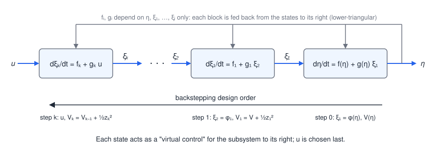
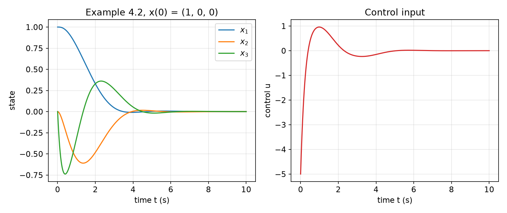
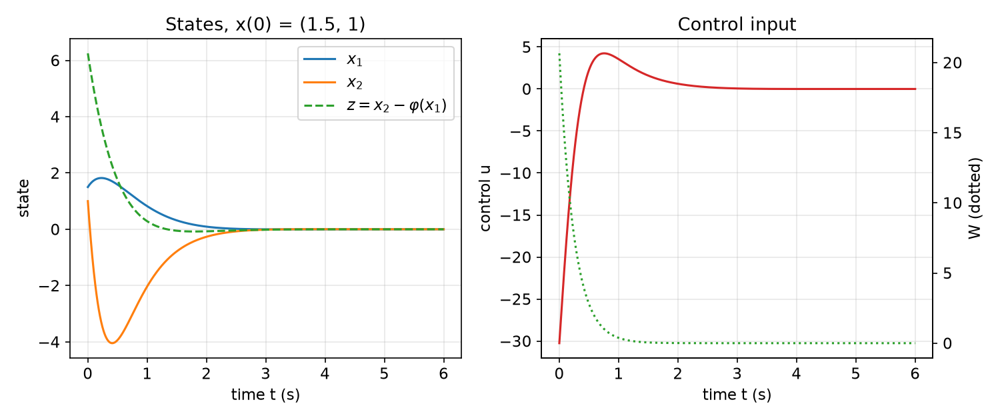
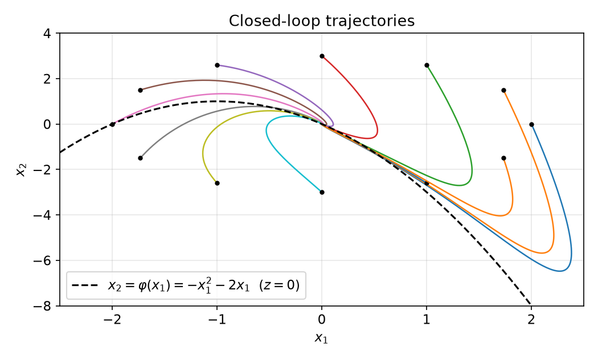
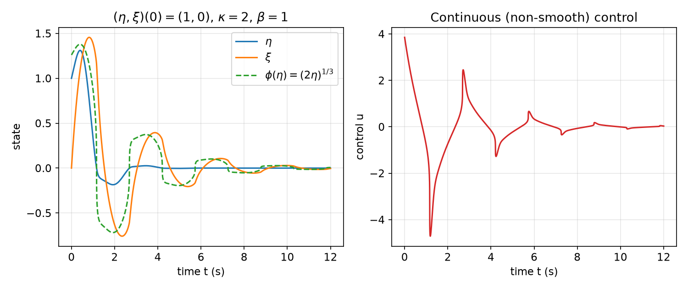
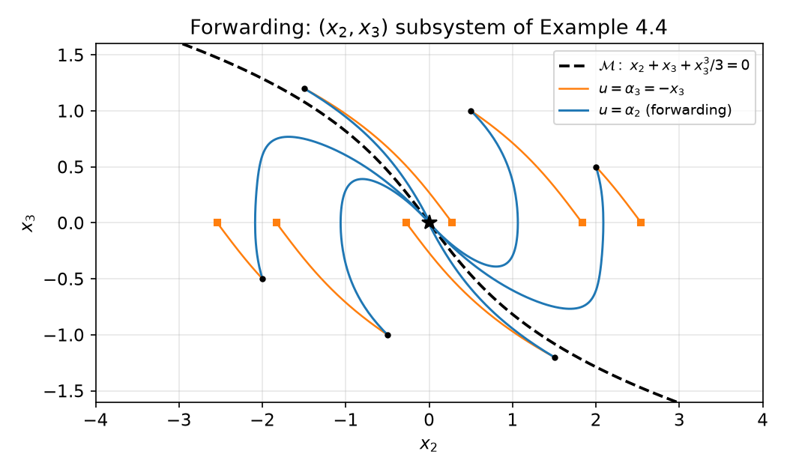

# Backstepping and Forwarding

Feedback linearization asks for a global change of coordinates that cancels every nonlinearity; Lyapunov redesign and sliding control require the uncertainty to be matched with the input. Backstepping is the constructive middle ground: for systems that are built as a *chain of cascades*, it builds a stabilizing feedback and a Lyapunov function at the same time, one integrator at a time, and it leaves the designer free to keep nonlinearities that help instead of cancelling them. This chapter develops integrator backstepping and its recursive form, then robust backstepping for unmatched uncertainty, backstepping as a recursive passivation tool, an extension that tolerates non-smooth virtual controls, and finally forwarding, the dual procedure for systems with an upper-triangular (feedforward) structure.

## Strict-Feedback Systems

Backstepping applies to systems in **strict-feedback form**

\\[
\begin{aligned}
\dot\eta &= f(\eta) + g(\eta)\\,\xi\_1, \\\\
\dot\xi\_1 &= f\_1(\eta,\xi\_1) + g\_1(\eta,\xi\_1)\\,\xi\_2, \\\\
\dot\xi\_2 &= f\_2(\eta,\xi\_1,\xi\_2) + g\_2(\eta,\xi\_1,\xi\_2)\\,\xi\_3, \\\\
&\ \ \vdots \\\\
\dot\xi\_{k-1} &= f\_{k-1}(\eta,\xi\_1,\dots,\xi\_{k-1}) + g\_{k-1}(\eta,\xi\_1,\dots,\xi\_{k-1})\\,\xi\_k, \\\\
\dot\xi\_k &= f\_k(\eta,\xi\_1,\dots,\xi\_k) + g\_k(\eta,\xi\_1,\dots,\xi\_k)\\,u,
\end{aligned}
\\]

where \\(\eta\in\mathbb R^n\\), \\(\xi\_1,\dots,\xi\_k\in\mathbb R\\), the drift terms \\(f,f\_1,\dots,f\_k\\) vanish at the origin, and

\\[
g\_i(\eta,\xi\_1,\dots,\xi\_i)\neq 0,\qquad 1\le i\le k,
\\]

on the domain of interest. The name describes the structure: the right-hand side of \\(\dot\xi\_i\\) depends only on \\(\eta\\) and on \\(\xi\_1,\dots,\xi\_i\\), that is, on the states "upstream" of \\(\xi\_i\\) in the chain, plus the next state \\(\xi\_{i+1}\\), which enters affinely with a nonvanishing gain. The Jacobian of the right-hand side, ordered \\((\eta,\xi\_1,\dots,\xi\_k)\\), is lower triangular apart from the superdiagonal entries \\(g\_i\\).



*Figure: a strict-feedback system as a chain of integrators. The input \\(u\\) drives only \\(\xi\_k\\); each \\(\xi\_{i+1}\\) drives \\(\xi\_i\\); and \\(\xi\_1\\) drives the \\(\eta\\)-subsystem. The nonlinearities \\(f\_i,g\_i\\) are fed back only from states to the right of the block. Backstepping designs from right to left: first a virtual control for \\(\eta\\), then for each \\(\xi\_i\\) in turn, and finally the real input \\(u\\).*

Two complementary readings of this structure guide the design.

- **A sequence of cascades.** The control \\(u\\) affects only \\(\xi\_k\\) directly; \\(\xi\_k\\) affects \\(\xi\_{k-1}\\), and so on, until \\(\xi\_1\\) affects \\(\eta\\). The system is a cascade of scalar subsystems, each driven by the one below it.
- **A sequence of virtual controls.** Treat \\(\xi\_1\\) as if it were a control input for the \\(\eta\\)-subsystem and choose a stabilizing law \\(\xi\_1=\phi(\eta)\\). Then use the \\(\xi\_1\\)-equation to make \\(\xi\_1\\) track \\(\phi(\eta)\\), treating \\(\xi\_2\\) as the new "control", and so on down the cascade until the last equation, where the real input \\(u\\) is finally chosen.

The recursive design is easy in principle, but the expressions grow quickly with the number of steps, because each step differentiates the previous virtual control along the system trajectories. The ideas are therefore introduced on one and two integrators; the recursive nature of the procedure makes the general case a matter of bookkeeping, which is carried out explicitly below.

## Integrator Backstepping

### The basic construction

Consider the simplest case, \\(k=1\\) with \\(f\_1=0\\) and \\(g\_1=1\\):

\\[
\dot\eta = f(\eta)+g(\eta)\\,\xi, \qquad \dot\xi = u, \qquad f(0)=0.
\\]

**Assumption.** Treating \\(\xi\\) as a control for the \\(\eta\\)-subsystem, there is a smooth state feedback

\\[
\xi=\phi(\eta),\qquad \phi(0)=0,
\\]

and a smooth, positive definite Lyapunov function \\(V(\eta)\\) such that

\\[
\frac{\partial V}{\partial\eta}\big(f(\eta)+g(\eta)\phi(\eta)\big) \le -U(\eta)
\\]

for some positive definite function \\(U\\). In words, the origin of \\(\dot\eta=f+g\phi\\) is asymptotically stable, and \\(V\\) proves it.

**The error variable.** Since \\(\xi\\) is a state and not a control, nothing forces \\(\xi=\phi(\eta)\\). The deviation

\\[
z=\xi-\phi(\eta)
\\]

can, however, be steered to zero through \\(u\\). Write the system in the coordinates \\((\eta,z)\\). The \\(\eta\\)-equation becomes, after adding and subtracting \\(g\phi\\),

\\[
\dot\eta = \big(f(\eta)+g(\eta)\phi(\eta)\big)+g(\eta)\\,z ,
\\]

the nominal stable closed loop plus a perturbation proportional to \\(z\\). Differentiating \\(z\\) along the trajectories,

\\[
\dot z = \dot\xi - \frac{\partial\phi}{\partial\eta}\dot\eta = u-\frac{\partial\phi}{\partial\eta}\big(f(\eta)+g(\eta)\xi\big).
\\]

The term \\(\dot\phi=\frac{\partial\phi}{\partial\eta}(f+g\xi)\\) is a known function of the state, so it can be cancelled: with a new input \\(v\\),

\\[
u=\frac{\partial\phi}{\partial\eta}\big(f(\eta)+g(\eta)\xi\big)+v
\quad\Longrightarrow\quad
\dot\eta=\big(f+g\phi\big)+g\\,z,\qquad \dot z=v .
\\]

This is the origin of the name: the integrator in front of the \\(\eta\\)-subsystem has been "stepped back" through, and the new input \\(v\\) acts on the error \\(z\\) through a pure integrator.

**The composite Lyapunov function.** Take

\\[
W(\eta,\xi)=V(\eta)+\tfrac12 z^2 = V(\eta)+\tfrac12\big(\xi-\phi(\eta)\big)^2 .
\\]

Its derivative is

\\[
\begin{aligned}
\dot W &= \frac{\partial V}{\partial\eta}\big(f+g\phi\big)+\frac{\partial V}{\partial\eta}g\\,z+z\\,v \\\\
&\le -U(\eta)+z\Big(\frac{\partial V}{\partial\eta}g(\eta)+v\Big).
\end{aligned}
\\]

The only indefinite term is the product of \\(z\\) with something we control. Choosing

\\[
v=-\frac{\partial V}{\partial\eta}g(\eta)-k\\,z,\qquad k>0,
\\]

gives \\(\dot W\le -U(\eta)-k z^2\\), which is negative definite in \\((\eta,z)\\). Since \\((\eta,\xi)\mapsto(\eta,z)\\) is a global diffeomorphism, the origin \\((\eta,\xi)=(0,0)\\) is asymptotically stable, and globally so if \\(V\\) is radially unbounded (then so is \\(W\\)).

**Theorem (Integrator backstepping).** Consider \\(\dot\eta=f(\eta)+g(\eta)\xi\\), \\(\dot\xi=u\\) with \\(f,g\\) smooth and \\(f(0)=0\\). Let \\(\phi\in C^1\\), \\(\phi(0)=0\\), and let \\(V\\) be a smooth, positive definite function with \\(\frac{\partial V}{\partial\eta}(f+g\phi)\le -U(\eta)\\), \\(U\\) positive definite. Then the state feedback

\\[
\boxed{\\,u=\frac{\partial\phi}{\partial\eta}\big(f(\eta)+g(\eta)\xi\big)-\frac{\partial V}{\partial\eta}g(\eta)-k\big(\xi-\phi(\eta)\big),\qquad k>0\\,}
\\]

makes the origin asymptotically stable, with Lyapunov function \\(W=V+\tfrac12(\xi-\phi)^2\\). If \\(V\\) is radially unbounded, the origin is globally asymptotically stable.

The control law has three recognizable parts:

1. a **feedforward** term \\(\dot\phi=\frac{\partial\phi}{\partial\eta}(f+g\xi)\\), the derivative of the virtual control along trajectories, so that \\(\xi\\) can follow a moving target;
2. a **cross-term cancellation** \\(-L\_gV=-\frac{\partial V}{\partial\eta}g\\), which removes the coupling \\(\frac{\partial V}{\partial\eta}g\\,z\\) that \\(z\\) introduces into \\(\dot V\\);
3. a **damping** term \\(-kz\\), which drives the error to zero.

Note that the theorem needs \\(\phi\in C^1\\): its derivative appears in \\(u\\). This is the restriction relaxed later in [Extended Backstepping](#extended-backstepping-non-smooth-virtual-controls).

### Non-unit input gain

The same construction handles a general scalar last equation

\\[
\dot\eta=f(\eta)+g(\eta)\xi, \qquad \dot\xi=a(\eta,\xi)+b(\eta,\xi)u, \qquad b(\eta,\xi)\neq 0 .
\\]

The preliminary feedback

\\[
u=\frac{1}{b(\eta,\xi)}\big(u\_a-a(\eta,\xi)\big)
\\]

reduces the second equation to \\(\dot\xi=u\_a\\), and the theorem applied to \\(u\_a\\) yields

\\[
u\_a=\frac{\partial\phi}{\partial\eta}\big(f+g\xi\big)-\frac{\partial V}{\partial\eta}g-k(\xi-\phi),
\\]

so that

\\[
u=\frac{1}{b(\eta,\xi)}\Big[\frac{\partial\phi}{\partial\eta}\big(f(\eta)+g(\eta)\xi\big)-\frac{\partial V}{\partial\eta}g(\eta)-k\big(\xi-\phi(\eta)\big)-a(\eta,\xi)\Big].
\\]

Cancelling \\(a\\) is not compulsory: if part of \\(a(\eta,\xi)\\) already contributes a negative term to \\(\dot W\\) (for example \\(a=-\xi^3\\)), it can be kept, which saves control effort and improves robustness. This freedom to choose which nonlinearities to cancel is one of the main advantages of backstepping over exact feedback linearization.

### Recursive backstepping for the general strict-feedback form

The general system is handled by applying the construction \\(k\\) times. Let \\(\phi\_0(\eta)\\) be a \\(C^k\\) virtual control for the \\(\eta\\)-subsystem with Lyapunov function \\(V\_0(\eta)\\) and \\(\frac{\partial V\_0}{\partial\eta}(f+g\phi\_0)\le -U\_0(\eta)\\). Define the error coordinates recursively,

\\[
z\_1=\xi\_1-\phi\_0(\eta),\qquad z\_i=\xi\_i-\phi\_{i-1}(\eta,\xi\_1,\dots,\xi\_{i-1}),\quad i=2,\dots,k,
\\]

with the functions \\(\phi\_i\\) still to be found, and the Lyapunov functions

\\[
V\_i=V\_{i-1}+\tfrac12 z\_i^2 = V\_0(\eta)+\tfrac12\sum\_{j=1}^{i} z\_j^2 .
\\]

*Step \\(i\\)* (\\(1\le i\le k\\), with the convention \\(\xi\_{k+1}=u\\)). Suppose \\(\phi\_0,\dots,\phi\_{i-1}\\) have been constructed. The error \\(z\_i\\) evolves as

\\[
\dot z\_i = f\_i+g\_i\\,\xi\_{i+1}-\dot\phi\_{i-1},
\qquad
\dot\phi\_{i-1}=\frac{\partial\phi\_{i-1}}{\partial\eta}\big(f+g\xi\_1\big)+\sum\_{j=1}^{i-1}\frac{\partial\phi\_{i-1}}{\partial\xi\_j}\big(f\_j+g\_j\xi\_{j+1}\big),
\\]

and \\(\dot\phi\_{i-1}\\) is a known function of the state (it involves only \\(\xi\_1,\dots,\xi\_i\\)). Next, examine \\(\dot V\_{i-1}\\). The function \\(V\_{i-1}\\) depends on \\((\eta,\xi\_1,\dots,\xi\_{i-1})\\), and the state \\(\xi\_i\\) enters its derivative only through \\(\dot\xi\_{i-1}=f\_{i-1}+g\_{i-1}\xi\_i\\) (through \\(\dot\eta=f+g\xi\_1\\) when \\(i=1\\)). Substituting \\(\xi\_i=\phi\_{i-1}+z\_i\\) separates what previous steps already guaranteed from a cross term:

\\[
\dot V\_{i-1}\le -U\_{i-1}+\frac{\partial V\_{i-1}}{\partial\xi\_{i-1}}\\,g\_{i-1}\\,z\_i,
\qquad \frac{\partial V\_{i-1}}{\partial\xi\_{i-1}}=z\_{i-1},
\\]

since among the terms of \\(V\_{i-1}\\) only \\(\tfrac12z\_{i-1}^2\\) depends on \\(\xi\_{i-1}\\), with \\(\partial z\_{i-1}/\partial\xi\_{i-1}=1\\). For \\(i=1\\) the cross term is \\(L\_gV\_0\\,z\_1=\frac{\partial V\_0}{\partial\eta}g\\,z\_1\\). Hence

\\[
\dot V\_i\le -U\_{i-1}+z\_i\Big(g\_{i-1}z\_{i-1}+f\_i+g\_i\xi\_{i+1}-\dot\phi\_{i-1}\Big).
\\]

Choosing the next virtual control (or, at \\(i=k\\), the actual control) as

\\[
\boxed{\\,\phi\_i=\frac{1}{g\_i}\Big(-f\_i+\dot\phi\_{i-1}-g\_{i-1}z\_{i-1}-c\_i z\_i\Big),\qquad c\_i>0\\,}
\\]

(with \\(g\_0z\_0\\) replaced by \\(L\_gV\_0\\) when \\(i=1\\)) gives \\(\dot V\_i\le -U\_{i-1}-c\_iz\_i^2=:-U\_i\\) whenever \\(\xi\_{i+1}=\phi\_i\\). At \\(i=k\\) the law \\(u=\phi\_k\\) completes the design with

\\[
\dot V\_k\le -U\_0(\eta)-\sum\_{i=1}^k c\_i z\_i^2 .
\\]

**The closed loop in error coordinates.** Substituting \\(\xi\_{i+1}=\phi\_i+z\_{i+1}\\) in \\(\dot z\_i\\) gives a remarkably structured system:

\\[
\begin{aligned}
\dot\eta &= f(\eta)+g(\eta)\phi\_0(\eta)+g(\eta)z\_1,\\\\
\dot z\_1 &= -c\_1z\_1 - L\_gV\_0(\eta) + g\_1 z\_2,\\\\
\dot z\_i &= -c\_iz\_i - g\_{i-1}z\_{i-1} + g\_i z\_{i+1},\qquad 2\le i\le k-1,\\\\
\dot z\_k &= -c\_kz\_k - g\_{k-1}z\_{k-1}.
\end{aligned}
\\]

The coupling between neighbouring errors is *skew-symmetric* (\\(+g\_iz\_{i+1}\\) in \\(\dot z\_i\\), \\(-g\_iz\_i\\) in \\(\dot z\_{i+1}\\)), which is exactly why the cross terms cancel in \\(\dot V\_k\\): backstepping transforms a strict-feedback system into a chain of damped, conservatively coupled error integrators. Because the map \\((\eta,\xi)\mapsto(\eta,z)\\) is triangular with unit diagonal, it is a global diffeomorphism, and asymptotic stability of \\((\eta,z)=0\\) is asymptotic stability of \\((\eta,\xi)=0\\); it is global when \\(V\_0\\) is radially unbounded. The smoothness requirement is that \\(\phi\_0\\), \\(f\_i\\) and \\(g\_i\\) be \\(C^k\\), since \\(\phi\_{i}\\) involves \\(i\\) derivatives of \\(\phi\_0\\).

### Example 4.1 (one step)

\\[
\dot\eta=-\eta+\eta^2\xi,\qquad \dot\xi=u .
\\]

The \\(\eta\\)-subsystem is stable on its own if \\(\xi=0\\), so take \\(\phi(\eta)=0\\) and \\(V(\eta)=\tfrac12\eta^2\\), with \\(\dot V=-\eta^2\\). The error variable is just \\(z=\xi\\), and

\\[
W(\eta,\xi)=\tfrac12\eta^2+\tfrac12\xi^2,\qquad
\dot W=\eta(-\eta+\eta^2\xi)+\xi u=-\eta^2+\xi\big(\eta^3+u\big).
\\]

The choice

\\[
u=-\eta^3-k\xi,\qquad k>0,
\\]

gives \\(\dot W=-\eta^2-k\xi^2\\): the closed loop is globally asymptotically (indeed exponentially) stable. Here \\(\eta^3=L\_gV\\) is the cross term, and the same law is obtained by passivation in the [Passivity](passivity.md) chapter. Notice that without feedback (\\(u=0\\), \\(\xi\equiv\xi\_0\\)) the \\(\eta\\)-subsystem \\(\dot\eta=-\eta+\xi\_0\eta^2\\) escapes to infinity in finite time from \\(\eta\_0>1/\xi\_0\\); the cross-term cancellation is what prevents this.

### Example 4.2 (two steps, third-order chain)

\\[
\dot x\_1=x\_1^2-x\_1^3+x\_2,\qquad \dot x\_2=x\_3,\qquad \dot x\_3=u.
\\]

The system is in strict-feedback form with \\(\eta=x\_1\\), \\(\xi\_1=x\_2\\), \\(\xi\_2=x\_3\\). Backstepping proceeds twice: from the \\(x\_1\\)-subsystem to \\((x\_1,x\_2)\\), then to the full system.

**Step 1 (virtual control \\(x\_2\\)).** The term \\(-x\_1^3\\) is stabilizing and is kept; only the destabilizing \\(x\_1^2\\) is cancelled:

\\[
x\_2=\varphi\_1(x\_1)=-x\_1^2-x\_1 \quad\Longrightarrow\quad \dot x\_1=-x\_1-x\_1^3 .
\\]

With \\(V\_1=\tfrac12x\_1^2\\), \\(\dot V\_1=-x\_1^2-x\_1^4<0\\). The error is

\\[
z\_2=x\_2-\varphi\_1(x\_1)=x\_2+x\_1+x\_1^2,
\\]

and in the coordinates \\((x\_1,z\_2)\\)

\\[
\dot x\_1=-x\_1-x\_1^3+z\_2,\qquad \dot z\_2=x\_3+(1+2x\_1)\big(-x\_1-x\_1^3+z\_2\big).
\\]

**Step 2 (virtual control \\(x\_3\\)).** With \\(V\_2=V\_1+\tfrac12z\_2^2=\tfrac12x\_1^2+\tfrac12z\_2^2\\),

\\[
\begin{aligned}
\dot V\_2 &= x\_1\big(-x\_1-x\_1^3+z\_2\big)+z\_2\Big(x\_3+(1+2x\_1)\big(-x\_1-x\_1^3+z\_2\big)\Big)\\\\
&= -x\_1^2-x\_1^4+z\_2\Big(x\_1+(1+2x\_1)\big(-x\_1-x\_1^3+z\_2\big)+x\_3\Big).
\end{aligned}
\\]

Choosing

\\[
x\_3=\varphi\_2(x\_1,x\_2)=-x\_1+(1+2x\_1)\big(x\_1+x\_1^3-z\_2\big)-z\_2
\\]

gives \\(\dot V\_2=-x\_1^2-x\_1^4-z\_2^2<0\\). Comparing with the recursive formula: \\(-x\_1\\) is the cross-term cancellation \\(L\_gV\_1\\), \\((1+2x\_1)(x\_1+x\_1^3-z\_2)=\dot\varphi\_1\\) is the feedforward term (recall \\(\dot x\_1=-x\_1-x\_1^3+z\_2\\)), and \\(-z\_2\\) is damping with \\(c=1\\).

**Step 3 (actual control \\(u\\)).** Let \\(z\_3=x\_3-\varphi\_2(x\_1,x\_2)\\). In the coordinates \\((x\_1,x\_2,z\_3)\\),

\\[
\begin{aligned}
\dot x\_1&=x\_1^2-x\_1^3+x\_2,\\\\
\dot x\_2&=\varphi\_2(x\_1,x\_2)+z\_3,\\\\
\dot z\_3&=u-\frac{\partial\varphi\_2}{\partial x\_1}\big(x\_1^2-x\_1^3+x\_2\big)-\frac{\partial\varphi\_2}{\partial x\_2}\big(\varphi\_2(x\_1,x\_2)+z\_3\big).
\end{aligned}
\\]

Take the Lyapunov candidate

\\[
W(x\_1,x\_2,z\_3)=V\_2+\tfrac12z\_3^2=\tfrac12x\_1^2+\tfrac12\big(x\_2+x\_1+x\_1^2\big)^2+\tfrac12z\_3^2 .
\\]

The terms that do not involve \\(z\_3\\) reproduce \\(\dot V\_2\\) with \\(x\_3=\varphi\_2\\), and \\(x\_2\\) appears in \\(W\\) only through \\(z\_2\\), so \\(\partial W/\partial x\_2=z\_2\\):

\\[
\dot W=-x\_1^2-x\_1^4-\big(x\_2+x\_1+x\_1^2\big)^2+z\_3\Big(\frac{\partial W}{\partial x\_2}+u-\frac{\partial\varphi\_2}{\partial x\_1}\big(x\_1^2-x\_1^3+x\_2\big)-\frac{\partial\varphi\_2}{\partial x\_2}\big(\varphi\_2+z\_3\big)\Big).
\\]

The control law

\\[
u=-\frac{\partial W}{\partial x\_2}+\frac{\partial\varphi\_2}{\partial x\_1}\big(x\_1^2-x\_1^3+x\_2\big)+\frac{\partial\varphi\_2}{\partial x\_2}\big(\varphi\_2(x\_1,x\_2)+z\_3\big)-z\_3
\\]

gives

\\[
\dot W=-x\_1^2-x\_1^4-\big(x\_2+x\_1+x\_1^2\big)^2-z\_3^2<0,
\\]

so the origin is globally asymptotically stable (\\(W\\) is radially unbounded in \\((x\_1,x\_2,x\_3)\\) because the error coordinates are a global diffeomorphism). The partial derivatives are elementary: writing \\(a=x\_1+x\_1^3-z\_2\\) so that \\(\varphi\_2=-x\_1+(1+2x\_1)a-z\_2\\),

\\[
\frac{\partial\varphi\_2}{\partial x\_1}=-1+2a+(1+2x\_1)\big(3x\_1^2-2x\_1\big)-(1+2x\_1),\qquad
\frac{\partial\varphi\_2}{\partial x\_2}=-(1+2x\_1)-1 ,
\\]

using \\(\partial z\_2/\partial x\_1=1+2x\_1\\), \\(\partial z\_2/\partial x\_2=1\\) and \\(\partial a/\partial x\_1=1+3x\_1^2-(1+2x\_1)=3x\_1^2-2x\_1\\).



*Figure: Example 4.2 from \\(x(0)=(1,0,0)\\). The control starts at \\(u(0)=-5\\) (at this point \\(z\_2=2\\), \\(\varphi\_2=-3\\), \\(z\_3=3\\)) and drives \\(x\_3\\) and \\(x\_2\\) negative to pull \\(x\_1\\) back; all three states converge in about 6 s. Note how \\(x\_1\\) initially stays near 1: the virtual controls must first be established before \\(x\_1\\) responds.*

## A Worked Design: Stabilizing a System with Finite Escape Time

This example carries a two-state design from start to finish: derivation, closed-loop analysis, numbers, and simulation.

**Example (Backstepping with finite escape).** Consider

\\[
\dot x\_1=x\_1^2+x\_2,\qquad \dot x\_2=u .
\\]

*Open-loop behaviour.* With \\(u=0\\), \\(x\_2\\) stays at \\(x\_2(0)\\), and for \\(x\_2(0)=1\\) the first equation \\(\dot x\_1=x\_1^2+1\\) has the solution \\(x\_1(t)=\tan\big(t+\arctan x\_1(0)\big)\\), which escapes to infinity at \\(t=\pi/2-\arctan x\_1(0)\\); from \\(x\_1(0)=1.5\\) this happens at \\(t\approx 0.59\\) s. The linearization at the origin is a double integrator, so linear design would give only local results; the quadratic term makes the domain of attraction of any linear controller bounded.

*Step 1: virtual control.* Treat \\(x\_2\\) as the input of \\(\dot x\_1=x\_1^2+x\_2\\). The choice

\\[
x\_2=\varphi(x\_1)=-x\_1^2-k\_1x\_1,\qquad k\_1>0,
\\]

gives \\(\dot x\_1=-k\_1x\_1\\), and \\(V\_1=\tfrac12x\_1^2\\) has \\(\dot V\_1=-k\_1x\_1^2\\).

*Step 2: error variable.* Let

\\[
z=x\_2-\varphi(x\_1)=x\_2+x\_1^2+k\_1x\_1 .
\\]

Then \\(\dot x\_1=x\_1^2+\varphi+z=-k\_1x\_1+z\\), and

\\[
\dot z=\dot x\_2+(2x\_1+k\_1)\dot x\_1=u+(2x\_1+k\_1)\big(x\_1^2+x\_2\big).
\\]

*Step 3: composite Lyapunov function and control.* With \\(W=\tfrac12x\_1^2+\tfrac12z^2\\),

\\[
\dot W=x\_1\big(-k\_1x\_1+z\big)+z\Big(u+(2x\_1+k\_1)\big(x\_1^2+x\_2\big)\Big)
=-k\_1x\_1^2+z\Big(x\_1+u+(2x\_1+k\_1)\big(x\_1^2+x\_2\big)\Big).
\\]

Choose

\\[
\boxed{\\,u=-x\_1-(2x\_1+k\_1)\big(x\_1^2+x\_2\big)-k\_2\big(x\_2+x\_1^2+k\_1x\_1\big),\qquad k\_2>0\\,}
\\]

so that \\(\dot W=-k\_1x\_1^2-k\_2z^2\\). The three terms are again cross-term cancellation (\\(-x\_1=-L\_gV\_1\\)), feedforward (\\(\dot\varphi=-(2x\_1+k\_1)\dot x\_1\\) appears with the sign that cancels it), and damping.

*Closed loop.* In the coordinates \\((x\_1,z)\\) the closed loop is *linear*:

\\[
\begin{bmatrix}\dot x\_1\\\\ \dot z\end{bmatrix}=\begin{bmatrix}-k\_1 & 1\\\\ -1 & -k\_2\end{bmatrix}\begin{bmatrix}x\_1\\\\ z\end{bmatrix},
\\]

with the skew-symmetric off-diagonal pair predicted by the general recursion. For \\(k\_1=k\_2=2\\) the eigenvalues are \\(-2\pm j\\): the error coordinates decay as \\(e^{-2t}\\) with a slow rotation. Because \\((x\_1,x\_2)\mapsto(x\_1,z)\\) is a global diffeomorphism with inverse \\(x\_2=z-x\_1^2-k\_1x\_1\\), the origin of the original system is globally exponentially stable in the \\((x\_1,z)\\) coordinates, and globally asymptotically stable in \\((x\_1,x\_2)\\). (For this particular system the result coincides with exact feedback linearization, because \\(z\\) is a linearizing coordinate; Example 4.2 shows a case where backstepping deliberately keeps a nonlinearity.)

*Numbers at \\(x(0)=(1.5,\\,1)\\), \\(k\_1=k\_2=2\\).* The error is \\(z(0)=1+2.25+3=6.25\\), \\(W(0)=\tfrac12(2.25+39.06)=20.66\\), and

\\[
u(0)=-1.5-(3+2)(2.25+1)-2(6.25)=-1.5-16.25-12.5=-30.25 .
\\]

The large initial control is spent mainly on the feedforward term, which must overcome the growth \\(x\_1^2\\) before \\(x\_1\\) can turn around.

*Simulation.*

```python
import numpy as np
from scipy.integrate import solve_ivp

k1, k2 = 2.0, 2.0
def u_bs(x1, x2):
    z = x2 + x1**2 + k1*x1
    return -x1 - (2*x1 + k1)*(x1**2 + x2) - k2*z

def rhs(t, x):
    x1, x2 = x
    return [x1**2 + x2, u_bs(x1, x2)]

sol = solve_ivp(rhs, (0, 6), [1.5, 1.0], max_step=0.005, rtol=1e-9)
x1, x2 = sol.y
u = u_bs(x1, x2)            # u(0) = -30.25
```

```matlab
k1 = 2; k2 = 2;
u  = @(x) -x(1) - (2*x(1)+k1)*(x(1)^2 + x(2)) - k2*(x(2) + x(1)^2 + k1*x(1));
f  = @(t,x) [x(1)^2 + x(2); u(x)];
[t, x] = ode45(f, [0 6], [1.5; 1]);
plot(t, x); xlabel('t (s)'); legend('x_1','x_2');
```



*Figure: closed loop from \\(x(0)=(1.5,1)\\) with \\(k\_1=k\_2=2\\). Left: \\(x\_1\\) rises briefly to about 1.8 (the escape that would occur at \\(t\approx0.59\\) s is prevented), while \\(x\_2\\) is driven down to about \\(-4\\) to provide the needed negative drive; the error \\(z\\) (dashed) decays monotonically from 6.25. Right: the control (solid) starts at \\(-30.25\\) and the Lyapunov function \\(W\\) (dotted) decreases monotonically from 20.7.*



*Figure: closed-loop trajectories from twelve initial conditions on an ellipse. The dashed parabola is the manifold \\(z=0\\), i.e. \\(x\_2=\varphi(x\_1)=-x\_1^2-2x\_1\\), where the virtual control is exactly realized. Trajectories are first pulled toward this curve and then slide along it to the origin, the geometric picture behind backstepping.*

## Robust Backstepping

A striking property of backstepping is that it can stabilize uncertain systems even when the uncertainty is **unmatched**, i.e. enters equations that the control does not act on directly. Methods such as Lyapunov redesign or sliding control require the uncertainty to enter through the same channel as \\(u\\) (the matching condition, see [Sliding Control](sliding-control.md)); backstepping handles unmatched terms by dominating them at each step with the virtual control.

Consider

\\[
\dot\eta=f(\eta)+g(\eta)\xi+\delta\_\eta(\eta,\xi), \qquad \dot\xi=a(\eta,\xi)+b(\eta,\xi)u+\delta\_\xi(\eta,\xi),
\\]

with \\(\eta\in\mathbb R^n\\), \\(\xi\in\mathbb R\\), \\(f,g,a,b\\) known, \\(b\neq0\\), and unknown uncertainties satisfying the linear growth bounds

\\[
\lVert\delta\_\eta(\eta,\xi)\rVert\le a\_1\lVert\eta\rVert, \qquad \lvert\delta\_\xi(\eta,\xi)\rvert\le a\_2\lVert\eta\rVert+a\_3\lvert\xi\rvert .
\\]

**Assumptions.** There is a \\(C^1\\) virtual control \\(\xi=\phi(\eta)\\) and a positive definite, radially unbounded \\(V(\eta)\\) that robustly stabilize the \\(\eta\\)-subsystem:

\\[
\frac{\partial V}{\partial\eta}\big(f(\eta)+g(\eta)\phi(\eta)+\delta\_\eta(\eta,\xi)\big)\le -\lambda\lVert\eta\rVert^2\qquad\text{for all }(\eta,\xi),\quad \lambda>0,
\\]

and \\(\phi\\) and its Jacobian satisfy

\\[
\lvert\phi(\eta)\rvert\le a\_4\lVert\eta\rVert,\qquad \Big\lVert\frac{\partial\phi}{\partial\eta}\Big\rVert\le a\_5 .
\\]

(The decay constant \\(\lambda\\) should not be confused with the input gain \\(b(\eta,\xi)\\).)

**Derivation.** Take \\(W(\eta,\xi)=V(\eta)+\tfrac12(\xi-\phi(\eta))^2\\). Writing \\(f+g\xi+\delta\_\eta=(f+g\phi+\delta\_\eta)+g(\xi-\phi)\\) and dropping arguments,

\\[
\dot W=\frac{\partial V}{\partial\eta}\big(f+g\phi+\delta\_\eta\big)+\frac{\partial V}{\partial\eta}g\\,(\xi-\phi)+(\xi-\phi)\Big[a+bu+\delta\_\xi-\frac{\partial\phi}{\partial\eta}\big(f+g\xi+\delta\_\eta\big)\Big].
\\]

The control is the nominal backstepping law, which uses only the known terms:

\\[
u=\frac1b\Big[\frac{\partial\phi}{\partial\eta}\big(f+g\xi\big)-\frac{\partial V}{\partial\eta}g-a-k(\xi-\phi)\Big],\qquad k>0 .
\\]

Substituting, the known terms cancel and only the uncertainties remain:

\\[
\begin{aligned}
\dot W&\le -\lambda\lVert\eta\rVert^2+(\xi-\phi)\Big(\delta\_\xi-\frac{\partial\phi}{\partial\eta}\delta\_\eta\Big)-k(\xi-\phi)^2\\\\
&\le -\lambda\lVert\eta\rVert^2+\lvert\xi-\phi\rvert\\,\lvert\delta\_\xi\rvert+\lvert\xi-\phi\rvert\Big\lVert\frac{\partial\phi}{\partial\eta}\Big\rVert\lVert\delta\_\eta\rVert-k(\xi-\phi)^2 .
\end{aligned}
\\]

Using the growth bounds,

\\[
\dot W\le -\lambda\lVert\eta\rVert^2+a\_2\lvert\xi-\phi\rvert\lVert\eta\rVert+a\_3\lvert\xi-\phi\rvert\lvert\xi\rvert+a\_5a\_1\lvert\xi-\phi\rvert\lVert\eta\rVert-k(\xi-\phi)^2 .
\\]

The term containing \\(\lvert\xi\rvert\\) is not yet in terms of the Lyapunov coordinates \\((\eta,\xi-\phi)\\). The key step writes \\(\xi=(\xi-\phi)+\phi\\):

\\[
\lvert\xi-\phi\rvert\lvert\xi\rvert\le\lvert\xi-\phi\rvert\big(\lvert\xi-\phi\rvert+\lvert\phi\rvert\big)\le(\xi-\phi)^2+a\_4\lvert\xi-\phi\rvert\lVert\eta\rVert .
\\]

Hence

\\[
\dot W\le -\lambda\lVert\eta\rVert^2+\lvert\xi-\phi\rvert\lVert\eta\rVert\\,(a\_2+a\_3a\_4+a\_1a\_5)-(k-a\_3)(\xi-\phi)^2 .
\\]

With \\(a\_6=\tfrac12(a\_2+a\_3a\_4+a\_1a\_5)\\) this is a quadratic form:

\\[
\dot W\le -\begin{bmatrix}\lVert\eta\rVert\\\\ \lvert\xi-\phi\rvert\end{bmatrix}^{T}\begin{bmatrix}\lambda&-a\_6\\\\ -a\_6&k-a\_3\end{bmatrix}\begin{bmatrix}\lVert\eta\rVert\\\\ \lvert\xi-\phi\rvert\end{bmatrix}.
\\]

The matrix is positive definite if and only if \\(\lambda>0\\) and \\(\lambda(k-a\_3)>a\_6^2\\), i.e.

\\[
\boxed{\\,k>a\_3+\frac{a\_6^2}{\lambda}\\,}.
\\]

Then \\(\dot W\le-\sigma\big(\lVert\eta\rVert^2+\lvert\xi-\phi\rvert^2\big)\\) for some \\(\sigma>0\\), and the origin of the perturbed system is globally (exponentially, if \\(V\\) is quadratically bounded) asymptotically stable. The damping gain \\(k\\) is the robustness knob: it must dominate the uncertainty that enters the \\(\xi\\)-equation directly (\\(a\_3\\)) and the coupling \\(a\_6\\) created by uncertainty and by the variation of the virtual control.

### Example 4.3 (Semiglobal robust backstepping)

\\[
\dot x\_1=x\_2+\theta\_1x\_1\sin x\_2,\qquad \dot x\_2=\theta\_2x\_2^2+x\_1+u,
\\]

with unknown constants \\(\lvert\theta\_1\rvert\le a\\) and \\(\lvert\theta\_2\rvert\le b\\). Set \\(\delta\_1(x\_1,x\_2)=\theta\_1x\_1\sin x\_2\\) and \\(\delta\_2(x\_2)=\theta\_2x\_2^2\\):

\\[
\dot x\_1=x\_2+\delta\_1,\qquad \dot x\_2=x\_1+u+\delta\_2 .
\\]

The first uncertainty is unmatched (it enters the \\(x\_1\\)-equation) but satisfies \\(\lvert\delta\_1\rvert\le a\lvert x\_1\rvert\\) globally. The second satisfies only a *local* linear bound: \\(\lvert\delta\_2\rvert\le b\rho\lvert x\_2\rvert\\) for \\(\lvert x\_2\rvert\le\rho\\). The global theorem does not apply, but its argument can be run on a bounded level set.

*Step 1.* The virtual control \\(x\_2=\phi\_1(x\_1)=-k\_1x\_1\\) with \\(V\_1=\tfrac12x\_1^2\\) gives

\\[
\dot V\_1=x\_1\phi\_1+\theta\_1x\_1^2\sin x\_2\le-(k\_1-a)x\_1^2 ,
\\]

and the choice \\(k\_1=1+a\\) makes this \\(\le -x\_1^2\\) for every admissible \\(\theta\_1\\).

*Step 2.* With \\(z\_2=x\_2+(1+a)x\_1\\),

\\[
\dot x\_1=-(1+a)x\_1+\delta\_1+z\_2,\qquad \dot z\_2=\dot x\_2+(1+a)\dot x\_1=\psi\_1(x)+\psi\_2(x,\theta)+u,
\\]

\\[
\psi\_1(x)=x\_1+(1+a)x\_2,\qquad \psi\_2(x,\theta)=(1+a)\delta\_1(x\_1,x\_2)+\delta\_2(x\_2),
\\]

where \\(\psi\_1\\) is known and \\(\psi\_2\\) collects the uncertainty. For \\(W=\tfrac12(x\_1^2+z\_2^2)\\), using \\(x\_1\big(-(1+a)x\_1+\delta\_1\big)\le -x\_1^2\\),

\\[
\dot W\le-x\_1^2+z\_2\big(x\_1+\psi\_1(x)+\psi\_2(x,\theta)+u\big).
\\]

*Control.* Take \\(u=-x\_1-\psi\_1(x)-kz\_2\\), \\(k>0\\). Then, with \\(\lvert\psi\_2\rvert\le a(1+a)\lvert x\_1\rvert+bx\_2^2\\),

\\[
\dot W\le-x\_1^2+z\_2\psi\_2-kz\_2^2\le-x\_1^2+a(1+a)\lvert x\_1\rvert\lvert z\_2\rvert+bx\_2^2\lvert z\_2\rvert-kz\_2^2 .
\\]

*Bounding \\(x\_2\\) on a level set.* On \\(\Omega\_c=\\{x : W(x)\le c\\}\\) we have

\\[
W=\tfrac12\big(x\_1^2+(x\_2+k\_1x\_1)^2\big)\le c\iff(1+k\_1^2)x\_1^2+2k\_1x\_2x\_1+x\_2^2-2c\le0 .
\\]

For a given \\(x\_2\\), this quadratic inequality in \\(x\_1\\) (leading coefficient \\(1+k\_1^2>0\\)) has a solution if and only if its discriminant is nonnegative:

\\[
\Delta(x\_2)=(2k\_1x\_2)^2-4(1+k\_1^2)(x\_2^2-2c)\ge0\iff x\_2^2\le2c(1+k\_1^2).
\\]

Hence on \\(\Omega\_c\\), \\(\lvert x\_2\rvert\le\rho:=\sqrt{2c(1+k\_1^2)}\\), and there \\(bx\_2^2\le b\rho\lvert x\_2\rvert\\). Using \\(x\_2=z\_2-(1+a)x\_1\\),

\\[
\begin{aligned}
\dot W&\le-x\_1^2+a(1+a)\lvert x\_1\rvert\lvert z\_2\rvert+b\rho\\,\lvert z\_2-(1+a)x\_1\rvert\lvert z\_2\rvert-kz\_2^2\\\\
&\le-x\_1^2+(1+a)(a+b\rho)\lvert x\_1\rvert\lvert z\_2\rvert-(k-b\rho)z\_2^2 .
\end{aligned}
\\]

The right side is negative definite if

\\[
k>b\rho+\tfrac14(1+a)^2(a+b\rho)^2 .
\\]

Then \\(\Omega\_c\\) is positively invariant, contained in the region of attraction, and the origin is exponentially stable. The final control is

\\[
u=-x\_1-\psi\_1(x)-k\big(x\_2+(1+a)x\_1\big)=-(2+k+ka)\\,x\_1-(1+a+k)\\,x\_2 ,
\\]

a *linear* feedback whose gain grows with \\(c\\). Since \\(c>0\\) is arbitrary, any bounded set of initial conditions can be included in the region of attraction by choosing \\(k\\) large enough: the design achieves **semiglobal** stabilization. Global stabilization is not claimed, because the quadratic uncertainty \\(\theta\_2x\_2^2\\) can overpower any fixed linear feedback for large \\(x\_2\\).

## Backstepping as a Recursive Passivation Tool

Backstepping can also be read as a procedure that makes a strict-feedback system **passive**, one integrator at a time; this connects it with the passivity-based designs of [Passivity](passivity.md). Consider

\\[
\dot\eta=f(\eta)+g(\eta)\xi,\qquad \dot\xi=a(\eta,\xi)+b(\eta,\xi)u,\qquad b\neq0,
\\]

and assume a \\(C^1\\) law \\(\xi=\phi(\eta)\\) and a positive definite, radially unbounded \\(V\\) with \\(\frac{\partial V}{\partial\eta}(f+g\phi)\le0\\) (only stability is required here).

**Step 1: the top subsystem is passive.** The feedback transformation \\(\xi=\phi(\eta)+v\_0\\) renders the \\(\eta\\)-subsystem passive from the new input \\(v\_0\\) to the output

\\[
y\_0=\Big(\frac{\partial V}{\partial\eta}g(\eta)\Big)^T=(L\_gV)^T(\eta),
\\]

with storage function \\(V\\), because

\\[
\dot V=\frac{\partial V}{\partial\eta}\big(f+g\phi\big)+\frac{\partial V}{\partial\eta}g\\,v\_0\le\frac{\partial V}{\partial\eta}g\\,v\_0=y\_0^Tv\_0 .
\\]

**Step 2: passivate through the integrator.** Define the new output \\(y=\xi-\phi(\eta)\\) and the storage function

\\[
W(\eta,\xi)=V(\eta)+\tfrac12y^Ty .
\\]

The plain backstepping law

\\[
u=b^{-1}(\eta,\xi)\Big[-a(\eta,\xi)+\frac{\partial\phi}{\partial\eta}\big(f(\eta)+g(\eta)\xi\big)-y\_0\Big]
\\]

stabilizes; adding an external input \\(v\\),

\\[
u=b^{-1}(\eta,\xi)\Big[-a(\eta,\xi)+\frac{\partial\phi}{\partial\eta}\big(f(\eta)+g(\eta)\xi\big)-y\_0+v\Big],
\\]

gives \\(\dot y=\dot\xi-\dot\phi=-y\_0+v\\) and

\\[
\dot W=\frac{\partial V}{\partial\eta}\big(f+g\phi\big)+\frac{\partial V}{\partial\eta}g\\,y+y^T(v-y\_0)\le y\_0^Ty+y^T(v-y\_0)=y^Tv .
\\]

So the feedback renders the cascade **passive from \\(v\\) to \\(y\\)** with storage function \\(W\\). The resulting system

\\[
\dot\eta=f(\eta)+g(\eta)\xi,\qquad
\dot\xi=\frac{\partial\phi}{\partial\eta}\big(f(\eta)+g(\eta)\xi\big)-(L\_gV)^T(\eta)+v,\qquad
y=\xi-\phi(\eta),
\\]

has relative degree one from \\(v\\) to \\(y\\), and its zero dynamics (\\(y\equiv0\\), i.e. \\(\xi=\phi(\eta)\\)) are the stabilized \\(\eta\\)-subsystem. These are exactly the two properties that make a system feedback-equivalent to a passive one, so the procedure can be iterated through further integrators: the passive output of one step becomes the cross-term of the next. Closing the loop with \\(v=-ky\\), \\(k>0\\), gives \\(\dot W\le-k\lvert y\rvert^2\\), and asymptotic stability follows from LaSalle's principle if the passive system is zero-state detectable (or directly if \\(\frac{\partial V}{\partial\eta}(f+g\phi)\\) is negative definite).

## Extended Backstepping: Non-Smooth Virtual Controls

The backstepping law contains \\(\partial\phi/\partial\eta\\), so \\(\phi\\) must be \\(C^1\\). Some systems can be stabilized by a continuous feedback but by no \\(C^1\\) feedback. A standard example is

\\[
\dot\eta=\eta-\xi^3,\qquad \dot\xi=u .
\\]

The linearization at the origin, \\(\dot\eta=\eta\\), \\(\dot\xi=u\\), has the uncontrollable unstable mode \\(\eta\\), so no \\(C^1\\) feedback can asymptotically stabilize the origin (a \\(C^1\\) closed loop would have a linearization with the eigenvalue \\(+1\\)). Yet the \\(\eta\\)-subsystem is stabilized by the continuous virtual control

\\[
\xi=\phi(\eta)=(\kappa\eta)^{1/3},\qquad\kappa>1,
\\]

(real cube root), which gives \\(\dot\eta=(1-\kappa)\eta\\), with Lyapunov function \\(V(\eta)=\eta^2\\). Since \\(\phi\\) is not differentiable at \\(\eta=0\\), ordinary backstepping cannot proceed. The way around it, following the desingularization approach of Praly and coauthors, is to replace the quadratic penalty \\(\tfrac12(\xi-\phi)^2\\) by a penalty built from a function that vanishes on the graph \\(\xi=\phi(\eta)\\) and is smooth enough even though \\(\phi\\) is not.

**Desingularizing function.** Let \\(q(\xi,\eta)\\) satisfy

1. \\(q\\) is continuous;
2. \\(q(\xi,\eta)=0\\) if and only if \\(\xi=\phi(\eta)\\), and \\(q(\xi,\eta)\\) has the sign of \\(\xi-\phi(\eta)\\);
3. its antiderivative in \\(\xi\\),
\\[
Q(\xi,\eta)=\int\_0^{\xi}q(s,\eta)\\,ds,
\\]
is \\(C^1\\), and \\(Q(\xi,\eta)\to\infty\\) as \\(\lvert\xi\rvert\to\infty\\) for every \\(\eta\\).

**Lyapunov function.** With \\(V^\alpha\\) of class \\(C^1\\) (choose \\(\alpha\\) accordingly) and \\(\beta>0\\), set

\\[
W(\eta,\xi)=Q(\xi,\eta)-Q(\phi(\eta),\eta)+\beta V^\alpha(\eta) .
\\]

The first two terms equal \\(\int\_{\phi(\eta)}^{\xi}q(s,\eta)\\,ds\ge0\\), with equality only on \\(\xi=\phi(\eta)\\) (condition 2), so \\(W\\) is positive definite and, by condition 3, radially unbounded in \\(\xi\\).

**Derivation of the control.** Consider the general cascade \\(\dot\eta=F(\eta,\xi)\\), \\(\dot\xi=u\\) with \\(\frac{\partial V}{\partial\eta}F(\eta,\phi(\eta))\le-U(\eta)\\). The crucial observation is that differentiating \\(Q(\phi(\eta),\eta)\\) does not require \\(\phi'\\):

\\[
\frac{d}{d\eta}Q(\phi(\eta),\eta)=q(\phi(\eta),\eta)\\,\phi'(\eta)+\frac{\partial Q}{\partial\eta}(\phi(\eta),\eta)=\frac{\partial Q}{\partial\eta}(\phi(\eta),\eta),
\\]

because \\(q(\phi,\eta)=0\\). Therefore

\\[
\dot W=q(\xi,\eta)\\,u+\Big(\frac{\partial Q}{\partial\eta}(\xi,\eta)-\frac{\partial Q}{\partial\eta}(\phi(\eta),\eta)\Big)F(\eta,\xi)+\beta\alpha V^{\alpha-1}\frac{\partial V}{\partial\eta}\Big(F(\eta,\phi)+\big[F(\eta,\xi)-F(\eta,\phi)\big]\Big).
\\]

The term \\(\beta\alpha V^{\alpha-1}\frac{\partial V}{\partial\eta}F(\eta,\phi)\\) is negative. All remaining terms vanish on \\(\xi=\phi(\eta)\\), as does \\(q\\), and the control divides them out:

\\[
u=\frac{1}{q(\xi,\eta)}\Big[\Big(\frac{\partial Q}{\partial\eta}(\phi(\eta),\eta)-\frac{\partial Q}{\partial\eta}(\xi,\eta)\Big)F(\eta,\xi)-\beta\alpha V^{\alpha-1}\frac{\partial V}{\partial\eta}\big(F(\eta,\xi)-F(\eta,\phi(\eta))\big)\Big]-\Theta(\eta,\xi),
\\]

where \\(\Theta\\) is any continuous function with the same sign as \\(q=\partial Q/\partial\xi\\). Then

\\[
\dot W=\beta\alpha V^{\alpha-1}\frac{\partial V}{\partial\eta}F(\eta,\phi)-q\\,\Theta<0\quad\text{away from the origin}.
\\]

For the affine case \\(F=f(\eta)+g(\eta)\xi\\) the bracket \\(F(\eta,\xi)-F(\eta,\phi)=g(\eta)(\xi-\phi)\\), and the control reads

\\[
u=\Big(\Big(\frac{\partial Q}{\partial\eta}(\phi(\eta),\eta)-\frac{\partial Q}{\partial\eta}(\xi,\eta)\Big)\big(f+g\xi\big)+\beta\alpha V^{\alpha-1}\frac{\partial V}{\partial\eta}g\\,\big(\phi(\eta)-\xi\big)\Big)\Big(\frac{\partial Q}{\partial\xi}(\xi,\eta)\Big)^{-1}-\Theta(\eta,\xi).
\\]

The design problem reduces to choosing \\(q\\) so that the quotient is continuous, i.e. so that \\(q\\) vanishes on \\(\xi=\phi\\) no faster than the bracket.

**Recipe.** If there are a \\(C^1\\) function \\(\sigma(\eta)\\) and a positive integer \\(p\\) such that \\((\phi(\eta)-\sigma(\eta))^{2p-1}\\) is \\(C^1\\), take

\\[
q(\xi,\eta)=\big(\xi-\sigma(\eta)\big)^{2p-1}-\big(\phi(\eta)-\sigma(\eta)\big)^{2p-1}.
\\]

It is increasing in \\(\xi\\) (odd power), vanishes exactly at \\(\xi=\phi\\), and its antiderivative is \\(C^1\\).

**Example (Desingularized backstepping).** For \\(\dot\eta=\eta-\xi^3\\), \\(\dot\xi=u\\), \\(\phi(\eta)=(\kappa\eta)^{1/3}\\), take \\(\sigma=0\\), so \\((\phi)^{2p-1}=(\kappa\eta)^{(2p-1)/3}\\) and

\\[
q(\xi,\eta)=\xi^{2p-1}-(\kappa\eta)^{\frac{2p-1}{3}} .
\\]

With \\(V=\eta^2\\), the Lyapunov function is

\\[
W(\eta,\xi)=\frac{\xi^{2p}}{2p}-\xi(\kappa\eta)^{\frac{2p-1}{3}}+\frac{2p-1}{2p}(\kappa\eta)^{\frac{2p}{3}}+\beta(\eta^2)^\alpha,\qquad \alpha>\tfrac12,
\\]

(the condition \\(\alpha>\tfrac12\\) makes \\(\lvert\eta\rvert^{2\alpha}\\) continuously differentiable at 0). Choose \\(p=2\\), so \\(q=\xi^3-\kappa\eta\\), and \\(\alpha=p/3=2/3\\), which makes all terms of \\(W\\) homogeneous of the same degree. Writing \\(\phi=(\kappa\eta)^{1/3}\\) (so \\(\phi^3=\kappa\eta\\)) and

\\[
D(\eta,\xi)=\xi^2+\phi\\,\xi+\phi^2,\qquad \xi^3-\phi^3=(\xi-\phi)\\,D,
\\]

the ingredients are \\(\frac{\partial Q}{\partial\eta}(\xi,\eta)-\frac{\partial Q}{\partial\eta}(\phi,\eta)=-\kappa(\xi-\phi)\\), \\(F(\eta,\xi)-F(\eta,\phi)=-(\xi^3-\phi^3)\\), \\(F(\eta,\phi)=(1-\kappa)\eta\\), and \\(\beta\alpha V^{\alpha-1}\frac{\partial V}{\partial\eta}=\tfrac43\beta\eta^{1/3}\\). The general formula with \\(\Theta=\xi-\phi\\) gives

\\[
\boxed{\\,u(\eta,\xi)=-\frac{\kappa(\xi^3-\eta)}{\xi^2+(\kappa\eta)^{1/3}\xi+(\kappa\eta)^{2/3}}+\frac43\beta\\,\eta^{1/3}-\big(\xi-(\kappa\eta)^{1/3}\big)\\,}
\\]

and

\\[
\dot W=-\tfrac43\beta(\kappa-1)\lvert\eta\rvert^{4/3}-(\xi-\phi)^2D(\eta,\xi)<0\quad\text{for }(\eta,\xi)\neq0 .
\\]

The denominator \\(D\\) is a positive definite quadratic form in \\((\xi,\phi)\\), so it vanishes only at the origin; the numerator \\(\kappa\xi^3-\phi^3\\) is cubic, so the quotient is continuous and equal to 0 there. The control is therefore continuous everywhere but not \\(C^1\\) at \\(\eta=0\\), which is unavoidable for this system.



*Figure: the desingularized controller with \\(\kappa=2\\), \\(\beta=1\\) from \\((\eta,\xi)=(1,0)\\). Left: \\(\xi\\) (solid) chases the non-smooth target \\(\phi(\eta)=(2\eta)^{1/3}\\) (dashed), whose steep slope near \\(\eta=0\\) produces the overshoots; both states converge, but more slowly than exponentially, as expected from the cube-root dynamics. Right: the control is continuous, with sharp corners each time \\(\eta\\) crosses zero, where the cube root is not differentiable.*

## Forwarding

Backstepping exploits a *lower-triangular* structure, in which the control enters at the bottom of the chain and each state feeds the one above. **Forwarding** is the dual procedure for *upper-triangular*, or **feedforward**, systems:

\\[
\begin{aligned}
\dot z\_1&=f\_1(z\_1)+\psi\_1(z\_1,z\_2,\dots,z\_n,\xi)+g\_1(z\_1,z\_2,\dots,z\_n,\xi)\\,u,\\\\
&\ \ \vdots\\\\
\dot z\_{n-1}&=f\_{n-1}(z\_{n-1})+\psi\_{n-1}(z\_{n-1},z\_n,\xi)+g\_{n-1}(z\_{n-1},z\_n,\xi)\\,u,\\\\
\dot z\_n&=f\_n(z\_n)+\psi\_n(z\_n,\xi)+g\_n(z\_n,\xi)\\,u,\\\\
\dot\xi&=a(\xi)+b(\xi)\\,u .
\end{aligned}
\\]

The system is in **strict-feedforward form** if, in addition, \\(a(\xi)=0\\), \\(b(\xi)=1\\), \\(f\_i=0\\), and each interconnection term depends only on the states *below* it: \\(\psi\_i=\psi\_i(z\_{i+1},\dots,z\_n,\xi)\\) and \\(g\_i=g\_i(z\_{i+1},\dots,z\_n,\xi)\\).

Two remarks explain why this class is interesting.

- **No finite escape.** Under suitable growth assumptions on the interconnection terms, solutions exist for all \\(t\ge0\\). For strict-feedforward systems this is *always* true: there are no feedback loops, so each state is the integral of a function of already-known lower states, and severe instabilities such as finite escape times cannot occur.
- **Bottom-up recursion.** Like backstepping, forwarding is recursive, but it proceeds from the bottom equation upward: stabilize the last equation, then add one equation above at a time, each time augmenting the Lyapunov function with a cross term computed from the solutions of the already-stabilized subsystem.

### Example 4.4 (Forwarding on a three-state system)

\\[
\dot x\_1=x\_2+x\_3^2+x\_2u,\qquad \dot x\_2=x\_3-x\_3^2u,\qquad \dot x\_3=u .
\\]

The system is strict-feedforward. For any input \\(u(t)\\) the solutions can be computed by successive integration,

\\[
x\_3(t)=x\_3(0)+\int\_0^tu\\,d\tau,\quad
x\_2(t)=x\_2(0)+\int\_0^t\big(x\_3-x\_3^2u\big)\\,d\tau,\quad
x\_1(t)=x\_1(0)+\int\_0^t\big(x\_2+x\_3^2+x\_2u\big)\\,d\tau,
\\]

in the order \\(x\_3\to x\_2\to x\_1\\), so no finite escape is possible. Still, the system is not stable: with \\(u=0\\) it is a chain of integrators (\\(\dot x\_1=x\_2+x\_3^2\\), \\(\dot x\_2=x\_3\\)) and most solutions grow without bound. The goal is a globally asymptotically stabilizing feedback. In compact form \\(\dot x=f(x)+g(x)u\\) with

\\[
f(x)=\begin{bmatrix}x\_2+x\_3^2\\\\ x\_3\\\\ 0\end{bmatrix},\qquad g(x)=\begin{bmatrix}x\_2\\\\ -x\_3^2\\\\ 1\end{bmatrix}.
\\]

**Step 1 (bottom equation).** The feedback \\(u=\alpha\_3(x\_3)=-x\_3=-L\_gV\_3\\) with \\(V\_3=\tfrac12x\_3^2\\) stabilizes \\(\dot x\_3=u\\). The \\((x\_2,x\_3)\\) subsystem becomes

\\[
\dot x\_2=x\_3+x\_3^3=\psi\_2(x\_3),\qquad \dot x\_3=-x\_3 :
\\]

a cascade in which the globally and locally exponentially stable system \\(\dot x\_3=-x\_3\\) drives the merely stable system \\(\dot x\_2=0\\) through the interconnection \\(\psi\_2(x\_3)\\).

**Step 2.** We seek \\(u=\alpha\_2(x\_2,x\_3)=\alpha\_3(x\_3)+v\_2=-x\_3+v\_2\\) and a positive definite \\(V\_2(x\_2,x\_3)\\) whose derivative is negative definite along

\\[
\dot x\_2=x\_3-x\_3^2\alpha\_2,\qquad \dot x\_3=\alpha\_2 .
\\]

First, see what \\(\alpha\_3\\) alone achieves. Along \\(\dot x\_2=x\_3+x\_3^3\\), \\(\dot x\_3=-x\_3\\), we have \\(x\_3(t)=x\_3(0)e^{-t}\\) and \\(\dot x\_2=x\_3(0)e^{-t}+x\_3^3(0)e^{-3t}\\), so

\\[
x\_2(t)=x\_2(0)+x\_3(0)+\tfrac13x\_3^3(0)-x\_3(0)e^{-t}-\tfrac13x\_3^3(0)e^{-3t},
\qquad
\lim\_{t\to\infty}x\_2(t)=x\_2(0)+x\_3(0)+\tfrac13x\_3^3(0).
\\]

The state converges, but to the origin only from initial conditions on the curve

\\[
\mathcal M=\big\\{(x\_2,x\_3):\ x\_2+x\_3+\tfrac13x\_3^3=0\big\\},
\\]

a rather exceptional set. The key idea of forwarding is to design \\(v\_2\\) to steer trajectories toward \\(\mathcal M\\), by adding to \\(V\_3\\) a penalty on the "distance" from \\(\mathcal M\\):

\\[
V\_2(x\_2,x\_3)=V\_3(x\_3)+\tfrac12\Big(x\_2+x\_3+\frac{x\_3^3}{3}\Big)^2 .
\\]

**The integral construction.** The same function arises from a general recipe that does not require solving the equations in closed form. Along the \\(\alpha\_3\\) closed loop, \\(dx\_2=\psi\_2(x\_3)\\,dt\\), so \\(x\_2\\,dx\_2=x\_2\psi\_2(x\_3)\\,dt\\); integrating from 0 to \\(\infty\\),

\\[
\tfrac12\lim\_{t\to\infty}x\_2^2(t)-\tfrac12x\_2^2(0)=\int\_0^\infty x\_2(t)\\,\psi\_2(x\_3(t))\\,dt .
\\]

Denoting by \\(\tilde x(s)\\) the solution of the \\(\alpha\_3\\) closed loop at time \\(s\\) from \\(\tilde x(0)=x\\),

\\[
\tfrac12\lim\_{s\to\infty}\tilde x\_2^2(s)=\tfrac12x\_2^2+\int\_0^\infty\tilde x\_2(s)\\,\psi\_2(\tilde x\_3(s))\\,ds ,
\\]

and the forwarding Lyapunov function is

\\[
V\_2=V\_3(x\_3)+\tfrac12x\_2^2+\int\_0^\infty\tilde x\_2(s)\\,\psi\_2(\tilde x\_3(s))\\,ds=V\_3+\tfrac12\lim\_{s\to\infty}\tilde x\_2^2(s)=V\_3+\tfrac12\Big(x\_2+x\_3+\frac{x\_3^3}{3}\Big)^2 .
\\]

The cross term \\(\int\_0^\infty\tilde x\_2\psi\_2\\,ds\\) is what makes the construction work: it converts the "merely stable" \\(x\_2\\) into the quantity that is conserved along the \\(\alpha\_3\\) loop.

**Derivative.** With \\(u=\alpha\_3+v\_2\\), \\(\dot x=f+g\alpha\_3+gv\_2\\), so

\\[
\dot V\_2=L\_{f+g\alpha\_3}V\_2+(L\_gV\_2)\\,v\_2 .
\\]

Because \\(\lim\_{s\to\infty}\tilde x\_2(s)\\) is constant along every trajectory of the \\(\alpha\_3\\) loop, the added term has zero derivative along that loop. Directly: with \\(s\_2=x\_2+x\_3+x\_3^3/3\\),

\\[
L\_{f+g\alpha\_3}s\_2=(x\_3+x\_3^3)+(1+x\_3^2)(-x\_3)=0,
\qquad\text{so}\qquad
L\_{f+g\alpha\_3}V\_2=L\_{f+g\alpha\_3}V\_3=-x\_3^2 .
\\]

Also \\(\partial V\_2/\partial x\_2=s\_2\\) and \\(\partial V\_2/\partial x\_3=x\_3+(1+x\_3^2)s\_2\\), hence

\\[
L\_gV\_2=(-x\_3^2)\\,s\_2+1\cdot\big(x\_3+(1+x\_3^2)s\_2\big)=x\_3+s\_2 .
\\]

Therefore

\\[
\dot V\_2=-x\_3^2+x\_3v\_2+s\_2v\_2 .
\\]

Choosing

\\[
v\_2=-\Big(x\_2+x\_3+\frac{x\_3^3}{3}\Big)=-s\_2
\\]

gives

\\[
\dot V\_2=-x\_3^2+x\_3v\_2-v\_2^2=-\tfrac12x\_3^2-\tfrac12v\_2^2-\tfrac12(x\_3-v\_2)^2<0,
\\]

so

\\[
\alpha\_2(x\_2,x\_3)=-x\_3-\Big(x\_2+x\_3+\frac{x\_3^3}{3}\Big)=-L\_gV\_2
\\]

renders \\((x\_2,x\_3)=(0,0)\\) globally asymptotically and locally exponentially stable for the \\((x\_2,x\_3)\\) subsystem. In particular,

\\[
L\_{f+g\alpha\_2}V\_2=-x\_3^2-x\_3s\_2-s\_2^2\le-\tfrac12(x\_3+s\_2)^2=-\tfrac12(L\_gV\_2)^2 .
\\]



*Figure: the \\((x\_2,x\_3)\\) subsystem of Example 4.4. With the bottom-level feedback \\(u=-x\_3\\) (orange), \\(x\_3\\) decays but \\(x\_2\\) converges to the constant \\(x\_2(0)+x\_3(0)+x\_3(0)^3/3\\) (squares on the axis \\(x\_3=0\\)), which is zero only from the dashed curve \\(\mathcal M\\). The forwarding law \\(\alpha\_2=-L\_gV\_2\\) (blue) also penalizes the distance from \\(\mathcal M\\), and every trajectory converges to the origin.*

**Step 3 (full system).** With \\(u=\alpha\_2\\), the full system is

\\[
\dot x\_1=\psi\_1(x\_2,x\_3),\qquad \dot x\_2=x\_3-x\_3^2\alpha\_2,\qquad \dot x\_3=\alpha\_2,
\qquad \psi\_1(x\_2,x\_3)=x\_2+x\_3^2+x\_2\\,\alpha\_2(x\_2,x\_3),
\\]

again a stable \\((x\_2,x\_3)\\) loop driving the integrator \\(x\_1\\). Take \\(u=\alpha\_1=\alpha\_2+v\_1\\) and build \\(V\_1\\) by the same integral:

\\[
V\_1=V\_2(x\_2,x\_3)+\tfrac12x\_1^2+\int\_0^\infty\tilde x\_1(s)\\,\psi\_1(\tilde x\_2(s),\tilde x\_3(s))\\,ds=V\_2+\tfrac12\lim\_{s\to\infty}\tilde x\_1^2(s)=V\_2(x\_2,x\_3)+\tfrac12\big(x\_1+\varphi(x\_2,x\_3)\big)^2,
\\]

\\[
\varphi(x\_2,x\_3)=\int\_0^\infty\Big(\tilde x\_2(s)+\tilde x\_3^2(s)+\tilde x\_2(s)\\,\alpha\_2\big(\tilde x\_2(s),\tilde x\_3(s)\big)\Big)\\,ds,
\\]

where \\(\tilde x\\) now denotes solutions of the \\(\alpha\_2\\) closed loop. The integral converges because \\((\tilde x\_2,\tilde x\_3)\\) decays exponentially and \\(\psi\_1\\) vanishes at the origin. Unlike Step 2 there is **no closed form** for \\(\varphi\\); it must be evaluated numerically (by integrating the \\(\alpha\_2\\) loop forward from each state) or approximated, which is the practical cost of forwarding. Along

\\[
\dot x\_1=\psi\_1+x\_2v\_1,\qquad \dot x\_2=x\_3-x\_3^2\alpha\_2-x\_3^2v\_1,\qquad \dot x\_3=\alpha\_2+v\_1,
\\]

the term \\(x\_1+\varphi\\) is again invariant along the \\(\alpha\_2\\) loop, so

\\[
\dot V\_1=L\_{f+g\alpha\_2}V\_1+(L\_gV\_1)v\_1=L\_{f+g\alpha\_2}V\_2+(L\_gV\_1)v\_1\le-\tfrac12(L\_gV\_2)^2+(L\_gV\_1)v\_1 .
\\]

Choose \\(v\_1=-L\_gV\_1+L\_gV\_2\\), that is,

\\[
u=\alpha\_1(x\_1,x\_2,x\_3)=\alpha\_2+v\_1=-L\_gV\_1 .
\\]

Then, with \\(p=L\_gV\_1\\) and \\(r=L\_gV\_2\\),

\\[
\dot V\_1\le-\tfrac12r^2-p^2+pr=-\tfrac12p^2-\tfrac12(r-p)^2\le-\tfrac12(L\_gV\_1)^2 .
\\]

This bound is only negative semidefinite, and global asymptotic stability needs one more argument, by LaSalle's invariance principle (see [Invariant Sets and LaSalle](invariance.md)); \\(V\_1\\) is radially unbounded because \\(V\_2\\) is and the last term is quadratic in \\(x\_1\\). On the set where \\(\dot V\_1=0\\) we need \\(L\_gV\_1=L\_gV\_2=0\\), so \\(u=-L\_gV\_1=0\\) there. A trajectory staying in this set therefore satisfies \\(\dot x\_3=0\\), \\(\dot x\_2=x\_3\\): \\(x\_3\\) is constant and \\(x\_2\\) grows linearly unless \\(x\_3=0\\). Then \\(L\_gV\_2=x\_3+s\_2=2x\_3+x\_2+x\_3^3/3\\) can stay zero only if \\(x\_3=0\\) and \\(x\_2=0\\). With \\(x\_2=x\_3=0\\), \\(\dot x\_1=0\\) and, since \\(g(x\_1,0,0)=(0,0,1)^T\\) and \\(\varphi(0,0)=0\\),

\\[
L\_gV\_1(x\_1,0,0)=x\_1\\,\frac{\partial\varphi}{\partial x\_3}(0,0).
\\]

To evaluate the derivative, linearize the \\(\alpha\_2\\) loop: \\(\alpha\_2\approx-x\_2-2x\_3\\), so \\(\dot{\tilde x}=A\tilde x\\) with \\(A=\begin{bmatrix}0&1\\\\ -1&-2\end{bmatrix}\\), and \\(\psi\_1\approx\tilde x\_2\\). Then \\(\varphi\approx\int\_0^\infty\tilde x\_2\\,ds=\begin{bmatrix}1&0\end{bmatrix}(-A^{-1})\begin{bmatrix}x\_2\\\\ x\_3\end{bmatrix}=2x\_2+x\_3\\), so \\(\partial\varphi/\partial x\_3(0,0)=1\neq0\\), and \\(L\_gV\_1=0\\) forces \\(x\_1=0\\). The only invariant solution is the origin, and \\(\alpha\_1=-L\_gV\_1\\) globally asymptotically stabilizes the original system.

**Summary of the choices.** The design used, at each level,

\\[
\alpha\_3=-L\_gV\_3,\qquad\alpha\_2=-L\_gV\_2,\qquad\alpha\_1=-L\_gV\_1 ,
\\]

the "\\(L\_gV\\)" damping control of the corresponding forwarding Lyapunov function. An alternative at each step is to add the increment \\(v\_i=-L\_gV\_i\\) instead, i.e. \\(u=\alpha\_{i+1}-L\_gV\_i\\); both lead to stabilizing laws.

**Backstepping versus forwarding.**

| | Backstepping | Forwarding |
|---|---|---|
| Structure | strict-feedback, lower-triangular | strict-feedforward, upper-triangular |
| Recursion | top-down: virtual control for \\(\eta\\) first, \\(u\\) last | bottom-up: stabilize \\(\dot\xi=u\\) first, then add equations above |
| Lyapunov increment | \\(\tfrac12(\xi\_i-\phi\_{i-1})^2\\), explicit | \\(\tfrac12\lim\_{s\to\infty}\tilde z\_i^2(s)\\), defined by an integral along solutions |
| Main computational cost | repeated differentiation of virtual controls | integrals along closed-loop solutions, often without closed form |
| Typical danger in open loop | finite escape possible | no finite escape (strict-feedforward) |

## Summary

- **Strict-feedback form** \\(\dot\eta=f+g\xi\_1\\), \\(\dot\xi\_i=f\_i+g\_i\xi\_{i+1}\\), \\(\dot\xi\_k=f\_k+g\_ku\\) with \\(g\_i\neq0\\): each state is a virtual control for the subsystem above it.
- **Integrator backstepping:** given \\(\xi=\phi(\eta)\\) and \\(V\\) with \\(\frac{\partial V}{\partial\eta}(f+g\phi)\le-U\\), the law \\(u=\frac{\partial\phi}{\partial\eta}(f+g\xi)-\frac{\partial V}{\partial\eta}g-k(\xi-\phi)\\) gives \\(\dot W\le-U-k(\xi-\phi)^2\\) for \\(W=V+\tfrac12(\xi-\phi)^2\\): feedforward, cross-term cancellation, damping.
- **Recursion:** \\(z\_i=\xi\_i-\phi\_{i-1}\\), \\(V\_i=V\_{i-1}+\tfrac12z\_i^2\\), \\(\phi\_i=g\_i^{-1}(-f\_i+\dot\phi\_{i-1}-g\_{i-1}z\_{i-1}-c\_iz\_i)\\); the closed loop is \\(\dot z\_i=-c\_iz\_i-g\_{i-1}z\_{i-1}+g\_iz\_{i+1}\\), a skew-symmetrically coupled chain.
- Backstepping lets the designer **keep beneficial nonlinearities** (e.g. \\(-x\_1^3\\)) rather than cancel them.
- **Robust backstepping** handles unmatched uncertainty with linear growth bounds; global stability if \\(k>a\_3+a\_6^2/\lambda\\). With only local bounds, high gain gives **semiglobal** stabilization.
- **Recursive passivation:** the backstepping law with an extra input \\(v\\) makes the cascade passive from \\(v\\) to \\(y=\xi-\phi(\eta)\\) with storage \\(V+\tfrac12y^2\\).
- **Extended backstepping:** when the virtual control is only continuous, replace \\(\tfrac12(\xi-\phi)^2\\) by \\(\int\_\phi^\xi q(s,\eta)\\,ds\\) with a desingularizing \\(q\\); \\(\phi'\\) never appears. For \\(\dot\eta=\eta-\xi^3\\), \\(\dot\xi=u\\) this yields a continuous, non-\\(C^1\\) stabilizer.
- **Forwarding** treats upper-triangular systems bottom-up, with Lyapunov increments \\(\tfrac12\lim\_{s\to\infty}\tilde z\_i^2(s)\\) that are invariant along the previous closed loop; the controls are \\(\alpha\_i=-L\_gV\_i\\).

## See Also

- [Passivity and Dissipativity](passivity.md): passivation, the \\(L\_gV\\) control, and the cascade results that underlie Example 4.1 and recursive passivation.
- [Input-to-State Stability](iss.md): cascades of ISS systems, the setting of the forwarding steps.
- [Advanced Lyapunov Theory](lyapunov-advanced.md) and [Lyapunov Stability](lyapunov.md): the stability theorems used throughout.
- [Feedback Linearization](feedback-linearization.md): exact cancellation, which backstepping generalizes.
- [Control Lyapunov Functions](clf.md): backstepping as a systematic CLF construction.
- [Nonlinear Controllability](controllability.md): why some systems, like \\(\dot\eta=\eta-\xi^3\\), admit no \\(C^1\\) stabilizer.
- [Sliding Control](sliding-control.md) and [Adaptive Control](adaptive-control.md): matched-uncertainty designs that robust and adaptive backstepping extend.
- [Differential Geometry for Nonlinear Control](differential-geometry.md): the Lie-derivative notation \\(L\_fV\\), \\(L\_gV\\).
- [Robot Control](../../../app/robotics/control.md): cascaded (kinematic-then-dynamic) designs in robotics, a common application of backstepping.
