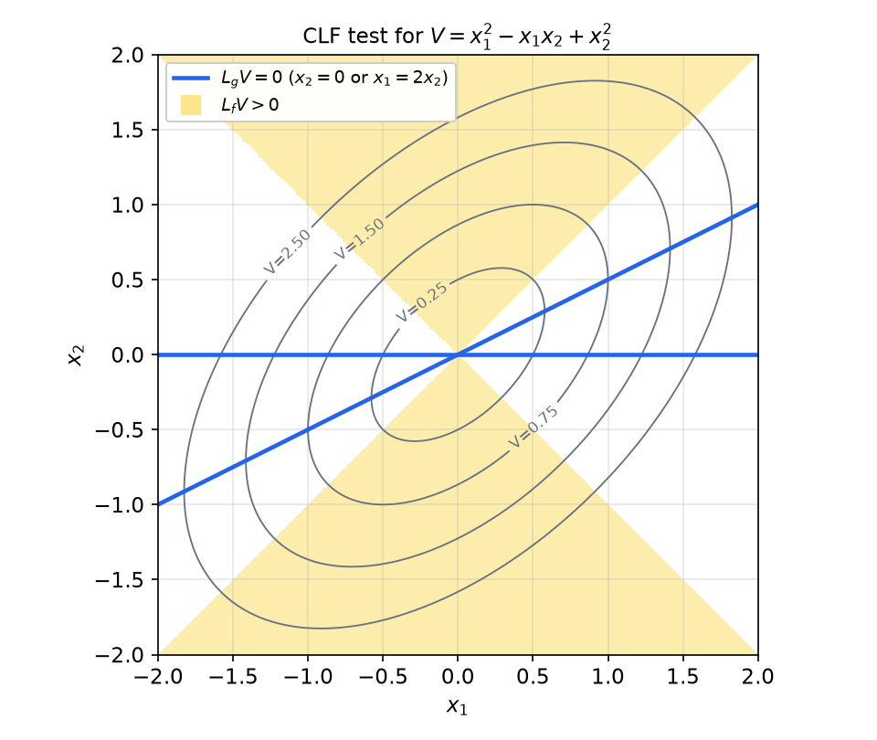
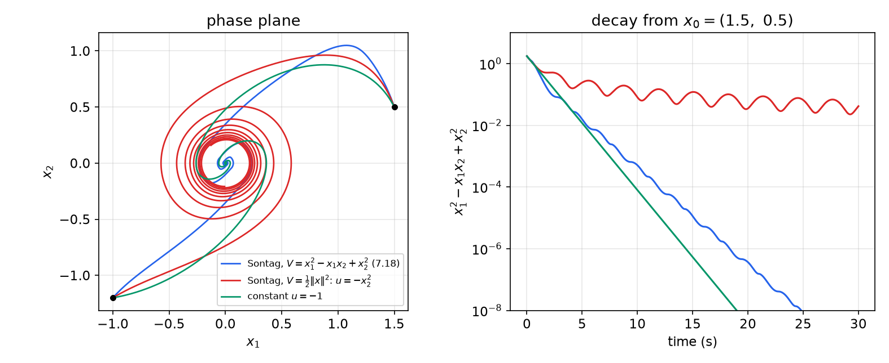
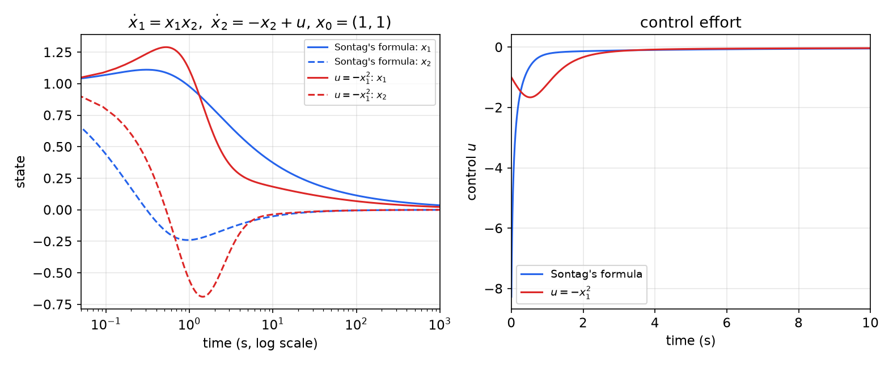
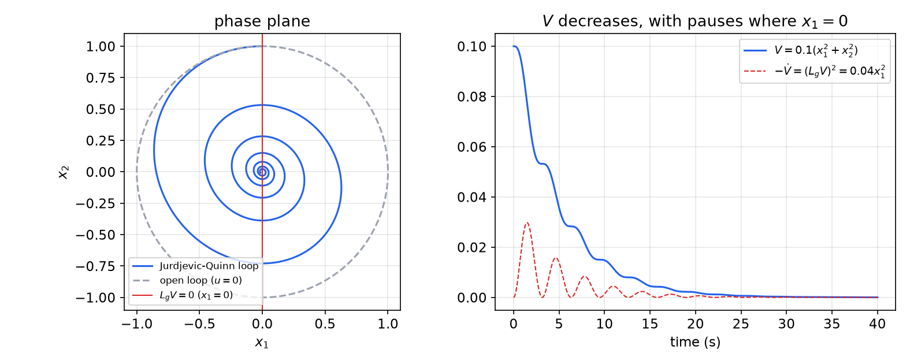

# Control Lyapunov Functions

Lyapunov theory is mostly a tool for *analysis*: given a closed loop, certify that it is stable. The design question, how to *choose* the input so that some function decreases, is harder and less developed. A **control Lyapunov function** (CLF) turns the question around: it is a positive definite function whose derivative *can* be made negative at every state by some choice of input. This chapter defines CLFs, shows that their existence is equivalent to stabilizability (with the right regularity), derives Sontag's universal formula that converts a CLF for a control-affine system into an explicit feedback, and treats the Jurdjević–Quinn damping laws, Tsinias' bracket test, continuous CLFs and the linear-quadratic case. It builds on [Lyapunov Stability](lyapunov.md) and [Advanced Lyapunov Theory](lyapunov-advanced.md), and on the obstructions to stabilization in [Nonlinear Controllability and Stabilizability](controllability.md).

## From Stabilizability to a CLF

### Motivation: the converse Lyapunov theorem

Consider
\\[
\dot x = f(x, u), \qquad f(0, 0) = 0,
\\]
with \\(f\\) regular enough for existence and uniqueness of solutions. Suppose a continuous feedback \\(u = u(x)\\) makes the origin locally asymptotically stable. The converse Lyapunov theorem ([Advanced Lyapunov Theory](lyapunov-advanced.md)) then gives a \\(C^\infty\\), positive definite \\(V\\) and a neighborhood \\(\mathcal{N}\\) of the origin with
\\[
\frac{\partial V}{\partial x}f(x, u(x)) < 0 \qquad \forall\\, x \in \mathcal{N} \setminus \\{0\\}.
\\]
In particular, at every \\(x \neq 0\\) there is *some* value of \\(u\\), namely \\(u(x)\\), that makes the derivative negative:
\\[
\inf\_u \\, L\_f V(x, u) < 0 \qquad \forall\\, x \in \mathcal{N} \setminus \\{0\\}, \qquad\text{where } L\_f V(x, u) = \frac{\partial V}{\partial x}f(x, u).
\\]
This necessary condition is taken as the definition.

**Definition (Control Lyapunov function).** A function \\(V \in C^\infty\\) is a *control Lyapunov function* for \\(\dot x = f(x, u)\\) if, on a neighborhood \\(\mathcal{N}\\) of the origin,

1. \\(V(0) = 0\\) and \\(V(x) > 0\\) for \\(x \in \mathcal{N} \setminus \\{0\\}\\);
2. \\(\inf\_u L\_f V(x, u) < 0\\) for \\(x \in \mathcal{N} \setminus \\{0\\}\\).

Unless stated otherwise we take \\(\mathcal{N} = \mathbb{R}^n\\) (global CLF), and for global results \\(V\\) is also assumed radially unbounded.

**Theorem.** Every continuously stabilizable system has a CLF.

*Proof.* This is the computation above. ∎

The converse is the real question: does a CLF give a stabilizing feedback, and how regular is it? Regularity cannot be taken for granted, because a CLF can exist when no \\(C^1\\) stabilizer does.

**Example 1 (A CLF but no \\(C^1\\) stabilizer).** For \\(\dot x = x - 2u^3\\), the linearization at the origin is \\(\dot x = x\\) with \\(B = 0\\): the eigenvalue \\(1\\) is uncontrollable, so by the linearization obstruction ([Nonlinear Controllability and Stabilizability](controllability.md)) there is no \\(C^1\\) stabilizer with \\(u(0) = 0\\). Yet \\(V = x^2\\) is a CLF: \\(L\_f V = 2x(x - 2u^3)\\), and for \\(x \neq 0\\) taking \\(u\\) large with the sign of \\(x\\) makes it negative. The feedback \\(u = \sqrt[3]{x}\\) gives \\(\dot x = x - 2x = -x\\), exponentially stable, but it is not differentiable at \\(0\\).

**Example 2.** The system \\(\dot x\_1 = u\\), \\(\dot x\_2 = x\_2 - x\_1^3\\) has no \\(C^1\\) stabilizer but has a continuous one (Example 12 of [Nonlinear Controllability and Stabilizability](controllability.md)). By the theorem it has a CLF.

## CLFs for Control-Affine Systems

From here on the system is control-affine,
\\[
\dot x = f(x) + \sum\_{i=1}^m g\_i(x)u\_i = f(x) + G(x)u, \qquad u \in \mathbb{R}^m,\quad f(0) = 0,
\\]
and \\(V\\) is smooth and positive definite. Along solutions,
\\[
\dot V = L\_f V(x) + \sum\_{i=1}^m L\_{g\_i}V(x)\\,u\_i .
\\]
Write \\(a(x) = L\_f V(x)\\) and \\(b(x) = (L\_{g\_1}V(x), \dots, L\_{g\_m}V(x))\\). For fixed \\(x\\), \\(\dot V\\) is affine in \\(u\\). If \\(b(x) \neq 0\\), choosing \\(u = -s\\,b(x)^\top\\) with \\(s\\) large makes \\(\dot V\\) as negative as we like, so \\(\inf\_u \dot V = -\infty\\). If \\(b(x) = 0\\), the input has no effect on \\(\dot V\\) at that point and \\(\inf\_u \dot V = a(x)\\). Hence the CLF condition for unconstrained inputs is
\\[
\boxed{L\_{g\_1}V(x) = \cdots = L\_{g\_m}V(x) = 0 \ \Longrightarrow\ L\_f V(x) < 0, \qquad x \neq 0.}
\\]
**Wherever the input cannot influence \\(\dot V\\), the drift alone must decrease \\(V\\).** The set \\(\\{x : b(x) = 0\\}\\) is where the level sets of \\(V\\) are tangent to all the input directions; the CLF condition is a check of \\(L\_f V\\) on that set only.

### The small control property

The CLF condition guarantees that a decreasing input exists at each \\(x \neq 0\\), but not that it stays bounded as \\(x \to 0\\). If the feedback is to be continuous at the origin, with a prescribed value \\(\bar u\\) there, small states must be stabilizable with inputs close to \\(\bar u\\).

**Definition (Small control property; strengthened CLF condition).** Let \\(\bar u\\) satisfy \\(f(0) + \sum\_i g\_i(0)\bar u\_i = 0\\). The system satisfies the *strengthened CLF condition* (for \\(V\\), at \\(\bar u\\)) if for every \\(\varepsilon > 0\\) there is \\(\delta > 0\\) such that every \\(x \neq 0\\) with \\(\lVert x\rVert < \delta\\) admits some \\(u\\) with \\(\lVert u - \bar u\rVert < \varepsilon\\) and
\\[
L\_{f + \sum\_i g\_i u\_i}V(x) = \frac{\partial V}{\partial x}\left( f(x) + g\_1(x)u\_1 + \dots + g\_m(x)u\_m \right) < 0 .
\\]
A continuous stabilizer with \\(u(0) = \bar u\\) obviously forces this condition (take \\(u = u(x)\\)).

## Sontag's Universal Formula

### Derivation

Take first a single input, \\(m = 1\\), with \\(a = L\_f V\\) and \\(b = L\_g V\\) scalars. We look for a feedback that makes \\(\dot V = a + bu\\) negative, depends smoothly on \\((a, b)\\), and vanishes when it can. The naive choice "cancel the drift and add damping", \\(u = -(a + kb^2)/b\\), blows up where \\(b = 0\\). Sontag's idea is to prescribe instead
\\[
\dot V = a + bu = -\sqrt{a^2 + b^4},
\\]
which is negative whenever \\((a, b) \neq (0, 0)\\). Solving for \\(u\\) where \\(b \neq 0\\):
\\[
\boxed{u(x) = \begin{cases} -\dfrac{L\_f V(x) + \sqrt{(L\_f V(x))^2 + (L\_g V(x))^4}}{L\_g V(x)}, & L\_g V(x) \neq 0, \\\\[2mm] 0, & L\_g V(x) = 0. \end{cases}}
\\]
This is **Sontag's universal formula**. It is universal in that it works for any \\(f\\) and \\(g\\); the price is that a CLF must be known.

*Why \\(\sqrt{a^2 + b^4}\\)?* The formula can be read as a pointwise optimal-control law. Suppose at each \\(x\\) we treat \\(\lambda V\\), with a scalar \\(\lambda > 0\\), as the value function of the cost \\(\int (q(x) + u^2)\\,dt\\) with state weight \\(q = b^2\\). The Hamilton–Jacobi–Bellman equation \\(\min\_u [\\,q + u^2 + \lambda(a + bu)\\,] = 0\\) gives the minimizer \\(u = -\lambda b/2\\) and then
\\[
b^2 - \frac{\lambda^2 b^2}{4} + \lambda a = 0 \quad\Longrightarrow\quad \lambda = \frac{2\left(a + \sqrt{a^2 + b^4}\right)}{b^2} \quad (\text{positive root}),
\\]
so \\(u = -\lambda b/2 = -\left(a + \sqrt{a^2 + b^4}\right)/b\\): exactly Sontag's formula. Sontag's law is therefore optimal for a cost whose value function has the same level sets as the CLF (inverse optimality), which explains its good robustness margins. In the linear-quadratic case it reduces to a familiar LQR-type gain (see the section on linear systems).

*Verification.* Where \\(b \neq 0\\), \\(\dot V = a + bu = -\sqrt{a^2 + b^4} < 0\\). Where \\(b = 0\\) and \\(x \neq 0\\), \\(u = 0\\) and \\(\dot V = a < 0\\) by the CLF condition. So \\(\dot V < 0\\) for every \\(x \neq 0\\), and the closed loop is asymptotically stable (globally if \\(V\\) is a global, radially unbounded CLF), provided the feedback is regular enough for solutions to exist, which we check next.

### Regularity: almost smooth feedback

Write the formula as \\(u = -b\\,\varphi(a, b^2)\\) with
\\[
\varphi(a, \beta) = \begin{cases} \dfrac{a + \sqrt{a^2 + \beta^2}}{\beta}, & \beta \neq 0, \\\\[2mm] 0, & \beta = 0. \end{cases}
\\]
Rationalizing the numerator,
\\[
\varphi(a, \beta) = \frac{\beta}{\sqrt{a^2 + \beta^2} - a} \qquad (\beta \neq 0 \text{ or } a < 0).
\\]
On the set \\(S = \\{(a, \beta) : \beta > 0 \text{ or } a < 0\\}\\), the denominator \\(\sqrt{a^2 + \beta^2} - a\\) is positive and the square root is real-analytic (its argument is positive), so \\(\varphi\\) is real-analytic on \\(S\\), and the second form shows that it equals \\(0\\) at \\(\beta = 0\\), \\(a < 0\\), consistently with the definition. The CLF condition says precisely that \\((a(x), b(x)^2) \in S\\) for all \\(x \neq 0\\): either \\(b \neq 0\\), or \\(b = 0\\) and \\(a < 0\\). Composing with the smooth maps \\(x \mapsto (a(x), b(x)^2)\\),

> **Sontag's formula is \\(C^\infty\\) (real-analytic if \\(f, g, V\\) are) on \\(\mathbb{R}^n \setminus \\{0\\}\\).**

The second form also shows the behavior near the set \\(b = 0\\): for \\(a < 0\\) and small \\(b\\), \\(u \approx -b^3/(2\lvert a\rvert)\\), so the input fades out smoothly instead of switching off. At the origin itself, \\(a = b = 0\\) and smoothness can fail. A feedback that is smooth away from the origin and continuous at it is called an **almost smooth** (almost \\(C^\infty\\)) stabilizer.

**Continuity at the origin.** If \\(V\\) satisfies the small control property with \\(\bar u = 0\\), then Sontag's \\(u(x) \to 0\\) as \\(x \to 0\\), so the feedback is continuous everywhere.

**Multi-input version.** With \\(b(x) = (L\_{g\_1}V, \dots, L\_{g\_m}V)\\) a row vector,
\\[
u(x) = -\frac{a + \sqrt{a^2 + \lVert b\rVert^4}}{\lVert b\rVert^2}\\,b^\top \quad (b \neq 0), \qquad u(x) = 0 \quad (b = 0),
\\]
gives \\(\dot V = a + bu = -\sqrt{a^2 + \lVert b\rVert^4}\\), with the same regularity.

**Theorem (Artstein–Sontag).** The control-affine system with smooth \\(f, g\_i\\) admits an almost smooth stabilizer with \\(u(0) = \bar u\\) if and only if it has a CLF satisfying the strengthened CLF condition (small control property) at \\(\bar u\\).

*Proof sketch.* Necessity: an almost smooth stabilizer is continuous, so the converse Lyapunov theorem gives a CLF, and the stabilizer itself provides the small controls. Sufficiency: Sontag's formula (after shifting \\(u\\) by \\(\bar u\\)) is smooth away from the origin, decreases \\(V\\), and is continuous at the origin by the small control property. ∎

**Corollary.** For control-affine systems with smooth vector fields, continuous stabilizability implies almost smooth stabilizability.

This is a remarkable feature of control-affine systems: once any continuous stabilizer exists, a smooth-away-from-zero one does too. Artstein's original theorem is more general (for systems \\(\dot x = f(x, u)\\) it yields relaxed-control feedbacks); Sontag's formula makes the affine case constructive.

A minimal implementation, written in the cancellation-free form so that it can be evaluated safely near \\(b = 0\\):

```python
import numpy as np

def sontag(a, b):
    """Single-input Sontag law: a = L_f V(x), b = L_g V(x)."""
    if b == 0.0:
        return 0.0
    r = np.sqrt(a * a + b**4)
    num = a + r if a >= 0 else b**4 / (r - a)   # = a + r, without cancellation
    return -num / b
```

### Generalized CLFs and the limits of the formula

**Definition (Generalized CLF).** A positive definite \\(V\\) is a *generalized CLF* if, near the origin,
\\[
L\_{g\_1}V(x) = \cdots = L\_{g\_m}V(x) = 0 \ \Longrightarrow\ L\_f V(x) \leq 0 .
\\]
Only non-strict decrease is required on the set where the inputs have no effect. Sontag's formula still makes \\(\dot V \le 0\\), so the origin is stable, and asymptotic stability must come from an invariance argument. With only a generalized CLF, Sontag's formula need not be smooth, and other techniques may be needed. Moreover, even with a true CLF the formula does not produce the *simplest* stabilizing law. The next two examples illustrate both points.

**Example 3 (Two Lyapunov functions, two Sontag laws, and a simpler answer).** Consider
\\[
\dot x\_1 = -x\_2, \qquad \dot x\_2 = x\_1 + ux\_2, \qquad
f = \begin{bmatrix} -x\_2 \\\\ x\_1 \end{bmatrix}, \quad g = \begin{bmatrix} 0 \\\\ x\_2 \end{bmatrix}.
\\]
The drift is a pure rotation, and the input acts only through \\(x\_2\\).

*Quadratic \\(V\\).* With \\(V = \tfrac12(x\_1^2 + x\_2^2)\\),
\\[
L\_f V = \begin{bmatrix} x\_1 & x\_2 \end{bmatrix}\begin{bmatrix} -x\_2 \\\\ x\_1 \end{bmatrix} = 0, \qquad
L\_g V = \begin{bmatrix} x\_1 & x\_2 \end{bmatrix}\begin{bmatrix} 0 \\\\ x\_2 \end{bmatrix} = x\_2^2 .
\\]
On the \\(x\_1\\)-axis (\\(x\_2 = 0\\), \\(x\_1 \neq 0\\)) both vanish, so \\(V\\) is **not** a CLF; it is a generalized CLF. Sontag's formula gives
\\[
u = -\frac{0 + \sqrt{0 + x\_2^8}}{x\_2^2} = -x\_2^2,
\\]
a smooth law, and \\(\dot V = \frac{\partial V}{\partial x}(f + gu) = x\_2^2\cdot(-x\_2^2) = -x\_2^4 \le 0\\): the origin is stable. By LaSalle's invariance principle ([Invariant Sets and LaSalle's Principle](invariance.md)), solutions converge to the largest invariant set in \\(\\{\dot V = 0\\} = \\{x\_2 = 0\\}\\). On that line \\(\dot x\_2 = x\_1\\), so staying on it forces \\(x\_1 = 0\\): the largest invariant set is the origin, which is therefore globally asymptotically stable. A smooth stabilizer exists, so by the theorem above a "true" CLF must exist too.

*A true CLF.* Take
\\[
V(x\_1, x\_2) = x\_1^2 - x\_1x\_2 + x\_2^2, \qquad \frac{\partial V}{\partial x} = \begin{bmatrix} 2x\_1 - x\_2 & 2x\_2 - x\_1 \end{bmatrix}.
\\]
Then
\\[
L\_f V = (2x\_1 - x\_2)(-x\_2) + (2x\_2 - x\_1)x\_1 = x\_2^2 - x\_1^2, \qquad L\_g V = (2x\_2 - x\_1)x\_2 = x\_2(2x\_2 - x\_1).
\\]
\\(L\_g V = 0\\) on the two lines \\(x\_2 = 0\\) and \\(x\_1 = 2x\_2\\). On the first, \\(L\_f V = -x\_1^2 < 0\\); on the second, \\(L\_f V = x\_2^2 - 4x\_2^2 = -3x\_2^2 < 0\\). So \\(V\\) is a CLF, and Sontag's formula gives the globally stabilizing law
\\[
u(x) = -\frac{(x\_2^2 - x\_1^2) + \sqrt{(x\_2^2 - x\_1^2)^2 + x\_2^4(2x\_2 - x\_1)^4}}{x\_2(2x\_2 - x\_1)},
\\]
smooth except at the origin, and much more complicated than \\(u = -x\_2^2\\). Simpler still, the constant \\(u = -1\\) gives the linear system \\(\dot x = \begin{bmatrix} 0 & -1 \\\\ 1 & -1 \end{bmatrix}x\\) with trace \\(-1\\) and determinant \\(1\\): Hurwitz, so the origin is globally (exponentially) stable. Sontag's formula delivers neither the simplest nor the smoothest law; it delivers *a* law, systematically, from any CLF.



*Figure: the CLF test for \\(V = x\_1^2 - x\_1x\_2 + x\_2^2\\). Gray ellipses are level sets of \\(V\\); in the shaded wedges \\(\lvert x\_2\rvert > \lvert x\_1\rvert\\) the drift increases \\(V\\) (\\(L\_f V > 0\\)). The input can act on \\(\dot V\\) everywhere except on the two blue lines \\(x\_2 = 0\\) and \\(x\_1 = 2x\_2\\), and both lines lie outside the shaded wedges. That is exactly the CLF condition.*



*Figure: the system \\(\dot x\_1 = -x\_2\\), \\(\dot x\_2 = x\_1 + ux\_2\\) under Sontag's law from the true CLF (blue), Sontag's law \\(u = -x\_2^2\\) from the generalized CLF (red), and \\(u = -1\\) (green). Right, \\(V = x\_1^2 - x\_1x\_2 + x\_2^2\\) on a log scale from \\(x\_0 = (1.5, 0.5)\\). The law from the true CLF gives exponential decay, rippled by the rotation. The law \\(u = -x\_2^2\\) is only asymptotically stable: its damping is cubic, so the state spirals in slowly. The plain constant gain does best of all.*

**Example 4 (Sontag's law versus a hand-made law).** Consider
\\[
\dot x\_1 = x\_1x\_2, \qquad \dot x\_2 = -x\_2 + u, \qquad f = \begin{bmatrix} x\_1x\_2 \\\\ -x\_2 \end{bmatrix}, \quad g = \begin{bmatrix} 0 \\\\ 1 \end{bmatrix}.
\\]
Take \\(V = \tfrac12\left(x\_1^2e^{2x\_2} + x\_2^2\right)\\), with gradient \\(\left(x\_1e^{2x\_2},\ x\_1^2e^{2x\_2} + x\_2\right)\\). Then
\\[
L\_f V = x\_1e^{2x\_2}\cdot x\_1x\_2 - (x\_1^2e^{2x\_2} + x\_2)x\_2 = -x\_2^2, \qquad L\_g V = x\_1^2e^{2x\_2} + x\_2 .
\\]
If \\(L\_g V = 0\\) then \\(x\_2 = -x\_1^2e^{2x\_2}\\); if moreover \\(L\_f V = -x\_2^2 = 0\\), then \\(x\_2 = 0\\) and so \\(x\_1 = 0\\). Hence \\(L\_f V < 0\\) wherever \\(L\_g V = 0\\) and \\(x \neq 0\\): \\(V\\) is a CLF. Sontag's formula gives
\\[
u = -\frac{-x\_2^2 + \sqrt{x\_2^4 + \left(x\_1^2e^{2x\_2} + x\_2\right)^4}}{x\_1^2e^{2x\_2} + x\_2}.
\\]
But any \\(u = -\alpha x\_1^2\\) with \\(\alpha > 0\\) is locally asymptotically stabilizing: then \\(x\_2\\) settles quickly near \\(-\alpha x\_1^2\\) (a center manifold), on which \\(\dot x\_1 \approx -\alpha x\_1^3\\).



*Figure: \\(\dot x\_1 = x\_1x\_2\\), \\(\dot x\_2 = -x\_2 + u\\) from \\(x\_0 = (1, 1)\\), on a logarithmic time axis. Both laws stabilize, but neither exponentially: the linearization has an eigenvalue at \\(0\\) and \\(x\_1\\) decays roughly like \\(t^{-1/2}\\). Sontag's law (blue) reacts hard at first (\\(u(0) \approx -8\\)) and keeps \\(x\_2\\) small; the simple law \\(u = -x\_1^2\\) (red) uses at most \\(\lvert u\rvert \approx 1.7\\) and ends up converging slightly faster.*

## Jurdjević–Quinn Damping Control

When the drift already conserves or dissipates some energy-like function, there is a much simpler construction that yields controllers smooth everywhere. It is a special case of the generalized-CLF setting.

**Definition (Jurdjević–Quinn Lyapunov function).** The control-affine system satisfies a *Lyapunov condition of Jurdjević–Quinn type* if there are a neighborhood \\(\mathcal{N}\\) of \\(0\\) and a smooth \\(V : \mathbb{R}^n \to \mathbb{R}\\) such that

1. \\(V(0) = 0\\) and \\(V(x) > 0\\) on \\(\mathcal{N} \setminus \\{0\\}\\);
2. \\(L\_f V(x) \le 0\\) for all \\(x \in \mathcal{N}\\).

Such a \\(V\\) is called a JQLF. Compared with a CLF, condition 2 does not involve the \\(g\_i\\) at all, and it asks for \\(L\_f V \le 0\\) *everywhere* near the origin, not only where the \\(L\_{g\_i}V\\) vanish. Neither notion contains the other.

**Example 5 (CLF versus JQLF).**

*(a) A CLF that is not a JQLF.* For \\(\dot x\_1 = -x\_1\\), \\(\dot x\_2 = x\_2 + u\\) (\\(f = (-x\_1, x\_2)\\), \\(g = (0, 1)\\)) and \\(V = x\_1^2 + x\_2^2\\):
\\[
L\_f V = -2x\_1^2 + 2x\_2^2, \qquad L\_g V = 2x\_2 .
\\]
\\(L\_g V = 0 \iff x\_2 = 0\\), and then \\(L\_f V = -2x\_1^2 < 0\\): \\(V\\) is a CLF. It is not a JQLF, since \\(L\_f V > 0\\) wherever \\(\lvert x\_2\rvert > \lvert x\_1\rvert\\), arbitrarily close to the origin (the unstable \\(x\_2\\)-mode).

*(b) A JQLF that is not a CLF.* For \\(\dot x\_1 = -x\_2 + u\\), \\(\dot x\_2 = x\_1\\) (\\(f = (-x\_2, x\_1)\\), \\(g = (1, 0)\\)) and \\(V = x\_1^2 + x\_2^2\\):
\\[
L\_f V = -2x\_1x\_2 + 2x\_1x\_2 \equiv 0, \qquad L\_g V = 2x\_1 .
\\]
\\(V\\) is a JQLF (the drift is a rotation that conserves \\(V\\)). It is not a CLF: \\(L\_g V\\) vanishes on the \\(x\_2\\)-axis, where \\(L\_f V = 0\\) is not negative.

**The Jurdjević–Quinn law** is pure damping injection along the input directions:
\\[
\boxed{u\_i(x) = -L\_{g\_i}V(x), \qquad i = 1, \dots, m.}
\\]
It is \\(C^\infty\\) everywhere, its main advantage over Sontag's formula. When \\(L\_f V = 0\\) it is what Sontag's formula gives: with \\(a = 0\\), \\(u = -\sqrt{b^4}/b = -b^2/b = -b\\). Along closed-loop solutions,
\\[
\dot V = L\_f V + \sum\_i L\_{g\_i}V\\,u\_i = L\_f V - \sum\_i (L\_{g\_i}V)^2 \le -\sum\_i (L\_{g\_i}V)^2 \le 0,
\\]
which gives stability. Asymptotic stability needs an invariance argument: \\(\dot V = 0\\) forces \\(L\_f V = 0\\) and all \\(L\_{g\_i}V = 0\\), and on such points the closed-loop input is zero, so closed-loop and open-loop motions coincide there.

**Theorem (Jurdjević–Quinn).** Suppose the system has a JQLF \\(V\\) and there is \\(c\_0 > 0\\) such that for each \\(c \in (0, c\_0)\\) the set
\\[
S\_c = \\{ x \in \mathcal{N} : V(x) = c,\ L\_{g\_i}V(x) = 0,\ i = 1, \dots, m \\}
\\]
contains no entire trajectory of the *open-loop* system \\(\dot x = f(x)\\). Then the closed loop with \\(u\_i = -L\_{g\_i}V\\) is asymptotically stable.

*Proof.* Sublevel sets \\(\\{V \le c\\}\\), \\(c < c\_0\\), are positively invariant. By LaSalle, solutions approach the largest invariant set \\(M\\) inside \\(\\{\dot V = 0\\} \subseteq \\{L\_{g\_i}V = 0 \ \forall i\\}\\). On that set \\(u = 0\\), so a closed-loop trajectory in \\(M\\) is an open-loop trajectory; and since \\(V\\) is constant along trajectories in \\(M\\) (its derivative vanishes there), it lies in a single \\(S\_c\\). By hypothesis this is possible only for \\(c = 0\\), i.e. \\(M = \\{0\\}\\). ∎

The hypothesis can be checked with brackets.

**Corollary (Lie-bracket test).** Let \\(V\\) be a JQLF with \\(\frac{\partial V}{\partial x}(x) \neq 0\\) for \\(x \neq 0\\), and let
\\[
\mathcal{V}(x) = \operatorname{span}\\{ f(x),\ \mathrm{ad}\_f^k g\_i(x) : i = 1, \dots, m,\ k = 0, 1, \dots \\}.
\\]
If \\(\dim\mathcal{V}(x) = n\\) for all \\(x \neq 0\\), the closed loop with \\(u\_i = -L\_{g\_i}V\\) is asymptotically stable.

*Idea.* On an open-loop trajectory lying in \\(S\_c\\), \\(L\_{g\_i}V \equiv 0\\) along the flow of \\(f\\); differentiating repeatedly in time gives \\(L\_{\mathrm{ad}\_f^k g\_i}V = 0\\) for all \\(k\\), and with \\(L\_f V = 0\\) the gradient of \\(V\\) annihilates \\(\mathcal{V}(x)\\). Full rank then forces \\(\partial V/\partial x = 0\\), impossible for \\(x \neq 0\\).

The condition is imposed only for \\(x \neq 0\\): at \\(x = 0\\) the fields \\(\mathrm{ad}\_f^k g\_i(0) = (-1)^kA^kb\_i\\) would span \\(\mathbb{R}^n\\) only if \\(\operatorname{rank}[B\ AB\ \cdots\ A^{n-1}B] = n\\), the case where the linearization already solves the local problem. The condition is sufficient, not necessary. The whole method hinges on finding a JQLF; physical energy is the usual candidate, and decomposition into subsystems helps.

For Example 5(b), \\(\mathrm{ad}\_f g = [f, g] = -\frac{\partial f}{\partial x}g = -\begin{bmatrix} 0 & -1 \\\\ 1 & 0 \end{bmatrix}\begin{bmatrix} 1 \\\\ 0 \end{bmatrix} = \begin{bmatrix} 0 \\\\ -1 \end{bmatrix}\\), which together with \\(g = (1, 0)\\) spans \\(\mathbb{R}^2\\). The Jurdjević–Quinn law \\(u = -L\_gV = -2x\_1\\) gives \\(\dot x = \begin{bmatrix} -2 & -1 \\\\ 1 & 0 \end{bmatrix}x\\), which is Hurwitz. Any positive multiple of \\(V\\) is again a JQLF, so the damping gain is free.



*Figure: Example 5(b) with the JQLF \\(V = 0.1(x\_1^2 + x\_2^2)\\) and its damping law \\(u = -L\_gV = -0.2x\_1\\). Left, the open-loop orbit (dashed circle) and the closed-loop spiral. Right, \\(V\\) decreases at the rate \\((L\_gV)^2 = 0.04x\_1^2\\) (red dashed), which vanishes each time the trajectory crosses the \\(x\_2\\)-axis: \\(V\\) pauses there, the "staircase" typical of LaSalle-type arguments, but the rotation always carries the state off the set \\(L\_gV = 0\\) again.*

**Example 6 (Cascade decomposition).** Consider
\\[
\dot x\_1 = \varphi(x\_1) + u\\,\Phi(x\_1, x\_2), \qquad \dot x\_2 = \psi(x\_2) + u\\,\Psi(x\_1, x\_2),
\\]
and suppose that (i) \\(V\_2(x\_2)\\) is positive definite with \\(L\_\psi V\_2 = \frac{\partial V\_2}{\partial x\_2}\psi(x\_2) < 0\\) for \\(x\_2 \neq 0\\) (the unforced \\(x\_2\\)-subsystem is asymptotically stable), and (ii) the \\(x\_1\\)-subsystem \\(\dot x\_1 = \varphi(x\_1) + u\Phi(x\_1, 0)\\) has a JQLF \\(V\_1(x\_1)\\), so \\(L\_\varphi V\_1 \le 0\\). Take \\(W = V\_1(x\_1) + V\_2(x\_2)\\) and
\\[
u(x\_1, x\_2) = -L\_\Phi V\_1(x\_1, x\_2) - L\_\Psi V\_2(x\_1, x\_2) = -\frac{\partial V\_1}{\partial x\_1}\Phi - \frac{\partial V\_2}{\partial x\_2}\Psi .
\\]
Then
\\[
\dot W = L\_\varphi V\_1 + L\_\psi V\_2 + u\left( L\_\Phi V\_1 + L\_\Psi V\_2 \right) = L\_\varphi V\_1 + L\_\psi V\_2 - \left( L\_\Phi V\_1 + L\_\Psi V\_2 \right)^2 \le 0,
\\]
so \\(W\\) is a Lyapunov function for the closed loop; \\(\dot W = 0\\) forces \\(x\_2 = 0\\), and on \\(x\_2 = 0\\) the argument reduces to the Jurdjević–Quinn theorem for the \\(x\_1\\)-subsystem. The point is that a JQLF for the full system is assembled from simple pieces.

## Tsinias' Bracket Condition

The Jurdjević–Quinn theorem needs \\(L\_f V \le 0\\) everywhere. Tsinias weakened this to the generalized CLF condition, at the cost of an almost-smooth rather than smooth feedback.

**Theorem (Tsinias).** Let \\(f(0) = 0\\) and let \\(V\\) be a generalized CLF on \\(\mathcal{N}\\). Suppose that for every \\(x \in \mathcal{N} \setminus \\{0\\}\\) with
\\[
L\_{g\_1}V(x) = \cdots = L\_{g\_m}V(x) = 0
\\]
there exist \\(k \ge 1\\) and an index \\(i\\) with
\\[
\frac{\partial V}{\partial x}\\,\mathrm{ad}\_f^k g\_i(x) = L\_{\mathrm{ad}\_f^k g\_i}V(x) \neq 0 .
\\]
Then the system is almost smoothly stabilizable.

The bracket condition says that, although the inputs cannot change \\(\dot V\\) instantaneously at such a point, they affect higher time derivatives of \\(V\\) through the drift, so the state cannot linger on the bad set.

## Continuous CLFs and Asymptotic Controllability

Brockett's integrator is asymptotically controllable but has no continuous stabilizer, hence no smooth CLF. What does asymptotic controllability correspond to? The answer requires CLFs that are only continuous. Where \\(V\\) is not differentiable, the derivative along the system is replaced by a **Dini derivative**, for instance the upper one,
\\[
D^+V(x; v) = \limsup\_{h \to 0^+} \frac{V(x + hv) - V(x)}{h}, \qquad v = f(x, u),
\\]
which bounds the rate of change of \\(V\\) along a trajectory leaving \\(x\\) with velocity \\(v\\), even at kinks of \\(V\\). For \\(v = f(x)\\) it reduces to \\(L\_f V\\) wherever \\(V\\) is differentiable. A *continuous CLF* is a continuous, positive definite, proper \\(V\\) for which \\(\inf\_u D V(x; f(x, u)) < 0\\) for all \\(x \neq 0\\), with the infimum taken over a bounded set of inputs (in the precise statement, over relaxed controls, and using a lower directional derivative).

**Theorem (Sontag).** A system is asymptotically controllable at the origin if and only if it admits a **continuous** control Lyapunov function.

Put together with the Artstein–Sontag theorem, the picture is:

- smooth CLF (with the small control property) \\(\iff\\) almost smooth stabilizer, for control-affine systems;
- continuous CLF \\(\iff\\) asymptotic controllability, which is strictly weaker than continuous stabilizability.

The gap is filled by **discontinuous** feedback: asymptotic controllability is known to be equivalent to stabilizability by discontinuous feedback implemented with sampling (Clarke, Ledyaev, Sontag and Subbotin), which is one way around Brockett's obstruction.

## The Linear Case and the Riccati Equation

For \\(\dot x = Ax + Bu\\) everything becomes explicit. Suppose \\(V = x^\top Px\\) with \\(P = P^\top > 0\\) is a CLF. Then \\(L\_f V = 2x^\top PAx\\) and \\(L\_g V = 2x^\top PB\\), and the CLF condition reads
\\[
B^\top Px = 0 \ \Longrightarrow\ x^\top PAx < 0 \qquad (x \neq 0),
\\]
that is,
\\[
\mathcal{N}(B^\top P) \subseteq \\{ x : x^\top PAx < 0 \\} \cup \\{0\\}.
\\]

**Linear stabilizer from a quadratic CLF.** Try the Jurdjević–Quinn-type law
\\[
u = -\alpha B^\top Px, \qquad \alpha > 0 .
\\]
With \\(V = x^\top Px\\),
\\[
\dot V = \dot x^\top Px + x^\top P\dot x = x^\top(A^\top P + PA)x + 2x^\top PBu = x^\top(A^\top P + PA)x - 2\alpha\\,\lVert B^\top Px\rVert^2 .
\\]
On the unit sphere, the first term is negative on the compact set \\(\\{B^\top Px = 0\\}\\) by the CLF condition, hence on a neighborhood of it; away from that neighborhood \\(\lVert B^\top Px\rVert^2\\) is bounded below, so a large enough \\(\alpha\\) makes \\(\dot V < 0\\) on the whole sphere. Both terms are homogeneous of degree two, so \\(\dot V < 0\\) for all \\(x \neq 0\\) and the decay is exponential. A known quadratic CLF thus yields an explicit linear stabilizer; Sontag's formula is not needed. Apart from the factor \\(\alpha\\), this is the Jurdjević–Quinn law, and it gives *asymptotic* rather than mere stability because \\(\dot V\\) is homogeneous ([Homogeneous Systems](homogeneity.md)). The existence of a quadratic CLF is equivalent to the PBH stabilizability condition.

**Proposition.** If \\(P > 0\\) solves the algebraic Riccati equation
\\[
A^\top P + PA - PBB^\top P + I = 0,
\\]
then \\(V = x^\top Px\\) is a CLF for \\(\dot x = Ax + Bu\\).

*Proof.* Multiplying the ARE by \\(x^\top\\) and \\(x\\),
\\[
x^\top(A^\top P + PA)x = \lVert B^\top Px\rVert^2 - \lVert x\rVert^2 .
\\]
If \\(B^\top Px = 0\\) and \\(x \neq 0\\), then \\(L\_f V = x^\top(A^\top P + PA)x = -\lVert x\rVert^2 < 0\\). ∎

With the law \\(u = -\alpha B^\top Px\\) the same identity gives
\\[
\dot V = \lVert B^\top Px\rVert^2 - \lVert x\rVert^2 - 2\alpha\lVert B^\top Px\rVert^2 = -\lVert x\rVert^2 - (2\alpha - 1)\lVert B^\top Px\rVert^2,
\\]
which is negative definite for every \\(\alpha \ge \tfrac12\\). This ARE is exactly the LQR Riccati equation for the cost \\(\int\_0^\infty(\lVert x\rVert^2 + \lVert u\rVert^2)\\,dt\\), whose optimal law is \\(u = -B^\top Px\\) (\\(\alpha = 1\\)) with value function \\(x^\top Px\\). The fact that every \\(\alpha \ge \tfrac12\\) still stabilizes is the classical LQR gain margin \\([\tfrac12, \infty)\\). See [Linear Quadratic Regulator](../linear/lqr.md).

**Theorem.** The linear system \\(\dot x = Ax + Bu\\) is (linearly) stabilizable if and only if the ARE \\(A^\top P + PA - PBB^\top P + I = 0\\) has a solution \\(P > 0\\). In that case \\(u = -\alpha B^\top Px\\) with any \\(\alpha \ge \tfrac12\\) is a stabilizing linear feedback.

*Proof sketch.* If \\(P > 0\\) solves the ARE, the computation above shows stabilization. Conversely, if \\((A, B)\\) is stabilizable, then since \\((A, I)\\) is trivially observable, standard LQR theory gives a unique stabilizing solution \\(P \ge 0\\) of the ARE, and observability of \\((A, I)\\) makes it positive definite. ∎

For linear systems, then, a CLF exists exactly when the system is stabilizable, a quadratic CLF can be computed by solving a Riccati equation, and the CLF-based law is a (scaled) LQR law. In MATLAB, `P = care(A, B, eye(n))` returns the solution of \\(A^\top P + PA - PBB^\top P + I = 0\\); in Python, `scipy.linalg.solve_continuous_are(A, B, np.eye(n), np.eye(m))`.

## Summary

- A **CLF** is a positive definite \\(V\\) with \\(\inf\_u L\_f V(x, u) < 0\\) for \\(x \neq 0\\). Every continuously stabilizable system has one (converse Lyapunov theorem); a CLF need not give a \\(C^1\\) stabilizer (\\(\dot x = x - 2u^3\\)).
- **Control-affine CLF condition:** \\(L\_{g\_1}V = \cdots = L\_{g\_m}V = 0 \Rightarrow L\_f V < 0\\) for \\(x \neq 0\\).
- **Sontag's formula**, from \\(\dot V = -\sqrt{a^2 + \lVert b\rVert^4}\\) with \\(a = L\_f V\\), \\(b = L\_g V\\): \\(u = -\frac{a + \sqrt{a^2 + \lVert b\rVert^4}}{\lVert b\rVert^2}b^\top\\) (zero when \\(b = 0\\)). It is analytic away from the origin and continuous at it under the small control property, and it is inverse-optimal.
- **Artstein–Sontag:** almost smooth stabilizer \\(\iff\\) CLF with the small control property; for affine systems continuous stabilizability implies almost smooth stabilizability.
- **Jurdjević–Quinn:** if \\(L\_f V \le 0\\), the damping law \\(u\_i = -L\_{g\_i}V\\) is smooth and gives \\(\dot V = L\_f V - \sum\_i(L\_{g\_i}V)^2\\); asymptotic stability follows if \\(\\{V = c, L\_{g\_i}V = 0\\}\\) contains no open-loop trajectory, e.g. if \\(\operatorname{span}\\{f, \mathrm{ad}\_f^k g\_i\\}\\) has rank \\(n\\) for \\(x \neq 0\\).
- **Tsinias:** a generalized CLF plus \\(L\_{\mathrm{ad}\_f^k g\_i}V \neq 0\\) on the set \\(\\{L\_{g}V = 0\\}\\) gives almost smooth stabilizability.
- **Sontag:** asymptotic controllability \\(\iff\\) existence of a continuous CLF (with Dini derivatives).
- **Linear systems:** \\(P > 0\\) solving \\(A^\top P + PA - PBB^\top P + I = 0\\) makes \\(x^\top Px\\) a CLF, and \\(u = -\alpha B^\top Px\\), \\(\alpha \ge \tfrac12\\), stabilizes with \\(\dot V = -\lVert x\rVert^2 - (2\alpha - 1)\lVert B^\top Px\rVert^2\\).

## See Also

- [Nonlinear Controllability and Stabilizability](controllability.md): Brockett's obstruction and asymptotic controllability
- [Lyapunov Stability](lyapunov.md), [Advanced Lyapunov Theory](lyapunov-advanced.md) and [Invariant Sets and LaSalle's Principle](invariance.md)
- [Backstepping](backstepping.md): a recursive way to construct CLFs for strict-feedback systems
- [Passivity](passivity.md): damping injection \\(u = -L\_gV\\) as output feedback \\(u = -y\\)
- [Input-to-State Stability](iss.md) and [Homogeneous Systems](homogeneity.md)
- [Linear Quadratic Regulator](../linear/lqr.md) and [Optimal Control](../optimal.md): the Riccati equation behind the linear CLF
