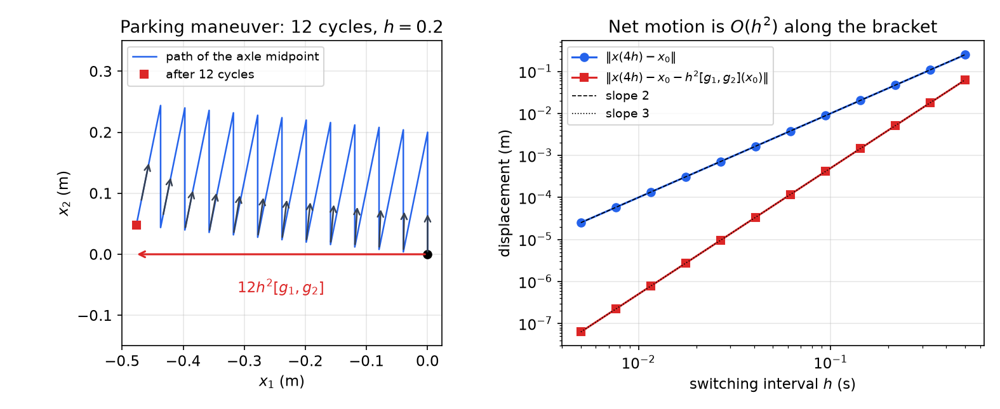
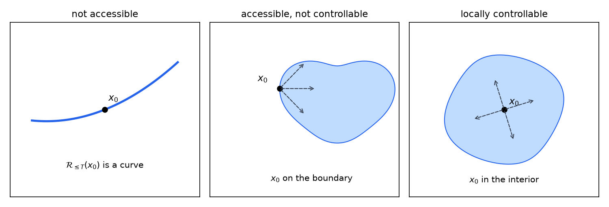
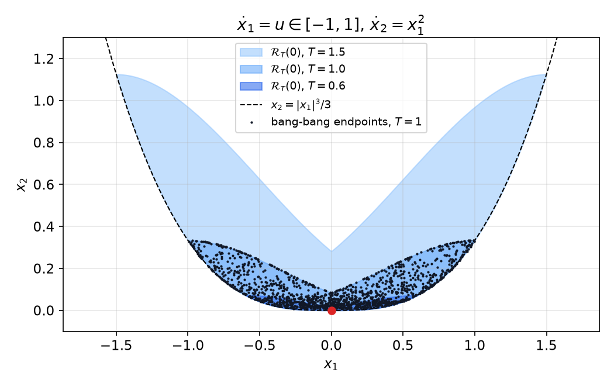
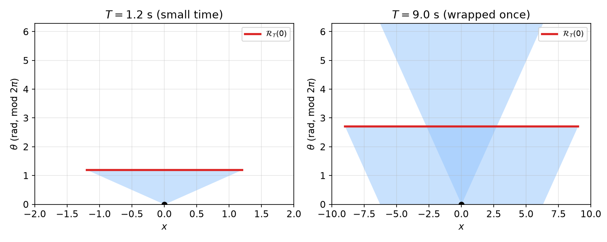
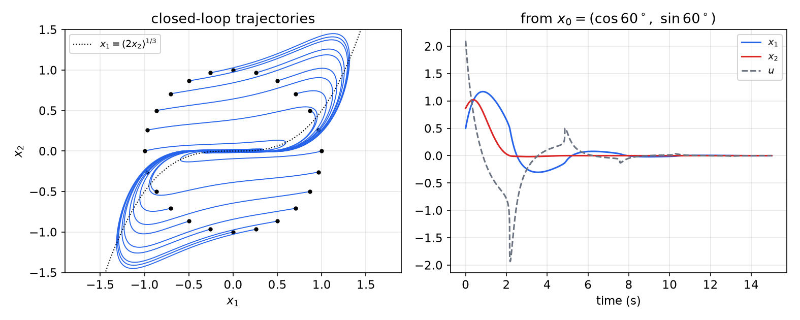
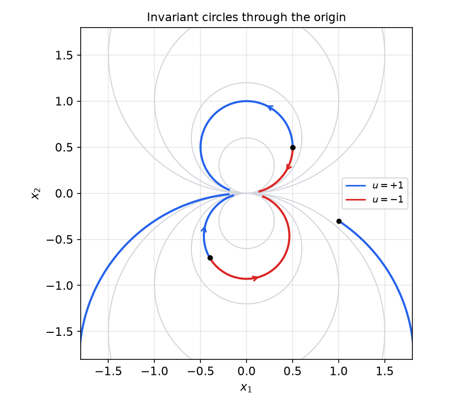

# Nonlinear Controllability and Stabilizability

For a linear system one rank test settles everything: if the Kalman matrix has full rank, the system can be steered anywhere, fast, and stabilized by linear state feedback. None of this carries over intact to nonlinear systems. A car cannot move sideways, yet anyone can park one; a system can reach every point near an equilibrium yet admit no continuous feedback that stabilizes it. This chapter sorts out the several inequivalent notions that replace Kalman controllability (accessibility, strong accessibility, small-time local controllability, asymptotic controllability) and gives the Lie-bracket tests for each. It then turns to **stabilizability** and its topological obstruction, Brockett's condition. The tools are the vector fields, Lie brackets, distributions and Frobenius theorem of [Differential Geometry for Control](differential-geometry.md). The [next chapter](clf.md) builds feedback laws from control Lyapunov functions.

## Setting and Reachable Sets

### Control-affine systems

We study smooth **control-affine** systems
\\[
\dot x = f(x) + \sum\_{i=1}^m g\_i(x)\\,u\_i, \qquad u = (u\_1,\dots,u\_m) \in U \subseteq \mathbb{R}^m,
\\]
where \\(x = (x\_1,\dots,x\_n)\\) are local coordinates on a smooth \\(n\\)-dimensional manifold \\(\mathcal{M}\\) (often just \\(\mathbb{R}^n\\), but angles live on \\(S^1\\)). The field \\(f\\) is the **drift**; the \\(g\_i\\) are the **input** (control) vector fields. We write \\(\phi(t; x\_0, u)\\) for the solution at time \\(t\\) starting at \\(x\_0\\) under the input \\(u(\cdot)\\).

The admissible inputs are **piecewise constant** functions \\(u : [0,T] \to U\\). This is not a real restriction: piecewise-constant functions are dense in the smooth ones, and on each interval of constancy the system is just the flow of a single vector field \\(f + \sum\_i g\_i u\_i\\), which makes their effect easy to compute by composing flows.

Lie brackets follow the convention
\\[
[X, Y] (x) = \frac{\partial Y}{\partial x}X(x) - \frac{\partial X}{\partial x}Y(x), \qquad \mathrm{ad}\_X Y = [X,Y], \qquad \mathrm{ad}\_f^k g = [f, [f, \dots [f, g]\dots]],
\\]
so that, for instance, \\([f, g] = -\tfrac{\partial f}{\partial x}g\\) when \\(g\\) is constant. The Lie derivative of a function is \\(L\_f V = \tfrac{\partial V}{\partial x} f\\).

**Definition (Controllability).** The system is *controllable* if for every \\(x\_0, x\_1 \in \mathcal{M}\\) there exist a finite \\(T > 0\\) and an admissible \\(u : [0,T] \to U\\) with \\(\phi(T; x\_0, u) = x\_1\\).

### Reachable sets

All local notions are phrased through reachable sets.

**Definition (Reachable sets).** Let \\(x\_0 \in \mathcal{M}\\), \\(T > 0\\), and let \\(V\\) be a neighborhood of \\(x\_0\\). The set reachable from \\(x\_0\\) at time \\(T\\) without leaving \\(V\\) is
\\[
\mathcal{R}^V\_T(x\_0) = \\{ x \in \mathcal{M} : \exists\\, u : [0,T] \to U \text{ admissible with } \phi(t; x\_0, u) \in V \ \forall\\, t \in [0,T],\ \phi(T; x\_0, u) = x \\},
\\]
and the set reachable *up to* time \\(T\\) is
\\[
\mathcal{R}^V\_{\leq T}(x\_0) = \bigcup\_{t \leq T} \mathcal{R}^V\_t(x\_0).
\\]
For \\(V = \mathcal{M}\\) we drop the superscript, and \\(\mathcal{R}(x\_0)\\) denotes the set of all states reachable from \\(x\_0\\) in any time.

The reachable set depends on \\(f\\), on the \\(g\_i\\) and on \\(U\\). Points in its *interior* reached with piecewise-constant inputs can also be reached with smooth inputs; reaching *boundary* points may require a larger class of inputs (measurable, or bang-bang with infinitely many switches).

**Fact.** If \\(U \subset \mathbb{R}^m\\) is compact and convex, then \\(\mathcal{R}\_T(x\_0)\\) and \\(\mathcal{R}\_{\leq T}(x\_0)\\) are compact for all \\(x\_0\\) and all \\(T \ge 0\\).

From now on \\(U\\) is convex and compact with \\(0 \in \operatorname{int} U\\).

### Why the span of the fields matters

The arguments below use the affine and convex hulls of a set \\(S \subseteq \mathbb{R}^n\\),
\\[
\operatorname{aff}(S) = \Big\\{ \sum\_{i=1}^{n+1} \lambda\_i x\_i : \lambda\_i \in \mathbb{R},\ \sum\_i \lambda\_i = 1,\ x\_i \in S \Big\\}, \qquad
\operatorname{co}(S) = \Big\\{ \sum\_{i=1}^{n+1} \lambda\_i x\_i : \lambda\_i \ge 0,\ \sum\_i \lambda\_i = 1,\ x\_i \in S \Big\\}.
\\]

**Lemma.** For the control-affine system with \\(u \in U\\), assume (i) \\(0 \in \operatorname{co}(U)\\) and (ii) \\(\operatorname{aff}(U) = \mathbb{R}^m\\). Then
\\[
\operatorname{span}\\{ f, g\_1, \dots, g\_m \\} = \operatorname{span}\Big\\{ f + \sum\_{i=1}^m g\_i u\_i : u \in U \Big\\}.
\\]

*Proof sketch.* The right side is contained in the left trivially. Conversely, by (ii) every \\(w \in \mathbb{R}^m\\) is an affine combination \\(\sum\_j \lambda\_j u^{(j)}\\) of points of \\(U\\), so \\(\sum\_j \lambda\_j (f + G u^{(j)}) = f + G w\\) lies in the right side for every \\(w\\), where \\(G = [g\_1 \cdots g\_m]\\). Taking \\(w = 0\\) gives \\(f\\), and then \\(G w\\) for all \\(w\\) gives every \\(g\_i\\). ∎

The lemma says that switching between constant inputs lets us use the whole linear span of \\(f\\) and the \\(g\_i\\), not just the set of available velocities. Lie brackets then add the directions generated by *noncommuting* switching.

### When linearization fails

If the linearization at an equilibrium is Kalman-controllable, the local question is easy (see [Small-time local controllability](#small-time-local-controllability)). The interesting cases are those where it is not, and they are common:

- **Driftless systems** \\(\dot x = \sum\_i g\_i(x) u\_i\\) linearize at any point to \\(\dot{\delta x} = B\\,\delta u\\) with \\(A = 0\\), so the Kalman matrix is just \\(B = [g\_1(x\_0) \cdots g\_m(x\_0)]\\), of rank at most \\(m\\). The linearization is uncontrollable unless \\(m \ge n\\).
- **Bilinear systems** \\(\dot x = Ax + \sum\_i (B\_i x) u\_i\\) have input fields that vanish at the origin, so the linearization there has \\(B = 0\\).

**Example 1 (Unicycle).** A unicycle (or a car, or a shopping cart) at position \\((x\_1, x\_2)\\) with heading \\(x\_3\\), measured from the \\(x\_2\\)-axis, has the kinematics
\\[
\dot x = g\_1(x) u\_1 + g\_2(x) u\_2, \qquad
g\_1(x) = \begin{bmatrix} \sin x\_3 \\\\ \cos x\_3 \\\\ 0 \end{bmatrix}, \quad
g\_2(x) = \begin{bmatrix} 0 \\\\ 0 \\\\ 1 \end{bmatrix},
\\]
with \\(u\_1\\) the forward speed and \\(u\_2\\) the turning rate. The state space is \\(\mathbb{R}^2 \times S^1\\). The **no-slip constraint** \\(\dot x\_1 \cos x\_3 - \dot x\_2 \sin x\_3 = 0\\) forbids sideways motion: the velocity always lies in the two-dimensional distribution \\(\Delta(x) = \operatorname{span}\\{g\_1(x), g\_2(x)\\}\\).

*Linearization.* At any \\(x\_0\\) the system is driftless with \\(m = 2 < n = 3\\), so the Kalman rank is 2 and the linearization is uncontrollable.

*The parking maneuver.* Apply the piecewise-constant "square" input
\\[
u(t) = \begin{cases} (1, 0), & t \in [0, h), \\\\ (0, 1), & t \in [h, 2h), \\\\ (-1, 0), & t \in [2h, 3h), \\\\ (0, -1), & t \in [3h, 4h]: \end{cases}
\\]
drive forward, turn, back up, turn back. Composing the four flows and expanding to second order in \\(h\\) (the flow-along-a-bracket formula of [Differential Geometry for Control](differential-geometry.md)) gives
\\[
x(4h) = x\_0 + h^2 [g\_1, g\_2] (x\_0) + O(h^3).
\\]
The bracket is
\\[
[g\_1, g\_2] = \frac{\partial g\_2}{\partial x} g\_1 - \frac{\partial g\_1}{\partial x} g\_2
= 0 - \begin{bmatrix} 0 & 0 & \cos x\_3 \\\\ 0 & 0 & -\sin x\_3 \\\\ 0 & 0 & 0 \end{bmatrix}\begin{bmatrix} 0 \\\\ 0 \\\\ 1 \end{bmatrix}
= \begin{bmatrix} -\cos x\_3 \\\\ \sin x\_3 \\\\ 0 \end{bmatrix}.
\\]
It is perpendicular to the heading \\((\sin x\_3, \cos x\_3)\\): it points exactly sideways. Since \\([g\_1, g\_2] (x\_0) \notin \Delta(x\_0)\\), the distribution \\(\Delta\\) is not involutive, and by repeating the cycle the vehicle creeps sideways, which is how a car is parallel-parked. Further switching patterns produce motion along \\([g\_2, [g\_1, g\_2]]\\), \\([[g\_1, g\_2], [g\_2, [g\_1, g\_2]]]\\), and so on; here the first three fields already span \\(\mathbb{R}^3\\), and we will prove controllability in Example 4.



*Figure: left, twelve cycles of the forward–turn–back–turn input with \\(h = 0.2\\) s, starting at the origin with heading \\(x\_3 = 0\\) (pointing up). The vehicle never slides, yet after the twelve cycles it has moved 0.48 m sideways, as the bracket predicts (\\(12h^2 = 0.48\\)); the small vertical offset is the accumulated \\(O(h^3)\\) error. Right, one cycle from heading \\(x\_3 = 0.3\\): the net displacement scales as \\(h^2\\) and its deviation from \\(h^2[g\_1, g\_2] (x\_0)\\) as \\(h^3\\), confirming the expansion.*

The same computation in Python:

```python
import numpy as np
from scipy.integrate import solve_ivp

def g(x, u):  # unicycle: u = (speed, turn rate)
    return [np.sin(x[2]) * u[0], np.cos(x[2]) * u[0], u[1]]

h, x = 0.1, np.array([0.0, 0.0, 0.3])
for u in [(1, 0), (0, 1), (-1, 0), (0, -1)]:
    x = solve_ivp(lambda t, y: g(y, u), [0, h], x, rtol=1e-11).y[:, -1]
print(x[:2] / h**2, [-np.cos(0.3), np.sin(0.3)])  # agree to O(h)
```

## Accessibility

Local controllability asks that a whole *neighborhood* of \\(x\_0\\) be reachable. **Accessibility** (also called weak controllability) asks only that the reachable set be "full", that is, have nonempty interior. It is much weaker, but unlike controllability it has a complete Lie-algebraic characterization.

**Definition (Local accessibility).** The system is *locally accessible from \\(x\_0\\)* if \\(\mathcal{R}^V\_{\leq T}(x\_0)\\) contains a nonempty open subset of \\(\mathcal{M}\\) for every neighborhood \\(V\\) of \\(x\_0\\) and every \\(T > 0\\). It is *locally accessible* if this holds at every \\(x\_0 \in \mathcal{M}\\).

### The accessibility Lie algebra

For a set \\(F\\) of vector fields, \\(\mathrm{Lie}(F)\\) is the smallest Lie algebra of vector fields containing \\(F\\).

**Definition (Accessibility algebra and distribution).** With \\(F = \\{f, g\_1, \dots, g\_m\\}\\), \\(\mathrm{Lie}(F)\\) is the *accessibility Lie algebra* of the system, and
\\[
\Delta\_F(x) = \operatorname{span}\\{ X(x) : X \in \mathrm{Lie}(F) \\}, \qquad x \in \mathcal{M},
\\]
is the *accessibility distribution*.

Every element of \\(\mathrm{Lie}(F)\\) is a linear combination of iterated brackets
\\[
[X\_k, [X\_{k-1}, [\dots, [X\_2, X\_1]\dots]]] = \mathrm{ad}\_{X\_k}\mathrm{ad}\_{X\_{k-1}}\cdots\mathrm{ad}\_{X\_2} X\_1, \qquad X\_j \in F,
\\]
because by the Jacobi identity any bracket of brackets can be rewritten in this right-nested form. Equivalently, \\(\mathrm{Lie}(F)\\) is the smallest linear space of vector fields that contains \\(F\\) and is invariant under \\(\mathrm{ad}\_X\\) for every \\(X \in F\\). By construction \\(\Delta\_F\\) is involutive.

**Theorem (Accessibility rank condition).** If
\\[
\Delta\_F(x\_0) = T\_{x\_0}\mathcal{M}, \quad\text{i.e.}\quad \dim \Delta\_F(x\_0) = n,
\\]
then for every neighborhood \\(V\\) of \\(x\_0\\) and every \\(T > 0\\), \\(\mathcal{R}^V\_{\leq T}(x\_0)\\) has nonempty interior. If the rank condition holds at every point, the system is locally accessible.

*Idea of proof.* Pick one field \\(Y\_1 = f + Gu^{(1)}\\) not vanishing at \\(x\_0\\); its flow sweeps out a curve. If all fields \\(f + Gu\\) were tangent to the image of the composed flows at every stage, then (by the Lie lemma) all their brackets would be too, and the rank condition would be violated. So one can successively add a field transverse to the current \\(k\\)-dimensional image of \\((t\_1, \dots, t\_k) \mapsto e^{t\_kY\_k}\cdots e^{t\_1Y\_1}x\_0\\) until \\(k = n\\), at which point this map has full rank at some small positive times and its image contains an open set.

**Proposition (Partial converse).** If the system is locally accessible, then \\(\dim \Delta\_F(x) = n\\) on an open and dense subset of \\(\mathcal{M}\\). (For analytic systems the rank condition is also necessary at every point.)

The rank condition is only sufficient at an individual point for smooth systems, as flat functions show.

**Example 2 (A flat function defeats the rank test).** With \\(U = \mathbb{R}^2\\), consider
\\[
\dot x\_1 = u\_1, \qquad \dot x\_2 = e^{-1/x\_1^2}\\,u\_2.
\\]
Here \\(g\_1 = (1, 0)\\) and \\(g\_2 = (0, \varphi(x\_1))\\) with \\(\varphi(x\_1) = e^{-1/x\_1^2}\\). Every bracket has the form \\((0, \varphi^{(k)}(x\_1))\\), and all derivatives of \\(\varphi\\) vanish at \\(x\_1 = 0\\), so \\(\dim\Delta\_F(0, x\_2) = 1\\): the rank condition fails on the whole \\(x\_2\\)-axis. Yet from \\((0, x\_2)\\) we can step off the axis with \\(u\_1\\), move \\(x\_2\\) freely with \\(u\_2\\), and step back. In fact \\(x\_0 \in \operatorname{int}\mathcal{R}^V\_{\leq T}(x\_0)\\) for every \\(x\_0 \in \mathbb{R}^2\\).

Two further remarks: for **one-dimensional** systems the rank condition at \\(x\_0\\) holds if and only if \\(\mathcal{R}(x\_0)\\) has nonempty interior; and in general the test asks for \\(n\\) iterated brackets independent at \\(x\_0\\), but the bracket length needed (the **degree of nonholonomy**) can far exceed \\(n\\), so checking it may require brackets of arbitrary length.

### Accessibility is not controllability

The rank condition guarantees an open reachable set, but \\(x\_0\\) may sit on its boundary.



*Figure: left, the reachable set is a lower-dimensional curve (not accessible). Middle, it is a full-dimensional set but \\(x\_0\\) lies on its boundary, so motion is possible only into one side (accessible, not locally controllable). Right, \\(x\_0\\) is an interior point and every nearby state can be reached (locally controllable).*

**Example 3a (A scalar drift).** For \\(\dot x = x\\) on \\(\mathbb{R}\\) (no input), \\(x(t) = e^t x\_0\\), so for \\(x\_0 > 0\\)
\\[
\mathcal{R}\_{\leq T}(x\_0) = \\{ x : x\_0 \leq x \leq e^T x\_0 \\}.
\\]
This segment has nonempty interior, so the system is accessible from \\(x\_0\\), but nothing to the left of \\(x\_0\\) is reachable and \\(x\_0\\) is always a boundary point. It is not controllable.

**Example 3b (A monotone state).** On \\(\mathbb{R}^2\\) take
\\[
\dot x\_1 = u, \qquad \dot x\_2 = x\_1^2, \qquad f = \begin{bmatrix} 0 \\\\ x\_1^2 \end{bmatrix},\quad g = \begin{bmatrix} 1 \\\\ 0 \end{bmatrix}.
\\]
The brackets are
\\[
[f, g] = \frac{\partial g}{\partial x}f - \frac{\partial f}{\partial x}g = -\begin{bmatrix} 0 & 0 \\\\ 2x\_1 & 0 \end{bmatrix}\begin{bmatrix} 1 \\\\ 0 \end{bmatrix} = \begin{bmatrix} 0 \\\\ -2x\_1 \end{bmatrix}, \qquad
[[f, g], g] = -\begin{bmatrix} 0 & 0 \\\\ -2 & 0 \end{bmatrix}\begin{bmatrix} 1 \\\\ 0 \end{bmatrix} = \begin{bmatrix} 0 \\\\ 2 \end{bmatrix}.
\\]
Together with \\(g\\), the bracket \\([[f, g], g]\\) spans \\(\mathbb{R}^2\\) everywhere, so the system is locally accessible. But \\(\dot x\_2 = x\_1^2 \ge 0\\): \\(x\_2\\) never decreases, the reachable set from \\(x\_0\\) lies in the half-plane \\(x\_2 \ge x\_{20}\\), and \\(x\_0\\) sits on its boundary. The system is not controllable.

**Example 3c (Linear systems).** For \\(\dot x = Ax + Bu = Ax + \sum\_i b\_i u\_i\\), the drift is \\(f(x) = Ax\\) and the brackets are \\([f, b\_i] = -Ab\_i\\), \\([f, [f, b\_i]] = A^2 b\_i\\), and so on, while brackets of two constant fields vanish. Hence
\\[
\Delta\_F(x\_0) = \operatorname{span}\\{ Ax\_0, B, AB, \dots, A^{n-1}B \\} = \operatorname{Im}\\,[B, AB, \dots, A^{n-1}B] + \operatorname{span}\\{Ax\_0\\}.
\\]
Even for linear systems, accessibility from \\(x\_0 \neq 0\\) is weaker than Kalman controllability, because of the extra drift direction \\(Ax\_0\\). An uncontrollable linear system with \\(n - 1\\) controllable directions is accessible from any \\(x\_0\\) whose drift \\(Ax\_0\\) points out of the controllable subspace; it just cannot go backwards along that drift.

### When the rank is deficient

**Proposition (Constant rank \\(k < n\\)).** Suppose \\(\dim\Delta\_F(x) = k < n\\) for all \\(x\\) in a neighborhood \\(V\\) of \\(x\_0\\). By Frobenius there are local coordinates in which the integral manifold of \\(\Delta\_F\\) through \\(x\_0\\) is
\\[
S\_{x\_0} = \\{ x \in V : x\_i = x\_i(x\_0),\ i = k+1, \dots, n \\}, \qquad \dim S\_{x\_0} = k.
\\]
Then \\(\mathcal{R}^V\_{\leq T}(x\_0) \subseteq S\_{x\_0}\\) for all \\(T > 0\\), it contains a nonempty open subset of \\(S\_{x\_0}\\), and the system restricted to \\(S\_{x\_0}\\) is locally accessible.

So the rank of the accessibility distribution tells exactly how many dimensions the system can explore: the remaining \\(n - k\\) coordinates are conserved quantities.

### Reversibility: when accessibility gives controllability

**Definition (Reversibility).** A system is *weakly reversible* if \\(x\_1 \in \mathcal{R}(x\_2) \iff x\_2 \in \mathcal{R}(x\_1)\\). It is *strongly reversible* if, in addition, the path from \\(x\_1\\) to \\(x\_2\\) can be retraced backwards from \\(x\_2\\) to \\(x\_1\\).

**Example (Rotation on a circle).** \\(\dot x\_1 = -x\_2\\), \\(\dot x\_2 = x\_1\\) on \\(\mathcal{M} = S^1\\) moves counterclockwise around the circle. Every point reaches every other by going around, so the system is weakly reversible; but no path can be traversed clockwise, so it is not strongly reversible.

A driftless system with a **symmetric** control set (\\(u \in U \iff -u \in U\\)) is strongly reversible: reverse the input and the path reverses. A symmetric, nontrivial convex \\(U\\) contains \\(0\\) in its interior, consistent with our standing assumption.

**Proposition.** If a system is weakly reversible, satisfies the accessibility rank condition at every \\(x \in \mathcal{M}\\), and \\(\mathcal{M}\\) is connected, then it is controllable.

*Proof sketch.* The rank condition gives each reachable set \\(\mathcal{R}(x)\\) nonempty interior; with reversibility, the relation "\\(x\_2 \in \mathcal{R}(x\_1)\\)" is an equivalence relation whose classes are open. Disjoint open classes partition \\(\mathcal{M}\\), so by connectedness there is only one class. ∎

**Corollary (Driftless systems; Chow–Rashevskii).** Let \\(f = 0\\) and let the set of fields \\(\\{\sum\_i g\_i u\_i : u \in U\\}\\) be symmetric. If \\(\dim\Delta\_F(x) = n\\) for all \\(x \in \mathcal{M}\\) and \\(\mathcal{M}\\) is connected, the system is controllable.

For driftless systems with \\(f = 0\\), the Lemma above gives \\(\Delta\_F = \operatorname{span}\\{g\_1, \dots, g\_m\\}\\) plus brackets, and the system is symmetric exactly when \\(U\\) is. **For driftless control-affine systems with symmetric \\(U\\), local accessibility and controllability are therefore equivalent.** A similar result holds with drift if \\(f(x) \in \operatorname{span}\\{g\_1(x), \dots, g\_m(x)\\}\\) for all \\(x\\), since then the drift can be cancelled by the inputs.

**Example 4 (Unicycle, rigorously).** For the unicycle,
\\[
\det\\,[\\,g\_1 \ \ g\_2 \ \ [g\_1, g\_2]\\,] = \det\begin{bmatrix} \sin x\_3 & 0 & -\cos x\_3 \\\\ \cos x\_3 & 0 & \sin x\_3 \\\\ 0 & 1 & 0 \end{bmatrix} = -(\sin^2 x\_3 + \cos^2 x\_3) = -1 \neq 0,
\\]
so \\(\dim\Delta\_F(x) = 3\\) everywhere. The system is locally accessible by the rank theorem, and since it is driftless with symmetric \\(U\\) on the connected manifold \\(\mathbb{R}^2 \times S^1\\), it is controllable by Chow's theorem. This is the rigorous version of the parking argument.

### Linearization in bracket language

Suppose \\(f(x\_0) = 0\\) and set \\(A = \frac{\partial f}{\partial x}(x\_0)\\), \\(b\_i = g\_i(x\_0)\\). Evaluating the brackets \\(\mathrm{ad}\_f^k g\_i\\) at the equilibrium, every term in which a derivative falls on something other than the innermost \\(g\_i\\) is multiplied by \\(f(x\_0) = 0\\), leaving
\\[
\mathrm{ad}\_f^k g\_i(x\_0) = [f, [f, \dots [f, g\_i]\dots]] (x\_0) = (-1)^k A^k b\_i, \qquad i = 1, \dots, m.
\\]
For \\(k = 1\\): \\([f, g\_i] (x\_0) = \frac{\partial g\_i}{\partial x}f(x\_0) - \frac{\partial f}{\partial x}g\_i(x\_0) = -Ab\_i\\). So the brackets \\(\mathrm{ad}\_f^k g\_i\\) reproduce the columns of the Kalman matrix up to sign. If they span \\(\mathbb{R}^n\\) at \\(x\_0\\), the reachable set contains a neighborhood of \\(x\_0\\) for every \\(T > 0\\) (see the linearization test below). This suggests a stronger notion built only from brackets that contain at least one \\(g\_i\\).

## Strong Accessibility

For a linear system, the Kalman test does not involve the term \\(\operatorname{span}\\{Ax\_0\\}\\). Correspondingly, a controllable linear system reaches an open set not only *up to* time \\(T\\) but at *exactly* time \\(T\\). The nonlinear analogue is:

**Definition (Local strong accessibility).** The system is *locally strongly accessible from \\(x\_0\\)* if for every neighborhood \\(V\\) of \\(x\_0\\), \\(\mathcal{R}^V\_T(x\_0)\\) contains a nonempty open set for all sufficiently small \\(T > 0\\).

**Definition (Strong accessibility algebra and distribution).** With \\(G = \\{g\_1, \dots, g\_m\\}\\), \\(\mathrm{Lie}(G, f)\\) is the smallest Lie algebra containing \\(G\\) and closed under \\(\mathrm{ad}\_f\\) (\\([f, X] \in \mathrm{Lie}(G, f)\\) for all \\(X \in \mathrm{Lie}(G, f)\\)). Its elements are linear combinations of
\\[
[X\_k, [X\_{k-1}, [\dots, [X\_1, g\_i]\dots]]], \qquad 1 \le i \le m,\ k = 0, 1, \dots,\ X\_j \in \\{f, g\_1, \dots, g\_m\\}.
\\]
The drift \\(f\\) itself is **not** a generator; it enters only through brackets. The *strong accessibility distribution* is
\\[
\Delta\_G(x) = \operatorname{span}\\{ X(x) : X \in \mathrm{Lie}(G, f) \\},
\\]
again involutive. For a linear system,
\\[
\mathrm{Lie}(G, f) = \operatorname{span}\\{B, AB, \dots, A^{n-1}B\\}, \qquad \Delta\_G(x) = \operatorname{Im}\\,[B, AB, \dots, A^{n-1}B],
\\]
exactly the range of the Kalman controllability matrix (the vector fields here are constant).

**Theorem (Strong accessibility rank condition).** If \\(\dim\Delta\_G(x\_0) = n\\), the system is locally strongly accessible from \\(x\_0\\).

**Proposition.** If the system is locally strongly accessible, then \\(\dim\Delta\_G(x) = n\\) on an open dense subset of \\(\mathcal{M}\\).

Since \\(\Delta\_F = \Delta\_G + \operatorname{span}\\{f\\}\\) (every element of \\(\mathrm{Lie}(F)\\) is a combination of \\(f\\) and elements of \\(\mathrm{Lie}(G, f)\\)), the rank of \\(\Delta\_F\\) exceeds that of \\(\Delta\_G\\) by at most one. The structure in the deficient case is:

**Proposition (Constant rank \\(k < n\\)).** Suppose \\(\dim\Delta\_G(x) = k < n\\) on a neighborhood \\(V\\) of \\(x\_0\\), and let
\\[
S\_{x\_0} = \\{ x \in V : x\_i = x\_i(x\_0),\ i = k+1, \dots, n \\}
\\]
be the integral manifold of \\(\Delta\_G\\) through \\(x\_0\\) in Frobenius coordinates.

1. If \\(f(x\_0) \in \Delta\_G(x\_0)\\), then \\(f(x) \in \Delta\_G(x)\\) for all \\(x \in S\_{x\_0}\\), \\(\mathcal{R}^V\_{\leq T}(x\_0) \subseteq S\_{x\_0}\\) for all \\(T > 0\\), and the system restricted to \\(S\_{x\_0}\\) is locally strongly accessible.
2. If \\(f(x\_0) \notin \Delta\_G(x\_0)\\), then by continuity \\(f(x) \notin \Delta\_G(x)\\) on some \\(\tilde V \subseteq V\\), where \\(\dim\Delta\_F = \dim\Delta\_G + 1\\). There are coordinates on \\(\tilde V\\) in which the \\((k+1)\\)-th coordinate grows exactly like time, \\(\dot x\_{k+1} = 1\\), and with
\\[
S^T\_{x\_0} = \\{ x \in \tilde V : x\_{k+1} = x\_{k+1}(x\_0) + T,\ x\_i = x\_i(x\_0),\ i = k+2, \dots, n \\},
\\]
we have \\(\mathcal{R}^{\tilde V}\_T(x\_0) \subseteq S^T\_{x\_0}\\) for all \\(T > 0\\), with nonempty interior relative to \\(S^T\_{x\_0}\\) for small \\(T\\).

Case 2 is the "clock" situation: the drift carries the state across the leaves of \\(\Delta\_G\\) at a rate the input cannot change, so at exactly time \\(T\\) the state lies on one leaf.

**Example 5 (Rigid spacecraft attitude rates).** The Euler equations of a rigid body with principal moments of inertia \\(I\_1, I\_2, I\_3\\), driven by body torques along the directions \\(b\_j = (b\_j^1, b\_j^2, b\_j^3)\\), are
\\[
\begin{bmatrix} I\_1\dot\omega\_1 \\\\ I\_2\dot\omega\_2 \\\\ I\_3\dot\omega\_3 \end{bmatrix} =
\begin{bmatrix} (I\_2 - I\_3)\\,\omega\_2\omega\_3 \\\\ (I\_3 - I\_1)\\,\omega\_3\omega\_1 \\\\ (I\_1 - I\_2)\\,\omega\_1\omega\_2 \end{bmatrix} + b\_1 u\_1 + b\_2 u\_2 + b\_3 u\_3 .
\\]

*Three independent torques.* If \\(b\_1, b\_2, b\_3\\) are linearly independent, the linearization at \\(\omega = 0\\) is \\(\dot\omega = J^{-1}[b\_1\ b\_2\ b\_3]u\\) with invertible input matrix, so it is controllable and the system is locally controllable.

*Two torques.* If \\(\dim\operatorname{span}\\{b\_j\\} = 2\\), assume without loss of generality \\(b\_3 = 0\\) and torques along the first two principal axes, \\(b\_1 = e\_1\\), \\(b\_2 = e\_2\\). Dividing by the inertias,
\\[
\dot\omega\_1 = A\_1\omega\_2\omega\_3 + \alpha\_1 u\_1, \qquad \dot\omega\_2 = A\_2\omega\_3\omega\_1 + \alpha\_2 u\_2, \qquad \dot\omega\_3 = A\_3\omega\_1\omega\_2,
\\]
with \\(A\_1 = (I\_2 - I\_3)/I\_1\\), \\(A\_2 = (I\_3 - I\_1)/I\_2\\), \\(A\_3 = (I\_1 - I\_2)/I\_3\\), \\(\alpha\_1 = 1/I\_1\\), \\(\alpha\_2 = 1/I\_2\\). The fields are
\\[
f(\omega) = \begin{bmatrix} A\_1\omega\_2\omega\_3 \\\\ A\_2\omega\_3\omega\_1 \\\\ A\_3\omega\_1\omega\_2 \end{bmatrix}, \qquad
g\_1 = \begin{bmatrix} \alpha\_1 \\\\ 0 \\\\ 0 \end{bmatrix}, \qquad
g\_2 = \begin{bmatrix} 0 \\\\ \alpha\_2 \\\\ 0 \end{bmatrix}.
\\]
Since the \\(g\_i\\) are constant, \\([g\_i, f] = \frac{\partial f}{\partial \omega}g\_i\\):
\\[
[g\_1, f] = \begin{bmatrix} 0 & A\_1\omega\_3 & A\_1\omega\_2 \\\\ A\_2\omega\_3 & 0 & A\_2\omega\_1 \\\\ A\_3\omega\_2 & A\_3\omega\_1 & 0 \end{bmatrix}\begin{bmatrix} \alpha\_1 \\\\ 0 \\\\ 0 \end{bmatrix} = \begin{bmatrix} 0 \\\\ \alpha\_1 A\_2\omega\_3 \\\\ \alpha\_1 A\_3\omega\_2 \end{bmatrix}, \qquad
[g\_2, f] = \begin{bmatrix} \alpha\_2 A\_1\omega\_3 \\\\ 0 \\\\ \alpha\_2 A\_3\omega\_1 \end{bmatrix},
\\]
\\[
[g\_2, [g\_1, f]] = \frac{\partial [g\_1, f]}{\partial\omega}g\_2 = \begin{bmatrix} 0 & 0 & 0 \\\\ 0 & 0 & \alpha\_1 A\_2 \\\\ 0 & \alpha\_1 A\_3 & 0 \end{bmatrix}\begin{bmatrix} 0 \\\\ \alpha\_2 \\\\ 0 \end{bmatrix} = \begin{bmatrix} 0 \\\\ 0 \\\\ \alpha\_1\alpha\_2 A\_3 \end{bmatrix}.
\\]
All three of \\(g\_1\\), \\(g\_2\\), \\([g\_2, [g\_1, f]]\\) belong to \\(\mathrm{Lie}(G, f)\\). If \\(A\_3 \neq 0\\), that is \\(I\_1 \neq I\_2\\), they span \\(\mathbb{R}^3\\) and the system is locally strongly accessible from \\(\omega = 0\\). If \\(I\_1 = I\_2\\), then \\(\dot\omega\_3 = 0\\): the spin about the third axis is conserved and the system is not strongly accessible. So **\\(I\_1 \neq I\_2\\) is necessary and sufficient**: two torques can control all three rates only if the gyroscopic coupling between the two actuated axes is nonzero. For general torque directions \\(b\_1, b\_2\\), the system is locally strongly accessible if and only if \\(\dim\operatorname{span}\\{b\_1, b\_2, S(\omega)J^{-1}\omega\\} = 3\\) for some \\(\omega \in \operatorname{span}\\{b\_1, b\_2\\}\\), where \\(J\\) is the inertia matrix and \\(S(\cdot)\\) the skew-symmetric cross-product matrix.

*One torque.* Take \\(b\_2 = b\_3 = 0\\) and, for simplicity, an axisymmetric body \\(I\_1 = I\_2\\). With \\(A = (I\_1 - I\_3)/I\_1\\), \\(\alpha = b\_1^1/I\_1\\), \\(\beta = b\_1^2/I\_2\\), \\(\gamma = b\_1^3/I\_3\\):
\\[
\dot\omega\_1 = A\omega\_2\omega\_3 + \alpha u, \qquad \dot\omega\_2 = -A\omega\_3\omega\_1 + \beta u, \qquad \dot\omega\_3 = \gamma u,
\\]
so \\(f = (A\omega\_2\omega\_3,\ -A\omega\_3\omega\_1,\ 0)\\) and \\(g = (\alpha, \beta, \gamma)\\). With \\(\frac{\partial f}{\partial\omega} = \begin{bmatrix} 0 & A\omega\_3 & A\omega\_2 \\\\ -A\omega\_3 & 0 & -A\omega\_1 \\\\ 0 & 0 & 0 \end{bmatrix}\\),
\\[
[f, g] = -\frac{\partial f}{\partial\omega}g = -A\begin{bmatrix} \beta\omega\_3 + \gamma\omega\_2 \\\\ -\alpha\omega\_3 - \gamma\omega\_1 \\\\ 0 \end{bmatrix},
\\]
\\[
[g, [f, g]] = \frac{\partial [f, g]}{\partial\omega}g = -A\begin{bmatrix} 0 & \gamma & \beta \\\\ -\gamma & 0 & -\alpha \\\\ 0 & 0 & 0 \end{bmatrix}\begin{bmatrix} \alpha \\\\ \beta \\\\ \gamma \end{bmatrix} = -2A\gamma\begin{bmatrix} \beta \\\\ -\alpha \\\\ 0 \end{bmatrix},
\\]
\\[
[[g, [f, g]], [f, g]] = \frac{\partial [f, g]}{\partial\omega}[g, [f, g]] = -A\begin{bmatrix} 0 & \gamma & \beta \\\\ -\gamma & 0 & -\alpha \\\\ 0 & 0 & 0 \end{bmatrix}(-2A\gamma)\begin{bmatrix} \beta \\\\ -\alpha \\\\ 0 \end{bmatrix} = -2A^2\gamma^2\begin{bmatrix} \alpha \\\\ \beta \\\\ 0 \end{bmatrix}.
\\]
(The last bracket uses that \\([g, [f, g]]\\) is constant, so its Jacobian term drops.) These three fields, up to nonzero scalar factors, span \\(\mathbb{R}^3\\) for all \\(\omega\\) if and only if
\\[
\det\begin{bmatrix} \alpha & A\gamma\beta & A^2\gamma^2\alpha \\\\ \beta & -A\gamma\alpha & A^2\gamma^2\beta \\\\ \gamma & 0 & 0 \end{bmatrix} = \gamma\left( A^3\gamma^3\beta^2 + A^3\gamma^3\alpha^2 \right) = A^3\gamma^4(\alpha^2 + \beta^2) \neq 0 .
\\]
So the system is locally strongly accessible if \\(\gamma \neq 0\\), \\(A \neq 0\\) and \\(\alpha^2 + \beta^2 \neq 0\\). Each condition is also necessary:

- If \\(A = 0\\) (a spherical body), the system is \\(\dot\omega = g\\,u\\), linear, driftless and single-input in \\(\mathbb{R}^3\\): not accessible.
- If \\(\gamma = 0\\), \\(\omega\_3\\) is constant.
- If \\(\alpha = \beta = 0\\), then \\(\tfrac12\frac{d}{dt}(\omega\_1^2 + \omega\_2^2) = A(\omega\_1\omega\_2\omega\_3 - \omega\_1\omega\_2\omega\_3) = 0\\), so trajectories stay on the cylinders \\(\omega\_1^2 + \omega\_2^2 = \text{const}\\).

## Small-Time Local Controllability

Accessibility allows \\(x\_0\\) to sit on the edge of its reachable set. The notion that matters for steering back and forth near an equilibrium, and the one most closely tied to stabilization, requires \\(x\_0\\) to be an interior point at all small times.

**Definition (STLC).** The system is *small-time locally controllable* (STLC) from \\(x\_0\\) if there is \\(T > 0\\) such that \\(x\_0 \in \operatorname{int}\mathcal{R}\_t(x\_0)\\) for all \\(t \in (0, T]\\).

Every STLC linear system is completely (globally) controllable; for nonlinear systems local and global controllability are linked only through the topology of \\(\mathcal{M}\\), as Example 8 shows.

### Standing assumptions on the control set

Two results of Sussmann justify the setting. First, if \\(\operatorname{aff}(U) = \mathbb{R}^m\\), the system is STLC from \\(x\_0\\) as soon as the system with control set \\(\operatorname{cl}(\operatorname{co}(U))\\) is; so \\(U\\) may be taken closed and convex. Second, if
\\[
f(x\_0) \notin \operatorname{co}\Big\\{ f(x\_0) + \sum\_i g\_i(x\_0)u\_i : u \in U \Big\\},
\\]
the system is not STLC: no available velocity can cancel the drift, so the state is pushed away from \\(x\_0\\) in a fixed half-space. We therefore assume the stronger condition that \\(f(x\_0)\\) lies in the *interior* of that convex hull; after redefining \\(f\\) and \\(U\\) this means
\\[
f(x\_0) = 0, \qquad 0 \in \operatorname{int}\operatorname{co}(U).
\\]

### The linearization test

**Proposition (Linearization test).** Suppose \\(f(x\_0) = 0\\), \\(0 \in \operatorname{int}U\\), and the linearization at \\((x\_0, 0)\\) is controllable. Then for every \\(T > 0\\) and \\(\varepsilon > 0\\), the set of states reachable at time \\(T\\) with inputs satisfying \\(\lVert u(t)\rVert < \varepsilon\\) for all \\(t \in [0, T]\\) contains a neighborhood of \\(x\_0\\).

*Proof sketch.* Fix \\(T\\) and consider the end-point map \\(E : u(\cdot) \mapsto \phi(T; x\_0, u)\\) on a finite-dimensional family of inputs near \\(u = 0\\) (for example, \\(n\\) suitably chosen piecewise-constant inputs \\(u = \sum\_j c\_j v\_j\\)). Its derivative at \\(c = 0\\) is the linearized end-point map \\(c \mapsto \int\_0^T e^{A(T-s)}B\\,v(s)\\,ds\\), which is onto exactly when \\((A, B)\\) is controllable. The inverse function theorem then gives a neighborhood of \\(E(0) = x\_0\\) covered by small \\(c\\). ∎

**Corollary.** For \\(\dot x = f(x, u)\\) with \\(f(0, 0) = 0\\), let \\(A = \frac{\partial f}{\partial x}(0, 0)\\) and \\(B = \frac{\partial f}{\partial u}(0, 0)\\). If \\((A, B)\\) is controllable, the system is STLC at the origin.

For linear systems, STLC from the origin, controllability, and accessibility from the origin all coincide:

**Proposition (Linear systems).** A linear system is STLC from \\(0\\) if and only if it is accessible from \\(0\\). (At \\(x\_0 = 0\\) the extra term \\(Ax\_0\\) vanishes and \\(\Delta\_F(0)\\) is the range of the Kalman matrix.)

### Examples separating the notions

**Example 6 (Accessible, not STLC).** Return to \\(\dot x\_1 = u\\), \\(\dot x\_2 = x\_1^2\\) on \\(\mathbb{R}^2\\).

*Unbounded input, \\(U = \mathbb{R}\\).* Any nonzero excursion of \\(x\_1\\) increases \\(x\_2\\), so
\\[
\mathcal{R}\_T(0) = \\{ (x\_1, x\_2) : x\_2 > 0 \\} \cup \\{(0, 0)\\}.
\\]
The system is locally accessible from the origin, but not controllable (the lower half-plane is unreachable) and not STLC (the origin is a boundary point of \\(\mathcal{R}\_T(0)\\)).

*Bounded input, \\(U = [-1, 1]\\).* Now \\(\lvert x\_1(t)\rvert \le t\\). To arrive at a given \\(x\_1\\) at time \\(T\\) with the least \\(x\_2\\), wait at \\(x\_1 = 0\\) and then move to \\(x\_1\\) at full speed during the last \\(\lvert x\_1\rvert\\) seconds: \\(x\_2 = \int\_0^{\lvert x\_1\rvert} s^2\\,ds = \lvert x\_1\rvert^3/3\\). So the lower boundary of every \\(\mathcal{R}\_T(0)\\), and the left and right boundaries of \\(\mathcal{R}(0)\\), is \\(x\_2 = \tfrac13\lvert x\_1\rvert^3\\). The largest \\(x\_2\\) comes from moving out at full speed and then back at full speed so that \\(x\_1(T)\\) is as prescribed, which gives the upper boundary
\\[
x\_2 = -\frac{\lvert x\_1\rvert^3}{4} + \frac{T\lvert x\_1\rvert^2}{4} + \frac{T^2\lvert x\_1\rvert}{4} + \frac{T^3}{12}, \qquad \lvert x\_1\rvert \le T.
\\]
(Check: at \\(x\_1 = 0\\) it equals \\(2\int\_0^{T/2}s^2\\,ds = T^3/12\\); at \\(\lvert x\_1\rvert = T\\) it equals \\(T^3/3\\), meeting the lower boundary.) Again the system is accessible but neither controllable nor STLC.



*Figure: the exact-time reachable sets \\(\mathcal{R}\_T(0)\\) for \\(T = 0.6, 1, 1.5\\) lie between the cubic \\(x\_2 = \lvert x\_1\rvert^3/3\\) (dashed) and the upper boundary formula. Black dots are end points of 1,500 random bang-bang inputs with \\(T = 1\\); they fill the predicted lens and never cross its boundary. The origin (red) is always on the bottom edge: every reachable set is open but none surrounds \\(x\_0\\).*

**Example 7 (Accessible, not strongly accessible).** For \\(\dot x\_1 = u\\), \\(\dot x\_2 = 1\\), the second state is a clock. At exactly time \\(T\\), \\(x\_2 = T\\), so \\(\mathcal{R}\_T(0)\\) is a horizontal segment \\(\\{(x\_1, T) : \lvert x\_1\rvert \le T\\}\\) (for \\(U = [-1, 1]\\)), while \\(\mathcal{R}\_{\leq T}(0)\\) is the full triangle swept by these segments. The system is locally accessible (\\(\Delta\_F = \operatorname{span}\\{f, g\\} = \mathbb{R}^2\\)) but not strongly accessible (\\(\Delta\_G = \operatorname{span}\\{g\\}\\), since \\([f, g] = 0\\)), and it is neither controllable nor STLC. This is case 2 of the constant-rank proposition, with \\(x\_2\\) as the clock coordinate.

**Example 8 (Local versus global: a cylinder).** Take \\(\dot x = u\\), \\(\dot\theta = 1\\) on \\(\mathcal{M} = \mathbb{R} \times S^1\\) with \\(U = [-1, 1]\\). For small \\(T\\) the reachable set \\(\mathcal{R}\_{\leq T}(0, 0)\\) is a V-shaped cone opening upward from the origin, so the system is accessible but not STLC: states with \\(\theta\\) slightly "behind" zero are not reachable in small time. But \\(\theta\\) lives on a circle; after one revolution (\\(T > 2\pi\\)) the cone wraps around and covers a full neighborhood of the origin, and eventually the whole cylinder. The system is controllable in large time although not STLC. The topology (compactness of \\(S^1\\)) is responsible. Large-time controllability depends on global topology and is hard to test; STLC is local and is usually what is needed.



*Figure: the system \\(\dot x = u \in [-1, 1]\\), \\(\dot\theta = 1\\) drawn with \\(\theta\\) taken mod \\(2\pi\\). Shading is \\(\mathcal{R}\_{\leq T}(0)\\); the red segment is \\(\mathcal{R}\_T(0)\\). Left (\\(T = 1.2\\) s): a cone above the origin, which lies on its boundary. Right (\\(T = 9\\) s): the cone has wrapped once around the cylinder and the origin is now surrounded.*

### Good and bad brackets

Why does Example 6 fail STLC although it is accessible? Its fields at the origin satisfy \\([f, g] (0) = 0\\), so the lowest-order basis of \\(\Delta\_F(0)\\) is \\(\\{g, [g, [f, g]]\\}\\) (note \\([g, [f, g]] = -[[f, g], g] = (0, -2)\\)). The bracket \\([g, [f, g]]\\) contains \\(g\\) twice, so replacing \\(u\\) by \\(-u\\) (that is, \\(g\\) by \\(-g\\)) leaves it unchanged:
\\[
[-g, [f, -g]] = [g, [f, g]].
\\]
The direction it generates can be traversed only one way, \\(x\_2\\) increasing: it adds a reachable dimension, but with a directional bias. Brackets in which each \\(g\_j\\) appears an odd number of times change sign with the input and can be traversed both ways. A bracket like \\([g, [f, g]]\\) is "bad": it obstructs STLC unless something else neutralizes it. Sussmann's theorem makes this precise.

*Formal setup.* Work in the free Lie algebra on indeterminates \\(\xi\_0, \xi\_1, \dots, \xi\_m\\) (antisymmetry and Jacobi enforced, nothing else). A *bracket* \\(B\\) is a single iterated bracket of indeterminates, not a sum (so \\(\xi\_1 + [\xi\_2, \xi\_3]\\) is not a bracket). Its *evaluation* \\(\mathrm{Ev}(B)\\) substitutes \\(\xi\_0 \mapsto f\\), \\(\xi\_j \mapsto g\_j\\), and \\(\mathrm{Ev}\_p(B)\\) is the resulting vector at \\(p\\). Let \\(\lvert B\rvert\_0\\) be the number of occurrences of \\(f\\) in \\(B\\) and \\(\lvert B\rvert\_j\\) the number of occurrences of \\(g\_j\\). For example \\(\lvert [f, [f, g\_1]] \rvert\_0 = 2\\), \\(\lvert [f, [f, g\_1]] \rvert\_1 = 1\\), \\(\lvert [g\_1, [g\_2, g\_1]] \rvert\_1 = 2\\), \\(\lvert [g\_2, g\_1] \rvert\_2 = 1\\). The counts are defined in the free algebra; for actual vector fields they would be ambiguous (if \\([g\_1, [g\_2, g\_1]]\\) happened to equal \\(g\_3\\), how many \\(g\_3\\)'s would it contain?).

**Definition (Good and bad brackets).** A bracket \\(B\\) is **bad** if \\(\lvert B\rvert\_0\\) is odd and every \\(\lvert B\rvert\_j\\), \\(j = 1, \dots, m\\), is even. Otherwise it is **good**.

**Definition (\\(\theta\\)-degree).** For a weight \\(\theta \in [1, \infty]\\),
\\[
\deg\_\theta(B) = \frac{1}{\theta}\lvert B\rvert\_0 + \sum\_{j=1}^m \lvert B\rvert\_j \quad (1 \le \theta < \infty), \qquad \deg\_\infty(B) = \sum\_{j=1}^m \lvert B\rvert\_j .
\\]
Counting \\(f\\) with a weight below one reflects that the drift acts for a time \\(t\\) while each input bracket costs a factor \\(t\\) as well; \\(\theta\\) lets one trade the two.

*Symmetrization.* A permutation \\(\sigma\\) of \\(\\{1, \dots, m\\}\\) acts on brackets by replacing each \\(g\_j\\) with \\(g\_{\sigma(j)}\\) and leaving \\(f\\) fixed; for instance \\(\sigma([g\_1, [f, [g\_2, g\_3]]])\\) can be \\([g\_2, [f, [g\_3, g\_1]]]\\). Define \\(\beta(B) = \sum\_{\sigma \in S\_m}\sigma(B)\\). Symmetrizing reflects that the inputs are interchangeable in a symmetric control set.

**Theorem (Sussmann's sufficient condition for STLC).** Consider the control-affine system with \\(f(x\_0) = 0\\) and \\(F = \\{f, g\_1, \dots, g\_m\\}\\). Suppose that for every bad bracket \\(B\\) there exist good brackets \\(C\_1, \dots, C\_k\\) and some \\(\theta \in [1, \infty]\\) such that

1. \\(\mathrm{Ev}\_{x\_0}(\beta(B)) \in \operatorname{span}\\{\mathrm{Ev}\_{x\_0}(C\_j) : j = 1, \dots, k\\}\\), and
2. \\(\deg\_\theta(C\_j) < \deg\_\theta(B)\\) for \\(j = 1, \dots, k\\).

If, in addition, \\(\Delta\_F(x\_0) = T\_{x\_0}\mathcal{M}\\), the system is STLC from \\(x\_0\\).

In words: the accessibility rank condition must hold, and every bad bracket must be *neutralized* by good brackets of lower degree, which dominate it for small times.

In Example 6, \\(B = [g, [f, g]]\\) has \\(\lvert B\rvert\_0 = 1\\) (odd) and \\(\lvert B\rvert\_1 = 2\\) (even): it is bad. Its value \\((0, -2)\\) is not in the span of the only lower-degree good bracket that is nonzero at the origin, \\(g = (1, 0)\\). The theorem does not apply, consistent with the failure of STLC.

**Corollary (Driftless systems are STLC under the rank condition).** For \\(\dot x = \sum\_i g\_i(x)u\_i\\), if \\(\Delta\_F(x\_0) = T\_{x\_0}\mathcal{M}\\) then the system is STLC from \\(x\_0\\).

*Proof.* Every bad bracket contains \\(f\\) an odd number of times, hence at least once, and so evaluates to zero when \\(f = 0\\). The bracket condition holds trivially; apply the theorem. ∎

So for driftless systems local accessibility already implies STLC; the unicycle is STLC everywhere.

**Corollary (Single input; Hermes-type condition).** For \\(\dot x = f(x) + g(x)u\\) with \\(f(x\_0) = 0\\) and \\(u \in \mathbb{R}\\), let \\(S\_k\\) be the set of iterated brackets of \\(f\\) and \\(g\\) containing any number of \\(f\\)'s and at most \\(k\\) copies of \\(g\\). If for some positive integer \\(k\\)
\\[
\operatorname{span}S\_{2k+1}(x\_0) = \mathbb{R}^n
\qquad\text{and}\qquad
\operatorname{span}S\_{2j}(x\_0) \subseteq \operatorname{span}S\_{2j-1}(x\_0), \quad j = 1, \dots, k,
\\]
then the system is STLC at \\(x\_0\\). The second condition says that whatever an even number of \\(g\\)'s (the potentially biased directions) generates is already generated with one fewer \\(g\\).

**Theorem (Planar single-input systems).** For
\\[
\dot x\_1 = \varphi(x\_1, x\_2) + u, \qquad \dot x\_2 = \psi(x\_1, x\_2),
\\]
with \\(\varphi, \psi\\) smooth and \\(\varphi(0, 0) = \psi(0, 0) = 0\\), the system is STLC at the origin if and only if the smallest \\(k\\) with
\\[
\frac{\partial^k\psi}{\partial x\_1^k}(0, 0) \neq 0
\\]
is **odd**.

The intuition: near the origin \\(x\_1\\) is directly actuated, and \\(\dot x\_2 \approx c\\,x\_1^k\\). For odd \\(k\\), positive and negative excursions of \\(x\_1\\) push \\(x\_2\\) in opposite directions; for even \\(k\\) they push it the same way. In Example 6, \\(\psi = x\_1^2\\) gives \\(k = 2\\), even, and the system is not STLC; \\(\dot x\_2 = x\_1^3\\) would be STLC.

## Stabilizability

Controllability is about open-loop steering. The practical question is usually different: is there a *feedback* \\(u = k(x)\\) that makes an equilibrium asymptotically stable?

### The linear case

The linear system \\(\dot x = Ax + Bu\\) is *stabilizable* if some \\(u = Kx\\) makes \\(A + BK\\) Hurwitz. A controllable pair is always stabilizable (pole placement); the exact condition is weaker, see [Controllability](../linear/controllability.md) and [Linear Stability](../linear/stability.md).

**Theorem.** \\(\dot x = Ax + Bu\\) is stabilizable if and only if the subspace spanned by the generalized eigenvectors of \\(A\\) for eigenvalues with \\(\operatorname{Re}\lambda \ge 0\\) is contained in the controllable subspace \\(\operatorname{Im}\\,[B, AB, \dots, A^{n-1}B]\\).

**Theorem (Popov–Belevitch–Hautus test).** \\(\dot x = Ax + Bu\\) is stabilizable if and only if
\\[
\operatorname{rank}\\,[\\,A - \lambda I \ \ B\\,] = n \qquad \text{for all } \lambda \in \mathbb{C},\ \operatorname{Re}\lambda \ge 0 .
\\]
Only the eigenvalues of \\(A\\) with \\(\operatorname{Re}\lambda \ge 0\\) need checking; for any other \\(\lambda\\), \\(A - \lambda I\\) alone already has rank \\(n\\).

### Nonlinear systems: what linearization can and cannot do

For \\(\dot x = f(x, u)\\) with \\(f(0, 0) = 0\\), let
\\[
A = \left.\frac{\partial f}{\partial x}\right\rvert\_{(0,0)}, \qquad B = \left.\frac{\partial f}{\partial u}\right\rvert\_{(0,0)}.
\\]
If \\(u = Kx\\) makes \\(A + BK\\) Hurwitz, the same feedback makes the origin of the nonlinear closed loop locally exponentially stable, by Lyapunov's indirect method ([Lyapunov Stability](lyapunov.md)). This is why linear control works so well in practice: whenever the linearization is stabilizable, local stabilization is "trivial". Two caveats remain. A gain \\(K\\) that speeds up the local decay need not enlarge the region of attraction, and the two goals can conflict; and when a large region of attraction or global stability is required, or the linearization is not stabilizable, genuinely nonlinear feedback is needed.

**Definition (Stabilizability).** An equilibrium \\(x\_0 \in \mathcal{M}\\) is *stabilizable by state feedback* (respectively, *by time-varying state feedback*) if there is \\(u : \mathcal{M} \to U\\) (respectively, \\(u : [0, \infty) \times \mathcal{M} \to U\\)) that makes \\(x\_0\\) an asymptotically stable equilibrium of the closed loop. The regularity class of \\(u\\) (\\(C^\infty\\), \\(C^1\\), continuous, discontinuous) is part of the question. A linear system is stabilizable if and only if it is linearly stabilizable.

Without loss of generality the equilibrium is the origin. If the linearization is stabilizable there is a smooth (even linear) local stabilizer. The converse fails: a nonlinear system may be stabilizable, perhaps only by a non-smooth law, while its linearization is not. The first obstruction is a linear one.

**Theorem (Linearization obstruction).** If for every \\(K \in \mathbb{R}^{m \times n}\\) the matrix \\(A + BK\\) has at least one eigenvalue with positive real part, then \\(\dot x = f(x, u)\\) cannot be stabilized by any \\(C^1\\) feedback \\(u = k(x)\\) with \\(k(0) = 0\\).

*Proof.* A \\(C^1\\) feedback with \\(k(0) = 0\\) has linearization \\(K = \frac{\partial k}{\partial x}(0)\\), and the closed loop linearizes to \\(\dot x = (A + BK)x\\). An eigenvalue with positive real part makes the origin unstable by the instability part of Lyapunov's indirect method. ∎

Equivalently, by PBH: an *uncontrollable* eigenvalue of \\((A, B)\\) with positive real part rules out \\(C^1\\) stabilization with \\(k(0) = 0\\). The theorem says nothing about eigenvalues on the imaginary axis, nor about laws with \\(k(0) \neq 0\\) or laws that are merely continuous. The next four examples probe each loophole.

**Example 9 (A constant nonzero input stabilizes).** Consider
\\[
\dot x\_1 = u(2x\_1 - x\_2), \qquad \dot x\_2 = x\_2 + u x\_1 .
\\]
At \\((x, u) = (0, 0)\\): \\(A = \begin{bmatrix} 0 & 0 \\\\ 0 & 1 \end{bmatrix}\\), \\(B = \begin{bmatrix} 0 \\\\ 0 \end{bmatrix}\\), so \\(A + BK = A\\) has the eigenvalue \\(1\\) for every \\(K\\): no \\(C^1\\) stabilizer with \\(u(0) = 0\\). But try the constant feedback \\(u = u\_0\\). The closed loop is linear,
\\[
\dot x = \begin{bmatrix} 2u\_0 & -u\_0 \\\\ u\_0 & 1 \end{bmatrix}x, \qquad \operatorname{tr} = 2u\_0 + 1, \qquad \det = 2u\_0 + u\_0^2 = u\_0(u\_0 + 2).
\\]
A \\(2 \times 2\\) matrix is Hurwitz iff its trace is negative and determinant positive: \\(u\_0 < -\tfrac12\\) and (\\(u\_0 < -2\\) or \\(u\_0 > 0\\)), that is, \\(u\_0 < -2\\). Any such constant stabilizes the origin. There is no contradiction: \\(u(0) = u\_0 \neq 0\\), and the origin is still an equilibrium because the inputs enter multiplied by the state.

**Example 10 (Eigenvalues on the imaginary axis).** For \\(\dot x = u x^2\\), \\(A = B = 0\\), so no \\(K\\) makes \\(A + BK\\) Hurwitz. Yet \\(u = -x\\) gives \\(\dot x = -x^3\\), which is globally asymptotically stable (\\(V = x^2\\), \\(\dot V = -2x^4\\)), with a linear \\(u\\) vanishing at zero. No contradiction: the eigenvalue of \\(A + BK\\) is \\(0\\), not in the open right half-plane, and the stability is not exponential.

**Example 11 (A nonlinear feedback is needed).** For
\\[
\dot x\_1 = x\_1 x\_2, \qquad \dot x\_2 = x\_1^2 + u,
\\]
the linear feedback \\(u = k\_1x\_1 + k\_2x\_2\\) gives the closed-loop linearization
\\[
\begin{bmatrix} 0 & 0 \\\\ k\_1 & k\_2 \end{bmatrix},
\\]
with an eigenvalue at \\(0\\) for all gains: never Hurwitz. The nonlinear feedback \\(u = -2bx\_2 - cx\_1^2\\) with \\(b > 0\\), \\(c > 1\\) achieves local asymptotic stability; the closed loop \\(\dot x\_1 = x\_1x\_2\\), \\(\dot x\_2 = -2bx\_2 - (c - 1)x\_1^2\\) has a center manifold \\(x\_2 \approx -\frac{c - 1}{2b}x\_1^2\\) on which \\(\dot x\_1 \approx -\frac{c - 1}{2b}x\_1^3\\). See [Center Manifold Theory](center-manifold.md) for this style of argument.

**Example 12 (Continuously but not \\(C^1\\) stabilizable).** For
\\[
\dot x\_1 = u, \qquad \dot x\_2 = x\_2 - x\_1^3,
\\]
\\(A = \begin{bmatrix} 0 & 0 \\\\ 0 & 1 \end{bmatrix}\\), \\(B = \begin{bmatrix} 1 \\\\ 0 \end{bmatrix}\\), and \\(A + BK = \begin{bmatrix} k\_1 & k\_2 \\\\ 0 & 1 \end{bmatrix}\\) always has the eigenvalue \\(1\\). Any stabilizer must vanish at the origin (otherwise \\(\dot x\_1 = u(0) \neq 0\\) there), so by the theorem there is no \\(C^1\\) stabilizer. The system is nevertheless STLC (by the planar theorem, \\(\psi = x\_2 - x\_1^3\\) has first nonzero \\(x\_1\\)-derivative of order \\(3\\), odd), and a *continuous*, Hölder-type stabilizer exists. One construction makes \\(x\_1\\) track the value that turns the \\(x\_2\\)-equation into \\(\dot x\_2 = -x\_2\\), namely \\(x\_1^3 = 2x\_2\\):
\\[
u = -3\left( x\_1 - (2x\_2)^{1/3} \right).
\\]
This law is continuous but not differentiable on the line \\(x\_2 = 0\\). The closed loop is *homogeneous of degree zero* with weights \\((1, 3)\\) on \\((x\_1, x\_2)\\): the substitution \\(x\_1 \to \lambda x\_1\\), \\(x\_2 \to \lambda^3 x\_2\\), applied to \\(\dot x\_1\\) and \\(\dot x\_2\\), scales them by \\(\lambda\\) and \\(\lambda^3\\). Its behavior on the homogeneous unit sphere therefore determines its behavior everywhere (see [Homogeneous Systems](homogeneity.md)), and simulation from points around that sphere shows convergence at a uniform exponential rate in the homogeneous norm \\(\lvert x\_1\rvert + \lvert x\_2\rvert^{1/3}\\), so the origin is globally asymptotically stable. (The gain matters: with gain \\(1\\) instead of \\(3\\), trajectories diverge.)



*Figure: closed loop of \\(\dot x\_1 = u\\), \\(\dot x\_2 = x\_2 - x\_1^3\\) under \\(u = -3(x\_1 - (2x\_2)^{1/3})\\). Left, 24 trajectories from the unit circle all reach the origin, after first sliding toward the curve \\(x\_1 = (2x\_2)^{1/3}\\) (dotted). Right, one response: the control has kinks each time \\(x\_2\\) crosses zero, where the cube root is not differentiable; no \\(C^1\\) law can do this job.*

### Brockett's topological obstruction

The linearization obstruction concerns \\(C^1\\) laws. Brockett found an obstruction to *continuous* stabilization, of an entirely different, topological nature.

**Theorem (Brockett's condition).** Suppose \\(\dot x = f(x, u)\\), with \\(f\\) continuous and \\(f(0, u(0)) = 0\\), admits a continuous feedback \\(u = u(x)\\) that makes the origin asymptotically stable. Then for every \\(\varepsilon > 0\\) there is \\(\delta > 0\\) such that for every \\(y\\) with \\(\lVert y\rVert < \delta\\) the equation
\\[
y = f(x, u)
\\]
has a solution with \\(\lVert x\rVert < \varepsilon\\) and \\(\lVert u - u(0)\rVert < \varepsilon\\). In words: **the map \\((x, u) \mapsto f(x, u)\\) must be onto a neighborhood of the origin.**

*Idea of proof.* For an asymptotically stable continuous closed loop \\(\dot x = F(x) = f(x, u(x))\\), a converse Lyapunov argument shows that on a small sphere around the origin the vector field \\(F\\) has the same degree (winding number, in the planar case) as \\(-x\\), which is nonzero. A degree argument then shows that \\(F(x) = y\\) is solvable near the origin for every small \\(y\\), and every such solution is a value of \\(f\\) at small \\((x, u)\\). ∎

Remarks:

- The condition is topological and independent of the linearization obstruction.
- It is only **necessary**. The uncontrolled system \\(\dot x\_1 = x\_1\\), \\(\dot x\_2 = x\_2\\) is locally onto (\\(f(x) = x\\)) but obviously not stabilizable in any sense.
- For linear systems it reads \\(\operatorname{rank}\\,[A \ \ B] = n\\), i.e. by PBH there is no uncontrollable eigenvalue at \\(\lambda = 0\\).
- **STLC does not imply continuous stabilizability**, as the next example shows.

**Example 13 (Brockett's nonholonomic integrator).** Consider
\\[
\dot x\_1 = u\_1, \qquad \dot x\_2 = u\_2, \qquad \dot x\_3 = x\_1u\_2 - x\_2u\_1 .
\\]
*Brockett's condition fails.* The equation \\(f(x, u) = (u\_1, u\_2, x\_1u\_2 - x\_2u\_1) = (0, 0, \varepsilon)\\) forces \\(u\_1 = u\_2 = 0\\) and then \\(0 = \varepsilon\\): no solution for any \\(\varepsilon \neq 0\\), however small. So no continuous feedback, time-invariant, can stabilize the origin.

*Yet the system is STLC.* It is driftless with \\(g\_1 = (1, 0, -x\_2)\\), \\(g\_2 = (0, 1, x\_1)\\), and
\\[
[g\_1, g\_2] = \frac{\partial g\_2}{\partial x}g\_1 - \frac{\partial g\_1}{\partial x}g\_2 = \begin{bmatrix} 0 \\\\ 0 \\\\ 1 \end{bmatrix} - \begin{bmatrix} 0 \\\\ 0 \\\\ -1 \end{bmatrix} = \begin{bmatrix} 0 \\\\ 0 \\\\ 2 \end{bmatrix},
\\]
so \\(g\_1, g\_2, [g\_1, g\_2]\\) span \\(\mathbb{R}^3\\) everywhere, and the driftless corollary gives STLC (and controllability). The linearization at the origin (\\(A = 0\\)) has no eigenvalues with positive real part, so the linearization obstruction is silent: the two obstructions are independent. The integrator is the normal form of the unicycle and of many wheeled robots, which is why their feedback stabilization requires time-varying or discontinuous laws.

### More counterexamples

The relationships among controllability and the various kinds of stabilizability are subtle; the following systems mark the boundaries.

- **Controllable but not smoothly stabilizable.** \\(\dot x\_1 = 4x\_1 + ux\_2\\), \\(\dot x\_2 = x\_2 + u\\) is STLC, yet its linearization (\\(A = \operatorname{diag}(4, 1)\\), \\(B = (0, 1)\\)) has the uncontrollable eigenvalue \\(4\\), so it has no \\(C^1\\) stabilizer with \\(u(0) = 0\\).
- **Continuous but not \\(C^1\\).** \\(\dot x\_1 = x\_1 + x\_2^3\\), \\(\dot x\_2 = u\\) is STLC and has a continuous stabilizer but no \\(C^1\\) one (the eigenvalue \\(1\\) is uncontrollable for the linearization).
- **Stabilizable but not controllable.** For the scalar \\(\dot x = ax + ubx\\) with \\(a \ge 0\\), the feedback \\(u = u\_0\\) with \\(a + bu\_0 < 0\\) stabilizes whenever \\(b \neq 0\\), yet from \\(x = 0\\) no other state is reachable. This is a **bilinear system**,
\\[
\dot x = Ax + \sum\_{i=1}^m (B\_ix)u\_i, \qquad A, B\_i \in \mathbb{R}^{n \times n}.
\\]
Because the input fields vanish at the origin, the natural question for bilinear systems is controllability on \\(\mathbb{R}^n \setminus \\{0\\}\\); even that is unrelated to smooth stabilizability, as the next example shows.

**Example 14 (Controllable on the punctured plane, not smoothly stabilizable).** For
\\[
\dot x\_1 = 2x\_1 + ux\_2, \qquad \dot x\_2 = -x\_2 - ux\_1,
\\]
every point of \\(\mathbb{R}^2 \setminus \\{0\\}\\) can be steered to every other using piecewise-constant \\(u \in \\{0, 2\\}\\). But let \\(u = u\_0 + Kx + O(\lVert x\rVert^2)\\) be any \\(C^1\\) feedback. The terms \\(Kx \cdot x\\) are quadratic, so the closed-loop linearization is
\\[
\begin{bmatrix} 2 & u\_0 \\\\ -u\_0 & -1 \end{bmatrix}, \qquad \operatorname{tr} = 1 > 0,
\\]
and a positive trace forces an eigenvalue with positive real part, whatever \\(u\_0\\) and \\(K\\) are. So the system is not \\(C^1\\)-stabilizable.

**Example 15 (Stabilizable, not controllable).** For \\(\dot x\_1 = -x\_1\\), \\(\dot x\_2 = x\_2 + ux\_2\\), the constant feedback \\(u = -2\\) gives \\(\dot x\_2 = -x\_2\\) and stabilizes. But the line \\(x\_2 = 0\\) is invariant whatever \\(u\\) is, and \\(x\_1\\) cannot be steered at all, so the system is not controllable.

## Asymptotic Controllability

STLC asks whether the equilibrium can be reached in *finite* time. Stabilization only needs it to be approached as \\(t \to \infty\\). The matching open-loop notion is:

**Definition (Asymptotic controllability).** Let \\(\mathcal{N}\\) be a neighborhood of the origin. The system \\(\dot x = f(x, u)\\) is *asymptotically controllable at the origin* if for each \\(x\_0 \in \mathcal{N}\\) there is an open-loop input \\(u(t)\\) such that

1. (stability) for every \\(\varepsilon > 0\\) there is \\(\delta > 0\\) such that \\(\lVert x\_0\rVert < \delta\\) implies \\(\lVert\phi(t; x\_0, u)\rVert < \varepsilon\\) and \\(\lVert u(t)\rVert < \varepsilon\\) for all \\(t \ge 0\\);
2. (attraction) \\(u(t) \to 0\\) and \\(\phi(t; x\_0, u) \to 0\\) as \\(t \to \infty\\).

**Continuous stabilizability implies asymptotic controllability.** Let \\(u = \kappa(x)\\) be continuous, with \\(\kappa(0) = 0\\), and stabilizing. Let \\(\phi(t; x\_0, \kappa)\\) be a closed-loop trajectory and define the open-loop input \\(u(t) = \kappa(\phi(t; x\_0, \kappa))\\). Then \\(\phi(t; x\_0, \kappa)\\) solves \\(\dot x = f(x, u(t))\\), \\(x(0) = x\_0\\), and tends to zero; since \\(\kappa\\) is continuous with \\(\kappa(0) = 0\\), also \\(u(t) \to 0\\); and condition 1 follows from closed-loop stability together with continuity of \\(\kappa\\).

The converse fails: Brockett's integrator is STLC, hence asymptotically controllable, but has no continuous stabilizer. Asymptotic controllability is, however, exactly equivalent to the existence of a *continuous control Lyapunov function* (Sontag's theorem, [next chapter](clf.md)), which explains why a continuous CLF does not yield a continuous feedback in general.

**Proposition.** For linear systems, asymptotic controllability is equivalent to linear stabilizability.

**Theorem (Brockett's necessary conditions).** For \\(\dot x = f(x, u)\\) with \\(f(0, 0) = 0\\):

- **(B1)** necessary for \\(C^1\\)-stabilizability: the linearization has no uncontrollable eigenvalues with positive real part;
- **(B2)** necessary for \\(C^0\\)-stabilizability: \\((x, u) \mapsto f(x, u)\\) is onto a neighborhood of the origin;
- **(B3)** necessary for \\(C^0\\)-stabilizability: the system is asymptotically controllable.

These are **necessary only**: some systems satisfy all three and still have no continuous stabilizer.

**Example 16 (All three tests pass, no continuous stabilizer).** Consider
\\[
\dot x\_1 = u(x\_1^2 - x\_2^2), \qquad \dot x\_2 = 2u\\,x\_1x\_2 .
\\]
In complex notation \\(z = x\_1 + ix\_2\\) this is simply \\(\dot z = u z^2\\). B1 holds trivially (\\(A = 0\\), \\(B = 0\\): no eigenvalue with positive real part). B2 holds because \\(uz^2\\) with small \\(z\\) and \\(u = 1\\) covers a neighborhood of \\(0\\). B3 holds because, as we will see, each trajectory can be driven to the origin along a circle.

Now look for invariant curves. For \\(V(x; k) = x\_1^2 + x\_2^2 + 2kx\_2\\),
\\[
\dot V = 2x\_1\dot x\_1 + 2x\_2\dot x\_2 + 2k\dot x\_2 = 2x\_1^3u - 2ux\_1x\_2^2 + 4ux\_1x\_2^2 + 4kux\_1x\_2 = 2ux\_1\left(x\_1^2 + x\_2^2 + 2kx\_2\right) = 2ux\_1V .
\\]
So if \\(V(x(0); k) = 0\\) then \\(V(x(t); k) \equiv 0\\) whatever the input. The zero sets \\(x\_1^2 + (x\_2 + k)^2 = k^2\\) are circles through the origin centered on the \\(x\_2\\)-axis, tangent to the \\(x\_1\\)-axis there. (In complex form: \\(w = 1/z\\) obeys \\(\dot w = -u\\), real, so \\(\operatorname{Im}(1/z)\\) is constant; these level sets are exactly the circles.) Every trajectory, for every input, stays on its circle. The input only sets the speed and direction of travel along it.

Each circle minus the origin is an open arc, and the origin can be approached along it from either end. A continuous feedback must choose a direction of travel at each point of each circle, consistently with being continuous across circles and with \\(u(0) = 0\\); the literature shows that no such choice drives every point to the origin, so the system is not continuously stabilizable.



*Figure: invariant circles of \\(\dot z = uz^2\\) (gray), with simulated trajectories for \\(u = +1\\) (blue) and \\(u = -1\\) (red) from the black dots. Each trajectory remains on the circle through its starting point and the origin (the invariant \\(V\\) is preserved to \\(10^{-9}\\)); the input chooses only the direction of travel, and both directions lead to the origin.*

**Dynamic extension.** If no static continuous feedback exists, one may add controller states. The system \\(\dot x = f(x, u)\\) is *dynamically locally asymptotically stabilizable* (DLAS) if there is a continuous \\(\kappa(x, y)\\) with \\(\kappa(0, 0) = 0\\) such that the extended system
\\[
\dot x = f(x, \kappa(x, y)), \qquad \dot y = v
\\]
is continuously stabilizable (with input \\(v\\)). For linear systems DLAS implies linear stabilizability, so dynamics buys nothing. For nonlinear systems it can, but STLC still does not imply DLAS.

**Example 17 (Counterexamples with drift).**

1. The system
\\[
\dot x\_1 = x\_2^3 - 3(x\_1 - x\_3)^2x\_2, \qquad \dot x\_2 = (x\_1 - x\_3)^2 - 3(x\_1 - x\_3)x\_2^2, \qquad \dot x\_3 = u
\\]
is STLC and satisfies B2 and B3, but is not stabilizable by a continuous \\(u\\) with \\(u(0) = 0\\), and it is not DLAS.
2. The system
\\[
\dot x\_1 = x\_3^2(x\_1 - x\_2), \qquad \dot x\_2 = x\_3^2(x\_2 - x\_3), \qquad \dot x\_3 = u
\\]
is STLC and satisfies B3, but is not continuously stabilizable with \\(u(0) = 0\\); whether it is DLAS is open.
3. The system
\\[
\dot x\_1 = u^2(x\_1 - x\_2), \qquad \dot x\_2 = u^2(x\_2 - u)
\\]
is STLC but not continuously stabilizable with \\(u(0) = 0\\), and it cannot be stabilized by adding an integrator (not DLAS with a one-dimensional dynamic extension).

## The Implication Map

The notions of this chapter are related as follows (arrows are implications; crossed arrows are refuted by the cited examples).

| Statement | Holds? | Reason |
|---|---|---|
| Controllable linearization \\(\Rightarrow\\) STLC \\(\Rightarrow\\) locally controllable | yes | linearization test |
| \\(\dim\Delta\_G = n\\) \\(\Rightarrow\\) locally strongly accessible \\(\Rightarrow\\) locally accessible | yes | strong rank condition |
| \\(\dim\Delta\_F = n\\) \\(\Rightarrow\\) locally accessible | yes | accessibility rank condition |
| Driftless, symmetric \\(U\\): \\(\dim\Delta\_F = n\\) \\(\Rightarrow\\) STLC and controllable | yes | Chow; driftless corollary |
| Accessible \\(\Rightarrow\\) controllable | no | Examples 3a, 3b, 6 |
| Accessible \\(\Rightarrow\\) strongly accessible | no | Example 7 |
| Controllable \\(\Rightarrow\\) STLC | no | Example 8 (cylinder) |
| STLC \\(\Rightarrow\\) continuously stabilizable | no | Examples 13, 17 |
| STLC \\(\Rightarrow\\) \\(C^1\\)-stabilizable | no | Example 12 and the list above |
| Stabilizable \\(\Rightarrow\\) controllable | no | Example 15, scalar bilinear system |
| Continuously stabilizable \\(\Rightarrow\\) asymptotically controllable | yes | open-loop replay of the feedback |
| Asymptotically controllable \\(\Rightarrow\\) continuously stabilizable | no | Example 13 |
| B1, B2, B3 all hold \\(\Rightarrow\\) continuously stabilizable | no | Example 16 |

For linear systems at the origin the whole table collapses: accessibility, strong accessibility, STLC and controllability coincide (Kalman rank), and stabilizability, asymptotic controllability and continuous stabilizability coincide (PBH on the closed right half-plane).

## Summary

- **Reachable sets** \\(\mathcal{R}^V\_T(x\_0)\\) (exactly at \\(T\\)) and \\(\mathcal{R}^V\_{\leq T}(x\_0)\\) (up to \\(T\\)) underlie every local notion; inputs are piecewise constant, and switching between them generates Lie-bracket directions: one forward–turn–back–turn cycle moves the unicycle by \\(h^2[g\_1, g\_2] + O(h^3)\\).
- **Accessibility:** \\(\dim\Delta\_F(x\_0) = n\\) with \\(\Delta\_F\\) generated by all brackets of \\(\\{f, g\_1, \dots, g\_m\\}\\) gives a reachable set with nonempty interior. For linear systems \\(\Delta\_F(x\_0) = \operatorname{Im}\\,[B, AB, \dots, A^{n-1}B] + \operatorname{span}\\{Ax\_0\\}\\).
- **Strong accessibility:** \\(\dim\Delta\_G(x\_0) = n\\) with \\(\Delta\_G\\) generated by brackets containing at least one \\(g\_i\\) (drift not a generator). For linear systems this is exactly the Kalman rank. \\(\mathrm{ad}\_f^k g\_i(x\_0) = (-1)^kA^kb\_i\\).
- **Driftless systems with symmetric inputs:** the rank condition gives controllability (Chow) and STLC.
- **STLC:** \\(x\_0 \in \operatorname{int}\mathcal{R}\_t(x\_0)\\) for small \\(t\\). Sufficient: controllable linearization, or Sussmann's condition (rank condition plus every bad bracket, with \\(f\\) odd and each \\(g\_j\\) even, neutralized by lower-degree good brackets). Planar single-input: STLC iff the first nonzero \\(\partial^k\psi/\partial x\_1^k(0)\\) has odd \\(k\\).
- **Stabilizability obstructions:** (B1) an uncontrollable linearized eigenvalue in the open right half-plane rules out \\(C^1\\) laws with \\(u(0) = 0\\); (B2) Brockett: \\(f\\) must map small \\((x, u)\\) onto a neighborhood of \\(0\\) for any continuous law; (B3) asymptotic controllability is necessary for continuous stabilization. All three are necessary, none sufficient.
- **Brockett's integrator** \\(\dot x\_3 = x\_1u\_2 - x\_2u\_1\\) is STLC yet not continuously stabilizable; continuous stabilization of nonholonomic vehicles needs time-varying or discontinuous feedback.

## See Also

- [Differential Geometry for Control](differential-geometry.md): vector fields, Lie brackets, flows along brackets, Frobenius
- [Control Lyapunov Functions](clf.md): constructive stabilization once stabilizability is known
- [Feedback Linearization](feedback-linearization.md): involutivity and the relative-degree conditions in action
- [Homogeneous Systems](homogeneity.md) and [Center Manifold Theory](center-manifold.md): tools for the non-exponential and non-smooth stabilizers above
- [Controllability (linear)](../linear/controllability.md) and [Structure, PBH and Kalman Decomposition](../linear/structure.md)
- [State-Space Methods](../state-space.md) and [Stability](../stability.md): the overview chapters
- [Robot Control](../../../app/robotics/control.md): wheeled and nonholonomic robots in practice
