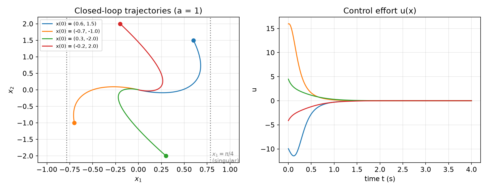
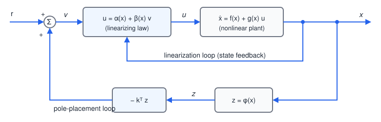
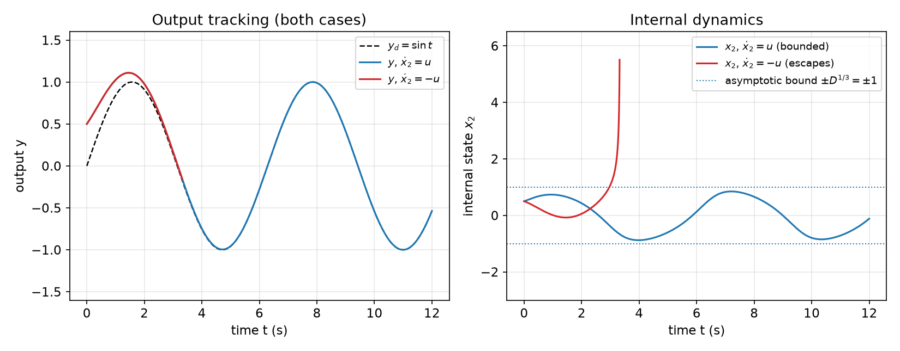
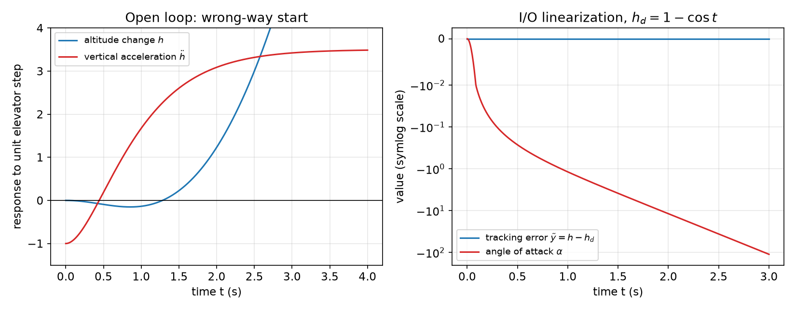
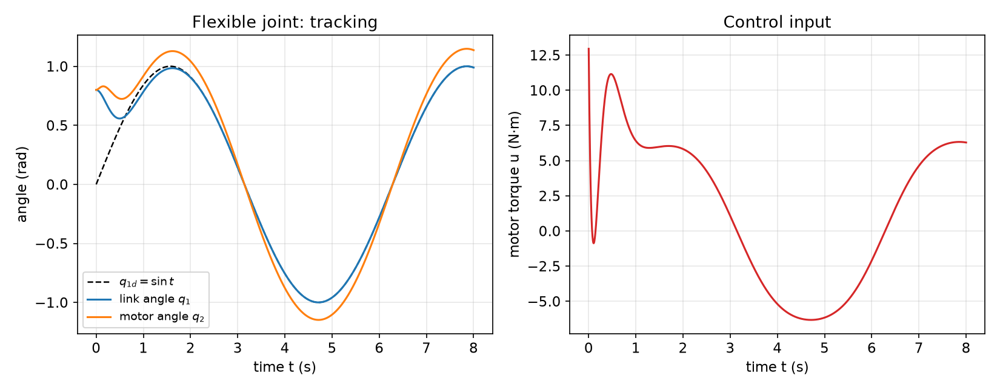
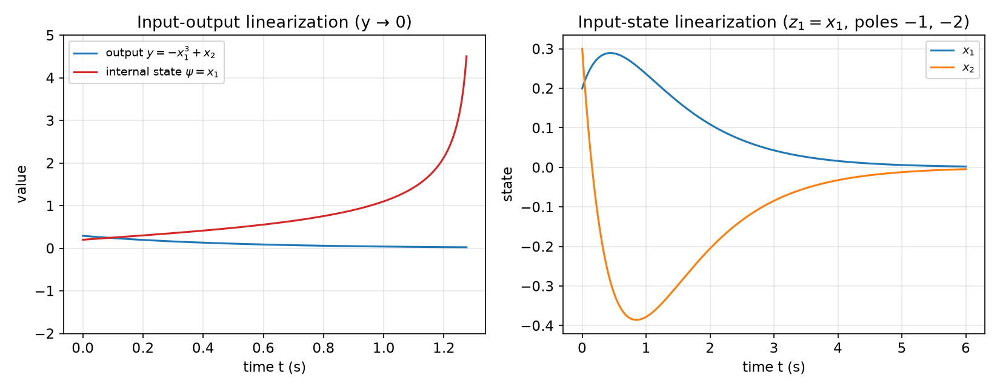

# Feedback Linearization

Feedback linearization is the first systematic design method for nonlinear systems in this subsection. Its central idea is to transform the nonlinear dynamics algebraically into fully or partly linear dynamics, by a change of state coordinates and a state feedback that cancels the nonlinearities, and then to apply the familiar tools of [linear state feedback](../linear/state-feedback.md). This is not Jacobian linearization: the transformation is exact, valid over a region rather than at a point. The method has been applied to helicopters, high-performance aircraft, industrial robots and biomedical devices. The chapter develops it in four stages: intuitive examples; the differential-geometric tools (Lie derivatives, Lie brackets, the Frobenius theorem); input-state linearization, which linearizes the whole state equation; and input-output linearization, which linearizes the map from input to output and leaves behind internal dynamics whose stability, through the notions of zero dynamics and minimum phase, decides whether the design is usable.

## Intuitive Concepts

### Cancelling nonlinearities

**Example 6.1 (Fluid level in a tank).** A tank with cross-sectional area \\(A(h)\\) at height \\(h\\) is fed by an inflow \\(u\\) and drains through an outlet pipe of cross-section \\(a\\). Mass balance and Torricelli's law give
\\[
\frac{d}{dt}\left[\int\_0^h A(h)\\,dh\right] = u(t) - a\sqrt{2gh}
\quad\Longleftrightarrow\quad
A(h)\\,\dot h = u - a\sqrt{2gh}.
\\]
The goal is to bring the level from \\(h\_0\\) to a desired \\(h\_d\\). Choose
\\[
u = a\sqrt{2gh} + A(h)\\,v,
\\]
which turns the dynamics into the integrator \\(\dot h = v\\). With \\(v = -\alpha\tilde h\\), \\(\tilde h = h - h\_d\\), \\(\alpha > 0\\), the error obeys \\(\dot{\tilde h} + \alpha\tilde h = 0\\) and decays exponentially. The control law is
\\[
u(t) = a\sqrt{2gh} - A(h)\\,\alpha\tilde h .
\\]
Its first term supplies exactly the outflow; its second raises the level according to the chosen linear dynamics. For a time-varying target, \\(v = \dot h\_d - \alpha\tilde h\\) gives the same error equation.

### The companion form

Cancellation is immediate when the system is in **companion (controllability canonical) form**,
\\[
x^{(n)} = f(\mathbf{x}) + b(\mathbf{x})\\,u, \qquad \mathbf{x} = \left[x, \dot x, \dots, x^{(n-1)}\right]^T,
\\]
with no derivatives of the input. In state-space form this is a chain of integrators whose last equation contains all the nonlinearity. Where \\(b \ne 0\\), the control
\\[
u = \frac{1}{b}\left[v - f\right]
\\]
gives \\(x^{(n)} = v\\). For regulation, \\(v = -k\_0x - k\_1\dot x - \dots - k\_{n-1}x^{(n-1)}\\) with \\(p^n + k\_{n-1}p^{n-1} + \dots + k\_0\\) Hurwitz gives an exponentially stable closed loop. For tracking a desired \\(x\_d(t)\\),
\\[
v = x\_d^{(n)} - k\_0e - k\_1\dot e - \dots - k\_{n-1}e^{(n-1)}, \qquad e = x - x\_d ,
\\]
so that \\(e^{(n)} + k\_{n-1}e^{(n-1)} + \dots + k\_0e = 0\\) and \\(e \to 0\\) exponentially. The same construction works when \\(x\\) is a vector and \\(b\\) an invertible matrix.

**Example 6.2 (Two-link robot: computed torque).** A planar two-link arm has link lengths \\(l\_1, l\_2\\), centres of mass at distances \\(l\_{c1}, l\_{c2}\\) from the joints, masses \\(m\_1, m\_2\\), moments of inertia \\(I\_1, I\_2\\), joint angles \\(q\_1, q\_2\\) and joint torques \\(\tau\_1, \tau\_2\\). Its dynamics are
\\[
\begin{bmatrix} H\_{11} & H\_{12} \\\\ H\_{21} & H\_{22} \end{bmatrix}
\begin{bmatrix} \ddot q\_1 \\\\ \ddot q\_2 \end{bmatrix} + \begin{bmatrix} -h\dot q\_2 & -h\dot q\_1 - h\dot q\_2 \\\\ h\dot q\_1 & 0 \end{bmatrix}
\begin{bmatrix} \dot q\_1 \\\\ \dot q\_2 \end{bmatrix} + \begin{bmatrix} g\_1 \\\\ g\_2 \end{bmatrix}
= \begin{bmatrix} \tau\_1 \\\\ \tau\_2 \end{bmatrix},
\\]
with
\\[
\begin{aligned}
H\_{11} &= m\_1l\_{c1}^2 + I\_1 + m\_2\left[l\_1^2 + l\_{c2}^2 + 2l\_1l\_{c2}\cos q\_2\right] + I\_2, \qquad H\_{22} = m\_2l\_{c2}^2 + I\_2, \\\\
H\_{12} &= H\_{21} = m\_2l\_1l\_{c2}\cos q\_2 + m\_2l\_{c2}^2 + I\_2, \qquad h = m\_2l\_1l\_{c2}\sin q\_2 ,
\end{aligned}
\\]
and \\(g\_1, g\_2\\) the gravity torques. Compactly, \\(H(q)\ddot q + C(q,\dot q)\dot q + g(q) = \tau\\), a vector companion form with invertible inertia matrix \\(H\\). The **computed-torque** control
\\[
\tau = H(q)\\,v + C(q,\dot q)\dot q + g(q), \qquad v = \ddot q\_d - 2\lambda\dot{\tilde q} - \lambda^2\tilde q, \qquad \tilde q = q - q\_d ,
\\]
cancels the nonlinear terms and leaves \\(\ddot{\tilde q} + 2\lambda\dot{\tilde q} + \lambda^2\tilde q = 0\\): each joint error decays exponentially, critically damped. The construction works for any number of joints (see [Control of Multi-Input Physical Systems](multi-input.md)).

A nonlinearity in the input can be handled the same way. If the dynamics depend on \\(u^4\\) (say, flow through a valve as a function of its opening), design the control in terms of \\(w = u^4\\), then apply \\(u = w^{1/4}\\).

### Input-state linearization: a first example

Most systems are not in companion form. The question is whether a change of coordinates can bring them into it. Input-state linearization proceeds in two steps: find a state transformation \\(z = z(x)\\) and an input transformation \\(u = u(x, v)\\) such that the dynamics in \\((z, v)\\) are linear and time-invariant, \\(\dot z = Az + bv\\); then design \\(v\\) by linear methods.

**Example 6.3 (A second-order system).** Consider
\\[
\dot x\_1 = -2x\_1 + ax\_2 + \sin x\_1, \qquad \dot x\_2 = -x\_2\cos x\_1 + u\cos(2x\_1).
\\]
The input cannot cancel the \\(\sin x\_1\\) term directly, since it appears only in the second equation. But the troublesome term can be absorbed into a new state. Define
\\[
z\_1 = x\_1, \qquad z\_2 = ax\_2 + \sin x\_1 .
\\]
Then \\(\dot z\_1 = -2z\_1 + z\_2\\), and
\\[
\dot z\_2 = a\dot x\_2 + \cos x\_1\\,\dot x\_1 = -2z\_1\cos z\_1 + \cos z\_1\sin z\_1 + au\cos(2z\_1),
\\]
where we used \\(ax\_2 = z\_2 - \sin z\_1\\), so that \\(-ax\_2\cos x\_1 + \cos x\_1(-2x\_1 + ax\_2 + \sin x\_1) = -2x\_1\cos x\_1 + \cos x\_1\sin x\_1\\). Now every nonlinearity is in the equation for \\(\dot z\_2\\), together with \\(u\\). The input transformation
\\[
u = \frac{1}{a\cos(2z\_1)}\left(v - \cos z\_1\sin z\_1 + 2z\_1\cos z\_1\right)
\\]
gives the linear system
\\[
\dot z\_1 = -2z\_1 + z\_2, \qquad \dot z\_2 = v .
\\]
This pair is controllable, so its poles can be placed anywhere. The choice \\(v = -2z\_2\\) puts both poles at \\(-2\\): \\(z\_2(t) = z\_2(0)e^{-2t}\\) and \\(z\_1(t) = [z\_1(0) + z\_2(0)t]e^{-2t}\\). In the original coordinates the controller is
\\[
u = \frac{1}{a\cos(2x\_1)}\left(-2ax\_2 - 2\sin x\_1 - \cos x\_1\sin x\_1 + 2x\_1\cos x\_1\right),
\\]
and the inverse transformation \\(x\_1 = z\_1\\), \\(x\_2 = (z\_2 - \sin z\_1)/a\\) shows that \\(x \to 0\\) whenever \\(z \to 0\\).



*Figure: closed loop of Example 6.3 with \\(a = 1\\) from four initial states. Left, trajectories in the \\((x\_1, x\_2)\\) plane converge to the origin; dotted lines mark the singular set \\(x\_1 = \pm\pi/4\\), where \\(\cos 2x\_1 = 0\\) and the input loses its authority. Right, the control \\(u(x)\\). The simulated \\(z\_1(t)\\) agrees with the analytic \\([z\_1(0) + z\_2(0)t]e^{-2t}\\) to \\(10^{-9}\\).*

The structure of the controller is two nested loops: an inner **linearization loop** \\(u = u(x, v)\\) that makes the plant look linear from \\(v\\) to \\(z\\), and an outer **pole-placement loop** \\(v = -k^Tz\\) with \\(z = z(x)\\).



*Figure: input-state linearization as two loops. The inner loop feeds back the state through the linearizing law \\(u = \alpha(x) + \beta(x)v\\); the outer loop computes the new state \\(z = \phi(x)\\) and closes a linear pole-placement loop on it.*

Several remarks apply to this and every input-state linearization.

- The result is **not global**. The controller is singular where \\(\cos 2x\_1 = 0\\), at \\(x\_1 = \pi/4 \pm k\pi/2\\), so the initial state must lie in the region between singularities.
- Both transformations use the state. The input transformation is a state feedback, which is why the method is called *feedback* linearization; and the new state \\(z\\) must be computed from \\(x\\), so the full state must be measured (or estimated).
- **Robustness** is not guaranteed. An error in the parameter \\(a\\) corrupts both the computed \\(z\\) and the cancellation in \\(u\\), and nothing in the design bounds the consequences.
- For **tracking**, the desired behaviour must be expressed in terms of the full new state \\(z\\), which may be physically unnatural. Input-output linearization addresses this.

### Input-output linearization: a first example

Often the specification concerns an output \\(y = h(x)\\): track \\(y\_d(t)\\) while keeping the whole state bounded. The idea is to differentiate the output until the input appears, then cancel.

**Example 6.4 (A third-order system).** Consider
\\[
\dot x\_1 = \sin x\_2 + (x\_2 + 1)x\_3, \qquad \dot x\_2 = x\_1^5 + x\_3, \qquad \dot x\_3 = x\_1^2 + u, \qquad y = x\_1 .
\\]
The output is not directly related to \\(u\\). Differentiate:
\\[
\dot y = \sin x\_2 + (x\_2 + 1)x\_3 ,
\\]
still no \\(u\\). Differentiate again:
\\[
\ddot y = \cos x\_2\\,\dot x\_2 + x\_3\dot x\_2 + (x\_2 + 1)\dot x\_3 = (x\_2 + 1)\\,u + f\_1(x),
\qquad
f\_1(x) = (x\_1^5 + x\_3)(x\_3 + \cos x\_2) + (x\_2 + 1)x\_1^2 .
\\]
The input appears after two differentiations. The control
\\[
u = \frac{1}{x\_2 + 1}\left(v - f\_1\right)
\\]
gives \\(\ddot y = v\\), and with \\(e = y - y\_d\\),
\\[
v = \ddot y\_d - k\_1e - k\_2\dot e
\quad\Longrightarrow\quad
\ddot e + k\_2\dot e + k\_1e = 0,
\\]
which converges exponentially for \\(k\_1, k\_2 > 0\\). The controller is singular at \\(x\_2 = -1\\) and needs the full state to compute \\(\dot y\\) and \\(f\_1\\).

The number of differentiations needed for \\(u\\) to appear is the **relative degree** \\(r\\) of the system, here \\(r = 2\\). For a controllable system of order \\(n\\), \\(r \le n\\) (proved below). Here the linear input-output map accounts for only two of the three states. The remaining part, of order \\(n - r = 1\\), is invisible from the output: these are the **internal dynamics**. Taking \\(x\_3\\) as the internal state, its dynamics under the control are
\\[
\dot x\_3 = x\_1^2 + \frac{1}{x\_2 + 1}\left(\ddot y\_d - k\_1e - k\_2\dot e - f\_1\right).
\\]
If these internal dynamics are unstable, the output tracks perfectly while an internal state diverges, and the controller is useless in practice: actuators saturate, fuses burn, the structure vibrates violently. Whether input-output linearization is acceptable therefore hinges on the internal dynamics.

**Example 6.5 (Stable and unstable internal dynamics).** Consider
\\[
\dot x\_1 = x\_2^3 + u, \qquad \dot x\_2 = u, \qquad y = x\_1 ,
\\]
and the tracking task \\(y \to y\_d(t)\\). Here \\(r = 1\\), and
\\[
u = -x\_2^3 - e + \dot y\_d
\quad\Longrightarrow\quad
\dot e + e = 0 .
\\]
The internal dynamics, obtained by substituting \\(u\\) into the second equation, are
\\[
\dot x\_2 + x\_2^3 = \dot y\_d - e .
\\]
If \\(\lvert \dot y\_d - e \rvert \le D\\) (true when \\(\dot y\_d\\) is bounded, since \\(e\\) decays), then \\(\frac{d}{dt}\frac{x\_2^2}{2} = x\_2(\dot y\_d - e) - x\_2^4 < 0\\) whenever \\(\lvert x\_2 \rvert^3 > D\\). So \\(\lvert x\_2 \rvert\\) eventually stays below \\(D^{1/3}\\): the internal dynamics are stable and the design is satisfactory.

If instead the second equation were \\(\dot x\_2 = -u\\), the same tracking law would give internal dynamics \\(\dot x\_2 - x\_2^3 = e - \dot y\_d\\), which diverge (in finite time, because of the cubic).



*Figure: Example 6.5 with \\(y\_d = \sin t\\) and \\(x(0) = (0.5, 0.5)\\). Left, the output converges to \\(y\_d\\) in both cases, since the error equation \\(\dot e + e = 0\\) is the same. Right, the internal state: with \\(\dot x\_2 = u\\) it stays within the asymptotic bound \\(\pm D^{1/3} = \pm1\\); with \\(\dot x\_2 = -u\\) it escapes to infinity at about \\(t = 3.3\\) s, ending the simulation.*

For stabilization (as opposed to tracking a physical output), the output \\(h(x)\\) is a design choice. Different outputs give different internal dynamics, and a good choice makes them stable. If the relative degree equals \\(n\\), there are no internal dynamics and input-output linearization becomes input-state linearization.

### Internal dynamics of linear systems

Linear systems show what internal dynamics are.

**Example 6.6 (Two second-order linear systems).** The system
\\[
\dot x\_1 = x\_2 + u, \qquad \dot x\_2 = u, \qquad y = x\_1
\\]
with \\(u = -x\_2 + \dot y\_d - (y - y\_d)\\) gives \\(\dot e + e = 0\\) and internal dynamics \\(\dot x\_2 + x\_2 = \dot y\_d - e\\): bounded. The system
\\[
\dot x\_1 = x\_2 + u, \qquad \dot x\_2 = -u, \qquad y = x\_1
\\]
with the same law gives \\(\dot x\_2 - x\_2 = e - \dot y\_d\\): unstable. Their transfer functions are
\\[
W\_1(p) = \frac{p + 1}{p^2}, \qquad W\_2(p) = \frac{p - 1}{p^2}:
\\]
the same poles, but a left-half-plane zero for the first and a right-half-plane zero for the second.

The connection between zeros and internal dynamics holds in general. Take a third-order system with one zero,
\\[
y = \frac{b\_0 + b\_1p}{p^3 + a\_2p^2 + a\_1p + a\_0}\\,u,
\\]
and the companion realization \\(x\_1 = u/(p^3 + a\_2p^2 + a\_1p + a\_0)\\), \\(x\_2 = \dot x\_1\\), \\(x\_3 = \dot x\_2\\), \\(y = b\_0x\_1 + b\_1x\_2\\). Differentiating,
\\[
\dot y = b\_0x\_2 + b\_1x\_3, \qquad \ddot y = b\_0x\_3 + b\_1\left(-a\_0x\_1 - a\_1x\_2 - a\_2x\_3 + u\right),
\\]
so the relative degree is 2, the **pole-zero excess** of the transfer function. The tracking law
\\[
u = a\_0x\_1 + a\_1x\_2 + a\_2x\_3 - \frac{b\_0}{b\_1}x\_3 + \frac{1}{b\_1}\left(-k\_1e - k\_2\dot e + \ddot y\_d\right)
\\]
gives \\(\ddot e + k\_2\dot e + k\_1e = 0\\). One state remains, and since \\(y = b\_0x\_1 + b\_1\dot x\_1\\), the internal dynamics are
\\[
\dot x\_1 + \frac{b\_0}{b\_1}x\_1 = \frac{1}{b\_1}\\,y .
\\]
They are driven by the bounded output \\(y\\) and are stable if and only if the zero \\(-b\_0/b\_1\\) lies in the left half-plane, whatever the initial conditions and the size of \\(y\_d, \dots, y\_d^{(r)}\\). For linear systems, **the poles of the internal dynamics are the zeros of the transfer function**.

**Example 6.7 (Aircraft altitude control).** An aircraft at constant forward speed is controlled in altitude \\(h\\) by its elevator deflection \\(E\\). The wing lift \\(L\_W = C\_{ZW}\alpha\\), proportional to the angle of attack \\(\alpha\\), acts at the centre of lift, a distance \\(d\\) behind the centre of gravity; the elevator force \\(L\_E = C\_{ZE}(E - \alpha)\\) acts at the tail, a distance \\(l\\) behind; aerodynamic damping is \\(b\dot\alpha\\). For small angles,
\\[
J\ddot\alpha + b\dot\alpha + (C\_{ZE}l + C\_{ZW}d)\alpha = C\_{ZE}l\\,E, \qquad m\ddot h = (C\_{ZE} + C\_{ZW})\alpha - C\_{ZE}E .
\\]
The pitch dynamics are open-loop stable iff \\(C\_{ZE}l + C\_{ZW}d > 0\\), which holds when the centre of gravity is ahead of the centre of lift (\\(d > 0\\)); this is why airliners are loaded with weight forward. With \\(J = 1\\), \\(m = 1\\), \\(b = 4\\), \\(C\_{ZE} = 1\\), \\(C\_{ZW} = 5\\), \\(l = 3\\), \\(d = 0.2\\):
\\[
\frac{\alpha}{E} = \frac{3}{(p + 2)^2}, \qquad
\frac{h}{E} = \frac{18/(p+2)^2 - 1}{p^2} = \frac{14 - 4p - p^2}{p^2(p + 2)^2} = \frac{(p + 6.24)(2.24 - p)}{p^2(p + 2)^2}.
\\]
The altitude transfer function has a zero at \\(p = 2.24\\), in the right half-plane. Its step response starts the wrong way: by the initial value theorem \\(\ddot h(0^+) = -1\\), while \\(\ddot h(\infty) = 18/4 - 1 = 3.5\\). Physically, raising the elevator first pushes the tail (and the aircraft) down, and only when the nose has pitched up does the extra wing lift take over.

With state \\(x = [\alpha, \dot\alpha, h, \dot h]^T\\),
\\[
\dot x\_1 = x\_2, \quad \dot x\_2 = -4x\_2 - 4x\_1 + 3E, \quad \dot x\_3 = x\_4, \quad \dot x\_4 = 6x\_1 - E, \qquad y = x\_3 .
\\]
Then \\(\ddot y = 6x\_1 - E\\), so \\(r = 2\\), and
\\[
E = 6x\_1 - \ddot y\_d + \dot{\tilde y} + \tilde y
\quad\Longrightarrow\quad
\ddot{\tilde y} + \dot{\tilde y} + \tilde y = 0, \qquad \tilde y = y - y\_d .
\\]
The internal dynamics follow by substituting \\(E\\) into the pitch equation:
\\[
\ddot\alpha + 4\dot\alpha - 14\alpha = 3\left(-\ddot y\_d + \dot{\tilde y} + \tilde y\right).
\\]
Their characteristic polynomial \\(p^2 + 4p - 14\\) has roots \\(2.24\\) and \\(-6.24\\), exactly the zeros of \\(h/E\\), and the internal dynamics are unstable: perfect altitude tracking makes the angle of attack diverge.



*Figure: left, response to a unit elevator step: \\(\ddot h\\) starts at \\(-1\\) and settles at 3.5, so the altitude first dips (by about 0.15) before rising parabolically. Right, input-output linearizing control tracking \\(h\_d = 1 - \cos t\\): the tracking error stays at zero while the angle of attack grows like \\(e^{2.24t}\\) (to about \\(-110\\) rad after 3 s, on a symmetric-log scale).*

### Zero dynamics and minimum phase

Internal dynamics depend on the desired trajectory, which makes them awkward to analyse. A trajectory-independent notion is obtained by asking for the simplest possible output.

**Definition (zero dynamics).** The **zero dynamics** of a system are its internal dynamics when the control keeps the output identically zero.

For Example 6.5, keeping \\(y \equiv 0\\) requires \\(\dot x\_1 = 0\\), i.e. \\(u = -x\_2^3\\), and the zero dynamics are
\\[
\dot x\_2 + x\_2^3 = 0,
\\]
asymptotically stable (with \\(V = x\_2^2\\), \\(\dot V = -2x\_2^4\\)). For the linear third-order system they are \\(\dot x\_1 + (b\_0/b\_1)x\_1 = 0\\), whose pole is the transfer-function zero; for linear systems this is the general rule, the zero dynamics having the zeros as poles.

For linear systems, stable zero dynamics guarantee globally stable internal dynamics for any bounded trajectory. For nonlinear systems the relation is only **local**: local asymptotic stability of the zero dynamics implies local stability of the internal dynamics (for small tracking errors and small desired trajectories), and nothing global can be concluded even from globally exponentially stable zero dynamics. In return, the zero dynamics are an intrinsic property of the system and much easier to analyse than the internal dynamics.

**Definition (minimum phase).** A nonlinear system is **asymptotically (exponentially) minimum phase** if its zero dynamics are asymptotically (exponentially) stable, locally or globally. Otherwise it is **non-minimum phase**.

**Example 6.8 (Aircraft, continued).** The zero dynamics of the aircraft model are \\(\ddot\alpha + 4\dot\alpha - 14\alpha = 0\\), unstable: the system is non-minimum phase. A full nonlinear aircraft model is non-minimum phase too, since its zero dynamics linearize to these.

The design procedure is now clear: differentiate the output until the input appears; choose the input to cancel the nonlinearities and achieve tracking; check the stability of the internal dynamics, or at least (locally) of the zero dynamics. The rest of the chapter makes each step precise.

## Mathematical Tools

The general theory uses a small amount of differential geometry. This section gives what is needed for the constructions; the rigorous treatment, with manifolds, distributions and flows, is in [Differential Geometry for Control](differential-geometry.md). All vector fields are smooth (infinitely differentiable) maps \\(f: \mathbb{R}^n \to \mathbb{R}^n\\). The gradient \\(\nabla h = \partial h/\partial x\\) of a scalar function is a row vector, and \\(\nabla f\\) is the Jacobian matrix of a vector field.

### Lie derivatives and Lie brackets

**Definition (Lie derivative).** The Lie derivative of a scalar function \\(h\\) along a vector field \\(f\\) is the directional derivative
\\[
L\_fh = \nabla h\\,f .
\\]
Repeated derivatives are defined recursively: \\(L\_f^0h = h\\), \\(L\_f^ih = L\_f(L\_f^{i-1}h) = \nabla(L\_f^{i-1}h)\\,f\\); and along a second field \\(g\\), \\(L\_gL\_fh = \nabla(L\_fh)\\,g\\).

The Lie derivative is simply the time derivative along trajectories. For \\(\dot x = f(x)\\), \\(y = h(x)\\): \\(\dot y = L\_fh\\), \\(\ddot y = L\_f^2h\\), and so on. For a Lyapunov function, \\(\dot V = L\_fV\\).

**Definition (Lie bracket).** The Lie bracket of two vector fields is the vector field
\\[
[f, g] = \nabla g\\,f - \nabla f\\,g ,
\\]
also written \\(\mathrm{ad}\_fg\\). Repeated brackets are \\(\mathrm{ad}\_f^0g = g\\), \\(\mathrm{ad}\_f^ig = [f, \mathrm{ad}\_f^{i-1}g]\\).

The bracket measures the failure of the flows of \\(f\\) and \\(g\\) to commute (see [Differential Geometry for Control](differential-geometry.md)). For linear fields \\(f = Ax\\), \\(g = b\\): \\(\mathrm{ad}\_fg = -Ab\\), \\(\mathrm{ad}\_f^ig = (-1)^iA^ib\\), so the brackets reproduce the columns of the controllability matrix, up to sign.

**Example 6.9 (A bracket).** For the system of Example 6.3, \\(f = [-2x\_1 + ax\_2 + \sin x\_1,\\; -x\_2\cos x\_1]^T\\) and \\(g = [0,\\; \cos 2x\_1]^T\\). The Jacobians are
\\[
\nabla f = \begin{bmatrix} -2 + \cos x\_1 & a \\\\ x\_2\sin x\_1 & -\cos x\_1 \end{bmatrix}, \qquad
\nabla g = \begin{bmatrix} 0 & 0 \\\\ -2\sin 2x\_1 & 0 \end{bmatrix},
\\]
so
\\[
[f, g] = \nabla g\\,f - \nabla f\\,g = \begin{bmatrix} -a\cos 2x\_1 \\\\ \cos x\_1\cos 2x\_1 - 2\sin 2x\_1\\,(-2x\_1 + ax\_2 + \sin x\_1) \end{bmatrix}.
\\]

**Lemma 6.1 (Properties of the Lie bracket).**

1. *Bilinearity:* for constants \\(\alpha\_1, \alpha\_2\\),
\\[
[\alpha\_1f\_1 + \alpha\_2f\_2, g] = \alpha\_1[f\_1, g] + \alpha\_2[f\_2, g], \qquad [f, \alpha\_1g\_1 + \alpha\_2g\_2] = \alpha\_1[f, g\_1] + \alpha\_2[f, g\_2].
\\]
2. *Skew-commutativity:* \\([f, g] = -[g, f]\\).
3. *Jacobi identity (in its Lie-derivative form):*
\\[
L\_{\mathrm{ad}\_fg}h = L\_fL\_gh - L\_gL\_fh .
\\]

*Proof.* (1) The Jacobian is linear: \\(\nabla(\alpha\_1g\_1 + \alpha\_2g\_2) = \alpha\_1\nabla g\_1 + \alpha\_2\nabla g\_2\\) for constant \\(\alpha\_i\\). Hence
\\[
[f, \alpha\_1g\_1 + \alpha\_2g\_2] = (\alpha\_1\nabla g\_1 + \alpha\_2\nabla g\_2)f - \nabla f(\alpha\_1g\_1 + \alpha\_2g\_2) = \alpha\_1(\nabla g\_1f - \nabla f g\_1) + \alpha\_2(\nabla g\_2f - \nabla fg\_2),
\\]
and similarly in the first argument. (2) \\([f, g] = \nabla g f - \nabla f g = -(\nabla f g - \nabla g f) = -[g, f]\\). (3) Let \\(\mathcal{H} = \partial^2h/\partial x^2\\) be the (symmetric) Hessian of \\(h\\). By the product rule, \\(\nabla(L\_gh) = \nabla(\nabla h\\,g) = \nabla h\\,\nabla g + g^T\mathcal{H}\\). Therefore
\\[
L\_fL\_gh - L\_gL\_fh = \left(\nabla h\\,\nabla g + g^T\mathcal{H}\right)f - \left(\nabla h\\,\nabla f + f^T\mathcal{H}\right)g
= \nabla h\left(\nabla g\\,f - \nabla f\\,g\right) + \underbrace{g^T\mathcal{H}f - f^T\mathcal{H}g}\_{=0}
= \nabla h\\,[f, g].
\\]
The second-order terms cancel because \\(g^T\mathcal{H}f\\) is a scalar, equal to its transpose \\(f^T\mathcal{H}g\\). \\(\square\\)

Applying the Jacobi identity twice gives
\\[
L\_{\mathrm{ad}\_f^2g}h = L\_f^2L\_gh - 2L\_fL\_gL\_fh + L\_gL\_f^2h ,
\\]
and in general \\(L\_{\mathrm{ad}\_f^kg}h\\) is a combination of terms \\(L\_f^iL\_gL\_f^jh\\) with \\(i + j = k\\).

**Example 6.10 (Checking the properties).** Let
\\[
f = \begin{bmatrix} e^{x\_1} \\\\ e^{-x\_2} \end{bmatrix}, \qquad g\_1 = \begin{bmatrix} x\_1 \\\\ 0 \end{bmatrix}, \qquad g\_2 = \begin{bmatrix} 0 \\\\ x\_2 \end{bmatrix}, \qquad \nabla f = \begin{bmatrix} e^{x\_1} & 0 \\\\ 0 & -e^{-x\_2} \end{bmatrix}.
\\]
A proof and an illustration are different things; here are illustrations of each property.

*Bilinearity.* \\(\alpha\_1g\_1 + \alpha\_2g\_2 = (\alpha\_1x\_1, \alpha\_2x\_2)^T\\) has Jacobian \\(\mathrm{diag}(\alpha\_1, \alpha\_2)\\), so
\\[
[f, \alpha\_1g\_1 + \alpha\_2g\_2] = \begin{bmatrix} \alpha\_1e^{x\_1} \\\\ \alpha\_2e^{-x\_2} \end{bmatrix} - \begin{bmatrix} \alpha\_1x\_1e^{x\_1} \\\\ -\alpha\_2x\_2e^{-x\_2} \end{bmatrix} = \begin{bmatrix} \alpha\_1(1 - x\_1)e^{x\_1} \\\\ \alpha\_2(1 + x\_2)e^{-x\_2} \end{bmatrix},
\\]
while separately \\([f, g\_1] = [(1 - x\_1)e^{x\_1},\\; 0]^T\\) and \\([f, g\_2] = [0,\\; (1 + x\_2)e^{-x\_2}]^T\\). The two sides agree.

*Skew-commutativity.* \\([g\_1, f] = \nabla f\\,g\_1 - \nabla g\_1\\,f = [x\_1e^{x\_1} - e^{x\_1},\\; 0]^T = -[f, g\_1]\\).

*Jacobi identity.* Take \\(h = \frac12(x\_1^2 + x\_2^2)\\) and \\(g = g\_1\\). Then \\(L\_gh = x\_1^2\\) and \\(L\_fL\_gh = 2x\_1e^{x\_1}\\); \\(L\_fh = x\_1e^{x\_1} + x\_2e^{-x\_2}\\) and \\(L\_gL\_fh = x\_1(e^{x\_1} + x\_1e^{x\_1})\\). The difference is \\(x\_1e^{x\_1} - x\_1^2e^{x\_1}\\). On the other side, \\(L\_{\mathrm{ad}\_fg}h = [x\_1\\;\\; x\_2]\\,[(1 - x\_1)e^{x\_1},\\; 0]^T = x\_1(1 - x\_1)e^{x\_1}\\), the same.

### Diffeomorphisms

**Definition (diffeomorphism).** A function \\(\phi: \Omega \to \mathbb{R}^n\\) defined on a region \\(\Omega \subset \mathbb{R}^n\\) is a diffeomorphism if it is smooth and has a smooth inverse \\(\phi^{-1}\\). It is a global diffeomorphism if \\(\Omega = \mathbb{R}^n\\) and \\(\phi(\mathbb{R}^n) = \mathbb{R}^n\\).

Global diffeomorphisms are rare, so local ones are used, and the inverse function theorem supplies them:

**Lemma 6.2.** If the Jacobian \\(\nabla\phi\\) is nonsingular at \\(x\_0\\), then \\(\phi\\) is a local diffeomorphism on a neighbourhood of \\(x\_0\\).

A diffeomorphism is a change of coordinates. Under \\(z = \phi(x)\\), the system \\(\dot x = f(x) + g(x)u\\), \\(y = h(x)\\) becomes
\\[
\dot z = \frac{\partial\phi}{\partial x}\dot x = \frac{\partial\phi}{\partial x}\left(f + gu\right) = f^\*(z) + g^\*(z)u, \qquad y = h^\*(z),
\\]
with \\(x\\) replaced by \\(\phi^{-1}(z)\\) on the right.

**Example 6.11 (A local diffeomorphism).** Let \\(\phi(x) = [2x\_1 + 5x\_1x\_2^2,\\; 3\sin x\_2]^T\\). Its Jacobian
\\[
\nabla\phi = \begin{bmatrix} 2 + 5x\_2^2 & 10x\_1x\_2 \\\\ 0 & 3\cos x\_2 \end{bmatrix}
\\]
has rank 2 at the origin, so \\(\phi\\) is a local diffeomorphism there. It is a diffeomorphism on the region \\(\lvert x\_2 \rvert < \pi/2\\), where \\(\sin x\_2\\) is invertible, but not globally.

### The Frobenius theorem

Input-state linearization requires solving a set of first-order partial differential equations for an unknown scalar function. The Frobenius theorem says when such a set has a solution.

Start with \\(n = 3\\) and two vector fields \\(f, g\\). We look for \\(h(x)\\) with
\\[
\nabla h\\,f = 0, \qquad \nabla h\\,g = 0, \qquad \nabla h \ne 0 .
\\]
Geometrically, we want a family of surfaces \\(h(x) = c\\) to which both \\(f\\) and \\(g\\) are tangent everywhere. This is not always possible: moving alternately along \\(f\\) and \\(g\\) generates motion in the direction of \\([f, g]\\), so the surfaces exist only if \\([f, g]\\) is also tangent to them. The equations are solvable iff there are scalar functions \\(\alpha\_1, \alpha\_2\\) such that \\([f, g] = \alpha\_1f + \alpha\_2g\\).

**Definition (complete integrability).** A linearly independent set of vector fields \\(\\{f\_1, \dots, f\_m\\}\\) on \\(\mathbb{R}^n\\) is **completely integrable** if and only if there exist \\(n - m\\) scalar functions \\(h\_1, \dots, h\_{n-m}\\) with linearly independent gradients satisfying
\\[
\nabla h\_i\\,f\_j = 0, \qquad 1 \le i \le n - m, \quad 1 \le j \le m .
\\]

**Definition (involutivity).** A linearly independent set \\(\\{f\_1, \dots, f\_m\\}\\) is **involutive** if and only if there are scalar functions \\(\alpha\_{ijk}\\) such that
\\[
[f\_i, f\_j] = \sum\_{k=1}^m \alpha\_{ijk}(x)\\,f\_k \qquad \text{for all } i, j ,
\\]
i.e. every bracket stays in the span of the set. Equivalently, \\(\mathrm{rank}\\,[f\_1 \cdots f\_m] = \mathrm{rank}\\,[f\_1 \cdots f\_m\\;\\; [f\_i, f\_j]]\\) for all \\(i, j\\).

Constant vector fields are always involutive (their brackets vanish), and so is a single vector field (\\([f, f] = 0\\)). A set of independent constant fields is the linear-system case.

**Theorem 6.1 (Frobenius).** Let \\(f\_1, \dots, f\_m\\) be linearly independent. The set is completely integrable if and only if it is involutive.

Necessity is the bracket argument above: if \\(\nabla h\_i f\_j = 0\\) for all \\(j\\), the Jacobi identity gives \\(\nabla h\_i [f\_j, f\_k] = L\_{f\_j}L\_{f\_k}h\_i - L\_{f\_k}L\_{f\_j}h\_i = 0\\), so every bracket lies in the \\(m\\)-dimensional subspace annihilated by the \\(n - m\\) independent gradients, which is the span of the \\(f\_j\\). Sufficiency, the construction of the \\(h\_i\\), uses flows of the vector fields and is proved in [Differential Geometry for Control](differential-geometry.md).

**Example 6.12 (A solvable set of PDEs).** Does the system
\\[
4x\_3\frac{\partial h}{\partial x\_1} - \frac{\partial h}{\partial x\_2} = 0, \qquad
-x\_1\frac{\partial h}{\partial x\_1} + (x\_3^2 - 3x\_2)\frac{\partial h}{\partial x\_2} + 2x\_3\frac{\partial h}{\partial x\_3} = 0
\\]
have a solution? It is \\(\nabla h\\,f\_1 = 0\\), \\(\nabla h\\,f\_2 = 0\\) with
\\[
f\_1 = [4x\_3,\\; -1,\\; 0]^T, \qquad f\_2 = [-x\_1,\\; x\_3^2 - 3x\_2,\\; 2x\_3]^T .
\\]
Compute \\([f\_1, f\_2] = \nabla f\_2\\,f\_1 - \nabla f\_1\\,f\_2\\):
\\[
\nabla f\_2\\,f\_1 = \begin{bmatrix} -1 & 0 & 0 \\\\ 0 & -3 & 2x\_3 \\\\ 0 & 0 & 2 \end{bmatrix}\begin{bmatrix} 4x\_3 \\\\ -1 \\\\ 0 \end{bmatrix} = \begin{bmatrix} -4x\_3 \\\\ 3 \\\\ 0 \end{bmatrix}, \qquad
\nabla f\_1\\,f\_2 = \begin{bmatrix} 0 & 0 & 4 \\\\ 0 & 0 & 0 \\\\ 0 & 0 & 0 \end{bmatrix}f\_2 = \begin{bmatrix} 8x\_3 \\\\ 0 \\\\ 0 \end{bmatrix},
\\]
so \\([f\_1, f\_2] = [-12x\_3,\\; 3,\\; 0]^T = -3f\_1\\). The set is involutive, hence (by Frobenius) the PDEs have a solution.

**Example 6.13 (Involutivity in four dimensions).** Let \\(f\_1 = (x\_1, 1, 0, x\_3)^T\\) and \\(f\_2 = (e^{-x\_2}, 0, 0, 0)^T\\). The Jacobian of \\(f\_2\\) has the single nonzero entry \\(-e^{-x\_2}\\) in position (1,2); that of \\(f\_1\\) has entries 1 in positions (1,1) and (4,3). Then
\\[
[f\_1, f\_2] = \nabla f\_2\\,f\_1 - \nabla f\_1\\,f\_2 = \begin{bmatrix} -e^{-x\_2} \\\\ 0 \\\\ 0 \\\\ 0 \end{bmatrix} - \begin{bmatrix} e^{-x\_2} \\\\ 0 \\\\ 0 \\\\ 0 \end{bmatrix} = \begin{bmatrix} -2e^{-x\_2} \\\\ 0 \\\\ 0 \\\\ 0 \end{bmatrix} = 0\cdot f\_1 - 2f\_2 ,
\\]
which lies in the span of \\(\\{f\_1, f\_2\\}\\): the set is involutive.

## Input-State Linearization of SISO Systems

Consider single-input systems affine in the control,
\\[
\dot x = f(x) + g(x)u ,
\\]
with \\(f, g\\) smooth vector fields. (A system \\(\dot x = f(x) + g(x)\\,w(u + \phi(x))\\) with invertible \\(w\\) reduces to this form with the new input \\(v = w(u + \phi(x))\\).)

**Definition (input-state linearizable).** The system is input-state linearizable if there exist a region \\(\Omega\\), a diffeomorphism \\(\phi: \Omega \to \mathbb{R}^n\\) and a nonlinear feedback
\\[
u = \alpha(x) + \beta(x)\\,v, \qquad \beta(x) \ne 0,
\\]
such that the new state \\(z = \phi(x)\\) and new input \\(v\\) satisfy the linear time-invariant equation \\(\dot z = Az + bv\\), with
\\[
A = \begin{bmatrix} 0 & 1 & 0 & \cdots & 0 \\\\ 0 & 0 & 1 & \cdots & 0 \\\\ \vdots & & & \ddots & \vdots \\\\ 0 & 0 & \cdots & 0 & 1 \\\\ 0 & 0 & \cdots & 0 & 0 \end{bmatrix}, \qquad b = \begin{bmatrix} 0 \\\\ \vdots \\\\ 0 \\\\ 1 \end{bmatrix}.
\\]

Any controllable linear system can be put in this chain-of-integrators (Brunovsky) form by a linear change of coordinates and feedback, so nothing is lost by requiring it.

**Lemma 6.3.** The system is input-state linearizable on \\(\Omega\\) if and only if there is a scalar function \\(z\_1(x)\\) such that the system with output \\(y = z\_1(x)\\) has relative degree \\(n\\) on \\(\Omega\\).

In words, input-state linearization is input-output linearization with an output chosen so that there are no internal dynamics. The difficulty is to find such an output; the next theorem says when it exists.

### Conditions for input-state linearization

**Theorem 6.2.** The system \\(\dot x = f(x) + g(x)u\\) is input-state linearizable on a region \\(\Omega\\) if and only if the following conditions hold in \\(\Omega\\):

1. the vector fields \\(\\{g, \mathrm{ad}\_fg, \dots, \mathrm{ad}\_f^{n-1}g\\}\\) are linearly independent;
2. the set \\(\\{g, \mathrm{ad}\_fg, \dots, \mathrm{ad}\_f^{n-2}g\\}\\) is involutive.

The first condition is a **controllability** condition. For a linear system \\(f = Ax\\), \\(g = b\\), the fields are \\(\pm A^ib\\), and the condition is \\(\mathrm{rank}\\,[b\\;\\; Ab\\;\cdots\\;A^{n-1}b] = n\\), the Kalman rank test of [controllability](../linear/controllability.md). The second condition has no linear counterpart: for linear systems the fields are constant and automatically involutive. It is what makes the first-order PDEs for \\(z\_1\\) solvable.

The proof rests on an equivalence between two sets of conditions on \\(z\_1\\).

**Lemma 6.4.** For a smooth scalar \\(z(x)\\) and an integer \\(k \ge 0\\), the conditions
\\[
L\_gz = L\_gL\_fz = \dots = L\_gL\_f^kz = 0
\\]
are equivalent to
\\[
L\_gz = L\_{\mathrm{ad}\_fg}z = \dots = L\_{\mathrm{ad}\_f^kg}z = 0 .
\\]
Moreover, when they hold, \\(L\_{\mathrm{ad}\_f^{k+1}g}z = (-1)^{k+1}L\_gL\_f^{k+1}z\\).

*Proof.* By induction on \\(k\\); the case \\(k = 0\\) is trivial. More generally one shows that, if \\(L\_gL\_f^iz = 0\\) for \\(i \le k\\), then \\(L\_{\mathrm{ad}\_f^jg}L\_f^iz = 0\\) for \\(i + j \le k\\) and \\(L\_{\mathrm{ad}\_f^jg}L\_f^iz = (-1)^jL\_gL\_f^{i+j}z\\) for \\(i + j = k + 1\\). The step from \\(j\\) to \\(j + 1\\) uses the Jacobi identity with \\(\mathrm{ad}\_f^{j+1}g = [f, \mathrm{ad}\_f^jg]\\):
\\[
L\_{\mathrm{ad}\_f^{j+1}g}L\_f^iz = L\_f\left(L\_{\mathrm{ad}\_f^jg}L\_f^iz\right) - L\_{\mathrm{ad}\_f^jg}L\_f^{i+1}z .
\\]
When \\(i + j + 1 \le k\\), both terms on the right vanish by the induction hypothesis (the first is the derivative of a function that is identically zero). When \\(i + j + 1 = k + 1\\), the first term still vanishes and the second equals \\(-(-1)^jL\_gL\_f^{k+1}z\\). Taking \\(i = 0\\) gives the statement, and the converse direction is the same computation read backwards. \\(\square\\)

*Proof of Theorem 6.2.* **Necessity.** Suppose \\(z = \phi(x)\\) and \\(u = \alpha + \beta v\\) give the chain of integrators. Then for \\(k < n\\),
\\[
\dot z\_k = \nabla z\_k\\,(f + gu) = L\_fz\_k + L\_gz\_k\\,u = z\_{k+1}
\\]
for all \\(u\\), so \\(L\_gz\_k = 0\\) and \\(z\_{k+1} = L\_fz\_k\\) for \\(k = 1, \dots, n-1\\). Thus \\(z\_k = L\_f^{k-1}z\_1\\), and
\\[
L\_gL\_f^kz\_1 = 0, \quad k = 0, \dots, n-2, \qquad \dot z\_n = L\_f^nz\_1 + L\_gL\_f^{n-1}z\_1\\,u, \quad L\_gL\_f^{n-1}z\_1 \ne 0,
\\]
the last because otherwise \\(v\\) could not influence \\(\dot z\_n\\). By Lemma 6.4,
\\[
\nabla z\_1\\,\mathrm{ad}\_f^kg = 0, \quad k = 0, \dots, n-2, \qquad \nabla z\_1\\,\mathrm{ad}\_f^{n-1}g \ne 0 .
\\]
*Independence.* Applying Lemma 6.4's general form to \\(L\_f^jz\_1\\), the \\(n \times n\\) matrix with entries \\(\nabla(L\_f^iz\_1)\\,\mathrm{ad}\_f^jg\\) (\\(i, j = 0, \dots, n-1\\)) is zero above the anti-diagonal and has the nonzero entries \\(\pm L\_gL\_f^{n-1}z\_1\\) on it. It is therefore nonsingular, and so is the matrix \\([g\\;\\; \mathrm{ad}\_fg\\;\cdots\\;\mathrm{ad}\_f^{n-1}g]\\) appearing as its right factor: condition 1. *Involutivity.* The \\(n - 1\\) fields \\(\\{g, \dots, \mathrm{ad}\_f^{n-2}g\\}\\) are all annihilated by the nonzero gradient \\(\nabla z\_1\\): the set is completely integrable, hence involutive by Frobenius: condition 2.

**Sufficiency.** The \\(n - 1\\) fields \\(\\{g, \dots, \mathrm{ad}\_f^{n-2}g\\}\\) are independent and involutive, so by Frobenius there is a function \\(z\_1\\) (\\(n - (n - 1) = 1\\) of them) with \\(\nabla z\_1 \ne 0\\) and
\\[
\nabla z\_1\\,\mathrm{ad}\_f^kg = 0, \qquad k = 0, \dots, n-2 .
\\]
Since the \\(n\\) fields span \\(\mathbb{R}^n\\) and \\(\nabla z\_1\\) is orthogonal to the first \\(n - 1\\) but not zero, \\(\nabla z\_1\\,\mathrm{ad}\_f^{n-1}g \ne 0\\). By Lemma 6.4,
\\[
L\_gL\_f^kz\_1 = 0, \quad k = 0, \dots, n-2, \qquad L\_gL\_f^{n-1}z\_1 \ne 0 .
\\]
Define \\(z = [z\_1,\\; L\_fz\_1,\\; \dots,\\; L\_f^{n-1}z\_1]^T\\). Its Jacobian is nonsingular by the anti-triangular argument above, so it is a local diffeomorphism, and
\\[
\dot z\_k = z\_{k+1}\ (k < n), \qquad \dot z\_n = L\_f^nz\_1 + L\_gL\_f^{n-1}z\_1\\,u .
\\]
The feedback \\(u = (v - L\_f^nz\_1)/L\_gL\_f^{n-1}z\_1\\) gives the chain of integrators. \\(\square\\)

### The design procedure

The proof is constructive:

1. Construct the vector fields \\(g, \mathrm{ad}\_fg, \dots, \mathrm{ad}\_f^{n-1}g\\).
2. Check the controllability and involutivity conditions.
3. Find \\(z\_1\\) from
\\[
\nabla z\_1\\,\mathrm{ad}\_f^ig = 0, \quad i = 0, \dots, n-2, \qquad \nabla z\_1\\,\mathrm{ad}\_f^{n-1}g \ne 0 .
\\]
4. Compute the state transformation \\(z = [z\_1,\\; L\_fz\_1,\\; \dots,\\; L\_f^{n-1}z\_1]^T\\) and the input transformation \\(u = \alpha(x) + \beta(x)v\\) with
\\[
\boxed{\alpha(x) = -\frac{L\_f^nz\_1}{L\_gL\_f^{n-1}z\_1}, \qquad \beta(x) = \frac{1}{L\_gL\_f^{n-1}z\_1} .}
\\]
5. Design \\(v\\) for the chain of integrators: \\(v = -k^Tz\\) for regulation, or \\(v = z\_{1d}^{(n)} - \sum\_{i} k\_i(z\_{i+1} - z\_{1d}^{(i)})\\) for tracking.

Step 3 is a set of linear first-order PDEs. Solving them analytically can be hard; a normalized version, \\([g\\;\\; \mathrm{ad}\_fg\\;\cdots\\;\mathrm{ad}\_f^{n-1}g]^T\\,\nabla z\_1^T = [0\\; \cdots\\; 0\\;\\; 1]^T\\), can be solved for \\(\nabla z\_1\\) and integrated, which is easier numerically. In the examples the PDEs simply force \\(z\_1\\) to be independent of some variables. Symbolic algebra makes the bookkeeping painless:

```python
import sympy as sp
x1, x2, x3 = X = sp.symbols('x1 x2 x3')
Xv = sp.Matrix(X)
def bracket(f, g):  return sp.simplify(g.jacobian(Xv)*f - f.jacobian(Xv)*g)
def lie(f, h):      return sp.simplify((sp.Matrix([h]).jacobian(Xv)*f)[0])

f = sp.Matrix([x2 + x2**2 + x3**2, x3 + sp.sin(x1 - x3), x3**2])
g = sp.Matrix([1, 0, 1])
ad1 = bracket(f, g); ad2 = bracket(f, ad1)
print(sp.factor(sp.Matrix.hstack(g, ad1, ad2).det()))   # 2*x2 + 1
print(bracket(g, ad1).T)                                  # [-2, 0, -2] = -2 g
```

### Examples

**Example 6.14 (Two-dimensional, I).** Let \\(f = (a\sin x\_2,\\; -x\_1^2)^T\\), \\(g = (0, 1)^T\\).

*Solution.* \\(\nabla g = 0\\), so \\(\mathrm{ad}\_fg = -\nabla f\\,g = -(a\cos x\_2,\\; 0)^T\\), and
\\[
[g\\;\\; \mathrm{ad}\_fg] = \begin{bmatrix} 0 & -a\cos x\_2 \\\\ 1 & 0 \end{bmatrix}
\\]
has rank 2 on \\(\Omega = \\{x : x\_2 \ne \pm\pi/2, \pm3\pi/2, \dots\\}\\). The set \\(\\{g\\}\\) is a single constant field, hence involutive. The system is input-state linearizable on \\(\Omega\\). The condition \\(\nabla z\_1\\,g = \partial z\_1/\partial x\_2 = 0\\) allows \\(z\_1 = x\_1\\). Then \\(z\_2 = L\_fz\_1 = a\sin x\_2\\), \\(L\_gL\_fz\_1 = a\cos x\_2\\), \\(L\_f^2z\_1 = -ax\_1^2\cos x\_2\\), and
\\[
u = x\_1^2 + \frac{v}{a\cos x\_2}, \qquad \dot z\_1 = z\_2, \quad \dot z\_2 = v, \qquad v = -k\_1z\_1 - k\_2z\_2 .
\\]

**Example 6.15 (Two-dimensional, II).** Let \\(f = (\sin x\_2,\\; x\_1^4\cos x\_2)^T\\), \\(g = (0, 1)^T\\).

*Solution.* \\(\mathrm{ad}\_fg = (-\cos x\_2,\\; x\_1^4\sin x\_2)^T\\), so \\(\det[g\\;\\; \mathrm{ad}\_fg] = \cos x\_2\\), nonzero on the same \\(\Omega\\). Again \\(z\_1 = x\_1\\), \\(z\_2 = \sin x\_2\\), \\(L\_f^2z\_1 = x\_1^4\cos^2x\_2\\), \\(L\_gL\_fz\_1 = \cos x\_2\\), and
\\[
u = -x\_1^4\cos x\_2 + \frac{v}{\cos x\_2} .
\\]

**Example 6.16 (A third-order system).** Let
\\[
f = \begin{bmatrix} x\_2 + x\_2^2 + x\_3^2 \\\\ x\_3 + \sin(x\_1 - x\_3) \\\\ x\_3^2 \end{bmatrix}, \qquad g = \begin{bmatrix} 1 \\\\ 0 \\\\ 1 \end{bmatrix}.
\\]

*Solution.* *Brackets.* With \\(\nabla g = 0\\), \\(\mathrm{ad}\_fg = -\nabla f\\,g\\). The Jacobian is
\\[
\nabla f = \begin{bmatrix} 0 & 1 + 2x\_2 & 2x\_3 \\\\ \cos(x\_1 - x\_3) & 0 & 1 - \cos(x\_1 - x\_3) \\\\ 0 & 0 & 2x\_3 \end{bmatrix},
\\]
so \\(\nabla f\\,g = (2x\_3,\\; 1,\\; 2x\_3)^T\\) and \\(\mathrm{ad}\_fg = -(2x\_3,\\; 1,\\; 2x\_3)^T\\). One more bracket gives
\\[
\mathrm{ad}\_f^2g = \begin{bmatrix} 1 + 2x\_2 + 2x\_3^2 \\\\ 2x\_3 \\\\ 2x\_3^2 \end{bmatrix}, \qquad
\det\left[g\\;\\; \mathrm{ad}\_fg\\;\\; \mathrm{ad}\_f^2g\right] = 1 + 2x\_2 .
\\]
*Conditions.* The fields are independent on \\(\Omega = \\{x : x\_2 \ne -\tfrac12\\}\\). For involutivity, \\([g, \mathrm{ad}\_fg] = \nabla(\mathrm{ad}\_fg)\\,g - \nabla g\\,\mathrm{ad}\_fg = (-2, 0, -2)^T = -2g\\), in the span: the pair is involutive. The system is input-state linearizable on \\(\Omega\\).

*The function \\(z\_1\\).* The conditions \\(L\_gz\_1 = \partial\_{x\_1}z\_1 + \partial\_{x\_3}z\_1 = 0\\) and \\(L\_{\mathrm{ad}\_fg}z\_1 = -2x\_3(\partial\_{x\_1}z\_1 + \partial\_{x\_3}z\_1) - \partial\_{x\_2}z\_1 = 0\\) give \\(\partial\_{x\_2}z\_1 = 0\\) and make \\(z\_1\\) a function of \\(x\_1 - x\_3\\). Choose
\\[
z\_1 = x\_1 - x\_3, \qquad z\_2 = L\_fz\_1 = x\_2 + x\_2^2, \qquad z\_3 = L\_f^2z\_1 = (1 + 2x\_2)\left[x\_3 + \sin(x\_1 - x\_3)\right].
\\]
*Feedback.* \\(L\_gL\_f^2z\_1 = 1 + 2x\_2 \ne 0\\) on \\(\Omega\\), and
\\[
L\_f^3z\_1 = (1 + 2x\_2)\cos(x\_1 - x\_3)(x\_2 + x\_2^2 + x\_3^2) + 2\left[x\_3 + \sin(x\_1 - x\_3)\right]^2 + (1 + 2x\_2)\left[1 - \cos(x\_1 - x\_3)\right]x\_3^2 ,
\\]
so
\\[
u = \frac{v - L\_f^3z\_1}{1 + 2x\_2}
\\]
gives \\(\dddot z\_1 = v\\). (All expressions were verified symbolically.)

**Example 6.17 (Flexible-joint manipulator).** A single link of inertia \\(I\\), mass \\(M\\) and centre-of-mass distance \\(L\\) moves in a vertical plane. It is driven by a motor of inertia \\(J\\) through a torsional spring of stiffness \\(k\\), modelling joint flexibility. With \\(q\_1\\) the link angle, \\(q\_2\\) the motor angle and \\(u\\) the motor torque,
\\[
I\ddot q\_1 + MgL\sin q\_1 + k(q\_1 - q\_2) = 0, \qquad J\ddot q\_2 - k(q\_1 - q\_2) = u .
\\]
The input acts on the motor, the nonlinearity (gravity) on the link, so the nonlinearity cannot be cancelled directly.

*Solution.* With \\(x = [q\_1, \dot q\_1, q\_2, \dot q\_2]^T\\),
\\[
f = \begin{bmatrix} x\_2 \\\\ -\frac{MgL}{I}\sin x\_1 - \frac{k}{I}(x\_1 - x\_3) \\\\ x\_4 \\\\ \frac{k}{J}(x\_1 - x\_3) \end{bmatrix}, \qquad g = \begin{bmatrix} 0 \\\\ 0 \\\\ 0 \\\\ 1/J \end{bmatrix}.
\\]
Since \\(g\\) is constant, \\(\mathrm{ad}\_fg = -\nabla f\\,g\\), and repeating,
\\[
\left[g\\;\\; \mathrm{ad}\_fg\\;\\; \mathrm{ad}\_f^2g\\;\\; \mathrm{ad}\_f^3g\right] = \begin{bmatrix} 0 & 0 & 0 & -\frac{k}{IJ} \\\\ 0 & 0 & \frac{k}{IJ} & 0 \\\\ 0 & -\frac{1}{J} & 0 & \frac{k}{J^2} \\\\ \frac{1}{J} & 0 & -\frac{k}{J^2} & 0 \end{bmatrix}.
\\]
This matrix has rank 4 for \\(k > 0\\) and all \\(x\\), and its first three columns are constant, hence involutive. The system is **globally** input-state linearizable. The PDEs \\(\nabla z\_1\\,\mathrm{ad}\_f^ig = 0\\), \\(i = 0, 1, 2\\), force \\(\partial z\_1/\partial x\_2 = \partial z\_1/\partial x\_3 = \partial z\_1/\partial x\_4 = 0\\), so \\(z\_1 = x\_1\\), and
\\[
z\_2 = x\_2, \qquad
z\_3 = -\frac{MgL}{I}\sin x\_1 - \frac{k}{I}(x\_1 - x\_3), \qquad
z\_4 = -\frac{MgL}{I}x\_2\cos x\_1 - \frac{k}{I}(x\_2 - x\_4).
\\]
These are the link position, velocity, acceleration and jerk: the same result follows from differentiating the link equation twice. Then \\(L\_gL\_f^3z\_1 = k/(IJ)\\) and the control
\\[
u = \frac{IJ}{k}\left(v - a(x)\right), \qquad
a(x) = \frac{MgL}{I}\sin x\_1\left(x\_2^2 + \frac{MgL}{I}\cos x\_1 + \frac{k}{I}\right) + \frac{k}{I}(x\_1 - x\_3)\left(\frac{k}{I} + \frac{k}{J} + \frac{MgL}{I}\cos x\_1\right),
\\]
with \\(a = L\_f^4z\_1\\), gives \\(z\_1^{(4)} = v\\). In the shorthand \\(\sigma = MgL/I\\), \\(\kappa\_1 = k/I\\), \\(\kappa\_2 = k/J\\), the same quantity reads \\(L\_f^4z\_1 = -(\sigma\cos z\_1 + \kappa\_1 + \kappa\_2)z\_3 + \sigma(z\_2^2 - \kappa\_2)\sin z\_1\\), with \\(L\_gL\_f^3z\_1 = \kappa\_1/J\\). The transformation is globally invertible:
\\[
x\_3 = z\_1 + \frac{I}{k}\left(z\_3 + \frac{MgL}{I}\sin z\_1\right), \qquad x\_4 = z\_2 + \frac{I}{k}\left(z\_4 + \frac{MgL}{I}z\_2\cos z\_1\right).
\\]
For tracking a link trajectory \\(q\_{1d}(t)\\),
\\[
v = q\_{1d}^{(4)} - a\_3\tilde z\_4 - a\_2\tilde z\_3 - a\_1\tilde z\_2 - a\_0\tilde z\_1, \qquad \tilde z\_{i+1} = z\_{i+1} - q\_{1d}^{(i)},
\\]
with \\(p^4 + a\_3p^3 + a\_2p^2 + a\_1p + a\_0\\) Hurwitz.



*Figure: flexible joint with \\(I = J = 1\\), \\(MgL = 10\\), \\(k = 50\\), all four error poles at \\(-5\\), tracking \\(q\_{1d} = \sin t\\) from \\(q\_1(0) = q\_2(0) = 0.8\\). Left, the link angle converges to the reference (the error is below \\(10^{-12}\\) at 8 s); the motor angle leads it by the spring deflection needed to carry gravity and inertia. Right, the motor torque, large during the initial transient.*

## Input-Output Linearization of SISO Systems

Now consider
\\[
\dot x = f(x) + g(x)u, \qquad y = h(x).
\\]
Differentiate the output: \\(\dot y = \nabla h\\,(f + gu) = L\_fh + L\_gh\\,u\\). If \\(L\_gh \ne 0\\) the input appears and we stop. If \\(L\_gh = 0\\), then \\(\dot y = L\_fh\\) and we differentiate again: \\(\ddot y = L\_f^2h + L\_gL\_fh\\,u\\). Continuing, suppose that for some integer \\(r\\), \\(L\_gL\_f^ih = 0\\) for \\(i < r - 1\\) and \\(L\_gL\_f^{r-1}h \ne 0\\). Then
\\[
y^{(r)} = L\_f^rh(x) + L\_gL\_f^{r-1}h(x)\\,u ,
\\]
and the control
\\[
\boxed{u = \frac{1}{L\_gL\_f^{r-1}h}\left(-L\_f^rh + v\right)}
\\]
gives the linear input-output relation \\(y^{(r)} = v\\).

**Definition (relative degree).** The system has relative degree \\(r\\) in a region \\(\Omega\\) if, for all \\(x \in \Omega\\),
\\[
L\_gL\_f^ih(x) = 0, \quad 0 \le i < r - 1, \qquad L\_gL\_f^{r-1}h(x) \ne 0 .
\\]

The relative degree is defined at a point \\(x\_0\\) if these conditions hold in a neighbourhood of it. It is **undefined** at \\(x\_0\\) if \\(L\_gL\_f^{r-1}h\\) vanishes at \\(x\_0\\) but not identically nearby: then the input appears at order \\(r\\) everywhere except at \\(x\_0\\) itself.

**Example 6.18 (Undefined relative degree).** For \\(\ddot x = p(x, \dot x) + u\\) with output \\(y = x\\), the relative degree is 2 everywhere. With output \\(y = x^2\\) instead, \\(\dot y = 2x\dot x\\) and
\\[
\ddot y = 2x\left(p + u\right) + 2\dot x^2 ,
\\]
so \\(L\_gL\_fh = 2x\\): the relative degree is 2 for \\(x \ne 0\\) and undefined at \\(x = 0\\), precisely the operating point of interest for regulation.

### The normal form

When the relative degree is \\(r\\), the output and its first \\(r - 1\\) derivatives are natural coordinates:
\\[
\mu = \left[\mu\_1, \dots, \mu\_r\right]^T = \left[y, \dot y, \dots, y^{(r-1)}\right]^T = \left[h, L\_fh, \dots, L\_f^{r-1}h\right]^T .
\\]
These are legitimate coordinates only if their gradients are independent.

**Lemma 6.5.** If the relative degree is \\(r\\) in \\(\Omega\\), the gradients \\(\nabla\mu\_1, \dots, \nabla\mu\_r\\) are linearly independent in \\(\Omega\\). In particular \\(r \le n\\).

*Proof.* By the computation in the proof of Lemma 6.4 (with \\(z = h\\) and \\(k = r - 2\\)), the \\(r \times r\\) matrix with entries \\(\nabla(L\_f^ih)\\,\mathrm{ad}\_f^jg\\), \\(i, j = 0, \dots, r-1\\), is zero above the anti-diagonal and has entries \\((-1)^jL\_gL\_f^{r-1}h \ne 0\\) on it. For \\(r = 3\\), for instance,
\\[
\begin{bmatrix} \nabla h \\\\ \nabla L\_fh \\\\ \nabla L\_f^2h \end{bmatrix}
\left[g\\;\\; \mathrm{ad}\_fg\\;\\; \mathrm{ad}\_f^2g\right]
= \begin{bmatrix} 0 & 0 & L\_gL\_f^2h \\\\ 0 & -L\_gL\_f^2h & \ast \\\\ L\_gL\_f^2h & \ast & \ast \end{bmatrix},
\\]
the entries following from \\(L\_gh = L\_gL\_fh = 0\\) and the Jacobi identity. The product has rank \\(r\\), so the left factor (the stacked gradients) has rank \\(r\\), which requires \\(r \le n\\). \\(\square\\)

If \\(r < n\\), we complete the coordinates with \\(n - r\\) functions \\(\psi = [\psi\_1, \dots, \psi\_{n-r}]^T\\) such that \\((\mu, \psi)\\) is a local diffeomorphism. It is convenient (though not necessary) to choose them with
\\[
\nabla\psi\_j\\,g = 0, \qquad j = 1, \dots, n - r ,
\\]
so that \\(u\\) does not appear in their dynamics. Such functions exist by Frobenius: a single vector field \\(g\\) is always involutive, so there are \\(n - 1\\) independent functions annihilating it, and \\(n - r\\) of them can be chosen independent of \\(\nabla\mu\_1, \dots, \nabla\mu\_{r-1}\\) (which also annihilate \\(g\\)). Geometrically, for \\(n = 3\\), \\(r = 2\\): \\(\nabla\mu\_1\\) and \\(\nabla\psi\_1\\) span the plane perpendicular to \\(g\\), while \\(\nabla\mu\_2\\) points out of it.

In the coordinates \\((\mu, \psi)\\) the system takes the **normal form**
\\[
\begin{aligned}
\dot\mu\_i &= \mu\_{i+1}, \qquad i = 1, \dots, r-1, \\\\
\dot\mu\_r &= a(\mu, \psi) + b(\mu, \psi)\\,u, \\\\
\dot\psi &= w(\mu, \psi), \\\\
y &= \mu\_1,
\end{aligned}
\\]
with \\(a = L\_f^rh\\) and \\(b = L\_gL\_f^{r-1}h\\) expressed in the new coordinates. The first \\(r\\) equations are the linearizable input-output part; the last \\(n - r\\) are the internal dynamics, driven by \\(\mu\\) but not directly by \\(u\\).

**Example 6.19 (Normal form).** Consider
\\[
\dot x = \begin{bmatrix} -x\_1 \\\\ 2x\_1x\_2 + \sin x\_2 \\\\ 2x\_2 \end{bmatrix} + \begin{bmatrix} e^{2x\_2} \\\\ 1/2 \\\\ 0 \end{bmatrix}u, \qquad y = x\_3 .
\\]

*Solution.* \\(\dot y = 2x\_2\\) and \\(\ddot y = 2\dot x\_2 = 4x\_1x\_2 + 2\sin x\_2 + u\\), so \\(r = 2\\) everywhere. Take \\(\mu\_1 = x\_3\\), \\(\mu\_2 = 2x\_2\\). The third coordinate must satisfy
\\[
\nabla\psi\\,g = e^{2x\_2}\frac{\partial\psi}{\partial x\_1} + \frac12\frac{\partial\psi}{\partial x\_2} = 0 ,
\\]
which \\(\psi = 1 + x\_1 - e^{2x\_2}\\) does (\\(e^{2x\_2}\cdot 1 + \frac12(-2e^{2x\_2}) = 0\\)). The Jacobian of \\((\mu\_1, \mu\_2, \psi)\\),
\\[
\begin{bmatrix} 0 & 0 & 1 \\\\ 0 & 2 & 0 \\\\ 1 & -2e^{2x\_2} & 0 \end{bmatrix},
\\]
is nonsingular everywhere, and the inverse \\(x\_1 = -1 + \psi + e^{\mu\_2}\\), \\(x\_2 = \mu\_2/2\\), \\(x\_3 = \mu\_1\\) is global. The normal form is
\\[
\begin{aligned}
\dot\mu\_1 &= \mu\_2, \\\\
\dot\mu\_2 &= 2\left(-1 + \psi + e^{\mu\_2}\right)\mu\_2 + 2\sin(\mu\_2/2) + u, \\\\
\dot\psi &= \left(1 - \psi - e^{\mu\_2}\right)\left(1 + 2\mu\_2e^{\mu\_2}\right) - 2\sin(\mu\_2/2)\\,e^{\mu\_2}.
\end{aligned}
\\]
The last line comes from \\(\dot\psi = \dot x\_1 - 2e^{2x\_2}\dot x\_2 = -x\_1 - 2e^{2x\_2}(2x\_1x\_2 + \sin x\_2)\\), the \\(u\\) terms cancelling by construction.

### Zero dynamics in the normal form

Holding the output at zero means \\(\mu \equiv 0\\). The system then stays on the \\((n - r)\\)-dimensional surface
\\[
M\_0 = \\{x : \mu(x) = 0\\} ,
\\]
the input must be
\\[
u\_0(x) = -\frac{L\_f^rh(x)}{L\_gL\_f^{r-1}h(x)}
\\]
to keep \\(\dot\mu\_r = 0\\), and the motion on the surface is governed by
\\[
\dot\mu = 0, \qquad \dot\psi = w(0, \psi) .
\\]
The equation \\(\dot\psi = w(0, \psi)\\) is the **zero dynamics**. A trajectory starting on \\(M\_0\\) slides along it under \\(u\_0\\). Zero dynamics can be found without solving PDEs for \\(\psi\\): any completing coordinates will do, or simply substitute \\(u\_0\\) and the constraint \\(\mu = 0\\) into the original equations.

**Example 6.20 (Zero dynamics of Example 6.19).** With \\(\mu = 0\\), the \\(\psi\\) equation gives \\(\dot\psi = 1 - \psi - 1 = -\psi\\): exponentially stable, globally. The input on \\(M\_0\\) is \\(u\_0 = -(4x\_1x\_2 + 2\sin x\_2) = 0\\) since \\(x\_2 = \mu\_2/2 = 0\\). The system is globally exponentially minimum phase.

**Example 6.21 (Relative degree one, marginally stable zero dynamics).** Consider
\\[
\dot x\_1 = -x\_1 + x\_2 - x\_3, \qquad \dot x\_2 = -x\_1x\_3 - x\_2 + u, \qquad \dot x\_3 = -x\_1 + u, \qquad y = x\_3 .
\\]
Is it input-output linearizable? Find the normal form, and decide whether it is minimum phase.

*Solution.* \\(\dot y = -x\_1 + u\\): relative degree 1 on all of \\(\mathbb{R}^3\\), so the system is input-output linearizable everywhere. With \\(g = (0, 1, 1)^T\\), completing coordinates must satisfy \\(\partial\_{x\_2}\psi + \partial\_{x\_3}\psi = 0\\); take \\(\psi\_1 = x\_1\\), \\(\psi\_2 = x\_2 - x\_3\\). The transformation
\\[
\begin{bmatrix} \mu\_1 \\\\ \psi\_1 \\\\ \psi\_2 \end{bmatrix} = \begin{bmatrix} 0 & 0 & 1 \\\\ 1 & 0 & 0 \\\\ 0 & 1 & -1 \end{bmatrix}x
\\]
is linear and invertible, hence global. Since \\(x\_2 = \psi\_2 + \mu\_1\\) and \\(x\_3 = \mu\_1\\),
\\[
\dot\mu\_1 = -\psi\_1 + u, \qquad \dot\psi\_1 = -\psi\_1 + \psi\_2, \qquad \dot\psi\_2 = \psi\_1 - \psi\_2 - \mu\_1 - \psi\_1\mu\_1 ,
\\]
valid in \\(\mathbb{R}^3\\). The zero dynamics (\\(\mu\_1 = 0\\)) are linear,
\\[
\dot\psi\_1 = -\psi\_1 + \psi\_2, \qquad \dot\psi\_2 = \psi\_1 - \psi\_2 ,
\\]
with eigenvalues \\(0\\) and \\(-2\\). They are stable but not asymptotically stable, so the system is **not minimum phase** in the asymptotic sense used here: holding \\(y = 0\\) leaves the internal state drifting along the eigenvector of the zero eigenvalue rather than returning to rest.

**Example 6.22 (Non-minimum phase, yet input-state linearizable).** Consider
\\[
\dot x\_1 = x\_1 + x\_2, \qquad \dot x\_2 = 3x\_1^2x\_2 + x\_1 + u, \qquad y = -x\_1^3 + x\_2 .
\\]

*Solution.* *Relative degree.* \\(\dot y = -3x\_1^2(x\_1 + x\_2) + 3x\_1^2x\_2 + x\_1 + u = -3x\_1^3 + x\_1 + u\\): \\(r = 1\\) on \\(\mathbb{R}^2\\).

*Normal form.* \\(\psi\_1 = x\_1\\) satisfies \\(L\_g\psi\_1 = 0\\). With \\(\mu\_1 = y\\), \\(x\_2 = \mu\_1 + \psi\_1^3\\), and
\\[
\dot\mu\_1 = -3\psi\_1^3 + \psi\_1 + u, \qquad \dot\psi\_1 = \psi\_1 + \psi\_1^3 + \mu\_1 ,
\\]
valid on \\(\mathbb{R}^2\\).

*Zero dynamics.* \\(\dot\psi\_1 = \psi\_1 + \psi\_1^3\\): unstable (and with finite escape time). The system is **non-minimum phase**, and input-output linearization cannot stabilize it: driving \\(y\\) to zero sends \\(x\_1\\) to infinity.

*Input-state linearization.* \\(\mathrm{ad}\_fg = -\nabla f\\,g = -(1,\\; 3x\_1^2)^T\\), and
\\[
\det\left[g\\;\\; \mathrm{ad}\_fg\right] = \det\begin{bmatrix} 0 & -1 \\\\ 1 & -3x\_1^2 \end{bmatrix} = 1 \ne 0 ,
\\]
so the system **is** input-state linearizable on all of \\(\mathbb{R}^2\\). The condition \\(\partial z\_1/\partial x\_2 = 0\\) gives \\(z\_1 = x\_1\\), \\(z\_2 = L\_fz\_1 = x\_1 + x\_2\\), and
\\[
\dot z\_1 = z\_2, \qquad \dot z\_2 = z\_2 + 3z\_1^2(z\_2 - z\_1) + z\_1 + u ,
\\]
so \\(u = -\left[z\_2 + 3z\_1^2(z\_2 - z\_1) + z\_1\right] + v\\) yields a double integrator.

The lesson: minimum phase is a property of the **output**, not of the system. The bad output \\(y = -x\_1^3 + x\_2\\) has unstable zero dynamics, while the output \\(z\_1 = x\_1\\) has relative degree 2 = \\(n\\) and no zero dynamics at all.



*Figure: Example 6.22 from \\(x(0) = (0.2, 0.3)\\). Left, input-output linearization with \\(\dot y = -2y\\): the output decays as designed, but the internal state \\(\psi = x\_1\\) obeys the unstable zero dynamics and escapes in finite time (the simulation is stopped at \\(\lvert x\_1 \rvert = 5\\), \\(t \approx 1.27\\) s). Right, input-state linearization with \\(v = -2z\_1 - 3z\_2\\) (poles \\(-1\\), \\(-2\\)): the full state converges to the origin.*

**Example 6.23 (Relative degree two, locally minimum phase).** Consider
\\[
\dot x\_1 = -x\_1 + x\_1x\_2, \qquad \dot x\_2 = x\_2 + x\_3, \qquad \dot x\_3 = \delta(x) + u, \qquad y = x\_1 + x\_2 ,
\\]
with \\(\delta\\) a smooth function.

*Solution.* \\(\dot y = -x\_1 + x\_1x\_2 + x\_2 + x\_3\\), with no \\(u\\), and
\\[
\ddot y = (-1 + x\_2)(-x\_1 + x\_1x\_2) + (x\_1 + 1)(x\_2 + x\_3) + \delta(x) + u ,
\\]
so \\(r = 2\\) on \\(\mathbb{R}^3\\). Take \\(\mu\_1 = x\_1 + x\_2\\), \\(\mu\_2 = -x\_1 + x\_1x\_2 + x\_2 + x\_3\\), and \\(\psi\_1 = x\_1\\) (which satisfies \\(L\_g\psi\_1 = 0\\) since \\(g = (0, 0, 1)^T\\)). The map is invertible on \\(\mathbb{R}^3\\) (\\(x\_1 = \psi\_1\\), \\(x\_2 = \mu\_1 - \psi\_1\\), then \\(x\_3\\) from \\(\mu\_2\\)), and the normal form is
\\[
\dot\mu\_1 = \mu\_2, \qquad \dot\mu\_2 = \ddot y, \qquad \dot\psi\_1 = -\psi\_1 + \psi\_1(\mu\_1 - \psi\_1).
\\]
The zero dynamics are
\\[
\dot\psi\_1 = -\psi\_1 - \psi\_1^2 .
\\]
The origin is asymptotically stable (linearization \\(-1\\)), but solutions starting at \\(\psi\_1 < -1\\) diverge. The system is **locally** minimum phase. With \\(V = \psi\_1^2/2\\), \\(\dot V = -\psi\_1^2(1 + \psi\_1)\\) is negative definite in the ball \\(\lvert \psi\_1 \rvert < 1\\), which gives a guaranteed region of attraction.

### Local stabilization

**Theorem 6.3 (Local stabilization of minimum-phase systems).** Suppose the system has relative degree \\(r\\), its zero dynamics are locally asymptotically stable, and the polynomial
\\[
K(p) = p^r + k\_{r-1}p^{r-1} + \dots + k\_1p + k\_0
\\]
is Hurwitz. Then the control
\\[
u = \frac{1}{L\_gL\_f^{r-1}h}\left[-L\_f^rh - k\_{r-1}y^{(r-1)} - \dots - k\_1\dot y - k\_0y\right]
\\]
makes the equilibrium locally asymptotically stable.

*Proof sketch.* In normal coordinates the closed loop is \\(\dot\mu = A\mu\\) with \\(A\\) the companion matrix of \\(K(p)\\), and \\(\dot\psi = w(\mu, \psi)\\). Linearizing, \\(\dot\psi = A\_1\mu + A\_2\psi + \text{h.o.t.}\\). If \\(A\_2\\) is Hurwitz, the linearized closed loop is block-triangular with Hurwitz diagonal blocks, and [Lyapunov's linearization method](lyapunov.md) concludes. If \\(A\_2\\) has eigenvalues on the imaginary axis but the zero dynamics are still asymptotically stable (through their nonlinear terms), the conclusion follows from [center manifold theory](center-manifold.md). \\(\square\\)

The theorem is valuable precisely in the critical case, when the Jacobian linearization of the plant has uncontrollable modes on the imaginary axis, so that no linear controller can stabilize it.

**Example 6.24 (Stabilizing a system with an uncontrollable linearization).** Consider
\\[
\dot x\_1 = x\_1^2x\_2, \qquad \dot x\_2 = 3x\_2 + u .
\\]
Its linearization at the origin, \\(\dot x\_1 = 0\\), \\(\dot x\_2 = 3x\_2 + u\\), has an uncontrollable mode at zero, so linear control cannot decide its stability. Choose the output
\\[
y = -2x\_1 - x\_2 .
\\]
Then \\(\dot y = -2x\_1^2x\_2 - 3x\_2 - u\\): relative degree 1. On \\(y = 0\\), \\(x\_2 = -2x\_1\\), and the zero dynamics are
\\[
\dot x\_1 = -2x\_1^3 ,
\\]
asymptotically stable (\\(V = x\_1^2\\), \\(\dot V = -4x\_1^4\\)) though not exponentially. Imposing \\(\dot y = -y\\) gives the control
\\[
u = -2x\_1^2x\_2 - 4x\_2 - 2x\_1 ,
\\]
which by Theorem 6.3 locally asymptotically stabilizes the origin.

### Global stabilization through partial linearization

Theorem 6.3 is local. When the internal dynamics are themselves controllable through the linearized states, a Lyapunov argument can give global results: treat the linearized output as a **virtual control** for the internal dynamics, pick its desired value so that the internal dynamics are stabilized with a known Lyapunov function, then drive the output to that value. This is the seed of [backstepping](backstepping.md).

**Example 6.25 (A minimum-phase design).** Consider
\\[
\dot y = v, \qquad \ddot z + \dot z^3 + yz = 0 ,
\\]
where \\(y\\) is the linearized output and \\(z\\) the internal state. Driving \\(y \to 0\\) would leave \\(\ddot z + \dot z^3 = 0\\), whose stability is weak. If instead \\(y\\) were equal to \\(z^2\\), the internal dynamics would become \\(\ddot z + \dot z^3 + z^3 = 0\\), for which
\\[
V\_0 = \frac12\dot z^2 + \frac14z^4
\\]
is a Lyapunov function. For general \\(y\\), \\(\dot V\_0 = \dot z(-\dot z^3 - yz) + z^3\dot z = -\dot z^4 - z\dot z\\,(y - z^2)\\). Add a penalty on the deviation from the target value:
\\[
V = V\_0 + \frac12\left(y - z^2\right)^2, \qquad
\dot V = -\dot z^4 - z\dot z\\,(y - z^2) + (y - z^2)(v - 2z\dot z).
\\]
Choosing
\\[
v = -y + z^2 + 3z\dot z
\\]
makes the last term \\((y - z^2)(-(y - z^2) + z\dot z)\\), which cancels the cross term:
\\[
\dot V = -\dot z^4 - (y - z^2)^2 \le 0 .
\\]
\\(V\\) is radially unbounded, and on the set \\(\dot V = 0\\) we have \\(\dot z = 0\\) and \\(y = z^2\\); then \\(\ddot z = -z^3 = 0\\), so \\(z = 0\\) and \\(y = 0\\). By the [invariant set theorem](invariance.md), the origin is globally asymptotically stable.

**Example 6.26 (A non-minimum-phase design).** Consider
\\[
\dot y = v, \qquad \ddot z + \dot z^3 - z^5 + yz = 0 .
\\]
Now the zero dynamics \\(\ddot z + \dot z^3 - z^5 = 0\\) are unstable, so the system is non-minimum phase and Theorem 6.3 does not apply. But \\(y\\) can still stabilize \\(z\\): with \\(y = 2z^4\\) the internal dynamics become \\(\ddot z + \dot z^3 + z^5 = 0\\), with Lyapunov function \\(V\_0 = \frac12\dot z^2 + \frac16z^6\\). Proceeding as before with
\\[
V = V\_0 + \frac12\left(y - 2z^4\right)^2, \qquad v = -y + 2z^4 + 8z^3\dot z + z\dot z ,
\\]
one finds (verified symbolically)
\\[
\dot V = -\dot z^4 - \left(y - 2z^4\right)^2 ,
\\]
and global asymptotic stability follows as before. The output does not go to zero along the way; it is used as an internal control.

**Example 6.27 (A recursive design).** Consider the cascade
\\[
\dot x + x^2y^5z\\,e^{xy} = (x^4 + 2)\\,u, \qquad \dot y + y^3z^2 - x = 0, \qquad \ddot z + \dot z^3 - z^5 + yz = 0 .
\\]
*Step 1.* Define \\(v = (x^4 + 2)u - x^2y^5ze^{xy}\\), so that \\(\dot x = v\\); since \\(x^4 + 2 > 0\\), \\(u = (v + x^2y^5ze^{xy})/(x^4 + 2)\\) is always defined.

*Step 2.* The \\(y\\) equation is \\(\dot y = x - y^3z^2\\), with \\(x\\) as virtual input. If \\(x\\) equalled
\\[
x\_0 = y^3z^2 - y + 2z^4 + 8z^3\dot z + z\dot z ,
\\]
then \\(\dot y = -y + 2z^4 + 8z^3\dot z + z\dot z\\), the control of Example 6.26, and
\\[
V\_0 = \frac12\dot z^2 + \frac16z^6 + \frac12\left(y - 2z^4\right)^2
\\]
would satisfy \\(\dot V\_0 = -\dot z^4 - (y - 2z^4)^2\\).

*Step 3.* For general \\(x\\), \\(\dot y\\) has the extra term \\(x - x\_0\\), and \\(\dot V\_0\\) gains \\((y - 2z^4)(x - x\_0)\\). Take
\\[
V = V\_0 + \frac12\left(x - x\_0\right)^2, \qquad v = \dot x\_0 - (y - 2z^4) - (x - x\_0) ,
\\]
where \\(\dot x\_0\\) is computed analytically from the known dynamics. Then
\\[
\dot V = -\dot z^4 - \left(y - 2z^4\right)^2 - \left(x - x\_0\right)^2 ,
\\]
and the origin is globally asymptotically stable. The actual control is \\(u = (v + x^2y^5ze^{xy})/(x^4 + 2)\\).

### Tracking control

For tracking, the internal dynamics are driven by the desired trajectory, and the zero-dynamics condition must be strengthened accordingly.

**Theorem 6.4 (Tracking control).** Assume the system has a well-defined relative degree \\(r\\) and that \\(\mu\_d = [y\_d, \dot y\_d, \dots, y\_d^{(r-1)}]^T\\) is smooth and bounded. Assume further that the solution \\(\psi\_d\\) of
\\[
\dot\psi\_d = w(\mu\_d, \psi\_d), \qquad \psi\_d(0) = 0,
\\]
exists, is bounded, and is uniformly asymptotically stable. Let the polynomial \\(K(p)\\) of Theorem 6.3 be Hurwitz. Then the control
\\[
\boxed{u = \frac{1}{L\_gL\_f^{r-1}h}\left[-L\_f^rh + y\_d^{(r)} - k\_{r-1}\tilde\mu\_r - \dots - k\_0\tilde\mu\_1\right], \qquad \tilde\mu = \mu - \mu\_d ,}
\\]
keeps the whole state bounded and drives the tracking error \\(\tilde\mu\\) to zero exponentially.

Exact tracking from \\(t = 0\\) requires \\(\mu(0) = \mu\_d(0)\\); otherwise the error decays as the roots of \\(K(p)\\) dictate.

**Inverse dynamics.** If the output is to follow a reference \\(y\_r(t)\\) exactly, the normal form says the required input and the resulting internal state are
\\[
u(t) = \frac{y\_r^{(r)} - a(\mu\_r, \psi)}{b(\mu\_r, \psi)}, \qquad \dot\psi = w(\mu\_r, \psi), \qquad \mu\_r = [y\_r, \dots, y\_r^{(r-1)}]^T .
\\]
This is the **inverse** of the system: from the output, recover the input. The internal dynamics are the inverse dynamics for the reference \\(y\_r^{(r)} = y\_d^{(r)} - k\_{r-1}\tilde y^{(r-1)} - \dots - k\_0\tilde y\\), and the zero dynamics are the inverse dynamics for the zero output. A non-minimum-phase system has an unstable inverse, so perfect tracking is impossible with bounded inputs, and the goal must be relaxed to small, not zero, tracking error.

**Example 6.28 (Perfect tracking of a non-minimum-phase linear system).** The system
\\[
\ddot y + 2\dot y + 2y = -\dot u + u
\\]
has a zero at \\(p = 1\\). Perfect tracking of \\(y\_d\\) requires
\\[
\dot u - u = -\left(\ddot y\_d + 2\dot y\_d + 2y\_d\right), \qquad u = -\frac{p^2 + 2p + 2}{p - 1}\\,y\_d ,
\\]
the plant inverse, which is unstable: \\(u\\) diverges exponentially for almost any \\(y\_d\\). The same zero causes **undershoot** in the step response, as in the aircraft of Example 6.7.

**Example 6.29 (Output redefinition).** One way to handle a non-minimum-phase zero is to track a different output that is close to the true one. Let
\\[
y = \frac{(1 - p/b)\\,B\_0(p)}{A(p)}\\,u, \qquad b > 0,
\\]
with \\(B\_0\\) minimum phase and \\(1 - p/b\\) the troublesome right-half-plane zero at \\(p = b\\).

- *Option 1.* Define \\(y\_1 = \frac{B\_0(p)}{A(p)}u\\), which is minimum phase, and track \\(y\_d\\) with it exactly. Then \\(y = (1 - p/b)y\_1 = y\_d - \dot y\_d/b\\): the tracking error is \\(-\dot y\_d/b\\).
- *Option 2.* Define \\(y\_2 = \frac{B\_0(p)}{A(p)(1 + p/b)}u\\), also minimum phase, and make it track \\(y\_d\\) exactly. Since the true output is \\(y = (1 - p/b)(1 + p/b)\\,y\_2\\), we get \\(y = (1 - p^2/b^2)\\,y\_d\\), and the error is \\(-\ddot y\_d/b^2\\). This is smaller than Option 1's when \\(\lvert \ddot y\_d \rvert < b\lvert \dot y\_d \rvert\\), i.e. when the desired trajectory is slow compared with the zero.

Other remedies: for weakly non-minimum-phase systems, neglect the small terms responsible (using \\(1 - \tau p \approx 1/(1 + \tau p)\\) for small \\(\tau\\)); change the output (sensor placement), the trajectory, or the plant itself (actuator placement, mass and stiffness distribution), since non-minimum-phase behaviour is often a consequence of design choices.

## Multi-Input Systems

The input-output method extends to square multi-input multi-output systems,
\\[
\dot x = f(x) + G(x)u, \qquad y = h(x), \qquad u, y \in \mathbb{R}^m .
\\]
Differentiate each output \\(y\_i\\) until some input appears, at order \\(r\_i\\):
\\[
\begin{bmatrix} y\_1^{(r\_1)} \\\\ \vdots \\\\ y\_m^{(r\_m)} \end{bmatrix}
= \begin{bmatrix} L\_f^{r\_1}h\_1 \\\\ \vdots \\\\ L\_f^{r\_m}h\_m \end{bmatrix} + E(x)\\,u,
\qquad E\_{ij} = L\_{g\_j}L\_f^{r\_i - 1}h\_i ,
\\]
where row \\(i\\) of the **decoupling matrix** \\(E(x)\\) is nonzero by the definition of \\(r\_i\\). If \\(E\\) is invertible in the region of interest, the **decoupling control law**
\\[
u = E^{-1}\left(v - \left[L\_f^{r\_1}h\_1, \dots, L\_f^{r\_m}h\_m\right]^T\right)
\\]
gives \\(m\\) decoupled chains of integrators, \\(y\_i^{(r\_i)} = v\_i\\), each designed as in the single-input case. The **total relative degree** is \\(\sum\_i r\_i\\). If it equals \\(n\\), there are no internal dynamics and the system is input-state linearized; otherwise the internal dynamics (or locally, the zero dynamics) must be checked, exactly as before. The computed-torque controller of Example 6.2 is the case \\(r\_i = 2\\), \\(E = H^{-1}\\).

If \\(E\\) is singular, two remedies are available.

- **Dynamic extension.** Suppose (for \\(m = 2\\)) only the first column of \\(E\\) is nonzero, so that both outputs see only \\(u\_1\\) at their first appearance. Make \\(u\_1\\) a state by adding an integrator in the controller (\\(\dot u\_1\\) becomes a new input) and differentiate the outputs again; the new decoupling matrix, involving \\(\dot u\_1\\) and \\(u\_2\\), may now be invertible.
- **System inversion.** If the two rows of \\(E\\) are dependent, a combination of the outputs' derivatives is free of the input: with rows \\((e\_{11}, e\_{12})\\) and \\((e\_{21}, e\_{22})\\), the quantity \\(z = e\_{21}L\_f^{r\_1}h\_1 - e\_{11}L\_f^{r\_2}h\_2\\) (when \\(e\_{21}y\_1^{(r\_1)} - e\_{11}y\_2^{(r\_2)}\\) has no \\(u\\)) can be differentiated further, \\(\dot z = j\_0 + j\_1u\_1 + j\_2u\_2\\), and \\((y\_1, z)\\) used as outputs with decoupling matrix \\(\begin{bmatrix} e\_{11} & e\_{12} \\\\ j\_1 & j\_2 \end{bmatrix}\\).

In both cases the internal dynamics of the modified problem must be checked.

**Example 6.30 (A singular decoupling matrix).** For
\\[
\ddot x + xy^2 = u\_1 + 2u\_2, \qquad \ddot y + x^3 = 2u\_1 + 4u\_2 ,
\\]
with outputs \\(x\\) and \\(y\\), both relative degrees are 2 and \\(E = \begin{bmatrix} 1 & 2 \\\\ 2 & 4 \end{bmatrix}\\) is singular. The combination \\(2\ddot x - \ddot y = x^3 - 2xy^2\\) contains no input: the inputs act only through \\(u\_1 + 2u\_2\\), so \\(x\\) and \\(y\\) cannot be assigned independently and one of the remedies above, or a different choice of outputs, is required.

## Limitations

Feedback linearization is conceptually simple and, where it applies, gives exact, global or large-region results with linear tools. Its limitations are as important:

- **Not every system is feedback linearizable.** Input-state linearization needs the controllability and involutivity conditions of Theorem 6.2; input-output linearization needs a well-defined relative degree and, for usefulness, stable internal dynamics.
- **The full state must be measured.** There is no general nonlinear observer theory and no separation principle to fall back on.
- **Robustness is not guaranteed.** Exact cancellation needs an exact model; parametric uncertainty and unmodeled dynamics can destroy the closed-loop properties, and poorly conditioned transformations make this worse. This motivates the robust ([sliding](sliding-control.md)) and [adaptive](adaptive-control.md) designs of the next chapters, both of which build on the structure exposed here.

## Summary

- **Idea:** a coordinate change \\(z = \phi(x)\\) and feedback \\(u = \alpha(x) + \beta(x)v\\) that make the dynamics exactly linear; then linear design for \\(v\\). In companion form, \\(u = (v - f)/b\\); for robots, computed torque \\(\tau = Hv + C\dot q + g\\).
- **Lie derivative** \\(L\_fh = \nabla h\\,f\\) (time derivative along \\(f\\)); **Lie bracket** \\([f, g] = \mathrm{ad}\_fg = \nabla g\\,f - \nabla f\\,g\\); bilinear, skew-symmetric, and \\(L\_{\mathrm{ad}\_fg}h = L\_fL\_gh - L\_gL\_fh\\).
- **Frobenius:** an independent set of vector fields is completely integrable (has \\(n - m\\) common annihilating functions) iff it is involutive (closed under brackets).
- **Input-state linearization (Theorem 6.2):** possible iff \\(\\{g, \mathrm{ad}\_fg, \dots, \mathrm{ad}\_f^{n-1}g\\}\\) is independent and \\(\\{g, \dots, \mathrm{ad}\_f^{n-2}g\\}\\) involutive. Find \\(z\_1\\) with \\(\nabla z\_1\\,\mathrm{ad}\_f^ig = 0\\) (\\(i \le n-2\\)); \\(z = [z\_1, L\_fz\_1, \dots, L\_f^{n-1}z\_1]\\); \\(\alpha = -L\_f^nz\_1/L\_gL\_f^{n-1}z\_1\\), \\(\beta = 1/L\_gL\_f^{n-1}z\_1\\).
- **Input-output linearization:** relative degree \\(r\\) when \\(L\_gL\_f^ih = 0\\) (\\(i < r-1\\)), \\(L\_gL\_f^{r-1}h \ne 0\\); then \\(y^{(r)} = L\_f^rh + L\_gL\_f^{r-1}h\\,u\\) and \\(u = (v - L\_f^rh)/L\_gL\_f^{r-1}h\\). Always \\(r \le n\\); for linear systems \\(r\\) is the pole-zero excess.
- **Normal form:** \\(\dot\mu\_i = \mu\_{i+1}\\), \\(\dot\mu\_r = a + bu\\), \\(\dot\psi = w(\mu, \psi)\\). **Zero dynamics** \\(\dot\psi = w(0, \psi)\\) under \\(u\_0 = -L\_f^rh/L\_gL\_f^{r-1}h\\); for linear systems their poles are the transmission zeros. **Minimum phase** = asymptotically stable zero dynamics; a property of the chosen output.
- **Stabilization:** minimum phase + Hurwitz \\(K(p)\\) gives local asymptotic stability (Theorem 6.3), including critical cases with uncontrollable linearizations; Lyapunov-based partial linearization can give global results, even for non-minimum-phase outputs. **Tracking (Theorem 6.4)** needs bounded, uniformly asymptotically stable internal dynamics along the desired trajectory; non-minimum-phase systems have unstable inverses and call for approximate tracking (output redefinition).
- **MIMO:** decoupling matrix \\(E(x)\\); if invertible, \\(u = E^{-1}(v - [L\_f^{r\_i}h\_i])\\); if singular, dynamic extension or system inversion.
- **Limitations:** applicability conditions, full-state measurement, no robustness guarantee.

## See Also

- [Differential Geometry for Control](differential-geometry.md): manifolds, distributions, flows and the full proof of the Frobenius theorem.
- [Nonlinear Controllability](controllability.md): Lie-bracket controllability conditions beyond linearizability.
- [Backstepping](backstepping.md): the recursive Lyapunov design that generalizes the partial-linearization examples.
- [Center Manifold Theory](center-manifold.md): stability in the critical cases of Theorem 6.3.
- [Sliding Control](sliding-control.md) and [Adaptive Control](adaptive-control.md): robust and adaptive versions of the cancellation idea.
- [Control of Multi-Input Physical Systems](multi-input.md): computed torque and its physically motivated alternatives for robots.
- [State Feedback](../linear/state-feedback.md) and [Controllability](../linear/controllability.md): pole placement for the linearized chain of integrators, and the linear rank test that Theorem 6.2 generalizes.
- [Lyapunov Stability Theory](lyapunov.md) and [Invariant Sets and LaSalle's Theorem](invariance.md): the stability tools used for internal dynamics.
- [Modern Control](../modern.md): an overview placing feedback linearization among other methods.
- [Robot Control](../../../app/robotics/control.md): computed-torque control in robotics practice.
