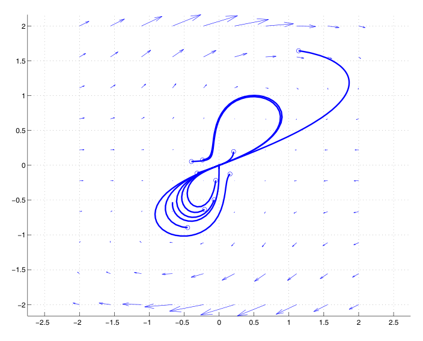
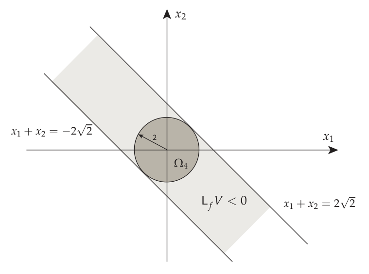
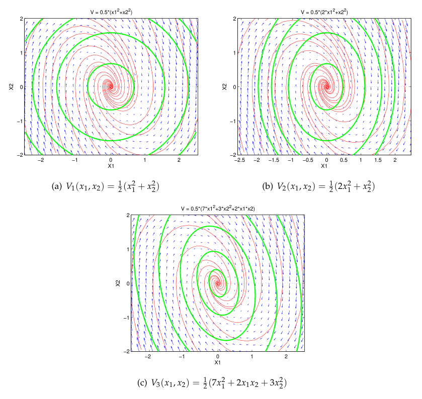
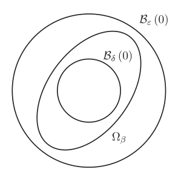
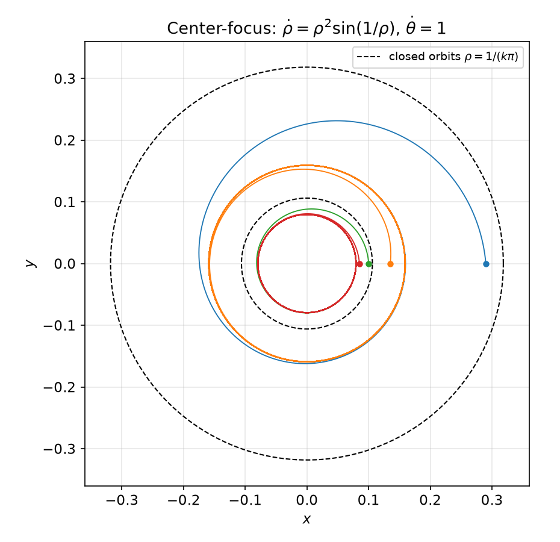
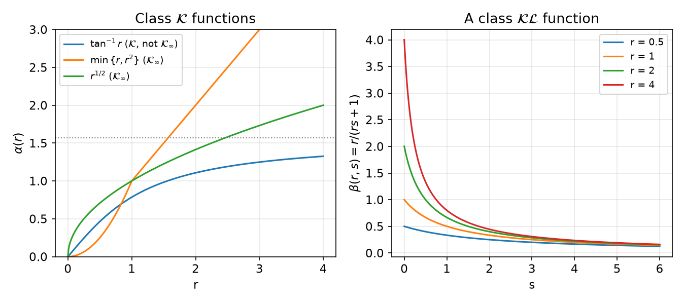
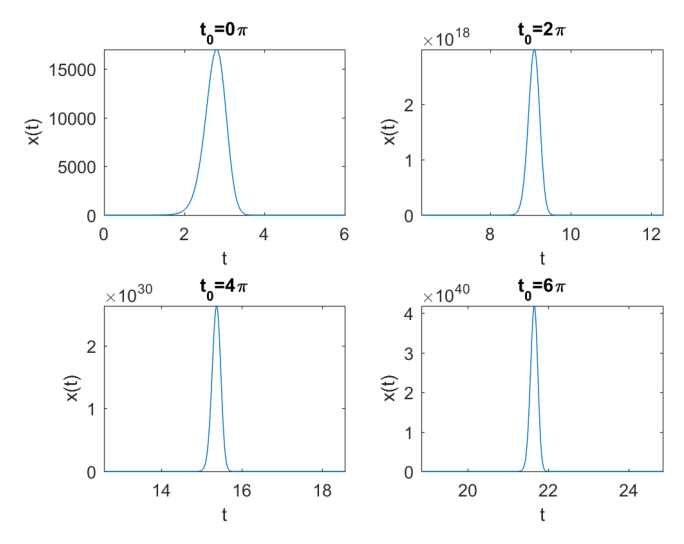
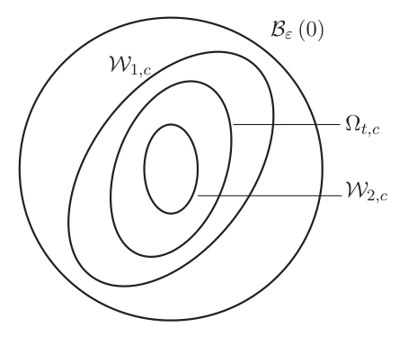
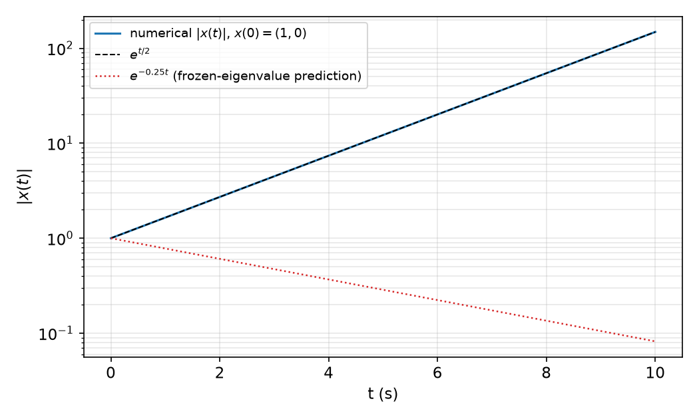
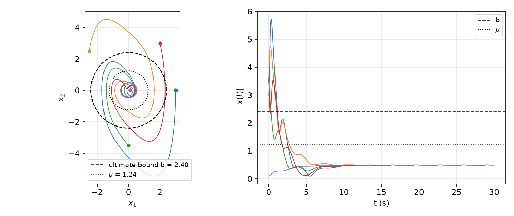

# Lyapunov Theory: Advanced Topics

The introductory chapters on [Lyapunov theory](lyapunov.md) and [invariance](invariance.md) present the direct and indirect methods as working tools. This chapter rebuilds the same theory with the precision needed for modern nonlinear control design: every theorem is stated with its hypotheses on the vector field, and most are proved. Along the way we introduce the language of **comparison functions** (classes \\(\mathcal{K}\\), \\(\mathcal{K}\_\infty\\), \\(\mathcal{L}\\), \\(\mathcal{KL}\\)), which turns the \\(\varepsilon\\)–\\(\delta\\) definitions of stability into explicit bounds on solutions. That language is what makes the theory work for **non-autonomous** systems, where uniformity with respect to the initial time becomes the central issue, and it is the language of every later chapter in this part: [input-to-state stability](iss.md), [control Lyapunov functions](clf.md), [backstepping](backstepping.md) and [averaging](averaging.md). The chapter closes with converse theorems, linear time-varying systems, total stability and ultimate boundedness, the tools for systems subject to persistent disturbances.

## Fundamental Concepts

### Norms, Balls and Solutions

Let \\(\lVert \cdot \rVert : \mathbb{R}^n \to \mathbb{R}\\) be any norm. The open ball of radius \\(\delta\\) about \\(x\\) is

\\[
\mathcal{B}\_\delta(x) \stackrel{\text{def}}{=} \\{ y \in \mathbb{R}^n : \lVert y - x \rVert < \delta \\},
\\]

its closure is \\(\operatorname{cl}\mathcal{B}\_\delta(x) = \\{y : \lVert y-x \rVert \le \delta\\}\\), and its boundary is the sphere \\(\partial \mathcal{B}\_\delta(x) = \\{ y : \lVert y - x \rVert = \delta \\} = \operatorname{cl}\mathcal{B}\_\delta(x) \setminus \mathcal{B}\_\delta(x)\\). In \\(\mathbb{R}^2\\) the unit ball is a diamond for \\(\lVert x \rVert\_1 = \lvert x\_1 \rvert + \lvert x\_2 \rvert\\), a disk for the Euclidean norm \\(\lVert x \rVert\_2\\), and a square for \\(\lVert x \rVert\_\infty = \max\\{\lvert x\_1\rvert, \lvert x\_2\rvert\\}\\), nested in that order. Because all norms on \\(\mathbb{R}^n\\) are equivalent, every stability notion below is independent of which norm is used; only constants change.

We study the autonomous system

\\[
\dot x = f(x), \qquad x(0) = x\_0, \qquad f : D \to \mathbb{R}^n, \tag{1}
\\]

with \\(D \subseteq \mathbb{R}^n\\) open. A **solution** through \\(x\_0 \in D\\) is a function \\(\phi(t; x\_0)\\) with \\(\frac{d}{dt}\phi(t;x\_0) = f(\phi(t;x\_0))\\) for all \\(t \in \mathcal{T}\\), where \\(\mathcal{T} = [0,\infty)\\) if the solution exists for all forward time and \\(\mathcal{T} = [0, T\_{\max})\\) otherwise; the maximal existence time \\(T\_{\max}\\) generally depends on \\(x\_0\\). If \\(\lVert \phi(t;x\_0) \rVert \to \infty\\) as \\(t \to T\_{\max} < \infty\\) the solution has a **finite escape time**. When the initial condition is clear we write simply \\(\phi(t)\\) or \\(x(t)\\).

What can be said about solutions depends on the regularity of \\(f\\):

| Hypothesis on \\(f\\) | Conclusion |
|---|---|
| continuous | local existence (Peano) |
| locally Lipschitz | local existence and uniqueness |
| globally Lipschitz | global existence and uniqueness |

If \\(f\\) is locally Lipschitz and \\(\phi(t;x\_0)\\) is defined on \\([0,T]\\), then \\(x\_0 \mapsto \phi(T;x\_0)\\) is continuous: solutions depend continuously on initial conditions over **finite** intervals. Lyapunov stability will be exactly the extension of this property to the infinite interval \\([0,\infty)\\).

**Definition (Equilibrium).** An **equilibrium** of (1) is a constant solution, \\(\phi(t;x\_e) = x\_e\\) for all \\(t \ge 0\\). Equivalently, \\(x\_e \in D\\) is an equilibrium if and only if \\(f(x\_e) = 0\\).

Shifting coordinates \\(\tilde x = x - x\_e\\) moves any equilibrium to the origin, so without loss of generality \\(x\_e = 0\\).

### Stability, Attractivity, Asymptotic and Exponential Stability

**Definition (Lyapunov stability).** The origin is **Lyapunov stable** if for every \\(\varepsilon > 0\\) there is \\(\delta = \delta(\varepsilon) > 0\\) such that \\(x\_0 \in \mathcal{B}\_\delta(0)\\) implies \\(\phi(t;x\_0) \in \mathcal{B}\_\varepsilon(0)\\) for all \\(t \ge 0\\). If it is not stable it is **unstable**.

**Definition (Attractivity).** The origin is **attractive** if there is \\(\delta > 0\\) such that \\(x\_0 \in \mathcal{B}\_\delta(0)\\) implies \\(\lim\_{t\to\infty} \phi(t;x\_0) = 0\\).

Attractivity does not forbid trajectories from leaving \\(\mathcal{B}\_\delta(0)\\) on the way; it only requires that they *eventually* enter every neighborhood of the origin and stay there. Stability and attractivity are logically independent properties. A linear center is stable but not attractive. The converse situation, attractive but unstable, is subtler and needs a nonlinear example.

**Example 1 (Attractive but unstable equilibrium).** Consider the Vinograd-type system

\\[
\dot x\_1 = \frac{x\_1^2 (x\_2 - x\_1) + x\_2^5}{(x\_1^2 + x\_2^2)\big(1 + (x\_1^2+x\_2^2)^2\big)}, \qquad
\dot x\_2 = \frac{x\_2^2 (x\_2 - 2x\_1)}{(x\_1^2 + x\_2^2)\big(1 + (x\_1^2+x\_2^2)^2\big)},
\\]

with \\(\dot x = 0\\) at the origin. Every trajectory converges to the origin, but trajectories starting arbitrarily close to it first make an excursion of fixed size (a loop reaching \\(x\_2 \approx 1\\)) before returning. No \\(\delta\\) works for \\(\varepsilon < 1\\), so the origin is attractive but not stable.

*Figure: phase portrait of Example 1. Circles mark initial conditions. Trajectories starting very near the origin (for instance at \\((0.2, 0.2)\\) or \\((-0.4, 0.05)\\)) make a large figure-eight excursion before entering the origin tangentially; the origin attracts everything but is not Lyapunov stable.*

**Definition (Asymptotic stability).** The origin is **(locally) asymptotically stable** (AS) if it is both Lyapunov stable and attractive.

Two questions follow immediately: how large is the set of initial conditions that converge, and how fast do they converge?

**Definition (Region of attraction).** For an asymptotically stable origin, the **region of attraction** is \\(\mathcal{A} = \\{x\_0 \in D : \lim\_{t\to\infty}\phi(t;x\_0) = 0\\}\\). If \\(\mathcal{A} = D = \mathbb{R}^n\\), the origin is **globally asymptotically stable** (GAS).

The region of attraction is open, connected and invariant, and its boundary is formed by trajectories.

**Definition (Exponential stability).** The origin is **(locally) exponentially stable** (ES) if there are \\(\mu, \alpha, \delta > 0\\) such that

\\[
\lVert \phi(t;x\_0) \rVert \le \mu \lVert x\_0 \rVert e^{-\alpha t}, \qquad \forall t \ge 0, \quad \forall x\_0 \in \mathcal{B}\_\delta(0).
\\]

If the bound holds for every \\(x\_0 \in \mathbb{R}^n\\), the origin is **globally exponentially stable** (GES).

ES implies AS (take \\(\delta(\varepsilon) = \min\\{\delta, \varepsilon/\mu\\}\\)) and additionally fixes a rate. An equilibrium that is AS but not ES is sometimes called **weakly** asymptotically stable; \\(\dot x = -x^3\\) is the standard example.

### Invariance and the Lie Derivative

**Definition (Invariant sets).** A set \\(S \subseteq D\\) is **positively invariant** if \\(x\_0 \in S\\) implies \\(\phi(t;x\_0) \in S\\) for all \\(t \ge 0\\); **negatively invariant** if the same holds for all \\(t \le 0\\); and **invariant** if both hold. Every equilibrium is an invariant singleton.

**Definition (Lie derivative).** For \\(V : D \to \mathbb{R}\\) of class \\(C^1\\), the **Lie derivative** of \\(V\\) along \\(f\\) is

\\[
L\_f V(x) \stackrel{\text{def}}{=} \nabla V(x) f(x) = \frac{\partial V}{\partial x} f(x) = \sum\_{i=1}^n \frac{\partial V}{\partial x\_i} f\_i(x).
\\]

The common notation \\(\dot V(x)\\) for \\(L\_fV(x)\\) is a slight abuse, since \\(V\\) depends on \\(x\\), not on \\(t\\). Its justification is the chain rule: along a solution \\(x(t) = \phi(t;x\_0)\\),

\\[
\frac{d}{dt} V(x(t)) = \nabla V(x(t))\\, \dot x(t) = \nabla V(x(t))\\, f(x(t)) = L\_f V(x(t)).
\\]

So \\(L\_f V\\) is a function on state space whose value at \\(x\\) is the rate of change of \\(V\\) along the trajectory passing through \\(x\\). We write \\(\dot V\\) when we evaluate it along specific trajectories.

A remarkable number of results in nonlinear control rest on the following lemma.

**Lemma 1 (Positively invariant sublevel sets).** Let \\(N \subseteq D\\) and let \\(V \in C^1\\) satisfy \\(L\_f V(x) \le 0\\) for all \\(x \in N\\). If for some \\(c \in \mathbb{R}\\) the **sublevel set**

\\[
\Omega\_c \stackrel{\text{def}}{=} \\{ x \in D : V(x) \le c \\}
\\]

is contained in \\(N\\), then \\(\Omega\_c\\) is positively invariant.

*Proof.* Let \\(x(0) \in \Omega\_c\\). As long as \\(x(t)\\) remains in \\(N\\), \\(\dot V(x(t)) = L\_fV(x(t)) \le 0\\), so

\\[
V(x(t)) = V(x(0)) + \int\_0^t \dot V(x(s))\\, ds \le V(x(0)) \le c,
\\]

i.e. \\(x(t) \in \Omega\_c \subseteq N\\). The trajectory therefore can never reach a point of \\(D\\) outside \\(N\\) without first leaving \\(\Omega\_c\\), which it cannot do. Hence \\(x(t) \in \Omega\_c\\) for all \\(t \ge 0\\) in the interval of existence. \\(\blacksquare\\)

Since \\(\Omega\_{c\_1} \subseteq \Omega\_{c\_2}\\) whenever \\(c\_1 \le c\_2\\), if \\(\Omega\_{c^\*} \subseteq N\\) then every \\(\Omega\_c\\) with \\(c \le c^\*\\) is positively invariant. In words: *sublevel sets of \\(V\\) contained in a region where \\(L\_fV\\) is non-positive are positively invariant.* The boundary \\(\partial\Omega\_c = \\{V = c\\}\\) is the corresponding **level set**. Two things the lemma does **not** say: (a) that \\(N\\) itself is positively invariant (trajectories starting in \\(N\\) but outside \\(\Omega\_c\\) may leave \\(N\\)); and (b) that solutions exist for all \\(t \ge 0\\), since \\(\Omega\_c\\) may be unbounded.

**Example 2 (Largest invariant disk).** Consider

\\[
\dot x\_1 = -2x\_1 - x\_2^2, \qquad \dot x\_2 = -x\_2 - x\_1^2,
\\]

whose linearization \\(\operatorname{diag}(-2,-1)\\) shows the origin is locally AS. We look for the largest \\(c\\) such that the disk \\(\\{x\_1^2 + x\_2^2 \le c\\}\\) is positively invariant. With \\(V = x\_1^2 + x\_2^2\\),

\\[
L\_fV = 2x\_1(-2x\_1 - x\_2^2) + 2x\_2(-x\_2 - x\_1^2) = -4x\_1^2 - 2x\_1x\_2^2 - 2x\_2^2 - 2x\_1^2x\_2
= -\begin{bmatrix} x\_1 & x\_2 \end{bmatrix} \begin{bmatrix} 4 & x\_1 + x\_2 \\\\ x\_1 + x\_2 & 2 \end{bmatrix} \begin{bmatrix} x\_1 \\\\ x\_2 \end{bmatrix}.
\\]

(Check: the off-diagonal terms contribute \\(-2(x\_1+x\_2)x\_1x\_2 = -2x\_1^2x\_2 - 2x\_1x\_2^2\\).) The matrix is positive definite iff its determinant \\(8 - (x\_1+x\_2)^2\\) is positive, so \\(L\_fV < 0\\) on the strip \\(N = \\{ \lvert x\_1 + x\_2 \rvert < 2\sqrt2 \\}\\) minus the origin. The distance from the origin to the line \\(x\_1 + x\_2 = 2\sqrt2\\) is \\(2\sqrt2/\sqrt2 = 2\\), so the largest disk in the strip has radius \\(2\\) and \\(c = 4\\). On the closed strip \\(\lvert x\_1 + x\_2 \rvert \le 2\sqrt2\\) the matrix is still positive semidefinite, so \\(L\_fV \le 0\\) there, and \\(\Omega\_4\\) (which touches the boundary lines only at \\(\pm(\sqrt2, \sqrt2)\\)) lies in it. By Lemma 1, \\(\Omega\_c\\) is positively invariant for every \\(c \le 4\\). We do *not* know whether the strip itself is positively invariant.

*Figure: Example 2. The shaded strip between \\(x\_1 + x\_2 = \pm 2\sqrt2\\) is where \\(L\_fV < 0\\); the darker disk \\(\Omega\_4\\) of radius 2 is the largest sublevel set of \\(V = x\_1^2 + x\_2^2\\) that fits inside, and is therefore positively invariant.*

## Lyapunov's Direct Method

The introductory treatment is in [Lyapunov theory](lyapunov.md); here we restate the results carefully and prove them.

### Positive Definite Functions

**Definition (Definite functions).** A continuous \\(V : \mathbb{R}^n \to \mathbb{R}\\) is **locally positive semidefinite** if \\(V(0) = 0\\) and there is a neighborhood \\(D\\) of the origin on which \\(V(x) \ge 0\\); **locally positive definite** (PD) if in addition \\(V(x) > 0\\) on \\(D \setminus \\{0\\}\\). If \\(D = \mathbb{R}^n\\) the word "locally" is dropped. \\(V\\) is (locally) negative (semi)definite if \\(-V\\) is (locally) positive (semi)definite.

**Example 3.** The functions \\(x^2\\), \\(x\_1^2 + x\_2^2\\) and \\(x^\top P x\\) with \\(P = P^\top > 0\\) are positive definite. \\(1 - \cos x\\) is locally but not globally PD (it vanishes at \\(x = 2\pi\\)). \\(1 - e^{-x^2}\\) is PD on all of \\(\mathbb{R}\\).

For a locally PD function the origin is an isolated strict local minimum. The converse fails in general, but a second-order test is available.

**Proposition 1 (Second-derivative test).** Let \\(V \in C^2\\) with (i) \\(V(0) = 0\\), (ii) \\(\frac{\partial V}{\partial x}(0) = 0\\), and (iii) \\(\frac{\partial^2 V}{\partial x^2}(0) > 0\\). Then \\(V\\) is locally positive definite.

*Proof.* Write \\(H = \frac{\partial^2 V}{\partial x^2}(0)\\). Taylor's theorem gives

\\[
V(x) = V(0) + \frac{\partial V}{\partial x}(0) x + \tfrac12 x^\top H x + r\_2(x) = \tfrac12 x^\top H x + r\_2(x), \qquad \lim\_{x \to 0} \frac{r\_2(x)}{\lVert x \rVert^2} = 0.
\\]

Pick \\(0 < \varepsilon < \tfrac12 \lambda\_{\min}(H)\\). There is \\(\delta > 0\\) with \\(\lvert r\_2(x) \rvert < \varepsilon \lVert x \rVert^2\\) for \\(\lVert x \rVert < \delta\\) (Euclidean norm). Then for \\(0 < \lVert x \rVert < \delta\\),

\\[
V(x) \ge \tfrac12 \lambda\_{\min}(H) \lVert x \rVert^2 - \lvert r\_2(x) \rvert > \big(\tfrac12 \lambda\_{\min}(H) - \varepsilon\big) \lVert x \rVert^2 > 0. \qquad \blacksquare
\\]

**Example 4.** \\(V(x) = 1 - \cos x\_1 + x\_2^2\\) has \\(V(0) = 0\\), gradient \\(\begin{bmatrix} \sin x\_1 & 2x\_2 \end{bmatrix}\\) vanishing at the origin, and Hessian \\(\operatorname{diag}(\cos x\_1, 2)\\), which equals \\(\operatorname{diag}(1,2) > 0\\) at the origin. Hence \\(V\\) is locally PD.

The geometry of sublevel sets is what the proofs use. Near the origin they are always well behaved:

**Fact 1 (Small sublevel sets are compact).** Let \\(V\\) be continuous and locally PD. There is \\(c^\* > 0\\) such that for all \\(0 \le c < c^\*\\) the connected component of \\(\Omega\_c\\) containing the origin is bounded (indeed compact).

*Proof.* Choose \\(r > 0\\) with \\(V > 0\\) on \\(\operatorname{cl}\mathcal{B}\_r(0) \setminus \\{0\\}\\), and let \\(c^\* = \min\\{V(x) : \lVert x \rVert = r\\}\\); the minimum exists because the sphere is compact, and it is positive. For \\(c < c^\*\\), no point \\(x\\) with \\(\lVert x \rVert = r\\) lies in \\(\Omega\_c\\), since \\(V(x) \ge c^\* > c\\). A connected set containing the origin and a point outside \\(\mathcal{B}\_r(0)\\) would have to cross the sphere, so the component of \\(\Omega\_c\\) through the origin lies inside \\(\mathcal{B}\_r(0)\\) and is bounded. It is also closed (the preimage of the closed set \\((-\infty, c]\\) under a continuous map is closed, and components of closed sets are closed), hence compact. \\(\blacksquare\\)

For global results we need sublevel sets that are bounded for every \\(c\\).

**Definition (Radially unbounded).** \\(V\\) is **radially unbounded** if \\(V(x) \to \infty\\) as \\(\lVert x \rVert \to \infty\\), in every direction.

**Example 5.** \\(x^2\\) and \\(x^\top P x\\) (\\(P > 0\\)) are radially unbounded. \\(1 - e^{-x^2}\\) is PD but not radially unbounded: it tends to 1. The function \\(x\_1^2 - x\_2^2\\) is not radially unbounded either, even though it grows along the \\(x\_1\\)-axis; it is identically zero along the lines \\(x\_2 = \pm x\_1\\). A subtler example from the basic chapter is \\(V = x\_1^2/(1 + x\_1^2) + x\_2^2\\), which grows along every ray off the \\(x\_1\\)-axis but has unbounded sublevel sets \\(\\{V \le c\\}\\) for \\(c \ge 1\\).

**Proposition 2.** If \\(V\\) is continuous and radially unbounded, \\(\Omega\_c\\) is bounded for every \\(c > 0\\).

*Proof.* For any \\(c\\) there is \\(r\\) with \\(V(x) > c\\) whenever \\(\lVert x \rVert > r\\), so \\(\Omega\_c \subset \operatorname{cl}\mathcal{B}\_r(0)\\). \\(\blacksquare\\)

**Definition (Proper).** \\(V\\) is **proper** if \\(\Omega\_c\\) is compact for every \\(c > 0\\). A continuous radially unbounded function is proper.

### Lyapunov Functions and the Main Theorems

**Definition (Lyapunov functions).** A \\(C^1\\) function \\(V : D \to \mathbb{R}\\) that is locally PD is a **Lyapunov function candidate**. If in addition \\(L\_fV\\) is locally negative definite, \\(V\\) is a **(strong) Lyapunov function**; if \\(L\_fV\\) is only negative semidefinite, \\(V\\) is a **weak Lyapunov function**.

**Theorem 1 (Lyapunov: stability).** Let \\(f : D \to \mathbb{R}^n\\), \\(D\\) open, \\(0 \in D\\), \\(f(0) = 0\\), and let \\(f\\) be continuous on \\(D \setminus \\{0\\}\\). If there is a \\(C^1\\) positive definite \\(V\\) with \\(L\_fV(x) \le 0\\) in a neighborhood of the origin, the origin is Lyapunov stable.

**Theorem 2 (Lyapunov: asymptotic stability).** Under the same hypotheses on \\(f\\), if there is a \\(C^1\\) positive definite \\(V\\) with \\(L\_fV\\) locally negative definite, the origin is asymptotically stable. If moreover \\(D = \mathbb{R}^n\\), \\(V\\) is radially unbounded and \\(L\_fV(x) < 0\\) for all \\(x \ne 0\\), the origin is globally asymptotically stable.

Lyapunov stability is intrinsically local. Some authors say "globally stable" for "stable with all trajectories bounded"; this usage is nonstandard. The existence of a strong Lyapunov function is *sufficient* for AS, and Lyapunov functions are never unique: if \\(V\\) is one, so is \\(\lambda V\\) for any \\(\lambda > 0\\) (and, more generally, \\(\varphi \circ V\\) for suitable \\(\varphi\\), see Fact 2 below).

The theorems decide stability *without solving the differential equation*, which is possible because stability is an asymptotic property as \\(t \to \infty\\) that only requires the monotonic behavior of a single scalar function.

**Example 6.** For \\(\dot x\_1 = x\_2\\), \\(\dot x\_2 = -x\_1^2 x\_2 - x\_1\\), take \\(V = \tfrac12(x\_1^2 + x\_2^2)\\):

\\[
L\_fV = x\_1 x\_2 + x\_2(-x\_1^2x\_2 - x\_1) = -x\_1^2 x\_2^2 \le 0,
\\]

so the origin is stable by Theorem 1. (LaSalle's principle below will upgrade this to GAS.)

**Example 7 (First integral).** For \\(\dot x\_1 = x\_2^3\\), \\(\dot x\_2 = -x\_1^3\\), take \\(V = \tfrac14(x\_1^4 + x\_2^4)\\), which is PD and radially unbounded. Then \\(L\_fV = x\_1^3 x\_2^3 - x\_2^3 x\_1^3 = 0\\): the origin is stable and every trajectory is bounded. Since \\(V(\phi(t;x\_0)) = V(x\_0)\\) for all \\(t\\), \\(V\\) is a **first integral**: trajectories are the closed level curves of \\(V\\).

**Example 8 (GAS).** For

\\[
\dot x\_1 = -x\_1 - 2x\_2^2, \qquad \dot x\_2 = x\_1 x\_2 - x\_2^3,
\\]

take \\(V = x\_1^2 + 2x\_2^2\\), PD and radially unbounded. Then

\\[
L\_fV = 2x\_1(-x\_1 - 2x\_2^2) + 4x\_2(x\_1x\_2 - x\_2^3) = -2x\_1^2 - 4x\_1x\_2^2 + 4x\_1x\_2^2 - 4x\_2^4 = -2x\_1^2 - 4x\_2^4,
\\]

which is negative for all \\(x \ne 0\\). The cross terms cancel exactly, which is how \\(V\\) was chosen. The origin is GAS by Theorem 2.

**Example 9 (The choice of candidate matters).** Consider the linear system \\(\dot x\_1 = x\_2\\), \\(\dot x\_2 = -2x\_1 - x\_2\\), whose eigenvalues \\(\tfrac12(-1 \pm i\sqrt7)\\) make the origin a stable focus. Three candidates give three different answers:

- \\(V\_1 = \tfrac12(x\_1^2 + x\_2^2)\\): \\(L\_fV\_1 = x\_1x\_2 + x\_2(-2x\_1 - x\_2) = -x\_2^2 - x\_1x\_2\\), which takes both signs in every neighborhood of the origin. No conclusion.
- \\(V\_2 = \tfrac12(2x\_1^2 + x\_2^2)\\): \\(L\_fV\_2 = 2x\_1x\_2 + x\_2(-2x\_1 - x\_2) = -x\_2^2 \le 0\\). Stable, by Theorem 1.
- \\(V\_3 = \tfrac12(7x\_1^2 + 2x\_1x\_2 + 3x\_2^2)\\): \\(\nabla V\_3 = \begin{bmatrix} 7x\_1 + x\_2 & x\_1 + 3x\_2 \end{bmatrix}\\), so

\\[
L\_fV\_3 = (7x\_1 + x\_2)x\_2 + (x\_1 + 3x\_2)(-2x\_1 - x\_2) = 7x\_1x\_2 + x\_2^2 - 2x\_1^2 - 7x\_1x\_2 - 3x\_2^2 = -2(x\_1^2 + x\_2^2).
\\]

GAS, by Theorem 2. Only \\(V\_3\\) is a strong Lyapunov function. Even for a two-dimensional linear system, a Lyapunov function proving AS is not obvious; for linear systems the systematic way to find one is the Lyapunov equation below (\\(V\_3\\) is \\(x^\top P x\\) with \\(P\\) solving \\(A^\top P + PA = -2I\\)).

*Figure: Example 9, with the vector field (blue), trajectories (red) and level sets (green). (a) For \\(V\_1\\), trajectories cross some circles outward: \\(L\_fV\_1\\) is indefinite. (b) For \\(V\_2\\), trajectories never cross outward but are tangent to the level sets on the \\(x\_1\\)-axis, where \\(L\_fV\_2 = 0\\): a weak Lyapunov function. (c) For \\(V\_3\\), trajectories always cross the tilted ellipses inward: a strong Lyapunov function.*

### Proofs of Lyapunov's Theorems

Lyapunov's original theorem assumed \\(f\\) analytic. That is far more than needed: Theorems 1 and 2 do not even require continuity of \\(f\\) at the origin. What the proofs really use is that sublevel sets of a Lyapunov function are positively invariant.

**Lemma 2.** If \\(V\\) is locally PD and \\(L\_fV \le 0\\) on \\(D\\), then every sublevel set \\(\Omega\_c = \\{x \in D : V(x) \le c\\}\\) contained in \\(D\\) (more precisely, the component through the origin, for \\(c\\) small) is positively invariant.

This is Lemma 1 with \\(N = D\\).

*Proof of Theorem 1.* Let \\(\varepsilon > 0\\) and shrink it so that \\(\operatorname{cl}\mathcal{B}\_\varepsilon(0) \subset D\\) and \\(V > 0\\), \\(L\_fV \le 0\\) there. Let

\\[
\alpha = \min\_{\lVert x \rVert = \varepsilon} V(x) > 0,
\\]

which exists by compactness and is positive by local positive definiteness. Choose \\(0 < \beta < \alpha\\) and let \\(\Omega\_\beta\\) denote the component of \\(\\{V \le \beta\\}\\) containing the origin. Then \\(\Omega\_\beta \subset \mathcal{B}\_\varepsilon(0)\\): a point \\(x^\*\\) of \\(\Omega\_\beta\\) on the sphere \\(\lVert x \rVert = \varepsilon\\) would satisfy \\(V(x^\*) \ge \alpha > \beta\\). Because \\(V\\) is continuous and \\(V(0) = 0\\), there is \\(\delta > 0\\) with \\(V(x) < \beta\\) whenever \\(\lVert x \rVert < \delta\\); thus \\(\mathcal{B}\_\delta(0) \subset \Omega\_\beta \subset \mathcal{B}\_\varepsilon(0)\\). If \\(\lVert x(0) \rVert < \delta\\), then \\(x(0) \in \Omega\_\beta\\), and by Lemma 2 \\(x(t) \in \Omega\_\beta \subset \mathcal{B}\_\varepsilon(0)\\) for all \\(t \ge 0\\). (Boundedness also rules out finite escape, so the solution exists for all \\(t \ge 0\\).) \\(\blacksquare\\)

*Figure: the sets in the proof of Theorem 1. The sublevel set \\(\Omega\_\beta\\) is squeezed between \\(\mathcal{B}\_\delta(0)\\) and \\(\mathcal{B}\_\varepsilon(0)\\); trajectories starting in the small ball are trapped in \\(\Omega\_\beta\\) and so never leave the large one.*

*Proof of Theorem 2.* Stability follows from Theorem 1. Take \\(\Omega\_\beta\\) as in that proof, compact, positively invariant, with \\(L\_fV < 0\\) on \\(\Omega\_\beta \setminus \\{0\\}\\), and \\(x(0) \in \Omega\_\beta\\). The function \\(t \mapsto V(x(t))\\) is nonincreasing and bounded below by 0, so \\(\lim\_{t\to\infty}V(x(t)) = c \ge 0\\) exists. Suppose \\(c > 0\\). By continuity of \\(V\\) there is \\(d > 0\\) with \\(\mathcal{B}\_d(0) \subset \\{V < c\\}\\); since \\(V(x(t)) \ge c\\) for all \\(t\\), the trajectory stays in the compact set \\(K = \Omega\_\beta \setminus \mathcal{B}\_d(0)\\). The continuous function \\(L\_fV\\) attains a maximum \\(-\gamma < 0\\) on \\(K\\). Then

\\[
V(x(t)) = V(x(0)) + \int\_0^t \dot V(x(s))\\, ds \le V(x(0)) - \gamma t,
\\]

which is less than \\(c\\) for \\(t > (V(x(0)) - c)/\gamma\\), a contradiction. Hence \\(V(x(t)) \to 0\\). Finally \\(V(x(t)) \to 0\\) forces \\(x(t) \to 0\\): otherwise there would be \\(d' > 0\\) and \\(t\_k \to \infty\\) with \\(x(t\_k) \in \Omega\_\beta \setminus \mathcal{B}\_{d'}(0)\\), where \\(V\\) has a positive minimum.

*Global part.* If \\(V\\) is radially unbounded, every \\(x(0) \in \mathbb{R}^n\\) lies in some bounded sublevel set \\(\Omega\_c\\) (Proposition 2), which is positively invariant by Lemma 1; the argument above applies verbatim with \\(\Omega\_c\\) in place of \\(\Omega\_\beta\\). \\(\blacksquare\\)

### Converse Theorem and Scalar Systems

The direct method gives sufficient conditions. For asymptotic stability they are also necessary:

**Theorem 3 (Converse Lyapunov theorem, Kurzweil).** If \\(f\\) is continuous and the origin of (1) is locally asymptotically stable, then there is a Lyapunov function for (1) that is \\(C^\infty\\) in a neighborhood of the origin.

Kurzweil's version does not need uniqueness of solutions; the earlier versions of Malkin and Massera assume it. Converse theorems for non-autonomous systems are given later in this chapter.

Finding Lyapunov functions is hard in general but easy in two important cases: scalar systems and linear systems.

**Proposition 3 (Scalar systems).** Let \\(\dot x = f(x)\\), \\(x \in \mathbb{R}\\), with \\(f\\) continuous and \\(f(0) = 0\\). The origin is GAS if and only if \\(x f(x) < 0\\) for all \\(x \ne 0\\).

*Proof.* Sufficiency: \\(V = x^2\\) is PD, radially unbounded, and \\(L\_fV = 2xf(x) < 0\\) for \\(x \ne 0\\). Necessity: if \\(f(x\_1) \ge 0\\) for some \\(x\_1 > 0\\), then either \\(f(x\_1) = 0\\) (another equilibrium, so not GAS) or the solution through \\(x\_1\\) can never decrease below \\(x\_1\\) (in one dimension a trajectory cannot cross the equilibria of \\(f\\) and moves monotonically), contradicting convergence; similarly for \\(x < 0\\). \\(\blacksquare\\)

**Proposition 4 (Scalar systems, local test).** Let \\(f \in C^k\\) with \\(f(0) = f'(0) = \dots = f^{(k-1)}(0) = 0\\) and \\(f^{(k)}(0) = a \ne 0\\), so that

\\[
f(x) = \frac{a}{k!} x^k + r\_k(x), \qquad \lim\_{x\to0} \frac{r\_k(x)}{x^k} = 0.
\\]

The origin of \\(\dot x = f(x)\\) is locally AS if and only if \\(k\\) is odd and \\(a < 0\\).

*Proof.* Write \\(\bar a = a/k!\\). Near the origin the sign of \\(f(x)\\) equals the sign of \\(\bar a x^k\\). If \\(k\\) is odd and \\(a < 0\\), \\(x f(x) \approx \bar a x^{k+1} < 0\\) for small \\(x \ne 0\\), and \\(V = x^2\\) proves local AS as in Proposition 3. If \\(k\\) is even, \\(f\\) has the same sign on both sides of the origin, so trajectories on one side move away; if \\(k\\) is odd and \\(a > 0\\), \\(xf(x) > 0\\) and all nearby trajectories move away. \\(\blacksquare\\)

For scalar systems \\(V = x^2\\) can always be used, but other choices are sometimes more natural.

**Example 10.** Let \\(\dot x = -g(x)\\) on \\((-a, a)\\) with \\(g\\) continuous, \\(g(0) = 0\\) and \\(xg(x) > 0\\) for \\(x \ne 0\\). Take

\\[
V(x) = \int\_0^x g(y)\\, dy .
\\]

Then \\(V(0) = 0\\), \\(V(x) > 0\\) for \\(x \ne 0\\) (the integrand has the sign of \\(y\\)), and \\(L\_fV = g(x)\cdot(-g(x)) = -g^2(x) < 0\\) for \\(x \ne 0\\). The origin is locally AS. (Of course \\(V = x^2\\) also works.)

## Instability

The origin is **unstable** if there is \\(\varepsilon > 0\\) such that for every \\(\delta > 0\\) there are \\(x\_0 \in \mathcal{B}\_\delta(0)\\) and \\(T > 0\\) with \\(\phi(T;x\_0) \notin \mathcal{B}\_\varepsilon(0)\\). Instability is proved by exhibiting a function that is forced to *grow* along some trajectories starting arbitrarily close to the origin.

**Theorem 4 (Instability).** Let \\(V \in C^1\\) and suppose there are \\(c > 0\\) and \\(\varepsilon > 0\\) with \\(\operatorname{cl}\mathcal{B}\_\varepsilon(0) \subset D\\) such that

\\[
W(x) \stackrel{\text{def}}{=} L\_fV(x) - cV(x) \ge 0 \quad \forall x \in \mathcal{B}\_\varepsilon(0), \qquad\qquad 0 \in \operatorname{cl}\\{x : V(x) > 0\\}.
\\]

Then the origin is unstable.

*Proof.* The second condition says there are points \\(x\_0\\) arbitrarily close to the origin with \\(V(x\_0) > 0\\). Take such an \\(x\_0 \in \mathcal{B}\_\delta(0)\\), \\(\delta < \varepsilon\\). As long as \\(x(t) \in \mathcal{B}\_\varepsilon(0)\\), \\(\dot V \ge c V\\), so \\(\frac{d}{dt}\big(e^{-ct}V(x(t))\big) = e^{-ct}(\dot V - cV) \ge 0\\) and

\\[
V(x(t)) \ge V(x\_0) e^{ct}.
\\]

But \\(V\\) is bounded on the compact set \\(\operatorname{cl}\mathcal{B}\_\varepsilon(0)\\), say by \\(M\\). Hence the trajectory must leave \\(\mathcal{B}\_\varepsilon(0)\\) no later than \\(t = c^{-1}\ln(M/V(x\_0))\\). Since \\(\delta\\) was arbitrary, the origin is unstable. \\(\blacksquare\\)

A closely related and frequently used result is Chetaev's theorem, which needs only a sign condition on \\(\dot V\\) in the region where \\(V > 0\\).

**Theorem 5 (Chetaev).** Let \\(V \in C^1\\) with \\(V(0) = 0\\) and \\(V(x\_0) > 0\\) for some \\(x\_0\\) of arbitrarily small norm. Let \\(r > 0\\) with \\(\operatorname{cl}\mathcal{B}\_r(0) \subset D\\), and \\(U = \\{x \in \mathcal{B}\_r(0) : V(x) > 0\\}\\). If \\(L\_fV(x) > 0\\) on \\(U\\), the origin is unstable.

*Proof sketch.* Take \\(x\_0 \in U\\) close to the origin, with \\(V(x\_0) = a > 0\\). Along the solution \\(V\\) increases, so the trajectory cannot leave \\(U\\) through the surface \\(V = 0\\). On the compact set \\(\\{x \in \operatorname{cl}\mathcal{B}\_r(0) : V(x) \ge a\\}\\), \\(L\_fV\\) has a positive minimum \\(\gamma\\), so \\(V(x(t)) \ge a + \gamma t\\) as long as \\(x(t) \in \mathcal{B}\_r(0)\\). Since \\(V\\) is bounded on the ball, the trajectory must leave it through the sphere \\(\lVert x \rVert = r\\). \\(\blacksquare\\)

Theorem 4 is what we use below to prove the instability half of the indirect method.

## Linear Time-Invariant Systems

For \\(\dot x = Ax\\) the origin is the unique (isolated) equilibrium iff \\(\det A \ne 0\\). The material here is developed in detail in [linear stability](../linear/stability.md); we collect the results needed later and prove the key one.

**Definition.** \\(A\\) is **Lyapunov stable** if all its eigenvalues have non-positive real parts and every eigenvalue with zero real part has equal algebraic and geometric multiplicities. \\(A\\) is **asymptotically stable** (Hurwitz) if all eigenvalues have negative real parts.

**Proposition 5.** If there are \\(P > 0\\) and \\(Q \ge 0\\) with

\\[
A^\top P + PA + Q = 0, \tag{2}
\\]

then \\(A\\) is Lyapunov stable.

*Proof.* \\(V = x^\top P x\\) is PD and \\(L\_{Ax}V = x^\top(A^\top P + PA)x = -x^\top Q x \le 0\\); apply Theorem 1. \\(\blacksquare\\)

**Proposition 6 (Lyapunov equation).** Let \\(A\\) be Hurwitz and \\(Q \in \mathbb{R}^{n\times n}\\). Then (2) has the unique solution

\\[
P = \int\_0^\infty e^{A^\top t} Q e^{At}\\, dt. \tag{3}
\\]

If \\(Q \ge 0\\) then \\(P \ge 0\\); if \\(Q > 0\\) then \\(P > 0\\); and if \\(Q \ge 0\\) with \\((A, Q)\\) observable then \\(P > 0\\).

*Proof.* The integral converges because \\(\lVert e^{At} \rVert \le k e^{-\lambda t}\\) for some \\(k, \lambda > 0\\). Substituting,

\\[
A^\top P + PA + Q = \int\_0^\infty \frac{d}{dt}\Big(e^{A^\top t} Q e^{At}\Big)\\, dt + Q = \lim\_{T\to\infty} e^{A^\top T} Q e^{AT} - Q + Q = 0 .
\\]

If \\(Q \ge 0\\) the integrand is PSD, so \\(P \ge 0\\). If \\(Q > 0\\) and \\(x^\top P x = \int\_0^\infty x^\top e^{A^\top t} Q e^{At} x\\, dt = 0\\), then \\(e^{At}x \equiv 0\\), so \\(x = 0\\); thus \\(P > 0\\).

*Uniqueness.* If \\(P\_1\\) and \\(P\_2\\) both solve (2), subtracting gives \\(A^\top(P\_1 - P\_2) + (P\_1 - P\_2)A = 0\\). Hence

\\[
\frac{d}{dt}\Big(e^{A^\top t}(P\_1 - P\_2)e^{At}\Big) = e^{A^\top t}\big(A^\top(P\_1 - P\_2) + (P\_1 - P\_2)A\big)e^{At} = 0,
\\]

and integrating over \\([0,\infty)\\), \\(\lim\_{t\to\infty} e^{A^\top t}(P\_1 - P\_2)e^{At} - (P\_1 - P\_2) = 0 - (P\_1 - P\_2) = 0\\).

*Observable case.* \\(x^\top P x = \int\_0^\infty \lVert Q^{1/2} e^{At}x \rVert^2 dt = 0\\) implies \\(Q^{1/2}e^{At}x \equiv 0\\). Observability of \\((A, Q)\\) is equivalent to observability of \\((A, Q^{1/2})\\) (they have the same kernel), so \\(x = 0\\). \\(\blacksquare\\)

**Theorem 6 (Lyapunov characterizations of Hurwitz matrices).** For \\(A \in \mathbb{R}^{n\times n}\\) the following are equivalent:

1. \\(A\\) is asymptotically stable (Hurwitz);
2. there exist \\(P > 0\\) and \\(Q > 0\\) satisfying (2);
3. for every \\(Q > 0\\) there is a unique \\(P > 0\\) satisfying (2);
4. there exist \\(Q \ge 0\\) with \\((A,Q)\\) observable and \\(P > 0\\) satisfying (2);
5. for every \\(Q \ge 0\\) with \\((A,Q)\\) observable there is a unique \\(P > 0\\) satisfying (2).

*Proof.* (1 ⇒ 3) and (1 ⇒ 5) are Proposition 6. (3 ⇒ 2) and (5 ⇒ 4) are immediate, and (2 ⇒ 4) holds because a positive definite \\(Q\\) makes \\((A, Q)\\) observable. (2 ⇒ 1) is Theorem 2 with \\(V = x^\top P x\\) and \\(L\_{Ax}V = -x^\top Q x\\). It remains to show (4 ⇒ 1). With \\(V = x^\top P x\\), \\(\dot V = -x^\top Q x \le 0\\), so the origin is stable and sublevel sets are compact and invariant. By LaSalle's principle (Theorem 7 below), trajectories converge to the largest invariant set in \\(\\{x : x^\top Q x = 0\\} = \\{x : Q^{1/2} x = 0\\}\\). A trajectory \\(e^{At}x\_0\\) remaining there satisfies \\(Q^{1/2}e^{At}x\_0 \equiv 0\\), which by observability forces \\(x\_0 = 0\\). Hence the origin is GAS, i.e. \\(A\\) is Hurwitz. \\(\blacksquare\\)

Quadratic functions \\(x^\top P x\\) therefore suffice to characterize stability of LTI systems: they admit **quadratic Lyapunov functions**. In linear matrix inequality form, the existence of \\(Q \ge 0\\) in (2) is equivalent to feasibility of \\(A^\top P + PA \le 0\\), \\(P > 0\\), and the existence of \\(Q > 0\\) to feasibility of \\(A^\top P + PA < 0\\), \\(P > 0\\).

## LaSalle's Invariance Principle and Barbalat's Lemma

The basic statements and many applications are in [invariance](invariance.md). LaSalle's principle lets us conclude convergence from a *weak* Lyapunov function, which is usually much easier to find (energy is the typical example).

### Limit Sets

**Definition (Limit points and sets).** A point \\(p\\) is a **positive limit point** of the solution \\(x(t)\\) if there is a sequence \\(t\_n \to \infty\\) with \\(x(t\_n) \to p\\); a **negative limit point** if \\(t\_n \to -\infty\\). The set \\(L^+\\) of positive limit points is the **positive limit set** (or \\(\omega\\)-limit set); the set of negative limit points is the \\(\alpha\\)-limit set. We drop "positive" from now on.

Limit points need not exist: a solution that tends to infinity has none.

**Lemma 3 (Properties of limit sets).** If \\(f\\) is locally Lipschitz and the solution \\(x(t)\\) is bounded for \\(t \ge 0\\), then \\(L^+\\) is nonempty, compact and invariant, and \\(x(t) \to L^+\\) as \\(t \to \infty\\), i.e. \\(\operatorname{dist}(x(t), L^+) = \inf\_{y \in L^+} \lVert x(t) - y \rVert \to 0\\).

Boundedness is essential; it is what the compact positively invariant set provides in the next theorem.

### LaSalle's Theorem

**Theorem 7 (LaSalle's invariance principle).** Let \\(f\\) be locally Lipschitz, \\(\Omega \subset D\\) compact and positively invariant, and \\(V \in C^1\\) with \\(L\_fV(x) \le 0\\) on \\(\Omega\\). Let \\(E = \\{x \in \Omega : L\_fV(x) = 0\\}\\) and let \\(M\\) be the largest invariant set contained in \\(E\\). Then every solution starting in \\(\Omega\\) approaches \\(M\\) as \\(t \to \infty\\).

*Proof.* Let \\(x(0) \in \Omega\\). Then \\(x(t) \in \Omega\\) for all \\(t \ge 0\\), \\(V(x(t))\\) is nonincreasing, and \\(V\\) is bounded below on the compact set \\(\Omega\\); hence \\(\lim\_{t\to\infty}V(x(t)) = a\\) exists. Because \\(\Omega\\) is closed, \\(L^+ \subset \Omega\\). For \\(p \in L^+\\) with \\(x(t\_n) \to p\\), continuity gives \\(V(p) = \lim V(x(t\_n)) = a\\), so \\(V \equiv a\\) on \\(L^+\\). By Lemma 3, \\(L^+\\) is invariant, so a solution starting in \\(L^+\\) stays in it and keeps \\(V\\) constant: \\(L\_fV = 0\\) on \\(L^+\\). Hence \\(L^+ \subseteq E\\), and being invariant, \\(L^+ \subseteq M\\). Since \\(x(t)\\) is bounded, \\(x(t) \to L^+ \subseteq M\\). \\(\blacksquare\\)

Two remarks. First, \\(V\\) need *not* be positive definite. Second, the compact positively invariant set \\(\Omega\\) is a hypothesis; when \\(V\\) is PD, the natural choice is a sublevel set \\(\Omega\_c\\) inside the region where \\(L\_fV \le 0\\) (Lemma 1).

When \\(M = \\{0\\}\\) we recover asymptotic stability:

**Theorem 8 (Barbashin–Krasovskii, local).** Let \\(V : S \to \mathbb{R}\\) be \\(C^1\\) and PD on a neighborhood \\(S\\) of the origin with \\(L\_fV \le 0\\) on \\(S\\), and let \\(E = \\{x \in S : L\_fV(x) = 0\\}\\). If no solution other than \\(x(t) \equiv 0\\) can stay forever in \\(E\\), the origin is asymptotically stable.

**Theorem 9 (Barbashin–Krasovskii, global).** Let \\(D = \mathbb{R}^n\\), \\(V\\) be \\(C^1\\), PD and radially unbounded, with \\(L\_fV \le 0\\) on \\(\mathbb{R}^n\\). If no solution other than \\(x(t) \equiv 0\\) can stay forever in \\(E = \\{L\_fV = 0\\}\\), the origin is globally asymptotically stable.

**Corollary 1.** If, in Theorem 7, \\(V\\) is PD and the largest invariant set \\(M\\) is the origin alone, the origin is locally AS.

**Example 11 (Example 6 revisited).** For \\(\dot x\_1 = x\_2\\), \\(\dot x\_2 = -x\_1^2 x\_2 - x\_1\\) with \\(V = \tfrac12(x\_1^2 + x\_2^2)\\) we found \\(L\_fV = -x\_1^2x\_2^2 \le 0\\). Every \\(\Omega\_c\\) is a compact, positively invariant disk. The set where \\(L\_fV = 0\\) is the union of the coordinate axes:

\\[
E = \\{x\_1 = 0,\ x\_2 \ne 0\\} \cup \\{x\_1 \ne 0,\ x\_2 = 0\\} \cup \\{0\\}.
\\]

On \\(\\{x\_1 = 0, x\_2 \ne 0\\}\\), \\(\dot x\_1 = x\_2 \ne 0\\), so solutions leave immediately. On \\(\\{x\_1 \ne 0, x\_2 = 0\\}\\), \\(\dot x\_2 = -x\_1 \ne 0\\), so they leave as well. The largest invariant set in \\(E\\) is \\(M = \\{0\\}\\): the origin is AS, and since \\(V\\) is radially unbounded, GAS.

LaSalle's principle holds for autonomous systems and, with modifications, for periodic time-varying ones; it fails in general for non-autonomous systems. Its non-autonomous substitute, stated here for reference and proved later as Theorem 26, is:

**Theorem 10 (LaSalle–Yoshizawa).** Let \\(x = 0\\) be an equilibrium of \\(\dot x = f(t,x)\\) with \\(f\\) piecewise continuous in \\(t\\) and locally Lipschitz in \\(x\\). Let \\(V : [t\_0, \infty) \times \mathbb{R}^n \to \mathbb{R}\_+\\) be \\(C^1\\), positive definite and radially unbounded (uniformly in \\(t\\), in the sense of Theorem 26), with

\\[
\frac{\partial V}{\partial t} + \frac{\partial V}{\partial x}f(t,x) \le -W(x) \le 0, \qquad \forall t \ge 0,\ x \in \mathbb{R}^n,
\\]

\\(W\\) continuous. Then all solutions are globally uniformly bounded and \\(\lim\_{t\to\infty} W(x(t)) = 0\\). If \\(W\\) is positive definite, the origin is globally uniformly asymptotically stable.

### Barbalat's Lemma

**Theorem 11 (Barbalat's lemma).** Let \\(g : [t\_0, \infty) \to \mathbb{R}\\) be uniformly continuous, and suppose \\(\lim\_{t\to\infty}\int\_{t\_0}^t g(\tau)\\, d\tau\\) exists and is finite. Then \\(g(t) \to 0\\) as \\(t \to \infty\\).

*Proof.* Suppose not. Then there are \\(\varepsilon > 0\\) and \\(t\_n \to \infty\\) with \\(\lvert g(t\_n) \rvert \ge \varepsilon\\). By uniform continuity there is \\(\delta > 0\\), independent of \\(n\\), with \\(\lvert g(t) - g(t\_n) \rvert < \varepsilon/2\\) for \\(\lvert t - t\_n \rvert \le \delta\\). On \\([t\_n, t\_n + \delta]\\), \\(g\\) keeps the sign of \\(g(t\_n)\\) and \\(\lvert g \rvert > \varepsilon/2\\), so

\\[
\Big\lvert \int\_{t\_n}^{t\_n + \delta} g(\tau)\\, d\tau \Big\rvert > \frac{\varepsilon \delta}{2}
\\]

for every \\(n\\). This contradicts the Cauchy criterion for convergence of \\(\int\_{t\_0}^t g\\). \\(\blacksquare\\)

Uniform continuity is essential. Note also that \\(\dot g \to 0\\) does not imply that \\(g\\) has a limit (\\(g = \sin\ln t\\)), and \\(g \to c\\) does not imply \\(\dot g \to 0\\) (\\(g = e^{-t}\sin e^{2t}\\)). A convenient sufficient condition for uniform continuity is a bounded derivative, \\(\lvert \dot g(t) \rvert \le M\\). The usual application is to \\(g = \dot V\\): if \\(V\\) is bounded below, \\(\dot V \le 0\\) and \\(\ddot V\\) is bounded, then \\(\dot V \to 0\\).

**Example 12 (Barbalat for a time-varying system).** Consider

\\[
\dot x\_1 = -x\_1 + x\_2 w(t), \qquad \dot x\_2 = -x\_1 w(t),
\\]

with \\(w\\) bounded. With \\(V = \tfrac12(x\_1^2 + x\_2^2)\\),

\\[
\dot V = x\_1(-x\_1 + x\_2 w) + x\_2(-x\_1 w) = -x\_1^2 \le 0,
\\]

so \\(V(t) \le V(0)\\) and \\(x\_1, x\_2\\) are bounded. LaSalle does not apply (the system is time-varying), but \\(\ddot V = -2x\_1\dot x\_1 = -2x\_1(-x\_1 + x\_2 w)\\) is bounded, so \\(\dot V\\) is uniformly continuous. Since \\(V\\) is bounded below and nonincreasing, \\(\int\_0^t \dot V = V(t) - V(0)\\) converges. By Barbalat's lemma \\(\dot V = -x\_1^2 \to 0\\), i.e. \\(x\_1(t) \to 0\\). Trajectories are attracted to the set \\(\\{x\_1 = 0\\}\\) where \\(\dot V = 0\\); nothing can be said about \\(x\_2\\) without further assumptions on \\(w\\). This structure is typical of [adaptive control](adaptive-control.md), with \\(x\_2\\) playing the role of a parameter error.

## Lyapunov's Indirect Method

For \\(f \in C^1\\) write

\\[
f(x) = Ax + g(x), \qquad A = \frac{\partial f}{\partial x}(0), \qquad \lim\_{\lVert x \rVert \to 0} \frac{\lVert g(x) \rVert}{\lVert x \rVert} = 0. \tag{4}
\\]

**Theorem 12 (Lyapunov's indirect method).** If all eigenvalues of \\(A\\) have negative real parts, the origin of (1) is locally asymptotically (indeed exponentially) stable. If at least one eigenvalue of \\(A\\) has positive real part, the origin is unstable.

*Proof (stability).* Since \\(A\\) is Hurwitz, for any \\(Q > 0\\) there is \\(P > 0\\) with \\(A^\top P + PA + Q = 0\\). Take \\(V = x^\top P x\\). By (4), for every \\(\gamma > 0\\) there is \\(r > 0\\) with \\(\lVert g(x) \rVert < \gamma \lVert x \rVert\\) whenever \\(\lVert x \rVert < r\\) (Euclidean norm). Then

\\[
L\_fV = x^\top(A^\top P + PA)x + 2x^\top P g(x) \le -\lambda\_{\min}(Q)\lVert x \rVert^2 + 2\lambda\_{\max}(P)\gamma \lVert x \rVert^2 = -\big(\lambda\_{\min}(Q) - 2\gamma\lambda\_{\max}(P)\big)\lVert x \rVert^2 .
\\]

Choosing \\(\gamma < \lambda\_{\min}(Q)/(2\lambda\_{\max}(P))\\) makes \\(L\_fV\\) negative definite on \\(\mathcal{B}\_r(0)\\), and Theorem 2 applies. (Theorem 19 below upgrades this to exponential stability, since \\(V\\) and \\(L\_fV\\) are bounded by multiples of \\(\lVert x \rVert^2\\).)

*Proof (instability).* Let \\(c = \min\\{a > 0 : a + ib \in \operatorname{spec}(A)\\}\\) be the smallest positive real part, and \\(C = A - \tfrac{c}{2}I\\). Then \\(C\\) has no eigenvalues on the imaginary axis and at least one with positive real part. There is an invertible \\(T\\) with

\\[
T C T^{-1} = \begin{bmatrix} D\_1 & 0 \\\\ 0 & D\_2 \end{bmatrix},
\\]

with \\(D\_1\\) and \\(-D\_2\\) Hurwitz (the stable and unstable parts of \\(C\\)). Choose \\(P\_1 > 0\\) with \\(D\_1^\top P\_1 + P\_1 D\_1 = -I\\), i.e. \\(D\_1^\top(-P\_1) + (-P\_1)D\_1 = I\\), and \\(P\_2 > 0\\) with \\((-D\_2)^\top P\_2 + P\_2(-D\_2) = -I\\), i.e. \\(D\_2^\top P\_2 + P\_2 D\_2 = I\\). Let

\\[
\hat P = \begin{bmatrix} -P\_1 & 0 \\\\ 0 & P\_2 \end{bmatrix}, \qquad P = T^\top \hat P T .
\\]

Then \\(C^\top P + PC = T^\top T =: Q > 0\\). With \\(V = x^\top P x\\), points of the form \\(x = T^{-1}\begin{bmatrix} 0 \\\\ z \end{bmatrix}\\), \\(z \ne 0\\), give \\(V(x) = z^\top P\_2 z > 0\\) and can be taken arbitrarily close to the origin, so \\(0 \in \operatorname{cl}\\{V > 0\\}\\). Moreover \\(A = C + \tfrac c2 I\\), so

\\[
W = L\_fV - cV = x^\top(A^\top P + PA - cP)x + 2x^\top P g(x) = x^\top Q x + 2x^\top P g(x).
\\]

Since \\(x^\top Q x \ge \lambda\_{\min}(Q)\lVert x \rVert^2\\) and \\(\lvert 2x^\top P g(x) \rvert \le 2\lVert P \rVert \lVert g(x) \rVert \lVert x \rVert\\) with \\(\lVert g(x) \rVert / \lVert x \rVert \to 0\\), we have \\(W > 0\\) on a small punctured ball. Theorem 4 shows the origin is unstable. \\(\blacksquare\\)

Linearization settles the stability question whenever \\(A\\) has no eigenvalues on the imaginary axis; such equilibria are **hyperbolic**, and they are **structurally stable**: their stability type survives small perturbations of \\(f\\). When \\(A\\) has eigenvalues on the imaginary axis, the higher-order terms decide, and the [center manifold](center-manifold.md) theory is needed. Theorem 12 also says nothing about whether the *qualitative* phase portrait of the nonlinear system matches that of its linearization; that requires additional smoothness (the Hartman–Grobman theorem requires \\(f \in C^1\\) and a hyperbolic equilibrium). The next example shows the gap.

**Example 13 (Focus versus node).** Consider

\\[
\dot x = -x + \frac{2y}{\ln(x^2 + y^2)}, \qquad \dot y = -y - \frac{2x}{\ln(x^2 + y^2)}.
\\]

The perturbation terms are \\(O(r/\lvert \ln r \rvert) = o(r)\\), so (4) holds and the Jacobian at the origin is \\(-I\\): the linearization is a degenerate (star) node with double eigenvalue \\(-1\\). In polar coordinates, \\(r\dot r = x\dot x + y\dot y = -r^2\\) and

\\[
\dot\theta = \frac{x\dot y - y\dot x}{r^2} = -\frac{2}{\ln r^2} = -\frac{1}{\ln r}.
\\]

So \\(r(t) = r\_0 e^{-(t-t\_0)}\\), and with \\(\ln r = \ln r\_0 - (t - t\_0)\\) (negative for \\(r\_0 < 1\\)),

\\[
\theta(t) = \theta\_0 + \ln\big(t - t\_0 - \ln r\_0\big) - \ln(-\ln r\_0).
\\]

Since \\(\theta(t) \to \infty\\), trajectories wind around the origin infinitely often: the origin is a **focus**, not a node. Both systems are asymptotically stable, as Theorem 12 predicts, but their qualitative behavior differs. (Here \\(f\\) is \\(C^1\\) but its derivative is not Lipschitz at the origin.)

**Example 14 (Center-focus).** Consider

\\[
\dot x = -y + \sqrt{x^2+y^2}\\, x \sin\frac{1}{\sqrt{x^2+y^2}}, \qquad \dot y = x + \sqrt{x^2+y^2}\\, y \sin\frac{1}{\sqrt{x^2+y^2}},
\\]

whose linearization is a center. In polar coordinates

\\[
\dot\rho = \rho^2 \sin\frac1\rho, \qquad \dot\theta = 1 .
\\]

The circles \\(\rho = 1/(k\pi)\\), \\(k = 1, 2, \dots\\), are closed orbits accumulating at the origin. Between them, \\(\sin(1/\rho) > 0\\) (so \\(\rho\\) increases) when \\(2m\pi < 1/\rho < (2m+1)\pi\\), and \\(\sin(1/\rho) < 0\\) (so \\(\rho\\) decreases) when \\((2m-1)\pi < 1/\rho < 2m\pi\\). Hence the orbits \\(\rho = 1/(2m\pi)\\) attract from both sides and the orbits \\(\rho = 1/((2m+1)\pi)\\) repel. Every trajectory stays in the annulus between two consecutive closed orbits, so the origin is Lyapunov stable but not attractive. It is neither a focus, nor a node, nor a center in the usual sense; such an equilibrium is called a **center-focus**.

*Figure: Example 14. Dashed circles are the closed orbits \\(\rho = 1/\pi, 1/(3\pi)\\) (repelling); the attracting orbits \\(\rho = 1/(2\pi) \approx 0.159\\) and \\(1/(4\pi) \approx 0.080\\) are traced out by the simulated trajectories, which spiral onto them from both sides. No trajectory converges to the origin, yet all stay close to it.*

The example shows how delicate a weak Lyapunov function for a merely stable equilibrium must be. Any \\(V\\) that is nonincreasing along trajectories is constant on each closed orbit; and since points between two consecutive orbits flow from the repelling orbit to the attracting one, \\(V\\) must have a local maximum (across the orbits) on every repelling orbit \\(\rho = 1/((2m+1)\pi)\\) and a local minimum on every attracting orbit \\(\rho = 1/(2m\pi)\\). An obvious candidate such as \\(V = \rho^2\\) therefore fails, since \\(\dot V = 2\rho^3 \sin(1/\rho)\\) is positive in every other annulus. A radial function with exactly the required oscillation does exist here: with

\\[
V(\rho) = \int\_0^\rho s\Big(\sin^2\frac1s - \sin\frac1s\Big) ds, \qquad V'(\rho) = -\sin\frac1\rho \cdot \rho\Big(1 - \sin\frac1\rho\Big),
\\]

one gets \\(\dot V = V'(\rho)\dot\rho = -\rho^3\big(1 - \sin\frac1\rho\big)\sin^2\frac1\rho \le 0\\), and \\(V(\rho) \approx \rho^2/4\\) for small \\(\rho\\) (the \\(\sin^2\\) term averages to \\(\tfrac12\\) while the \\(\sin\\) term contributes only \\(O(\rho^3)\\); numerically \\(V(\rho)/\rho^2 > 0.1\\) on \\((0, 0.35]\\)). So Theorem 1 does apply to this example, but only with a carefully tuned function. In general there is **no** converse theorem guaranteeing a continuous time-invariant Lyapunov function for a stable (not asymptotically stable) equilibrium; for *asymptotically* stable equilibria one always exists (Theorem 3).

### Robustness Margins for the Linearization

The proof of Theorem 12 gives more than local stability: it gives a class of perturbations \\(g\\) for which the same quadratic \\(V\\) still works. Let \\(P, Q > 0\\) satisfy \\(A^\top P + PA + Q = 0\\). For a constant matrix \\(G\\), \\(V = x^\top P x\\) is a Lyapunov function for \\(\dot x = (A + G)x\\) iff \\(Q - G^\top P - PG > 0\\). Let \\(\underline G\_{ij}, \overline G\_{ij}\\) be endpoints of intervals such that every \\(G\\) with entries \\(G\_{ij}\\) in them satisfies this inequality, and let \\(\underline G\_i, \overline G\_i\\) be the column vectors with components \\(\underline G\_{ij}, \overline G\_{ij}\\), \\(j = 1, \dots, n\\). Then the origin of \\(\dot x = Ax + g(x)\\) is AS with Lyapunov function \\(V = x^\top P x\\) provided each component of \\(g\\) satisfies the sector condition

\\[
x^\top \underline G\_i \le g\_i(x) \le x^\top \overline G\_i \quad \text{or} \quad x^\top \underline G\_i \ge g\_i(x) \ge x^\top \overline G\_i, \qquad i = 1, \dots, n,
\\]

since \\(g\_i(x)\\) can then be written as \\(x^\top G\_i(x)\\) with \\(G\_i(x)\\) between the bounds componentwise.

A complete description of the nonlinearities that preserve a given quadratic Lyapunov function is the following.

**Theorem 13.** Let \\(P, Q\\) be constant positive definite matrices with \\(A^\top P + PA + Q = 0\\). The origin of \\(\dot x = Ax + g(x)\\) is AS with Lyapunov function \\(V = x^\top P x\\) and \\(L\_{Ax+g}V = -x^\top R(x) x\\) for every \\(g\\) of the form

\\[
g(x) = P^{-1}\Big(\tfrac12 Q - \tfrac12 R(x) + S(x)\Big)x,
\\]

where \\(R(x)\\) is an arbitrary symmetric positive definite matrix function and \\(S(x)\\) an arbitrary skew-symmetric one.

*Verification.* \\(L\_{Ax+g}V = -x^\top Q x + 2x^\top P g(x) = -x^\top Q x + x^\top Q x - x^\top R(x) x + 2x^\top S(x) x = -x^\top R(x) x\\), since \\(x^\top S x = 0\\) for skew-symmetric \\(S\\). \\(\blacksquare\\)

## Total Stability

Lyapunov stability of \\(\dot x = f(x)\\) is robustness with respect to perturbations of the *initial condition*. In practice the vector field is also uncertain. **Total stability** asks for robustness with respect to perturbations of both \\(x\_0\\) and the right-hand side:

\\[
\dot x = f(x) + p(t,x), \qquad x(0) = x\_0, \qquad p : [0,\infty) \times D \to \mathbb{R}^n, \tag{5}
\\]

where \\(f(0) = 0\\), \\(p\\) may be time-varying, and \\(\phi\_p(t;x\_0)\\) denotes the perturbed solution.

**Definition (Total stability).** The system \\(\dot x = f(x)\\) is **totally stable** at the origin if for every \\(\varepsilon > 0\\) there exist \\(\delta\_1, \delta\_2 > 0\\) such that for every \\(x\_0 \in \mathcal{B}\_{\delta\_1}(0)\\) and every perturbation \\(p\\) with \\(\lVert p(t,x) \rVert < \delta\_2\\) for \\(x \in \mathcal{B}\_\varepsilon(0)\\), \\(t \ge 0\\), we have \\(\lVert \phi\_p(t;x\_0) \rVert < \varepsilon\\) for all \\(t \ge 0\\).

The definition is a property of the nominal system, not of (5). The perturbation need not vanish at the origin (\\(p(t,0) \ne 0\\) is allowed), so the origin need not be an equilibrium of the perturbed system: total stability says the perturbed trajectories stay close, not that they converge. The term is Malkin's; Hahn calls the same property *stability under persistent disturbances*. We consider perturbations in the class

\\[
\mathcal{P} = \\{ p(t,x) : p \text{ continuous and locally Lipschitz in } x \\}.
\\]

**Theorem 14 (AS implies total stability).** If \\(f\\) is locally Lipschitz, \\(f(0) = 0\\), and the origin of \\(\dot x = f(x)\\) is locally asymptotically stable, then the system is totally stable with respect to all \\(p \in \mathcal{P}\\).

*Idea of proof.* By the converse theorem (Corollary 2 below) there is a Lyapunov function with \\(\alpha\_1(\lVert x \rVert) \le V \le \alpha\_2(\lVert x \rVert)\\), \\(L\_fV \le -\alpha\_3(\lVert x \rVert)\\) and \\(\lVert \partial V/\partial x \rVert \le L\\) near the origin. Along (5), \\(\dot V \le -\alpha\_3(\lVert x \rVert) + L\delta\_2\\), which is negative outside a ball whose radius shrinks to zero with \\(\delta\_2\\); the ultimate-boundedness argument of Theorem 25 then keeps trajectories inside \\(\mathcal{B}\_\varepsilon(0)\\).

The converse is false:

**Example 15 (Totally stable but not AS).** Consider \\(\dot x = -x \sin^2(1/x)\\) (with \\(f(0) = 0\\)). The equilibria \\(x = 1/(k\pi)\\) accumulate at the origin, so the origin is not attractive. It is, however, totally stable. Given \\(\varepsilon < 1/\pi\\), the interval \\((1/\varepsilon, 2/\varepsilon)\\) has length greater than \\(\pi\\), so it contains a point \\(1/\bar x = (m + \tfrac12)\pi\\); then \\(\bar x \in (\varepsilon/2, \varepsilon)\\) and \\(f(\bar x) = -\bar x \le -\varepsilon/2\\). Similarly \\(f(-\bar x) = \bar x \ge \varepsilon/2\\). Take \\(\delta\_2 < \varepsilon/2\\) and \\(\delta\_1 = \bar x\\). For any perturbation with \\(\lvert p \rvert < \delta\_2\\), \\(\dot x < 0\\) at \\(x = \bar x\\) and \\(\dot x > 0\\) at \\(x = -\bar x\\), so a trajectory starting in \\((-\bar x, \bar x)\\) can never cross \\(\pm \bar x\\) and stays inside \\(\mathcal{B}\_\varepsilon(0)\\).

Total stability plus the absence of other invariant sets recovers asymptotic stability:

**Theorem 15.** Under the hypotheses on \\(f\\) of Theorem 14, if \\(\dot x = f(x)\\) is totally stable and some neighborhood of the origin contains no invariant set other than \\(\\{0\\}\\), then the origin is asymptotically stable.

## Comparison Functions

The \\(\varepsilon\\)–\\(\delta\\) definitions say *that* a bound exists. Comparison functions say *what* the bound is, as an explicit function of \\(\lVert x\_0 \rVert\\) and elapsed time. They are indispensable for non-autonomous systems and for everything built on input-to-state stability.

**Definition (Comparison classes).**

- A continuous function \\(\alpha : [0,a) \to [0,\infty)\\) is of **class \\(\mathcal{K}\\)** if it is strictly increasing and \\(\alpha(0) = 0\\).
- It is of **class \\(\mathcal{K}\_\infty\\)** if \\(a = \infty\\) and \\(\alpha(r) \to \infty\\) as \\(r \to \infty\\).
- A continuous function \\(\sigma : [b, \infty) \to [0,\infty)\\), \\(b \ge 0\\), is of **class \\(\mathcal{L}\\)** if it is strictly decreasing and \\(\sigma(s) \to 0\\) as \\(s \to \infty\\).
- A continuous function \\(\beta : [0,a) \times [b,\infty) \to [0,\infty)\\) is of **class \\(\mathcal{KL}\\)** if \\(\beta(\cdot, s) \in \mathcal{K}\\) for each fixed \\(s\\) and \\(\beta(r, \cdot) \in \mathcal{L}\\) for each fixed \\(r > 0\\).

(Many authors only require class-\\(\mathcal{L}\\) functions to be nonincreasing; the distinction is immaterial for the results below.)

**Example 16.**

1. \\(\tan^{-1} r \in \mathcal{K}\\) but \\(\notin \mathcal{K}\_\infty\\), since it saturates at \\(\pi/2\\).
2. \\(e^{-s} \in \mathcal{L}\\).
3. \\(r^c \in \mathcal{K}\_\infty\\) for every \\(c > 0\\).
4. \\(\min\\{r, r^2\\} \in \mathcal{K}\_\infty\\); it is not differentiable at \\(r = 1\\), showing that class-\\(\mathcal{K}\\) functions need not be smooth.
5. \\(\beta(r,s) = \dfrac{r}{rs + 1}\\) and \\(\beta(r,s) = r^c e^{-s}\\) (\\(c > 0\\)) are of class \\(\mathcal{KL}\\).

*Figure: left, three class-\\(\mathcal{K}\\) functions from Example 16; \\(\tan^{-1} r\\) saturates at \\(\pi/2\\) (dotted) and so is not of class \\(\mathcal{K}\_\infty\\). Right, slices of the class-\\(\mathcal{KL}\\) function \\(\beta(r,s) = r/(rs+1)\\): each curve is decreasing to zero in \\(s\\), and at each fixed \\(s\\) the curves are ordered increasingly in \\(r\\).*

**Lemma 4 (Algebra of comparison functions).**

1. If \\(\alpha \in \mathcal{K}\\) on \\([0,a)\\), then \\(\alpha^{-1}\\) exists on the range \\([0, \alpha(a))\\) and is of class \\(\mathcal{K}\\).
2. If \\(\alpha \in \mathcal{K}\_\infty\\), then \\(\alpha^{-1} \in \mathcal{K}\_\infty\\).
3. If \\(\alpha\_1, \alpha\_2 \in \mathcal{K}\\), then \\(\alpha\_1 \circ \alpha\_2 \in \mathcal{K}\\).
4. If \\(\alpha\_1, \alpha\_2 \in \mathcal{K}\_\infty\\), then \\(\alpha\_1 \circ \alpha\_2 \in \mathcal{K}\_\infty\\).
5. If \\(\alpha\_1, \alpha\_2 \in \mathcal{K}\\) and \\(\beta \in \mathcal{KL}\\), then \\(\sigma(r,s) = \alpha\_1(\beta(\alpha\_2(r), s)) \in \mathcal{KL}\\).
6. If \\(\alpha \in \mathcal{K}\\) and \\(\sigma \in \mathcal{L}\\), then \\(\alpha \circ \sigma \in \mathcal{L}\\).
7. If \\(\alpha\_1(r) > \alpha\_2(r)\\) for all \\(r > 0\\), then \\(\alpha\_1^{-1}(r) < \alpha\_2^{-1}(r)\\) on the common domain.
8. Let \\(\alpha \in \mathcal{K}\\) on \\([0, k^2]\\), and \\(0 \le r\_1, r\_2 \le k\\). Since \\(r\_1 r\_2 \le k r\_1\\) and \\(r\_1 r\_2 \le k r\_2\\), monotonicity gives \\(\alpha(r\_1 r\_2) \le \alpha(kr\_1)\\) and \\(\alpha(r\_1 r\_2) \le \alpha(kr\_2)\\), hence \\(\alpha(r\_1 r\_2) \le \sqrt{\alpha(kr\_1)}\sqrt{\alpha(kr\_2)} = \alpha\_1(r\_1)\alpha\_1(r\_2)\\) with \\(\alpha\_1(r) := \sqrt{\alpha(kr)} \in \mathcal{K}\\).
9. If \\(\alpha, \beta \in \mathcal{K}\\), \\(\sigma \in \mathcal{L}\\), and either \\(\alpha'\\) or \\(\beta\\) is bounded, then \\(\alpha(\beta(r)\sigma(r)) \le \alpha\_1(r)\sigma\_1(r)\\) for some \\(\alpha\_1 \in \mathcal{K}\\), \\(\sigma\_1 \in \mathcal{L}\\).
10. (Weak triangle inequality.) If \\(\alpha \in \mathcal{K}\\), then \\(\alpha(r\_1 + r\_2) \le \alpha(2r\_1) + \alpha(2r\_2)\\), because \\(r\_1 + r\_2 \le 2\max\\{r\_1, r\_2\\}\\).
11. If \\(\beta \in \mathcal{KL}\\) is bounded in its first argument, \\(\beta(r,s) \le \beta\_0(s)\\) with \\(\beta\_0 \in \mathcal{L}\\), then \\(\beta(r,s) \le \alpha(r)\sigma(s)\\) for some \\(\alpha \in \mathcal{K}\\), \\(\sigma \in \mathcal{L}\\); for example \\(\alpha(r) = \sqrt{\beta(r, s\_0)}\\) with \\(s\_0\\) the initial time-argument, and \\(\sigma(s) = \sqrt{\beta\_0(s)}\\), using \\(\beta(r,s) = \sqrt{\beta(r,s)}\sqrt{\beta(r,s)} \le \sqrt{\beta(r,s\_0)}\sqrt{\beta\_0(s)}\\).

A class-\\(\mathcal{K}\\) function that is invertible on all of \\([0,\infty)\\) is of class \\(\mathcal{K}\_\infty\\).

The bridge between positive definite functions and comparison functions is the following.

**Lemma 5 (Sandwich bounds).** Let \\(V : D \to \mathbb{R}\\) be continuous and positive definite, with \\(\operatorname{cl}\mathcal{B}\_\delta(0) \subset D\\). Then there exist \\(\alpha\_1, \alpha\_2 \in \mathcal{K}\\) defined on \\([0,\delta]\\) with

\\[
\alpha\_1(\lVert x \rVert) \le V(x) \le \alpha\_2(\lVert x \rVert), \qquad \forall x \in \mathcal{B}\_\delta(0). \tag{6}
\\]

If \\(D = \mathbb{R}^n\\) and \\(V\\) is radially unbounded, \\(\alpha\_1\\) and \\(\alpha\_2\\) can be chosen of class \\(\mathcal{K}\_\infty\\).

*Proof sketch.* Define \\(\psi\_1(r) = \inf\_{r \le \lVert x \rVert \le \delta} V(x)\\) and \\(\psi\_2(r) = \max\_{\lVert x \rVert \le r} V(x)\\). Both are continuous, nondecreasing, zero at zero and positive for \\(r > 0\\), and \\(\psi\_1(\lVert x \rVert) \le V(x) \le \psi\_2(\lVert x \rVert)\\). Strictly increasing bounds are obtained by, e.g., \\(\alpha\_1(r) = \frac{r}{r+1}\psi\_1(r) \le \psi\_1(r)\\) and \\(\alpha\_2(r) = \psi\_2(r) + r \ge \psi\_2(r)\\). In the radially unbounded case \\(\psi\_1(r) = \inf\_{\lVert x \rVert \ge r} V(x) \to \infty\\), and one obtains \\(\mathcal{K}\_\infty\\) bounds. \\(\blacksquare\\)

**Example 17.** For \\(V = x^\top P x\\), \\(P > 0\\), the Rayleigh inequality gives

\\[
\lambda\_{\min}(P)\lVert x \rVert\_2^2 \le x^\top P x \le \lambda\_{\max}(P)\lVert x \rVert\_2^2,
\\]

so \\(\alpha\_1(r) = \lambda\_{\min}(P)r^2\\), \\(\alpha\_2(r) = \lambda\_{\max}(P)r^2\\). For \\(P = I\\) the two coincide.

The prototype of every \\(\mathcal{KL}\\) bound is the solution of a scalar ODE with a class-\\(\mathcal{K}\\) right-hand side.

**Lemma 6 (Scalar comparison system).** Consider \\(\dot y = -\alpha(y)\\), \\(y(t\_0) = y\_0\\), where \\(\alpha\\) is locally Lipschitz and of class \\(\mathcal{K}\\) on \\([0,a)\\). For every \\(y\_0 \in [0,a)\\) there is a unique solution defined for all \\(t \ge t\_0\\), and

\\[
y(t) = \beta(y\_0, t - t\_0)
\\]

with \\(\beta\\) of class \\(\mathcal{KL}\\) on \\([0,a) \times [0,\infty)\\).

*Proof sketch.* Uniqueness follows from the Lipschitz property; since \\(\dot y \le 0\\) and \\(y = 0\\) is an equilibrium, \\(0 \le y(t) \le y\_0\\) and the solution exists for all \\(t\\). For \\(y\_0 > 0\\), separating variables with \\(\eta(y) = -\int\_{b}^{y} \frac{ds}{\alpha(s)}\\) (\\(b \in (0,a)\\) fixed), which is strictly decreasing, gives \\(\eta(y(t)) = \eta(y\_0) + (t - t\_0)\\), so \\(y(t) = \eta^{-1}(\eta(y\_0) + t - t\_0)\\). This is strictly increasing in \\(y\_0\\) and strictly decreasing in \\(t\\); it tends to zero because \\(\eta(y) \to \lim\_{y\to0^+}\eta(y) \le \infty\\) and the only possible limit is the equilibrium \\(y = 0\\). Setting \\(\beta(0, s) = 0\\) completes the definition. \\(\blacksquare\\)

**Example 18.** \\(\dot y = -ky\\), \\(k > 0\\): \\(\alpha(r) = kr\\), \\(y(t) = y\_0 e^{-k(t-t\_0)}\\), so \\(\beta(r,s) = re^{-ks}\\).

**Example 19.** \\(\dot y = -ky^2\\), \\(k > 0\\): \\(\alpha(r) = kr^2\\). For \\(y > 0\\), \\(\frac{d}{dt}(1/y) = -\dot y/y^2 = k\\), so \\(1/y(t) = 1/y\_0 + k(t - t\_0)\\) and

\\[
y(t) = \frac{y\_0}{k y\_0 (t - t\_0) + 1}, \qquad \beta(r,s) = \frac{r}{krs + 1}.
\\]

The decay is only like \\(1/s\\): asymptotic but not exponential.

Composition with a class-\\(\mathcal{K}\\) function preserves the Lyapunov property:

**Fact 2.** If \\(V\\) is a Lyapunov function and \\(\varphi \in \mathcal{K}\\) is continuously differentiable with \\(\varphi'(r) > 0\\) for \\(r > 0\\), then \\(\varphi \circ V\\) is a Lyapunov function.

*Proof.* \\(\varphi(V(0)) = \varphi(0) = 0\\) and \\(\varphi(V(x)) > 0\\) where \\(V(x) > 0\\). By the chain rule \\(L\_f(\varphi \circ V)(x) = \varphi'(V(x)) L\_fV(x) < 0\\) for \\(x \ne 0\\) near the origin. (A class-\\(\mathcal{K}\\) function only guarantees \\(\varphi' \ge 0\\), e.g. \\(r^3\\) has \\(\varphi'(0) = 0\\); positivity away from zero is what is needed.) \\(\blacksquare\\)

### The Comparison Principle

Differential inequalities are converted into bounds by comparing with an equation.

**Lemma 7 (Comparison principle).** Consider the scalar equation \\(\dot u = F(t,u)\\), \\(u(t\_0) = u\_0\\), with \\(F\\) piecewise continuous in \\(t\\) and locally Lipschitz in \\(u\\), and let \\([t\_0, T)\\) be the interval of existence of its solution \\(u(t)\\). If \\(v(t)\\) is differentiable (more generally, has an upper right Dini derivative \\(D^+v\\)) with

\\[
\dot v(t) \le F(t, v(t)), \qquad v(t\_0) \le u\_0,
\\]

then \\(v(t) \le u(t)\\) for all \\(t \in [t\_0, T)\\).

**Example 20.** For \\(\dot x = -(1 + x^2)x\\), let \\(v = x^2\\). Then

\\[
\dot v = 2x\dot x = -2(1 + x^2)x^2 \le -2x^2 = -2v, \qquad v(0) = x\_0^2 .
\\]

The comparison equation \\(\dot u = -2u\\), \\(u(0) = x\_0^2\\), has solution \\(u = x\_0^2 e^{-2t}\\). Therefore \\(x^2(t) \le x\_0^2 e^{-2t}\\), i.e. \\(\lvert x(t) \rvert \le \lvert x\_0 \rvert e^{-t}\\): the origin is GES, with an explicit rate, obtained without solving the equation.

### Comparison Functions in Lyapunov Proofs

With comparison functions the proof of Theorem 1 becomes a two-line calculation. We need \\(\beta\\) and \\(\delta\\) with \\(\mathcal{B}\_\delta(0) \subset \Omega\_\beta \subset \mathcal{B}\_\varepsilon(0)\\). Using the sandwich (6), choose

\\[
\beta < \alpha\_1(\varepsilon), \qquad \delta \le \alpha\_2^{-1}(\beta).
\\]

If \\(\lVert x \rVert < \delta\\), then \\(V(x) \le \alpha\_2(\lVert x \rVert) < \alpha\_2(\delta) \le \beta\\), so \\(x \in \Omega\_\beta\\). If \\(x \in \Omega\_\beta\\), then \\(\alpha\_1(\lVert x \rVert) \le V(x) \le \beta < \alpha\_1(\varepsilon)\\), so \\(\lVert x \rVert < \varepsilon\\).

For asymptotic stability, \\(L\_fV\\) negative definite implies (Lemma 5 applied to \\(-L\_fV\\)) that \\(L\_fV(x) \le -\alpha\_3(\lVert x \rVert)\\) for some \\(\alpha\_3 \in \mathcal{K}\\). Since \\(\lVert x \rVert \ge \alpha\_2^{-1}(V(x))\\), along solutions

\\[
\dot V \le -\alpha\_3\big(\alpha\_2^{-1}(V(x(t)))\big).
\\]

By the comparison principle \\(V(x(t)) \le y(t)\\), where \\(\dot y = -\alpha\_3(\alpha\_2^{-1}(y))\\), \\(y(0) = V(x(0))\\). Because \\(\alpha\_3 \circ \alpha\_2^{-1} \in \mathcal{K}\\) (Lemma 4; if necessary replace it by a locally Lipschitz class-\\(\mathcal{K}\\) lower bound), Lemma 6 gives \\(y(t) = \beta(y(0), t)\\) with \\(\beta \in \mathcal{KL}\\):

\\[
V(x(t)) \le \beta\big(V(x(0)), t\big), \qquad t \ge 0 .
\\]

This yields explicit estimates of the solution. From \\(\alpha\_1(\lVert x(t) \rVert) \le V(x(t)) \le V(x(0)) \le \alpha\_2(\lVert x(0) \rVert)\\),

\\[
\lVert x(t) \rVert \le \alpha\_1^{-1}\big(\alpha\_2(\lVert x(0) \rVert)\big), \tag{7}
\\]

a class-\\(\mathcal{K}\\) bound (stability), and from the \\(\mathcal{KL}\\) estimate,

\\[
\lVert x(t) \rVert \le \alpha\_1^{-1}\Big(\beta\big(\alpha\_2(\lVert x(0) \rVert), t\big)\Big), \tag{8}
\\]

where \\(\alpha\_1^{-1} \circ \beta \circ \alpha\_2 \in \mathcal{KL}\\) by Lemma 4(5) (asymptotic stability with an explicit transient bound).

## Non-Autonomous Systems

We now consider

\\[
\dot x = f(t,x), \qquad x(t\_0) = x\_0, \tag{9}
\\]

with \\(f : [0,\infty) \times D \to \mathbb{R}^n\\) piecewise continuous in \\(t\\) and locally Lipschitz in \\(x\\). The origin is an equilibrium at \\(t\_0\\) if \\(f(t,0) = 0\\) for all \\(t \ge t\_0\\). The solution is denoted \\(\phi(t; t\_0, x\_0)\\): it now depends on the initial time as well as the initial state. Basic material is in [invariance](invariance.md); here the focus is on uniformity.

### Stability Notions and the Role of the Initial Time

In comparison-function form, the non-autonomous analogues of the definitions above are:

**Definition (Stability for non-autonomous systems).** The origin of (9) is

1. **stable** if for each \\(t\_0 \ge 0\\) there are \\(r > 0\\) and \\(\alpha(\cdot; t\_0) \in \mathcal{K}\\) with \\(\lVert \phi(t;t\_0,x\_0) \rVert \le \alpha(\lVert x\_0 \rVert; t\_0)\\) for all \\(t \ge t\_0\\), \\(\lVert x\_0 \rVert < r\\);
2. **attractive** if for each \\(t\_0\\) there are \\(\delta > 0\\) and \\(\sigma(\cdot; t\_0) \in \mathcal{L}\\) with \\(\lVert \phi(t;t\_0,x\_0) \rVert \le \sigma(t - t\_0; t\_0)\\) for all \\(t \ge t\_0\\), \\(\lVert x\_0 \rVert < \delta\\);
3. **asymptotically stable** if for each \\(t\_0\\) there are \\(\delta > 0\\), \\(\alpha(\cdot;t\_0) \in \mathcal{K}\\), \\(\sigma(\cdot;t\_0) \in \mathcal{L}\\) with \\(\lVert \phi(t;t\_0,x\_0) \rVert \le \alpha(\lVert x\_0 \rVert; t\_0)\sigma(t - t\_0; t\_0)\\) for \\(\lVert x\_0 \rVert < \delta\\).

In each case the bounds may depend on \\(t\_0\\). That dependence can be severe.

**Example 21 (Non-uniform stability).** Consider

\\[
\dot x = (6t\sin t - 2t)x .
\\]

Its solution is

\\[
x(t) = x(t\_0)\\, e^{a(t) - a(t\_0)}, \qquad a(t) = 6\sin t - 6t\cos t - t^2,
\\]

as one checks from \\(\dot a(t) = 6\cos t - 6\cos t + 6t\sin t - 2t\\). For large \\(t\\) the term \\(-t^2\\) dominates, so for each \\(t\_0\\) the exponent \\(a(t) - a(t\_0)\\) is bounded above in \\(t \ge t\_0\\) and tends to \\(-\infty\\): there is \\(c(t\_0)\\) with \\(\lvert x(t) \rvert \le c(t\_0)\lvert x(t\_0) \rvert\\), and \\(x(t) \to 0\\). Given \\(\varepsilon\\), \\(\delta = \varepsilon / c(t\_0)\\) works, so the origin is stable, and in fact asymptotically stable by the definition above.

But take \\(t\_0 = 2k\pi\\). Then \\(\sin t\_0 = 0\\), \\(\cos t\_0 = 1\\), \\(\sin(t\_0 + \pi) = 0\\), \\(\cos(t\_0 + \pi) = -1\\), and

\\[
a(t\_0 + \pi) - a(t\_0) = 6(t\_0 + \pi) - (t\_0 + \pi)^2 + 6t\_0 + t\_0^2 = (6 - \pi)(2t\_0 + \pi) = (4k + 1)(6 - \pi)\pi,
\\]

so

\\[
\frac{x(t\_0 + \pi)}{x(t\_0)} = e^{(4k+1)(6-\pi)\pi} \to \infty \quad \text{as } k \to \infty .
\\]

Thus \\(c(t\_0) \to \infty\\) and \\(\delta \to 0\\) as \\(t\_0\\) grows: \\(\delta\\) *cannot* be chosen independently of \\(t\_0\\). Physically such transients are unacceptable: a state that grows by a factor \\(10^{40}\\) before decaying saturates every actuator and burns out every component.

*Figure: Example 21 with \\(x(t\_0) = 1\\) and \\(t\_0 = 0, 2\pi, 4\pi, 6\pi\\). Each response has a single peak near \\(t\_0 + \pi\\) before decaying to zero, but the peak heights (about \\(1.7\times10^{4}\\), \\(3\times10^{18}\\), \\(2.6\times10^{30}\\), \\(4\times10^{40}\\)) grow without bound with \\(t\_0\\). The origin is asymptotically stable for every \\(t\_0\\), but not uniformly.*

The region of attraction can also depend on \\(t\_0\\). The system

\\[
\dot x = -x - \frac{x}{t}\big(1 - x^2 t^3\big), \qquad t\_0 > 0,
\\]

has an asymptotically stable origin whose region of attraction at time \\(t\_0\\) is \\(\\{\lvert x\_0 \rvert < 1/t\_0\\}\\) (a numerical bisection on the escape boundary confirms the threshold \\(1/t\_0\\) for \\(t\_0 = 1, 2, 4, 8\\)). The origin is attractive, but non-uniformly: the region shrinks to zero as \\(t\_0 \to \infty\\).

### Uniform Stability

**Definition (Uniform notions).** The origin of (9) is

1. **uniformly stable** (US) if for every \\(\varepsilon > 0\\) there is \\(\delta > 0\\), *independent of \\(t\_0\\)*, such that \\(\phi(t;t\_0,x\_0) \in \mathcal{B}\_\varepsilon(0)\\) for all \\(t \ge t\_0 \ge 0\\) and \\(x\_0 \in \mathcal{B}\_\delta(0)\\);
2. **uniformly attractive** if there is \\(r > 0\\) such that for every \\(\varepsilon > 0\\) there is \\(T(\varepsilon)\\), independent of \\(t\_0\\), with \\(\lVert \phi(t;t\_0,x\_0) \rVert < \varepsilon\\) for all \\(t \ge t\_0 + T(\varepsilon)\\) and \\(x\_0 \in \mathcal{B}\_r(0)\\);
3. **uniformly asymptotically stable** (UAS) if it is uniformly stable and uniformly attractive;
4. **globally uniformly asymptotically stable** (GUAS) if it is uniformly stable with \\(\delta(\varepsilon) \to \infty\\) as \\(\varepsilon \to \infty\\), and for all \\(r, \varepsilon > 0\\) there is \\(T(r,\varepsilon)\\), independent of \\(t\_0\\), with \\(\lVert \phi(t;t\_0,x\_0) \rVert < \varepsilon\\) for \\(t \ge t\_0 + T\\), \\(x\_0 \in \mathcal{B}\_r(0)\\).

Uniform attractivity means \\(\phi(t;t\_0,x\_0) \to 0\\) uniformly in \\(x\_0 \in \mathcal{B}\_r(0)\\) and \\(t\_0 \ge 0\\). For autonomous systems every notion is automatically uniform, since solutions depend only on \\(t - t\_0\\).

Comparison functions characterize the uniform notions exactly:

**Theorem 16 (Comparison-function characterizations).** The origin of (9) is

1. US if and only if there are \\(\alpha \in \mathcal{K}\\) and \\(r > 0\\), independent of \\(t\_0\\), with \\(\lVert \phi(t;t\_0,x\_0) \rVert \le \alpha(\lVert x\_0 \rVert)\\) for all \\(t \ge t\_0 \ge 0\\), \\(x\_0 \in \mathcal{B}\_r(0)\\);
2. UAS if and only if there are \\(\beta \in \mathcal{KL}\\) and \\(r > 0\\) with \\(\lVert \phi(t;t\_0,x\_0) \rVert \le \beta(\lVert x\_0 \rVert, t - t\_0)\\) for all \\(t \ge t\_0 \ge 0\\), \\(x\_0 \in \mathcal{B}\_r(0)\\);
3. GUAS if and only if the bound in 2 holds for all \\(x\_0 \in \mathbb{R}^n\\);
4. uniformly exponentially stable (UES) if and only if 2 holds with \\(\beta(r,s) = \mu r e^{-\alpha s}\\), \\(\mu, \alpha > 0\\);
5. globally UES (GUES) if and only if 3 holds with \\(\beta(r,s) = \mu r e^{-\alpha s}\\).

That is, exponential stability means

\\[
\lVert \phi(t;t\_0,x\_0) \rVert \le \mu \lVert x\_0 \rVert e^{-\alpha(t - t\_0)} .
\\]

To see why (1) gives the \\(\varepsilon\\)–\\(\delta\\) definition: given \\(\varepsilon\\) (small enough to be in the range of \\(\alpha\\)), set \\(\delta = \alpha^{-1}(\varepsilon)\\); then \\(\lVert x\_0 \rVert < \delta\\) implies \\(\lVert \phi \rVert \le \alpha(\lVert x\_0 \rVert) < \alpha(\delta) = \varepsilon\\), with \\(\delta\\) independent of \\(t\_0\\) because \\(\alpha\\) is.

**Example 22.** \\(\dot x = -x\\) has \\(x(t) = x\_0 e^{-(t - t\_0)}\\), so \\(\beta(r,s) = \alpha(r)\sigma(s)\\) with \\(\alpha(r) = r\\), \\(\sigma(s) = e^{-s}\\): GUAS, indeed GUES.

**Example 23 (AS but not UAS).** \\(\dot x = -\dfrac{x}{1 + t}\\) has solution

\\[
x(t) = x\_0 \frac{1 + t\_0}{1 + t}.
\\]

Since \\(\lvert x(t) \rvert \le \lvert x\_0 \rvert\\), the origin is US with \\(\alpha(r) = r\\), and \\(x(t) \to 0\\) for every \\(t\_0\\), so it is globally AS. It is not UAS: to reach \\(\lvert x(t) \rvert \le \lvert x\_0 \rvert/2\\) takes time \\(t - t\_0 = 1 + t\_0\\), which grows without bound with \\(t\_0\\), so no \\(\beta \in \mathcal{KL}\\) independent of \\(t\_0\\) can satisfy \\(\lvert x(t) \rvert \le \beta(\lvert x\_0 \rvert, t - t\_0)\\).

### Lyapunov Theorems for Non-Autonomous Systems

For non-autonomous systems we use time-varying functions \\(V(t,x)\\), whose derivative along (9) is

\\[
\dot V(t,x) = \frac{\partial V}{\partial t} + \frac{\partial V}{\partial x}f(t,x).
\\]

**Theorem 17 (Uniform stability).** Let \\(V : [t\_0,\infty) \times D \to \mathbb{R}\_+\\) be \\(C^1\\) with

\\[
W\_1(x) \le V(t,x) \le W\_2(x), \tag{10}
\\]

\\[
\dot V(t,x) = \frac{\partial V}{\partial t} + \frac{\partial V}{\partial x}f(t,x) \le 0, \tag{11}
\\]

for all \\(t \ge t\_0\\), \\(x \in D\\), where \\(W\_1, W\_2\\) are continuous and positive definite on \\(D\\). Then the origin is uniformly stable.

*Proof.* The level sets of \\(V\\) now move with \\(t\\), so we trap them between time-invariant sets built from \\(W\_1\\) and \\(W\_2\\). Choose \\(\varepsilon\\) with \\(\operatorname{cl}\mathcal{B}\_\varepsilon(0) \subset D\\), let \\(\alpha = \min\_{\lVert x \rVert = \varepsilon} W\_1(x) > 0\\), take \\(0 < c < \alpha\\), and define

\\[
\Omega\_{t,c} = \\{x \in \operatorname{cl}\mathcal{B}\_\varepsilon(0) : V(t,x) \le c\\}, \qquad \mathcal{W}\_{i,c} = \\{x \in \operatorname{cl}\mathcal{B}\_\varepsilon(0) : W\_i(x) \le c\\}.
\\]

As in the proof of Theorem 1, \\(\mathcal{W}\_{1,c}\\) lies in the interior of \\(\mathcal{B}\_\varepsilon(0)\\). Since \\(W\_2(x) \le c\\) implies \\(V(t,x) \le c\\), and \\(V(t,x) \le c\\) implies \\(W\_1(x) \le c\\),

\\[
\mathcal{W}\_{2,c} \subset \Omega\_{t,c} \subset \mathcal{W}\_{1,c} \subset \mathcal{B}\_\varepsilon(0) \subset D, \qquad \forall t \ge t\_0 .
\\]

If \\(x\_0 \in \mathcal{W}\_{2,c}\\), then \\(x\_0 \in \Omega\_{t\_0,c}\\). Because \\(\dot V \le 0\\), \\(V(t,x(t)) \le V(t\_0,x\_0) \le c\\), so \\(x(t) \in \Omega\_{t,c} \subset \mathcal{W}\_{1,c}\\) for all \\(t \ge t\_0\\): the solution is bounded and defined for all \\(t\\). By Lemma 5 there are \\(\alpha\_1, \alpha\_2 \in \mathcal{K}\\) on \\([0,\varepsilon]\\) with

\\[
\alpha\_1(\lVert x \rVert) \le W\_1(x) \le V(t,x) \le W\_2(x) \le \alpha\_2(\lVert x \rVert),
\\]

hence

\\[
\lVert x(t) \rVert \le \alpha\_1^{-1}\big(V(t,x(t))\big) \le \alpha\_1^{-1}\big(V(t\_0,x\_0)\big) \le \alpha\_1^{-1}\big(\alpha\_2(\lVert x\_0 \rVert)\big).
\\]

Since \\(\alpha\_1^{-1} \circ \alpha\_2 \in \mathcal{K}\\) is independent of \\(t\_0\\), the origin is US by Theorem 16. \\(\blacksquare\\)

*Figure: the sets in the proof of Theorem 17. Whatever the time \\(t\\), the moving sublevel set \\(\Omega\_{t,c}\\) of \\(V(t,\cdot)\\) contains the fixed set \\(\mathcal{W}\_{2,c}\\) and is contained in the fixed set \\(\mathcal{W}\_{1,c} \subset \mathcal{B}\_\varepsilon(0)\\). Solutions starting in \\(\mathcal{W}\_{2,c}\\) stay in \\(\mathcal{W}\_{1,c}\\).*

**Theorem 18 (Uniform asymptotic stability).** If, in addition to (10),

\\[
\dot V(t,x) \le -W\_3(x) \tag{12}
\\]

with \\(W\_1, W\_2, W\_3\\) continuous and positive definite on \\(D\\), the origin is uniformly asymptotically stable. If \\(D = \mathbb{R}^n\\) and \\(W\_1\\) is radially unbounded, it is globally uniformly asymptotically stable.

*Proof.* Uniform stability follows from Theorem 17. By Lemma 5 there is \\(\alpha\_3 \in \mathcal{K}\\) with \\(\dot V \le -W\_3(x) \le -\alpha\_3(\lVert x \rVert)\\). From \\(V \le \alpha\_2(\lVert x \rVert)\\) we get \\(\lVert x \rVert \ge \alpha\_2^{-1}(V)\\), so \\(\alpha\_3(\alpha\_2^{-1}(V)) \le \alpha\_3(\lVert x \rVert)\\) and

\\[
\dot V \le -\alpha\_3\big(\alpha\_2^{-1}(V)\big) =: -\alpha(V), \qquad \alpha \in \mathcal{K},
\\]

where without loss of generality \\(\alpha\\) is locally Lipschitz (otherwise replace it by a smaller locally Lipschitz class-\\(\mathcal{K}\\) function). By the comparison principle and Lemma 6, there is \\(\sigma \in \mathcal{KL}\\) with \\(V(t, x(t)) \le \sigma\big(V(t\_0, x(t\_0)), t - t\_0\big)\\) whenever \\(V(t\_0,x(t\_0)) \in [0,c]\\). For solutions starting in \\(\mathcal{W}\_{2,c}\\),

\\[
\lVert x(t) \rVert \le \alpha\_1^{-1}\Big(\sigma\big(\alpha\_2(\lVert x(t\_0) \rVert), t - t\_0\big)\Big) =: \beta(\lVert x(t\_0) \rVert, t - t\_0), \qquad \beta \in \mathcal{KL},
\\]

which is UAS by Theorem 16. If \\(W\_1\\) is radially unbounded, \\(\mathcal{W}\_{1,c}\\) is bounded for every \\(c\\) and \\(\mathcal{W}\_{2,c}\\) can be made to contain any given initial condition, giving GUAS. \\(\blacksquare\\)

In this terminology, the first inequality in (10) says \\(V\\) is **positive definite** (bounded below by a time-invariant PD function), and the second says \\(V\\) is **decrescent** (bounded above by one). Decrescence is what rules out the non-uniform behavior of Examples 21 and 23.

**Theorem 19 (Exponential stability).** If Theorem 18 holds with \\(W\_i(x) = k\_i \lVert x \rVert^a\\), \\(k\_i > 0\\), \\(a > 0\\), the origin is uniformly exponentially stable; if the inequalities hold for all \\(x \in \mathbb{R}^n\\), it is globally (uniformly) exponentially stable.

*Proof.* \\(\dot V \le -k\_3\lVert x \rVert^a \le -(k\_3/k\_2)V\\), so \\(V(t) \le V(t\_0)e^{-(k\_3/k\_2)(t - t\_0)}\\) by the comparison principle, and

\\[
\lVert x(t) \rVert \le \Big(\frac{V(t)}{k\_1}\Big)^{1/a} \le \Big(\frac{k\_2}{k\_1}\Big)^{1/a} \lVert x\_0 \rVert e^{-\frac{k\_3}{a k\_2}(t - t\_0)}. \qquad \blacksquare
\\]

The results combine into one summary.

**Theorem 20 (Summary of Lyapunov theorems).** Consider \\(\dot x = f(t,x)\\) on \\(D = \\{\lVert x \rVert < \rho\\}\\), and let \\(V \in C^1\\) satisfy

\\[
\alpha\_1(\lVert x \rVert) \le V(t,x) \le \alpha\_2(\lVert x \rVert), \qquad \frac{\partial V}{\partial t} + \frac{\partial V}{\partial x}f(t,x) \le -\alpha\_3(\lVert x \rVert). \tag{13}
\\]

Then the origin is

1. uniformly stable if \\(\alpha\_1, \alpha\_2 \in \mathcal{K}\\) on \\([0,\rho)\\) and \\(\alpha\_3 \ge 0\\);
2. uniformly asymptotically stable if \\(\alpha\_1, \alpha\_2, \alpha\_3 \in \mathcal{K}\\) on \\([0,\rho)\\);
3. (uniformly) exponentially stable if \\(\alpha\_i(r) = k\_i r^a\\), \\(k\_i, a > 0\\);
4. globally uniformly stable if \\(D = \mathbb{R}^n\\), \\(\alpha\_1, \alpha\_2 \in \mathcal{K}\_\infty\\), \\(\alpha\_3 \ge 0\\);
5. GUAS if \\(D = \mathbb{R}^n\\), \\(\alpha\_1, \alpha\_2 \in \mathcal{K}\_\infty\\) and \\(\alpha\_3 \in \mathcal{K}\\) on \\([0,\infty)\\);
6. globally exponentially stable if \\(D = \mathbb{R}^n\\) and \\(\alpha\_i(r) = k\_i r^a\\) on \\([0,\infty)\\).

## Converse Theorems

The Lyapunov conditions are not only sufficient but, for uniform asymptotic stability, necessary.

**Theorem 21 (Converse theorem, UAS).** Consider \\(\dot x = f(t,x)\\) with \\(f\\) continuously differentiable on \\([0,\infty) \times D\\), \\(D\\) open, and \\(\partial f/\partial x\\) bounded on \\(D\\) uniformly in \\(t\\). If the origin is locally uniformly asymptotically stable, there is a \\(C^1\\) function \\(V(t,x)\\) and class-\\(\mathcal{K}\\) functions \\(\alpha\_1, \dots, \alpha\_4\\) with

\\[
\alpha\_1(\lVert x \rVert) \le V(t,x) \le \alpha\_2(\lVert x \rVert), \qquad
\frac{\partial V}{\partial t} + \frac{\partial V}{\partial x}f(t,x) \le -\alpha\_3(\lVert x \rVert), \qquad
\Big\lVert \frac{\partial V}{\partial x} \Big\rVert \le \alpha\_4(\lVert x \rVert)
\\]

on a neighborhood of the origin. If the origin is GUAS (and \\(D = \mathbb{R}^n\\)), the inequalities hold on \\(\mathbb{R}^n\\). If the system is autonomous, \\(V\\) can be taken independent of \\(t\\).

The gradient bound is what makes the converse theorem useful for robustness: it bounds the effect of a perturbation \\(p\\) on \\(\dot V\\) by \\(\alpha\_4(\lVert x \rVert)\lVert p \rVert\\), which is how Theorem 14 and [ISS](iss.md) results are proved.

**Corollary 2.** Let \\(\dot x = f(x)\\) with \\(f\\) locally Lipschitz on \\(D\\) and the origin locally AS. Then there are a smooth positive definite \\(V\\) and a continuous positive definite \\(W\\) on \\(D\\) (a neighborhood of the origin within the region of attraction) with

\\[
L\_fV(x) \le -W(x).
\\]

If the origin is GAS and \\(D = \mathbb{R}^n\\), \\(V\\) can be chosen radially unbounded.

There is **no** comparable converse theorem for mere stability: an autonomous system with a stable equilibrium need not have a continuous time-invariant Lyapunov function, and even when one exists it can be very hard to find (Example 14).

**Theorem 22 (Converse theorem, exponential stability).** Under the hypotheses of Theorem 21, if the origin is locally uniformly exponentially stable, there are a \\(C^1\\) function \\(V(t,x)\\) and constants \\(c\_1, \dots, c\_4 > 0\\) with

\\[
c\_1\lVert x \rVert^2 \le V(t,x) \le c\_2\lVert x \rVert^2, \qquad
\frac{\partial V}{\partial t} + \frac{\partial V}{\partial x}f(t,x) \le -c\_3\lVert x \rVert^2, \qquad
\Big\lVert \frac{\partial V}{\partial x} \Big\rVert \le c\_4\lVert x \rVert
\\]

near the origin. Global and autonomous versions hold as in Theorem 21.

The standard construction is \\(V(t,x) = \int\_t^{t + \delta}\phi^\top(\tau; t, x)\phi(\tau; t, x)\\, d\tau\\), integrating the squared norm of the solution over a finite window; exponential decay gives the upper bound, the Lipschitz bound of Proposition 7 below gives the lower bound, and differentiating under the integral gives \\(\dot V\\).

### Linear Time-Varying Systems

For \\(\dot x = A(t)x\\) with state-transition matrix \\(\Phi(t,t\_0)\\) (see [time response](../linear/time-response.md)), stability is entirely a property of \\(\Phi\\).

**Fact 3.** The origin of \\(\dot x = A(t)x\\) is (globally) uniformly asymptotically stable if and only if there are \\(k, \lambda > 0\\) with

\\[
\lVert \Phi(t, t\_0) \rVert \le k e^{-\lambda(t - t\_0)}, \qquad \forall t \ge t\_0 \ge 0 .
\\]

So for linear systems UAS and UES coincide. Unlike the time-invariant case, however, the eigenvalues of \\(A(t)\\) do **not** determine stability.

**Example 24 (Stable frozen eigenvalues, unstable system).** Let

\\[
A(t) = \begin{bmatrix} -1 + 1.5\cos^2 t & 1 - 1.5\sin t\cos t \\\\ -1 - 1.5\sin t\cos t & -1 + 1.5\sin^2 t \end{bmatrix}.
\\]

Write \\(s = \sin t\\), \\(c = \cos t\\). For every \\(t\\), \\(\operatorname{tr}A(t) = -2 + 1.5(c^2 + s^2) = -0.5\\), and since \\((-1 + 1.5c^2)(-1 + 1.5s^2) = 1 - 1.5 + 2.25s^2c^2\\) and \\((1 - 1.5sc)(-1 - 1.5sc) = -1 + 2.25s^2c^2\\),

\\[
\det A(t) = \big(-0.5 + 2.25s^2c^2\big) - \big(-1 + 2.25s^2c^2\big) = 0.5 .
\\]

The frozen-time eigenvalues are the roots of \\(\lambda^2 + 0.5\lambda + 0.5 = 0\\),

\\[
\lambda = -0.25 \pm i\\, 0.25\sqrt7,
\\]

constant and in the open left half plane. Yet the transition matrix is

\\[
\Phi(t,0) = \begin{bmatrix} e^{t/2}\cos t & e^{-t}\sin t \\\\ -e^{t/2}\sin t & e^{-t}\cos t \end{bmatrix},
\\]

whose first column grows like \\(e^{t/2}\\): the origin is unstable. (One verifies \\(\dot\Phi = A(t)\Phi\\) directly; this is the Markus–Yamabe example.)

*Figure: Example 24 simulated from \\(x(0) = (1, 0)\\). The norm of the solution follows \\(e^{t/2}\\) exactly (the first column of \\(\Phi\\) has norm \\(e^{t/2}\\)), while the frozen-time eigenvalues would predict decay at rate \\(e^{-0.25t}\\).*

Frozen eigenvalues do suffice in special cases: periodic systems (through Floquet theory) and *slowly varying* systems, where \\(\lVert \dot A(t) \rVert\\) is small enough.

The Lyapunov equation generalizes to a differential Lyapunov equation.

**Definition.** A matrix function \\(P(t)\\) is **uniformly positive definite** if there is \\(c > 0\\) with \\(P(t) \ge cI\\) for all \\(t \ge 0\\).

**Theorem 23 (Lyapunov functions for LTV systems).** Let the origin of \\(\dot x = A(t)x\\) be exponentially stable, with \\(A(t)\\) continuous and bounded, \\(\lVert A(t) \rVert\_2 \le L\\), and let \\(Q(t)\\) be continuous with \\(0 < c\_3 I \le Q(t) \le c\_4 I\\). Then there is a \\(C^1\\), bounded, uniformly positive definite \\(P(t)\\) solving

\\[
-\dot P(t) = P(t)A(t) + A^\top(t)P(t) + Q(t),
\\]

namely \\(P(t) = \int\_t^\infty \Phi^\top(\tau, t) Q(\tau) \Phi(\tau, t)\\, d\tau\\). The function \\(V(t,x) = x^\top P(t) x\\) is positive definite, decrescent and radially unbounded, \\(c\_1\lVert x \rVert^2 \le V \le c\_2\lVert x \rVert^2\\), and

\\[
\frac{\partial V}{\partial t} + \frac{\partial V}{\partial x}A(t)x = x^\top\big(\dot P + PA + A^\top P\big)x = -x^\top Q(t) x \le -c\_3\lVert x \rVert^2 .
\\]

The upper bound \\(c\_2\\) comes from exponential stability: \\(x^\top P(t)x \le \int\_t^\infty c\_4 k^2 e^{-2\lambda(\tau - t)}d\tau\\, \lVert x \rVert^2 = \frac{c\_4 k^2}{2\lambda}\lVert x \rVert^2\\). Boundedness of \\(A(t)\\) is essential for the lower bound \\(c\_1\\), which uses the following estimate.

**Proposition 7 (Solutions cannot decay faster than exponentially).** Let \\(\dot x = f(t,x)\\), \\(f(t,0) = 0\\), with \\(\lVert f(t,x) \rVert\_2 \le L\lVert x \rVert\_2\\) along the solution. Then

\\[
\Big\lvert \frac{d}{dt}\lVert x(t) \rVert\_2^2 \Big\rvert \le 2L\lVert x(t) \rVert\_2^2
\quad \text{and} \quad
\lVert x\_0 \rVert\_2 e^{-L(t - t\_0)} \le \lVert x(t) \rVert\_2 \le \lVert x\_0 \rVert\_2 e^{L(t - t\_0)} .
\\]

*Proof.* \\(\big\lvert \frac{d}{dt}\lVert x \rVert^2 \big\rvert = \lvert 2x^\top f(t,x) \rvert \le 2\lVert x \rVert \lVert f \rVert \le 2L\lVert x \rVert^2\\). The comparison principle applied to \\(\pm\frac{d}{dt}\lVert x \rVert^2\\) gives \\(\lVert x\_0 \rVert^2 e^{-2L(t-t\_0)} \le \lVert x(t) \rVert^2 \le \lVert x\_0 \rVert^2 e^{2L(t-t\_0)}\\); take square roots. \\(\blacksquare\\)

Applied with \\(f = A(t)x\\) it gives \\(\lVert \Phi(\tau,t)x \rVert^2 \ge e^{-2L(\tau - t)}\lVert x \rVert^2\\), hence \\(x^\top P(t)x \ge \frac{c\_3}{2L}\lVert x \rVert^2\\).

### Linearization of Non-Autonomous Systems

Let \\(\dot x = f(t,x)\\) with \\(f(t,0) = 0\\), and suppose the Jacobian is bounded and Lipschitz in \\(x\\) uniformly in \\(t\\):

\\[
\Big\lVert \frac{\partial f\_i}{\partial x}(t,x) - \frac{\partial f\_i}{\partial x}(t,y) \Big\rVert\_2 \le L\_1 \lVert x - y \rVert\_2, \qquad i = 1, \dots, n .
\\]

Then

\\[
f(t,x) = A(t)x + g(t,x), \qquad A(t) = \frac{\partial f}{\partial x}(t,0), \qquad \lVert g(t,x) \rVert\_2 \le L\lVert x \rVert\_2^2, \quad L = \sqrt n\\, L\_1 .
\\]

(By the mean value theorem, \\(f\_i(t,x) = \frac{\partial f\_i}{\partial x}(t, z\_i)x\\) for some \\(z\_i\\) on the segment from 0 to \\(x\\), so \\(\lvert g\_i \rvert \le L\_1\lVert x \rVert^2\\) and \\(\lVert g \rVert\_2 \le \sqrt n L\_1 \lVert x \rVert^2\\).)

**Theorem 24 (Indirect method, time-varying).** Under these hypotheses, if the origin of \\(\dot x = A(t)x\\) is exponentially stable, the origin of the nonlinear system is locally exponentially stable.

*Proof.* Take \\(V = x^\top P(t)x\\) from Theorem 23 with \\(Q = I\\). Along the nonlinear system,

\\[
\dot V = -\lVert x \rVert^2 + 2x^\top P(t) g(t,x) \le -\lVert x \rVert^2 + 2c\_2 L \lVert x \rVert^3 \le -(1 - 2c\_2 L r)\lVert x \rVert^2
\\]

for \\(\lVert x \rVert < r\\). Choosing \\(r < 1/(2c\_2L)\\) gives a quadratic \\(\dot V\\) bound, and Theorem 19 applies. \\(\blacksquare\\)

## Boundedness and Ultimate Boundedness

When disturbances act persistently, the system may have no equilibrium at all, and the right question is whether solutions stay bounded and eventually enter a small set.

**Example 25.** Consider

\\[
\dot x = -x + \delta\sin t, \qquad x(t\_0) = a, \qquad a > \delta > 0,
\\]

which has no equilibrium. Its solution is

\\[
x(t) = e^{-(t-t\_0)}a + \delta\int\_{t\_0}^t e^{-(t-\tau)}\sin\tau\\, d\tau .
\\]

Bounding \\(\lvert \sin\tau \rvert \le 1\\) gives \\(\big\lvert \delta\int\_{t\_0}^t e^{-(t-\tau)}\sin\tau\\, d\tau \big\rvert \le \delta(1 - e^{-(t-t\_0)})\\), so

\\[
\lvert x(t) \rvert \le e^{-(t-t\_0)}a + \delta\big(1 - e^{-(t-t\_0)}\big) = \delta + (a - \delta)e^{-(t-t\_0)} \le a, \qquad \forall t \ge t\_0 .
\\]

The solution is bounded, uniformly in \\(t\_0\\). Moreover, for any \\(b\\) with \\(\delta < b < a\\), the right side is at most \\(b\\) once \\(e^{-(t-t\_0)} \le (b - \delta)/(a - \delta)\\), i.e.

\\[
\lvert x(t) \rvert \le b, \qquad \forall t \ge t\_0 + \ln\frac{a - \delta}{b - \delta}.
\\]

The number \\(b\\) is an **ultimate bound**, reached after a time that depends on \\(a\\) and \\(b\\) but not on \\(t\_0\\); it can be any number larger than the disturbance amplitude \\(\delta\\).

**Definition (Boundedness).** Let \\(f\\) in (9) be piecewise continuous in \\(t\\) and locally Lipschitz in \\(x\\). The solutions of (9) are

1. **uniformly bounded** if there is \\(c > 0\\), independent of \\(t\_0\\), and for every \\(a \in (0,c)\\) a \\(\beta(a) > 0\\), independent of \\(t\_0\\), such that \\(\lVert x(t\_0) \rVert \le a\\) implies \\(\lVert x(t) \rVert \le \beta\\) for all \\(t \ge t\_0\\);
2. **globally uniformly bounded** if this holds for arbitrarily large \\(a\\);
3. **uniformly ultimately bounded (UUB) with ultimate bound \\(b\\)** if there are \\(b, c > 0\\), independent of \\(t\_0\\), and for every \\(a \in (0,c)\\) a \\(T(a,b) \ge 0\\), independent of \\(t\_0\\), such that \\(\lVert x(t\_0) \rVert \le a\\) implies \\(\lVert x(t) \rVert \le b\\) for all \\(t \ge t\_0 + T(a,b)\\);
4. **globally UUB** if 3 holds for arbitrarily large \\(a\\).

For autonomous systems the word "uniformly" is dropped.

**Theorem 25 (Uniform ultimate boundedness).** Let \\(D \subseteq \mathbb{R}^n\\) be a domain containing the origin and \\(V : [0,\infty) \times D \to \mathbb{R}\\) be \\(C^1\\) with

\\[
\alpha\_1(\lVert x \rVert) \le V(t,x) \le \alpha\_2(\lVert x \rVert), \qquad
\frac{\partial V}{\partial t} + \frac{\partial V}{\partial x}f(t,x) \le -W\_3(x), \quad \forall \lVert x \rVert \ge \mu > 0, \tag{14}
\\]

for all \\(t \ge 0\\), where \\(\alpha\_1, \alpha\_2 \in \mathcal{K}\\) and \\(W\_3\\) is continuous and positive definite. Let \\(r > 0\\) with \\(\mathcal{B}\_r(0) \subseteq D\\) and suppose

\\[
\mu < \alpha\_2^{-1}\big(\alpha\_1(r)\big).
\\]

Then there is \\(\beta \in \mathcal{KL}\\) such that for every initial state with \\(\lVert x(t\_0) \rVert \le \alpha\_2^{-1}(\alpha\_1(r))\\) there is \\(T \ge 0\\) (depending on \\(x(t\_0)\\) and \\(\mu\\), but not on \\(t\_0\\)) with

\\[
\lVert x(t) \rVert \le \beta\big(\lVert x(t\_0) \rVert, t - t\_0\big), \quad t\_0 \le t \le t\_0 + T; \qquad
\lVert x(t) \rVert \le \alpha\_1^{-1}\big(\alpha\_2(\mu)\big), \quad t \ge t\_0 + T .
\\]

If \\(D = \mathbb{R}^n\\) and \\(\alpha\_1 \in \mathcal{K}\_\infty\\), these conclusions hold for every initial state, with no restriction on \\(\mu\\).

*Proof sketch.* Let \\(c = \alpha\_1(r)\\) and \\(\varepsilon = \alpha\_2(\mu) < c\\). The set \\(\\{V(t,x) \le c\\}\\) lies in \\(\mathcal{B}\_r(0)\\), and on the "shell" \\(\\{\varepsilon \le V(t,x) \le c\\}\\) we have \\(\lVert x \rVert \ge \alpha\_2^{-1}(\varepsilon) = \mu\\), so \\(\dot V \le -W\_3(x) < 0\\) there. Hence both \\(\\{V \le c\\}\\) and \\(\\{V \le \varepsilon\\}\\) are positively invariant. A solution starting with \\(\lVert x(t\_0) \rVert \le \alpha\_2^{-1}(c)\\) has \\(V \le c\\); while it is in the shell, the argument of Theorem 18 gives the \\(\mathcal{KL}\\) bound, and since \\(W\_3\\) has a positive minimum on the compact set \\(\\{\mu \le \lVert x \rVert \le r\\}\\), it enters \\(\\{V \le \varepsilon\\}\\) within a finite time \\(T\\) independent of \\(t\_0\\). Thereafter \\(\alpha\_1(\lVert x \rVert) \le V \le \varepsilon = \alpha\_2(\mu)\\). \\(\blacksquare\\)

So (14) implies uniform ultimate boundedness, with ultimate bound \\(\alpha\_1^{-1}(\alpha\_2(\mu))\\). This bound is a class-\\(\mathcal{K}\\) function of \\(\mu\\) and tends to zero as \\(\mu \to 0\\): the smaller the region where \\(\dot V\\) may be positive, the tighter the ultimate bound. This is the mechanism behind input-to-state stability.

**Example 26 (Forced Duffing-type oscillator).** Consider

\\[
\dot x\_1 = x\_2, \qquad \dot x\_2 = -(1 + x\_1^2)x\_1 - x\_2 + M\cos\omega t, \qquad M \ge 0 .
\\]

For \\(M = 0\\), the function

\\[
V(x) = x^\top P x + \tfrac12 x\_1^4, \qquad P = \begin{bmatrix} 3/2 & 1/2 \\\\ 1/2 & 1 \end{bmatrix},
\\]

is a Lyapunov function. Its eigenvalues are \\(\lambda\_{\min,\max}(P) = (5 \mp \sqrt5)/4 \approx 0.691,\ 1.809\\). Using \\(x\_1^4 \le \lVert x \rVert^4\\),

\\[
\lambda\_{\min}(P)\lVert x \rVert^2 \le V(x) \le \lambda\_{\max}(P)\lVert x \rVert^2 + \tfrac12\lVert x \rVert^4,
\\]

so \\(\alpha\_1(r) = \lambda\_{\min}(P)r^2\\) and \\(\alpha\_2(r) = \lambda\_{\max}(P)r^2 + \tfrac12 r^4\\), both of class \\(\mathcal{K}\_\infty\\). The gradient is \\(\nabla V = \begin{bmatrix} 3x\_1 + x\_2 + 2x\_1^3 & x\_1 + 2x\_2 \end{bmatrix}\\), so along solutions

\\[
\begin{aligned}
\dot V &= (3x\_1 + x\_2 + 2x\_1^3)x\_2 + (x\_1 + 2x\_2)\big(-x\_1 - x\_1^3 - x\_2 + M\cos\omega t\big) \\\\
&= 3x\_1x\_2 + x\_2^2 + 2x\_1^3x\_2 - x\_1^2 - x\_1^4 - x\_1x\_2 - 2x\_1x\_2 - 2x\_1^3x\_2 - 2x\_2^2 + (x\_1 + 2x\_2)M\cos\omega t \\\\
&= -x\_1^2 - x\_1^4 - x\_2^2 + (x\_1 + 2x\_2)M\cos\omega t .
\end{aligned}
\\]

By Cauchy–Schwarz, \\(\lvert x\_1 + 2x\_2 \rvert \le \sqrt5\lVert x \rVert\\), so

\\[
\dot V \le -\lVert x \rVert^2 - x\_1^4 + M\sqrt5\lVert x \rVert = -(1 - \theta)\lVert x \rVert^2 - x\_1^4 - \theta\lVert x \rVert^2 + M\sqrt5\lVert x \rVert, \qquad 0 < \theta < 1 .
\\]

The last two terms sum to a non-positive number when \\(\lVert x \rVert \ge \mu := M\sqrt5/\theta\\), so

\\[
\dot V \le -(1 - \theta)\lVert x \rVert^2 - x\_1^4 =: -W\_3(x), \qquad \forall \lVert x \rVert \ge \mu .
\\]

By Theorem 25 (global version, since \\(\alpha\_1 \in \mathcal{K}\_\infty\\)), the solutions are globally uniformly ultimately bounded, with ultimate bound

\\[
b = \alpha\_1^{-1}\big(\alpha\_2(\mu)\big) = \sqrt{\frac{\alpha\_2(\mu)}{\lambda\_{\min}(P)}} = \sqrt{\frac{\lambda\_{\max}(P)\mu^2 + \mu^4/2}{\lambda\_{\min}(P)}} .
\\]

For instance, with \\(M = 0.5\\) and \\(\theta = 0.9\\), \\(\mu = 0.5\sqrt5/0.9 \approx 1.242\\) and \\(b \approx 2.40\\). Taking \\(\theta\\) closer to 1 shrinks \\(\mu\\) and \\(b\\), at the price of a slower guaranteed decrease outside the ball.

*Figure: Example 26 with \\(M = 0.5\\), \\(\omega = 1\\). Left: trajectories from five initial states, with the ball of radius \\(\mu \approx 1.24\\) (dotted) outside which \\(\dot V < 0\\), and the guaranteed ultimate bound \\(b \approx 2.40\\) (dashed). Right: \\(\lVert x(t) \rVert\\); every trajectory enters the ball of radius \\(b\\) in finite time and settles on a periodic response of amplitude about 0.5, well inside the conservative Lyapunov bound.*

Finally, the time-varying version of LaSalle–Yoshizawa (Theorem 10), with the uniformity made explicit:

**Theorem 26 (LaSalle–Yoshizawa).** Let \\(\dot x = f(t,x)\\) with \\(f\\) piecewise continuous in \\(t\\) and locally Lipschitz in \\(x\\), uniformly in \\(t\\), and \\(f(t,0) = 0\\). Let \\(V : [t\_0,\infty) \times \mathbb{R}^n \to \mathbb{R}\_+\\) be \\(C^1\\) with

\\[
\alpha\_1(\lVert x \rVert) \le V(t,x) \le \alpha\_2(\lVert x \rVert), \qquad
\frac{\partial V}{\partial t} + \frac{\partial V}{\partial x}f(t,x) \le -W(x) \le 0,
\\]

where \\(\alpha\_1, \alpha\_2 \in \mathcal{K}\_\infty\\) and \\(W\\) is continuous. Then all solutions are globally uniformly bounded and

\\[
\lim\_{t\to\infty} W(x(t)) = 0 .
\\]

If \\(W\\) is positive definite, the origin is globally uniformly asymptotically stable.

*Proof sketch.* Uniform boundedness follows as in Theorem 17: \\(\lVert x(t) \rVert \le \alpha\_1^{-1}(\alpha\_2(\lVert x\_0 \rVert))\\). Integrating \\(\dot V \le -W\\) gives \\(\int\_{t\_0}^t W(x(\tau))\\, d\tau \le V(t\_0, x\_0)\\), so the integral converges. Since \\(x(t)\\) stays in a compact set where \\(f\\) is bounded (uniformly in \\(t\\)), \\(x(t)\\) is uniformly continuous, and so is \\(W(x(t))\\) (\\(W\\) is uniformly continuous on compact sets). Barbalat's lemma gives \\(W(x(t)) \to 0\\). If \\(W\\) is PD, Theorem 18 applies. \\(\blacksquare\\)

This theorem is the workhorse of [adaptive control](adaptive-control.md) and [backstepping](backstepping.md) designs, where the closed-loop Lyapunov function contains parameter errors and \\(\dot V\\) is only negative semidefinite.

## Summary

- **Stability notions**: Lyapunov stability (\\(\varepsilon\\)–\\(\delta\\)), attractivity, AS = stable + attractive, ES \\(\lVert x(t) \rVert \le \mu\lVert x\_0 \rVert e^{-\alpha t}\\). Attractivity does not imply stability (Vinograd example).
- **Positively invariant sublevel sets**: if \\(L\_fV \le 0\\) on \\(N\\) and \\(\Omega\_c = \\{V \le c\\} \subseteq N\\), then \\(\Omega\_c\\) is positively invariant. This is the engine of all Lyapunov proofs.
- **Direct method**: \\(V\\) PD with \\(L\_fV \le 0\\) gives stability; \\(L\_fV\\) ND gives AS; \\(V\\) radially unbounded and \\(L\_fV < 0\\) globally gives GAS. **Instability**: \\(L\_fV - cV \ge 0\\) with \\(0 \in \operatorname{cl}\\{V > 0\\}\\), or Chetaev.
- **LTI**: \\(A\\) Hurwitz \\(\iff\\) for every \\(Q > 0\\) the Lyapunov equation \\(A^\top P + PA + Q = 0\\) has a unique solution \\(P = \int\_0^\infty e^{A^\top t}Qe^{At}dt > 0\\); observability of \\((A,Q)\\) allows \\(Q \ge 0\\).
- **LaSalle**: on a compact positively invariant \\(\Omega\\) with \\(L\_fV \le 0\\), solutions approach the largest invariant set in \\(\\{L\_fV = 0\\}\\). **Barbalat**: \\(g\\) uniformly continuous with convergent integral implies \\(g \to 0\\).
- **Indirect method**: Hurwitz Jacobian gives local ES; an eigenvalue with positive real part gives instability; the phase portrait may still differ (focus vs node, center-focus).
- **Total stability**: AS implies robustness to small persistent perturbations; the converse needs no other invariant sets nearby.
- **Comparison functions**: \\(\mathcal{K}\\), \\(\mathcal{K}\_\infty\\), \\(\mathcal{L}\\), \\(\mathcal{KL}\\); \\(\alpha\_1(\lVert x \rVert) \le V \le \alpha\_2(\lVert x \rVert)\\); \\(\dot y = -\alpha(y)\\) has a \\(\mathcal{KL}\\) solution; comparison principle.
- **Non-autonomous systems**: uniformity in \\(t\_0\\) is essential. US \\(\iff \lVert x(t) \rVert \le \alpha(\lVert x\_0 \rVert)\\); UAS \\(\iff \lVert x(t) \rVert \le \beta(\lVert x\_0 \rVert, t - t\_0)\\). A PD and **decrescent** \\(V\\) with \\(\dot V \le -\alpha\_3(\lVert x \rVert)\\) gives UAS, and \\(\mathcal{K}\_\infty\\) bounds give GUAS.
- **Converse theorems**: UAS (UES) implies existence of \\(V\\) with \\(\mathcal{K}\\) (quadratic) bounds, including a bound on \\(\partial V/\partial x\\). No converse for mere stability.
- **LTV**: frozen-time eigenvalues do not determine stability; UES \\(\iff \lVert \Phi(t,t\_0) \rVert \le ke^{-\lambda(t - t\_0)}\\); \\(-\dot P = PA + A^\top P + Q\\) gives a quadratic Lyapunov function.
- **Ultimate boundedness**: \\(\dot V \le -W\_3(x)\\) for \\(\lVert x \rVert \ge \mu\\) gives UUB with ultimate bound \\(\alpha\_1^{-1}(\alpha\_2(\mu))\\).

## See Also

- [Lyapunov Theory](lyapunov.md): the introductory treatment of the direct and indirect methods
- [Invariant Sets, LaSalle and Barbalat](invariance.md): applications of the invariance principle and Barbalat's lemma
- [Input-to-State Stability](iss.md): comparison-function bounds with inputs
- [Control Lyapunov Functions](clf.md) and [Backstepping](backstepping.md): Lyapunov-based design
- [Center Manifold Theory](center-manifold.md): the non-hyperbolic case left open by the indirect method
- [Averaging and Singular Perturbations](averaging.md): non-autonomous systems with fast time variation
- [Linear Stability](../linear/stability.md) and [Time Response and LTV Systems](../linear/time-response.md)
- [Stability (overview)](../stability.md)
- [Systems of ODEs](../../../math/diffeq/systems.md) and [Eigenvalues](../../../math/linear-algebra/eigen.md)
