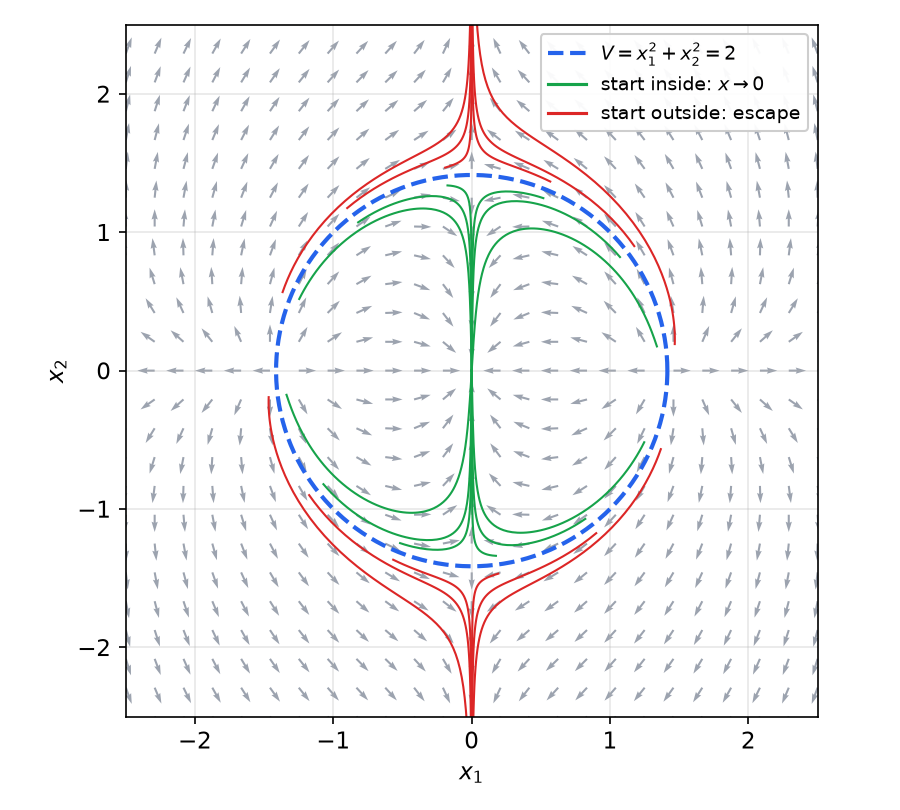
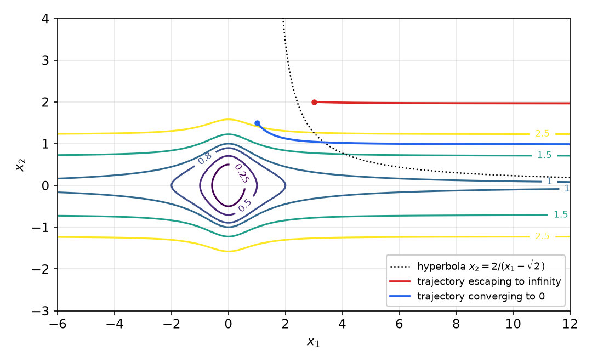
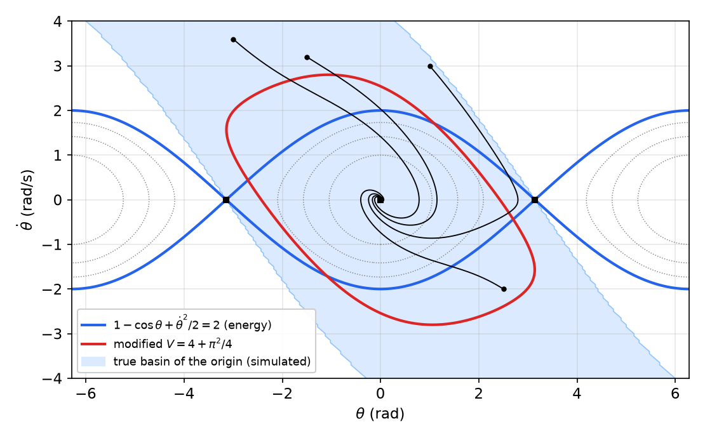
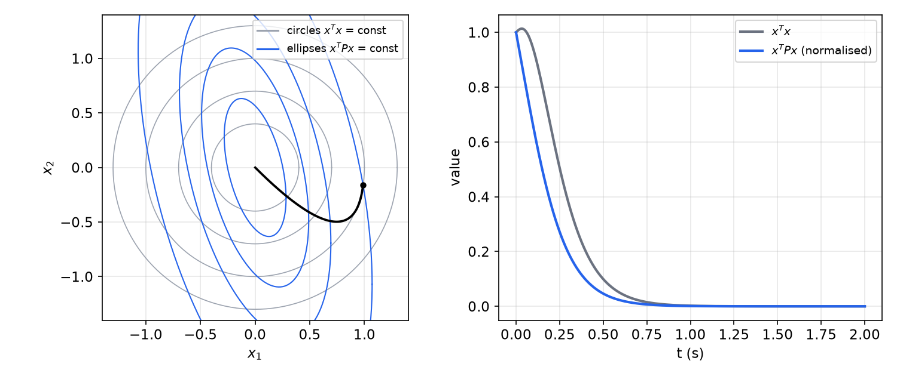
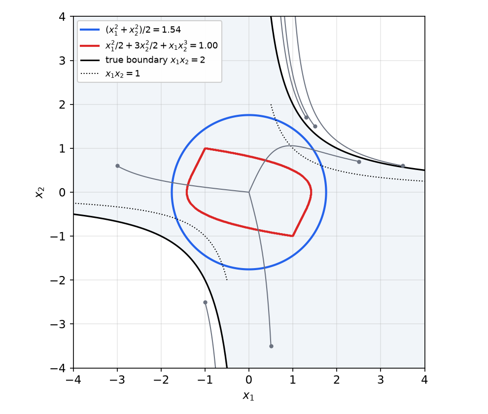
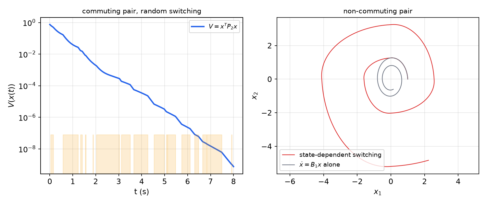

# Lyapunov Stability Theory

The first question to ask about any control system is whether it is stable: does a state that starts near an operating point stay near it, and does it come back? For a linear system the eigenvalues answer this. A nonlinear system can have several equilibria, limit cycles and finite escape times, and it has no eigenvalues, so it needs other tools. A. M. Lyapunov supplied two of them in 1892. The **linearization method** draws conclusions about a nonlinear system from its linear approximation near an equilibrium. The **direct method** finds an energy-like scalar function that decreases along trajectories, and it is not restricted to small motions. This chapter develops both for autonomous systems, shows how to construct Lyapunov functions, treats linear systems through the Lyapunov equation, and ends with common Lyapunov functions for switched linear systems. [Invariant Sets, Barbalat's Lemma and Non-Autonomous Systems](invariance.md) continues the theory.

## Nonlinear Systems and Equilibrium Points

A nonlinear dynamic system is described by
\\[
\dot x = f(x, t),
\\]
where \\(f\\) is an \\(n\times 1\\) nonlinear vector function and \\(x\in\mathbb R^n\\) is the state. A particular value of the state is a *point*, \\(n\\) is the *order* of the system, and a solution \\(x(t)\\) traces a curve in state space called a *trajectory*. The equation can equally well describe a closed loop. If the plant is \\(\dot x = f(x, u, t)\\) and the control law is \\(u = g(x, t)\\), the closed-loop dynamics are \\(\dot x = f(x, g(x,t), t)\\), which has the same form. The special case of a linear system is \\(\dot x = A(t)x\\).

**Definition (Autonomous system).** The system is **autonomous** if \\(f\\) does not depend explicitly on time, so that the state equation reads
\\[
\dot x = f(x).
\\]
Otherwise the system is **non-autonomous**.

Linear time-invariant (LTI) systems are autonomous; linear time-varying (LTV) systems are not. Strictly speaking every physical system is non-autonomous, because no parameter is perfectly constant; autonomy is an idealization that is valid when the variation is slow. The definition applies to the *closed loop*. A time-invariant plant controlled by a time-varying controller is non-autonomous: \\(\dot x = -x + u\\) with \\(u = -x^2\sin t\\) gives \\(\dot x = -x - x^2\sin t\\). Adaptive controllers for LTI plants generally make the closed loop both nonlinear and non-autonomous. The essential difference is that the trajectories of an autonomous system do not depend on the initial time, only on the initial state, so the analysis can always take \\(t\_0 = 0\\).

**Definition (Equilibrium point).** A state \\(x\_e\\) is an **equilibrium state** (or equilibrium point) if, once \\(x(t)\\) equals \\(x\_e\\), it remains equal to \\(x\_e\\) for all future time. For an autonomous system the equilibria are the real roots of
\\[
f(x\_e) = 0 .
\\]

For the LTI system \\(\dot x = Ax\\), the origin is the only equilibrium if \\(A\\) is nonsingular. If \\(A\\) is singular, every point of its null space is an equilibrium. These are not isolated: for \\(\ddot x + \dot x = 0\\) the whole \\(x\\) axis of the phase plane consists of equilibria. A nonlinear system can have several isolated equilibria, as the pendulum shows.

**Example 1 (Pendulum).** A pendulum of length \\(R\\) carries a bob of mass \\(M\\). Its angle \\(\theta\\) is measured from the downward vertical, and the hinge has viscous friction coefficient \\(b\\):
\\[
MR^2\ddot\theta + b\dot\theta + MgR\sin\theta = 0 .
\\]
With \\(x\_1 = \theta\\) and \\(x\_2 = \dot\theta\\),
\\[
\dot x\_1 = x\_2, \qquad \dot x\_2 = -\frac{b}{MR^2}x\_2 - \frac gR\sin x\_1 .
\\]
Setting both right-hand sides to zero gives \\(x\_2 = 0\\) and \\(\sin x\_1 = 0\\). The equilibria are
\\[
(x\_1, x\_2) = (n\pi, 0), \qquad n = 0, \pm1, \pm2, \dots
\\]
Physically there are only two: the bob hanging down (\\(n\\) even) and the bob balanced upright (\\(n\\) odd).

**Shifting an equilibrium to the origin.** Most theorems are stated for an equilibrium at the origin. Nothing is lost by this. If \\(x\_e\\) is an equilibrium, let \\(y = x - x\_e\\); then
\\[
\dot y = f(y + x\_e),
\\]
whose solutions correspond one-to-one with those of the original system, and \\(y = 0\\) is an equilibrium. From now on the equilibrium of interest is taken to be \\(x = 0\\).

### Stability of a nominal motion

Sometimes the object of interest is a trajectory rather than a point: a robot following a desired path, for instance. Let \\(x\_d(t)\\) be the solution of the autonomous system \\(\dot x = f(x)\\) from \\(x\_d(0) = x\_0\\), and perturb the initial condition to \\(x(0) = x\_0 + \delta x\_0\\). The error \\(e(t) = x(t) - x\_d(t)\\) satisfies
\\[
\dot e = f(x\_d(t) + e) - f(x\_d(t)) = g(e, t), \qquad e(0) = \delta x\_0 .
\\]
Since \\(g(0, t) = 0\\), the origin is an equilibrium of the error system, and the stability of the nominal motion is the stability of this equilibrium. The error system is **non-autonomous**, because the nominal trajectory appears explicitly. For the hardening spring \\(m\ddot x + k\_1x + k\_2x^3 = 0\\), for example, the error obeys
\\[
m\ddot e + k\_1e + k\_2\left[e^3 + 3e^2x\_d(t) + 3e\\,x\_d^2(t)\right] = 0 .
\\]
For a linear autonomous system the error system \\(\dot e = Ae\\) is still autonomous, which is why the distinction never arises in linear theory. Every nominal motion of an autonomous system therefore leads to an equivalent non-autonomous problem; the tools for that are developed in [the next chapter](invariance.md).

## Concepts of Stability

Write \\(B\_R\\) for the open ball \\(\lVert x \rVert < R\\) and \\(S\_R\\) for the sphere \\(\lVert x \rVert = R\\). Any norm will do, since all norms on \\(\mathbb R^n\\) are equivalent.

**Definition (Lyapunov stability).** The equilibrium \\(x = 0\\) is **stable** if for every \\(R > 0\\) there exists \\(r > 0\\) such that \\(\lVert x(0) \rVert < r\\) implies \\(\lVert x(t) \rVert < R\\) for all \\(t \ge 0\\). Otherwise it is **unstable**.

The definition is a game: an adversary names a ball \\(B\_R\\), however small, and we must find a ball \\(B\_r\\) of initial conditions whose trajectories never leave \\(B\_R\\). Instability means that there is *some* ball \\(B\_R\\) such that, for every \\(r > 0\\), a trajectory starting inside \\(B\_r\\) eventually leaves \\(B\_R\\). For nonlinear systems instability does not mean "blowing up". It means only that the state cannot be kept *arbitrarily* close to the equilibrium.

**Example 2 (Van der Pol oscillator).** The system
\\[
\dot x\_1 = x\_2, \qquad \dot x\_2 = -x\_1 + (1 - x\_1^2)x\_2
\\]
has a limit cycle (see [Phase Plane Analysis](phase-plane.md)), and every trajectory that starts at a nonzero point approaches it. Choose \\(R\\) so that the circle \\(S\_R\\) lies inside the limit cycle. Trajectories that start arbitrarily close to the origin still spiral out to the limit cycle, so they leave \\(B\_R\\). The origin is unstable, although no trajectory diverges.

**Definition (Asymptotic stability).** The equilibrium \\(x = 0\\) is **asymptotically stable** if it is stable and, in addition, there exists \\(r > 0\\) such that \\(\lVert x(0) \rVert < r\\) implies \\(x(t) \to 0\\) as \\(t \to \infty\\).

Any ball \\(B\_r\\) with this property is *a* domain of attraction; *the* domain (or region) of attraction is the largest set of initial states whose trajectories converge to the origin. An equilibrium that is Lyapunov stable but not asymptotically stable is called **marginally stable**.

The stability requirement in the definition is not redundant. Vinograd constructed a planar system in which every trajectory starting from a nonzero point of the unit disk first travels out along a large loop and only then converges to the origin. Every trajectory converges, but the origin is unstable, because no small ball of initial conditions keeps the motion near the origin. In engineering terms the excursion could take the state far outside the region where the model is valid. [Advanced Lyapunov Theory](lyapunov-advanced.md) simulates Vinograd's example.

**Definition (Exponential stability).** The equilibrium \\(x = 0\\) is **exponentially stable** if there exist \\(\alpha > 0\\) and \\(\lambda > 0\\) such that, in some ball \\(B\_r\\),
\\[
\lVert x(t) \rVert \le \alpha\lVert x(0) \rVert e^{-\lambda t} \qquad \forall t > 0 .
\\]
The number \\(\lambda\\) is the **rate of exponential convergence**.

For example, \\(\dot x = -(1 + \sin^2x)\\,x\\) has the solution
\\[
x(t) = x(0)\exp\left(-\int\_0^t\left[1 + \sin^2 x(\tau)\right]d\tau\right),
\\]
so \\(\lvert x(t) \rvert \le \lvert x(0) \rvert e^{-t}\\): the origin is exponentially stable with rate 1. Exponential stability implies asymptotic stability, but not conversely. The system \\(\dot x = -x^2\\) with \\(x(0) = 1\\) has solution \\(x(t) = 1/(1 + t)\\), which tends to zero more slowly than any exponential. The constant \\(\alpha\\) can be written as \\(e^{\lambda\tau\_0}\\). The bound then says that after \\(\tau\_0 + 1/\lambda\\) the norm is below \\(e^{-1}\approx 37\\%\\) of its initial value, and after \\(\tau\_0 + 3/\lambda\\) below \\(e^{-3} \approx 5\\%\\). In this sense \\(1/\lambda\\) plays the role of the time constant of a linear system.

**Definition (Global stability).** If asymptotic (or exponential) stability holds for every initial state, the equilibrium is **globally asymptotically stable** (GAS), also called asymptotically stable *in the large*, or globally exponentially stable.

For LTI systems these refinements are unnecessary. An LTI system is asymptotically stable, marginally stable or unstable. Its asymptotic stability is always global and exponential, and its instability always means exponential growth. The finer notions matter only for nonlinear systems.

## Lyapunov's Linearization Method

Assume \\(f\\) is continuously differentiable and \\(f(0) = 0\\). A Taylor expansion about the origin gives
\\[
\dot x = \left(\frac{\partial f}{\partial x}\right)\_{x = 0}x + f\_{\mathrm{h.o.t.}}(x),
\\]
where \\(f\_{\mathrm{h.o.t.}}\\) collects the terms of second and higher order. The constant Jacobian matrix
\\[
A = \left(\frac{\partial f}{\partial x}\right)\_{x = 0}, \qquad A\_{ij} = \frac{\partial f\_i}{\partial x\_j}(0),
\\]
defines the **linearization** \\(\dot x = Ax\\) of the system at the equilibrium. For a system with input, \\(\dot x = f(x, u)\\) with \\(f(0,0) = 0\\), the linearization is \\(\dot x = Ax + Bu\\) with \\(A = (\partial f/\partial x)\_{(0,0)}\\) and \\(B = (\partial f/\partial u)\_{(0,0)}\\). If a feedback law \\(u = u(x)\\) with \\(u(0) = 0\\) is applied, the closed loop linearizes to
\\[
\dot x = (A + BG)x, \qquad G = \left(\frac{du}{dx}\right)\_{x = 0},
\\]
which is the same as linearizing \\(f(x, u(x))\\) directly. In practice one simply drops every term of order higher than one. [Modeling and Linearization](../linear/modeling.md) covers linearization about trajectories as well.

**Example 3 (Computing a linearization).** For
\\[
\dot x\_1 = x\_2^2 + x\_1\cos x\_2, \qquad \dot x\_2 = x\_2 + (x\_1 + 1)x\_1 + x\_1\sin x\_2,
\\]
\\(x\_2^2\\) is second order, \\(x\_1\cos x\_2 \approx x\_1\\), \\((x\_1+1)x\_1 \approx x\_1\\) and \\(x\_1\sin x\_2 \approx x\_1x\_2\\) is second order, so
\\[
\dot x = \begin{bmatrix} 1 & 0 \\\\ 1 & 1 \end{bmatrix}x .
\\]
For a controlled system, \\(\ddot x + 4\dot x^5 + (x^2 + 1)u = 0\\) linearizes about \\(x = \dot x = u = 0\\) to \\(\ddot x = -u\\). Under \\(u = \sin x + x^3 + \dot x\cos^2x\\), whose linear part is \\(x + \dot x\\), the linearized closed loop is \\(\ddot x + \dot x + x = 0\\).

**Theorem (Lyapunov's linearization method).** Let \\(x = 0\\) be an equilibrium of \\(\dot x = f(x)\\) with \\(f\\) continuously differentiable, and let \\(A\\) be the Jacobian at the origin.

1. If all eigenvalues of \\(A\\) lie strictly in the open left half-plane (the linearization is *strictly stable*), the equilibrium is asymptotically stable for the nonlinear system. In fact it is locally exponentially stable.
2. If at least one eigenvalue of \\(A\\) lies strictly in the right half-plane, the equilibrium is unstable.
3. If all eigenvalues lie in the closed left half-plane with at least one on the imaginary axis (the linearization is *marginally stable*), no conclusion can be drawn: the equilibrium may be stable, asymptotically stable or unstable.

The theorem is "true by continuity": near the origin the linear terms dominate the higher-order ones, so the linear behaviour prevails. When the linear part is only marginal, however, the small nonlinear terms decide the outcome. Part 1 is proved in the section on LTI systems below, using a Lyapunov function built from the Lyapunov equation. Part 2 follows from the instability theorems in [the next chapter](invariance.md#instability-theorems).

The theorem is local. It says nothing about how large the region of attraction is, and a nonlinear system can be globally asymptotically stable while its linearization is only marginally stable (\\(\dot x = -x^3\\) is an example). In practice, linear control design is a matter of *consistency*: the design must keep the system within the range where the linear model is accurate.

**Example 4 (Pendulum equilibria).** Return to the pendulum of Example 1 and shift the equilibrium \\((n\pi, 0)\\) to the origin with \\(z\_1 = x\_1 - n\pi\\), \\(z\_2 = x\_2\\). Since \\(\sin(z\_1 + n\pi) \approx \sin n\pi + \cos(n\pi)\\,z\_1 = (-1)^nz\_1\\):

- For \\(n\\) even (bob down),
\\[
A = \begin{bmatrix} 0 & 1 \\\\ -g/R & -b/(MR^2) \end{bmatrix}, \qquad \lambda^2 + \frac{b}{MR^2}\lambda + \frac gR = 0 .
\\]
All coefficients are positive, so both roots lie in the open left half-plane when \\(b > 0\\): the hanging equilibrium is **locally asymptotically stable**.
- For \\(n\\) odd (bob up),
\\[
A = \begin{bmatrix} 0 & 1 \\\\ g/R & -b/(MR^2) \end{bmatrix}, \qquad \lambda = \frac12\left(-\frac{b}{MR^2} \pm \sqrt{\left(\frac{b}{MR^2}\right)^2 + \frac{4g}{R}}\right).
\\]
One root is positive, so the inverted equilibrium is **unstable**. Equivalently, with \\(\tilde\theta = \theta - \pi\\) the linearization is \\(\ddot{\tilde\theta} + \frac{b}{MR^2}\dot{\tilde\theta} - \frac gR\tilde\theta = 0\\), which has a negative stiffness.

**Example 5 (A marginal case).** For the scalar system \\(\dot x = ax + bx^5\\) the linearization is \\(\dot x = ax\\). If \\(a < 0\\) the origin is asymptotically stable; if \\(a > 0\\) it is unstable. If \\(a = 0\\) the linearization \\(\dot x = 0\\) is inconclusive, and the answer depends on the sign of \\(b\\): the origin of \\(\dot x = bx^5\\) is asymptotically stable for \\(b < 0\\) and unstable for \\(b > 0\\). The direct method settles this case with \\(V = x^2\\), for which \\(\dot V = 2bx^6\\).

**Example 6 (A three-state system with a unique equilibrium).** Consider
\\[
\dot x\_1 = -x\_2x\_3 + 1, \qquad \dot x\_2 = x\_1x\_3 - x\_2, \qquad \dot x\_3 = x\_3^2(1 - x\_3).
\\]
*Equilibria.* The third equation requires \\(x\_3 = 0\\) or \\(x\_3 = 1\\). If \\(x\_3 = 0\\), the second equation gives \\(x\_2 = 0\\) and the first then gives \\(1 = 0\\), which is impossible. If \\(x\_3 = 1\\), then \\(x\_2 = 1\\) from the first equation and \\(x\_1 = 1\\) from the second. The **unique equilibrium is \\((1, 1, 1)\\)**.

*Stability.* The Jacobian is
\\[
\frac{\partial f}{\partial x} = \begin{bmatrix} 0 & -x\_3 & -x\_2 \\\\ x\_3 & -1 & x\_1 \\\\ 0 & 0 & 2x\_3(1 - x\_3) - x\_3^2 \end{bmatrix}
\quad\Longrightarrow\quad
A = \begin{bmatrix} 0 & -1 & -1 \\\\ 1 & -1 & 1 \\\\ 0 & 0 & -1 \end{bmatrix}\ \text{at } (1,1,1).
\\]
Shifting the equilibrium to the origin with \\(z = x - (1,1,1)\\) gives the same Jacobian. Expanding along the last row,
\\[
\det(\lambda I - A) = (\lambda + 1)\left[\lambda(\lambda + 1) + 1\right] = (\lambda + 1)(\lambda^2 + \lambda + 1),
\\]
with roots \\(\lambda = -1\\) and \\(\lambda = \tfrac12(-1 \pm j\sqrt3)\\). All lie in the open left half-plane, so **\\((1,1,1)\\) is locally asymptotically stable**. A common mistake is to treat \\(x\_3\\) as a constant and analyse only the \\((x\_1, x\_2)\\) subsystem; the equilibrium must be found for the full state.

**Example 7 (Torque-free rigid body).** Euler's equations for a rigid body with distinct principal moments of inertia \\(J\_1, J\_2, J\_3 > 0\\) are
\\[
J\_1\dot\omega\_1 = (J\_2 - J\_3)\omega\_2\omega\_3, \quad J\_2\dot\omega\_2 = (J\_3 - J\_1)\omega\_3\omega\_1, \quad J\_3\dot\omega\_3 = (J\_1 - J\_2)\omega\_1\omega\_2 .
\\]
*Equilibria.* All three products \\(\omega\_2\omega\_3\\), \\(\omega\_3\omega\_1\\), \\(\omega\_1\omega\_2\\) must vanish, so at most one component is nonzero. The equilibria are \\((\bar\omega, 0, 0)\\), \\((0, \bar\omega, 0)\\) and \\((0, 0, \bar\omega)\\) for any constant \\(\bar\omega\\): steady spin about a principal axis. They form continua, so none is isolated.

*Linearization.* Shift the first family with \\(\hat\omega\_1 = \omega\_1 - \bar\omega\\):
\\[
\dot{\hat\omega}\_1 = \frac{J\_2 - J\_3}{J\_1}\omega\_2\omega\_3, \quad \dot\omega\_2 = \frac{J\_3 - J\_1}{J\_2}(\hat\omega\_1 + \bar\omega)\omega\_3, \quad \dot\omega\_3 = \frac{J\_1 - J\_2}{J\_3}(\hat\omega\_1 + \bar\omega)\omega\_2 .
\\]
The Jacobian at the origin and its eigenvalues are
\\[
A = \begin{bmatrix} 0 & 0 & 0 \\\\ 0 & 0 & \frac{J\_3 - J\_1}{J\_2}\bar\omega \\\\ 0 & \frac{J\_1 - J\_2}{J\_3}\bar\omega & 0 \end{bmatrix}, \qquad
\lambda = 0, \quad \lambda = \pm\bar\omega\sqrt{\frac{(J\_3 - J\_1)(J\_1 - J\_2)}{J\_2J\_3}} .
\\]
- If \\(\bar\omega \ne 0\\) and \\((J\_3 - J\_1)(J\_1 - J\_2) > 0\\), so that \\(J\_1\\) is the **intermediate** moment of inertia, one eigenvalue is real and positive: spin about the intermediate axis is **unstable**. This is the "tennis racket" effect.
- If \\(\bar\omega \ne 0\\) and \\(J\_1\\) is the largest or smallest moment, all eigenvalues lie on the imaginary axis, and the linearization is **inconclusive**. Spin about the major or minor axis is in fact Lyapunov stable, which an energy and momentum argument shows.
- If \\(\bar\omega = 0\\), all eigenvalues are zero: inconclusive.

The same conclusions hold for the other two axes.

## Lyapunov's Direct Method

The linearization method answers only local questions, and only when the linear part is not marginal. The direct method rests on a physical observation: if the total energy of a mechanical or electrical system is continuously dissipated, the system must eventually settle at an equilibrium, whether it is linear or not.

Consider a mass on rollers attached to a wall by a nonlinear spring and a nonlinear damper:
\\[
m\ddot x + b\dot x\lvert \dot x \rvert + k\_0x + k\_1x^3 = 0 .
\\]
Suppose the mass is pulled far from the spring's natural length and released. No closed-form solution exists, so the stability definitions cannot be checked directly. The linearization \\(m\ddot x + k\_0x = 0\\) is only marginally stable, and in any case the motion starts outside its range of validity. The total energy, kinetic plus spring potential, is
\\[
V(x) = \frac12m\dot x^2 + \int\_0^x(k\_0\xi + k\_1\xi^3)\\,d\xi = \frac12m\dot x^2 + \frac12k\_0x^2 + \frac14k\_1x^4 .
\\]
Zero energy corresponds to the equilibrium, asymptotic stability to the energy tending to zero, and instability to energy growth. Along the motion,
\\[
\dot V = m\dot x\ddot x + (k\_0x + k\_1x^3)\dot x = \dot x\left(-b\dot x\lvert \dot x \rvert\right) = -b\lvert \dot x \rvert^3 \le 0 .
\\]
The damper dissipates energy until the mass stops. Since the spring exerts a nonzero force everywhere except at its natural length, the mass cannot stop anywhere else, so it must settle at \\(x = 0\\). Lyapunov's direct method turns this argument into a theorem that works with any scalar function having the right properties.

### Positive definite functions

**Definition (Positive definite function).** A continuous scalar function \\(V(x)\\) is **locally positive definite** if \\(V(0) = 0\\) and, in some ball \\(B\_{R\_0}\\),
\\[
x \ne 0 \implies V(x) > 0 .
\\]
If this holds on the whole state space, \\(V\\) is **globally positive definite**. \\(V\\) is **negative definite** if \\(-V\\) is positive definite, **positive semi-definite** if \\(V(0) = 0\\) and \\(V(x) \ge 0\\) for \\(x \ne 0\\), and **negative semi-definite** if \\(-V\\) is positive semi-definite.

The pendulum energy \\(V = \frac12MR^2x\_2^2 + MRg(1 - \cos x\_1)\\) is locally positive definite (it vanishes again at \\(x\_1 = 2\pi\\)). The mass–spring energy above is globally positive definite. The kinetic energy \\(\frac12m\dot x^2\\) alone is *not* positive definite in the state \\((x, \dot x)\\), because it vanishes on the whole line \\(\dot x = 0\\). Any function with a unique minimum in a ball can be made locally positive definite by adding a constant: \\(x\_1^2 + x\_2^2 - 1\\) becomes positive definite after adding 1, and its time derivative is unchanged.

Geometrically, a positive definite function of two variables is a cup whose lowest point sits at the origin. Its level curves \\(V(x) = c\\) are, for small \\(c\\), closed curves that surround the origin and nest without crossing: a smaller value lies inside a larger one.

**Derivative along trajectories.** If \\(x(t)\\) is a solution of \\(\dot x = f(x)\\), the chain rule gives
\\[
\dot V = \frac{dV(x(t))}{dt} = \frac{\partial V}{\partial x}\dot x = \frac{\partial V}{\partial x}f(x) = \nabla V(x)^Tf(x) .
\\]
The right side depends only on \\(x\\), not on the solution, so \\(\dot V\\) can be computed without solving the differential equation. That is the whole point of the method. Note that \\(\dot V = 0\\) at every equilibrium.

**Definition (Lyapunov function).** If, in a ball \\(B\_{R\_0}\\), the function \\(V(x)\\) is positive definite and has continuous partial derivatives, and its time derivative along any trajectory of \\(\dot x = f(x)\\) is negative semi-definite,
\\[
\dot V(x) \le 0,
\\]
then \\(V\\) is a **Lyapunov function** for the system.

Picture the state point moving in the plane while the value \\(V(x(t))\\) is plotted above it on the cup: the point can only slide downhill. In the plane, each trajectory crosses the level curves inward, from larger to smaller values of \\(V\\).

### Local stability

**Theorem (Lyapunov, local stability).** Suppose that in a ball \\(B\_{R\_0}\\) there is a scalar function \\(V(x)\\) with continuous first partial derivatives such that

- \\(V(x)\\) is positive definite (locally in \\(B\_{R\_0}\\)), and
- \\(\dot V(x)\\) is negative semi-definite (locally in \\(B\_{R\_0}\\)).

Then the equilibrium \\(x = 0\\) is **stable**. If \\(\dot V(x)\\) is negative definite in \\(B\_{R\_0}\\), the equilibrium is **asymptotically stable**.

*Proof.* *Stability.* Given \\(R\\) with \\(0 < R < R\_0\\), let \\(m = \min\_{\lVert x \rVert = R}V(x)\\). The minimum exists because \\(V\\) is continuous and the sphere is compact, and \\(m > 0\\) because \\(V\\) is positive definite. Since \\(V(0) = 0\\) and \\(V\\) is continuous, there is a ball \\(B\_r\\) on which \\(V(x) < m\\). A trajectory starting in \\(B\_r\\) has \\(V(x(0)) < m\\). Because \\(V\\) is non-increasing along trajectories, \\(V(x(t)) < m\\) for all later times. To leave \\(B\_R\\) the trajectory would have to cross the sphere \\(S\_R\\), where \\(V \ge m\\), which is impossible. Hence \\(\lVert x(t) \rVert < R\\) for all \\(t \ge 0\\).

*Asymptotic stability.* Take a trajectory starting in a ball \\(B\_r\\) chosen as above with \\(R\\) close to \\(R\_0\\), so that it stays inside \\(B\_R\\). Along it, \\(V\\) is decreasing and bounded below by zero, so it converges to some limit \\(L \ge 0\\). Suppose \\(L > 0\\). Since \\(V\\) is continuous with \\(V(0) = 0\\), there is a ball \\(B\_{r\_0}\\) on which \\(V < L\\), and the trajectory never enters it. The trajectory therefore stays in the compact annulus \\(r\_0 \le \lVert x \rVert \le R\\). On that annulus the continuous, positive function \\(-\dot V\\) has a positive minimum \\(L\_1\\). Then \\(V(x(t)) \le V(x(0)) - L\_1t\\), which falls below \\(L\\) after a finite time less than \\([V(x(0)) - L]/L\_1\\). This contradicts \\(V \to L\\) from above. Hence \\(L = 0\\), and since \\(V\\) is positive definite, \\(x(t) \to 0\\). ∎

**Example 8 (Damped pendulum: stability).** For \\(\ddot\theta + \dot\theta + \sin\theta = 0\\), take the total energy
\\[
V(x) = (1 - \cos\theta) + \frac{\dot\theta^2}{2},
\\]
which is locally positive definite. Along trajectories,
\\[
\dot V = \dot\theta\sin\theta + \dot\theta\ddot\theta = \dot\theta\sin\theta + \dot\theta(-\dot\theta - \sin\theta) = -\dot\theta^2 \le 0 .
\\]
\\(\dot V\\) is the power dissipated by friction. It is only negative *semi*-definite, because it vanishes whenever \\(\dot\theta = 0\\), so the theorem gives **stability** but not asymptotic stability. Physical intuition says the pendulum does come to rest. Proving it needs either a different \\(V\\) (Example 15 below) or the invariant set theorem of [the next chapter](invariance.md).

**Example 9 (Asymptotic stability).** Consider
\\[
\dot x\_1 = x\_1(x\_1^2 + x\_2^2 - 2) - 4x\_1x\_2^2, \qquad \dot x\_2 = 4x\_1^2x\_2 + x\_2(x\_1^2 + x\_2^2 - 2) .
\\]
With \\(V = x\_1^2 + x\_2^2\\), the cross terms \\(\mp 8x\_1^2x\_2^2\\) cancel and
\\[
\dot V = 2x\_1\dot x\_1 + 2x\_2\dot x\_2 = 2(x\_1^2 + x\_2^2)(x\_1^2 + x\_2^2 - 2).
\\]
This is negative definite in the region \\(x\_1^2 + x\_2^2 < 2\\), so the origin is **asymptotically stable**. Because \\(V = \lVert x \rVert^2\\), every trajectory that starts inside the disk keeps decreasing \\(\lVert x \rVert\\) and converges: the open disk of radius \\(\sqrt2\\) is a domain of attraction. Outside the disk \\(\dot V > 0\\), and trajectories escape. A closed-form calculation later in this chapter shows that they do so in finite time.



*Figure: Example 9. The dashed circle is the level set \\(V = x\_1^2 + x\_2^2 = 2\\), where \\(\dot V\\) changes sign. Trajectories started just inside it (green) converge to the origin; trajectories started just outside (red) run off to infinity. The grey arrows show the direction of the vector field.*

**Examples 10–12 (Quadratic Lyapunov candidates).** In each case \\(x = 0\\) is shown to be asymptotically stable with a quadratic \\(V\\).

1. \\(\dot x\_1 = -x\_1 + x\_1x\_2\\), \\(\dot x\_2 = -x\_2\\). With \\(V = \frac12(x\_1^2 + x\_2^2)\\),
\\[
\dot V = -x\_1^2 - x\_2^2 + x\_1^2x\_2 .
\\]
The cubic term is bounded with \\(ab \le \frac12(a^2 + b^2)\\), taking \\(a = x\_1^2\\) and \\(b = x\_2\\):
\\[
\dot V \le -x\_1^2 - x\_2^2 + \frac12\left(x\_1^4 + x\_2^2\right) = -\left(1 - \frac12x\_1^2\right)x\_1^2 - \frac12x\_2^2 .
\\]
This is negative for \\(x \ne 0\\) whenever \\(x\_1^2 < 2\\), in particular in the ball \\(x\_1^2 + x\_2^2 < 2\\): the origin is **locally asymptotically stable**.

2. \\(\dot x\_1 = -x\_2 - x\_1(1 - x\_1^2 - x\_2^2)\\), \\(\dot x\_2 = x\_1 - x\_2(1 - x\_1^2 - x\_2^2)\\). With the same \\(V\\), the rotational terms \\(-x\_1x\_2 + x\_2x\_1\\) cancel and
\\[
\dot V = -(x\_1^2 + x\_2^2)(1 - x\_1^2 - x\_2^2) < 0 \quad\text{for } 0 < \lVert x \rVert < 1 .
\\]
The origin is asymptotically stable, and the open unit disk is its region of attraction. The unit circle is an unstable limit cycle.

3. \\(\dot x\_1 = x\_2(1 - x\_1^2)\\), \\(\dot x\_2 = -(x\_1 + x\_2)(1 - x\_1^2)\\). A diagonal quadratic form fails here; the cross term is essential. Try \\(V = \frac12x^TPx\\) with
\\[
P = \begin{bmatrix} 3 & 1 \\\\ 1 & 2 \end{bmatrix}, \qquad 2V = 3x\_1^2 + 2x\_1x\_2 + 2x\_2^2 .
\\]
\\(V\\) is positive definite: from \\((x\_1 + x\_2)^2 \ge 0\\), \\(2x\_1x\_2 \ge -(x\_1^2 + x\_2^2)\\), so \\(2V \ge 2x\_1^2 + x\_2^2 > 0\\) for \\(x \ne 0\\) (or check that the leading minors \\(3\\) and \\(5\\) are positive). Then
\\[
\begin{aligned}
\dot V &= (3x\_1 + x\_2)\dot x\_1 + (x\_1 + 2x\_2)\dot x\_2 \\\\
&= (1 - x\_1^2)\left[(3x\_1 + x\_2)x\_2 - (x\_1 + 2x\_2)(x\_1 + x\_2)\right] \\\\
&= (1 - x\_1^2)\left[3x\_1x\_2 + x\_2^2 - x\_1^2 - 3x\_1x\_2 - 2x\_2^2\right] = -(x\_1^2 + x\_2^2)(1 - x\_1^2) .
\end{aligned}
\\]
\\(\dot V < 0\\) for \\(x \ne 0\\) inside the ball \\(\lVert x \rVert < 1\\), so the origin is **asymptotically stable**.

### Global stability

To conclude that *every* trajectory converges, the ball \\(B\_{R\_0}\\) must be the whole space, but that alone is not enough. One more condition is needed.

**Definition (Radially unbounded).** A function \\(V(x)\\) is **radially unbounded** if \\(V(x) \to \infty\\) as \\(\lVert x \rVert \to \infty\\), in every direction.

**Theorem (Lyapunov, global stability).** Suppose there is a scalar function \\(V(x)\\) with continuous first partial derivatives such that

- \\(V(x)\\) is positive definite,
- \\(\dot V(x)\\) is negative definite, and
- \\(V(x) \to \infty\\) as \\(\lVert x \rVert \to \infty\\).

Then the equilibrium at the origin is **globally asymptotically stable**.

*Proof.* The argument is the same as in the local case. The only new ingredient is boundedness: for any initial state \\(x\_0\\), radial unboundedness makes the set \\(\\{x : V(x) \le V(x\_0)\\}\\) bounded, and since \\(\dot V \le 0\\) the trajectory never leaves it. The trajectory therefore lives in a compact set, and the annulus argument applies. ∎

Radial unboundedness guarantees that the level curves \\(V = c\\) are *closed* for every \\(c\\). If some level curves are open, a trajectory can cross ever-lower level curves while drifting off to infinity. The classic example uses
\\[
V(x) = \frac{x\_1^2}{1 + x\_1^2} + x\_2^2 ,
\\]
whose level curves are closed for \\(V < 1\\) but open for \\(V \ge 1\\), because \\(x\_1^2/(1 + x\_1^2) < 1\\). Hahn's system
\\[
\dot x\_1 = -\frac{6x\_1}{z^2} + 2x\_2, \qquad \dot x\_2 = -\frac{2(x\_1 + x\_2)}{z^2}, \qquad z = 1 + x\_1^2,
\\]
has, with \\(\partial V/\partial x\_1 = 2x\_1/z^2\\),
\\[
\dot V = \frac{2x\_1}{z^2}\left(-\frac{6x\_1}{z^2} + 2x\_2\right) + 2x\_2\left(-\frac{2(x\_1 + x\_2)}{z^2}\right) = -\frac{12x\_1^2}{z^4} - \frac{4x\_2^2}{z^2} < 0
\\]
for \\(x \ne 0\\). \\(V\\) is positive definite with a negative definite derivative, so the origin is asymptotically stable, but it is **not** globally asymptotically stable. On the hyperbola \\(x\_2 = 2/(x\_1 - \sqrt2)\\) the trajectory slope is
\\[
\frac{\dot x\_2}{\dot x\_1} = \frac{-1}{1 + 2\sqrt2\\,x\_1 + 2x\_1^2},
\\]
while the slope of the hyperbola itself is
\\[
\frac{dx\_2}{dx\_1} = \frac{-2}{(x\_1 - \sqrt2)^2} = \frac{-1}{1 - \sqrt2\\,x\_1 + x\_1^2/2} .
\\]
(Some printings write \\(2^{3/2}x\_1\\) in this denominator; the correct coefficient is \\(\sqrt2\\).) For \\(x\_1 > \sqrt2\\) both slopes are negative and the trajectories are much flatter than the hyperbola, while \\(\dot x\_1 = 2x\_2 - 6x\_1/z^2 > 0\\) on the branch. A trajectory on the branch therefore moves to the right and above it, so trajectories in the first quadrant above its right branch can never cross it toward the axes. They escape to infinity while \\(V\\) keeps decreasing toward a value above 1.



*Figure: level curves of \\(V = x\_1^2/(1 + x\_1^2) + x\_2^2\\). For \\(V < 1\\) they are closed ovals; for \\(V \ge 1\\) they open up and run off to \\(x\_1 = \pm\infty\\). A trajectory of Hahn's system that starts above the dotted hyperbola (red) crosses lower and lower level curves, yet drifts off to infinity. A trajectory that starts closer in (blue) converges to the origin.*

**Example 13 (A class of first-order systems).** Let \\(\dot x + c(x) = 0\\), where \\(c\\) is any continuous function with the same sign as its argument: \\(x\\,c(x) > 0\\) for \\(x \ne 0\\), which forces \\(c(0) = 0\\). With the radially unbounded function \\(V = x^2\\),
\\[
\dot V = 2x\dot x = -2x\\,c(x) < 0 \quad (x \ne 0),
\\]
so the origin is globally asymptotically stable. For example, \\(\dot x = \sin^2x - x\\) is GAS, since \\(\sin^2x \le \lvert \sin x \rvert < \lvert x \rvert\\) for \\(x \ne 0\\). \\(\dot x = -x^3\\) is also GAS, although its linearization \\(\dot x = 0\\) is inconclusive.

**Example 14 (Further global results).**

1. \\(\dot x\_1 = x\_2 - x\_1(x\_1^2 + x\_2^2)\\), \\(\dot x\_2 = -x\_1 - x\_2(x\_1^2 + x\_2^2)\\). With \\(V = x\_1^2 + x\_2^2\\), \\(\dot V = -2(x\_1^2 + x\_2^2)^2\\), negative definite, and \\(V\\) is radially unbounded: the origin is GAS. Global asymptotic stability also implies that the origin is the *only* equilibrium.
2. \\(\dot x\_1 = -x\_1 - x\_2\\), \\(\dot x\_2 = 2x\_1 - x\_2^3\\). A weighted quadratic is chosen so that the cross terms cancel: with \\(V = x\_1^2 + \frac12x\_2^2\\),
\\[
\dot V = 2x\_1(-x\_1 - x\_2) + x\_2(2x\_1 - x\_2^3) = -2x\_1^2 - x\_2^4 < 0 \quad (x \ne 0),
\\]
and \\(V\\) is radially unbounded: GAS.
3. \\(\dot x = -x^3 + \sin^4x\\). With \\(V = x^2\\), \\(\dot V = 2x(-x^3 + \sin^4x)\\). For \\(0 < \lvert x \rvert < 1\\), \\(\sin^4x \le x^4 < \lvert x \rvert^3\\); for \\(\lvert x \rvert \ge 1\\), \\(\sin^4x \le 1 \le \lvert x \rvert^3\\), with equality impossible since \\(\sin^4 x = 1\\) needs \\(\lvert x \rvert = \pi/2\\). So \\(-x^3 + \sin^4x\\) has the sign of \\(-x\\), \\(\dot V\\) is negative definite, and the origin is GAS. The linearization \\(\dot x \approx 0\\) is again inconclusive.
4. \\(\dot x = (5 - x)^5\\) has the single equilibrium \\(x = 5\\). With \\(y = x - 5\\), \\(\dot y = -y^5\\), and \\(V = y^2\\) gives \\(\dot V = -2y^6\\): \\(x = 5\\) is GAS.
5. *A parameterized quadratic.* \\(\dot x\_1 = -ax\_1 - bx\_2\\), \\(\dot x\_2 = cx\_1 - dx\_2\\), with \\(a, b, c, d > 0\\). The only equilibrium is the origin, because the determinant \\(ad + bc\\) of the system matrix is positive. Try \\(V = \frac12(l\_1x\_1^2 + l\_2x\_2^2)\\) with \\(l\_1, l\_2 > 0\\):
\\[
\dot V = -l\_1ax\_1^2 + (l\_2c - l\_1b)x\_1x\_2 - l\_2dx\_2^2 .
\\]
Choose the weights to cancel the cross term, \\(l\_1b = l\_2c\\) (for instance \\(l\_1 = c\\), \\(l\_2 = b\\)). Then \\(\dot V = -l\_1ax\_1^2 - l\_2dx\_2^2\\) is negative definite and \\(V\\) is radially unbounded: the origin is **globally asymptotically stable**.
6. *Rigid spacecraft with rate feedback.* Add torques to Example 7: \\(J\_1\dot\omega\_1 = (J\_2 - J\_3)\omega\_2\omega\_3 + u\_1\\) and cyclically. With the kinetic energy \\(V = \frac12(J\_1\omega\_1^2 + J\_2\omega\_2^2 + J\_3\omega\_3^2)\\),
\\[
\dot V = \left[(J\_2 - J\_3) + (J\_3 - J\_1) + (J\_1 - J\_2)\right]\omega\_1\omega\_2\omega\_3 + \sum\_i\omega\_iu\_i = \sum\_i\omega\_iu\_i .
\\]
With \\(u = 0\\), \\(\dot V = 0\\): \\(\omega = 0\\) is stable but not asymptotically stable, because the energy is conserved and the equilibria are not isolated. With \\(u\_i = -k\_i\omega\_i\\), \\(k\_i > 0\\), \\(\dot V = -\sum\_ik\_i\omega\_i^2\\) is negative definite and \\(V\\) is radially unbounded, so \\(\omega = 0\\) is **globally asymptotically stable**.

### Choosing the Lyapunov function

Lyapunov functions are far from unique. If \\(V\\) is one, so is \\(\rho V^\alpha\\) for any \\(\rho > 0\\) and \\(\alpha > 1\\), and many unrelated functions may also work. The theorems are only **sufficient**: if a candidate fails, nothing is proved, and one tries another.

**Example 15 (Damped pendulum: asymptotic stability).** For the pendulum of Example 8, the less obvious function
\\[
V(x) = \frac12\dot\theta^2 + \frac12(\dot\theta + \theta)^2 + 2(1 - \cos\theta)
\\]
is locally positive definite. Using \\(\ddot\theta = -\dot\theta - \sin\theta\\),
\\[
\begin{aligned}
\dot V &= \dot\theta\ddot\theta + (\dot\theta + \theta)(\ddot\theta + \dot\theta) + 2\dot\theta\sin\theta \\\\
&= \dot\theta(-\dot\theta - \sin\theta) + (\dot\theta + \theta)(-\sin\theta) + 2\dot\theta\sin\theta = -\dot\theta^2 - \theta\sin\theta .
\end{aligned}
\\]
Since \\(\theta\sin\theta > 0\\) for \\(0 < \lvert \theta \rvert < \pi\\), \\(\dot V\\) is negative definite in the strip \\(\lvert \theta \rvert < \pi\\), and the origin is **asymptotically stable**. This \\(V\\) has no obvious physical meaning, but it proves more than the energy did.

**Estimating the region of attraction.** A Lyapunov function also gives a *guaranteed* region of attraction. Let \\(\Omega\_l\\) be the connected component of \\(\\{V(x) < l\\}\\) that contains the origin. If \\(\Omega\_l\\) is bounded and \\(\dot V < 0\\) on it except at the origin, then \\(\Omega\_l\\) is invariant (\\(V\\) cannot increase) and every trajectory starting in it converges to the origin. One therefore chooses the largest \\(l\\) for which \\(\Omega\_l\\) stays inside the region where \\(\dot V\\) is negative.

For the pendulum:

- With the modified function of Example 15, \\(\dot V < 0\\) in the strip \\(\lvert \theta \rvert < \pi\\) (except at the origin). On its edge \\(\theta = \pi\\), \\(V = \frac12\dot\theta^2 + \frac12(\dot\theta + \pi)^2 + 4\\), which is smallest at \\(\dot\theta = -\pi/2\\), where it equals \\(4 + \pi^2/4\\); the edge \\(\theta = -\pi\\) gives the same minimum at \\(\dot\theta = \pi/2\\). So \\(\Omega\_l\\) with \\(l = 4 + \pi^2/4 \approx 6.47\\) is a guaranteed region of attraction.
- The energy \\(1 - \cos\theta + \frac12\dot\theta^2\\) has only a semi-definite derivative, but the invariant set theorem of [the next chapter](invariance.md#local-invariant-set-theorem) shows that \\(\\{V < 2\\}\\) is also a region of attraction. The value 2 is the energy of the upright equilibria, so this is the eye-shaped region bounded by the separatrices of the frictionless pendulum.



*Figure: the damped pendulum \\(\ddot\theta + \dot\theta + \sin\theta = 0\\). The blue curve bounds the energy estimate \\(\\{1 - \cos\theta + \dot\theta^2/2 < 2\\}\\) and the red curve the estimate from the modified function of Example 15. Neither contains the other. The shaded band is the true basin of the origin, found by simulating a grid of initial states. Both estimates are conservative, as Lyapunov estimates usually are. Black curves are sample trajectories; squares mark the equilibria.*

## Lyapunov Analysis of LTI Systems

Linear systems need no Lyapunov theory to decide stability: the eigenvalues do that. Lyapunov analysis of linear systems is still worth doing. It gives a common language for linear and nonlinear systems, it supplies quadratic Lyapunov functions that can be added together like energies when subsystems are combined, and it proves the linearization theorem. [Stability of Linear Systems](../linear/stability.md) treats the linear theory in its own right.

### Symmetric and positive definite matrices

**Definition (Symmetric, skew-symmetric).** A square matrix \\(M\\) is **symmetric** if \\(M = M^T\\) and **skew-symmetric** if \\(M = -M^T\\).

Every square matrix splits into a symmetric part and a skew-symmetric part:
\\[
M = \frac{M + M^T}{2} + \frac{M - M^T}{2} .
\\]
If \\(M\\) is skew-symmetric, the quadratic form vanishes identically. Since \\(x^TMx\\) is a scalar it equals its own transpose, so \\(x^TMx = x^TM^Tx = -x^TMx\\), and therefore
\\[
x^TMx = 0 \qquad \forall x .
\\]
Conversely, if \\(x^TMx = 0\\) for all \\(x\\), then \\(M\\) is skew-symmetric. Taking \\(x = e\_i\\) gives \\(M\_{ii} = 0\\); taking \\(x = e\_i + e\_j\\) gives \\(M\_{ii} + M\_{ij} + M\_{ji} + M\_{jj} = 0\\), hence \\(M\_{ji} = -M\_{ij}\\). The skew-symmetric part therefore contributes nothing to a quadratic form, and a quadratic Lyapunov candidate \\(x^TMx\\) can always be assumed to have symmetric \\(M\\). The identity reappears in robot control, where \\(\dot H - 2C\\) is skew-symmetric (see [Control of Multi-Input Physical Systems](multi-input.md)).

**Definition (Positive definite matrix).** A square matrix \\(M\\) is **positive definite** if \\(x \ne 0 \implies x^TMx > 0\\), and **positive semi-definite** if \\(x^TMx \ge 0\\) for all \\(x\\). We write \\(M > 0\\) and \\(M \ge 0\\), and \\(M\_1 > M\_2\\) means \\(M\_1 - M\_2 > 0\\).

Geometrically, \\(M > 0\\) means that the angle between \\(x\\) and \\(Mx\\) is always less than 90°. A necessary condition is that all diagonal entries be positive (take \\(x = e\_i\\)). For a symmetric matrix, the following are equivalent:

- \\(M\\) is positive definite;
- all eigenvalues of \\(M\\) are positive;
- all leading principal minors are positive: \\(M\_{11} > 0\\), \\(M\_{11}M\_{22} - M\_{12}M\_{21} > 0\\), …, \\(\det M > 0\\) (**Sylvester's criterion**).

A symmetric positive definite matrix is invertible. A symmetric matrix can be diagonalized by an orthogonal matrix, \\(M = U^T\Lambda U\\) with \\(U^TU = I\\). Setting \\(z = Ux\\) gives \\(x^TMx = z^T\Lambda z\\) with \\(z^Tz = \lVert x \rVert^2\\), and therefore
\\[
\lambda\_{\min}(M)\lVert x \rVert^2 \le x^TMx \le \lambda\_{\max}(M)\lVert x \rVert^2 .
\\]
Any matrix of the form \\(M = N^TN\\) is positive semi-definite, because \\(x^TN^TNx = \lVert Nx \rVert^2\\). It is positive definite exactly when \\(N\\) has full column rank. A time-varying matrix \\(M(t)\\) is **uniformly positive definite** if there is \\(\alpha > 0\\) with \\(M(t) \ge \alpha I\\) for all \\(t \ge 0\\). See [Eigenvalues and Eigenvectors](../../../math/linear-algebra/eigen.md) for the spectral theorem.

A useful identity: for any constant \\(M\\),
\\[
\frac{d}{dt}\left(x^TMx\right) = \dot x^TMx + x^TM\dot x = x^T(M + M^T)\dot x,
\\]
which equals \\(2x^TM\dot x\\) when \\(M\\) is symmetric.

### The Lyapunov equation

For \\(\dot x = Ax\\), take the quadratic candidate \\(V = x^TPx\\) with \\(P\\) symmetric positive definite. Then
\\[
\dot V = \dot x^TPx + x^TP\dot x = x^T(A^TP + PA)x = -x^TQx,
\\]
where
\\[
\boxed{A^TP + PA = -Q}
\\]
is the **Lyapunov equation**. If \\(Q\\) is positive definite, \\(\dot V\\) is negative definite, \\(V\\) is radially unbounded, and the origin is GAS.

Picking \\(P\\) and computing \\(Q\\) is often inconclusive, however.

**Example 16 (An unlucky choice of P).** Let
\\[
A = \begin{bmatrix} 0 & 4 \\\\ -8 & -12 \end{bmatrix},
\\]
whose eigenvalues are \\(-4\\) and \\(-8\\), so the system is stable. With \\(P = I\\),
\\[
-Q = PA + A^TP = \begin{bmatrix} 0 & -4 \\\\ -4 & -24 \end{bmatrix}.
\\]
\\(Q\\) has a zero diagonal entry and determinant \\(-16\\), so it is not positive definite: \\(\lVert x \rVert^2\\) is not a Lyapunov function, and nothing can be concluded. Indeed \\(\frac{d}{dt}\lVert x \rVert^2 = -8x\_1x\_2 - 24x\_2^2\\), which is positive at, for example, \\(x = (1, -0.1)\\): there the Euclidean norm *grows* for a short while.

The better procedure runs the other way: choose a positive definite \\(Q\\), solve the Lyapunov equation for \\(P\\), and check whether \\(P\\) is positive definite.

**Theorem (Lyapunov equation).** The LTI system \\(\dot x = Ax\\) is strictly stable (all eigenvalues of \\(A\\) have negative real parts) if and only if, for any symmetric positive definite \\(Q\\), the unique solution \\(P\\) of \\(A^TP + PA = -Q\\) is symmetric positive definite.

*Proof.* Sufficiency was shown above. For necessity, assume \\(A\\) is strictly stable and, given \\(Q > 0\\), define
\\[
P = \int\_0^\infty e^{A^Tt}\\,Q\\,e^{At}\\,dt .
\\]
The integral converges because \\(e^{At}\\) decays exponentially. \\(P\\) is symmetric, and it is positive definite: for \\(x \ne 0\\), \\(x^TPx = \int\_0^\infty (e^{At}x)^TQ(e^{At}x)\\,dt > 0\\), since \\(e^{At}x \ne 0\\). It satisfies the Lyapunov equation, because
\\[
-Q = \int\_0^\infty \frac{d}{dt}\left[e^{A^Tt}Qe^{At}\right]dt = \int\_0^\infty\left[A^Te^{A^Tt}Qe^{At} + e^{A^Tt}Qe^{At}A\right]dt = A^TP + PA,
\\]
where the first equality uses \\(e^{At} \to 0\\) as \\(t\to\infty\\) and \\(e^{0} = I\\). For uniqueness, let \\(P\_1\\) be any solution. Then
\\[
P\_1 = -\int\_0^\infty \frac{d}{dt}\left[e^{A^Tt}P\_1e^{At}\right]dt = -\int\_0^\infty e^{A^Tt}\left(A^TP\_1 + P\_1A\right)e^{At}dt = \int\_0^\infty e^{A^Tt}Qe^{At}dt = P .
\\]
∎

Lyapunov's original argument for uniqueness is algebraic. The Lyapunov equation is a linear map from the \\(n^2\\) entries of \\(P\\) to the \\(n^2\\) entries of \\(Q\\). The integral formula shows that it can be solved for *every* \\(Q\\), so the map is onto, hence one-to-one, and the solution is unique. More generally, the map \\(P \mapsto A^TP + PA\\) has eigenvalues \\(\lambda\_i + \lambda\_j\\), so it is invertible whenever no two eigenvalues of \\(A\\) sum to zero.

**Example 17 (Solving the Lyapunov equation).** For the matrix of Example 16, take \\(Q = I\\) and \\(P = \begin{bmatrix} p\_{11} & p\_{12} \\\\ p\_{12} & p\_{22} \end{bmatrix}\\):
\\[
\begin{bmatrix} p\_{11} & p\_{12} \\\\ p\_{12} & p\_{22} \end{bmatrix}\begin{bmatrix} 0 & 4 \\\\ -8 & -12 \end{bmatrix} + \begin{bmatrix} 0 & -8 \\\\ 4 & -12 \end{bmatrix}\begin{bmatrix} p\_{11} & p\_{12} \\\\ p\_{12} & p\_{22} \end{bmatrix} = \begin{bmatrix} -1 & 0 \\\\ 0 & -1 \end{bmatrix}.
\\]
Entry by entry:

- (1,1): \\(-8p\_{12} - 8p\_{12} = -1\\), so \\(p\_{12} = 1/16\\);
- (2,2): \\(8p\_{12} - 24p\_{22} = -1\\), so \\(24p\_{22} = 1 + 1/2\\) and \\(p\_{22} = 1/16\\);
- (1,2): \\(4p\_{11} - 12p\_{12} - 8p\_{22} = 0\\), so \\(4p\_{11} = 12/16 + 8/16\\) and \\(p\_{11} = 5/16\\).

Hence
\\[
P = \frac{1}{16}\begin{bmatrix} 5 & 1 \\\\ 1 & 1 \end{bmatrix},
\\]
which is positive definite (minors \\(5/16 > 0\\), \\(\det P = 4/256 > 0\\)). The system is GAS, and \\(V = x^TPx\\) proves it. In MATLAB, `lyap(A,Q)` solves \\(AX + XA^T + Q = 0\\), so the equation in the form used here is solved with the transpose:

```matlab
A = [0 4; -8 -12];
P = lyap(A', eye(2))      % returns [5 1; 1 1]/16
eig(P)                    % both positive
```

```python
import numpy as np
from scipy.linalg import solve_continuous_lyapunov
A = np.array([[0, 4], [-8, -12]])
P = solve_continuous_lyapunov(A.T, -np.eye(2))   # solves A^T P + P A = -I
```



*Figure: Examples 16 and 17. Left: a trajectory of \\(\dot x = Ax\\) starts on the unit circle at the point where \\(\lVert x \rVert^2\\) grows fastest. It first moves outward across the grey circles, so \\(x^Tx\\) is not a Lyapunov function, but it crosses every blue ellipse \\(x^TPx = c\\) inward. Right: along the same trajectory \\(x^Tx\\) rises slightly before decaying, whereas \\(x^TPx\\) decreases monotonically.*

### Convergence rate

The direct method also bounds how fast the state converges.

**Lemma (Comparison).** If a real function \\(W(t)\\) satisfies \\(\dot W(t) + \alpha W(t) \le 0\\) for a real constant \\(\alpha\\), then
\\[
W(t) \le W(0)e^{-\alpha t} .
\\]

*Proof.* Let \\(Z(t) = \dot W + \alpha W \le 0\\). Solving this linear equation for \\(W\\) with \\(Z\\) as an input gives
\\[
W(t) = W(0)e^{-\alpha t} + \int\_0^t e^{-\alpha(t - r)}Z(r)\\,dr \le W(0)e^{-\alpha t},
\\]
because the integrand is non-positive. ∎

If \\(W \ge 0\\) and \\(\alpha > 0\\), the lemma gives exponential convergence of \\(W\\) to zero.

For a linear system with \\(A^TP + PA = -Q\\), let
\\[
\gamma = \frac{\lambda\_{\min}(Q)}{\lambda\_{\max}(P)} .
\\]
Since \\(Q \ge \lambda\_{\min}(Q)I\\) and \\(P \le \lambda\_{\max}(P)I\\),
\\[
x^TQx \ge \lambda\_{\min}(Q)\lVert x \rVert^2 = \frac{\lambda\_{\min}(Q)}{\lambda\_{\max}(P)}\lambda\_{\max}(P)\lVert x \rVert^2 \ge \gamma\\,x^TPx = \gamma V,
\\]
so \\(\dot V \le -\gamma V\\) and \\(V(t) \le V(0)e^{-\gamma t}\\). Using \\(x^TPx \ge \lambda\_{\min}(P)\lVert x \rVert^2\\), the state converges with rate at least \\(\gamma/2\\):
\\[
\lVert x(t) \rVert \le \sqrt{\frac{\lambda\_{\max}(P)}{\lambda\_{\min}(P)}}\\,\lVert x(0) \rVert e^{-\gamma t/2} .
\\]

**The choice Q = I is optimal.** Of all \\(Q > 0\\), \\(Q = I\\) gives the largest \\(\gamma\\). To see this, let \\(P\_0\\) solve \\(A^TP\_0 + P\_0A = -I\\), and let \\(P\\) solve \\(A^TP + PA = -Q\_1\\), where \\(Q\_1\\) has been scaled (without loss of generality, since \\(\gamma\\) is unchanged by scaling) so that \\(\lambda\_{\min}(Q\_1) = 1\\). Subtracting,
\\[
A^T(P - P\_0) + (P - P\_0)A = -(Q\_1 - I) .
\\]
Since \\(Q\_1 - I \ge 0\\), the integral formula shows \\(P - P\_0 \ge 0\\), so \\(\lambda\_{\max}(P) \ge \lambda\_{\max}(P\_0)\\) and \\(\gamma(Q\_1) = 1/\lambda\_{\max}(P) \le 1/\lambda\_{\max}(P\_0) = \gamma(I)\\). If \\(A\\) is symmetric, \\(P = -\frac12A^{-1}\\) solves the equation with \\(Q = I\\), and then \\(\gamma/2\\) is exactly the magnitude of the dominant (slowest) eigenvalue: the estimate is tight. For Example 17, \\(\lambda\_{\max}(P) = (3 + \sqrt5)/16 \approx 0.327\\), giving a guaranteed rate \\(\gamma/2 \approx 1.53\\) against the true slowest rate of 4. A related exercise: if \\(A^TP + PA + 2\lambda P = -Q\\) with \\(P, Q > 0\\), every eigenvalue of \\(A\\) has real part less than \\(-\lambda\\), because \\(A + \lambda I\\) is then strictly stable.

### Proof of the linearization theorem

The Lyapunov equation proves part 1 of the linearization theorem. Let the Jacobian \\(A\\) be strictly stable, and let \\(P > 0\\) solve \\(A^TP + PA = -I\\). For the nonlinear system \\(\dot x = Ax + f\_{\mathrm{h.o.t.}}(x)\\), take \\(V = x^TPx\\):
\\[
\dot V = x^T(A^TP + PA)x + 2x^TPf\_{\mathrm{h.o.t.}}(x) = -\lVert x \rVert^2 + 2x^TPf\_{\mathrm{h.o.t.}}(x) .
\\]
Because \\(f\_{\mathrm{h.o.t.}}\\) is of higher order, \\(\lVert f\_{\mathrm{h.o.t.}}(x) \rVert / \lVert x \rVert \to 0\\) as \\(x \to 0\\). So there is a ball \\(B\_r\\) on which \\(\lVert f\_{\mathrm{h.o.t.}}(x) \rVert \le \lVert x \rVert / (4\lambda\_{\max}(P))\\), and there
\\[
\dot V \le -\lVert x \rVert^2 + 2\lambda\_{\max}(P)\lVert x \rVert\cdot\frac{\lVert x \rVert}{4\lambda\_{\max}(P)} = -\frac12\lVert x \rVert^2 .
\\]
\\(\dot V\\) is negative definite in \\(B\_r\\), so the origin is asymptotically stable, and by the convergence-rate argument it is exponentially stable. Krasovskii's theorem, next, gives another route to the same result.

## Constructing Lyapunov Functions

There is no general method for finding a Lyapunov function for a nonlinear system. This is the fundamental drawback of the direct method. In practice one relies on experience, intuition and physical insight, helped by a few systematic procedures.

### Krasovskii's method

Krasovskii's idea is to use the squared length of the vector field itself, \\(V = f^Tf\\), as the candidate.

**Theorem (Krasovskii).** Consider \\(\dot x = f(x)\\) with the origin as an equilibrium, and let \\(A(x) = \partial f/\partial x\\) be the Jacobian. If the matrix
\\[
F(x) = A(x) + A^T(x)
\\]
is negative definite in a neighbourhood \\(\Omega\\) of the origin, then the origin is asymptotically stable, and
\\[
V(x) = f^T(x)f(x)
\\]
is a Lyapunov function. If \\(\Omega\\) is the whole state space and \\(V(x) \to \infty\\) as \\(\lVert x \rVert \to \infty\\), the origin is globally asymptotically stable.

*Proof.* First, \\(A(x)\\) is invertible in \\(\Omega\\). If \\(A(x)y\_0 = 0\\) for some \\(y\_0 \ne 0\\), then \\(y\_0^TFy\_0 = 2y\_0^TAy\_0 = 0\\), contradicting negative definiteness. From this one can show that \\(f\\) is one-to-one in \\(\Omega\\), so the origin is the only equilibrium there, \\(f(x) \ne 0\\) for \\(x \ne 0\\), and \\(V = f^Tf\\) is positive definite. Next, along trajectories \\(\dot f = A(x)\dot x = A(x)f\\), so
\\[
\dot V = f^T\dot f + \dot f^Tf = f^TAf + f^TA^Tf = f^TF(x)f,
\\]
which is negative definite. The stability theorems then apply. ∎

**Example 18 (Krasovskii's method).** For
\\[
\dot x\_1 = -6x\_1 + 2x\_2, \qquad \dot x\_2 = 2x\_1 - 6x\_2 - 2x\_2^3,
\\]
the Jacobian and \\(F\\) are
\\[
A = \begin{bmatrix} -6 & 2 \\\\ 2 & -6 - 6x\_2^2 \end{bmatrix}, \qquad
F = A + A^T = \begin{bmatrix} -12 & 4 \\\\ 4 & -12 - 12x\_2^2 \end{bmatrix}.
\\]
\\(F\\) is negative definite everywhere: \\(-12 < 0\\) and \\(\det F = 144(1 + x\_2^2) - 16 > 0\\). So the origin is asymptotically stable, with
\\[
V = (-6x\_1 + 2x\_2)^2 + (2x\_1 - 6x\_2 - 2x\_2^3)^2 .
\\]
This \\(V\\) is radially unbounded, so the origin is **globally** asymptotically stable.

The method is limited. The Jacobians of many systems do not satisfy the negative definiteness requirement, and for high-order systems it is hard to check for all \\(x\\). A generalization adds a weighting matrix.

**Theorem (Generalized Krasovskii).** Consider \\(\dot x = f(x)\\) with the origin as an equilibrium and Jacobian \\(A(x)\\). A sufficient condition for asymptotic stability is that there exist symmetric positive definite matrices \\(P\\) and \\(Q\\) such that, for all \\(x \ne 0\\) in a neighbourhood \\(\Omega\\) of the origin,
\\[
F(x) = A^TP + PA + Q
\\]
is negative semi-definite. Then \\(V = f^TPf\\) is a Lyapunov function. If \\(\Omega\\) is the whole space and \\(V \to \infty\\) as \\(\lVert x \rVert \to \infty\\), the origin is GAS.

*Proof.* As before, \\(\dot V = f^TPAf + f^TA^TPf = f^TFf - f^TQf\\), which is negative definite. ∎

Applied to the linearization, Krasovskii's theorem with \\(P\\) from the Lyapunov equation gives another proof of Lyapunov's linearization method, because the Jacobian is close to \\(A(0)\\) near the origin.

### The variable gradient method

Instead of guessing \\(V\\), one can guess its gradient. Any scalar function is recovered from its gradient by a line integral,
\\[
V(x) = \int\_0^x \nabla V\cdot dx, \qquad \nabla V = \left[\frac{\partial V}{\partial x\_1}, \dots, \frac{\partial V}{\partial x\_n}\right]^T .
\\]
For the integral to be independent of the path, so that it really defines a function, the gradient must satisfy the **curl conditions**
\\[
\frac{\partial\nabla V\_i}{\partial x\_j} = \frac{\partial\nabla V\_j}{\partial x\_i}, \qquad i, j = 1, \dots, n,
\\]
which for \\(n = 2\\) is the single condition \\(\partial\nabla V\_1/\partial x\_2 = \partial\nabla V\_2/\partial x\_1\\). The method, due to Schultz and Gibson and popularized by Ogata, proceeds as follows.

1. Assume a gradient of the form
\\[
\nabla V\_i = \sum\_{j = 1}^n a\_{ij}x\_j,
\\]
where the coefficients \\(a\_{ij}\\) may be constants or functions of \\(x\\).
2. Solve the curl equations for the \\(a\_{ij}\\).
3. Restrict the \\(a\_{ij}\\) further so that \\(\dot V = \nabla V^Tf\\) is negative semi-definite, at least locally.
4. Compute \\(V\\) by integrating along a path parallel to the axes:
\\[
V(x) = \int\_0^{x\_1}\nabla V\_1(\xi, 0, \dots, 0)\\,d\xi + \int\_0^{x\_2}\nabla V\_2(x\_1, \xi, 0, \dots, 0)\\,d\xi + \dots + \int\_0^{x\_n}\nabla V\_n(x\_1, \dots, x\_{n-1}, \xi)\\,d\xi .
\\]
5. Check that \\(V\\) is positive definite.

**Example 19 (Variable gradient).** Consider
\\[
\dot x\_1 = -2x\_1, \qquad \dot x\_2 = -2x\_2 + 2x\_1x\_2^2 .
\\]
Assume \\(\nabla V\_1 = a\_{11}x\_1 + a\_{12}x\_2\\) and \\(\nabla V\_2 = a\_{21}x\_1 + a\_{22}x\_2\\). The curl condition is
\\[
a\_{12} + x\_2\frac{\partial a\_{12}}{\partial x\_2} = a\_{21} + x\_1\frac{\partial a\_{21}}{\partial x\_1} .
\\]
*First choice.* \\(a\_{11} = a\_{22} = 1\\), \\(a\_{12} = a\_{21} = 0\\) satisfies it, with \\(\nabla V = (x\_1, x\_2)\\). Then
\\[
\dot V = x\_1(-2x\_1) + x\_2(-2x\_2 + 2x\_1x\_2^2) = -2x\_1^2 - 2x\_2^2(1 - x\_1x\_2),
\\]
which is negative definite in the region \\(1 - x\_1x\_2 > 0\\), and
\\[
V = \int\_0^{x\_1}\xi\\,d\xi + \int\_0^{x\_2}\xi\\,d\xi = \frac{x\_1^2 + x\_2^2}{2}
\\]
is positive definite. The origin is asymptotically stable.

*Second choice.* \\(a\_{11} = 1\\), \\(a\_{12} = x\_2^2\\), \\(a\_{21} = 3x\_2^2\\), \\(a\_{22} = 3\\) gives \\(\nabla V = (x\_1 + x\_2^3,\\; 3x\_1x\_2^2 + 3x\_2)\\). The curl condition holds, since both cross derivatives equal \\(3x\_2^2\\). Then
\\[
\dot V = (x\_1 + x\_2^3)(-2x\_1) + (3x\_1x\_2^2 + 3x\_2)(-2x\_2 + 2x\_1x\_2^2) = -2x\_1^2 - 6x\_2^2 - 2x\_2^2\left(x\_1x\_2 - 3x\_1^2x\_2^2\right),
\\]
which is negative definite near the origin, where the quadratic terms dominate. Integrating,
\\[
V = \int\_0^{x\_1}\xi\\,d\xi + \int\_0^{x\_2}\left(3x\_1\xi^2 + 3\xi\right)d\xi = \frac{x\_1^2}{2} + \frac32x\_2^2 + x\_1x\_2^3,
\\]
which is locally positive definite: a second Lyapunov function for the same system.

This example can be solved exactly, which lets us judge the estimates. Since \\(x\_1 = x\_1(0)e^{-2t}\\), the substitution \\(w = 1/x\_2\\) turns the second equation into the linear equation \\(\dot w = 2w - 2x\_1(0)e^{-2t}\\), whose solution is
\\[
w(t) = \left(w(0) - \frac{x\_1(0)}{2}\right)e^{2t} + \frac{x\_1(0)}{2}e^{-2t} .
\\]
\\(x\_2\\) blows up in finite time exactly when \\(w\\) reaches zero, which happens if and only if \\(x\_1(0)x\_2(0) > 2\\). The true region of attraction is therefore \\(\\{x\_1x\_2 < 2\\}\\). The guaranteed regions from the two functions are found as the largest level sets inside the region where \\(\dot V < 0\\). For \\(V = (x\_1^2 + x\_2^2)/2\\), the sufficient region \\(x\_1x\_2 < 1\\) already contains the disk \\(V < 1\\) (on the hyperbola \\(x\_1x\_2 = 1\\), \\(x\_1^2 + x\_2^2 \ge 2x\_1x\_2 = 2\\)). A numerical search of the exact sign of \\(\dot V\\) enlarges this to \\(V < 1.54\\). For the second function, the level sets stay closed only up to \\(V = 1\\), the value at its saddle points \\((\mp1, \pm1)\\). [The variant \\(\dot x\_2 = -2x\_2 + 2x\_1x\_2^3\\) is handled the same way: with \\(\nabla V = (x\_1, x\_2)\\), \\(\dot V = -2x\_1^2 - 2x\_2^2(1 - x\_1x\_2^2)\\), negative definite where \\(x\_1x\_2^2 < 1\\), in particular in the unit ball.]



*Figure: Example 19. The shaded region \\(x\_1x\_2 < 2\\) is the true region of attraction; outside it \\(x\_2\\) escapes in finite time (grey trajectories starting beyond the black hyperbolas run off the plot). The blue circle and the red curve are the largest guaranteed regions from the two Lyapunov functions. The red region has corners at the saddle points of \\(V\\), where its level sets stop being closed. Both estimates are much smaller than the true region.*

**Example 20 (Variable gradient with a sector nonlinearity).** Consider
\\[
\dot x\_1 = x\_2, \qquad \dot x\_2 = -(x\_1 + x\_2) - h(x\_1 + x\_2),
\\]
where \\(h\\) is continuously differentiable and lies in the first and third quadrants: \\(zh(z) > 0\\) for \\(z \ne 0\\). Assume
\\[
\nabla V = \begin{bmatrix} \alpha x\_1 + \beta x\_2 \\\\ \gamma x\_1 + \delta x\_2 \end{bmatrix}
\\]
with constants. The curl condition gives \\(\gamma = \beta\\). Then
\\[
\dot V = (\alpha x\_1 + \beta x\_2)x\_2 - (\beta x\_1 + \delta x\_2)\left[(x\_1 + x\_2) + h(x\_1 + x\_2)\right].
\\]
The nonlinearity enters as \\(-(\beta x\_1 + \delta x\_2)h(x\_1 + x\_2)\\); it has a definite sign only if the multiplier is proportional to \\(x\_1 + x\_2\\), so take \\(\delta = \beta\\):
\\[
\dot V = -\beta x\_1^2 + (\alpha - 2\beta)x\_1x\_2 - \beta(x\_1 + x\_2)h(x\_1 + x\_2) .
\\]
(The \\(x\_2^2\\) terms cancel: \\(\beta x\_2^2 - \beta x\_2^2 = 0\\).) Choosing \\(\alpha = 2\beta\\) with \\(\beta > 0\\) removes the cross term:
\\[
\dot V = -\beta x\_1^2 - \beta(x\_1 + x\_2)h(x\_1 + x\_2) .
\\]
Both terms are non-positive. If \\(x\_1 \ne 0\\) the first is negative; if \\(x\_1 = 0\\) and \\(x\_2 \ne 0\\) the second is \\(-\beta x\_2h(x\_2) < 0\\). So \\(\dot V < 0\\) for all \\(x \ne 0\\). The gradient is linear, \\(\nabla V = Px\\) with
\\[
P = \beta\begin{bmatrix} 2 & 1 \\\\ 1 & 1 \end{bmatrix} > 0,
\\]
so \\(V = \int\_0^x(Py)^Tdy = \frac12x^TPx = \beta\left(x\_1^2 + x\_1x\_2 + \frac12x\_2^2\right)\\). \\(V\\) is positive definite and radially unbounded, and the origin is **globally asymptotically stable** for every such \\(h\\).

### Physically motivated Lyapunov functions

The most powerful Lyapunov functions come from physics: energy, momentum, or an engineered "artificial" energy. Such a function captures the structure of the system and avoids hopeless algebra.

**Example 21 (Robot position control).** An \\(n\\)-link robot arm obeys
\\[
H(q)\ddot q + b(q, \dot q) + g(q) = \tau,
\\]
where \\(q\\) is the vector of joint angles, \\(H(q)\\) is the symmetric positive definite inertia matrix, \\(b\\) contains the Coriolis and centripetal torques, \\(g\\) the gravity torques, and \\(\tau\\) the actuator torques. Consider the PD controller with gravity compensation
\\[
\tau = -K\_D\dot q - K\_Pq + g(q),
\\]
with constant symmetric positive definite gains \\(K\_D\\) and \\(K\_P\\). For a five- or six-link arm the dynamics contain hundreds of terms, so trial-and-error Lyapunov design is hopeless. Physics suggests the sum of the kinetic energy and the "artificial potential energy" of virtual springs at the joints:
\\[
V = \frac12\left[\dot q^TH(q)\dot q + q^TK\_Pq\right].
\\]
The rate of change of the kinetic energy equals the power delivered by the actuator and gravity torques, \\(\frac{d}{dt}\left(\frac12\dot q^TH\dot q\right) = \dot q^T(\tau - g)\\). (This also follows from the skew-symmetry of \\(\dot H - 2C\\).) Therefore
\\[
\dot V = \dot q^T(\tau - g) + \dot q^TK\_Pq = \dot q^T\left(-K\_D\dot q - K\_Pq\right) + \dot q^TK\_Pq = -\dot q^TK\_D\dot q \le 0 .
\\]
\\(\dot V\\) is only negative semi-definite. However, the arm cannot remain at rest at any \\(q \ne 0\\), because there the closed loop gives \\(H\ddot q = -K\_Pq \ne 0\\). By the global invariant set theorem of [the next chapter](invariance.md#global-invariant-set-theorem), \\(\dot q \to 0\\) and \\(q \to 0\\): the controller is **globally asymptotically stable**. [Control of Multi-Input Physical Systems](multi-input.md) develops this idea for tracking control.

### Convergence and finite escape in a nonlinear example

For Example 9, \\(V = \lVert x \rVert^2\\) satisfies
\\[
\dot V = 2V(V - 2) = -2V(2 - V),
\\]
a scalar differential equation that can be solved exactly. Separating variables with \\(\frac{1}{V(2 - V)} = \frac12\left(\frac1V + \frac{1}{2 - V}\right)\\),
\\[
\frac12\ln\frac{V}{2 - V} = -2t + c \quad\Longrightarrow\quad V(t) = \frac{2\alpha e^{-4t}}{1 + \alpha e^{-4t}}, \qquad \alpha = \frac{V(0)}{2 - V(0)} .
\\]
If \\(\lVert x(0) \rVert^2 = V(0) < 2\\), then \\(\alpha > 0\\) and \\(V(t) < 2\alpha e^{-4t}\\), so \\(\lVert x(t) \rVert\\) tends to zero exponentially with rate 2. This rate matches the linearization \\(\dot x \approx -2x\\). If \\(V(0) > 2\\), then \\(\alpha < -1\\), the denominator vanishes at \\(t = \frac14\ln(-\alpha)\\), and \\(V\\) and \\(\lVert x \rVert\\) reach infinity in finite time: a **finite escape time**. (Some printings of this example write \\(V - 1\\) instead of \\(V - 2\\), which would put the critical circle at radius 1 instead of \\(\sqrt2\\).)

## Lyapunov-Based Control Design

Lyapunov theory is even more rewarding for design than for analysis, because the designer can choose the controller so that a chosen scalar function becomes a Lyapunov function. There are two trial-and-error routes:

1. hypothesize a control law, then look for a Lyapunov function that proves it works (as for the robot of Example 21);
2. hypothesize a Lyapunov candidate, then choose the control law that makes its derivative negative.

**Example 22 (Regulator design).** Stabilize \\(\ddot x - \dot x^3 + x^2 = u\\) at \\(x = 0\\). The class of second-order systems \\(\ddot x + b(\dot x) + c(x) = 0\\) with \\(\dot xb(\dot x) > 0\\) and \\(xc(x) > 0\\) is asymptotically stable (see [Invariant Sets](invariance.md#global-invariant-set-theorem)). So choose \\(u = u\_1(\dot x) + u\_2(x)\\) with
\\[
\dot x\left(\dot x^3 + u\_1(\dot x)\right) < 0 \quad (\dot x \ne 0), \qquad x\left(x^2 - u\_2(x)\right) > 0 \quad (x \ne 0) .
\\]
The closed loop \\(\ddot x - (\dot x^3 + u\_1) + (x^2 - u\_2) = 0\\) then belongs to the class. The same argument gives robustness. For \\(\ddot x + \alpha\_1\dot x^3 + \alpha\_2x^2 = u\\) with unknown parameters satisfying \\(\alpha\_1 > -2\\) and \\(\lvert \alpha\_2 \rvert < 5\\), the controller
\\[
u = -2\dot x^3 - 5x\lvert x \rvert
\\]
gives \\(\ddot x + (\alpha\_1 + 2)\dot x^3 + (\alpha\_2x^2 + 5x\lvert x \rvert) = 0\\). Here \\(\dot x(\alpha\_1 + 2)\dot x^3 > 0\\) and \\(x(\alpha\_2x^2 + 5x\lvert x \rvert) = x^2(\alpha\_2x + 5\lvert x \rvert) > 0\\), and \\(\int\_0^x(\alpha\_2\xi^2 + 5\xi\lvert \xi \rvert)d\xi = \lvert x \rvert^3(5 \pm \alpha\_2)/3 \to \infty\\). The closed loop is globally asymptotically stable for every admissible parameter value.

Nonlinear systems can also be controllable when their linearization is not. For \\(\ddot x + \dot x^5 = x^2u\\), the feedback \\(u = -x\\) gives \\(\ddot x + \dot x^5 + x^3 = 0\\), which converges to zero by the same class argument. Yet the linearization at \\(x = 0\\), \\(u = 0\\) is \\(\ddot x = 0\\), which the input cannot influence at all.

Systematic Lyapunov-based design methods are the subject of later chapters: [sliding control](sliding-control.md), [adaptive control](adaptive-control.md), physically motivated [robot control](multi-input.md), and [control Lyapunov functions](clf.md) and [backstepping](backstepping.md).

## Common Lyapunov Functions for Switched Linear Systems

In intelligent and switching control the closed loop is
\\[
\dot x = A(t)x, \qquad A(t) \in \mathcal A = \\{A\_1, \dots, A\_N\\},
\\]
where \\(A(t)\\) switches among a finite set of matrices, each of them Hurwitz. Stability of each \\(A\_i\\) separately does **not** imply stability under switching. A sufficient condition is a **common quadratic Lyapunov function**: a single \\(P = P^T > 0\\) with
\\[
A\_i^TP + PA\_i < 0, \qquad i = 1, \dots, N .
\\]
Then \\(V = x^TPx\\) decreases along every mode, at a rate bounded below by \\(\min\_i\lambda\_{\min}\left(-(A\_i^TP + PA\_i)\right)/\lambda\_{\max}(P)\\), so the switched system is exponentially stable for *any* switching sequence. Narendra and Balakrishnan (1994) showed that commuting matrices always have such a \\(P\\), and gave a constructive formula.

**Theorem (Common Lyapunov function, two commuting matrices).** Let \\(A\_1\\) and \\(A\_2\\) be Hurwitz and commute, \\(A\_1A\_2 = A\_2A\_1\\). Then:

1. the switched system \\(\dot x = A(t)x\\), \\(A(t) \in \\{A\_1, A\_2\\}\\), is exponentially stable for every switching sequence;
2. for any \\(P\_0 = P\_0^T > 0\\), let \\(P\_1 > 0\\) and \\(P\_2 > 0\\) be the solutions of
\\[
A\_1^TP\_1 + P\_1A\_1 = -P\_0, \qquad A\_2^TP\_2 + P\_2A\_2 = -P\_1 ;
\\]
then \\(V = x^TP\_2x\\) is a common Lyapunov function;
3. the order of \\(A\_1\\) and \\(A\_2\\) in the chain does not matter: interchanging them gives the same \\(P\_2\\);
4. explicitly,
\\[
P\_2 = \int\_0^\infty e^{A\_2^Tt}\left[\int\_0^\infty e^{A\_1^T\tau}P\_0e^{A\_1\tau}d\tau\right]e^{A\_2t}\\,dt .
\\]

*Proof.* Both Lyapunov equations have unique positive definite solutions because \\(A\_1\\) and \\(A\_2\\) are Hurwitz and the right-hand sides are negative definite. Along \\(\dot x = A\_2x\\), \\(\dot V = x^T(A\_2^TP\_2 + P\_2A\_2)x = -x^TP\_1x < 0\\) by construction. For \\(\dot x = A\_1x\\), substitute \\(P\_1 = -(A\_2^TP\_2 + P\_2A\_2)\\) into the first equation:
\\[
P\_0 = A\_1^T\left(A\_2^TP\_2 + P\_2A\_2\right) + \left(A\_2^TP\_2 + P\_2A\_2\right)A\_1 .
\\]
Using \\(A\_1^TA\_2^T = (A\_2A\_1)^T = (A\_1A\_2)^T = A\_2^TA\_1^T\\) and \\(A\_2A\_1 = A\_1A\_2\\), regroup the four terms:
\\[
P\_0 = A\_2^T\left(A\_1^TP\_2 + P\_2A\_1\right) + \left(A\_1^TP\_2 + P\_2A\_1\right)A\_2 .
\\]
So \\(M = A\_1^TP\_2 + P\_2A\_1\\) solves the Lyapunov equation \\(A\_2^TM + MA\_2 = P\_0\\). Since \\(A\_2\\) is Hurwitz, its unique solution is \\(M = -\int\_0^\infty e^{A\_2^Tt}P\_0e^{A\_2t}dt\\), which is negative definite. Hence \\(\dot V = x^TMx < 0\\) along \\(\dot x = A\_1x\\) as well, proving part 2 and with it part 1. Part 1 also follows directly from commutativity: \\(e^{A\_1t}e^{A\_2\tau} = e^{A\_2\tau}e^{A\_1t}\\), so any product of the mode transition matrices can be reordered into \\(e^{A\_1T\_1}e^{A\_2T\_2}\\), where \\(T\_i\\) is the total time spent in mode \\(i\\), and this decays exponentially in \\(T\_1 + T\_2\\). Part 4 is the integral formula applied twice, and part 3 follows from it by commutativity, or from uniqueness of the solution. ∎

**Theorem (N pairwise commuting matrices).** If \\(A\_1, \dots, A\_N\\) are Hurwitz and commute pairwise, define the chain
\\[
A\_i^TP\_i + P\_iA\_i = -P\_{i-1}, \qquad i = 1, \dots, N,
\\]
starting from any \\(P\_0 > 0\\). Then \\(V = x^TP\_Nx\\) is a common Lyapunov function, and the switched system is exponentially stable under arbitrary switching.

*Proof.* By induction. Let \\(P\_{ij} = A\_i^TP\_j + P\_jA\_i\\). By construction \\(P\_{ii} = -P\_{i-1} < 0\\). If \\(P\_{ij} < 0\\) for some \\(j \ge i\\), then, using commutativity exactly as above,
\\[
A\_{j+1}^TP\_{i,j+1} + P\_{i,j+1}A\_{j+1} = A\_i^T(A\_{j+1}^TP\_{j+1} + P\_{j+1}A\_{j+1}) + (\cdots)A\_i = -P\_{ij} > 0,
\\]
and since \\(A\_{j+1}\\) is Hurwitz this forces \\(P\_{i,j+1} < 0\\). Hence \\(P\_{iN} = A\_i^TP\_N + P\_NA\_i < 0\\) for every \\(i\\). ∎

**Remarks.**

- The converse is false: matrices can share a quadratic Lyapunov function without commuting. For example,
\\[
A\_1 = \begin{bmatrix} -2 & 1 \\\\ 1 & -2 \end{bmatrix}, \qquad A\_2 = \begin{bmatrix} -1 & 1 \\\\ 1 & -2 \end{bmatrix}
\\]
share \\(V = x^Tx\\), since \\(A\_1 + A\_1^T\\) and \\(A\_2 + A\_2^T = \begin{bmatrix} -2 & 2 \\\\ 2 & -4 \end{bmatrix}\\) are both negative definite. But \\(A\_1A\_2 = \begin{bmatrix} 3 & -4 \\\\ -3 & 5 \end{bmatrix} \ne A\_2A\_1 = \begin{bmatrix} 3 & -3 \\\\ -4 & 5 \end{bmatrix}\\).
- In discrete time the chain becomes \\(A\_i^TP\_iA\_i - P\_i = -P\_{i-1}\\).
- A common Lyapunov function for \\(A\_1\\) and \\(A\_2\\) is also one for every conic combination \\(\alpha A\_1 + \beta A\_2\\) with \\(\alpha, \beta \ge 0\\), \\(\alpha + \beta > 0\\).
- The strict inequalities are robust: \\(V\\) remains a common Lyapunov function for all matrices in sufficiently small neighbourhoods of \\(A\_1\\) and \\(A\_2\\), even if the perturbed matrices no longer commute.



*Figure: left, the commuting pair \\(A\_1 = \begin{bmatrix} 0 & 1 \\\\ -2 & -3 \end{bmatrix}\\) and \\(A\_2 = A\_1^2 + 2A\_1 - I\\) (both with eigenvalues \\(-1, -2\\)) under random switching (shaded intervals use \\(A\_2\\)). The common function \\(V = x^TP\_2x\\) from the chain with \\(P\_0 = I\\) decreases monotonically on a log scale. Right, the non-commuting pair \\(B\_1 = \begin{bmatrix} -0.1 & -1 \\\\ 2 & -0.1 \end{bmatrix}\\) and \\(B\_2 = \begin{bmatrix} -0.1 & -2 \\\\ 1 & -0.1 \end{bmatrix}\\). Both are stable (eigenvalues \\(-0.1 \pm j\sqrt2\\)), and each alone spirals inward (grey). A state-dependent rule that always picks the mode in which \\(\lVert x \rVert\\) grows faster makes the trajectory spiral outward (red).*

## Summary

- A system is **autonomous** if its closed-loop dynamics do not depend explicitly on time. Equilibria solve \\(f(x\_e) = 0\\) and are shifted to the origin by \\(y = x - x\_e\\). Stability of a nominal motion leads to a non-autonomous error system.
- **Stability** (in the sense of Lyapunov), **asymptotic**, **exponential** (\\(\lVert x(t) \rVert \le \alpha\lVert x(0) \rVert e^{-\lambda t}\\)) and **global** stability are distinct for nonlinear systems. Instability need not mean divergence, and convergence without stability is possible.
- **Linearization method:** with \\(A = (\partial f/\partial x)\_0\\), strictly stable \\(A\\) implies local (exponential) asymptotic stability; an eigenvalue in the open right half-plane implies instability; eigenvalues on the imaginary axis give no conclusion.
- **Direct method:** \\(V > 0\\) and \\(\dot V = \nabla V^Tf \le 0\\) near the origin imply stability; \\(\dot V < 0\\) implies asymptotic stability; adding radial unboundedness and global validity gives GAS. Connected level sets \\(\\{V < l\\}\\) on which \\(\dot V < 0\\) are guaranteed regions of attraction.
- **LTI systems:** \\(\dot x = Ax\\) is strictly stable if and only if, for any \\(Q > 0\\), the solution of \\(A^TP + PA = -Q\\) is positive definite. Then \\(P = \int\_0^\infty e^{A^Tt}Qe^{At}dt\\), the convergence rate is at least \\(\lambda\_{\min}(Q)/(2\lambda\_{\max}(P))\\), and \\(Q = I\\) gives the best estimate.
- **Constructing \\(V\\):** Krasovskii (\\(V = f^Tf\\) if \\(A(x) + A^T(x) < 0\\)), the variable gradient method (assume \\(\nabla V\\), impose the curl conditions, integrate), and physical energy (robot PD control with gravity compensation).
- **Switched systems:** pairwise commuting Hurwitz matrices have the common Lyapunov function \\(x^TP\_Nx\\) given by the chain \\(A\_i^TP\_i + P\_iA\_i = -P\_{i-1}\\), so they are exponentially stable under arbitrary switching.

## See Also

- [Invariant Sets, Barbalat's Lemma and Non-Autonomous Systems](invariance.md): LaSalle's theorems for semi-definite \\(\dot V\\), time-varying systems, positive real systems and absolute stability.
- [Advanced Lyapunov Theory](lyapunov-advanced.md): comparison functions, converse theorems and total stability, at graduate level.
- [Phase Plane Analysis](phase-plane.md) and [Nonlinear Phenomena](phenomena.md): equilibria, limit cycles and finite escape seen geometrically.
- [Stability of Linear Systems](../linear/stability.md) and [Stability](../stability.md): eigenvalue and Routh–Hurwitz tests.
- [Linear Quadratic Regulator](../linear/lqr.md): the Riccati equation, a close relative of the Lyapunov equation.
- [Control Lyapunov Functions](clf.md) and [Input-to-State Stability](iss.md): Lyapunov methods for design and for systems with inputs.
- [Eigenvalues and Eigenvectors](../../../math/linear-algebra/eigen.md) and [Systems of ODEs](../../../math/diffeq/systems.md).
