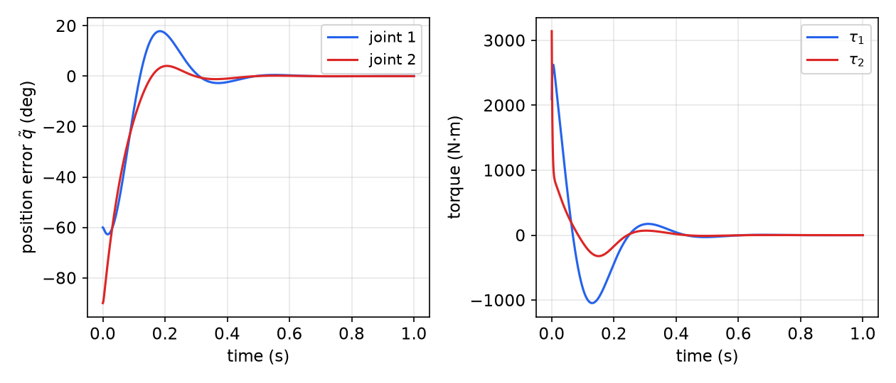
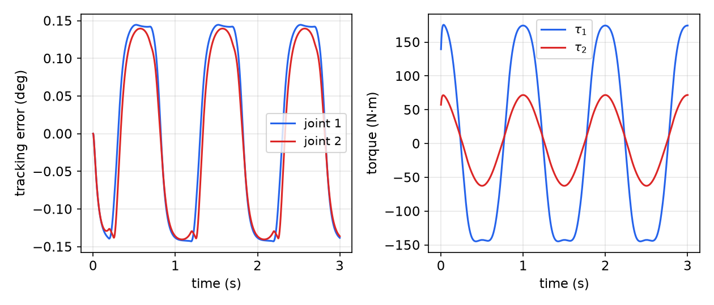
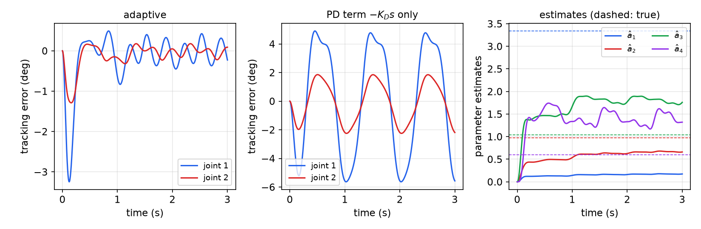
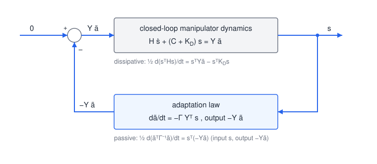
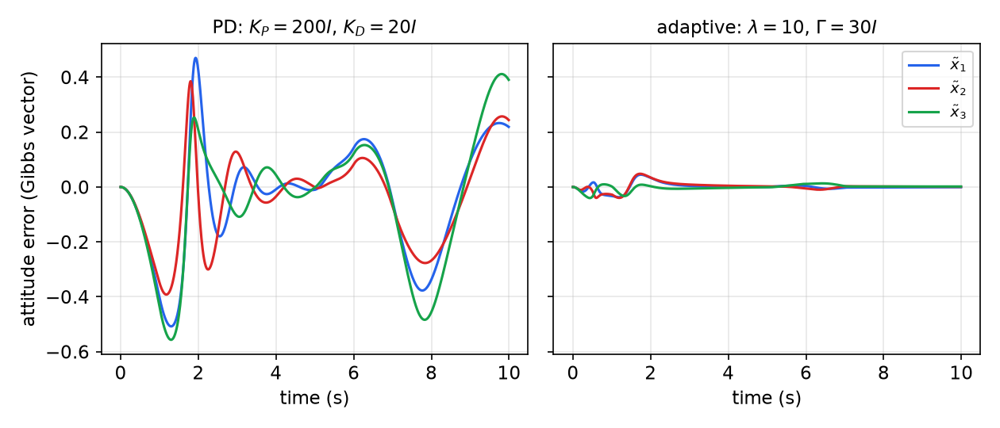

# Control of Multi-Input Physical Systems

The general methods of the previous chapters, [Feedback Linearization](feedback-linearization.md), [Sliding Control](sliding-control.md) and [Adaptive Control](adaptive-control.md), treat the plant as an abstract set of differential equations. For multi-input mechanical systems such as robot manipulators, aircraft, and underwater or space vehicles, this throws away valuable structure. Their dynamics conserve energy, dissipate it through friction and drag, and depend linearly on physical parameters such as masses and inertias. This chapter shows how to build that physics into the controller. The resulting designs are simpler, come with global stability proofs, and are more robust than designs that treat the dynamics as a black box. In a sense this is a return to the origins of Lyapunov theory, which began as a generalization of mechanical energy. Robot manipulators serve as the prototype, and spacecraft attitude control shows how the ideas carry over.

## Robotics as a Prototype

### Manipulator dynamics

Industrial arms with large gear ratios (\\(r \approx 100\\)) are nearly linear as seen from the motors, since reflected nonlinear inertial effects are divided by \\(r\\) or \\(r^2\\). Direct-drive and cable-driven arms, which avoid gear backlash and friction, expose the full nonlinear dynamics and require them to be modeled. The motion of an \\(n\\)-link rigid manipulator with joint coordinates \\(q \in \mathbb{R}^n\\) and joint torques \\(\tau\\) obeys
\\[
\boxed{H(q)\\,\ddot q + C(q, \dot q)\\,\dot q + g(q) = \tau .}
\\]
- \\(H(q)\\) is the **inertia matrix**, symmetric positive definite and configuration-dependent: a stretched-out arm has more inertia about its base than a folded one. The kinetic energy is \\(\tfrac{1}{2}\dot q^TH(q)\dot q\\).
- \\(C(q, \dot q)\dot q\\) collects the **centripetal** torques, proportional to squares of joint velocities, and the **Coriolis** torques, proportional to products of different joint velocities.
- \\(g(q)\\) is the vector of **gravitational** torques.

Two structural properties are used throughout.

**Uniform positive definiteness.** There is \\(\alpha > 0\\) such that \\(H(q) \ge \alpha I\\) for all \\(q\\) in the (closed, bounded) workspace. Physically, if \\(H(q)\\) had a zero eigenvalue in some configuration, the arm could move along the corresponding direction with zero kinetic energy, which is impossible for real bodies with mass. This guarantees that \\(H^{-1}\\) is bounded.

**Linear parametrization.** When the mass properties of each link are referred to the joint axes, every term of the dynamics is linear in a vector \\(a\\) of constant physical parameters (masses, first moments, inertias):
\\[
H(q)\ddot q + C(q, \dot q)\dot q + g(q) = Y\_1(q, \dot q, \ddot q)\\,a .
\\]
More generally, for any vectors \\(\dot q\_r\\), \\(\ddot q\_r\\),
\\[
H(q)\\,\ddot q\_r + C(q, \dot q)\\,\dot q\_r + g(q) = Y(q, \dot q, \dot q\_r, \ddot q\_r)\\,a ,
\\]
with a known regressor matrix \\(Y\\).

**Example 1 (two-link planar arm with a load).** A two-link arm moves in a horizontal plane (\\(g = 0\\)). The second link and the grasped load are treated as a single "end" body with mass \\(m\_e\\), inertia \\(I\_e\\) about its centre of mass, centre of mass at distance \\(l\_{ce}\\) from joint 2 and at angle \\(\delta\_e\\) from the link axis. Then
\\[
H\_{11} = a\_1 + 2a\_3\cos q\_2 + 2a\_4\sin q\_2, \qquad H\_{12} = H\_{21} = a\_2 + a\_3\cos q\_2 + a\_4\sin q\_2, \qquad H\_{22} = a\_2,
\\]
\\[
C = \begin{bmatrix} -h\dot q\_2 & -h(\dot q\_1 + \dot q\_2) \\\\ h\dot q\_1 & 0 \end{bmatrix}, \qquad h = a\_3\sin q\_2 - a\_4\cos q\_2,
\\]
with the four parameters
\\[
a\_1 = I\_1 + m\_1l\_{c1}^2 + I\_e + m\_el\_{ce}^2 + m\_el\_1^2, \quad a\_2 = I\_e + m\_el\_{ce}^2, \quad a\_3 = m\_el\_1l\_{ce}\cos\delta\_e, \quad a\_4 = m\_el\_1l\_{ce}\sin\delta\_e .
\\]
The numerical values used in all robot examples below are \\(m\_1 = 1\\), \\(l\_1 = 1\\), \\(m\_e = 2\\), \\(\delta\_e = 30^\circ\\), \\(I\_1 = 0.12\\), \\(l\_{c1} = 0.5\\), \\(I\_e = 0.25\\), \\(l\_{ce} = 0.6\\) (SI units), which give
\\[
a = [3.34,\ 0.97,\ 1.04,\ 0.60]^T .
\\]
Only four combinations of the six physical quantities appear, so the physical parameters themselves cannot be recovered from the motion. This does not matter for control, which needs only the combinations.

### Energy conservation and the skew-symmetry of \\(\dot H - 2C\\)

The total power delivered by the actuators goes into kinetic and potential energy. Without gravity,
\\[
\frac{1}{2}\frac{d}{dt}\left[\dot q^TH\dot q\right] = \dot q^T\tau ,
\\]
and with gravity
\\[
\frac{1}{2}\frac{d}{dt}\left[\dot q^TH\dot q\right] = \dot q^T(\tau - g) .
\\]
The Coriolis and centripetal forces do no work; they enter this balance only implicitly, through \\(\dot H\\). Expanding the left side and substituting the dynamics,
\\[
\dot q^TH\ddot q + \frac{1}{2}\dot q^T\dot H\dot q = \dot q^T(\tau - C\dot q - g) + \frac{1}{2}\dot q^T\dot H\dot q ,
\\]
and comparing with the right side gives
\\[
\dot q^T\left(\dot H - 2C\right)\dot q = 0 \qquad \forall\\,\dot q .
\\]
This scalar identity holds for every valid choice of \\(C\\). A stronger, matrix statement holds for a particular choice.

**Proposition (skew-symmetry).** With \\(C\\) defined componentwise by
\\[
C\_{ij} = \frac{1}{2}\sum\_k\frac{\partial H\_{ij}}{\partial q\_k}\dot q\_k + \frac{1}{2}\sum\_k\left(\frac{\partial H\_{ik}}{\partial q\_j} - \frac{\partial H\_{jk}}{\partial q\_i}\right)\dot q\_k ,
\\]
the matrix \\(\dot H - 2C\\) is skew-symmetric: \\(x^T(\dot H - 2C)x = 0\\) for *all* \\(x\\), not only for \\(x = \dot q\\). Equivalently, \\(\dot H = C + C^T\\).

*Proof.* Start from the Lagrangian \\(L = \frac{1}{2}\dot q^TH(q)\dot q - G(q)\\), where \\(G\\) is the potential energy. Lagrange's equations give
\\[
H\ddot q + b(q, \dot q) + g(q) = \tau, \qquad g = \frac{\partial G}{\partial q},
\\]
\\[
b\_i = \sum\_j\dot H\_{ij}\dot q\_j - \frac{1}{2}\dot q^T\frac{\partial H}{\partial q\_i}\dot q = \sum\_j\sum\_k h\_{ijk}\\,\dot q\_j\dot q\_k, \qquad h\_{ijk} = \frac{\partial H\_{ij}}{\partial q\_k} - \frac{1}{2}\frac{\partial H\_{jk}}{\partial q\_i} .
\\]
The vector \\(b\\) is quadratic in \\(\dot q\\), and it can be written as \\(b = C\dot q\\) in many ways. For example, \\(b\_1 = \dot q\_1^2 + 2\dot q\_1\dot q\_2 + \dot q\_2^2\\) is reproduced by the first row \\(c\_1 = [\dot q\_1,\ \dot q\_1 + 2\dot q\_2]\\) and equally by \\(c\_1 = [\dot q\_1 + \dot q\_2,\ \dot q\_1 + \dot q\_2]\\). Since \\(\sum\_{j,k}h\_{ijk}\dot q\_j\dot q\_k\\) is symmetric under exchanging the summation indices, one can rewrite it using \\(\frac{\partial H\_{ij}}{\partial q\_k}\dot q\_j\dot q\_k = \frac{1}{2}\left(\frac{\partial H\_{ij}}{\partial q\_k} + \frac{\partial H\_{ik}}{\partial q\_j}\right)\dot q\_j\dot q\_k\\) and read off the coefficient of \\(\dot q\_j\\), which gives the stated \\(C\_{ij}\\). Since \\(\dot H\_{ij} = \sum\_k\frac{\partial H\_{ij}}{\partial q\_k}\dot q\_k\\),
\\[
C\_{ij} = \frac{1}{2}\dot H\_{ij} + \frac{1}{2}\sum\_k\left(\frac{\partial H\_{ik}}{\partial q\_j} - \frac{\partial H\_{jk}}{\partial q\_i}\right)\dot q\_k .
\\]
The second term is antisymmetric in \\((i, j)\\), so \\(2C = \dot H + S\\) with \\(S^T = -S\\), and \\(\dot H - 2C = -S\\) is skew-symmetric. \\(\blacksquare\\)

Skew-symmetry is the matrix expression of energy conservation, and it is the single property that makes the Lyapunov proofs below work. For Example 1 one checks directly that \\(\dot H - 2C = \begin{bmatrix} 0 & 2h\dot q\_1 + h\dot q\_2 \\\\ -2h\dot q\_1 - h\dot q\_2 & 0 \end{bmatrix}\\) (a numerical check of the simulation model confirms skew-symmetry to rounding error).

## Position Control: the PD Energy Proof

Consider first the regulation of a manipulator in the horizontal plane (\\(g = 0\\)) to a constant position \\(q\_d\\), with \\(\tilde q = q - q\_d\\). A joint PD controller,
\\[
\tau\_j = -k\_{Pj}\\,\tilde q\_j - k\_{Dj}\\,\dot q\_j ,
\\]
mimics a passive spring and damper at each joint. More generally take
\\[
\tau = -K\_P\\,\tilde q - K\_D\\,\dot q, \qquad K\_P, K\_D \text{ symmetric positive definite}.
\\]
**Theorem (global convergence of PD position control).** For the manipulator in the horizontal plane, the PD law drives \\(q\\) to \\(q\_d\\) and \\(\dot q\\) to zero from any initial condition.

*Proof.* Use as Lyapunov function the "virtual mechanical energy" of the arm plus the virtual springs,
\\[
V = \frac{1}{2}\left[\dot q^TH\dot q + \tilde q^TK\_P\tilde q\right].
\\]
By the energy balance,
\\[
\dot V = \dot q^T\tau + \dot q^TK\_P\tilde q = \dot q^T\left(\tau + K\_P\tilde q\right) = -\dot q^TK\_D\dot q \le 0 ,
\\]
the power dissipated by the virtual dampers. \\(V\\) is radially unbounded, so trajectories are bounded. On the set where \\(\dot V \equiv 0\\) we have \\(\dot q \equiv 0\\), hence \\(\ddot q \equiv 0\\), and the dynamics give \\(\ddot q = -H^{-1}K\_P\tilde q = 0\\), so \\(\tilde q = 0\\). The largest invariant set in \\(\\{\dot V = 0\\}\\) is the equilibrium, and the invariant set theorem gives global convergence. \\(\blacksquare\\)

The proof uses no knowledge of the inertia parameters, and no Coriolis terms appear: energy conservation takes care of them. In a vertical plane, adding gravity compensation, \\(\tau = -K\_P\tilde q - K\_D\dot q + g(q)\\), restores the same argument (with \\(\dot q^T(\tau - g)\\) in the energy balance).

**Example 2 (PD regulation of the two-link arm).** For the arm of Example 1, move from \\((0, 0)\\) to \\((q\_{d1}, q\_{d2}) = (60^\circ, 90^\circ)\\) with \\(K\_D = 100I\\) and \\(K\_P = 20K\_D = 2000I\\) (angles in radians).

*Figure: Example 2, re-simulated. Left: the position errors decay from \\(-60^\circ\\) and \\(-90^\circ\\) to zero within about half a second, without overshoot. Right: the torques start at about \\(2.1\times10^3\\) and \\(3.1\times10^3\\) N·m (the springs \\(K\_P\tilde q(0)\\)) and decay with the error.*

## Trajectory Control

### Computed torque

For tracking a time-varying \\(q\_d(t)\\), the classical approach is feedback linearization, here called **computed torque**:
\\[
\tau = H(q)\\,v + C(q, \dot q)\dot q + g(q) \quad\Longrightarrow\quad \ddot q = v,
\qquad v = \ddot q\_d - 2\lambda\dot{\tilde q} - \lambda^2\tilde q ,
\\]
which gives the decoupled, critically damped error dynamics \\(\ddot{\tilde q} + 2\lambda\dot{\tilde q} + \lambda^2\tilde q = 0\\). It requires an exact model: errors in \\(H\\) multiply the commanded acceleration.

### Sliding control with the kinetic-energy metric

The robust controllers of [Sliding Control](sliding-control.md) can be applied joint by joint, with one sliding condition per joint, or with vector conditions. The best choice is to measure the distance to the sliding surface with the inertia matrix, \\(s^THs\\), a kinetic-energy-like quantity, because then energy conservation removes the Coriolis terms from the analysis. Define the vector sliding variable
\\[
s = \dot{\tilde q} + \Lambda\tilde q ,
\\]
with \\(\Lambda\\) symmetric positive definite (or, more generally, \\(-\Lambda\\) Hurwitz). Equivalently, \\(s\\) is a **velocity error**,
\\[
\boxed{s = \dot q - \dot q\_r, \qquad \dot q\_r = \dot q\_d - \Lambda\tilde q ,}
\\]
where the **reference velocity** \\(\dot q\_r\\) is the desired velocity corrected by the position error. Because \\(\tilde q\\) is \\(s\\) passed through the stable filter \\((pI + \Lambda)^{-1}\\), \\(s\\) bounded (or tending to zero) implies \\(\tilde q\\) and \\(\dot{\tilde q}\\) bounded (or tending to zero).

Consider
\\[
V(t) = \frac{1}{2}s^TH s .
\\]
Then \\(\dot V = s^T(H\ddot q - H\ddot q\_r) + \frac{1}{2}s^T\dot Hs\\). Substitute \\(H\ddot q = \tau - C\dot q - g = \tau - C(s + \dot q\_r) - g\\):
\\[
\dot V = s^T\left(\tau - H\ddot q\_r - C\dot q\_r - g\right) + \frac{1}{2}s^T\left(\dot H - 2C\right)s = s^T\left(\tau - H\ddot q\_r - C\dot q\_r - g\right),
\\]
the last step by skew-symmetry. The quadratic term in \\(s\\) has disappeared. Choose
\\[
\tau = \hat\tau - k\\,\mathrm{sgn}(s), \qquad \hat\tau = \hat H\ddot q\_r + \hat C\dot q\_r + \hat g ,
\\]
where \\(k\\,\mathrm{sgn}(s)\\) is the vector with components \\(k\_i\\,\mathrm{sgn}(s\_i)\\). With \\(\tilde H = \hat H - H\\), \\(\tilde C = \hat C - C\\), \\(\tilde g = \hat g - g\\),
\\[
\dot V = s^T\left[\tilde H\ddot q\_r + \tilde C\dot q\_r + \tilde g\right] - \sum\_i k\_i\lvert s\_i\rvert ,
\\]
and the gains
\\[
k\_i \ge \left\lvert\left[\tilde H\ddot q\_r + \tilde C\dot q\_r + \tilde g\right]\_i\right\rvert + \eta\_i
\\]
give \\(\dot V \le -\sum\_i\eta\_i\lvert s\_i\rvert\\). Hence \\(s = 0\\) is reached in finite time, after which \\(\tilde q \to 0\\) exponentially. The discontinuity is smoothed by a boundary layer as in the single-input case. Since \\(\tilde H\ddot q\_r + \tilde C\dot q\_r + \tilde g = Y\tilde a\\) with \\(\tilde a = \hat a - a\\), a convenient bound is \\(k\_i = \sum\_j\lvert Y\_{ij}\rvert\\,\delta a\_j + \eta\_i\\), where \\(\delta a\_j\\) bounds \\(\lvert\tilde a\_j\rvert\\).

**Example 3 (sliding control of the two-link arm).** Use
\\[
\tau = \hat H\ddot q\_r + \hat C\dot q\_r - \begin{bmatrix} k\_1\\,\mathrm{sat}(s\_1/\Phi\_1) \\\\ k\_2\\,\mathrm{sat}(s\_2/\Phi\_2) \end{bmatrix},
\\]
with \\(\Lambda = 20I\\), \\(\eta\_1 = \eta\_2 = 0.1\\), \\(\Phi\_1 = \Phi\_2 = 0.05\\). The design assumes up to 25% uncertainty in the mass properties; in the simulation the estimates are 20% low, \\(\hat a = 0.8\\,a\\). (With these numbers the largest ratio \\(k\_i/\Phi\_i\\) is comparable to the diagonal of \\(K\_D\\) in Example 2.) The desired trajectory starts from rest at \\((0, 0)\\):
\\[
q\_{d1}(t) = 30^\circ\left(1 - \cos 2\pi t\right), \qquad q\_{d2}(t) = 45^\circ\left(1 - \cos 2\pi t\right).
\\]

*Figure: Example 3, re-simulated over three periods. Left: tracking errors stay within about \\(\pm 0.14^\circ\\) on both joints. Right: the torques are smooth, with peaks of about 176 and 72 N·m.*

## Adaptive Trajectory Control

### The Slotine–Li algorithm

Now let the parameter vector \\(a\\) be unknown and constant, and add a parameter-error term to the Lyapunov function:
\\[
V(t) = \frac{1}{2}\left[s^THs + \tilde a^T\Gamma^{-1}\tilde a\right], \qquad \Gamma \text{ symmetric positive definite}.
\\]
As before, by skew-symmetry,
\\[
\dot V = s^T\left(\tau - H\ddot q\_r - C\dot q\_r - g\right) + \dot{\hat a}^T\Gamma^{-1}\tilde a = s^T\left(\tau - Ya\right) + \dot{\hat a}^T\Gamma^{-1}\tilde a .
\\]
Choose the control law
\\[
\boxed{\tau = Y(q, \dot q, \dot q\_r, \ddot q\_r)\\,\hat a - K\_D\\,s ,}
\\]
a feedforward term \\(Y\hat a = \hat H\ddot q\_r + \hat C\dot q\_r + \hat g\\) plus a PD-like term (\\(K\_Ds = K\_D\dot{\tilde q} + K\_D\Lambda\tilde q\\)), with \\(K\_D\\) symmetric positive definite. Then
\\[
\dot V = s^TY\tilde a - s^TK\_Ds + \dot{\hat a}^T\Gamma^{-1}\tilde a ,
\\]
and the adaptation law
\\[
\boxed{\dot{\hat a} = -\Gamma\\,Y^T s}
\\]
cancels the cross term, leaving
\\[
\dot V = -s^TK\_D\\,s \le 0 .
\\]
**Theorem (Slotine–Li adaptive controller).** For bounded desired trajectories with bounded first and second derivatives, the closed loop is globally stable and \\(\tilde q \to 0\\), \\(\dot{\tilde q} \to 0\\).

*Proof.* \\(V\\) is non-increasing, so \\(s\\) and \\(\tilde a\\) are bounded; hence \\(\tilde q\\), \\(\dot{\tilde q}\\), \\(q\\), \\(\dot q\\), \\(\hat a\\), \\(\dot q\_r\\) and \\(\ddot q\_r\\) are bounded. The closed loop is
\\[
H\dot s + (C + K\_D)\\,s = Y\tilde a ,
\\]
and since \\(H^{-1}\\) is bounded (uniform positive definiteness), \\(\dot s\\) is bounded. Thus \\(\ddot V = -2s^TK\_D\dot s\\) is bounded and \\(\dot V\\) is uniformly continuous. By Barbalat's lemma \\(\dot V \to 0\\), so \\(s \to 0\\), and therefore \\(\tilde q \to 0\\) and \\(\dot{\tilde q} \to 0\\). \\(\blacksquare\\)

The adaptation law consists of correlation integrals of the tracking error with the regressor signals. The parameters need not converge to their true values; that requires the trajectory to be sufficiently rich. In practice one often adapts only on the parameters of the grasped load (at most 10: mass, three centre-of-mass coordinates, six inertia components), with robust terms for the unadapted parameters and for stiction.

The two ingredients that made the proof work are exactly the physical properties above: skew-symmetry eliminated the \\(\tfrac{1}{2}s^T(\dot H - 2C)s\\) term, and linear parametrization allowed the uncertainty to be written as \\(Y\tilde a\\). Unlike adaptive computed torque, no estimate of \\(H\\) is ever inverted, and no measurement of acceleration is needed.

**Example 4 (adaptive control of the two-link arm).** With \\(\Lambda = 20I\\) and \\(K\_D = 100I\\), the controller is
\\[
\begin{bmatrix} \tau\_1 \\\\ \tau\_2 \end{bmatrix} =
\begin{bmatrix} \hat H\_{11} & \hat H\_{12} \\\\ \hat H\_{21} & \hat H\_{22} \end{bmatrix}
\begin{bmatrix} \ddot q\_{r1} \\\\ \ddot q\_{r2} \end{bmatrix} + \begin{bmatrix} -\hat h\dot q\_2 & -\hat h(\dot q\_1 + \dot q\_2) \\\\ \hat h\dot q\_1 & 0 \end{bmatrix}
\begin{bmatrix} \dot q\_{r1} \\\\ \dot q\_{r2} \end{bmatrix} - \begin{bmatrix} 100\\,s\_1 \\\\ 100\\,s\_2 \end{bmatrix},
\\]
where the hats denote the expressions of Example 1 evaluated with \\(\hat a\\). The regressor has entries
\\[
Y\_{11} = \ddot q\_{r1}, \qquad Y\_{12} = \ddot q\_{r2}, \qquad Y\_{21} = 0, \qquad Y\_{22} = \ddot q\_{r1} + \ddot q\_{r2},
\\]
\\[
Y\_{13} = (2\ddot q\_{r1} + \ddot q\_{r2})\cos q\_2 - (\dot q\_2\dot q\_{r1} + \dot q\_1\dot q\_{r2} + \dot q\_2\dot q\_{r2})\sin q\_2,
\\]
\\[
Y\_{14} = (2\ddot q\_{r1} + \ddot q\_{r2})\sin q\_2 + (\dot q\_2\dot q\_{r1} + \dot q\_1\dot q\_{r2} + \dot q\_2\dot q\_{r2})\cos q\_2,
\\]
\\[
Y\_{23} = \ddot q\_{r1}\cos q\_2 + \dot q\_1\dot q\_{r1}\sin q\_2, \qquad Y\_{24} = \ddot q\_{r1}\sin q\_2 - \dot q\_1\dot q\_{r1}\cos q\_2 .
\\]
(These follow by collecting the coefficients of \\(a\_1, \dots, a\_4\\) in \\(H\ddot q\_r + C\dot q\_r\\).) The adaptation gain is \\(\Gamma = \mathrm{diag}[0.03, 0.05, 0.1, 0.3]\\), the initial estimates \\(\hat a(0) = 0\\), the true parameters \\(a = [3.34, 0.97, 1.04, 0.60]^T\\), and the trajectory that of Example 3.

*Figure: Example 4, re-simulated. Left: with adaptation, after an initial transient of about \\(3^\circ\\) on joint 1, the errors fall below \\(0.8^\circ\\) after half a second and below \\(0.5^\circ\\) after two seconds. Middle: the PD term \\(-K\_Ds\\) alone (the same controller with adaptation switched off; both are identical at \\(t = 0\\) since \\(\hat a(0) = 0\\)) leaves periodic errors of about \\(5.6^\circ\\) and \\(2.3^\circ\\). Right: the estimates move smoothly but do not converge to the true values (dashed); tracking needs only the combination of parameters excited by this trajectory.*

### A variant with time-varying \\(K\_D\\)

The proof is unchanged if \\(K\_D\\) is time-varying, provided it stays uniformly positive definite with bounded derivative. This opens an interesting connection with computed torque. With no uncertainty, choose \\(K\_D = \lambda H\\) and \\(\Lambda = \lambda I\\):
\\[
\dot V = -\lambda s^THs = -2\lambda V \quad\Longrightarrow\quad V(t) = V(0)e^{-2\lambda t},
\\]
and since \\(V \ge \tfrac{\alpha}{2}\lVert s\rVert^2\\), \\(s\\) converges exponentially at rate \\(\lambda\\). The resulting control,
\\[
\tau = H\left(\ddot q\_r - \lambda s\right) + C\dot q\_r + g = H\left[\ddot q\_d - 2\lambda\dot{\tilde q} - \lambda^2\tilde q\right] + C\dot q\_r + g ,
\\]
differs from computed torque only in the Coriolis term (\\(C\dot q\_r\\) instead of \\(C\dot q\\)). It exploits the structure of the dynamics without cancelling them exactly. In the adaptive case the choice \\(K\_D = \lambda\hat H\\) might lose positive definiteness. Instead, write
\\[
\hat H(\ddot q\_r - \lambda s) + \hat C\dot q\_r + \hat g = Y\_m(q, \dot q, \dot q\_r, \ddot q\_r)\\,\hat a,
\qquad
\tau = Y\_m\hat a, \qquad \dot{\hat a} = -\Gamma Y\_m^Ts .
\\]
Then \\(\dot V = -\lambda s^THs\\), and global convergence follows because the *true* \\(H\\) is uniformly positive definite.

### Composite adaptive trajectory control

Composite adaptation ([Adaptive Control](adaptive-control.md)) applies directly to robots. Let \\(e\\) be the prediction error on the filtered torque (Example 12 of that chapter), with
\\[
W(q, \dot q) = \frac{\lambda\_f}{p + \lambda\_f}\left[Y\_1(q, \dot q, \ddot q)\right],
\\]
computable without accelerations, so that \\(e = W\tilde a\\). The composite law is
\\[
\dot{\hat a} = -P(t)\left[Y^Ts + W^TR(t)\\,e\right],
\\]
with \\(R(t)\\) a uniformly positive definite weighting (take \\(R = I\\)). Tracking-error-based adaptation corresponds to \\(P = \Gamma\\), \\(R = 0\\). Use
\\[
V(t) = \frac{1}{2}\left[s^THs + \tilde a^TP^{-1}\tilde a\right].
\\]
**Constant gain** \\(P = P\_0\\):
\\[
\dot V = -s^TK\_Ds - \tilde a^TW^TW\tilde a = -s^TK\_Ds - e^Te .
\\]
For bounded desired trajectories, \\(\tilde q\\), \\(\dot{\tilde q}\\) and \\(e\\) tend to zero globally and \\(\tilde a\\) stays bounded. The proof bounds \\(\ddot V = -2s^TK\_D\dot s - 2e^T\dot e\\) using \\(H\dot s + (C + K\_D)s = Y\tilde a\\) and the boundedness of \\(W\\) (a stable strictly proper filter of bounded signals), then applies Barbalat's lemma. If, in addition, the trajectory is persistently exciting and uniformly continuous, \\(\tilde a \to 0\\): the parameter error obeys
\\[
\dot{\tilde a} + P\_0W^TW\tilde a = -P\_0Y^Ts ,
\\]
an exponentially stable system (under PE) with a convergent input. Persistent excitation of \\(W\\) follows from that of \\(W\_d = W(q\_d, \dot q\_d)\\) once \\(\tilde q, \dot{\tilde q} \to 0\\), and the latter from PE and uniform continuity of \\(Y\_{1d}\\). Compared with the gradient-like law \\(\dot{\tilde a} = -\Gamma Y^Ts\\), the composite law is a time-varying filtered version, hence smoother and faster.

**Bounded-gain forgetting**: \\(\frac{d}{dt}P^{-1} = -\lambda(t)P^{-1} + W^TW\\), \\(\lambda(t) = \lambda\_0(1 - \lVert P\rVert/k\_0)\\), which guarantees \\(\lambda(t) \ge 0\\) and \\(P \le k\_0I\\), with \\(\lambda(t) \ge \lambda\_1 > 0\\) under PE. Combined with the variant controller \\(\tau = Y\_m\hat a\\) above,
\\[
\dot V = -\lambda s^THs - \frac{\lambda(t)}{2}\tilde a^TP^{-1}\tilde a - \frac{1}{2}\tilde a^TW^TW\tilde a \le 0 .
\\]
For bounded trajectories, \\(\tilde q\\), \\(\dot{\tilde q}\\) and \\(e\\) tend to zero. With PE and uniform continuity, \\(\lambda(t)\tilde a^TP^{-1}\tilde a \ge \lambda\_1\tilde a^TP^{-1}\tilde a\\), and with \\(\gamma\_0 = \min(2\lambda, \lambda\_1)\\),
\\[
\dot V + \gamma\_0V \le 0 \quad\Longrightarrow\quad V(t) \le V(0)\\,e^{-\gamma\_0t} :
\\]
**global exponential convergence** of both tracking and parameter errors. In practice composite adaptation permits higher adaptation gains, faster parameter convergence, better tracking, and more robustness to unmodeled dynamics.

## Putting Physics in Control

### High-frequency unmodeled dynamics

The classical rule is to keep the control bandwidth below the frequencies of unmodeled dynamics, such as structural modes of flexible links. But a PD term that mimics a passive spring and damper cannot destabilize a passive structure, however flexible: the interconnection of passive systems is passive. The bandwidth of such terms is therefore limited by actuator dynamics and sampling, not by the structural modes. Zero-mean noise uncorrelated with the state does not destroy passivity either. More generally, control components that combine with a passive element of the plant into a new passive system can be tuned without regard for that element's bandwidth limits. This suggests implementing the controller on multiple time scales: PD terms fastest (possibly analog), feedforward terms slower, and parameter updates slowest.

### Conservative and dissipative dynamics

Physical systems dissipate energy, and dissipation can be exploited rather than fought. Consider viscous friction \\(D\dot q\\) at the joints, with \\(D\\) positive definite and linearly parametrized, \\(D\dot q = Y\_D(\dot q)\\,a\_D\\).

(a) **As a disturbance to be compensated**:
\\[
\tau = Y\hat a + Y\_D(\dot q)\\,\hat a\_D - K\_Ds, \qquad \dot{\hat a}\_D = -\Gamma\_DY\_D^T(\dot q)\\,s \quad\Longrightarrow\quad \dot V = -s^TK\_Ds .
\\]
(b) **As a helpful effect.** Write \\(D\dot q = D\dot q\_r + Ds\\). Compensating only the reference part,
\\[
\tau = Y\hat a + Y\_D(\dot q\_r)\\,\hat a\_D - K\_Ds, \qquad \dot{\hat a}\_D = -\Gamma\_DY\_D^T(\dot q\_r)\\,s \quad\Longrightarrow\quad \dot V = -s^T(K\_D + D)\\,s .
\\]
The physical damping adds to \\(K\_D\\), increasing the effective feedback gain beyond the classical bandwidth limit, and the compensation uses the desired-based \\(\dot q\_r\\), which is insensitive to velocity noise.

**Coulomb friction** \\(D\_c\\,\mathrm{sgn}(\dot q)\\) (diagonal \\(D\_c \ge 0\\)) can likewise be compensated by \\(D\_c\\,\mathrm{sgn}(\dot q\_r)\\). The resulting extra term in \\(\dot V\\) is
\\[
-s^TD\_c\left(\mathrm{sgn}\\,\dot q - \mathrm{sgn}\\,\dot q\_r\right) = -\sum\_i s\_iD\_{ci}\left(\mathrm{sgn}\\,\dot q\_i - \mathrm{sgn}\\,\dot q\_{ri}\right) \le 0 ,
\\]
because whenever \\(\mathrm{sgn}\\,\dot q\_i \ne \mathrm{sgn}\\,\dot q\_{ri}\\), the difference has the sign of \\(\dot q\_i - \dot q\_{ri} = s\_i\\). This avoids differentiating noisy velocities and the modeling errors of friction near zero velocity. Square-law hydrodynamic drag \\(D(\dot q)\dot q\\) and other monotone dissipative terms can be handled in the same way.

### Passivity interpretation

**Example 5 (adaptive robot control as a passive feedback loop).** Energy conservation makes the map from \\(\tau - g\\) to \\(\dot q\\) passive. The control \\(\tau = Y\hat a - K\_Ds\\) turns the manipulator into a *dissipative* map from \\(Y\tilde a\\) to \\(s\\):
\\[
\frac{1}{2}\frac{d}{dt}\left[s^THs\right] = s^TY\tilde a - s^TK\_Ds .
\\]
The adaptation law makes the map from \\(s\\) to \\(-Y\tilde a\\) *passive*:
\\[
\frac{1}{2}\frac{d}{dt}\left[\tilde a^T\Gamma^{-1}\tilde a\right] = -s^TY\tilde a .
\\]
The closed loop is the feedback interconnection of the two.

*Figure: the adaptive robot controller as a feedback interconnection. The forward block (closed-loop manipulator dynamics) is dissipative from \\(Y\tilde a\\) to \\(s\\); the feedback block (adaptation) is passive from \\(s\\) to \\(-Y\tilde a\\). Adding the two storage functions gives the Lyapunov function \\(V\\), and \\(\dot V = -s^TK\_Ds\\).*

This view shows that the integrator in the adaptation law is not essential. It can be replaced by any passive operator: \\(h(p)/p\\) with \\(h\\) passive, any passive linear MIMO system, or a passive nonlinear map such as composite adaptation. The same construction extends to spacecraft, aircraft and underwater vehicles (where added-mass effects come from a velocity potential), and to systems with thermodynamic or chemical ports through the notion of available energy. See [Passivity](passivity.md) for the general theory.

### Robotics as a metaphor

The recipe generalizes beyond robots. Write the energy balance as
\\[
\frac{d}{dt}\left[\text{stored energy}\right] = \left[\text{external power input } y^Tu\right] + \left[\text{internal power generation}\right].
\\]
Then design a controller that maps the parametric uncertainty into a variable \\(s = y - y\_r\\), where \\(s = 0\\) defines an exponentially stable differential equation in the tracking error and \\(\dim s \le \dim u\\). Linear parametrization makes adaptive designs possible; bounds on the uncertainty suffice for robust (sliding) designs.

## Spacecraft Control

Consider the attitude control of a rigid spacecraft by three orthogonal reaction wheels, possibly while it holds a large load of unknown mass properties.

### Dynamics and kinematics

In spacecraft (body) coordinates the dynamics are
\\[
H\dot\omega = p \times \omega + \tau ,
\\]
where \\(\omega\\) is the angular velocity of the spacecraft, \\(H = H^o - H\_A\\) with \\(H^o\\) the total central inertia (including the wheels) and \\(H\_A\\) the diagonal matrix of wheel axial inertias, \\(p\\) the total angular momentum expressed in the spacecraft frame, and \\(-\tau\\) the vector of torques applied by the wheel motors. The cross product is written with the skew matrix
\\[
[v\times] = \begin{bmatrix} 0 & -v\_3 & v\_2 \\\\ v\_3 & 0 & -v\_1 \\\\ -v\_2 & v\_1 & 0 \end{bmatrix} .
\\]
In the absence of external torques the total angular momentum is constant in inertial space, \\(p^I\\), and in body coordinates it rotates with the attitude.

The attitude can be parametrized by the **Gibbs vector** \\(\xi = \tan(\rho/2)\\,e\\), where \\(e\\) is the unit vector of the rotation axis and \\(\rho\\) the rotation angle (valid for \\(-\pi < \rho < \pi\\)). Its kinematics are
\\[
\dot\xi = Z(\xi)\\,\omega, \qquad Z(\xi) = \frac{1}{2}\left[I + \xi\xi^T + [\xi\times]\right],
\\]
and the body-frame momentum is \\(p = C(\xi)\\,p^I\\) with
\\[
C(\xi) = \frac{2}{1 + \xi^T\xi}\left[I + \xi\xi^T - [\xi\times]\right] - I, \qquad C^{-1} = C^T = C(-\xi).
\\]
Euler angles \\(\gamma = (\phi, \theta, \psi)\\) can be used instead, with \\(\dot\gamma = M(\gamma)\omega\\),
\\[
M(\gamma) = \begin{bmatrix} 1 & \sin\phi\tan\theta & \cos\phi\tan\theta \\\\ 0 & \cos\phi & -\sin\phi \\\\ 0 & \sin\phi\sec\theta & \cos\phi\sec\theta \end{bmatrix} \qquad (\lvert\theta\rvert < \pi/2),
\\]
and \\(p = R(\gamma)\\,p^I\\) with \\(R\\) the corresponding rotation matrix. In either case the system has the synthetic form
\\[
H\dot\omega = p \times \omega + \tau, \qquad \dot x = J(x)\\,\omega ,
\\]
where \\(x\\) is the attitude vector. For the Gibbs vector, \\(J = Z\\) and
\\[
J^{-1}(x) = \frac{2}{1 + x^Tx}\left[I - [x\times]\right],
\\]
as one verifies by multiplying out and using \\([x\times]^2 = xx^T - (x^Tx)I\\).

### Dynamics in attitude coordinates

Substitute \\(\omega = J^{-1}\dot x\\) and \\(\dot\omega = J^{-1}\ddot x - J^{-1}\dot JJ^{-1}\dot x\\) into the dynamics and multiply by \\(J^{-T}\\):
\\[
H^\*(x)\\,\ddot x + C^\*(x, \dot x)\\,\dot x = F, \qquad \tau = J^TF,
\\]
\\[
H^\* = J^{-T}HJ^{-1}, \qquad C^\* = -J^{-T}HJ^{-1}\dot JJ^{-1} - J^{-T}[p\times]J^{-1} .
\\]
This has the structure of a manipulator. \\(H^\*\\) is symmetric positive definite, and
\\[
\dot H^\* - 2C^\* = \frac{d}{dt}\left(J^{-T}\right)HJ^{-1} - J^{-T}H\frac{d}{dt}\left(J^{-1}\right) + 2J^{-T}[p\times]J^{-1}
\\]
is skew-symmetric (the first two terms are transposes of each other with opposite sign, and \\([p\times]\\) is skew). Both \\(H^\*\\) and \\(C^\*\\) are linear in the parameter vector \\(a\\) made of the six independent entries of \\(H\\) and the three components of \\(p^I\\).

### Attitude regulation and adaptive tracking

**PD regulation.** The control
\\[
\tau = J^TF = -J^T\left[K\_P\tilde x + K\_D\dot x\right]
\\]
with \\(V\_1 = \tfrac{1}{2}\left[\dot x^TH^\*\dot x + \tilde x^TK\_P\tilde x\right]\\) gives \\(\dot V\_1 = -\dot x^TK\_D\dot x\\) and, by the invariant set theorem, convergence to the desired attitude. No knowledge of the mass properties is needed, and the design tolerates flexible appendages, which are passive. Since \\(V\_1\\) bounds \\(x\\), the singularity of the Gibbs vector at \\(\rho = \pi\\) is never reached.

**Adaptive tracking.** Define, as for robots,
\\[
s = \dot{\tilde x} + \lambda\tilde x = \dot x - \dot x\_r, \qquad \dot x\_r = \dot x\_d - \lambda\tilde x,
\\]
and \\(V = \tfrac{1}{2}\left[s^TH^\*s + \tilde a^T\Gamma^{-1}\tilde a\right]\\). The controller
\\[
F = \hat H^\*\ddot x\_r + \hat C^\*\dot x\_r - K\_Ds = Y^\*(x, \dot x, \dot x\_r, \ddot x\_r)\\,\hat a - K\_Ds, \qquad \dot{\hat a} = -\Gamma Y^{\*T}s,
\\]
gives \\(\dot V = -s^TK\_Ds \le 0\\), and Barbalat's lemma yields \\(\tilde x, \dot{\tilde x} \to 0\\). The wheel torques are \\(\tau = J^T(Y^\*\hat a - K\_Ds)\\). Adding \\(\lambda\tilde x^TK\_D\tilde x\\) to \\(V\\) shows that \\(x\\) stays bounded, so the Gibbs singularity is avoided for maneuvers smaller than \\(180^\circ\\) (larger ones can be split into subtasks). The location of the centre of mass is not needed. If the initial wheel speeds \\(\Omega(0)\\) are measured and \\(H\_A\\) is known, \\(p^I\\) can be computed from the initial momentum, leaving only the six inertia parameters to adapt. The PD part may also be generalized to \\(-J^T[K\_D\dot{\tilde x} + K\_P\tilde x]\\), tuned independently of \\(\lambda\\).

**Example 6 (adaptive attitude tracking).** The spacecraft starts at \\(x(0) = 0\\). The desired attitude accelerates uniformly for 1 s to \\(x\_d = [0.5, 0.5, 0.5]^T\\), decelerates for 1 s to \\([1, 1, 1]^T\\), holds for 3 s, and then returns to zero in the same way. The true inertia matrix and momentum are
\\[
H = \begin{bmatrix} 15 & 5 & 5 \\\\ 5 & 10 & 7 \\\\ 5 & 7 & 20 \end{bmatrix}, \qquad p^I = [1, -1, 0]^T,
\\]
and the controller runs at 100 Hz. The PD controller uses \\(F = -K\_P\tilde x - K\_D\dot{\tilde x}\\) with \\(K\_P = 200I\\), \\(K\_D = 20I\\). The adaptive controller uses \\(\lambda = 10\\) and \\(K\_D = 20I\\), so that \\(K\_Ds\\) equals the PD law exactly, \\(\hat a(0) = 0\\) (so both controllers start identically), and a conservative \\(\Gamma = 30I\\).

*Figure: Example 6, re-simulated. Left: the PD controller, which knows nothing about the mass properties, lags the maneuver with errors up to about 0.56 on the first leg and 0.48 on the return, and is lightly damped (the effective inertia \\(H^\* = 4H\\) at \\(x = 0\\) is large compared with \\(K\_P\\)). Right: the adaptive controller, starting from the same law, reduces the errors to about 0.05 on the first leg and 0.013 on the return, with smaller peak torques (about 140 versus 270 N·m).*

The improvement grows on the second leg because the parameters learned during the first leg are reused. This happens along a smooth, "unexciting" trajectory, without any identification experiment. Extensions include translational control with gas jets (adding the mass and the centre-of-mass position, ten parameters in all), low-frequency structural modes (handled by singular perturbation arguments; see [Averaging and Singular Perturbations](averaging.md)), and manipulators mounted on spacecraft.

## Summary

- **Manipulator dynamics** \\(H\ddot q + C\dot q + g = \tau\\): \\(H\\) uniformly positive definite; dynamics linear in mass properties, \\(H\ddot q\_r + C\dot q\_r + g = Ya\\).
- **Energy conservation**: \\(\tfrac{1}{2}\tfrac{d}{dt}[\dot q^TH\dot q] = \dot q^T(\tau - g)\\); with the Christoffel-type \\(C\\), \\(\dot H - 2C\\) is skew-symmetric (\\(\dot H = C + C^T\\)).
- **PD position control** \\(\tau = -K\_P\tilde q - K\_D\dot q\\) is globally convergent; \\(V = \tfrac{1}{2}[\dot q^TH\dot q + \tilde q^TK\_P\tilde q]\\), \\(\dot V = -\dot q^TK\_D\dot q\\).
- **Velocity error** \\(s = \dot q - \dot q\_r\\), \\(\dot q\_r = \dot q\_d - \Lambda\tilde q\\); with \\(V = \tfrac{1}{2}s^THs\\), \\(\dot V = s^T(\tau - H\ddot q\_r - C\dot q\_r - g)\\).
- **Sliding control**: \\(\tau = \hat H\ddot q\_r + \hat C\dot q\_r + \hat g - k\\,\mathrm{sgn}(s)\\), \\(k\_i \ge \lvert[Y\tilde a]\_i\rvert + \eta\_i\\).
- **Slotine–Li adaptive control**: \\(\tau = Y\hat a - K\_Ds\\), \\(\dot{\hat a} = -\Gamma Y^Ts\\), \\(\dot V = -s^TK\_Ds\\); global tracking convergence; parameters converge only with sufficient excitation.
- **Composite adaptation** \\(\dot{\hat a} = -P[Y^Ts + W^Te]\\): with bounded-gain forgetting and PE, global exponential convergence of tracking and parameter errors.
- **Physics**: passive PD terms are not limited by structural modes; viscous friction compensated through \\(\dot q\_r\\) adds damping \\(D\\) to \\(K\_D\\); Coulomb friction compensated by \\(D\_c\\,\mathrm{sgn}(\dot q\_r)\\).
- **Passivity**: closed-loop arm dissipative from \\(Y\tilde a\\) to \\(s\\), adaptation passive from \\(s\\) to \\(-Y\tilde a\\).
- **Spacecraft**: \\(H^\*\ddot x + C^\*\dot x = F\\), \\(\tau = J^TF\\), same skew-symmetry and linear parametrization, same adaptive controller.

## See Also

- [Sliding Control](sliding-control.md) and [Adaptive Control](adaptive-control.md): the single-input foundations of this chapter.
- [Feedback Linearization](feedback-linearization.md): computed torque and the two-link arm model.
- [Passivity](passivity.md): passive interconnections and storage functions.
- [Invariant Sets and LaSalle's Principle](invariance.md): the invariant set theorem and Barbalat's lemma.
- [Backstepping](backstepping.md): recursive Lyapunov designs for systems with more structure.
- [Robot Control](../../../app/robotics/control.md): applied robot control.
- [Modern Control Overview](../modern.md) and [PID Control](../pid.md).
