# Phase Plane Analysis

Phase-plane analysis, introduced by Poincaré, is a graphical method for studying second-order systems. The idea is to draw, in the plane of the two state variables, the curves traced by the solutions for many initial conditions, and to read the system's qualitative behavior (equilibria, stability, oscillations, regions of attraction) directly from the picture without solving the equations. The method has two great advantages: it shows *all* motions at once, globally, and it works for strong and hard nonlinearities (relays, saturation) as easily as for smooth ones. Its limitation is equally clear: it applies only to systems of order one or two. This chapter builds the method from the definitions, classifies the singular points of linear systems, extends the classification locally to nonlinear systems, and then studies limit cycles and the theorems (index, Poincaré–Bendixson, Bendixson) that predict their existence or absence.

## Phase Portraits

Consider the second-order autonomous system
\\[
\dot x\_1 = f\_1(x\_1, x\_2), \qquad \dot x\_2 = f\_2(x\_1, x\_2),
\\]
where \\(f\_1\\) and \\(f\_2\\) are nonlinear functions of the state components \\(x\_1, x\_2\\). Geometrically, the state space of this system is a plane with coordinates \\(x\_1\\) and \\(x\_2\\), the **phase plane**.

**Definition (phase-plane trajectory, phase portrait).** Given an initial condition \\(x(0) = x\_0\\), the system equation defines a solution \\(x(t)\\). As \\(t\\) varies from 0 to \\(\infty\\) the solution traces a curve in the phase plane, the **phase-plane trajectory**. A family of trajectories corresponding to various initial conditions is a **phase portrait** of the system.

**Example 2.1 (Mass–spring system).** A unit mass on a unit spring, \\(\ddot x + x = 0\\), starts at rest from position \\(x\_0\\). Its solution is
\\[
x(t) = x\_0\cos t, \qquad \dot x(t) = -x\_0\sin t .
\\]
Eliminating time with \\(\cos^2 t + \sin^2 t = 1\\) gives the trajectory equation
\\[
x^2 + \dot x^2 = x\_0^2 ,
\\]
a circle of radius \\(\lvert x\_0 \rvert\\) about the origin. The phase portrait (figure below, left) is a family of concentric circles, traversed clockwise: in the upper half-plane \\(\dot x > 0\\), so \\(x\\) increases and the motion goes to the right. The picture makes the system's **marginal stability** obvious: a trajectory starting near the origin stays near it, but never approaches it.

A large class of second-order systems can be written as
\\[
\ddot x + f(x, \dot x) = 0 ,
\\]
which includes mass–spring–damper systems and RLC circuits. With \\(x\_1 = x\\) and \\(x\_2 = \dot x\\) this becomes
\\[
\dot x\_1 = x\_2, \qquad \dot x\_2 = -f(x\_1, x\_2) .
\\]
The traditional phase plane uses exactly these coordinates, position and velocity. Everything below holds for the general form \\(\dot x\_1 = f\_1, \dot x\_2 = f\_2\\), which is the one we use; the position–velocity form is a special case with a convenient property: trajectories in the upper half-plane always move to the right and those in the lower half-plane to the left, and trajectories cross the \\(x\_1\\)-axis vertically.

## Singular Points

**Definition (singular point).** A **singular point** is an equilibrium point in the phase plane, a point where the system stays if started there:
\\[
f\_1(x\_1, x\_2) = 0, \qquad f\_2(x\_1, x\_2) = 0 .
\\]

**Why "singular".** Dividing the two state equations eliminates time and gives the slope of the trajectory through any point:
\\[
\frac{dx\_2}{dx\_1} = \frac{f\_2(x\_1, x\_2)}{f\_1(x\_1, x\_2)} .
\\]
When \\(f\_1\\) and \\(f\_2\\) are single-valued, this slope is uniquely determined at every point where it is defined. Consequently **trajectories cannot cross**: if two trajectories passed through the same point they would have the same slope there and, by uniqueness of solutions, would be the same trajectory. At a singular point, and only there, the slope is \\(0/0\\), indeterminate, and many trajectories can meet.

A linear system usually has a single singular point, the origin, though it can have a continuum: \\(\ddot x + \dot x = 0\\) has every point of the \\(x\\)-axis as a singular point. A nonlinear system often has several isolated singular points, and its global behavior is organized around them.

**Example 2.2 (A focus and a saddle).** Consider
\\[
\ddot x + 0.6\dot x + 3x + x^2 = 0 .
\\]
With \\(x\_1 = x, x\_2 = \dot x\\): \\(\dot x\_1 = x\_2\\), \\(\dot x\_2 = -0.6x\_2 - 3x\_1 - x\_1^2\\). The singular points satisfy \\(x\_2 = 0\\) and \\(x\_1(3 + x\_1) = 0\\): they are \\((0, 0)\\) and \\((-3, 0)\\).

*Near \\((0,0)\\)* drop the quadratic term: \\(\ddot x + 0.6\dot x + 3x = 0\\), with characteristic roots
\\[
\lambda = -0.3 \pm j\sqrt{3 - 0.09} = -0.3 \pm 1.706j ,
\\]
a stable focus: trajectories spiral into the origin.

*Near \\((-3,0)\\)* put \\(x = -3 + z\\). Then \\(3x + x^2 = -9 + 3z + 9 - 6z + z^2 = -3z + z^2\\), so to first order \\(\ddot z + 0.6\dot z - 3z = 0\\), with roots
\\[
\lambda = \frac{-0.6 \pm \sqrt{0.36 + 12}}{2} = 1.458, \\; -2.058 ,
\\]
one positive and one negative: a saddle point, unstable.

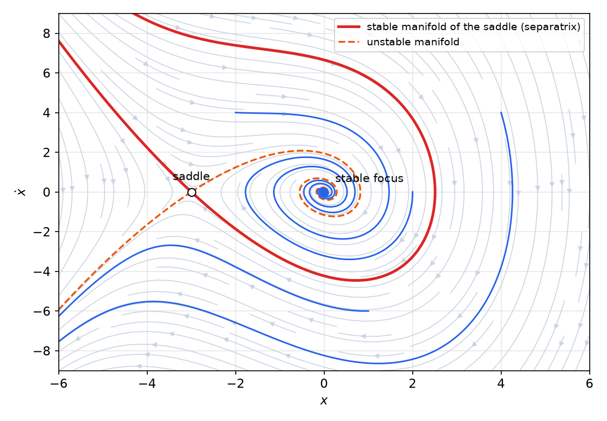

*Figure: phase portrait of Example 2.2. The origin is a stable focus and (−3, 0) a saddle. The two branches of the saddle's stable manifold (red) are separatrices: they bound the region of attraction of the origin. Trajectories starting inside it (blue, upper) spiral into the origin; those starting outside (blue, lower) run off to infinity toward the lower left, along the unstable manifold (dashed).*

The phase portrait shows what no local analysis can: the plane is split by the stable manifold of the saddle into a **convergence region** around the origin and a **divergence region** outside, and trajectories in the latter diverge to infinity. The stability of the origin is therefore only local, and the phase portrait gives its region of attraction exactly.

Two remarks follow. First, the stability of a **linear** system is uniquely characterized by the nature of its singular point; a **nonlinear** system can in addition have limit cycles and multiple equilibria, so its singular points do not tell the whole story. Second, for a **first-order** system \\(\dot x + f(x) = 0\\) the phase portrait is drawn in the \\((x, \dot x)\\) plane, and it consists of the single curve \\(\dot x = -f(x)\\); the motion is along the \\(x\\)-axis, to the right where \\(\dot x > 0\\) and to the left where \\(\dot x < 0\\).

**Example 2.3 (First-order system with three equilibria).** For
\\[
\dot x = -4x + x^3
\\]
the singular points are the roots of \\(x(x^2 - 4) = 0\\): \\(x = 0, -2, 2\\). The curve \\(\dot x = -4x + x^3\\) is positive on \\((-2, 0)\\) and \\((2, \infty)\\), negative on \\((-\infty, -2)\\) and \\((0, 2)\\). Flow arrows therefore point toward 0 from both sides and away from \\(\pm 2\\): the origin is stable and \\(x = \pm 2\\) are unstable. The slope of the curve at an equilibrium gives the same answer, \\(d\dot x/dx = -4 + 3x^2\\) equals \\(-4\\) at 0 and \\(+8\\) at \\(\pm 2\\). The region of attraction of the origin is the open interval \\((-2, 2)\\).

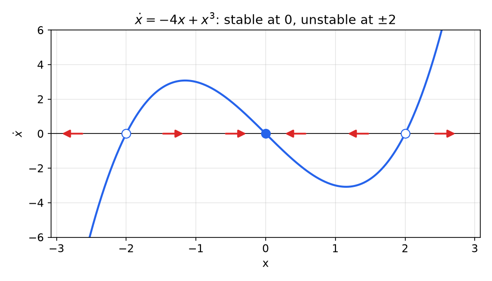

*Figure: the first-order phase portrait of Example 2.3. Filled circle: the stable equilibrium at 0; open circles: the unstable equilibria at ±2. Red arrows show the direction of motion along the x-axis.*

## Symmetry in Phase Portraits

Symmetry, when present, halves the work of constructing a portrait. For systems of the form \\(\ddot x + f(x, \dot x) = 0\\), the slope of trajectories is
\\[
\frac{dx\_2}{dx\_1} = -\frac{f(x\_1, x\_2)}{x\_2} .
\\]
- **Symmetry about the \\(x\_1\\)-axis**: if \\(f(x\_1, x\_2) = f(x\_1, -x\_2)\\) (\\(f\\) even in \\(x\_2\\)), then the slope at \\((x\_1, -x\_2)\\) is the negative of the slope at \\((x\_1, x\_2)\\), and the portrait is the mirror image of itself in the \\(x\_1\\)-axis.
- **Symmetry about the \\(x\_2\\)-axis**: if \\(f(x\_1, x\_2) = -f(-x\_1, x\_2)\\) (\\(f\\) odd in \\(x\_1\\)).
- **Symmetry about the origin**: if \\(f(x\_1, x\_2) = -f(-x\_1, -x\_2)\\).

The mass–spring system \\(f = x\_1\\) satisfies the first two conditions, consistent with its circular portrait. Symmetry about the \\(x\_1\\)-axis has a useful consequence: a trajectory that crosses the \\(x\_1\\)-axis at two points is automatically a **closed curve**, because its lower half is the mirror image of its upper half. This is how one proves that a system has closed orbits without solving it (Example 2.11 below).

## Constructing Phase Portraits

Today phase portraits are produced by computer: integrate the equations from a grid of initial conditions, or plot the direction field. Hand construction still matters, because it explains *why* the portrait looks as it does and because the constructions are exact analysis tools in their own right. Classical methods include the analytical method, the method of isoclines, the delta method, Liénard's method and Pell's method. We present the first three.

### The analytic method

The analytic method seeks a relation between the state variables,
\\[
g(x\_1, x\_2, c) = 0 ,
\\]
where the constant \\(c\\) represents the initial condition (and possibly a constant input). Plotting this relation for several values of \\(c\\) gives the portrait. There are two techniques:

1. Solve for \\(x\_1(t)\\) and \\(x\_2(t)\\) explicitly and eliminate \\(t\\), as in Example 2.1.
2. Eliminate time first, using \\(dx\_2/dx\_1 = f\_2/f\_1\\), and integrate this first-order equation directly.

The second technique is often far easier, because the trajectory equation can be integrable even when the time solution is not.

**Example 2.4 (Mass–spring by eliminating time).** Using \\(\ddot x = \dfrac{d\dot x}{dt} = \dfrac{d\dot x}{dx}\dfrac{dx}{dt} = \dot x\dfrac{d\dot x}{dx}\\), the equation \\(\ddot x + x = 0\\) becomes
\\[
\dot x\\,\frac{d\dot x}{dx} + x = 0 \quad\Longrightarrow\quad \dot x\\,d\dot x + x\\,dx = 0 .
\\]
Integrating from \\((x\_0, 0)\\) gives \\(\dot x^2 + x^2 = x\_0^2\\), the circles of Example 2.1, without ever computing \\(x(t)\\).

**Example 2.5 (Satellite attitude control with on–off thrusters).** A satellite with unit rotational inertia is controlled by a pair of thrusters that provide either a positive torque \\(U\\) or a negative torque \\(-U\\):
\\[
\ddot\theta = u .
\\]
The attitude is to be held at \\(\theta\_d = 0\\). The control loop is the simplest imaginable: the error \\(-\theta\\) drives an ideal relay (the jets), whose output \\(u = \pm U\\) acts on the double integrator \\(1/p^2\\), with unity feedback of \\(\theta\\). The control law is
\\[
u(t) = \begin{cases} -U, & \theta > 0, \\\\ U, & \theta < 0 . \end{cases}
\\]

*Trajectories for each control value.* With \\(u = U\\), eliminating time as in Example 2.4 gives \\(\dot\theta\\,d\dot\theta = U\\,d\theta\\), so
\\[
\dot\theta^2 = 2U\theta + c\_1 ,
\\]
a family of parabolas opening to the right. With \\(u = -U\\),
\\[
\dot\theta^2 = -2U\theta + c\_1 ,
\\]
parabolas opening to the left.

*Closed-loop portrait.* The control law uses \\(u = U\\) in the left half-plane \\(\theta < 0\\) and \\(u = -U\\) in the right half-plane, so the closed-loop portrait consists of the left halves of the right-opening parabolas joined to the right halves of the left-opening parabolas. The joining line, the vertical \\(\dot\theta\\)-axis, is the **switching line**. Each trajectory is a closed lens-shaped curve made of two parabolic arcs, traversed clockwise.

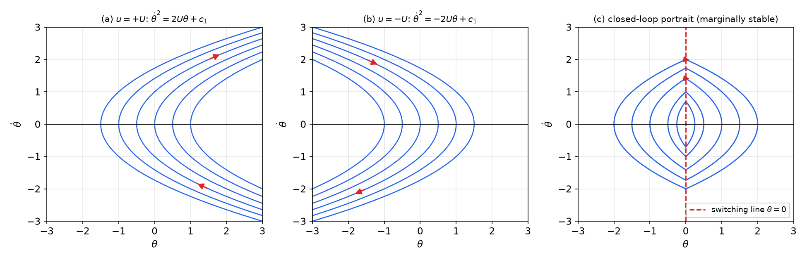

*Figure: (a) trajectories of θ'' = +U are right-opening parabolas; (b) trajectories of θ'' = −U are left-opening parabolas; (c) the closed loop uses (a) for θ < 0 and (b) for θ > 0, switching on the line θ = 0 (red). Every trajectory is closed: the attitude oscillates forever.*

The satellite therefore oscillates periodically and is only **marginally stable**. The portrait also reveals a feature that is impossible for a linear oscillator: the period depends on the amplitude. Starting at \\(\theta = 0\\) with rate \\(v\_0 > 0\\), the jets apply \\(-U\\); the rate decreases linearly, \\(\dot\theta = v\_0 - Ut\\), and vanishes at \\(t = v\_0/U\\) with \\(\theta\_{\max} = v\_0^2/(2U)\\). By symmetry the full orbit takes four such quarter periods:
\\[
T = \frac{4v\_0}{U} = 4\sqrt{\frac{2\theta\_{\max}}{U}} ,
\\]
proportional to the square root of the amplitude. Convergence is obtained by adding rate feedback, which tilts the switching line (Example 2.16).

### The method of isoclines

When the trajectory equation cannot be integrated, the trajectories can still be constructed graphically from the slope field. An **isocline** is a locus of points at which all trajectories have the same slope. The isocline of slope \\(\alpha\\) is defined by
\\[
\frac{dx\_2}{dx\_1} = \frac{f\_2(x\_1, x\_2)}{f\_1(x\_1, x\_2)} = \alpha
\quad\Longleftrightarrow\quad
f\_2(x\_1, x\_2) = \alpha f\_1(x\_1, x\_2) .
\\]
The construction proceeds in two steps:

1. **Field of directions.** For a number of values of \\(\alpha\\), draw the isocline and, along it, short line segments of slope \\(\alpha\\).
2. **Trajectories.** From an initial point, draw a short segment along the local direction to the next isocline, then continue with the average of the slopes of neighboring isoclines, and so on. Between neighboring isoclines the slope is assumed locally constant.

Two practical rules: use the **same scale on both axes**, so that \\(dx\_2/dx\_1\\) equals the geometric slope of the drawn segments; and draw **more isoclines where the slope changes quickly**, since the accuracy depends on the spacing.

For the mass–spring system, \\(dx\_2/dx\_1 = -x\_1/x\_2\\), so the isocline of slope \\(\alpha\\) is
\\[
x\_1 + \alpha x\_2 = 0 ,
\\]
a straight line through the origin. On the isocline of slope \\(\alpha\\) the trajectory slope is \\(\alpha\\) while the line itself has slope \\(-1/\alpha\\): the trajectories cross every isocline perpendicularly, which is why they are circles.

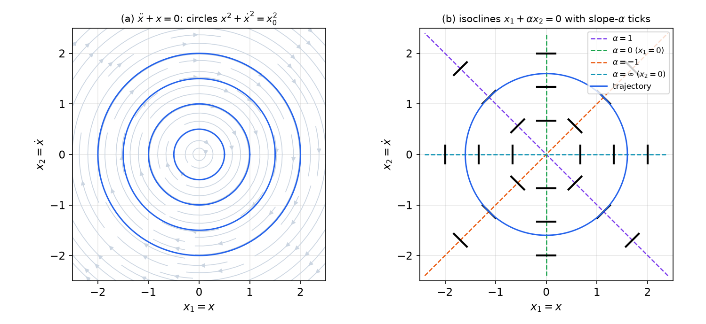

*Figure: (a) the concentric circles of the mass–spring system on its direction field. (b) The isoclines x₁ + αx₂ = 0 for α = 1, 0, −1 and ∞, with short ticks of slope α; joining the ticks reproduces the circular trajectory (blue).*

**Example 2.6 (Isoclines of a damped linear system).** Sketch the phase portrait of
\\[
\ddot\theta + \dot\theta + 0.5\theta = 0
\\]
by the method of isoclines.

*Solution.* With \\(x\_1 = \theta\\), \\(x\_2 = \dot\theta\\): \\(\dot x\_1 = x\_2\\), \\(\dot x\_2 = -0.5x\_1 - x\_2\\). The trajectory slope is
\\[
\frac{dx\_2}{dx\_1} = \frac{-0.5x\_1 - x\_2}{x\_2} = \alpha
\quad\Longrightarrow\quad
-0.5x\_1 = (\alpha + 1)x\_2
\quad\Longrightarrow\quad
x\_2 = \frac{-0.5}{\alpha + 1}\\,x\_1 .
\\]
The isoclines are straight lines through the origin with slope \\(m = x\_2/x\_1 = -0.5/(\alpha + 1)\\):

| \\(\alpha\\) | \\(-3\\) | \\(-1.5\\) | \\(-1\\) | \\(-0.5\\) | \\(0\\) | \\(1\\) | \\(2\\) | \\(\infty\\) |
|---|---|---|---|---|---|---|---|---|
| \\(m\\) | \\(0.25\\) | \\(1\\) | \\(\infty\\) (\\(x\_1 = 0\\)) | \\(-1\\) | \\(-0.5\\) | \\(-0.25\\) | \\(-1/6\\) | \\(0\\) (\\(x\_2 = 0\\)) |

Draw short segments of slope \\(\alpha\\) on each line and connect them. The trajectories spiral clockwise into the origin. This agrees with the characteristic equation \\(\lambda^2 + \lambda + 0.5 = 0\\), whose roots \\(\lambda = -0.5 \pm 0.5j\\) make the origin a **stable focus**: there are no straight-line trajectories (no real eigen-directions), and every trajectory winds around the origin while converging.

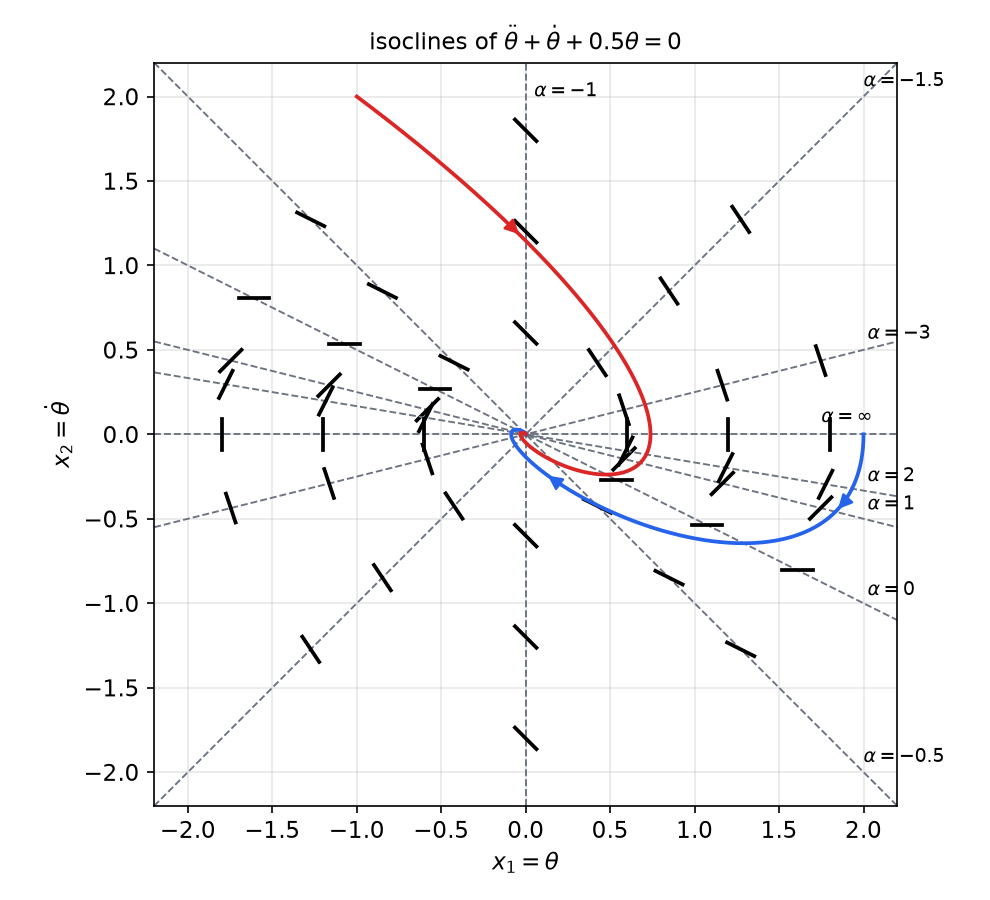

*Figure: isoclines (dashed lines through the origin, labeled by α) with short segments of slope α, and two trajectories built from them, which spiral clockwise into the stable focus at the origin.*

**Example 2.7 (The Van der Pol equation by isoclines).** For
\\[
\ddot x + 0.2(x^2 - 1)\dot x + x = 0
\\]
the slope of trajectories is
\\[
\frac{d\dot x}{dx} = -\frac{0.2(x^2 - 1)\dot x + x}{\dot x} = \alpha ,
\\]
so the isocline of slope \\(\alpha\\) is the curve
\\[
0.2(x^2 - 1)\dot x + x + \alpha\dot x = 0 \quad\Longleftrightarrow\quad \dot x = \frac{-x}{0.2(x^2 - 1) + \alpha} .
\\]
These are no longer straight lines; each passes through the origin and has vertical asymptotes where \\(0.2(x^2 - 1) + \alpha = 0\\). Drawing the isoclines for \\(\alpha = 1, 0, -1, -5\\) and connecting the direction segments reveals a closed curve, roughly a rounded square crossing the \\(x\\)-axis near \\(\pm 2\\). A trajectory started near the origin spirals outward toward it; a trajectory started far outside spirals inward toward it. This closed curve is a **limit cycle**, the oscillation discussed in [Nonlinear Systems and Their Behavior](phenomena.md#limit-cycles).

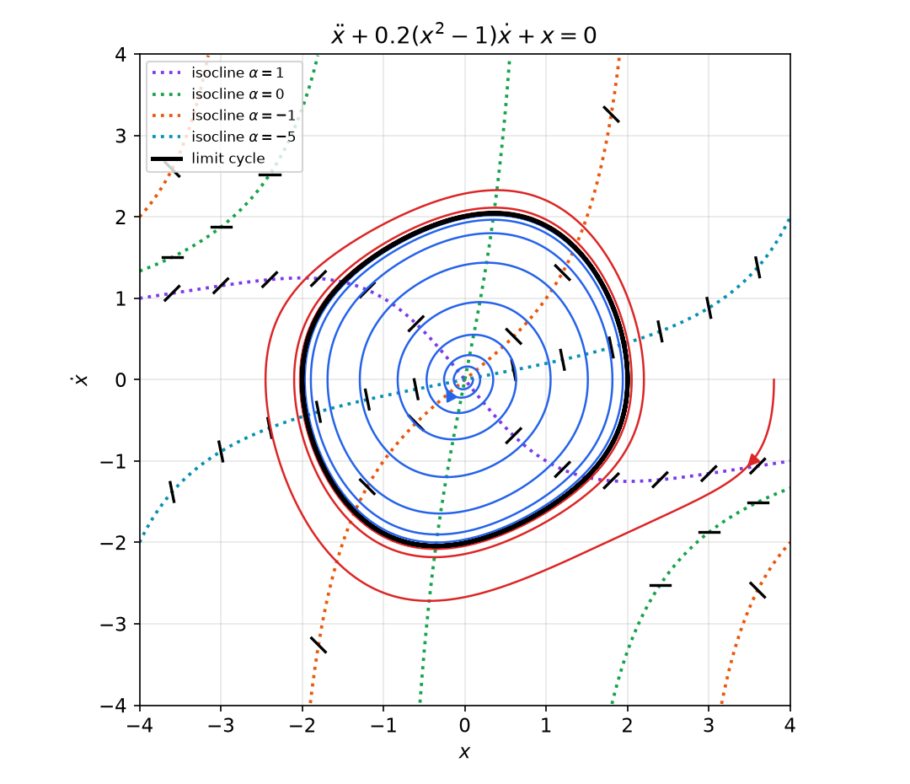

*Figure: isoclines of the Van der Pol equation for α = 1, 0, −1, −5 (dotted), with direction ticks. The trajectory from (0.1, 0) spirals out (blue), the trajectory from (3.8, 0) spirals in (red), and both approach the limit cycle (black), which crosses the x-axis near ±2.*

### The delta method

The delta method constructs trajectories of \\(\ddot x + f(x, \dot x) = 0\\) as a sequence of short circular arcs. Choose a constant \\(\omega > 0\\) (often the natural frequency of the linear part) and rewrite the equation as
\\[
\ddot x + \omega^2\big[x + \delta(x, \dot x)\big] = 0, \qquad \delta(x, \dot x) = \frac{f(x, \dot x)}{\omega^2} - x .
\\]
Work in the plane of \\(x\\) and \\(y = \dot x/\omega\\). If \\(\delta\\) were a constant \\(\delta\_0\\), the equation would be a harmonic oscillator about \\(x = -\delta\_0\\), and eliminating time exactly as in Example 2.4 gives
\\[
(x + \delta\_0)^2 + y^2 = \text{const} ,
\\]
a **circle centered at \\((-\delta\_0, 0)\\)**. Since \\(\delta\\) changes only slowly along a short piece of trajectory, the construction is:

1. at the current point \\(P\_k\\), evaluate \\(\delta\_k = \delta(P\_k)\\);
2. draw a short arc, clockwise, of the circle centered at \\((-\delta\_k, 0)\\) through \\(P\_k\\), ending at \\(P\_{k+1}\\);
3. repeat from \\(P\_{k+1}\\) (accuracy improves if \\(\delta\\) is evaluated at the midpoint of the arc).

The method has a bonus: on each arc the motion is uniform circular motion of angular rate \\(\omega\\), so the time spent on an arc that subtends an angle \\(\Delta\phi\\) is simply \\(\Delta t = \Delta\phi/\omega\\). For the linear oscillator \\(f = \omega^2 x\\), \\(\delta \equiv 0\\) and the construction gives the exact circles.

## Determining Time from Phase Portraits

Time does not appear explicitly in the phase plane, but it can be recovered from a trajectory in two ways.

**Using \\(\Delta t \approx \Delta x/\dot x\\).** For a small displacement along the trajectory, \\(\Delta x \approx \dot x\\,\Delta t\\), so the time to traverse a short segment is
\\[
\Delta t \approx \frac{\Delta x}{\dot x\_{\text{avg}}} ,
\\]
where \\(\dot x\_{\text{avg}}\\) is the average velocity on the segment. Dividing the trajectory into small segments and summing gives \\(t\\) at each point, from which \\(x(t)\\) and \\(\dot x(t)\\) can be plotted.

**Using an integral.** Since \\(dt = dx/\dot x\\),
\\[
t - t\_0 = \int\_{x\_0}^{x} \frac{1}{\dot x}\\,dx ,
\\]
where \\(\dot x\\) is read from the trajectory as a function of \\(x\\). The elapsed time is the area under the curve \\(1/\dot x\\) versus \\(x\\).

**Example 2.8 (Quarter period of the mass–spring).** On the circle through \\((x\_0, 0)\\), \\(x\_0 > 0\\), the motion first goes into the lower half-plane, where \\(\dot x = -\sqrt{x\_0^2 - x^2}\\). The time to reach \\(x = 0\\) is
\\[
t = \int\_{x\_0}^{0} \frac{dx}{-\sqrt{x\_0^2 - x^2}} = \int\_0^{x\_0} \frac{dx}{\sqrt{x\_0^2 - x^2}} = \arcsin(1) = \frac{\pi}{2} ,
\\]
a quarter of the period \\(2\pi\\), independent of \\(x\_0\\). The integrand is infinite at the starting point, where \\(\dot x = 0\\), but the integral converges; in graphical work this is the region where the step \\(\Delta x\\) must be kept small or the delta method used instead.

## Phase-Plane Analysis of Linear Systems

The linear case is worth working out completely, because near each singular point a nonlinear system behaves like its linearization.

### Reduction to a second-order equation

The general second-order linear system is
\\[
\dot x\_1 = a x\_1 + b x\_2, \qquad \dot x\_2 = c x\_1 + d x\_2 .
\\]
Differentiate the first equation and substitute the second: \\(\ddot x\_1 = a\dot x\_1 + b\dot x\_2 = a\dot x\_1 + bc\\,x\_1 + d\\,(b x\_2)\\). From the first equation \\(b x\_2 = \dot x\_1 - a x\_1\\), hence
\\[
\ddot x\_1 = (a + d)\dot x\_1 + (bc - ad)x\_1 .
\\]
The coefficients are the trace \\(a + d\\) and minus the determinant of the system matrix. It is therefore enough to study, with new coefficient names,
\\[
\ddot x + a\dot x + bx = 0 .
\\]
Its solution is
\\[
x(t) = k\_1 e^{\lambda\_1 t} + k\_2 e^{\lambda\_2 t} \quad (\lambda\_1 \ne \lambda\_2), \qquad x(t) = k\_1 e^{\lambda\_1 t} + k\_2\\,t\\,e^{\lambda\_1 t} \quad (\lambda\_1 = \lambda\_2),
\\]
where \\(k\_1, k\_2\\) are set by the initial conditions and \\(\lambda\_{1,2}\\) are the roots of \\(s^2 + as + b = (s - \lambda\_1)(s - \lambda\_2)\\),
\\[
\lambda\_{1,2} = \frac{-a \pm \sqrt{a^2 - 4b}}{2} .
\\]
If \\(b \neq 0\\) the origin is the only singular point; if \\(b = 0\\) the whole \\(x\\)-axis is singular.

### Straight-line trajectories

When \\(\lambda\\) is real, the pure mode \\(x = k e^{\lambda t}\\) has \\(\dot x = \lambda k e^{\lambda t} = \lambda x\\). Its trajectory is the straight line
\\[
\dot x = \lambda x
\\]
through the origin. Real eigenvalues therefore come with straight-line trajectories of slopes \\(\lambda\_1\\) and \\(\lambda\_2\\) in the \\((x, \dot x)\\) plane (the eigenvector directions, \\((1, \lambda\_i)\\)). Every other trajectory is a blend of the two modes.

### Classification of the singular point

1. **Node: \\(\lambda\_1, \lambda\_2\\) real and of the same sign.** If both are negative the singular point is a **stable node**: \\(x\\) and \\(\dot x\\) converge to zero exponentially without oscillation. As \\(t \to \infty\\) the faster mode dies first, so trajectories enter the origin tangent to the line of the *slower* eigenvalue (the one closer to zero), and far away they are parallel to the line of the faster one. If both are positive, the same picture with arrows reversed is an **unstable node**.
2. **Saddle: \\(\lambda\_1 < 0 < \lambda\_2\\).** The unstable mode \\(e^{\lambda\_2 t}\\) dominates almost every solution, so almost all trajectories diverge. The two straight-line trajectories are special. The **converging line** \\(\dot x = \lambda\_1 x\\) is generated by initial conditions that make \\(k\_2\\), the coefficient of the unstable mode, equal to zero; along it the state goes straight into the origin. The **diverging line** \\(\dot x = \lambda\_2 x\\) corresponds to \\(k\_1 = 0\\). Trajectories near the converging line approach the origin for a while and then leave along the diverging line, giving the hyperbola-like pattern of a saddle. (In some printings this assignment of \\(k\_1\\) and \\(k\_2\\) to the two lines appears reversed; the converging line is the one on which the unstable component vanishes.)
3. **Focus: \\(\lambda\_{1,2} = \sigma \pm j\omega\\), \\(\sigma \neq 0\\).** The solution is \\(x = e^{\sigma t}(A\cos\omega t + B\sin\omega t)\\). If \\(\sigma < 0\\), a **stable focus**: trajectories encircle the origin one or more times while converging to it. If \\(\sigma > 0\\), an **unstable focus**: they spiral outward.
4. **Center: \\(\lambda\_{1,2} = \pm j\omega\\)** (\\(a = 0, b > 0\\)). The trajectories are the ellipses \\(b x^2 + \dot x^2 = \text{const}\\) around the origin, as in the undamped mass–spring system: marginally stable.

Degenerate cases: a repeated real eigenvalue gives a **degenerate (improper) node** with a single straight-line trajectory (or, for a general system with a scalar matrix \\(A = \lambda I\\), a **star node** in which every line through the origin is a trajectory); \\(b = 0\\) gives a line of singular points.

In terms of the general system matrix \\(A = \begin{bmatrix} a & b \\\\ c & d \end{bmatrix}\\), with trace \\(\tau = a + d\\) and determinant \\(\Delta = ad - bc\\), the eigenvalues satisfy \\(\lambda^2 - \tau\lambda + \Delta = 0\\), and the classification reads:

| Condition | Singular point |
|---|---|
| \\(\Delta < 0\\) | saddle |
| \\(\Delta > 0,\\ \tau^2 \ge 4\Delta\\) | node (stable if \\(\tau < 0\\), unstable if \\(\tau > 0\\)) |
| \\(\Delta > 0,\\ \tau^2 < 4\Delta,\\ \tau \neq 0\\) | focus (stable if \\(\tau < 0\\), unstable if \\(\tau > 0\\)) |
| \\(\Delta > 0,\\ \tau = 0\\) | center |
| \\(\Delta = 0\\) | non-isolated singular points |

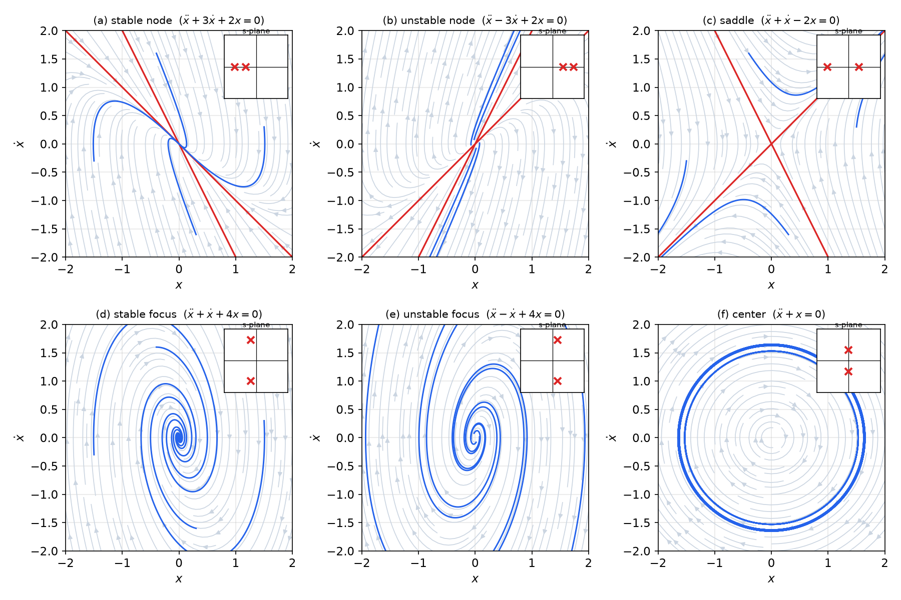

*Figure: phase portraits of ẍ + aẋ + bx = 0 for the six generic cases, with the pole locations in the s-plane shown in each inset. Red lines are the straight-line (eigenvector) trajectories ẋ = λx, present only when the roots are real. Stable node: trajectories enter the origin tangent to the slow line ẋ = −x. Saddle: the line with negative slope converges, the other diverges. Foci spiral; the center gives closed curves.*

For linear systems, the nature of the singular point determines the stability of the system completely, globally and for every initial condition. This is not true for nonlinear systems.

**Example 2.9 (Unity-feedback servo).** A plant \\(G(p) = \dfrac{10}{p(1 + 0.1p)}\\) is placed in a unity negative-feedback loop with zero reference. Then \\(e = -y\\) and \\((0.1p^2 + p)y = 10e = -10y\\), that is
\\[
0.1\ddot y + \dot y + 10y = 0 \quad\Longleftrightarrow\quad \ddot y + 10\dot y + 100y = 0 .
\\]
Here \\(\omega\_n = 10\\) rad/s and \\(\zeta = 0.5\\); the roots are \\(\lambda = -5 \pm j\sqrt{75} = -5 \pm 8.66j\\). The origin is a stable focus, and trajectories spiral into it. The decay time constant is \\(1/\lvert\sigma\rvert = 0.2\\) s and the damped period \\(2\pi/8.66 = 0.73\\) s, so the amplitude shrinks by a factor \\(e^{-0.73/0.2} \approx 0.03\\) on each revolution and only about one turn of the spiral is visible.

**Example 2.10 (Constant input: shifting the singular point).** For \\(\ddot\theta + \dot\theta + 0.5\theta = 1\\), the singular point is where \\(\dot\theta = 0\\) and \\(0.5\theta = 1\\): \\((\theta, \dot\theta) = (2, 0)\\). With \\(z = \theta - 2\\) the equation becomes \\(\ddot z + \dot z + 0.5z = 0\\), the system of Example 2.6. The phase portrait is that of Example 2.6 translated so that its focus sits at \\((2, 0)\\), and the isoclines become the lines \\(x\_2 = -0.5(x\_1 - 2)/(\alpha + 1)\\) through \\((2, 0)\\). A constant input moves the singular point; it does not change its type.

## Phase-Plane Analysis of Nonlinear Systems

### Local behavior

Near a singular point, a nonlinear system looks like its linearization. Shift the singular point to the origin and expand \\(f\_1, f\_2\\) in Taylor series:
\\[
\dot x\_1 = a x\_1 + b x\_2 + g\_1(x\_1, x\_2), \qquad \dot x\_2 = c x\_1 + d x\_2 + g\_2(x\_1, x\_2),
\\]
where \\(a, b, c, d\\) are the entries of the Jacobian \\(\partial f/\partial x\\) at the singular point and \\(g\_1, g\_2\\) contain the higher-order terms. Very close to the origin the higher-order terms are negligible, and trajectories follow the patterns of the linear classification. This is how the singular points of Example 2.2 were classified: \\((0, 0)\\) as a stable focus and \\((-3, 0)\\) as a saddle.

The precise statement is the **Hartman–Grobman theorem**: if the linearization has no eigenvalue with zero real part (a *hyperbolic* singular point), the nonlinear portrait near the singular point is a continuous deformation of the linear one. Nodes, foci and saddles therefore survive the nonlinear terms. A **center does not**: it is a borderline case, and the nonlinear terms can turn it into a stable focus, an unstable focus, or keep it a center. For example
\\[
\dot x\_1 = x\_2 + \varepsilon x\_1(x\_1^2 + x\_2^2), \qquad \dot x\_2 = -x\_1 + \varepsilon x\_2(x\_1^2 + x\_2^2)
\\]
has the linearization \\(\dot x\_1 = x\_2, \dot x\_2 = -x\_1\\), a center, for every \\(\varepsilon\\). In polar coordinates (computed as in Example 2.12 below) \\(\dot r = \varepsilon r^3\\), so the origin is in fact a slowly converging focus for \\(\varepsilon < 0\\) and a slowly diverging one for \\(\varepsilon > 0\\). This is the phase-plane picture of the inconclusive case of [Lyapunov's linearization method](lyapunov.md).

**Example 2.11 (A nonlinear center).** Consider
\\[
\ddot x + \dot x^2 + 0.5x = 0 .
\\]
Its only singular point is the origin, and the linearization \\(\ddot x + 0.5x = 0\\) is a center, which decides nothing. Isoclines are easy to draw: \\(dx\_2/dx\_1 = (-x\_2^2 - 0.5x\_1)/x\_2 = \alpha\\) gives the parabolas \\(x\_1 = -2x\_2(x\_2 + \alpha)\\). Better still, the trajectory equation can be solved exactly. Let \\(w = \dot x^2\\). Then
\\[
\frac{dw}{dx} = 2\dot x\frac{d\dot x}{dx} = 2\ddot x = -2w - x ,
\\]
a *linear* first-order equation in \\(w(x)\\). A particular solution \\(w = Ax + B\\) requires \\(A + 2Ax + 2B = -x\\), so \\(A = -\tfrac12\\), \\(B = \tfrac14\\), and the general solution is
\\[
\dot x^2 = \frac14 - \frac{x}{2} + Ce^{-2x}
\quad\Longleftrightarrow\quad
H(x, \dot x) = \left(\dot x^2 - \frac14 + \frac{x}{2}\right)e^{2x} = C .
\\]
\\(H\\) is constant along every trajectory (a first integral). Expanding near the origin, \\(H = -\tfrac14 + \tfrac12 x^2 + \dot x^2 + \dots\\), a strict local minimum, so the level curves near the origin are closed and the origin is a genuine **center** of the nonlinear system. The closed orbits fill the region bounded by the trajectory \\(C = 0\\), the parabola \\(x = \tfrac12 - 2\dot x^2\\) (check: along it \\(\ddot x = -\tfrac14\\), which equals \\(-\dot x^2 - 0.5x\\)). Outside, trajectories are open and run off to \\(x \to -\infty\\). The function \\(f = \dot x^2 + 0.5x\\) is even in \\(\dot x\\), and the portrait is symmetric about the \\(x\\)-axis, as the symmetry rule predicts.

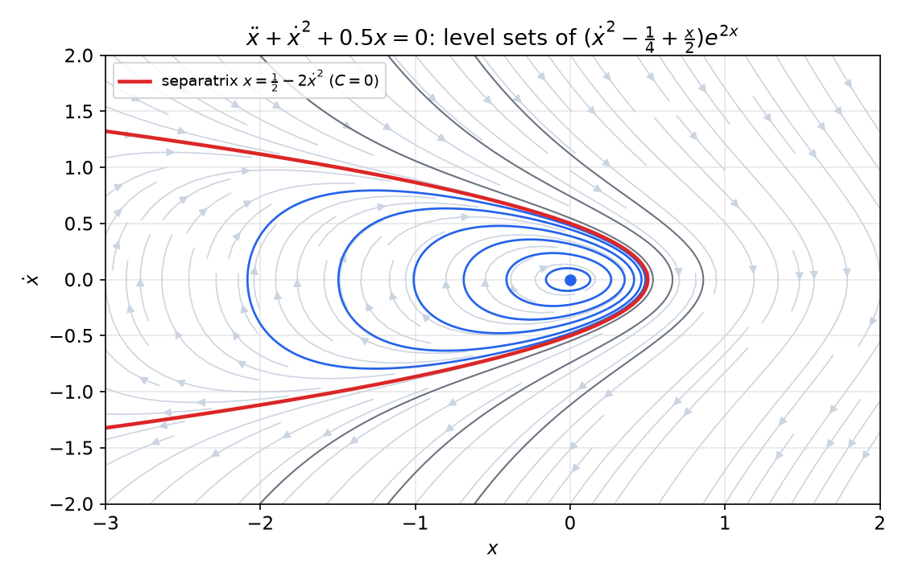

*Figure: level curves of the first integral H. Inside the separatrix x = 1/2 − 2ẋ² (red) the trajectories are closed (blue): the origin is a nonlinear center. Outside it (gray) the trajectories are open.*

### Limit cycles

The Van der Pol portrait of Example 2.7 contains a feature that has no counterpart in linear systems: an isolated closed trajectory that attracts the trajectories around it. Its origin is an unstable focus (the linearization \\(\ddot x - 0.2\dot x + x = 0\\) has roots \\(0.1 \pm 0.995j\\)), trajectories near it spiral out, trajectories far away spiral in, and both approach the same closed curve.

**Definition (limit cycle).** A **limit cycle** is an isolated closed curve in the phase plane. The trajectory must be *closed*, which indicates the periodic nature of the motion, and *isolated*, which means that nearby trajectories are not closed: they converge to it or diverge from it.

The closed curves of the mass–spring system (Example 2.1), of the bang-bang satellite (Example 2.5) and of the nonlinear center (Example 2.11) are **not** limit cycles: each is surrounded by a continuum of other closed curves, so none is isolated. This is the precise sense in which a limit cycle's amplitude is independent of the initial condition.

Depending on the motion of nearby trajectories, limit cycles are of three kinds:

1. **Stable** limit cycles: all trajectories in the vicinity of the cycle converge to it as \\(t \to \infty\\).
2. **Unstable** limit cycles: all trajectories in the vicinity diverge from it.
3. **Semi-stable** limit cycles: some of the nearby trajectories converge to it and others diverge from it.

**Example 2.12 (Stable, unstable and semi-stable limit cycles).** Consider the three systems
\\[
\begin{aligned}
&\text{(a)}\quad \dot x\_1 = x\_2 - x\_1(x\_1^2 + x\_2^2 - 1), && \dot x\_2 = -x\_1 - x\_2(x\_1^2 + x\_2^2 - 1), \\\\
&\text{(b)}\quad \dot x\_1 = x\_2 + x\_1(x\_1^2 + x\_2^2 - 1), && \dot x\_2 = -x\_1 + x\_2(x\_1^2 + x\_2^2 - 1), \\\\
&\text{(c)}\quad \dot x\_1 = x\_2 - x\_1(x\_1^2 + x\_2^2 - 1)^2, && \dot x\_2 = -x\_1 - x\_2(x\_1^2 + x\_2^2 - 1)^2 .
\end{aligned}
\\]

*Polar coordinates.* All three have the form \\(\dot x\_1 = x\_2 + x\_1 h(r)\\), \\(\dot x\_2 = -x\_1 + x\_2 h(r)\\) with \\(r = (x\_1^2 + x\_2^2)^{1/2}\\) and \\(\theta = \tan^{-1}(x\_2/x\_1)\\). Then
\\[
r\dot r = x\_1\dot x\_1 + x\_2\dot x\_2 = x\_1x\_2 + x\_1^2 h - x\_1x\_2 + x\_2^2 h = r^2 h(r) \quad\Longrightarrow\quad \dot r = r\\,h(r) ,
\\]
\\[
r^2\dot\theta = x\_1\dot x\_2 - x\_2\dot x\_1 = -x\_1^2 + x\_1x\_2 h - x\_2^2 - x\_1x\_2 h = -r^2 \quad\Longrightarrow\quad \dot\theta = -1 .
\\]
The rotation is uniform and clockwise, with period \\(2\pi\\); all the interesting behavior is in the radial equation.

*(a)* \\(h = -(r^2 - 1)\\), so \\(\dot r = -r(r^2 - 1)\\). On the unit circle \\(\dot r = 0\\): it is a closed trajectory, traversed with period \\(2\pi\\). For \\(r < 1\\), \\(\dot r > 0\\); for \\(r > 1\\), \\(\dot r < 0\\). Trajectories approach the circle from both sides: a **stable limit cycle**. Here the solution can even be written down. With \\(w = 1/r^2\\), \\(\dot w = -2\dot r/r^3 = -2(r - r^3)/r^3 = 2 - 2w\\), so \\(w = 1 + c\_0e^{-2t}\\) and
\\[
r(t) = \frac{1}{\big(1 + c\_0e^{-2t}\big)^{1/2}}, \qquad \theta(t) = \theta\_0 - t, \qquad c\_0 = \frac{1}{r\_0^2} - 1 ,
\\]
which tends to 1 for every \\(r\_0 > 0\\).

*(b)* \\(h = r^2 - 1\\), so \\(\dot r = r(r^2 - 1)\\): inside, \\(\dot r < 0\\) and trajectories shrink to the origin; outside, \\(\dot r > 0\\) and they grow. An **unstable limit cycle**. The same substitution gives \\(\dot w = 2w - 2\\), \\(w = 1 + c\_0e^{2t}\\). For \\(r\_0 > 1\\), \\(c\_0 < 0\\) and \\(w\\) reaches zero at \\(t = \tfrac12\ln\big[r\_0^2/(r\_0^2 - 1)\big]\\): trajectories outside the cycle escape to infinity in finite time.

*(c)* \\(h = -(r^2 - 1)^2\\), so \\(\dot r = -r(r^2 - 1)^2 \le 0\\) everywhere. Trajectories outside the circle decrease toward it and converge to it; trajectories inside also decrease, moving *away* from it toward the origin. A **semi-stable limit cycle**, attracting from outside and repelling on the inside.

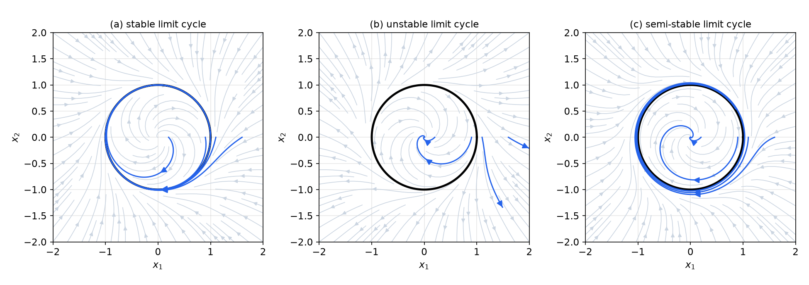

*Figure: phase portraits of the three systems of Example 2.12, with the unit circle in black. (a) Trajectories from inside and outside converge to the circle. (b) Trajectories inside shrink to the origin and those outside diverge. (c) Trajectories outside converge to the circle, those inside leave it toward the origin.*

**Example 2.13 (A semi-stable cycle attracting from inside).** Find the limit cycles of
\\[
\dot x\_1 = x\_2 + x\_1(x\_1^2 + x\_2^2 - 1)^2, \qquad \dot x\_2 = -x\_1 + x\_2(x\_1^2 + x\_2^2 - 1)^2 ,
\\]
and determine their stability.

*Solution.* This is system (c) with the sign of the nonlinear term reversed. From \\(x\_1\dot x\_1 + x\_2\dot x\_2 = r^2(r^2 - 1)^2\\) and \\(\tfrac12\frac{d}{dt}r^2 = r\dot r\\), \\(\dot r = r(r^2 - 1)^2\\). For the angle, differentiate \\(\tan\theta = x\_2/x\_1\\):
\\[
\frac{d}{dt}\tan\theta = \frac{1}{\cos^2\theta}\dot\theta, \qquad
\frac{d}{dt}\frac{x\_2}{x\_1} = \frac{\dot x\_2x\_1 - \dot x\_1x\_2}{x\_1^2} = -\frac{r^2}{x\_1^2} = -\frac{1}{\cos^2\theta},
\\]
so \\(\dot\theta = -1\\). The equation \\(r(r^2 - 1)^2 = 0\\) with \\(r > 0\\) has the single solution \\(r = 1\\): **one limit cycle**, the unit circle (the origin is the singular point). Since \\(\dot r > 0\\) both for \\(0 < r < 1\\) and for \\(r > 1\\), trajectories inside approach the cycle and trajectories outside leave it: the cycle is **semi-stable**, this time attracting from inside.

**Example 2.14 (Infinitely many limit cycles).** Analyze the limit cycles of
\\[
\dot x = y + x(x^2 + y^2 - 1)\sin\frac{1}{x^2 + y^2 - 1}, \qquad \dot y = -x + y(x^2 + y^2 - 1)\sin\frac{1}{x^2 + y^2 - 1} .
\\]

*Solution.* With \\(r = (x^2 + y^2)^{1/2}\\) and \\(\theta = \tan^{-1}(y/x)\\), the computation of Example 2.12 with \\(h(r) = (r^2 - 1)\sin\frac{1}{r^2 - 1}\\) gives two decoupled equations:
\\[
\dot r = r(r^2 - 1)\sin\frac{1}{r^2 - 1}, \qquad \dot\theta = -1 .
\\]
No closed-form solution of the radial equation is needed: the existence and stability of limit cycles can be read from the sign of \\(\dot r\\). Closed orbits are circles on which \\(\dot r = 0\\) with \\(r > 0\\):

- \\(\sin\dfrac{1}{r^2 - 1} = 0\\), that is \\(\dfrac{1}{r^2 - 1} = \pm n\pi\\), giving
\\[
r\_n^{\pm} = \left(1 \pm \frac{1}{n\pi}\right)^{1/2}, \qquad n = 1, 2, \dots
\\]
- \\(r = 1\\): the factor \\(\sin\frac{1}{r^2 - 1}\\) has no limit as \\(r \to 1\\), but it is bounded, so \\(\dot r \to 0\\) and the unit circle is also a closed orbit (defining the vector field there by continuity).

There are therefore **infinitely many limit cycles**, accumulating at \\(r = 1\\) from both sides. The unit circle itself is not isolated, so it is a closed orbit but not a limit cycle.

*Stability.* Put \\(u = 1/(r^2 - 1)\\). For \\(r > 1\\) (the \\(+\\) sign), \\(r(r^2 - 1) > 0\\) and \\(\operatorname{sgn}\dot r = \operatorname{sgn}\sin u\\), with \\(u\\) *decreasing* as \\(r\\) increases. At \\(r\_n^{+}\\), \\(u = n\pi\\). If \\(n\\) is even, \\(\sin u > 0\\) for \\(u\\) slightly above \\(n\pi\\) (that is, \\(r\\) slightly below \\(r\_n^+\\)) and \\(\sin u < 0\\) for \\(u\\) slightly below (\\(r\\) slightly above): trajectories move toward the cycle from both sides, so it is **stable**. If \\(n\\) is odd the signs are reversed and the cycle is **unstable**. For \\(r < 1\\) (the \\(-\\) sign) the factor \\(r(r^2 - 1) < 0\\) flips every sign: \\(r\_n^-\\) is **stable for \\(n\\) odd and unstable for \\(n\\) even**. Stable and unstable cycles alternate on each side of the unit circle.

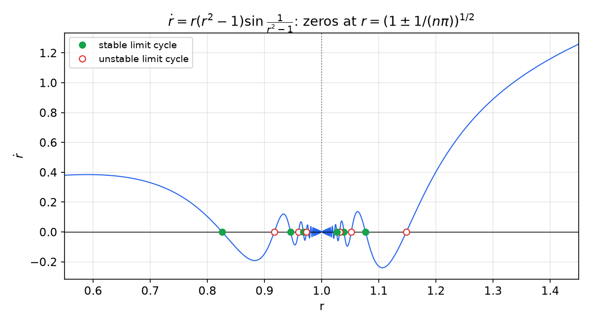

*Figure: ṙ as a function of r. Every zero r = (1 ± 1/(nπ))^½ is a limit cycle; filled green circles mark stable cycles (ṙ changes from positive to negative) and open red circles unstable ones. The zeros accumulate at r = 1, where the oscillation of sin(1/(r²−1)) becomes infinitely fast.*

## Existence of Limit Cycles

Finding limit cycles by constructing the whole portrait is laborious, and in higher dimensions impossible. For second-order systems, three classical theorems answer the existence question more directly.

### The index theorem

**Definition (index).** Let \\(C\\) be a simple closed curve in the phase plane that passes through no singular point. As a point travels once around \\(C\\) counterclockwise, the vector \\(f(x) = (f\_1, f\_2)\\) at that point rotates continuously and returns to its original direction; the net number of counterclockwise revolutions it makes is an integer, the **index** of \\(C\\). The index of an isolated singular point is the index of any small curve enclosing only that point.

Computing the index from the linear portraits: nodes, foci and centers have index \\(+1\\) (the vector field turns once, in the same direction as the point); a saddle has index \\(-1\\). The index of a curve equals the sum of the indices of the singular points it encloses, and a curve enclosing none has index 0. Finally, if \\(C\\) is itself a closed trajectory, \\(f\\) is tangent to \\(C\\) everywhere and turns exactly once: the index of a closed orbit is \\(+1\\).

**Theorem (Poincaré index theorem).** If a limit cycle exists in the second-order autonomous system \\(\dot x\_1 = f\_1, \dot x\_2 = f\_2\\), then
\\[
N = S + 1 ,
\\]
where \\(N\\) is the number of nodes, centers and foci enclosed by the limit cycle and \\(S\\) is the number of enclosed saddle points.

*Proof sketch.* The index of the limit cycle is \\(+1\\); it equals the sum of the indices of the enclosed singular points, \\(N\cdot(+1) + S\cdot(-1)\\). (A full proof rests on the topological properties of the index; questions of this kind helped motivate algebraic topology.)

**Corollary.** A limit cycle must enclose at least one equilibrium point.

The theorem is mainly a tool for ruling limit cycles out. In Example 2.2 a closed orbit could encircle the focus alone (\\(N = 1, S = 0\\)), but not the saddle alone (\\(N = 0, S = 1\\)) nor both (\\(N = 1, S = 1\\)). A system with no singular points in a region cannot have a limit cycle lying in that region together with its interior.

### The Poincaré–Bendixson theorem

**Theorem (Poincaré–Bendixson).** If a trajectory of the second-order autonomous system remains in a finite region \\(\Omega\\), then one of the following is true:

1. the trajectory goes to an equilibrium point;
2. the trajectory tends to an asymptotically stable limit cycle;
3. the trajectory is itself a limit cycle.

More precisely (assuming smooth \\(f\\) and finitely many equilibria in \\(\Omega\\)), the limit set of a bounded trajectory is an equilibrium, a closed orbit, or a set of equilibria joined by trajectories. The practical form is:

**Corollary (trapping region).** If \\(M\\) is a closed bounded region that trajectories cannot leave (positively invariant) and \\(M\\) contains no equilibrium point, then \\(M\\) contains a closed orbit. The same holds if \\(M\\) contains only one equilibrium, an unstable node or focus, since a small disk around it can be removed: trajectories leave that disk and cannot return.

*Application to Example 2.12(a).* Take the annulus \\(M = \\{\tfrac12 \le r \le 2\\}\\). On the inner circle \\(\dot r = -\tfrac12(\tfrac14 - 1) = \tfrac38 > 0\\); on the outer circle \\(\dot r = -2(4 - 1) = -6 < 0\\). Trajectories enter \\(M\\) across both boundaries and cannot leave, and \\(M\\) contains no equilibrium (the only one is the origin). So \\(M\\) contains a closed orbit, which we know to be the unit circle. The same reasoning, with a more elaborate trapping region, proves the existence of the Van der Pol limit cycle; Liénard's theorem gives general conditions on \\(\ddot x + f(x)\dot x + g(x) = 0\\) under which there is exactly one limit cycle and it is stable, and the Van der Pol equation satisfies them.

The theorem also explains a fact quoted in [Nonlinear Systems and Their Behavior](phenomena.md#chaos): since a bounded trajectory of a planar system can only approach an equilibrium or a closed orbit, **autonomous second-order systems cannot be chaotic**.

### Bendixson's theorem

**Theorem (Bendixson).** For the second-order autonomous system \\(\dot x\_1 = f\_1(x\_1, x\_2)\\), \\(\dot x\_2 = f\_2(x\_1, x\_2)\\), no limit cycle can exist in a (simply connected) region \\(\Omega\\) of the phase plane in which
\\[
\frac{\partial f\_1}{\partial x\_1} + \frac{\partial f\_2}{\partial x\_2}
\\]
does not vanish and does not change sign.

*Proof.* Along any trajectory, \\(dx\_2/dx\_1 = f\_2/f\_1\\), that is
\\[
f\_2\\,dx\_1 - f\_1\\,dx\_2 = 0 .
\\]
Suppose a limit cycle \\(L\\) lies in \\(\Omega\\). Integrating this identity along \\(L\\),
\\[
\oint\_L \big(f\_1\\,dx\_2 - f\_2\\,dx\_1\big) = 0 .
\\]
By Green's theorem (Stokes' theorem in the plane), applied to the region \\(D\\) enclosed by \\(L\\), which lies in \\(\Omega\\) because \\(\Omega\\) is simply connected,
\\[
\oint\_L \big(f\_1\\,dx\_2 - f\_2\\,dx\_1\big) = \iint\_D \left(\frac{\partial f\_1}{\partial x\_1} + \frac{\partial f\_2}{\partial x\_2}\right)dx\_1\\,dx\_2 .
\\]
The integrand on the right is continuous, nonzero and of one sign in \\(D\\), so the double integral is nonzero, a contradiction. \\(\blacksquare\\)

The quantity \\(\partial f\_1/\partial x\_1 + \partial f\_2/\partial x\_2\\) is the divergence of the vector field, the rate at which the flow expands areas. A closed orbit encloses a region whose area is preserved over one period, which is impossible if the flow contracts (or expands) area everywhere inside it.

**Example 2.15 (No limit cycles).** Consider
\\[
\dot x\_1 = g(x\_2) + 4x\_1x\_2^2, \qquad \dot x\_2 = h(x\_1) + 4x\_1^2x\_2 ,
\\]
with \\(g\\) and \\(h\\) arbitrary smooth functions. Since
\\[
\frac{\partial f\_1}{\partial x\_1} + \frac{\partial f\_2}{\partial x\_2} = 4x\_2^2 + 4x\_1^2 = 4(x\_1^2 + x\_2^2) ,
\\]
which is positive everywhere except at the origin, the system has **no limit cycles** anywhere in the phase plane. (A single point where the divergence vanishes does not affect the double integral.)

*Application to the Van der Pol equation.* For \\(\dot x\_1 = x\_2\\), \\(\dot x\_2 = -0.2(x\_1^2 - 1)x\_2 - x\_1\\), the divergence is \\(-0.2(x\_1^2 - 1)\\), positive in the strip \\(\lvert x\_1 \rvert < 1\\) and negative outside it. Bendixson's theorem then says that a limit cycle cannot lie entirely inside the strip or entirely in either half-plane \\(x\_1 > 1\\), \\(x\_1 < -1\\): the cycle must cross the lines \\(x\_1 = \pm 1\\), consistent with the cycle of amplitude about 2.

For linear damped systems \\(\ddot x + a\dot x + bx = 0\\) the divergence is \\(-a\\), a nonzero constant whenever \\(a \neq 0\\): consistent with the fact that a damped linear system has no closed orbits at all.

**Remark.** The index, Poincaré–Bendixson and Bendixson theorems are intrinsically two-dimensional (they use the Jordan curve theorem: a closed curve separates the plane). They have no equivalent for systems of order three or more, which can display exotic behavior, including chaos.

## Relay and Saturation Systems

Hard nonlinearities divide the phase plane into regions in each of which the dynamics is simple (often linear), separated by switching lines. Within each region the trajectories can be found analytically, and the portrait is assembled by piecing them together. The satellite of Example 2.5 is the prototype; the next two examples show how a lead term and an amplitude limit change the picture.

**Example 2.16 (Relay control with rate feedback).** In the satellite loop of Example 2.5, insert a lead element \\(p + a\\) between the error and the relay: the error \\(e = -\theta\\) is filtered into \\(\sigma = (p + a)e = -\dot\theta - a\theta\\), and the relay output is \\(u = U\operatorname{sgn}(\sigma)\\) acting on \\(1/p^2\\). Sketch the phase portrait for various \\(a\\) and discuss stability.

*Solution.* The closed loop is
\\[
\ddot\theta = \begin{cases} -U, & \dot\theta + a\theta > 0, \\\\ +U, & \dot\theta + a\theta < 0, \end{cases} \qquad U > 0 .
\\]
With \\(x\_1 = \theta, x\_2 = \dot\theta\\), integrating \\(\dot\theta\\,d\dot\theta = \mp U\\,d\theta\\) gives
\\[
\tfrac12 x\_2^2 = -Ux\_1 + C \quad\text{above the line } x\_2 + ax\_1 = 0, \qquad \tfrac12 x\_2^2 = Ux\_1 + C \quad\text{below it} .
\\]
The trajectories are the same two families of parabolas as in Example 2.5, but they are now joined along the **switching line** \\(x\_2 = -ax\_1\\) instead of the vertical axis.

*Case \\(a > 0\\).* The switching line lies in the second and fourth quadrants. A trajectory coming down from the upper right toward \\(\theta = 0\\) reaches the line \\(\dot\theta = -a\theta\\) *before* it reaches \\(\theta = 0\\), so the thrust reverses early: the lead term brakes the satellite before the error vanishes. To see that this removes energy, use the quantity conserved by the pure relay loop,
\\[
V = U\lvert\theta\rvert + \tfrac12\dot\theta^2 .
\\]
Along the motion, \\(\dot V = U\operatorname{sgn}(\theta)\dot\theta + \dot\theta u = U\dot\theta\big[\operatorname{sgn}(\theta) - \operatorname{sgn}(\dot\theta + a\theta)\big]\\). Where the two signs agree, \\(\dot V = 0\\) (the motion follows one of the closed lenses of Example 2.5). They disagree only in the wedge between the line \\(\theta = 0\\) and the switching line. There, if \\(\theta > 0\\) then \\(\dot\theta < -a\theta < 0\\) and \\(\dot V = 2U\dot\theta < 0\\); if \\(\theta < 0\\) then \\(\dot\theta > -a\theta > 0\\) and \\(\dot V = -2U\dot\theta < 0\\). Every orbit passes through the wedge twice per revolution, so \\(V\\) decreases each half-cycle, and the trajectories spiral inward: the origin is **globally asymptotically stable**.

Near the origin something new happens. On the switching line \\(s = x\_2 + ax\_1 = 0\\), consider \\(\dot s = u + ax\_2\\). Just above the line (\\(s > 0\\), \\(u = -U\\)), \\(\dot s = -U + ax\_2 < 0\\) when \\(ax\_2 < U\\); just below (\\(s < 0\\), \\(u = +U\\)), \\(\dot s = U + ax\_2 > 0\\) when \\(ax\_2 > -U\\). On the segment where \\(\lvert a x\_2 \rvert < U\\), trajectories on both sides point *toward* the line, and the state cannot leave it: it **slides** along the switching line, with the relay switching infinitely fast, and obeys the first-order dynamics \\(\dot x\_1 = -ax\_1\\). The state then converges exponentially to the origin with time constant \\(1/a\\), independent of \\(U\\). This sliding motion, here an accident of the relay loop, is the basis of [Sliding Control](sliding-control.md).

As \\(a\\) increases, the switching line rotates toward the vertical axis and the loop approaches the marginally stable satellite of Example 2.5 (with \\(a = 5\\) the convergence is visibly slow, and the sliding segment \\(\lvert x\_2 \rvert < U/a\\) shrinks).

*Case \\(a < 0\\).* The switching line \\(x\_2 = \lvert a \rvert x\_1\\) lies in the first and third quadrants. The early switching becomes late switching, \\(V\\) increases, and near the origin the state again slides on the line, now with dynamics \\(\dot x\_1 = -ax\_1 = \lvert a \rvert x\_1\\), which diverges exponentially. The system is **unstable**.

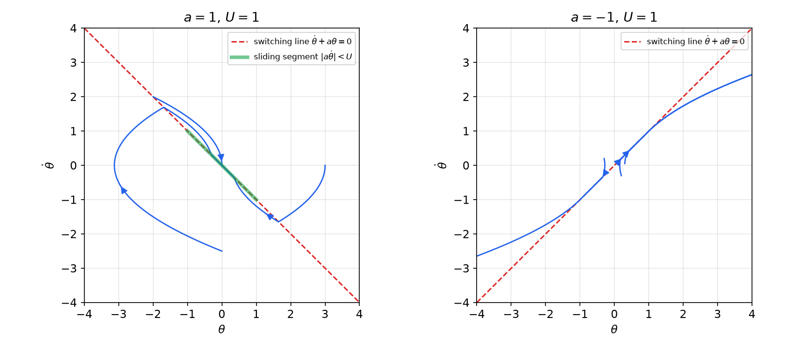

*Figure: phase portraits of the relay loop with U = 1. Left, a = 1: trajectories are pieces of parabolas that switch on the line θ' + θ = 0 (red dashed), spiral inward and finally slide along the green segment |θ'| < U/a into the origin. Right, a = −1: trajectories near the origin are driven along the switching line θ' = θ and diverge.*

**Example 2.17 (Saturated proportional control).** A plant \\(\ddot x + \dot x = u\\) (a motor driving an inertia with viscous friction, in normalized units) is controlled by a proportional law whose output is limited by the actuator:
\\[
u = \mathrm{sat}\_M(-Kx) = \begin{cases} -Kx, & \lvert Kx \rvert \le M, \\\\ -M\operatorname{sgn}(x), & \lvert Kx \rvert > M , \end{cases}
\\]
with \\(K = 4\\) and \\(M = 1\\). Construct the phase portrait and determine stability.

*Solution.* The lines \\(x = \pm M/K = \pm 0.25\\) divide the plane into three regions.

*Linear zone* \\(\lvert x \rvert < 0.25\\): \\(\ddot x + \dot x + 4x = 0\\), with roots \\(\lambda = -0.5 \pm j\sqrt{15}/2 = -0.5 \pm 1.936j\\): the origin is a stable focus (\\(\zeta = 0.25\\), \\(\omega\_n = 2\\)).

*Saturated zone* \\(x > 0.25\\): \\(\ddot x = -\dot x - M\\). Eliminating time, \\(\dfrac{d\dot x}{dx} = \dfrac{-\dot x - M}{\dot x}\\), so \\(\dfrac{\dot x\\,d\dot x}{\dot x + M} = -dx\\). Since \\(\dfrac{\dot x}{\dot x + M} = 1 - \dfrac{M}{\dot x + M}\\), integration gives
\\[
x + \dot x - M\ln\lvert\dot x + M\rvert = C .
\\]
As \\(x\\) decreases, these trajectories approach the horizontal asymptote \\(\dot x = -M\\): the motor accelerates to its terminal velocity, where the saturated torque balances friction. Symmetrically, for \\(x < -0.25\\), \\(\ddot x = -\dot x + M\\) and
\\[
x + \dot x + M\ln\lvert M - \dot x\rvert = C ,
\\]
with the asymptote \\(\dot x = +M\\).

*Global behavior.* A trajectory from a large initial error moves at nearly constant speed \\(M\\) toward the linear zone, enters it, and spirals into the origin; the approach time grows linearly with the size of the initial error, about \\(\lvert x\_0 \rvert/M\\), whereas the unsaturated linear loop would converge in a time independent of \\(x\_0\\). To prove that every trajectory converges, combine two observations:

1. *Boundedness.* Let \\(\Phi(x) = \int\_0^x \mathrm{sat}\_M(Ks)\\,ds\\), which grows like \\(M\lvert x \rvert\\), and \\(V = \tfrac12\dot x^2 + \Phi(x)\\). Then \\(\dot V = \dot x\ddot x + \mathrm{sat}\_M(Kx)\dot x = \dot x\big(-\dot x - \mathrm{sat}\_M(Kx)\big) + \mathrm{sat}\_M(Kx)\dot x = -\dot x^2 \le 0\\), so \\(V\\) cannot increase and every trajectory stays in a bounded set.
2. *No limit cycles.* The divergence of \\((\dot x\_1, \dot x\_2) = \big(x\_2, -x\_2 + \mathrm{sat}\_M(-Kx\_1)\big)\\) is \\(0 + (-1) = -1\\) everywhere, because the saturation depends on \\(x\_1\\) only. By Bendixson's theorem there are no closed orbits.

By the Poincaré–Bendixson theorem, each bounded trajectory must then tend to an equilibrium, and the only one is the origin. The origin is **globally asymptotically stable**: saturation slows the response but does not destabilize this loop. (The function \\(V\\) used in step 1 is a Lyapunov function; the argument anticipates [Lyapunov's direct method](lyapunov.md) and the invariance principle of [Invariant Sets and LaSalle's Theorem](invariance.md).)

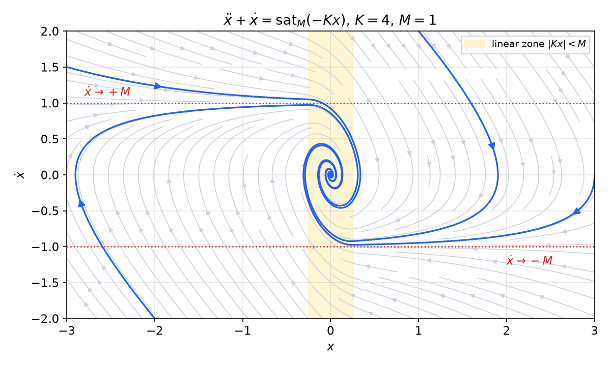

*Figure: phase portrait of ẍ + ẋ = sat(−4x) with M = 1. Outside the linear zone (shaded, |x| < 0.25) the trajectories approach the terminal velocities ẋ = ∓M (red dotted) and travel toward the zone at almost constant speed; inside it they spiral into the stable focus at the origin.*

Not every saturated loop is so benign. If the plant is open-loop unstable, or if a third-order loop (for example, the same loop with an integrator) is stable only in its linear range, saturation can create limit cycles or shrink the region of attraction to a bounded set; such loops are studied with [describing functions](describing-function.md) and Lyapunov methods.

## Computing Phase Portraits

A phase portrait is produced numerically by drawing the direction field and integrating trajectories from selected initial conditions. In Python:

```python
import numpy as np, matplotlib.pyplot as plt
from scipy.integrate import solve_ivp

f = lambda t, x: [x[1], -0.6*x[1] - 3*x[0] - x[0]**2]   # Example 2.2
X, Y = np.meshgrid(np.linspace(-6, 6, 30), np.linspace(-9, 9, 30))
U, V = f(0, [X, Y])
plt.streamplot(X, Y, U, V, color='0.8', density=1.3)       # direction field
for x0 in ([2, 0], [-2, 4], [1, -6]):
    s = solve_ivp(f, [0, 25], x0, max_step=0.01)
    plt.plot(s.y[0], s.y[1])                                # trajectories
plt.xlabel('x'); plt.ylabel("x'"); plt.show()
```

Separatrices are obtained by starting very close to a saddle along its stable eigenvector and integrating **backward** in time; unstable limit cycles likewise become attracting, and easy to locate, when time is reversed. For systems with discontinuous right-hand sides (relays), use a small fixed step or event detection at the switching line, since sliding motions make adaptive integrators chatter.

## Summary

- **Phase portrait**: the family of trajectories of \\(\dot x\_1 = f\_1(x\_1, x\_2)\\), \\(\dot x\_2 = f\_2(x\_1, x\_2)\\) in the \\((x\_1, x\_2)\\) plane. The slope \\(dx\_2/dx\_1 = f\_2/f\_1\\) is unique except at **singular points** (\\(f\_1 = f\_2 = 0\\)), so trajectories never cross.
- **Construction**: analytic (eliminate \\(t\\) and integrate \\(dx\_2/dx\_1 = f\_2/f\_1\\)); **isoclines** \\(f\_2 = \alpha f\_1\\) with slope-\\(\alpha\\) segments; **delta method** (arcs of circles centered at \\((-\delta, 0)\\) in the \\((x, \dot x/\omega)\\) plane). Time: \\(t - t\_0 = \int dx/\dot x\\).
- **Linear systems** \\(\ddot x + a\dot x + bx = 0\\), \\(\lambda\_{1,2} = (-a \pm \sqrt{a^2 - 4b})/2\\): stable/unstable **node** (real, same sign), **saddle** (real, opposite signs; converging line \\(\dot x = \lambda\_1 x\\) when the unstable coefficient is zero), stable/unstable **focus** (complex), **center** (imaginary). In trace–determinant form: \\(\Delta < 0\\) saddle; \\(\tau^2 \ge 4\Delta\\) node; \\(\tau^2 < 4\Delta\\) focus; \\(\tau = 0\\) center.
- **Nonlinear systems**: hyperbolic singular points have the type of their linearization (Hartman–Grobman); centers are not preserved (Example 2.11 is a true nonlinear center, \\(\dot r = \varepsilon r^3\\) is not).
- **Limit cycle**: an isolated closed trajectory; stable, unstable or semi-stable. In polar form \\(\dot r = r h(r)\\), \\(\dot\theta = -1\\), cycles are the positive zeros of \\(h\\), and their stability is read from the sign changes of \\(h\\). Example: \\(r\_n^{\pm} = (1 \pm 1/(n\pi))^{1/2}\\) gives infinitely many alternating cycles.
- **Index theorem**: a limit cycle encloses \\(N = S + 1\\) nodes/foci/centers versus saddles, hence at least one equilibrium.
- **Poincaré–Bendixson**: a bounded planar trajectory tends to an equilibrium or a closed orbit; a trapping region without equilibria contains a closed orbit; planar autonomous systems cannot be chaotic.
- **Bendixson**: no limit cycle in a simply connected region where \\(\partial f\_1/\partial x\_1 + \partial f\_2/\partial x\_2\\) has constant sign and does not vanish.
- **Relay and saturation**: piece together analytic solutions in each region. Pure relay on a double integrator: closed orbits, period \\(4\sqrt{2\theta\_{\max}/U}\\). Lead switching line \\(\dot\theta + a\theta = 0\\): \\(a > 0\\) GAS with sliding for \\(\lvert a\dot\theta \rvert < U\\), \\(a < 0\\) unstable. Saturation on \\(\ddot x + \dot x = u\\): terminal velocity \\(\pm M\\), still GAS.

## See Also

- [Nonlinear Systems and Their Behavior](phenomena.md): the phenomena (limit cycles, multiple equilibria, hard nonlinearities) analyzed here.
- [Lyapunov Stability Theory](lyapunov.md): stability of equilibria in any dimension; the linearization method formalizes the local classification of this chapter.
- [Invariant Sets and LaSalle's Theorem](invariance.md): the invariance argument behind Example 2.17.
- [Describing Function Analysis](describing-function.md): approximate limit-cycle prediction for relay and saturation loops of higher order.
- [Sliding Control](sliding-control.md): the sliding motion of Example 2.16, turned into a design method.
- [Eigenvalues and Eigenvectors](../../../math/linear-algebra/eigen.md) and [Systems of Differential Equations](../../../math/diffeq/systems.md): the linear algebra of the singular-point classification.
- [Stability of Linear Systems](../linear/stability.md) and [Stability](../stability.md): eigenvalue tests for linear systems.
- [Numerical ODEs](../../../math/numerical/odes.md): integrating trajectories for computed phase portraits.
