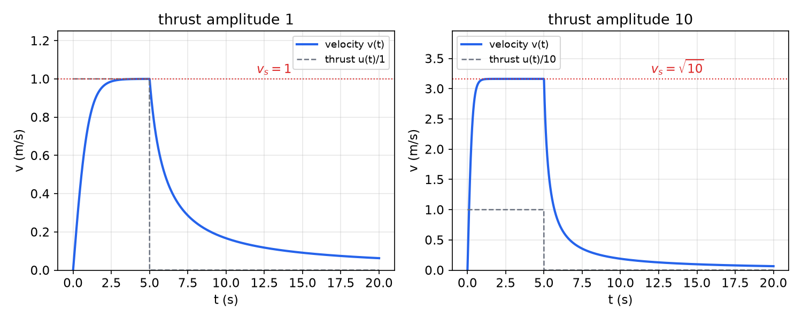
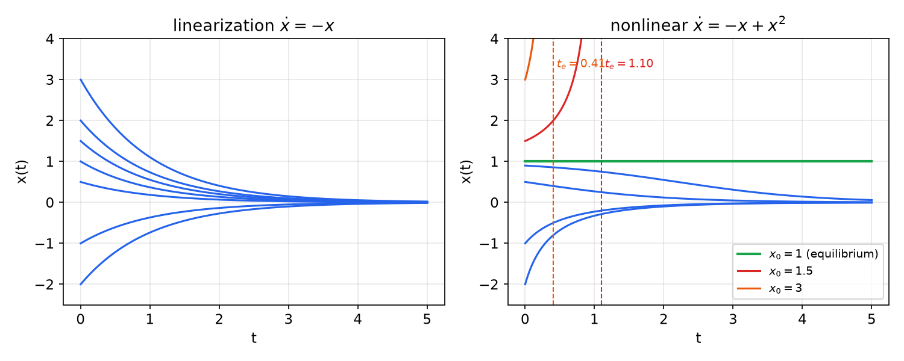
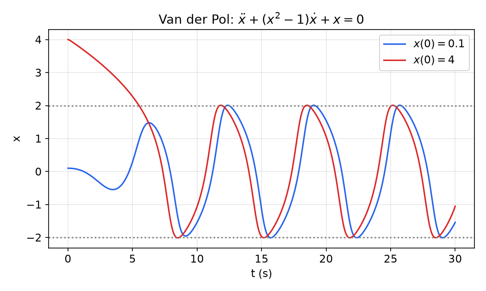
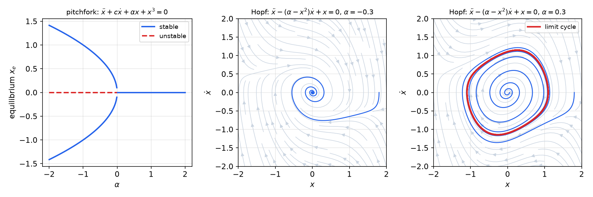
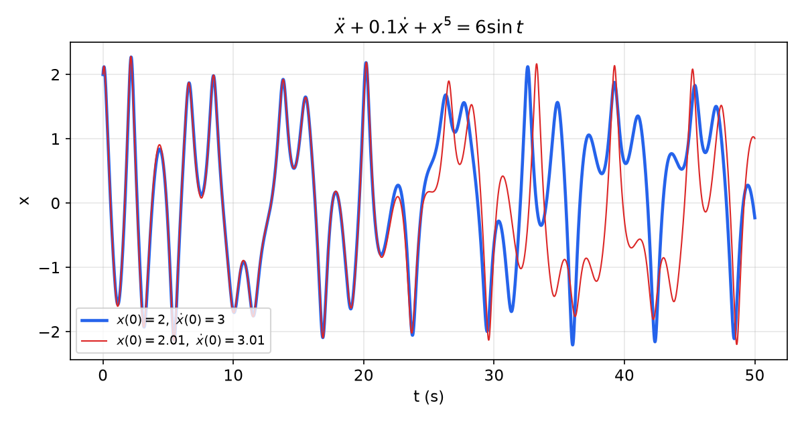
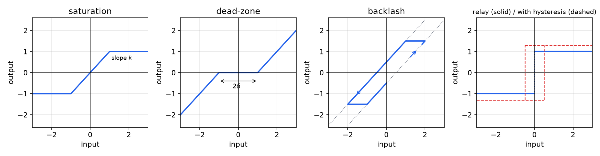

# Nonlinear Systems and Their Behavior

Every physical system is nonlinear; linear models describe it only over a limited range of operation, and only for nonlinearities smooth enough to be approximated by a straight line. This chapter explains why control engineers need methods beyond linear theory, catalogues the qualitative behaviors that nonlinear systems exhibit and linear systems never can (multiple equilibria, finite escape time, limit cycles, bifurcations, chaos), describes the "hard" nonlinearities of real hardware, and surveys the analysis and design tools developed in the rest of this subsection. It is the motivation for everything that follows, starting with the graphical method of [Phase Plane Analysis](phase-plane.md).

## Analysis and Design

Nonlinear control problems come in two kinds. In an **analysis** problem a nonlinear closed-loop system is given and its behavior must be determined: is the equilibrium stable, from which initial conditions, how fast does the state converge, does the system oscillate? In a **design** problem a nonlinear plant and a set of specifications for the closed loop are given, and a controller must be constructed to meet them. The two are intertwined. A design is checked by analysis, analysis tools often suggest designs (a Lyapunov function for the closed loop can be *chosen* first and the controller built to make it decrease), and practical design is iterative: propose, analyze, simulate, revise.

## Why Nonlinear Control?

Linear control is a mature and powerful body of theory, so it is fair to ask why one should bother with anything else. Several reasons recur.

**Improvement of existing control systems.** Linear controllers rely on the assumption of small-range operation. When the required range of operation is large, a linear controller may perform poorly or even be unstable, because the nonlinearities that the linear model ignores are no longer small. A robot manipulator is the standard example. The Coriolis and centripetal forces in its dynamics grow with the *square* of the joint velocities. A linear controller tuned around rest treats them as disturbances, so tracking accuracy degrades as the motion speeds up. A *computed-torque* controller, which uses the nonlinear model to cancel these forces, keeps high accuracy over a large range of speeds and a large workspace (see [Control of Multi-Input Physical Systems](multi-input.md)).

**Analysis of hard nonlinearities.** Many control systems contain components that are not smooth at all: Coulomb friction, saturation, dead-zones, backlash, hysteresis. These are **hard nonlinearities**. Because they are discontinuous or have corners, they cannot be linearized, not even locally, and they are notorious for producing instability or spurious oscillations (limit cycles). Their effects must be predicted with nonlinear tools, and compensated with nonlinear controllers.

**Dealing with model uncertainty.** A linear design assumes that the model parameters are reasonably well known. In practice parameters drift slowly (the ambient air pressure changes during an aircraft's flight) or change abruptly (a robot picks up a new object of unknown mass). A linear controller designed for nominal parameters may then perform badly. Nonlinear controllers can be built to *tolerate* uncertainty, either by robustness ([Sliding Control](sliding-control.md)) or by on-line estimation of the unknown parameters ([Adaptive Control](adaptive-control.md)); in both cases the nonlinearity is intentionally introduced.

**Design simplicity.** Good nonlinear designs are often rooted in the physics of the plant and can be simpler and more intuitive than their linear counterparts. Consider a pendulum with friction, released from an arbitrary angle. It comes to rest hanging down, and the reason has very little to do with the eigenvalues of some linearized system matrix: the friction continuously dissipates the total mechanical energy, so the pendulum must end at a minimum of that energy. Energy-like arguments of this kind are the heart of [Lyapunov's direct method](lyapunov.md) and of the physically motivated designs of later chapters.

**Cost and performance.** Nonlinear designs can be optimal in a precise sense. Bang-bang controllers, which switch an actuator between its extreme values, give the fastest response for many problems (the minimum-time solutions of [optimal control](../optimal.md)) and are inherently nonlinear. Cheaper actuators and sensors with nonlinear characteristics can often be used if the controller accounts for them. Finally, advances in computing have made it routine to implement controllers that would have been impractical a few decades ago, so the cost of nonlinear control has dropped sharply.

## What Linearity Means

The behaviors of the next sections are "nonlinear" only by contrast with a precise notion of linearity, so it is worth stating that notion carefully.

**Definition (linear system).** A dynamic system defines a map from an initial state and an input history to an output history, \\((x\_0, u(\cdot)) \mapsto y(\cdot)\\), \\(t \ge t\_0\\). The system is **linear** if this map satisfies the **superposition principle**: whenever \\((x\_{10}, u\_1) \mapsto y\_1\\) and \\((x\_{20}, u\_2) \mapsto y\_2\\), then for any constant \\(\alpha\\)
\\[
(x\_{10} + \alpha x\_{20},\\; u\_1 + \alpha u\_2) \mapsto y\_1 + \alpha y\_2 .
\\]

Equivalently, the map is additive (responses to sums are sums of responses) and homogeneous (scaling the cause scales the effect). The important subtlety is that the *initial state is part of the cause*. A system whose zero-input response does not scale with \\(x\_0\\) is not linear even if its forced response does.

**Example 1.1 (Linearity of the time-varying state-space model).** Show that
\\[
\dot x = A(t)x + B(t)u, \qquad y = C(t)x + D(t)u,
\\]
with \\(x \in \mathbb{R}^n\\), \\(u \in \mathbb{R}^m\\), \\(y \in \mathbb{R}^p\\), is linear.

*Solution.* It is not enough to check the output equation at a single instant: the claim concerns the whole output history, so we need the full solution. With the state-transition matrix \\(\Phi(t, t\_0)\\) (see [Time Response](../linear/time-response.md)),
\\[
y(t) = C(t)\left( \Phi(t,t\_0)x\_0 + \int\_{t\_0}^{t} \Phi(t,\tau)B(\tau)u(\tau)\\,d\tau \right) + D(t)u(t), \qquad t \ge t\_0 .
\\]
Write this formula for \\((x\_{10}, u\_1)\\), giving \\(y\_1\\), and for \\((x\_{20}, u\_2)\\), giving \\(y\_2\\). Adding the first to \\(\alpha\\) times the second and collecting terms, using linearity of matrix multiplication and of the integral,
\\[
y\_1 + \alpha y\_2 = C(t)\left( \Phi(t,t\_0)(x\_{10} + \alpha x\_{20}) + \int\_{t\_0}^{t} \Phi(t,\tau)B(\tau)\big(u\_1(\tau) + \alpha u\_2(\tau)\big)d\tau \right) + D(t)\big(u\_1 + \alpha u\_2\big),
\\]
which is exactly the output produced by the initial state \\(x\_{10} + \alpha x\_{20}\\) and the input \\(u\_1 + \alpha u\_2\\). The system is linear for every \\(t \ge t\_0\\), even though its coefficients vary with time.

Superposition gives linear time-invariant systems \\(\dot x = Ax + Bu\\) a set of strong and convenient properties:

- **A unique equilibrium** for \\(u = 0\\) when \\(A\\) is nonsingular (otherwise a whole subspace of equilibria, the null space of \\(A\\)).
- **Stability is a property of the system**, not of the initial condition: the equilibrium is asymptotically stable if all eigenvalues of \\(A\\) have negative real parts, regardless of where the motion starts, and then it is globally and exponentially stable.
- **The transient is a sum of natural modes** \\(e^{\lambda\_i t}\\) and can be written down analytically.
- **Forced behavior inherits the same simplicity**: asymptotic stability implies bounded-input bounded-output stability, and a sinusoidal input produces, in steady state, a sinusoidal output *of the same frequency*, which is the basis of transfer functions and [frequency-response methods](../frequency.md).

Each of these properties fails for some nonlinear system, and the failures are the subject of the rest of this chapter.

## Classifying Nonlinearities

Nonlinearities can be classified as **inherent** (natural) or **intentional** (artificial). Inherent nonlinearities come with the hardware and its motion: centripetal and Coriolis forces, Coulomb friction between surfaces in contact, aerodynamic drag. They are usually undesirable, and the controller must cope with them. Intentional nonlinearities are introduced by the designer: adaptive laws, bang-bang laws, switching controllers.

Nonlinearities can also be classified as **continuous** or **discontinuous**. Discontinuous nonlinearities (backlash, hysteresis, stiction, relays) are also called hard nonlinearities. The essential point is that a hard nonlinearity *cannot be locally approximated by a linear function*: no matter how small the operating region, the corner or jump is still there.

## A First Example: Square-Law Drag

**Example 1.2 (Underwater vehicle).** A simplified model of the forward motion of an underwater vehicle is
\\[
\dot v + \lvert v \rvert v = u,
\\]
where \\(v\\) is the velocity and \\(u\\) the thrust (both scaled to unit mass). The term \\(\lvert v \rvert v\\) is the typical square-law hydrodynamic drag. Apply a unit step in thrust at \\(t = 0\\) and remove it at \\(t = 5\\) s, so \\(u = 1\\) on \\(0 \le t < 5\\) and \\(u = 0\\) afterwards; then repeat with thrust amplitude 10.

*Solution.* While \\(v \ge 0\\) the equation is \\(\dot v = A - v^2\\) for a thrust of amplitude \\(A\\). Separating variables with \\(v(0) = 0\\),
\\[
\int\_0^{v} \frac{dv}{A - v^2} = \frac{1}{\sqrt{A}}\operatorname{artanh}\frac{v}{\sqrt{A}} = t
\quad\Longrightarrow\quad
v(t) = \sqrt{A}\\,\tanh\big(\sqrt{A}\\,t\big), \qquad 0 \le t < 5 .
\\]
The steady-state velocity satisfies \\(0 + \lvert v\_s \rvert v\_s = A\\):
\\[
A = 1:\\; v\_s = 1, \qquad A = 10:\\; v\_s = \sqrt{10} \approx 3.16 .
\\]
Ten times the thrust gives about three times the speed, not ten times as superposition would predict. The time constant of the rise is \\(1/\sqrt{A}\\), so the larger step also settles faster.

After the thrust is removed, \\(\dot v = -v^2\\) with \\(v(5) = v\_5 \approx v\_s\\), whose solution is
\\[
v(t) = \frac{v\_5}{1 + v\_5 (t - 5)}, \qquad t \ge 5 .
\\]
The decay is algebraic (like \\(1/t\\)), not exponential: at \\(t = 20\\) s the velocity is still \\(1/16 \approx 0.06\\) for the unit step. The response to a positive step is fast and the return to zero is slow, because the "apparent damping" \\(\lvert v \rvert\\) is large at high speed and vanishes at low speed.

*Figure: response of the square-law-drag vehicle to a 5 s thrust pulse. Left, amplitude 1: v rises to 1 within about 2 s and then decays slowly. Right, amplitude 10: v rises to √10 ≈ 3.16, not 10, and returns with the same long algebraic tail. The steady state does not scale with the input, and rise and decay are asymmetric.*

This matters in practice. A remotely operated vehicle that changes speed continually never operates near one equilibrium, so a linear controller tuned at one speed is sluggish or oscillatory at others. A controller that compensates the drag term exactly (\\(u = \lvert v \rvert v + \dots\\)) does not have this problem; this is the idea of [feedback linearization](feedback-linearization.md).

## Common Nonlinear Behaviors

### Multiple equilibria and finite escape time

**Example 1.3 (Multiple equilibria).** Consider the first-order system
\\[
\dot x = -x + x^2, \qquad x(0) = x\_0 .
\\]
Its linearization about \\(x = 0\\) is \\(\dot x = -x\\), with solution \\(x(t) = x\_0 e^{-t}\\): every solution decays to the unique equilibrium 0, whatever \\(x\_0\\).

*Solution of the nonlinear equation.* Separate variables and use partial fractions, \\(\dfrac{1}{x(x-1)} = \dfrac{1}{x-1} - \dfrac{1}{x}\\):
\\[
\int \left(\frac{1}{x-1} - \frac{1}{x}\right)dx = \int dt
\quad\Longrightarrow\quad
\ln\left\lvert\frac{x-1}{x}\right\rvert = t + c .
\\]
At \\(t = 0\\) the constant is fixed by \\((x\_0 - 1)/x\_0\\), so \\((x-1)/x = e^{t}(x\_0-1)/x\_0\\). Solving for \\(x\\),
\\[
x(t) = \frac{x\_0 e^{-t}}{1 - x\_0 + x\_0 e^{-t}} .
\\]
The nonlinear system has **two equilibria**, \\(x = 0\\) and \\(x = 1\\) (the zeros of \\(-x + x^2\\)), and the qualitative behavior depends on the initial condition:

- if \\(x\_0 < 1\\), the denominator stays positive and \\(x(t) \to 0\\);
- if \\(x\_0 = 1\\), \\(x(t) \equiv 1\\);
- if \\(x\_0 > 1\\), the denominator \\(1 - x\_0 + x\_0e^{-t}\\) decreases from 1 and vanishes when \\(e^{-t} = (x\_0 - 1)/x\_0\\), that is at
\\[
t\_e = \ln\frac{x\_0}{x\_0 - 1} .
\\]

At \\(t\_e\\) the solution becomes infinite: the system has a **finite escape time**. For \\(x\_0 = 1.5\\), \\(t\_e = \ln 3 \approx 1.10\\); for \\(x\_0 = 3\\), \\(t\_e = \ln 1.5 \approx 0.41\\). A linear system can grow exponentially but can never reach infinity in finite time.

*Figure: left, the linearization predicts decay to zero from every initial condition. Right, the true nonlinear system decays to zero only for x₀ < 1, stays at the second equilibrium for x₀ = 1, and escapes to infinity at the finite times t_e (dashed lines) for x₀ > 1.*

Two lessons follow. First, for a nonlinear system **stability is a property of an equilibrium together with a region of initial conditions**, not of the system as a whole: the origin here is stable, but only for \\(x\_0 < 1\\). Second, the linearization is perfectly accurate near the origin yet says nothing about this region.

Stability can also depend on the **input**. The bilinear system \\(\dot x = xu\\) has \\(x(t) = x\_0 e^{-t} \to 0\\) for the constant input \\(u = -1\\), but \\(\lvert x(t) \rvert = \lvert x\_0 \rvert e^{t} \to \infty\\) for \\(u = 1\\). An even simpler example of escape is \\(\dot x = x^2\\), whose solution \\(x(t) = x\_0/(1 - x\_0 t)\\) blows up at \\(t = 1/x\_0\\) for any \\(x\_0 > 0\\). Finite escape is a real concern in design: a controller that leaves some nonlinearity uncompensated may allow the state to escape before any slower stabilizing effect acts (see [Input-to-State Stability](iss.md)).

### Limit cycles

Nonlinear systems can oscillate with a fixed amplitude and period without any external excitation. Such an oscillation is called a **limit cycle**.

**Example 1.4 (Van der Pol equation).** The second-order equation
\\[
m\ddot x + 2c(x^2 - 1)\dot x + kx = 0, \qquad m, c, k > 0,
\\]
models an electronic oscillator with a nonlinear (tunnel-diode or vacuum-tube) element. It is a mass–spring–damper with a **position-dependent damping coefficient** \\(2c(x^2 - 1)\\).

*Energy argument.* Take the stored energy \\(E = \tfrac12 m\dot x^2 + \tfrac12 kx^2\\). Along solutions,
\\[
\dot E = \dot x(m\ddot x + kx) = -2c(x^2 - 1)\dot x^2 .
\\]
For \\(\lvert x \rvert > 1\\) the damping is positive and removes energy; for \\(\lvert x \rvert < 1\\) it is negative and pumps energy in. A small motion therefore grows, and a large motion decays. The state can neither grow without bound nor decay to zero, and settles on an oscillation in which the energy gained near the center of each swing balances the energy lost near its ends.

*Figure: x(t) for the Van der Pol equation with m = k = 1, 2c = 1, started at x(0) = 0.1 (growing) and x(0) = 4 (decaying). Both responses converge to the same periodic oscillation of amplitude about 2 (dotted lines): the amplitude is fixed by the system, not by the initial condition.*

Limit cycles differ from the oscillations of linear systems in two fundamental ways:

1. **The amplitude is independent of the initial condition.** A linear oscillator (the undamped mass–spring \\(\ddot x + x = 0\\)) oscillates with whatever amplitude it was started at.
2. **A limit cycle is robust to parameter changes.** A linear oscillation exists only when the system is exactly marginally stable (eigenvalues exactly on the imaginary axis); the smallest change in damping turns it into decay or growth. The Van der Pol oscillation persists over a whole range of \\(m, c, k\\).

Limit cycles can be desirable (electronic oscillators, the periodic gait of a hopping legged robot, biological rhythms) or harmful (aircraft wing flutter, chatter in machining, oscillations caused by friction or backlash in position servos). Predicting and suppressing them is a major use of nonlinear analysis: the [phase plane](phase-plane.md) handles second-order systems exactly, and [describing functions](describing-function.md) give approximate predictions for higher-order loops.

### Bifurcations

As the parameters of a nonlinear system change, the number and stability of its equilibria (and limit cycles) can change. Parameter values at which the qualitative behavior changes are called **critical** or **bifurcation values**, and the phenomenon is a **bifurcation**.

**Example 1.5 (Pitchfork bifurcation).** Consider the undamped Duffing equation
\\[
\ddot x + \alpha x + x^3 = 0 ,
\\]
or, to make stability statements meaningful, its damped version \\(\ddot x + c\dot x + \alpha x + x^3 = 0\\) with \\(c > 0\\). The equilibria satisfy \\(\alpha x + x^3 = x(\alpha + x^2) = 0\\):

- for \\(\alpha > 0\\), the only equilibrium is \\(x\_e = 0\\);
- for \\(\alpha < 0\\), there are three: \\(x\_e = 0\\) and \\(x\_e = \pm\sqrt{-\alpha}\\).

The stability of each follows from the linearization. Writing \\(x = x\_e + \tilde x\\) and dropping higher-order terms,
\\[
\ddot{\tilde x} + c\dot{\tilde x} + (\alpha + 3x\_e^2)\tilde x = 0 .
\\]
At \\(x\_e = 0\\) the effective stiffness is \\(\alpha\\): positive (stable focus or node) for \\(\alpha > 0\\), negative (saddle, unstable) for \\(\alpha < 0\\). At \\(x\_e = \pm\sqrt{-\alpha}\\) the stiffness is \\(\alpha + 3(-\alpha) = -2\alpha > 0\\), so both outer equilibria are stable. As \\(\alpha\\) decreases through 0, a single stable equilibrium splits into one unstable and two stable equilibria. Plotted against \\(\alpha\\), the branches look like a pitchfork.

**Example 1.6 (Hopf bifurcation).** A Hopf bifurcation occurs when a pair of complex-conjugate eigenvalues \\(p\_{1,2} = \gamma \pm j\omega\\) of the linearization crosses from the left to the right half-plane as a parameter changes: the equilibrium loses stability and the response diverges, not to infinity, but to a limit cycle that is born at the crossing. A convenient example is
\\[
\ddot x - (\alpha - x^2)\dot x + x = 0 .
\\]
The linearization at the origin, \\(\ddot x - \alpha\dot x + x = 0\\), has eigenvalues \\(\alpha/2 \pm j\sqrt{1 - \alpha^2/4}\\), which cross the imaginary axis at \\(\alpha = 0\\). For \\(\alpha < 0\\) the origin is a stable focus. For \\(\alpha > 0\\) it is an unstable focus surrounded by a stable limit cycle. Scaling \\(x = \sqrt{\alpha}\\,y\\) gives \\(\ddot y - \alpha(1 - y^2)\dot y + y = 0\\), a Van der Pol equation whose limit cycle has amplitude close to 2 for small \\(\alpha\\); hence the cycle in \\(x\\) has amplitude about \\(2\sqrt{\alpha}\\), growing continuously from zero as \\(\alpha\\) increases past the critical value.

*Figure: left, equilibrium positions of the damped Duffing equation versus α: one stable branch for α > 0, which becomes unstable (dashed) for α < 0 while two stable branches ±√(−α) appear. Middle and right, phase portraits of the Hopf example: a stable focus for α = −0.3, an unstable focus surrounded by a limit cycle of amplitude ≈ 2√α ≈ 1.1 (red) for α = 0.3.*

Bifurcations matter in control because plant parameters, operating points and controller gains are parameters too. Raising a feedback gain until a pair of closed-loop poles crosses the imaginary axis typically produces a Hopf bifurcation: the linear prediction "unstable" turns out, in the real system, to be a sustained oscillation of finite amplitude.

### Chaos

In a stable linear system, small differences in initial conditions produce small differences in the response. Some nonlinear systems show extreme sensitivity to initial conditions instead, so that the long-term response is essentially unpredictable even though the equations are deterministic. This is **chaos**. It is different from random motion: the model contains no uncertainty and the response is exactly reproducible from exactly the same initial condition.

**Example 1.7 (Forced Duffing-type oscillator).** The lightly damped, sinusoidally forced structure with large elastic deflections
\\[
\ddot x + 0.1\dot x + x^5 = 6\sin t
\\]
is integrated from \\(x(0) = 2,\\ \dot x(0) = 3\\) and from \\(x(0) = 2.01,\\ \dot x(0) = 3.01\\).

*Figure: the two responses, started 0.01 apart, are indistinguishable for about 25 s and then become completely different, while both stay within about ±2.3. No finite measurement precision would allow the long-term response to be predicted.*

Chaos occurs mostly in strongly nonlinear systems, and it **cannot occur in linear systems** (nor in autonomous systems of order one or two, a consequence of the [Poincaré–Bendixson theorem](phase-plane.md#existence-of-limit-cycles); the forcing here makes the system effectively third order). It appears in fluid turbulence, weather, buckled elastic structures, mechanical systems with backlash, aeroelasticity, wheel–rail dynamics and some feedback control devices.

### Other behaviors

Several other phenomena have no linear counterpart:

- **Jump resonance.** The frequency-response curve of a forced nonlinear oscillator (for example a Duffing oscillator with a hardening spring) can be multivalued; as the forcing frequency is swept slowly, the response amplitude jumps discontinuously from one branch to another, at different frequencies for increasing and decreasing sweeps.
- **Subharmonic generation.** A sinusoidal input can produce an output containing frequencies that are integer submultiples of the input frequency (and harmonics), whereas a linear system only reproduces the input frequency.
- **Asynchronous quenching.** A self-excited oscillation (limit cycle) can be suppressed by applying a forcing signal at a frequency unrelated to that of the oscillation.
- **Frequency–amplitude dependence of free vibrations.** The frequency of free oscillation depends on its amplitude: a pendulum's period grows with amplitude, and a hardening spring oscillates faster at large amplitude. The bang-bang satellite controller of the [phase-plane chapter](phase-plane.md#the-analytic-method) is an extreme case, with a period proportional to the square root of the amplitude.

## Hard Nonlinearities

Hard nonlinearities deserve separate attention because they are present in almost every real control system, cannot be linearized, and are the usual culprits when a well-designed linear loop misbehaves in practice.

*Figure: static characteristics of saturation (linear with slope k up to a limit), dead-zone (no output for inputs smaller than δ), backlash (a parallelogram traversed in the direction of the arrows; the output follows the input only after the gap is taken up), and relay (ideal relay solid; relay with hysteresis dashed).*

**Saturation.** Every actuator has limits: amplifiers have a maximum voltage, motors a maximum torque, valves a maximum opening. Over the small-signal range the output is proportional to the input; beyond it, the output stays at its limit,
\\[
\mathrm{sat}(u) = \begin{cases} k u, & \lvert u \rvert \le a, \\\\ k a \operatorname{sgn}(u), & \lvert u \rvert > a . \end{cases}
\\]
Saturation reduces the effective gain for large signals. It usually slows the response and can make a loop that is stable in the small unstable in the large; combined with integral action it causes **integrator windup**, large overshoot due to an integrator that keeps accumulating error while the actuator is saturated (see [PID Control](../pid.md)). Some sensors also saturate.

**Dead-zone.** Many devices do not respond to small inputs: a valve that needs a minimum opening, a motor that needs a minimum voltage to overcome static friction, a sensor below its threshold.
\\[
\mathrm{dz}(u) = \begin{cases} 0, & \lvert u \rvert \le \delta, \\\\ u - \delta\operatorname{sgn}(u), & \lvert u \rvert > \delta . \end{cases}
\\]
Dead-zones cause static positioning errors (the loop is effectively open for small errors) and can, in combination with integral action, cause limit cycles; sometimes they are introduced deliberately to stop a loop from reacting to sensor noise.

**Backlash.** Gear trains and other mechanical transmissions have a small gap between the driving and driven parts. When the driving member reverses, the driven member does not move until the gap is closed. The input–output relation is a parallelogram whose path depends on the direction of motion, so backlash has **memory**: the output depends on the past history of the input, not just on its current value. Backlash introduces phase lag and is a classic cause of limit cycles in position servos.

**Relay (on–off) elements.** A relay switches its output between two (or three) levels depending on the sign of its input:
\\[
\text{ideal relay:}\quad u = M\operatorname{sgn}(e).
\\]
Practical variants include the **relay with dead-zone** (zero output for \\(\lvert e \rvert < \delta\\), used to stop thrusters firing for small errors) and the **relay with hysteresis**, which switches on at \\(e = +h\\) and off at \\(e = -h\\) to avoid chattering. Relays are used deliberately because on–off actuators (gas jets, thyristors, solenoid valves) are cheap and fast. Their analysis is a natural application of the phase plane (the [satellite and switching-line examples](phase-plane.md#relay-and-saturation-systems)) and of describing functions.

**Coulomb friction and stiction.** Dry friction opposes motion with a force of roughly constant magnitude, \\(F = F\_c \operatorname{sgn}(\dot x)\\): a relay characteristic in velocity. Static friction (stiction), the extra force needed to start motion from rest, adds a discontinuity at zero velocity. Friction causes steady-state errors and stick–slip limit cycles, particularly at low speed.

**Hysteresis.** Magnetic materials, piezoelectric actuators and many relays show a multivalued input–output relation whose branch depends on the direction of the input. Like backlash, hysteresis has memory and introduces phase lag.

The common features are that these nonlinearities are **not differentiable at the origin**, so there is no linearization to fall back on, and that several of them (backlash, hysteresis) are **multivalued**, which makes them dynamic rather than static. Analysis tools for them must work with the nonlinearity itself: exact phase-plane construction for second-order systems, describing functions for limit-cycle prediction, and Lyapunov or sector arguments for stability.

## Overview of Analysis and Design Methods

Nonlinear systems have no general analytical solution, and the transform methods (Laplace, Fourier) on which linear control is built do not apply, because they rely on superposition. Instead there is a set of tools, each with a domain of validity.

**Why analysis first.** Analysis is the cheapest way to explore a system and the basis of design. Simulation is indispensable, but simulation must be guided by theory: blind simulation of a nonlinear system tests one initial condition and one parameter set at a time and can be badly misleading about stability, attraction regions or the existence of oscillations.

**Analysis methods** (Part I of this subsection):

- **Phase-plane analysis** ([Phase Plane Analysis](phase-plane.md)). A graphical method that displays all motions of a second-order system without solving the equations, applies to strong and hard nonlinearities alike, and gives exact global qualitative information. Its limitation is that it applies only to first- and second-order systems.
- **Lyapunov theory** ([Lyapunov Stability Theory](lyapunov.md), [Invariance and Non-Autonomous Systems](invariance.md)). The **indirect method** (linearization) shows that the stability of a hyperbolic equilibrium is decided by its linearization, which is the theoretical justification of linear control. The **direct method** generalizes the energy argument used above for the Van der Pol equation: if a positive scalar "energy" function decreases along all motions, the system settles. It applies to systems of any order, to time-varying and even infinite-dimensional systems, and it is also a *design* tool: choose a candidate function, then choose the control to make it decrease. Its difficulty is finding a suitable function.
- **Describing functions** ([Describing Function Analysis](describing-function.md)). An approximate frequency-domain method that replaces a nonlinearity by an amplitude-dependent gain and predicts limit cycles, their amplitude and frequency, in loops of any order. It is approximate and can give false predictions, and it handles multiple nonlinearities poorly, but it is widely used for loops with hard nonlinearities.

**Design methods** (Part I continued):

- **Feedback linearization** ([Feedback Linearization](feedback-linearization.md)): transform the nonlinear dynamics algebraically into a linear one, then apply linear design.
- **Sliding control** ([Sliding Control](sliding-control.md)): a robust method that drives the state onto a surface on which the closed loop has the desired behavior and keeps it there despite bounded model uncertainty.
- **Adaptive control** ([Adaptive Control](adaptive-control.md)): estimate uncertain parameters on line and adjust the controller, with stability guaranteed by a Lyapunov argument.
- **Control of multi-input physical systems** ([Multi-Input Physical Systems](multi-input.md)): exploit physical structure (energy, passivity, the properties of robot dynamics) to design simple controllers for complex multi-input plants.

Part II develops more advanced tools: comparison functions and the non-autonomous theory ([Advanced Lyapunov Theory](lyapunov-advanced.md)), [input-to-state stability](iss.md), [passivity](passivity.md), [backstepping](backstepping.md), [differential geometry](differential-geometry.md) and [nonlinear controllability](controllability.md), [control Lyapunov functions](clf.md), [homogeneity](homogeneity.md), [center manifolds](center-manifold.md), and [averaging and singular perturbations](averaging.md).

Throughout, systems are treated in continuous time. Digital controllers sampled fast compared with the closed-loop bandwidth behave essentially like their continuous-time counterparts; slow sampling requires the methods of [Digital Control](../digital/introduction.md).

## Summary

- Linear control assumes small-range operation and smooth, known dynamics. Nonlinear control is needed for large-range operation, hard nonlinearities, model uncertainty, and when physics-based designs are simpler or faster.
- A system is **linear** if superposition holds for the map \\((x\_0, u) \mapsto y\\), with the initial state counted as an input. The LTV state-space model is linear.
- Nonlinear phenomena with no linear counterpart: **multiple equilibria** (stability depends on initial condition and on the input), **finite escape time** (\\(\dot x = -x + x^2\\) escapes at \\(t\_e = \ln[x\_0/(x\_0 - 1)]\\) for \\(x\_0 > 1\\)), **limit cycles** (Van der Pol; amplitude independent of initial condition, robust to parameters), **bifurcations** (pitchfork \\(x\_e = 0, \pm\sqrt{-\alpha}\\); Hopf, a complex pair crossing into the right half-plane), **chaos** (sensitive dependence on initial conditions), jump resonance, subharmonics, asynchronous quenching, amplitude-dependent frequency.
- Square-law drag: steady state \\(v\_s = \sqrt{u}\\), fast rise and slow algebraic \\(1/t\\) decay.
- **Hard nonlinearities** (saturation, dead-zone, backlash, relays, Coulomb friction, hysteresis) are not differentiable at the origin, sometimes have memory, and commonly cause steady-state errors, windup and limit cycles.
- Analysis tools: phase plane (second order, exact, global), Lyapunov (indirect: local; direct: general, also a design tool), describing functions (approximate, any order, limit cycles). Design tools: feedback linearization, sliding, adaptive and physically motivated control.

## See Also

- [Phase Plane Analysis](phase-plane.md): the graphical analysis of the second-order examples of this chapter.
- [Lyapunov Stability Theory](lyapunov.md): the precise definitions of stability that this chapter uses informally.
- [Describing Function Analysis](describing-function.md): limit-cycle prediction in loops with hard nonlinearities.
- [System Modeling](../modeling.md) and [Modeling and Linearization](../linear/modeling.md): Jacobian linearization about an operating point.
- [Stability](../stability.md) and [Stability of Linear Systems](../linear/stability.md): the eigenvalue tests that hold only in the linear case.
- [Systems of Differential Equations](../../../math/diffeq/systems.md) and [Numerical ODEs](../../../math/numerical/odes.md): solution methods and the simulations behind the figures.
