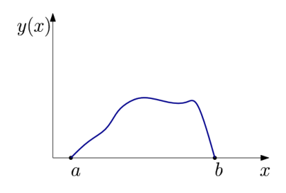
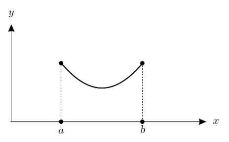
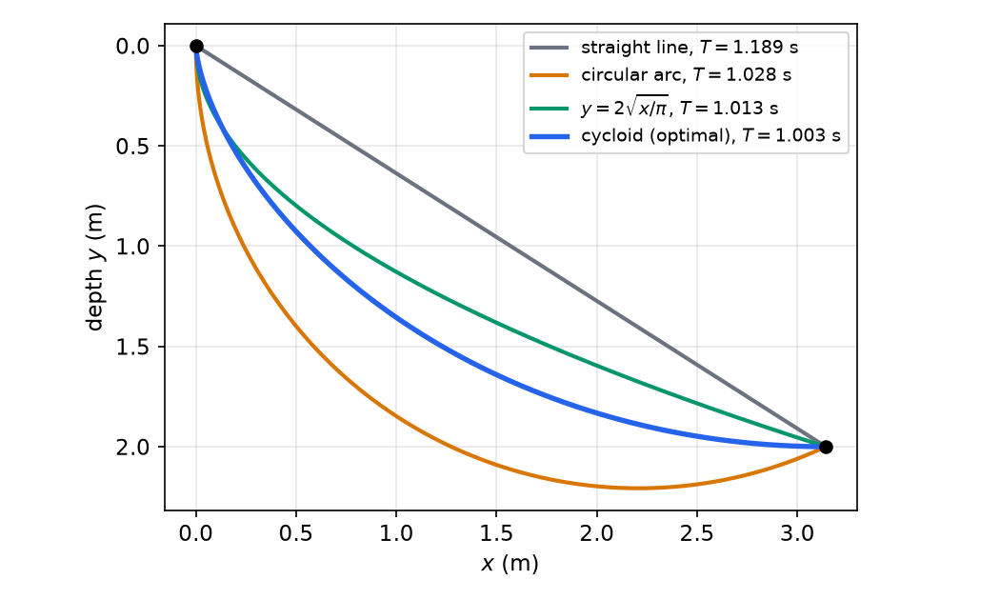
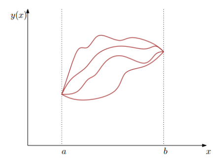
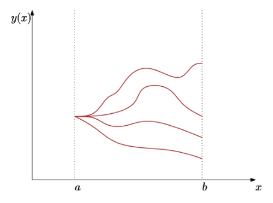
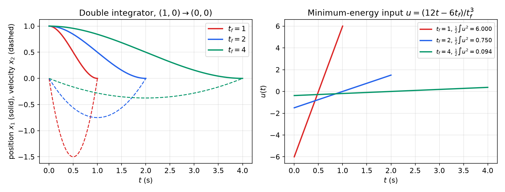
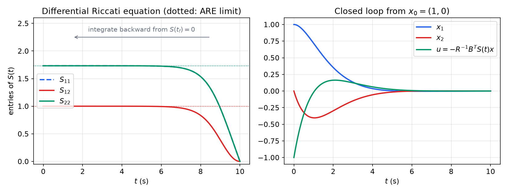
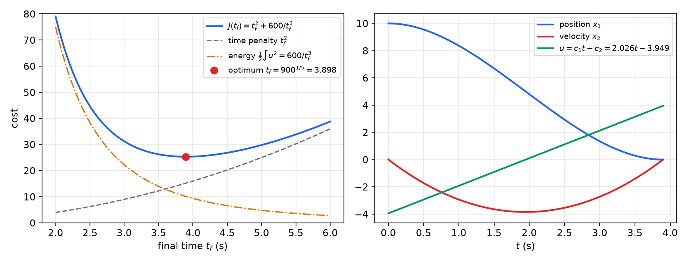
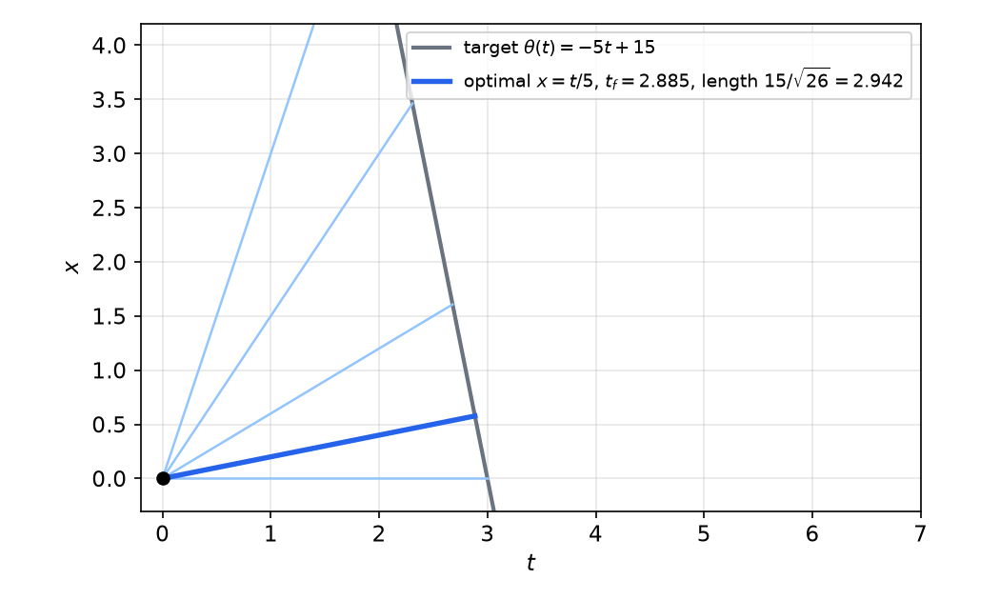

# Calculus of Variations and the Riccati Equation

The [previous chapter](optimization.md) minimized functions of finitely many variables. Optimal control minimizes over *functions* of time: the input \\(u(\cdot)\\) and the trajectory \\(x(\cdot)\\) it produces. The calculus of variations is the classical theory of such problems. This chapter derives its central result, the Euler–Lagrange equation, together with second-order (Legendre) conditions and boundary conditions for free end points and free end times. It then applies these tools to dynamical systems. That yields the costate and stationarity equations of optimal control, the minimum-energy transfer through the controllability Gramian, and, by the sweep method, the differential Riccati equation of the linear–quadratic regulator.

## From Vectors to Functions

### Functionals

The calculus of variations was set in motion by Newton and the Bernoulli brothers at the end of the seventeenth century and developed by Euler and Lagrange in the eighteenth; Laplace, Hamilton, Jacobi, Dirichlet, Weierstrass and Hilbert extended it through the nineteenth. It deals with **functionals**, "functions of functions": maps that assign a number to an entire curve. Its minimization problems characterize the equilibria of nearly every continuous physical system: elasticity, solid and fluid mechanics, electromagnetism, gravitation, quantum mechanics. The same mathematics describes minimal surfaces, geodesics (shortest paths on a surface), Hamilton's principle (physical trajectories are critical points of the action), minimum-energy paths, image denoising and segmentation, and, in statistics and machine learning, the choice of a probability density that optimizes an objective.

The optimal-control problem
\\[
J^\star = \min\_u \int\_{t\_0}^{t\_f}L(t,x,u)\\,dt+\phi(x\_f,t\_f)\qquad\text{s.t.}\qquad \dot x=f(x,u,t)
\\]
is an optimization over functions, that is, over an infinite-dimensional vector space. The constrained finite-dimensional problem of the previous chapter, \\(\min L(x,u)\\) subject to \\(F(x,u)=0\\), was a discrete shadow of it, and the Hamiltonian machinery will carry over almost verbatim.

### The basic problem

Start with the simplest version. Let \\(x\\) be the independent variable (think time) and \\(y(x)\\) the dependent one (think state). Consider
\\[
\min\_{y\in C^1[a,b]} J(y) = \int\_a^b L\big(x,y(x),y'(x)\big)\\,dx,
\\]
possibly with \\(y(a)\\) and \\(y(b)\\) prescribed. \\(L\\) is called the **Lagrangian**. A function \\(y^\star\\) is a **local minimum** if \\(J(y^\star)\le J(y)\\) for all admissible \\(y\\) in a neighbourhood \\(\lVert y-y^\star\rVert\le\epsilon\\). In infinite dimensions the choice of norm matters. With the \\(C^1\\) norm \\(\lVert y\rVert\_1=\max\lvert y\rvert+\max\lvert y'\rvert\\) the neighbourhood contains only curves whose slopes are also close, giving a **weak** minimum; with the \\(C^0\\) norm \\(\max\lvert y\rvert\\) the slopes may differ wildly, giving a **strong** minimum. (These terms differ from the strong/weak distinction for finite-dimensional minima.) Every strong minimum is a weak minimum, so necessary conditions for weak minima apply to both.

## Classical Problems

**Example 1 (Shortest path).** Among all curves joining \\((a,y\_a)\\) and \\((b,y\_b)\\), find the shortest. The length is
\\[
J(y)=\int\_a^b\sqrt{1+(y')^2}\\,dx .
\\]
The answer is the straight line, which we will derive below.

**Example 2 (Dido's isoperimetric problem).** According to legend, about 850 B.C. Dido was granted as much land as an ox hide could enclose. She cut the hide into thin strips and enclosed a large area along the coast, which became Carthage. Mathematically: given a rope of length \\(C\\) with ends on a straight coastline, find the maximum area it can enclose. Admissible curves are continuous \\(y:[a,b]\to\mathbb R\\), differentiable almost everywhere, with \\(y(a)=y(b)=0\\):
\\[
\max\_y\int\_a^b y(x)\\,dx\qquad\text{s.t.}\qquad \int\_a^b\sqrt{1+(y'(x))^2}\\,dx=C .
\\]
To fit the minimization template, minimize \\(-\int\_a^by\\,dx\\). To keep the curve from dipping into the sea, one may replace \\(y\\) by \\(\max\\{0,y\\}\\) in the area. The optimal curve is an arc of a circle, a fact already known to Zenodorus in the second century B.C.



*Figure: Dido's problem. A curve of fixed length from \\(a\\) to \\(b\\) on the axis (the coastline) encloses the area \\(\int\_a^by\\,dx\\); the area is maximized by a circular arc.*

**Example 3 (Light: reflection and refraction).** In a homogeneous medium light travels along straight lines, the shortest paths. For reflection in a plane mirror, Hero of Alexandria (first century A.D.) observed that the reflected path is the shortest among nearby broken paths touching the mirror, which gives equal angles of incidence and reflection. Fermat's principle generalizes this: light follows the path of shortest *time*, which yields Snell's law of refraction between media with different speeds of light. The brachistochrone below is the same principle with a speed that varies continuously.

**Example 4 (Catenary).** A chain of given length and uniform density hangs between two supports. What shape does it take? Galileo suggested, in the 1630s, that it is a parabola; that is wrong. The chain minimizes its potential energy, i.e. the height of its centre of mass. With \\(y:[a,b]\to[0,\infty)\\), \\(y(a)=y\_0\\), \\(y(b)=y\_1\\), the potential energy is proportional to
\\[
J(y)=\int\_a^b y(x)\sqrt{1+(y'(x))^2}\\,dx,
\\]
to be minimized subject to a fixed length \\(\int\_a^b\sqrt{1+(y')^2}dx\\). Since \\(y'\\) appears in the integrand, \\(y\\) must be differentiable (almost everywhere) for \\(J\\) to be defined. Johann Bernoulli, Leibniz and Huygens found the answer in 1691: the **catenary** \\(y=c\cosh(x/c)\\), \\(c>0\\) (up to translation).



*Figure: a uniform chain hanging between two supports above \\(x=a\\) and \\(x=b\\). Its shape minimizes the height of the centre of mass for the given length.*

**Example 5 (Brachistochrone).** Find the shape of a wire along which a bead, released from rest, slides without friction under gravity from one point to a lower point in the shortest time. Johann Bernoulli posed the problem in 1696 and named it from the Greek *brachistos* (shortest) and *chronos* (time). Measure \\(y\\) downward from the starting point. Conservation of energy gives the speed \\(v=\sqrt{2gy}\\), and the travel time along the curve is
\\[
T(y)=\int\frac{ds}{v}=\frac{1}{\sqrt{2g}}\int\_a^b\frac{\sqrt{1+(y'(x))^2}}{\sqrt{y(x)}}\\,dx .
\\]
The constant factor does not affect the minimizer. The solutions are **cycloids**, the curves traced by a point on a circle of radius \\(c\\) rolling along the horizontal:
\\[
x(\theta)=a+c(\theta-\sin\theta),\qquad y(\theta)=c(1-\cos\theta),\qquad \theta\in[0,2\pi],\quad c>0 .
\\]
The straight line is the shortest path but not the fastest: a curve that drops steeply at first gains speed early and wins, even though it is longer.



*Figure: descent from \\((0,0)\\) to \\((\pi,2)\\) m (depth measured downward) with \\(g=9.81\\) m/s². The cycloid with \\(c=1\\) m reaches the end point at \\(\theta=\pi\\) in \\(T=\pi\sqrt{c/g}=1.003\\) s. The straight line takes 1.189 s, a circular arc with vertical initial tangent 1.028 s, and the curve \\(y=2\sqrt{x/\pi}\\) 1.013 s. The cycloid trades extra length for early speed.*

## The First Variation and the Euler–Lagrange Equation

### Variations

Perturb a candidate \\(y\\) in a direction \\(\eta\in C^1[a,b]\\):
\\[
y\_\alpha = y+\alpha\eta,\qquad \alpha\in\mathbb R .
\\]
For fixed \\(y\\) and \\(\eta\\), \\(J(y+\alpha\eta)\\) is an ordinary function of the scalar \\(\alpha\\), and
\\[
J(y+\alpha\eta) = J(y)+\delta J(y;\eta)\\,\alpha+o(\alpha).
\\]
The coefficient \\(\delta J(y;\eta)\\) is the **first variation**, the analogue of the differential \\(\nabla f^T\Delta x\\). If \\(y\\) is a local minimum, \\(\alpha=0\\) minimizes \\(J(y+\alpha\eta)\\) for every admissible \\(\eta\\), so the **first-order necessary condition** is
\\[
\delta J(y;\eta)=0\quad\text{for all admissible }\eta .
\\]

### Fixed end points

If \\(y(a)=y\_a\\) and \\(y(b)=y\_b\\) are prescribed, admissible perturbations must satisfy \\(\eta(a)=\eta(b)=0\\).



*Figure: admissible curves for the fixed-end problem all pass through the same two end points at \\(x=a\\) and \\(x=b\\); their differences \\(\eta=y-y^\star\\) vanish at both ends.*

Expanding the Lagrangian to first order in \\(\alpha\\),
\\[
J(y+\alpha\eta)=\int\_a^bL(x,y+\alpha\eta,y'+\alpha\eta')\\,dx=\int\_a^b\Big(L+L\_y\\,\eta\\,\alpha+L\_{y'}\\,\eta'\\,\alpha+o(\alpha)\Big)dx,
\\]
so
\\[
\delta J=\int\_a^b\Big(L\_y\\,\eta(x)+L\_{y'}\\,\eta'(x)\Big)dx .
\\]
This is not yet useful, because \\(\eta\\) and \\(\eta'\\) are not independent. Integrate the second term by parts (assuming \\(L\_{y'}\\) is differentiable along \\(y\\)):
\\[
\int\_a^bL\_{y'}\eta'\\,dx=\Big[L\_{y'}\eta\Big]\_a^b-\int\_a^b\frac{d}{dx}L\_{y'}\\,\eta\\,dx,
\\]
so that
\\[
\delta J=\int\_a^b\Big(L\_y-\frac{d}{dx}L\_{y'}\Big)\eta\\,dx+\Big[L\_{y'}\eta\Big]\_a^b .
\\]
With fixed ends the boundary term vanishes. To conclude that the bracket in the integral is zero we need one more fact.

**Lemma (Fundamental lemma of the calculus of variations).** If \\(\xi\\) is continuous on \\([a,b]\\) and \\(\int\_a^b\xi(x)\eta(x)\\,dx=0\\) for all \\(\eta\in C^1[a,b]\\) with \\(\eta(a)=\eta(b)=0\\), then \\(\xi\equiv0\\) on \\([a,b]\\).

*Proof.* Suppose \\(\xi(x\_0)>0\\) at some interior \\(x\_0\\). By continuity \\(\xi>0\\) on an interval \\([x\_1,x\_2]\ni x\_0\\). Take \\(\eta=(x-x\_1)^2(x\_2-x)^2\\) on \\([x\_1,x\_2]\\) and \\(\eta=0\\) elsewhere; it is \\(C^1\\), vanishes at the ends, and gives \\(\int\xi\eta\\,dx>0\\), a contradiction. Likewise for \\(\xi(x\_0)<0\\); continuity extends \\(\xi=0\\) to the end points. ∎

**Theorem (Euler–Lagrange equation).** If \\(y\in C^2\\) is a local extremum of \\(J(y)=\int\_a^bL(x,y,y')\\,dx\\) with fixed end points, then
\\[
\boxed{\frac{\partial L}{\partial y}=\frac{d}{dx}\frac{\partial L}{\partial y'}}\qquad\text{on }[a,b],\qquad y(a)=y\_a,\quad y(b)=y\_b .
\\]

By the chain rule, \\(\frac{d}{dx}L\_{y'}(x,y,y')=L\_{y'x}+L\_{y'y}y'+L\_{y'y'}y''\\), so the Euler–Lagrange equation is the second-order ODE
\\[
L\_y-L\_{y'x}-L\_{y'y}\\,y'-L\_{y'y'}\\,y''=0 .
\\]
Its general solution has two free constants, fixed by the **two boundary conditions** \\(y(a)=y\_a\\) and \\(y(b)=y\_b\\). This is a **two-point boundary-value problem**, not an initial-value problem: the data are split between the two ends because the cost couples the whole curve, and the slope at \\(a\\) that makes the curve land at \\(y\_b\\) is not known in advance. Two-point boundary-value problems are the central computational difficulty of optimal control. Solutions of the Euler–Lagrange equation are called **extremals**; they include all smooth local minimizers and maximizers.

### First integrals and the Hamiltonian

Two special cases integrate once immediately.

- **\\(L=L(x,y')\\) does not depend on \\(y\\).** Then \\(\frac{d}{dx}L\_{y'}=0\\), so \\(L\_{y'}=\text{const}\\).
- **\\(L=L(y,y')\\) does not depend explicitly on \\(x\\).** Then \\(L\_y-L\_{y'y}y'-L\_{y'y'}y''=0\\). Multiply by \\(y'\\) and note that
\\[
\frac{d}{dx}\big(y'L\_{y'}-L\big)=y''L\_{y'}+y'\big(L\_{y'y}y'+L\_{y'y'}y''\big)-L\_yy'-L\_{y'}y''=-y'\big(L\_y-L\_{y'y}y'-L\_{y'y'}y''\big)=0 .
\\]
This gives the **Beltrami identity**
\\[
y'L\_{y'}-L=\text{const}.
\\]

These first integrals have a mechanical meaning. Define the **momentum** \\(p:=L\_{y'}\\) and the **Hamiltonian**
\\[
H(x,y,y',p)=p\\,y'-L(x,y,y').
\\]
The Beltrami identity says \\(H\\) is constant along extremals when \\(L\\) has no explicit \\(x\\)-dependence (conservation of energy in mechanics). Regarding \\(H\\) as a function of \\((x,y,p)\\) (with \\(y'\\) eliminated through \\(p=L\_{y'}\\)), the Euler–Lagrange equation becomes the pair of first-order **canonical equations**
\\[
y'=\frac{\partial H}{\partial p},\qquad p'=\frac{d}{dx}L\_{y'}=L\_y=-\frac{\partial H}{\partial y}.
\\]
This first-order Hamiltonian form, with a state equation and a costate (momentum) equation, is the form in which necessary conditions are written throughout optimal control.

### Solving the classical problems

**Example 1 (continued): straight lines.** \\(L=\sqrt{1+(y')^2}\\) depends only on \\(y'\\), so
\\[
L\_{y'}=\frac{y'}{\sqrt{1+(y')^2}}=\text{const}.
\\]
The map \\(y'\mapsto y'/\sqrt{1+(y')^2}\\) is strictly increasing, so \\(y'\\) is constant: the extremal is the straight line through the two end points.

**Example 4 (continued): the catenary without the length constraint.** For \\(L=y\sqrt{1+(y')^2}\\), which has no explicit \\(x\\), the Beltrami identity gives
\\[
y\sqrt{1+(y')^2}-\frac{y(y')^2}{\sqrt{1+(y')^2}}=\frac{y}{\sqrt{1+(y')^2}}=c .
\\]
Solving, \\(y'=\sqrt{y^2/c^2-1}\\), and separating variables, \\(c\\,\mathrm{arccosh}(y/c)=x-x\_0\\), i.e.
\\[
y=c\cosh\frac{x-x\_0}{c}.
\\]
(Without the length constraint this is the minimal surface of revolution problem; the hanging chain adds the length constraint, treated below.)

**Example 5 (continued): the cycloid.** Drop the constant \\(1/\sqrt{2g}\\) and take \\(L=\sqrt{1+(y')^2}/\sqrt y\\), again without explicit \\(x\\). The Beltrami identity gives
\\[
\frac{\sqrt{1+(y')^2}}{\sqrt y}-\frac{(y')^2}{\sqrt y\sqrt{1+(y')^2}}=\frac{1}{\sqrt y\sqrt{1+(y')^2}}=\text{const},
\qquad\text{so}\qquad y\big(1+(y')^2\big)=2c
\\]
for some constant \\(c>0\\). Substitute \\(y=c(1-\cos\theta)\\). If \\(x=a+c(\theta-\sin\theta)\\), then \\(dy/d\theta=c\sin\theta\\), \\(dx/d\theta=c(1-\cos\theta)\\), and \\(y'=\sin\theta/(1-\cos\theta)\\). Then
\\[
1+(y')^2=\frac{(1-\cos\theta)^2+\sin^2\theta}{(1-\cos\theta)^2}=\frac{2}{1-\cos\theta},\qquad y\big(1+(y')^2\big)=2c,
\\]
as required: the extremals are cycloids. The travel time along the cycloid is simple too: \\(ds=\sqrt{(dx)^2+(dy)^2}=2c\sin(\theta/2)\\,d\theta\\) and \\(v=\sqrt{2gc(1-\cos\theta)}=2\sqrt{gc}\sin(\theta/2)\\), so \\(dt=\sqrt{c/g}\\,d\theta\\) and \\(T=\theta\_f\sqrt{c/g}\\).

## The Second Variation and the Legendre Condition

### Second variation

Stationarity does not distinguish minima from maxima. Expand to second order:
\\[
J(y+\alpha\eta)=J(y)+\delta J\\,\alpha+\delta^2J\\,\frac{\alpha^2}{2}+o(\alpha^2),
\\]
where the **second variation** is
\\[
\delta^2J(y;\eta)=\frac{d^2}{d\alpha^2}J(y+\alpha\eta)\Big\rvert\_{\alpha=0}=\int\_a^b\Big(L\_{yy}\eta^2+2L\_{yy'}\eta\eta'+L\_{y'y'}(\eta')^2\Big)dx .
\\]
A minimum requires \\(\delta^2J(y;\eta)\ge0\\) for all admissible \\(\eta\\). Since \\(2\eta\eta'=(\eta^2)'\\) and \\(\eta\\) vanishes at the ends, integration by parts turns the middle term into \\(-\int(\frac{d}{dx}L\_{yy'})\eta^2dx\\), so
\\[
\delta^2J=\int\_a^b\Big(P(x)(\eta')^2+Q(x)\eta^2\Big)dx,\qquad P=L\_{y'y'},\quad Q=L\_{yy}-\frac{d}{dx}L\_{yy'},
\\]
all evaluated along the extremal.

**Theorem (Legendre's necessary condition).** If \\(y\\) is a (weak) local minimum, then
\\[
L\_{y'y'}\big(x,y(x),y'(x)\big)\ge0\quad\text{for all }x\in[a,b].
\\]

*Proof sketch.* Suppose \\(P(x\_0)<0\\). Take \\(\eta\\) to be a narrow tent of height \\(\epsilon\\) and half-width \\(\epsilon\\) centred at \\(x\_0\\) (smoothed at the corners). Then \\(\lvert\eta'\rvert\approx1\\) on an interval of length \\(2\epsilon\\), so \\(\int P(\eta')^2\approx2\epsilon P(x\_0)\\), while \\(\int Q\eta^2=O(\epsilon^3)\\). For small \\(\epsilon\\) the second variation is negative, a contradiction. ∎

The proof shows why \\(L\_{y'y'}\\) dominates: a perturbation can be small in size but steep, and steepness is weighted by \\(L\_{y'y'}\\).

**Sufficient conditions.** The strengthened Legendre condition \\(L\_{y'y'}>0\\) on \\([a,b]\\) is *not* sufficient by itself; one also needs the interval to be "not too long". Precisely (Jacobi's condition), the solution of the **Jacobi equation** \\(-(Ph')'+Qh=0\\), \\(h(a)=0\\), \\(h'(a)=1\\), must not vanish again in \\((a,b]\\); a zero is a **conjugate point**. If the extremal satisfies \\(L\_{y'y'}>0\\) and has no conjugate point in \\((a,b]\\), then \\(\delta^2J\\) is positive definite and \\(y\\) is a weak local minimum. For a great circle on a sphere, the conjugate point of a point is its antipode: an arc longer than half a great circle is an extremal but not the shortest path.

For the examples above: \\(L=\sqrt{1+(y')^2}\\) has \\(L\_{y'y'}=(1+(y')^2)^{-3/2}>0\\), so the straight line satisfies Legendre's condition (and, being the global minimum by the triangle inequality, is a minimum). For the brachistochrone, \\(L\_{y'y'}=y^{-1/2}(1+(y')^2)^{-3/2}>0\\).

### The Hamiltonian is maximized

In terms of \\(H=py'-L\\) with the momentum \\(p\\) held fixed,
\\[
\frac{\partial^2H}{\partial(y')^2}=-L\_{y'y'} .
\\]
Legendre's condition therefore says that along a minimizing extremal the slope \\(y'\\) is a local **maximizer** of \\(H(x,y,v,p)=pv-L(x,y,v)\\) over \\(v\\): stationarity \\(\partial H/\partial v=p-L\_{y'}=0\\) is just the definition of \\(p\\), and the curvature is nonpositive. This observation, strengthened by Weierstrass to a global maximization over \\(v\\), is the seed of Pontryagin's [maximum principle](pontryagin.md). (With the optimal-control Hamiltonian \\(L+\lambda^Tf\\) introduced below, which has the opposite sign, the statement becomes a minimum principle.)

### The analogy with ordinary calculus

| Calculus | Calculus of variations |
|---|---|
| \\(f\in C^2(\mathbb R)\\): critical point \\(f'(x\_0)=0\\) | \\(\delta J(y;\eta)=0\\) for all \\(\eta\\): Euler–Lagrange equation |
| \\(f''(x\_0)>0\\): local minimum; \\(f''(x\_0)<0\\): local maximum | \\(\delta^2J(y;\eta)>0\\) for all \\(\eta\ne0\\), with \\(L\_{y'y'}>0\\): weak minimum |
| \\(f(x\_0+tu,y\_0+tv)=f+(f\_xu+f\_yv)t+\tfrac12(f\_{xx}u^2+2f\_{xy}uv+f\_{yy}v^2)t^2+\dots\\) | \\(J(y+t\eta)=J+\delta J\\,t+\tfrac12\delta^2J\\,t^2+\dots\\) with \\(\delta^2J=\int(L\_{yy}\eta^2+2L\_{yy'}\eta\eta'+L\_{y'y'}\eta'^2)\\) |

In the same way, if \\(L\_{y'y'}<0\\) and \\(\delta^2J<0\\) for all \\(\eta\ne0\\), the extremal is a weak maximum. Deciding which extremals are genuine minima requires a positivity analysis of the second variation. In one dimension the Jacobi theory settles it; for multi-dimensional variational problems this question still lacks a completely satisfactory general resolution.

## Constraints

Equality constraints are adjoined with multipliers, exactly as in finite dimensions. Inequality constraints (such as bounds \\(\lvert u\rvert\le1\\)) are outside the reach of the classical calculus of variations; they require the [minimum principle](pontryagin.md).

**Pointwise constraints.** For a constraint \\(F(x,y,y')=0\\) that must hold at every \\(x\\) (in optimal control: the dynamics), introduce a multiplier *function* \\(\lambda(x)\\) and apply the Euler–Lagrange equation to the augmented Lagrangian
\\[
L^{new}=L(x,y,y')+\lambda^T(x)F(x,y,y'),\qquad J^{new}(y)=\int\_a^bL^{new}\\,dx .
\\]

**Integral (isoperimetric) constraints.** A constraint \\(\int\_a^bG(x,y,y')\\,dx=C\\) is a single scalar condition, like one equation in static optimization, so its multiplier is a **constant** \\(\lambda\\): extremals of the constrained problem are extremals of \\(\int(L+\lambda G)\\,dx\\).

**Example 2 (continued): Dido's circle.** Minimize \\(-\int y\\,dx\\) subject to \\(\int\sqrt{1+(y')^2}dx=C\\): the augmented Lagrangian is \\(-y+\lambda\sqrt{1+(y')^2}\\), with no explicit \\(x\\). The Beltrami identity gives
\\[
\frac{\lambda(y')^2}{\sqrt{1+(y')^2}}+y-\lambda\sqrt{1+(y')^2}=y-\frac{\lambda}{\sqrt{1+(y')^2}}=k .
\\]
Write \\(y'=\tan\psi\\), so \\(y-k=\lambda\cos\psi\\). Then \\(dy=-\lambda\sin\psi\\,d\psi\\) and \\(dx=dy/\tan\psi=-\lambda\cos\psi\\,d\psi\\), so \\(x-x\_0=-\lambda\sin\psi\\). Hence
\\[
(x-x\_0)^2+(y-k)^2=\lambda^2,
\\]
a circle of radius \\(\lvert\lambda\rvert\\). The constants \\(x\_0,k,\lambda\\) are fixed by \\(y(a)=y(b)=0\\) and the length \\(C\\).

**Example 4 (continued): the hanging chain.** With the length constraint the augmented Lagrangian is \\((y+\lambda)\sqrt{1+(y')^2}\\). This is the unconstrained catenary Lagrangian in the shifted variable \\(y+\lambda\\), so \\(y+\lambda=c\cosh((x-x\_0)/c)\\): a catenary whose vertical position is set by the multiplier, i.e., by the length of the chain.

## Problems in Two Dimensions

The same reasoning applies when the unknown is a function of several variables. Let \\(D\subset\mathbb R^2\\) be a smooth bounded domain, \\(g\\) given data on its boundary, and \\(\mathcal A=\\{u\in C^2(\bar D): u=g\text{ on }\partial D\\}\\). For
\\[
E(u)=\int\_D L(x,y,u,u\_x,u\_y)\\,dx\\,dy,
\\]
with \\(L\in C^2\\), perturb \\(u+\alpha\varphi\\) with \\(\varphi=0\\) on \\(\partial D\\). The first variation is \\(\int\_D(L\_u\varphi+L\_{u\_x}\varphi\_x+L\_{u\_y}\varphi\_y)\\,dx\\,dy\\). The divergence theorem moves the derivatives from \\(\varphi\\) onto the coefficients, and the boundary integral vanishes because \\(\varphi=0\\) on \\(\partial D\\). The fundamental lemma then gives the Euler–Lagrange equation
\\[
\frac{\partial L}{\partial u}-\frac{\partial}{\partial x}\frac{\partial L}{\partial u\_x}-\frac{\partial}{\partial y}\frac{\partial L}{\partial u\_y}=0\quad\text{in }D,\qquad u=g\text{ on }\partial D .
\\]

**Example 6 (Dirichlet energy).** For \\(\min\_{u\in\mathcal A}\int\_D(u\_x^2+u\_y^2)\\,dx\\,dy\\), \\(L\_u=0\\), \\(L\_{u\_x}=2u\_x\\) and \\(L\_{u\_y}=2u\_y\\). The Euler–Lagrange equation is **Laplace's equation**
\\[
u\_{xx}+u\_{yy}=0\quad\text{in }D,\qquad u=g\text{ on }\partial D .
\\]
Harmonic functions minimize the Dirichlet energy, which is Dirichlet's principle.

For comparison, the one-dimensional problem in the same notation is: minimize \\(E(y)=\int\_0^1L(x,y,y')\\,dx\\) over \\(\mathcal A=\\{y\in C^1[0,1]: y(0)=a,\\;y(1)=b\\}\\), whose extremals satisfy \\(L\_y-\frac{d}{dx}L\_{y'}=0\\) on \\((0,1)\\) with \\(y(0)=a\\), \\(y(1)=b\\).

## Free End Points and Free End Times

### Free end value: the natural boundary condition

Suppose \\(y(a)=y\_a\\) is fixed but \\(y(b)\\) is free. Then admissible perturbations have \\(\eta(a)=0\\) but arbitrary \\(\eta(b)\\).



*Figure: with a free right end, admissible curves share the left end point at \\(x=a\\) but may end at any height at \\(x=b\\). The extra freedom adds one boundary condition, \\(L\_{y'}=0\\) at \\(x=b\\).*

The first-variation formula derived above still holds:
\\[
\delta J=\int\_a^b\Big(L\_y-\frac{d}{dx}L\_{y'}\Big)\eta\\,dx+L\_{y'}\Big\rvert\_{x=b}\eta(b).
\\]
Perturbations with \\(\eta(b)=0\\) are still admissible, so the Euler–Lagrange equation must still hold, and the integral vanishes. What remains, \\(L\_{y'}(b)\eta(b)\\), must vanish for arbitrary \\(\eta(b)\\):
\\[
\boxed{\frac{\partial L}{\partial y'}\Big\rvert\_{x=b}=0}
\\]
This **natural boundary condition** (transversality condition) *replaces* the missing condition \\(y(b)=y\_b\\): the boundary-value problem still has two conditions for a second-order ODE. For the shortest path from a point to a vertical line \\(x=b\\), it gives \\(y'(b)/\sqrt{1+y'(b)^2}=0\\): the horizontal segment, perpendicular to the line.

**Terminal cost.** If the cost includes a terminal term, \\(J=\phi(y(b))+\int\_a^bL\\,dx\\), the boundary term becomes \\((\phi\_y+L\_{y'})\rvert\_b\\,\eta(b)\\), and the natural condition is
\\[
\phi\_y\big(y(b)\big)+L\_{y'}\Big\rvert\_{x=b}=0 .
\\]
An equivalent route, useful below, writes the terminal cost as an integral: \\(\phi(y(b))=\phi(y(a))+\int\_a^b\frac{d\phi}{dx}dx=\phi(y(a))+\int\_a^b\phi\_yy'\\,dx\\). The first term is a constant (since \\(y(a)\\) is fixed) and can be dropped, so the problem is a free-end problem with Lagrangian \\(L+\phi\_yy'\\). Its natural boundary condition \\(\partial(L+\phi\_yy')/\partial y'=L\_{y'}+\phi\_y=0\\) agrees with the one above.

### Free end time and end points on curves

Now let the end point \\(b\\) itself vary. Compare the extremal \\(y\\) on \\([a,b]\\) with a perturbed curve \\(y+\alpha\eta\\) on \\([a,b+\alpha\Delta b]\\) (extend \\(y\\) smoothly beyond \\(b\\) if needed). Differentiating \\(J(\alpha)=\int\_a^{b+\alpha\Delta b}L(x,y+\alpha\eta,y'+\alpha\eta')\\,dx\\) at \\(\alpha=0\\) gives a contribution \\(L\rvert\_b\Delta b\\) from the moving limit plus the usual first variation:
\\[
\delta J = L\Big\rvert\_b\Delta b+\int\_a^b\Big(L\_y-\frac{d}{dx}L\_{y'}\Big)\eta\\,dx+L\_{y'}\Big\rvert\_b\eta(b).
\\]
The total displacement of the end point in the \\(y\\) direction is \\(\delta y\_b=\eta(b)+y'(b)\Delta b\\), since the curve also moves along itself. Substituting \\(\eta(b)=\delta y\_b-y'(b)\Delta b\\) and using the Euler–Lagrange equation,
\\[
\delta J=\Big(L-y'L\_{y'}\Big)\Big\rvert\_b\Delta b+L\_{y'}\Big\rvert\_b\\,\delta y\_b = -H\Big\rvert\_b\Delta b+p\Big\rvert\_b\\,\delta y\_b ,
\\]
with \\(p=L\_{y'}\\) and \\(H=py'-L\\) as before. This single formula covers all cases:
- **Free end value, fixed \\(b\\)** (\\(\Delta b=0\\)): \\(p(b)=0\\), the natural boundary condition.
- **Free \\(b\\), fixed end value** (\\(\delta y\_b=0\\)): \\(H(b)=0\\), i.e. \\((L-y'L\_{y'})\rvert\_b=0\\).
- **End point on a curve \\(y=\theta(x)\\)** (\\(\delta y\_b=\theta'(b)\Delta b\\)): \\(\big(L+(\theta'-y')L\_{y'}\big)\rvert\_b=0\\).
- **With a terminal cost \\(\phi(b,y\_b)\\)**, add \\(\phi\_b\Delta b+\phi\_y\delta y\_b\\): the conditions become \\((\phi\_b-H)\rvert\_b=0\\) and \\((\phi\_y+p)\rvert\_b=0\\) for the free components.

## Connection to Optimal Control

### Necessary conditions from the Euler–Lagrange equation

Return to the optimal control problem with fixed \\(t\_0\\), \\(t\_f\\) and \\(x(t\_0)=x\_0\\), and no terminal cost for the moment:
\\[
J^\star=\min\_u\int\_{t\_0}^{t\_f}L(x,u,t)\\,dt\qquad\text{s.t.}\qquad\dot x=f(x,u,t).
\\]
Treat \\(x(\cdot)\\), \\(u(\cdot)\\) and a multiplier function \\(\lambda(\cdot)\\) as unknown curves, and adjoin the dynamics as a pointwise constraint:
\\[
L^{new}(x,\dot x,u,\lambda,t)=L(x,u,t)+\lambda^T(t)\big(f(x,u,t)-\dot x\big).
\\]
Apply the Euler–Lagrange equation in each dependent variable. Only \\(x\\) appears with its derivative, through \\(-\lambda^T\dot x\\), so \\(L^{new}\_{\dot x}=-\lambda\\), while \\(L^{new}\_{\dot u}=L^{new}\_{\dot\lambda}=0\\):
\\[
L^{new}\_x=\frac{d}{dt}L^{new}\_{\dot x}:\quad L\_x+f\_x^T\lambda=-\dot\lambda,\qquad
L^{new}\_u=0:\quad L\_u+f\_u^T\lambda=0,\qquad
L^{new}\_\lambda=0:\quad \dot x=f(x,u,t).
\\]
With the **Hamiltonian**
\\[
\boxed{H(x,u,\lambda,t)=L(x,u,t)+\lambda^Tf(x,u,t)}
\\]
these read
\\[
\dot x=\frac{\partial H}{\partial\lambda}\\;\text{(state equation)},\qquad
-\dot\lambda=\frac{\partial H}{\partial x}\\;\text{(costate equation)},\qquad
0=\frac{\partial H}{\partial u}\\;\text{(stationarity)}.
\\]
These three sets of equations, written via the Hamiltonian, are the **necessary conditions for optimality** used throughout optimal control (see [continuous-time optimal control](continuous-optimal-control.md)). They are the continuous-time counterpart of \\(H\_\lambda=0\\), \\(H\_x=0\\), \\(H\_u=0\\) for static problems.

*Remark (sign conventions).* Adjoining the constraint as \\(\lambda^T(\dot x-f)\\) instead of \\(\lambda^T(f-\dot x)\\) flips the sign of \\(\lambda\\): the equations become \\(L\_x-f\_x^T\lambda=\dot\lambda\\) and \\(L\_u-f\_u^T\lambda=0\\). Both conventions appear in the literature and give the same \\(x\\) and \\(u\\). This book uses \\(H=L+\lambda^Tf\\) throughout.

How do these relate to the canonical equations of the calculus of variations? The momentum conjugate to \\(x\\) is \\(p=L^{new}\_{\dot x}=-\lambda\\), and the variational Hamiltonian is \\(p^T\dot x-L^{new}=-\lambda^T\dot x-L-\lambda^Tf+\lambda^T\dot x=-H\\). So the control Hamiltonian is the negative of the classical one, which is why the classical "maximum" becomes a minimum principle, and why \\(H\\) is constant along optimal trajectories of time-invariant problems.

### Boundary conditions

Applying the free-end results to \\(L^{new}\\) with \\(p=-\lambda\\) and \\(H\_{\text{classical}}=-H\\):
- **Free final state, terminal cost \\(\phi(x(t\_f))\\), fixed \\(t\_f\\)**: \\(\phi\_x+p=0\\) at \\(t\_f\\), i.e.
\\[
\lambda(t\_f)=\frac{\partial\phi}{\partial x}\big(x(t\_f)\big).
\\]
For \\(\phi=\tfrac12x^T(t\_f)S\_fx(t\_f)\\) this is \\(\lambda(t\_f)=S\_fx(t\_f)\\).
- **Free final time, fixed final state, terminal cost \\(\phi(t\_f)\\)**: \\(\phi\_t-H\_{\text{classical}}=0\\), i.e.
\\[
\frac{\partial\phi}{\partial t}\Big\rvert\_{t\_f}+H\big(x(t\_f),u(t\_f),\lambda(t\_f),t\_f\big)=0 .
\\]
- **Fixed final state and time**: \\(x(t\_f)=x\_f\\), no condition on \\(\lambda(t\_f)\\).

In every case the state has its \\(n\\) conditions at \\(t\_0\\) and the remaining \\(n\\) conditions sit at \\(t\_f\\), on \\(x\\) or on \\(\lambda\\): a two-point boundary-value problem.

## Linear Systems, Quadratic Costs

Take \\(\dot x=Ax+Bu\\) and
\\[
J=\tfrac12\int\_{t\_0}^{t\_f}\big(x^TQx+u^TRu\big)dt,\qquad Q\succeq0,\quad R\succ0 .
\\]
The Hamiltonian is \\(H=\tfrac12(x^TQx+u^TRu)+\lambda^T(Ax+Bu)\\), and the necessary conditions are
\\[
-\dot\lambda=Qx+A^T\lambda\\;\text{(costate)},\qquad 0=Ru+B^T\lambda\\;\text{(stationarity)},\qquad \dot x=Ax+Bu\\;\text{(state)}.
\\]
Since \\(R\succ0\\), \\(u=-R^{-1}B^T\lambda\\), and the state and costate obey the \\(2n\\) linear ODEs
\\[
\begin{bmatrix}\dot x \\\\ \dot\lambda\end{bmatrix}=\begin{bmatrix}A & -BR^{-1}B^T \\\\ -Q & -A^T\end{bmatrix}\begin{bmatrix}x \\\\ \lambda\end{bmatrix},
\\]
the **Hamiltonian system**, with \\(2n\\) boundary conditions split between \\(t\_0\\) and \\(t\_f\\).

### Minimum-energy transfer and the controllability Gramian

Fix both ends, \\(x(t\_0)=x\_0\\) and \\(x(t\_f)=x\_f\\), and penalize only control energy (\\(Q=0\\)). The costate equation decouples: \\(\dot\lambda=-A^T\lambda\\), so
\\[
\lambda(t)=e^{A^T(t\_f-t)}\lambda(t\_f),\qquad u(t)=-R^{-1}B^Te^{A^T(t\_f-t)}\lambda(t\_f).
\\]
By variation of constants,
\\[
x(t)=e^{A(t-t\_0)}x\_0-\int\_{t\_0}^{t}e^{A(t-\tau)}BR^{-1}B^Te^{A^T(t\_f-\tau)}d\tau\\;\lambda(t\_f).
\\]
At \\(t=t\_f\\),
\\[
x(t\_f)=e^{A(t\_f-t\_0)}x\_0-G\\,\lambda(t\_f),\qquad
G:=\int\_{t\_0}^{t\_f}e^{A(t\_f-\tau)}BR^{-1}B^Te^{A^T(t\_f-\tau)}d\tau .
\\]
\\(G\\) is the (\\(R^{-1}\\)-weighted) **controllability (reachability) Gramian**. It is invertible if and only if \\((A,B)\\) is controllable (see [Controllability](../linear/controllability.md)). In that case
\\[
\lambda(t\_f)=-G^{-1}\big(x\_f-e^{A(t\_f-t\_0)}x\_0\big),
\\]
and the optimal control is
\\[
\boxed{u(t)=R^{-1}B^Te^{A^T(t\_f-t)}G^{-1}\big(x\_f-e^{A(t\_f-t\_0)}x\_0\big)}
\\]
Writing \\(d=x\_f-e^{A(t\_f-t\_0)}x\_0\\) (the displacement the input must produce beyond the free response), the minimum energy is
\\[
\tfrac12\int\_{t\_0}^{t\_f}u^TRu\\,dt=\tfrac12d^TG^{-1}\Big(\int\_{t\_0}^{t\_f}e^{A(t\_f-t)}BR^{-1}B^Te^{A^T(t\_f-t)}dt\Big)G^{-1}d=\tfrac12d^TG^{-1}d .
\\]
**Controllability is necessary for an optimal control to exist**: if \\(G\\) is singular, some targets cannot be reached at all. Directions in which \\(G\\) has small eigenvalues are expensive to reach.

**Example 7 (Double integrator).** For \\(\dot x\_1=x\_2\\), \\(\dot x\_2=u\\), \\(R=1\\), \\(t\_0=0\\), \\(t\_f=T\\): \\(e^{As}=\begin{bmatrix}1&s \\\\ 0&1\end{bmatrix}\\), \\(e^{As}B=\begin{bmatrix}s \\\\ 1\end{bmatrix}\\), and
\\[
G=\int\_0^T\begin{bmatrix}s^2&s \\\\ s&1\end{bmatrix}ds=\begin{bmatrix}T^3/3&T^2/2 \\\\ T^2/2&T\end{bmatrix},\qquad
G^{-1}=\frac{12}{T^4}\begin{bmatrix}T&-T^2/2 \\\\ -T^2/2&T^3/3\end{bmatrix}.
\\]
To move from \\(x\_0=(1,0)\\) to the origin, \\(d=-(1,0)\\), so \\(G^{-1}d=(-12/T^3,\\;6/T^2)\\), and with \\(B^Te^{A^T(T-t)}=\begin{bmatrix}T-t&1\end{bmatrix}\\),
\\[
u(t)=-\frac{12(T-t)}{T^3}+\frac{6}{T^2}=\frac{12t-6T}{T^3},\qquad \tfrac12\int\_0^Tu^2dt=\tfrac12d^TG^{-1}d=\frac{6}{T^3}.
\\]
The input is linear in time: brake first, then reverse to arrive at rest. Halving the available time multiplies the energy by eight.



*Figure: minimum-energy transfer of the double integrator from \\((1,0)\\) to \\((0,0)\\) for \\(t\_f=1,2,4\\) s. Left: position (solid) and velocity (dashed). Right: the optimal inputs, straight lines \\(u=(12t-6t\_f)/t\_f^3\\), with energies \\(6/t\_f^3=6,\\;0.75,\\;0.094\\).*

### Free final state and the sweep method

Now let the final state be free and penalize it instead:
\\[
J=\tfrac12x^T(t\_f)S\_fx(t\_f)+\tfrac12\int\_{t\_0}^{t\_f}\big(x^TQx+u^TRu\big)dt,\qquad S\_f\succeq0 .
\\]
The necessary conditions are the Hamiltonian system above with \\(x(t\_0)=x\_0\\) and the transversality condition
\\[
\lambda(t\_f)=S\_fx(t\_f).
\\]
Shooting (guessing \\(\lambda(t\_0)\\) and integrating forward) is ineffective here: the Hamiltonian matrix has eigenvalues symmetric about the imaginary axis, so forward integration amplifies errors exponentially. The **sweep method** instead transfers the one-point boundary condition at \\(t\_f\\) backward through the differential equation.

Because the Hamiltonian system is linear and the terminal condition is linear, \\(\lambda(t)\\) is a linear function of \\(x(t)\\) at every time: integrating backward from \\(t\_f\\), \\(\begin{bmatrix}x(t) \\\\ \lambda(t)\end{bmatrix}=\Phi(t,t\_f)\begin{bmatrix}I \\\\ S\_f\end{bmatrix}x(t\_f)\\), so \\(\lambda(t)=S(t)x(t)\\) with \\(S(t)=(\Phi\_{21}+\Phi\_{22}S\_f)(\Phi\_{11}+\Phi\_{12}S\_f)^{-1}\\) wherever the inverse exists. So assume the terminal relation holds for all \\(t\\):
\\[
\lambda(t)=S(t)x(t)\quad\Longrightarrow\quad\dot\lambda=\dot Sx+S\dot x .
\\]
Substitute the state equation, \\(\dot x=Ax-BR^{-1}B^T\lambda=(A-BR^{-1}B^TS)x\\), and the costate equation, \\(\dot\lambda=-Qx-A^TSx\\):
\\[
-Qx-A^TSx=\dot Sx+SAx-SBR^{-1}B^TSx .
\\]
This must hold for every \\(x(t)\\) (the initial state is arbitrary), so the matrices must agree:
\\[
\boxed{-\dot S=A^TS+SA+Q-SBR^{-1}B^TS,\qquad S(t\_f)=S\_f}
\\]
This is the **differential Riccati equation**. It is solved **backward** in time from \\(t\_f\\), independently of \\(x\_0\\), and \\(S(t)\\) stays symmetric and positive semidefinite. The optimal control is then a time-varying linear **state feedback**:
\\[
\boxed{u(t)=-R^{-1}B^TS(t)\\,x(t)}
\\]
The open-loop two-point boundary-value problem has become a closed-loop control law. One can also show that the optimal cost is \\(J^\star=\tfrac12x\_0^TS(t\_0)x\_0\\), so \\(S(t)\\) is the matrix of the quadratic cost-to-go, and \\(\lambda=Sx\\) is its gradient, as the sensitivity interpretation of multipliers predicts. As \\(t\_f-t\to\infty\\), \\(S(t)\\) typically converges to a constant solution of the **algebraic Riccati equation** \\(A^TS+SA+Q-SBR^{-1}B^TS=0\\), giving the steady-state LQR of the [overview](../optimal.md). Existence, uniqueness and stability are developed in [Continuous-Time LQR](continuous-lqr.md).



*Figure: the differential Riccati equation for the double integrator with \\(Q=I\\), \\(R=1\\), \\(S\_f=0\\), \\(t\_f=10\\) s, integrated backward. Left: the entries of \\(S(t)\\) rise from zero at \\(t\_f\\) and settle, within about 4 s, at the algebraic Riccati solution \\(\begin{bmatrix}\sqrt3&1 \\\\ 1&\sqrt3\end{bmatrix}\\) (dotted). Right: the closed loop \\(u=-R^{-1}B^TS(t)x\\) from \\(x\_0=(1,0)\\). Over most of the horizon the gain is essentially constant; it relaxes only near \\(t\_f\\), where the cost no longer values future state.*

```python
import numpy as np
from scipy.integrate import solve_ivp
A = np.array([[0., 1.], [0., 0.]]); B = np.array([[0.], [1.]])
Q, R, Sf, tf = np.eye(2), np.array([[1.]]), np.zeros((2, 2)), 10.0
def riccati(t, s):
    S = s.reshape(2, 2)
    return -(A.T @ S + S @ A + Q - S @ B @ np.linalg.solve(R, B.T) @ S).ravel()
sol = solve_ivp(riccati, (tf, 0.0), Sf.ravel(), rtol=1e-10)   # backward in time
print(sol.y[:, -1].reshape(2, 2))   # S(0) ~ [[1.732, 1], [1, 1.732]]
```

## Worked Examples

### Double integrator: energy versus time with free final time

**Example 8.** The double integrator \\(\ddot x=u\\) models satellite attitude, a car on a line, or one axis of a UAV. Drive it from \\(x(0)=(10,0)\\) to \\(x(t\_f)=(0,0)\\) minimizing
\\[
J=t\_f^2+\tfrac12\int\_0^{t\_f}u^2\\,dt,\qquad t\_f\text{ free}.
\\]
The term \\(t\_f^2=\phi(t\_f)\\) penalizes slowness, the integral penalizes effort.

*Necessary conditions.* With \\(A=\begin{bmatrix}0&1 \\\\ 0&0\end{bmatrix}\\), \\(B=\begin{bmatrix}0 \\\\ 1\end{bmatrix}\\) and \\(H=\tfrac12u^2+\lambda^T(Ax+Bu)=\tfrac12u^2+\lambda\_1x\_2+\lambda\_2u\\):
\\[
\dot\lambda=-A^T\lambda,\qquad u=-B^T\lambda=-\lambda\_2,\qquad\dot x=Ax+Bu .
\\]

*Costate.* \\(\dot\lambda\_1=0\\) and \\(\dot\lambda\_2=-\lambda\_1\\), so \\(\lambda\_1=c\_1\\), \\(\lambda\_2=-c\_1t+c\_2\\), and
\\[
u(t)=c\_1t-c\_2,
\\]
linear in time, as in the fixed-time minimum-energy problem.

*State.* Integrating twice, \\(x\_2=c\_1\tfrac{t^2}{2}-c\_2t+c\_3\\) and \\(x\_1=c\_1\tfrac{t^3}{6}-c\_2\tfrac{t^2}{2}+c\_3t+c\_4\\). The initial conditions give \\(c\_3=0\\), \\(c\_4=10\\).

*Terminal conditions.* \\(x(t\_f)=0\\) gives two equations in the three unknowns \\((c\_1,c\_2,t\_f)\\):
\\[
c\_1\frac{t\_f^3}{6}-c\_2\frac{t\_f^2}{2}+10=0,\qquad c\_1\frac{t\_f^2}{2}-c\_2t\_f=0 .
\\]

*Free-final-time condition.* The final state is fixed and \\(t\_f\\) is free, so \\(\partial\phi/\partial t+H=0\\) at \\(t\_f\\):
\\[
2t\_f=-H(t\_f)=-\Big(\tfrac12u^2+\lambda\_1x\_2+\lambda\_2u\Big)\Big\rvert\_{t\_f}.
\\]
At \\(t\_f\\), \\(x\_2=0\\) and \\(\lambda\_2=-u\\), so \\(H(t\_f)=\tfrac12u^2-u^2=-\tfrac12u(t\_f)^2\\), and
\\[
4t\_f=u(t\_f)^2=(c\_1t\_f-c\_2)^2=c\_1^2t\_f^2-2c\_1c\_2t\_f+c\_2^2 .
\\]

*Solution.* The second terminal condition gives \\(c\_2=c\_1t\_f/2\\). The first then gives \\(10=c\_1t\_f^3(\tfrac14-\tfrac16)=c\_1t\_f^3/12\\), so \\(c\_1=120/t\_f^3\\). The transversality condition becomes \\(4t\_f=(c\_1t\_f/2)^2\\), i.e. \\(c\_1^2=16/t\_f\\). Combining, \\(14400/t\_f^6=16/t\_f\\):
\\[
t\_f^5=900,\qquad t\_f=900^{1/5}\approx3.898\text{ s},\qquad c\_1=\frac{4}{\sqrt{t\_f}}\approx2.026,\qquad c\_2\approx3.949 .
\\]
A numerical solution of the three nonlinear equations gives the same values (\\(c\_1\approx2.025\\), \\(c\_2\approx3.95\\), \\(t\_f\approx3.90\\) to the solver's tolerance). The optimal cost is \\(J^\star=t\_f^2+600/t\_f^3\approx15.19+10.13=25.32\\).

*Check by direct minimization.* For a fixed \\(t\_f\\), Example 7 scaled by \\(10\\) gives the minimum energy \\(\tfrac12\int u^2=100\cdot6/t\_f^3=600/t\_f^3\\). So \\(J(t\_f)=t\_f^2+600/t\_f^3\\), and \\(dJ/dt\_f=2t\_f-1800/t\_f^4=0\\) gives \\(t\_f^5=900\\) again. The transversality condition is exactly the statement that the cost is stationary with respect to the final time.

```matlab
fun = @(z) [z(1)*z(3)^3/6 - z(2)*z(3)^2/2 + 10;
            z(1)*z(3)^2/2 - z(2)*z(3);
            4*z(3) - (z(1)*z(3) - z(2))^2];
z = fsolve(fun, [1; 1; 3])      % [c1; c2; tf] = [2.026; 3.949; 3.898]
```

```python
from scipy.optimize import fsolve
fun = lambda z: [z[0]*z[2]**3/6 - z[1]*z[2]**2/2 + 10,
                 z[0]*z[2]**2/2 - z[1]*z[2],
                 4*z[2] - (z[0]*z[2] - z[1])**2]
print(fsolve(fun, [1, 1, 3]))   # [2.026, 3.949, 3.898]
```



*Figure: left, the cost as a function of the final time. The time penalty \\(t\_f^2\\) grows while the minimum energy \\(600/t\_f^3\\) falls; their sum is minimized at \\(t\_f=900^{1/5}\approx3.898\\) s, where the transversality condition holds. Right, the optimal trajectory: the input ramps linearly from \\(-3.949\\) to \\(+3.949\\), and the car arrives at the origin at rest.*

### Shortest curve from a point to a line

**Example 9.** Find the shortest curve from the origin to the line \\(\theta(t)=-5t+15\\) in the \\((t,x)\\) plane:
\\[
\min J=\int\_{0}^{t\_f}\sqrt{1+\dot x^2}\\,dt,\qquad x(0)=0,\qquad x(t\_f)=\theta(t\_f),\quad t\_f\text{ and }x\_f\text{ free}.
\\]

*Euler–Lagrange.* \\(L\\) depends only on \\(\dot x\\), so \\(\frac{d}{dt}\big[\dot x/\sqrt{1+\dot x^2}\big]=0\\), hence \\(\ddot x=0\\) and \\(x=c\_1t+c\_0\\). The initial condition gives \\(c\_0=0\\).

*Transversality on a curve.* The end point lies on \\(x=\theta(t)\\), so \\(\big(L+(\dot\theta-\dot x)L\_{\dot x}\big)\rvert\_{t\_f}=0\\):
\\[
\sqrt{1+c\_1^2}+(-5-c\_1)\frac{c\_1}{\sqrt{1+c\_1^2}}=0\quad\Longrightarrow\quad 1+c\_1^2-5c\_1-c\_1^2=0\quad\Longrightarrow\quad c\_1=\frac15 .
\\]
The optimal line has slope \\(1/5\\) and the target slope \\(-5\\); their product is \\(-1\\), so the shortest path meets the target line **perpendicularly**, as geometry demands.

*Final time.* \\(t\_f/5=-5t\_f+15\\), so \\(t\_f=15/5.2\approx2.885\\) and \\(x\_f\approx0.577\\). The length is \\(t\_f\sqrt{1+1/25}=15/\sqrt{26}\approx2.942\\), the distance from the origin to the line \\(x+5t=15\\).



*Figure: candidate straight paths from the origin to the target line \\(\theta(t)=-5t+15\\) (light blue). The optimal path \\(x=t/5\\) (dark blue) meets the target at right angles, which is what the transversality condition \\(L+(\dot\theta-\dot x)L\_{\dot x}=0\\) encodes.*

## Summary

- First variation: \\(\delta J=\int\_a^b(L\_y-\frac{d}{dx}L\_{y'})\eta\\,dx+[L\_{y'}\eta]\_a^b\\). With the fundamental lemma this gives the **Euler–Lagrange equation** \\(L\_y=\frac{d}{dx}L\_{y'}\\), a second-order two-point boundary-value problem.
- First integrals: \\(L\_{y'}=\\) const if \\(L\\) lacks \\(y\\); Beltrami \\(y'L\_{y'}-L=\\) const if \\(L\\) lacks \\(x\\). Canonical form \\(y'=H\_p\\), \\(p'=-H\_y\\) with \\(p=L\_{y'}\\), \\(H=py'-L\\).
- Classical solutions: straight line (shortest path), circle (Dido), catenary \\(c\cosh((x-x\_0)/c)\\), cycloid (brachistochrone).
- Second variation \\(\int(P\eta'^2+Q\eta^2)\\); **Legendre** \\(L\_{y'y'}\ge0\\) necessary; \\(L\_{y'y'}>0\\) plus no conjugate points sufficient for a weak minimum.
- End conditions: \\(\delta J=-H\rvert\_b\Delta b+p\rvert\_b\delta y\_b\\): free end \\(L\_{y'}(b)=0\\); free end time \\(H(b)=0\\); end on a curve \\(L+(\theta'-y')L\_{y'}=0\\).
- Optimal control: \\(H=L+\lambda^Tf\\); \\(\dot x=H\_\lambda\\), \\(-\dot\lambda=H\_x\\), \\(H\_u=0\\); \\(\lambda(t\_f)=\phi\_x\\) for a free final state; \\(\phi\_t+H=0\\) at a free final time.
- Minimum-energy transfer: \\(u=R^{-1}B^Te^{A^T(t\_f-t)}G^{-1}d\\), energy \\(\tfrac12d^TG^{-1}d\\); requires controllability.
- Sweep \\(\lambda=Sx\\) gives the **differential Riccati equation** \\(-\dot S=A^TS+SA+Q-SBR^{-1}B^TS\\), \\(S(t\_f)=S\_f\\), and feedback \\(u=-R^{-1}B^TSx\\).

## See Also

- [Static Optimization](optimization.md): Lagrange multipliers and the Hamiltonian in finite dimensions
- [Discrete-Time Optimal Control](discrete-optimal-control.md)
- [Continuous-Time Optimal Control](continuous-optimal-control.md): necessary conditions, shooting and collocation
- [Continuous-Time LQR](continuous-lqr.md) and [the Minimum Principle](pontryagin.md)
- [Dynamic Programming](dynamic-programming.md): the cost-to-go behind \\(\lambda=Sx\\)
- [Controllability](../linear/controllability.md) and [LQR in ME 6401](../linear/lqr.md)
- [Optimal Control overview](../optimal.md)
- [Systems of ODEs](../../../math/diffeq/systems.md)
