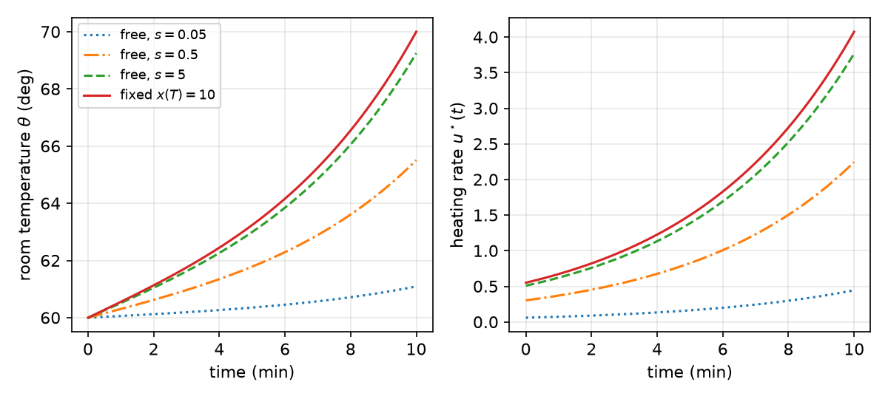
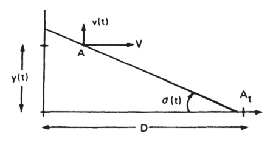
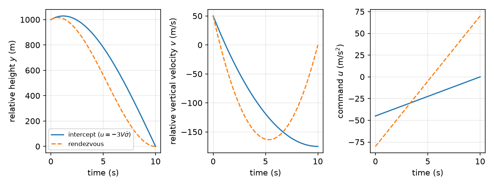
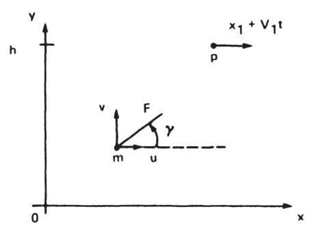
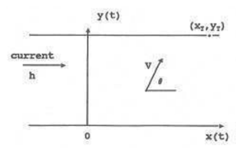
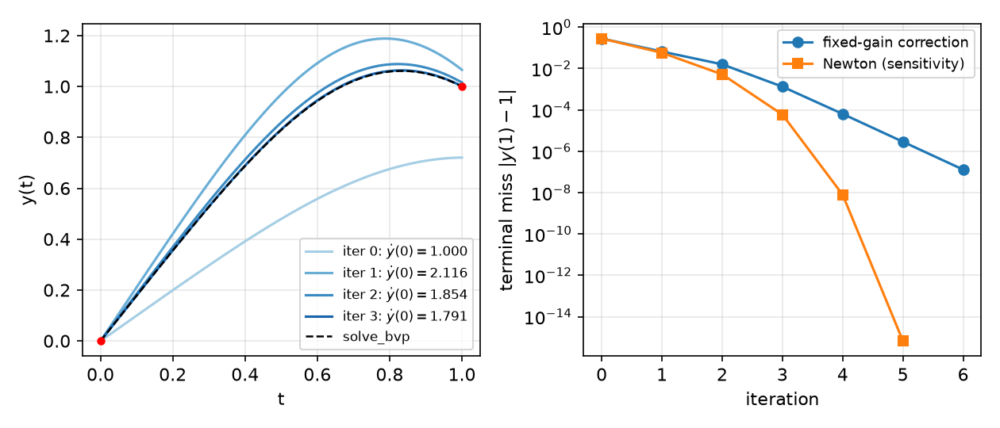
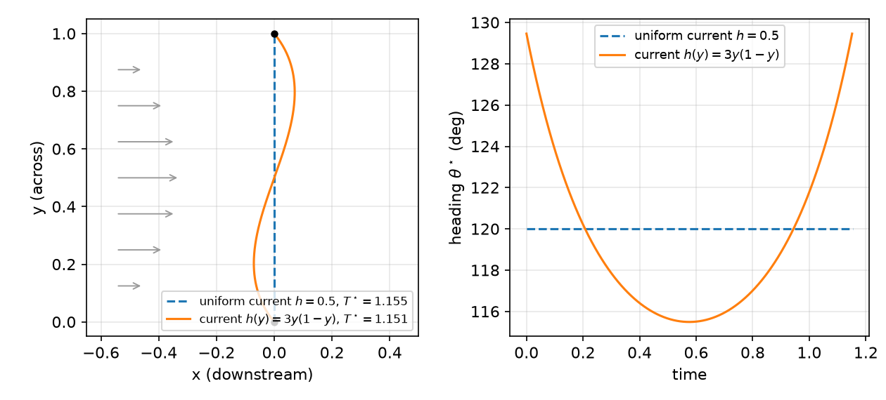

# Continuous-Time Optimal Control and Two-Point Boundary-Value Problems

This chapter solves the general optimal-control problem for a plant described by ordinary differential equations: minimize a terminal cost plus an integral cost, subject to \\(\dot x = f(x,u,t)\\), possibly with terminal constraints and a free final time. The tools are those of the [Calculus of Variations](calculus-of-variations.md), with the dynamics adjoined by a costate \\(\lambda(t)\\); the result is a set of necessary conditions that couples a forward state equation with a backward costate equation, a **two-point boundary-value problem (TPBVP)**. It is the continuous-time counterpart of the discrete conditions in [Discrete-Time Optimal Control](discrete-optimal-control.md). Analytic examples (temperature control, missile intercept, thrust-angle programming, a river crossing) show how the boundary conditions are used, and the last part of the chapter shows how to solve TPBVPs numerically by shooting and collocation. Bounded controls, which call for the minimum principle rather than \\(\partial H/\partial u = 0\\), are treated in [Pontryagin's Minimum Principle](pontryagin.md).

## The General Problem

The plant is
\\[
\dot x = f(x, u, t), \qquad x(t\_0) = x\_0, \qquad x \in \mathbb{R}^n,\ u \in \mathbb{R}^m ,
\\]
and the performance index on \\([t\_0, T]\\) is
\\[
J(t\_0) = \phi\big(x(T), T\big) + \int\_{t\_0}^{T} L\big(x(t), u(t), t\big)\\, dt ,
\\]
subject, possibly, to a terminal constraint
\\[
\psi\big(x(T), T\big) = 0, \qquad \psi \in \mathbb{R}^p .
\\]
The final time \\(T\\) may be fixed or free. \\(f\\), \\(L\\), \\(\phi\\), \\(\psi\\) are assumed continuously differentiable.

**Common choices of \\(L\\).** \\(L = 1\\) gives the **minimum-time** problem (\\(J = T - t\_0\\)). \\(L = u^T R u\\) penalizes control effort only; it is the **minimum-energy** (sometimes loosely called minimum-fuel) index. \\(L = x^T Q x + u^T R u\\) is the **quadratic regulator** index. A true fuel index, \\(L = \lvert u \rvert\\), is not differentiable at zero and is handled with the minimum principle.

**Terminal cost versus terminal constraint.** \\(\phi\\) and \\(\psi\\) play different roles. \\(\phi\\) is a function of the final state that we want *small*; it is traded off against the integral cost. \\(\psi\\) is a function of the final state that we want *exactly zero*; it is a hard requirement. Each is enforced through its own boundary condition below.

## Variations and Increments

When the final time is free, two different increments of the final state must be distinguished. If \\(x(t)\\) is perturbed to a nearby trajectory and the final time to \\(T + dT\\), then

- the **variation** \\(\delta x(t)\\) is the change in \\(x\\) at a *fixed* time \\(t\\);
- the **differential** \\(dx(T)\\) is the total change in the final state, which also includes the change due to stopping at a different time.

To first order,
\\[
dx(T) = \delta x(T) + \dot x(T)\\, dT .
\\]
\\(dx(T)\\) and \\(dT\\) are independent increments; \\(\delta x(T)\\) is not independent of them. Increments of integrals with variable upper limit follow **Leibniz's rule**:
\\[
d \int\_{t\_0}^{T} g(x, \dot x, t)\\, dt = g\big\|\_{T}\\, dT - g\big\|\_{t\_0}\\, dt\_0 + \int\_{t\_0}^{T} \big( g\_x^T \delta x + g\_{\dot x}^T \delta \dot x \big)\\, dt .
\\]

## Derivation of the Necessary Conditions

### The augmented cost and the Hamiltonian

Adjoin the terminal constraint with a constant multiplier \\(\nu \in \mathbb{R}^p\\) and the dynamics with a time-varying multiplier, the **costate** \\(\lambda(t) \in \mathbb{R}^n\\):
\\[
J\_{\rm aug} = \phi\big(x(T),T\big) + \nu^T \psi\big(x(T),T\big) + \int\_{t\_0}^{T} \Big[ L(x,u,t) + \lambda^T \big( f(x,u,t) - \dot x \big) \Big] dt .
\\]
Define the **Hamiltonian**
\\[
H(x, u, \lambda, t) = L(x, u, t) + \lambda^T f(x, u, t),
\\]
so that \\(J\_{\rm aug} = \phi + \nu^T \psi + \int\_{t\_0}^{T} \big[ H - \lambda^T \dot x \big] dt\\).

### The first variation

Take the increment of \\(J\_{\rm aug}\\) due to increments in \\(x\\), \\(u\\), \\(\lambda\\), \\(\nu\\) and the end times, using Leibniz's rule:
\\[
\begin{aligned}
dJ\_{\rm aug} ={}& (\phi\_x + \psi\_x^T \nu)^T dx\big\|\_T + (\phi\_t + \psi\_t^T \nu)\\, dt\big\|\_T + \psi^T\big\|\_T\\, d\nu \\\\
&+ (H - \lambda^T \dot x)\\, dt\big\|\_T - (H - \lambda^T \dot x)\\, dt\big\|\_{t\_0} \\\\
&+ \int\_{t\_0}^{T} \Big[ H\_x^T \delta x + H\_u^T \delta u - \lambda^T \delta \dot x + (H\_\lambda - \dot x)^T \delta \lambda \Big] dt .
\end{aligned}
\\]
The term in \\(\delta \dot x\\) is not independent of \\(\delta x\\); remove it by integrating by parts:
\\[
-\int\_{t\_0}^{T} \lambda^T \delta \dot x\\, dt = -\lambda^T \delta x\big\|\_T + \lambda^T \delta x\big\|\_{t\_0} + \int\_{t\_0}^{T} \dot\lambda^T \delta x\\, dt .
\\]
Finally express \\(\delta x\\) at the ends through the independent differentials, \\(\delta x(T) = dx(T) - \dot x(T)\\, dT\\) (and likewise at \\(t\_0\\)). The terms \\(-\lambda^T \dot x\\, dT\\) and \\(+\lambda^T \dot x\\, dT\\) cancel, and
\\[
\begin{aligned}
dJ\_{\rm aug} ={}& (\phi\_x + \psi\_x^T \nu - \lambda)^T dx\big\|\_T + (\phi\_t + \psi\_t^T \nu + H)\\, dt\big\|\_T + \psi^T\big\|\_T\\, d\nu \\\\
&- H\\, dt\big\|\_{t\_0} + \lambda^T dx\big\|\_{t\_0} + \int\_{t\_0}^{T} \Big[ (H\_x + \dot \lambda)^T \delta x + H\_u^T \delta u + (H\_\lambda - \dot x)^T \delta \lambda \Big] dt .
\end{aligned}
\\]
At a constrained minimum this first variation vanishes for every admissible increment. The multipliers have been introduced precisely so that \\(\delta x(t)\\), \\(\delta u(t)\\), \\(\delta\lambda(t)\\) and \\(d\nu\\) can be treated as independent; hence each coefficient must vanish. With the initial time and state given, \\(dt\_0 = 0\\) and \\(dx(t\_0) = 0\\).

### The necessary conditions

**Theorem (Necessary conditions for continuous-time optimal control).** Suppose \\(u^\star(t)\\) is an unconstrained (interior) optimal control for the problem above, with \\(t\_0\\) and \\(x(t\_0)\\) given. Then there exist a costate \\(\lambda(t)\\) and a constant \\(\nu \in \mathbb{R}^p\\) such that:

| Condition | Equation |
|---|---|
| Hamiltonian | \\(H = L + \lambda^T f\\) |
| State equation | \\(\dot x = \dfrac{\partial H}{\partial \lambda} = f(x,u,t), \quad t \ge t\_0\\) |
| Costate equation | \\(-\dot \lambda = \dfrac{\partial H}{\partial x} = \Big(\dfrac{\partial f}{\partial x}\Big)^T \lambda + \dfrac{\partial L}{\partial x}, \quad t \le T\\) |
| Stationarity | \\(0 = \dfrac{\partial H}{\partial u} = \dfrac{\partial L}{\partial u} + \Big(\dfrac{\partial f}{\partial u}\Big)^T \lambda\\) |
| Terminal constraint | \\(\psi\big(x(T), T\big) = 0\\) |
| Transversality | \\((\phi\_x + \psi\_x^T \nu - \lambda)^T\big\|\_T\\, dx(T) + (\phi\_t + \psi\_t^T \nu + H)\big\|\_T\\, dT = 0\\) |

As in discrete time, the state equation runs forward from \\(x(t\_0)\\) and the costate equation backward from a condition at \\(T\\): the sign in \\(-\dot\lambda = H\_x\\) is natural when the costate is integrated in reverse time. Together they form a TPBVP. A second-order necessary condition for a minimum is \\(H\_{uu} \succeq 0\\) along the trajectory (the Legendre–Clebsch condition); \\(H\_{uu} \succ 0\\) together with a Riccati-type condition gives sufficiency for a local minimum.

### Boundary conditions in the common cases

The transversality condition must hold for all *admissible* \\(dx(T)\\) and \\(dT\\). The common cases (no \\(\psi\\) unless stated):

| Final time | Final state | Conditions at \\(T\\) |
|---|---|---|
| fixed (\\(dT = 0\\)) | fixed (\\(dx(T) = 0\\)) | \\(x(T) = x\_T\\) given |
| fixed | free | \\(\lambda(T) = \phi\_x\big(x(T),T\big)\\) |
| free | fixed | \\(x(T) = x\_T\\) and \\(H(T) + \phi\_t(T) = 0\\) |
| free | free | \\(\lambda(T) = \phi\_x\\) and \\(H(T) + \phi\_t(T) = 0\\) |
| fixed | on \\(\psi = 0\\) | \\(\psi = 0\\) and \\(\lambda(T) = \phi\_x + \psi\_x^T \nu\\) |
| free | on \\(\psi = 0\\) | \\(\psi = 0\\), \\(\lambda(T) = \phi\_x + \psi\_x^T \nu\\), and \\(\phi\_t + \psi\_t^T \nu + H = 0\\) at \\(T\\) |

In every case there are exactly as many conditions as unknowns: \\(2n\\) for the state–costate pair, plus \\(p\\) for \\(\nu\\), plus one for \\(T\\) when it is free.

**The Hamiltonian along an optimal trajectory.** Differentiating along a solution,
\\[
\frac{dH}{dt} = H\_t + H\_x^T \dot x + H\_u^T \dot u + H\_\lambda^T \dot \lambda = H\_t + H\_x^T f + 0 - f^T H\_x = H\_t ,
\\]
using the state and costate equations and stationarity. So for a time-invariant problem (\\(f\\), \\(L\\) independent of \\(t\\)), **\\(H\\) is constant** along the optimal trajectory. If, in addition, the final time is free and \\(\phi\\), \\(\psi\\) do not depend on \\(t\\), then \\(H \equiv 0\\). This is the key extra equation in minimum-time problems.

**Example (Euler–Lagrange equations).** Mechanics is a special case. Let \\(q\\) be generalized coordinates and treat the generalized velocity as the control: \\(\dot q = u\\). Take \\(J = \int\_0^T L(q, u)\\, dt\\) with the Lagrangian \\(L = \mathcal{T}(q,u) - \mathcal{U}(q)\\) (kinetic minus potential energy). Then \\(H = L + \lambda^T u\\), and the necessary conditions give
\\[
-\dot\lambda = \frac{\partial L}{\partial q}, \qquad 0 = \frac{\partial L}{\partial u} + \lambda .
\\]
Eliminating \\(\lambda = -\partial L/\partial \dot q\\),
\\[
\frac{\partial L}{\partial q} - \frac{d}{dt} \frac{\partial L}{\partial \dot q} = 0 ,
\\]
the Euler–Lagrange equation. Hamilton's principle (the motion makes the action stationary) is thus an optimal-control problem, and the state–costate equations \\(\dot q = \partial H/\partial\lambda\\), \\(-\dot \lambda = \partial H/\partial q\\) are the equations of motion in Hamiltonian form. This is the origin of the name "Hamiltonian".

## Example: Temperature Control of a Room

**Example 1 (Minimum-energy heating).** A room at temperature \\(\theta\\) loses heat to the ambient \\(\theta\_a\\) and is heated at rate \\(u\\):
\\[
\dot\theta = -a(\theta - \theta\_a) + b u, \qquad a, b > 0 .
\\]
With \\(x = \theta - \theta\_a\\), \\(\dot x = -a x + b u\\). We want to warm the room using as little energy as possible over a fixed interval: \\(J = \tfrac12 \int\_0^T u^2\\, dt\\).

*Necessary conditions.* \\(H = \tfrac12 u^2 + \lambda(-a x + b u)\\), so
\\[
\dot x = -a x + b u, \qquad \dot\lambda = -H\_x = a\lambda, \qquad 0 = H\_u = u + b\lambda \;\Rightarrow\; u = -b\lambda .
\\]
The costate equation is decoupled: \\(\lambda(t) = e^{-a(T-t)} \lambda(T)\\). Then \\(\dot x = -a x - b^2 e^{-a(T-t)} \lambda(T)\\). A particular solution is \\(C e^{at}\\) with \\(2aC = -b^2 e^{-aT}\lambda(T)\\); adding the homogeneous solution to match \\(x(0)\\),
\\[
x(t) = x(0) e^{-at} - \frac{b^2}{a} e^{-aT} \lambda(T) \sinh at ,
\qquad
x(T) = x(0) e^{-aT} - \frac{b^2}{2a}\big(1 - e^{-2aT}\big) \lambda(T).
\\]
The remaining unknown \\(\lambda(T)\\) is set by the terminal boundary condition.

**(a) Fixed final state.** Let \\(\theta\_a = 60°\\) and \\(\theta(0) = 60°\\), so \\(x(0) = 0\\), and require exactly \\(\theta(T) = 70°\\), i.e. \\(x(T) = 10\\), with \\(T\\) fixed (\\(dT = 0\\), \\(dx(T) = 0\\)). Then
\\[
\lambda(T) = -\frac{20 a}{b^2 (1 - e^{-2aT})}, \qquad
\lambda(t) = -\frac{10 a\\, e^{at}}{b^2 \sinh aT}, \qquad
u^\star(t) = \frac{10 a\\, e^{at}}{b \sinh aT}, \qquad
x^\star(t) = 10 \frac{\sinh at}{\sinh aT}.
\\]
(Since \\(\lambda(T) < 0\\), the control \\(u = -b\lambda\\) is positive: the room is heated.) The heating rate grows exponentially toward the end: heat added early leaks away to the ambient, so it is cheaper to add it late.

**(b) Free final state.** Replace the hard requirement by a penalty, \\(J = \tfrac{s}{2} \big(x(T) - 10\big)^2 + \tfrac12 \int\_0^T u^2\\, dt\\), with \\(T\\) fixed and \\(dx(T)\\) free. Transversality gives
\\[
\lambda(T) = \frac{\partial\phi}{\partial x}\Big\|\_T = s\big(x(T) - 10\big) .
\\]
Combining with the expression for \\(x(T)\\) (with \\(x(0) = 0\\)):
\\[
\lambda(T) = \frac{-20 a s}{2a + b^2 s (1 - e^{-2aT})}, \qquad
\lambda(t) = \frac{-10 a s\\, e^{at}}{a e^{aT} + s b^2 \sinh aT},
\\]
\\[
u^\star(t) = \frac{10 a b s\\, e^{at}}{a e^{aT} + s b^2 \sinh aT}, \qquad
x^\star(t) = \frac{10 s b^2 \sinh at}{a e^{aT} + s b^2 \sinh aT}.
\\]
Dividing numerator and denominator by \\(s\\) and letting \\(s \to \infty\\) recovers the fixed-final-state solution. For finite \\(s\\) the room falls short of \\(70°\\); \\(s\\) prices the shortfall against the energy.



*Figure: minimum-energy heating with illustrative values a = 0.2 /min, b = 1, T = 10 min. The fixed-final-state solution (solid) reaches exactly 70°; with a terminal penalty s = 5, 0.5, 0.05 the final temperature is 69.2°, 65.5° and 61.1°. All heating profiles grow like e^{at}.*

## Example: Intercept and Rendezvous

**Example 2 (Intercept and rendezvous).** A pursuer \\(A\\) approaches a target \\(A\_t\\) at rest. Let \\(y(t)\\) and \\(v(t)\\) be the vertical position and velocity of \\(A\\) relative to the target. The horizontal closing speed \\(V\\) is constant and the initial horizontal range is \\(D\\), so the encounter time is fixed: \\(T = t\_0 + D/V\\). The line-of-sight angle is \\(\sigma(t)\\).



*Figure: intercept geometry (after Lewis, Vrabie and Syrmos). The pursuer closes horizontally at constant speed V, so the time of closest approach is fixed; the vertical miss y(T) is controlled by the vertical acceleration u.*

The vertical motion is a double integrator, \\(\dot y = v\\), \\(\dot v = u\\), and the cost
\\[
J(t\_0) = \frac{s\_y}{2} y^2(T) + \frac{s\_v}{2} v^2(T) + \frac12 \int\_{t\_0}^{T} u^2\\, dt
\\]
trades miss distance and terminal relative velocity against control effort. **Intercept** means \\(s\_v = 0\\) and \\(s\_y\\) large (hit the target, at any relative velocity). **Rendezvous** means both large (arrive with zero relative position and velocity).

*Necessary conditions.* \\(H = \tfrac12 u^2 + \lambda\_y v + \lambda\_v u\\), so
\\[
\dot\lambda\_y = -H\_y = 0, \qquad \dot\lambda\_v = -H\_v = -\lambda\_y, \qquad u = -\lambda\_v .
\\]
The final time is fixed and the final state free, so \\(\lambda\_y(T) = s\_y y(T)\\), \\(\lambda\_v(T) = s\_v v(T)\\). Integrating the costates backward, \\(\lambda\_y(t) \equiv \lambda\_y(T) =: \lambda\_y\\) and \\(\lambda\_v(t) = \lambda\_v(T) + (T - t)\lambda\_y\\); the optimal acceleration is therefore linear in time. Integrating the state forward (take \\(t\_0 = 0\\)):
\\[
v(t) = v(0) - t\big(\lambda\_v(T) + T\lambda\_y\big) + \frac{t^2}{2}\lambda\_y, \qquad
y(t) = y(0) + t\\, v(0) - \frac{t^2}{2}\big(\lambda\_v(T) + T\lambda\_y\big) + \frac{t^3}{6}\lambda\_y .
\\]
*Terminal conditions.* Substituting \\(t = T\\) into \\(\lambda\_y = s\_y y(T)\\) and \\(\lambda\_v(T) = s\_v v(T)\\) gives two linear equations,
\\[
\begin{bmatrix} 1 + s\_y \frac{T^3}{3} & s\_y \frac{T^2}{2} \\\\ s\_v \frac{T^2}{2} & 1 + s\_v T \end{bmatrix}
\begin{bmatrix} \lambda\_y(T) \\\\ \lambda\_v(T) \end{bmatrix} =
\begin{bmatrix} s\_y & s\_y T \\\\ 0 & s\_v \end{bmatrix}
\begin{bmatrix} y(0) \\\\ v(0) \end{bmatrix}.
\\]
With \\(\bar s\_y = 1/s\_y\\), \\(\bar s\_v = 1/s\_v\\) and \\(\Delta(T) = (\bar s\_y + \tfrac{T^3}{3})(\bar s\_v + T) - \tfrac{T^4}{4}\\), the solution is
\\[
\begin{bmatrix} \lambda\_y(T) \\\\ \lambda\_v(T) \end{bmatrix}
= \frac{1}{\Delta(T)}
\begin{bmatrix} \bar s\_v + T & T(\bar s\_v + \frac{T}{2}) \\\\ -\frac{T^2}{2} & \bar s\_y - \frac{T^3}{6} \end{bmatrix}
\begin{bmatrix} y(0) \\\\ v(0) \end{bmatrix}.
\\]
*From open loop to feedback.* Nothing in this derivation depends on the initial time being zero. Treating the *current* time \\(t\\) as the initial time and replacing \\(T\\) by the **time-to-go** \\(T - t\\) therefore gives the optimal control as a function of the current state. With \\(u(t) = -\lambda\_v(t) = -\big[(T-t)\lambda\_y + \lambda\_v(T)\big]\\),
\\[
u(t) = -\frac{(T-t)\bar s\_v + \frac{(T-t)^2}{2}}{\Delta(T-t)}\\, y(t) - \frac{(T-t)^2 \bar s\_v + \bar s\_y + \frac{(T-t)^3}{3}}{\Delta(T-t)}\\, v(t) .
\\]
This is a time-varying linear state feedback, exactly as in the free-final-state LQR.

**Intercept.** Let \\(s\_v = 0\\) (\\(\bar s\_v \to \infty\\)) and \\(s\_y \to \infty\\) (\\(\bar s\_y \to 0\\)). Then \\(\Delta \approx \bar s\_v (T-t)^3/3\\) and
\\[
u = -\frac{3}{(T-t)^2}\\, y(t) - \frac{3}{T-t}\\, v(t) .
\\]
For small angles the line-of-sight angle is \\(\sigma = y/\big((T-t)V\big)\\), whose rate is
\\[
\dot\sigma = \frac{\dot y}{(T-t)V} + \frac{y}{(T-t)^2 V} .
\\]
Comparing,
\\[
\boxed{u = -3V\dot\sigma .}
\\]
This is **proportional navigation** with navigation constant 3: command an acceleration proportional to the rotation rate of the line of sight. Pilots know the rule geometrically: on a collision course the bearing to the target stays constant, so to intercept one only needs to null the line-of-sight drift.

**Rendezvous.** Letting both \\(s\_y, s\_v \to \infty\\) (\\(\bar s\_y, \bar s\_v \to 0\\)) gives \\(\Delta = (T-t)^4/12\\) and
\\[
u = -\frac{6}{(T-t)^2}\\, y(t) - \frac{4}{T-t}\\, v(t) .
\\]
Both gains grow without bound as \\(t \to T\\), which in practice means the law is switched off shortly before the encounter.



*Figure: simulated intercept and rendezvous from y(0) = 1000 m, v(0) = 50 m/s, T = 10 s. The intercept command is linear in time and ends at zero with a nonzero closing velocity; the rendezvous law also nulls the velocity, at the price of larger acceleration of both signs.*

## Example: Thrust-Angle Programming

**Example 3 (Thrust-angle programming).** A particle of mass \\(m\\) is driven by a thrust of constant magnitude \\(F\\) whose direction \\(\gamma(t)\\) is the control. With position \\((x, y)\\), velocity \\((u, v)\\) and \\(a = F/m\\):
\\[
\dot x = u, \qquad \dot y = v, \qquad \dot u = a\cos\gamma, \qquad \dot v = a\sin\gamma .
\\]
(Here \\(u\\) is a state, the horizontal velocity; the control is \\(\gamma\\).)



*Figure: thrust-angle programming (after Lewis, Vrabie and Syrmos). Only the direction γ of a constant thrust is controlled; the target P moves horizontally at height h.*

*Bilinear tangent law.* For a terminal cost \\(J = \phi(X(T), T)\\) with \\(X = (x, y, u, v)\\),
\\[
H = \lambda\_x u + \lambda\_y v + \lambda\_u a\cos\gamma + \lambda\_v a\sin\gamma .
\\]
The costate equations are \\(\dot\lambda\_x = 0\\), \\(\dot\lambda\_y = 0\\), \\(\dot\lambda\_u = -\lambda\_x\\), \\(\dot\lambda\_v = -\lambda\_y\\), and stationarity gives
\\[
H\_\gamma = -\lambda\_u a\sin\gamma + \lambda\_v a\cos\gamma = 0 \quad\Longrightarrow\quad \tan\gamma = \frac{\lambda\_v}{\lambda\_u} .
\\]
(Of the two directions satisfying this, the minimizing one points the thrust opposite to \\((\lambda\_u, \lambda\_v)\\), since \\(H\_{\gamma\gamma} = -a(\lambda\_u\cos\gamma + \lambda\_v\sin\gamma)\\) must be nonnegative.) The costates are constant or linear in time: \\(\lambda\_x, \lambda\_y\\) constant, \\(\lambda\_u(t) = \lambda\_u(T) + (T - t)\lambda\_x\\), \\(\lambda\_v(t) = \lambda\_v(T) + (T - t)\lambda\_y\\). Hence
\\[
\tan\gamma(t) = \frac{\lambda\_v(T) + (T - t)\lambda\_y}{\lambda\_u(T) + (T - t)\lambda\_x},
\\]
the **bilinear tangent law**: the tangent of the optimal thrust angle is a ratio of two linear functions of time. It is the classical guidance law for rocket ascent in a flat-Earth, constant-gravity model.

*Minimum-time intercept.* Let the target \\(P\\) start at horizontal position \\(x\_1\\), move with constant horizontal speed \\(V\_1\\), and stay at height \\(h\\). The particle starts from rest at the origin. Minimize \\(J = T\\) (i.e. \\(L = 1\\)), so \\(H = 1 + \lambda\_x u + \lambda\_y v + \lambda\_u a\cos\gamma + \lambda\_v a\sin\gamma\\), subject to the terminal constraint
\\[
\psi\big(X(T), T\big) = \begin{bmatrix} x(T) - x\_1 - V\_1 T \\\\ y(T) - h \end{bmatrix} = 0 .
\\]
The final time is free and the final state lies on \\(\psi = 0\\), with \\(\phi = 0\\). Transversality, \\(\lambda(T) = \psi\_x^T \nu\\) and \\((\psi\_t^T \nu + H)\big\|\_T = 0\\), gives
\\[
\lambda\_x(T) = \nu\_x, \quad \lambda\_y(T) = \nu\_y, \quad \lambda\_u(T) = 0, \quad \lambda\_v(T) = 0, \qquad 1 + \nu\_x u(T) + \nu\_y v(T) - V\_1 \nu\_x = 0 .
\\]
The terminal velocity is free, so its costates vanish at \\(T\\), and
\\[
\lambda\_u(t) = (T - t)\nu\_x, \qquad \lambda\_v(t) = (T - t)\nu\_y, \qquad \tan\gamma = \frac{\nu\_y}{\nu\_x} = \text{constant}.
\\]
The optimal thrust direction is **constant**. Starting from rest, \\(u = a t\cos\gamma\\), \\(v = a t\sin\gamma\\), \\(x = \tfrac12 a t^2 \cos\gamma\\), \\(y = \tfrac12 a t^2 \sin\gamma\\). At \\(t = T\\) the terminal constraint gives
\\[
\sin\gamma = \frac{2h}{a T^2}, \qquad \cos\gamma = \frac{2(x\_1 + V\_1 T)}{a T^2}, \qquad \tan\gamma = \frac{h}{x\_1 + V\_1 T},
\\]
and \\(\sin^2\gamma + \cos^2\gamma = 1\\) yields the quartic for the minimum time,
\\[
a^2 T^4 = 4h^2 + 4(x\_1 + V\_1 T)^2 .
\\]
Its smallest positive root is \\(T^\star\\); the thrust then points straight at the target's position at time \\(T^\star\\). The remaining transversality equation determines the scale of \\(\nu\\), which is otherwise irrelevant to the control.

## Example: Minimum-Time River Crossing (Zermelo's Problem)

**Example 4 (Boat crossing a current).** A boat moving at constant speed \\(V\\) relative to the water steers with heading \\(\theta\\) across a stream whose current \\(h\\) flows in the \\(+x\\) direction. It must go from the origin to the point \\((x\_T, y\_T)\\) on the opposite bank in minimum time.



*Figure: minimum-time crossing of a stream with current h (Zermelo's navigation problem). The boat's own speed V is fixed; only its heading θ is chosen.*

\\[
\dot x = V\cos\theta + h, \qquad \dot y = V\sin\theta, \qquad J = \int\_0^T 1\\, dt = T .
\\]
*Necessary conditions.* \\(H = 1 + \lambda\_x (V\cos\theta + h) + \lambda\_y V\sin\theta\\). For a uniform current \\(H\\) does not depend on \\(x\\) or \\(y\\), so \\(-\dot\lambda\_x = 0\\) and \\(-\dot\lambda\_y = 0\\): both costates are constant. Stationarity,
\\[
H\_\theta = -\lambda\_x V\sin\theta + \lambda\_y V\cos\theta = 0 \quad\Longrightarrow\quad \tan\theta = \frac{\lambda\_y}{\lambda\_x},
\\]
then says that **the heading is constant**, and the path is a straight line. (The free final time adds \\(H(T) = 0\\), hence \\(H \equiv 0\\), which fixes the magnitude of \\((\lambda\_x, \lambda\_y)\\) but not the heading.)

*Solving for the heading and time.* With constant \\(\theta\\), \\(x = (V\cos\theta + h)t\\) and \\(y = (V\sin\theta)t\\). At \\(T\\):
\\[
\sin\theta = \frac{y\_T}{VT}, \qquad \cos\theta = \frac{x\_T - hT}{VT}, \qquad \tan\theta = \frac{y\_T}{x\_T - hT} .
\\]
\\(\sin^2\theta + \cos^2\theta = 1\\) gives \\((x\_T - hT)^2 + y\_T^2 = V^2 T^2\\), i.e.
\\[
(h^2 - V^2) T^2 - 2 x\_T h T + (x\_T^2 + y\_T^2) = 0, \qquad
T = \frac{x\_T h \pm \sqrt{V^2 (x\_T^2 + y\_T^2) - h^2 y\_T^2}}{h^2 - V^2} .
\\]
When the boat is faster than the current (\\(V > h\\)), the product of the roots, \\((x\_T^2 + y\_T^2)/(h^2 - V^2)\\), is negative, so exactly one root is positive:
\\[
T^\star = \frac{\sqrt{V^2 (x\_T^2 + y\_T^2) - h^2 y\_T^2} - x\_T h}{V^2 - h^2} .
\\]
Check: with no current (\\(h = 0\\)), \\(T^\star = \sqrt{x\_T^2 + y\_T^2}/V\\), the straight-line distance divided by the speed. For example, to cross a unit-width stream to the point directly opposite (\\(x\_T = 0\\), \\(y\_T = 1\\)) with \\(V = 1\\), \\(h = 0.5\\): \\(T^\star = \sqrt{0.75}/0.75 = 2/\sqrt3 \approx 1.155\\) and \\(\cos\theta = -hT^\star/(VT^\star) = -0.5\\), so \\(\theta = 120°\\): the boat points 30° upstream for the whole crossing. A current that varies across the stream makes the heading vary too; that case has no closed form and is solved numerically below.

## Numerical Solution of the Two-Point Boundary-Value Problem

The examples above were solvable by hand because the costate equations decoupled from the state. In general they do not, and the TPBVP must be solved numerically.

### Structure of the problem

Consider a nonlinear plant with a quadratic cost toward a target \\(r(T)\\),
\\[
J(t\_0) = \tfrac12 \big(x(T) - r(T)\big)^T S(T) \big(x(T) - r(T)\big) + \tfrac12 \int\_{t\_0}^{T} (x^T Q x + u^T R u)\\, dt, \qquad S(T) \succeq 0,\ Q \succeq 0,\ R \succ 0 .
\\]
Stationarity gives \\(u = -R^{-1} f\_u^T \lambda\\), and the closed-loop Hamiltonian system is
\\[
\dot x = f\big(x, -R^{-1} f\_u^T \lambda, t\big), \qquad -\dot\lambda = f\_x^T \lambda + Q x .
\\]
The boundary data are \\(n\\) initial conditions \\(x(t\_0) = x\_0\\); \\(p\\) terminal constraints \\(\psi(x(T), T) = 0\\); and the remaining \\(n - p\\) conditions from \\(\lambda(T) = S(T)\big(x(T) - r(T)\big) + \psi\_x^T \nu\big\|\_T\\). Half the conditions are at each end, so no single integration of the ODEs can be started with complete data.

### Shooting

Shooting turns the boundary-value problem into a root-finding problem. Guess the missing initial data, integrate as an initial-value problem, measure how badly the terminal conditions are missed, and correct the guess.

**Algorithm 1 (Shooting on the initial costate).**

1. Guess the \\(n\\) unknown initial costates \\(\lambda(t\_0)\\).
2. Integrate the Hamiltonian system forward from \\(\big(x(t\_0), \lambda(t\_0)\big)\\) to \\(T\\).
3. Evaluate the terminal residual: \\(\psi\big(x(T), T\big)\\) and \\(\lambda(T) - S(T)\big(x(T) - r(T)\big) - \psi\_x^T \nu\\) (choosing \\(\nu\\) to make the second part as small as possible).
4. If the residual is small enough, stop.
5. Otherwise compute the **sensitivity matrix** of the final state–costate \\(\mu(T) = \big(x(T), \lambda(T)\big)\\) with respect to the guess,
\\[
\delta\mu(T) = \begin{bmatrix} \delta x(T) \\\\ \delta\lambda(T) \end{bmatrix} = \frac{\partial \mu(T)}{\partial \lambda(t\_0)}\\, \delta\lambda(t\_0),
\\]
   determine the change \\(\delta\mu(T)\\) needed to cancel the residual, solve for \\(\delta\lambda(t\_0)\\) (a Newton step), update the guess, and return to step 2.

The sensitivity matrix can be obtained by finite differences (\\(n\\) extra integrations) or, more accurately, by integrating the **variational equations** alongside the trajectory. Writing the Hamiltonian system as \\(\dot z = F(z, t)\\) with \\(z = (x, \lambda)\\), the matrix \\(\Phi(t) = \partial z(t)/\partial \lambda(t\_0)\\) satisfies
\\[
\dot\Phi = \frac{\partial F}{\partial z}\big(z(t), t\big)\\, \Phi, \qquad \Phi(t\_0) = \begin{bmatrix} 0 \\\\ I\_n \end{bmatrix} .
\\]
Shooting is simple and accurate when it converges, but it can be fragile: the costate equations of a stable plant are unstable in forward time (the Hamiltonian system has eigenvalues in mirror pairs \\(\pm s\\)), so on long intervals small changes in \\(\lambda(t\_0)\\) produce enormous changes in \\(\mu(T)\\). Multiple shooting, which restarts the integration on subintervals and matches the pieces, is the standard remedy.

**Algorithm 2 (Superposition, for linear Hamiltonian systems).** If the Hamiltonian system is linear (e.g. LQR with time-varying matrices), no iteration is needed.

1. Integrate once with \\(x(t\_0) = x\_0\\), \\(\lambda(t\_0) = 0\\); call the solution \\(\big(x\_0(t), \lambda\_0(t)\big)\\).
2. For \\(i = 1, \dots, n\\), integrate with \\(x(t\_0) = 0\\), \\(\lambda(t\_0) = e\_i\\) (the \\(i\\)-th unit vector); call the unit solutions \\(\big(x\_i(t), \lambda\_i(t)\big)\\).
3. By linearity, the solution with \\(\lambda(t\_0) = \sum\_i c\_i e\_i\\) is \\(x(t) = x\_0(t) + \sum\_i c\_i x\_i(t)\\), \\(\lambda(t) = \lambda\_0(t) + \sum\_i c\_i \lambda\_i(t)\\). The terminal conditions are linear in the \\(c\_i\\); solve the resulting \\(n \times n\\) linear system.

**Example 5 (Simple shooting).** Solve \\(\ddot y = -4y^2\\), \\(y(0) = 0\\), \\(y(1) = 1\\). Write \\(z = (y, \dot y)\\); the unknown initial datum is the slope \\(\dot y(0)\\). Start from the slope of the straight line between the boundary values, \\(\dot y(0) = 1\\), and correct by a fixed multiple of the terminal miss,
\\[
\dot y^{(k)}(0) = \dot y^{(k-1)}(0) - 4\big[ y^{(k-1)}(1) - 1 \big] .
\\]

```matlab
% Simple shooting for y'' = f(t,y,y'), y(t0)=a, y(tf)=b
function [T,Y] = bvp2ordshoot(t0,tf,a,b)
c = -4;                         % correction gain
tol = 1e-6;                     % terminal error tolerance
yp = (b-a)/(tf-t0);             % initial guess of dy/dt(t0)
[T,Y] = ode45(@ode2ord,[t0 tf],[a yp]');
res = abs(Y(end,1)-b);
while res > tol
    yp = c*(Y(end,1)-b) + yp;   % correct the initial slope
    [T,Y] = ode45(@ode2ord,[t0 tf],[a yp]');
    res = abs(Y(end,1)-b);
end
end
function dydt = ode2ord(t,y)
dydt = [y(2); -4*y(1)^2];
end
```

The iterates are \\(\dot y(0) = 1,\ 2.116,\ 1.854,\ 1.791, \dots\\) with terminal values \\(y(1) = 0.721,\ 1.066,\ 1.016,\ 1.0013, \dots\\); the miss falls below \\(10^{-6}\\) after six corrections, at \\(\dot y(0) = 1.78524\\). Why does the gain 4 work? Integrating the variational equation \\(\ddot\eta = -8y\\,\eta\\), \\(\eta(0) = 0\\), \\(\dot\eta(0) = 1\\), gives the sensitivity \\(\partial y(1)/\partial \dot y(0) = 0.2387\\) at the solution, so the Newton gain would be \\(1/0.2387 = 4.19\\). The fixed gain 4 is close to it, and the iteration converges linearly with ratio \\(\lvert 1 - 4 \times 0.2387 \rvert \approx 0.045\\). Newton's method, updating the sensitivity at every iterate, converges quadratically (five iterations to machine precision).

```python
import numpy as np
from scipy.integrate import solve_ivp, solve_bvp

def shoot(slope):                          # y(1) and dy(1)/dslope
    rhs = lambda t, z: [z[1], -4*z[0]**2, z[3], -8*z[0]*z[2]]
    s = solve_ivp(rhs, [0, 1], [0, slope, 0, 1], rtol=1e-11, atol=1e-12)
    return s.y[0, -1], s.y[2, -1]

slope = 1.0
for _ in range(20):                        # Newton shooting
    yT, dyT = shoot(slope)
    if abs(yT - 1) < 1e-12: break
    slope -= (yT - 1) / dyT                # -> 1.785238

# collocation: same problem with solve_bvp
t = np.linspace(0, 1, 5)
sol = solve_bvp(lambda t, z: np.vstack([z[1], -4*z[0]**2]),
                lambda za, zb: np.array([za[0], zb[0] - 1]),
                t, np.vstack([t, np.ones_like(t)]))
sol.sol(0)[1]                              # -> 1.785238
```



*Figure: shooting for y'' = -4y², y(0) = 0, y(1) = 1. Left: the first trajectories of the fixed-gain iteration close in on the collocation solution (dashed). Right: the fixed gain converges linearly (about 1.3 decades per iteration) and Newton shooting quadratically.*

### Collocation

Collocation attacks the boundary-value problem directly instead of through initial-value integrations. The interval is divided into a mesh, the solution is represented by a piecewise polynomial, and the polynomial coefficients are chosen so that the boundary conditions hold and the ODE is satisfied exactly at a set of **collocation points** in every subinterval. This turns the TPBVP into a large, sparse system of nonlinear algebraic equations, solved by Newton's method; the mesh is then refined where the residual is large. Because no long forward integration is ever performed, collocation is far less sensitive to the instability of the costate equations than single shooting.

MATLAB's `bvp4c` uses a \\(C^1\\) piecewise cubic satisfying the ODE at both ends and the midpoint of each subinterval (the three-stage Lobatto IIIa formula), which is fourth-order accurate; `scipy.integrate.solve_bvp` implements a fourth-order collocation algorithm with control of the residual. Both need an initial guess for the solution on a coarse mesh, and both accept unknown parameters, which is how a free final time is handled.

**Example 6 (Polynomial collocation by hand).** For \\(\ddot y = t - 2y + \dot y\\), \\(y(0) = 1\\), \\(y(1) = 2\\), the idea can be carried out with a single quintic \\(y(t) = \sum\_{j=0}^{5} c\_j t^j\\). Given a guess of \\(\dot y(0)\\), the six coefficients are fixed by six conditions: \\(y\\), \\(\dot y\\) and the ODE-implied \\(\ddot y\\) at \\(t = 0\\), and \\(y\\), \\(\dot y\\), \\(\ddot y\\) at \\(t = 1\\) (with \\(\dot y(1)\\) from a trial integration). The guess is then corrected until the ODE residual of the polynomial at the midpoint \\(t = 0.5\\) vanishes. The reference solution from collocation has \\(\dot y(0) = 1.6585\\) and \\(y(0.5) = 1.7270\\):

```matlab
solinit = bvpinit(linspace(0,1,5),[1 0]);     % initial guess y=1, dy/dt=0
sol = bvp4c(@(t,y)[y(2); t-2*y(1)+y(2)], @(ya,yb)[ya(1)-1; yb(1)-2], solinit);
t = linspace(0,1);  x = deval(sol,t);          % [y; dy/dt] on a fine grid
```

### Free final time: Zermelo's problem with a variable current

**Example 7 (Zermelo's problem by collocation).** Return to the river crossing of Example 4, but let the current vary across the stream, as it does in a real river: zero at the banks and fastest in the middle,
\\[
h(y) = 3y(1 - y), \qquad 0 \le y \le 1 ,
\\]
which has the same average (0.5) as the uniform current of Example 4. Take \\(V = 1\\) and the target \\((x\_T, y\_T) = (0, 1)\\) directly opposite the start.

*Necessary conditions.* \\(H = 1 + \lambda\_x\big(V\cos\theta + h(y)\big) + \lambda\_y V\sin\theta\\). Now \\(H\\) depends on \\(y\\), so
\\[
\dot\lambda\_x = 0, \qquad \dot\lambda\_y = -\lambda\_x h'(y) .
\\]
Minimizing \\(H\\) over \\(\theta\\) gives the heading opposite to \\((\lambda\_x, \lambda\_y)\\): \\(\cos\theta = -\lambda\_x/\rho\\), \\(\sin\theta = -\lambda\_y/\rho\\), \\(\rho = \sqrt{\lambda\_x^2 + \lambda\_y^2}\\). The final time is free and the problem time-invariant, so \\(H \equiv 0\\), i.e. \\(1 - V\rho + \lambda\_x h(y) = 0\\); imposing it at \\(t = 0\\) is enough.

*Free final time as a parameter.* Rescale time, \\(t = \tau T\\) with \\(\tau \in [0, 1]\\). Then \\(dx/d\tau = T\\,\dot x\\), etc., the interval is fixed, and \\(T\\) becomes an unknown constant parameter, as does \\(\lambda\_x\\). The unknowns are the three functions \\(x, y, \lambda\_y\\) and the two parameters \\(T, \lambda\_x\\); the boundary conditions are \\(x(0) = y(0) = 0\\), \\(x(1) = x\_T\\), \\(y(1) = y\_T\\), and \\(H(0) = 0\\): five conditions for three first-order ODEs plus two parameters, as required.

```python
import numpy as np
from scipy.integrate import solve_bvp
V, xT, yT = 1.0, 0.0, 1.0
h  = lambda y: 3*y*(1 - y)
dh = lambda y: 3*(1 - 2*y)

def rhs(tau, z, p):                 # z = [x, y, lam_y], p = [T, lam_x]
    T, lx = p
    x, y, ly = z
    th = np.arctan2(-ly, -lx)       # heading minimizing H
    return np.vstack([T*(V*np.cos(th) + h(y)), T*V*np.sin(th), -T*lx*dh(y)])

def bc(za, zb, p):
    T, lx = p
    H0 = 1 - V*np.hypot(lx, za[2]) + lx*h(za[1])   # H = 0 at t = 0
    return np.array([za[0], za[1], zb[0] - xT, zb[1] - yT, H0])

tau = np.linspace(0, 1, 30)
guess = np.vstack([np.zeros_like(tau), tau*yT, -np.ones_like(tau)])
sol = solve_bvp(rhs, bc, tau, guess, p=[1.2, 0.5], tol=1e-8)
sol.p                                # T* = 1.1513, lam_x = 0.636
```

*Validation and result.* With the uniform current \\(h = 0.5\\) the same code returns \\(T^\star = 1.15470\\) and a constant heading of \\(120.0°\\), matching the analytic \\(2/\sqrt3\\) of Example 4 to eight digits. With the parabolic current it returns \\(T^\star = 1.1513\\), slightly faster, with a heading that varies from \\(129.5°\\) at the banks to \\(115.5°\\) in midstream. The optimal boat points steeply upstream near the banks, where the current is weak and upstream progress is cheap, gaining ground that the strong midstream current then carries it back across; the path is an S-curve rather than a straight line.



*Figure: minimum-time crossing solved with solve_bvp and a free final time. Dashed: uniform current h = 0.5 (straight path, constant heading 120°, minimum time 1.155). Solid: current 3y(1 − y) (gray arrows), which is zero at the banks; the heading varies between about 115° and 130° and the minimum time is 1.151.*

## Summary

- Problem: \\(\dot x = f(x,u,t)\\), \\(J = \phi(x(T),T) + \int\_{t\_0}^T L\\,dt\\), \\(\psi(x(T),T) = 0\\). Hamiltonian \\(H = L + \lambda^T f\\).
- Necessary conditions: \\(\dot x = H\_\lambda\\), \\(-\dot\lambda = H\_x\\), \\(H\_u = 0\\), \\(\psi = 0\\), and transversality \\((\phi\_x + \psi\_x^T\nu - \lambda)^T dx(T) + (\phi\_t + \psi\_t^T\nu + H)\\,dT = 0\\) at \\(T\\).
- Free final state: \\(\lambda(T) = \phi\_x\\). Free final time: \\((\phi\_t + \psi\_t^T\nu + H)(T) = 0\\). For time-invariant problems \\(H\\) is constant, and \\(H \equiv 0\\) when \\(T\\) is free.
- \\(dx(T) = \delta x(T) + \dot x(T)\\,dT\\) distinguishes the total change of the final state from the variation at fixed time.
- Temperature control: \\(u^\star = 10 a e^{at}/(b\sinh aT)\\) (fixed final state); the soft-constraint solution tends to it as \\(s \to \infty\\).
- Intercept: \\(u = -3y/(T-t)^2 - 3v/(T-t) = -3V\dot\sigma\\) (proportional navigation); rendezvous: \\(u = -6y/(T-t)^2 - 4v/(T-t)\\).
- Thrust-angle programming: bilinear tangent law \\(\tan\gamma = (c\_1 + c\_2 t)/(c\_3 + c\_4 t)\\); minimum-time intercept from rest has constant \\(\gamma\\) and \\(a^2T^4 = 4h^2 + 4(x\_1 + V\_1T)^2\\).
- Zermelo, uniform current: constant heading, \\(T^\star = \big(\sqrt{V^2(x\_T^2 + y\_T^2) - h^2y\_T^2} - x\_Th\big)/(V^2 - h^2)\\).
- Numerical TPBVP: shooting (guess \\(\lambda(t\_0)\\), integrate, Newton-correct using the sensitivity \\(\partial\mu(T)/\partial\lambda(t\_0)\\)); superposition for linear systems; collocation (`bvp4c`, `solve_bvp`) for robustness. A free final time becomes a parameter after rescaling \\(t = \tau T\\).

## See Also

- [Calculus of Variations](calculus-of-variations.md): first variation, Euler–Lagrange equation, natural boundary conditions.
- [Discrete-Time Optimal Control and LQR](discrete-optimal-control.md): the same conditions in discrete time.
- [Continuous-Time LQR](continuous-lqr.md): the linear-quadratic TPBVP solved by the Riccati equation.
- [Pontryagin's Minimum Principle](pontryagin.md): bounded controls, bang-bang and time-optimal control.
- [Dynamic Programming](dynamic-programming.md): the HJB equation, whose gradient is the costate.
- [Optimization](optimization.md): Lagrange multipliers and Newton's method.
- [Numerical ODEs](../../../math/numerical/odes.md) and [Systems of ODEs](../../../math/diffeq/systems.md)
- [Optimal Control overview](../optimal.md)
- [Robot control](../../../app/robotics/control.md)
