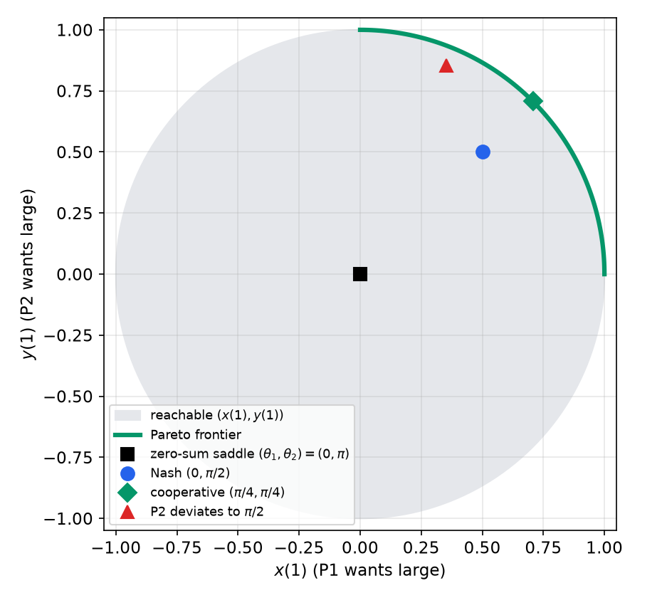
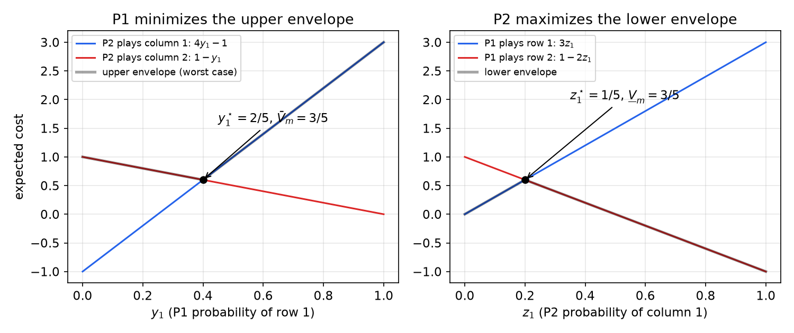
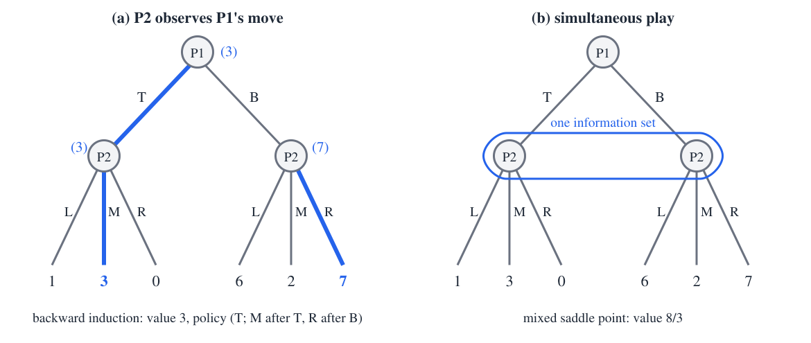
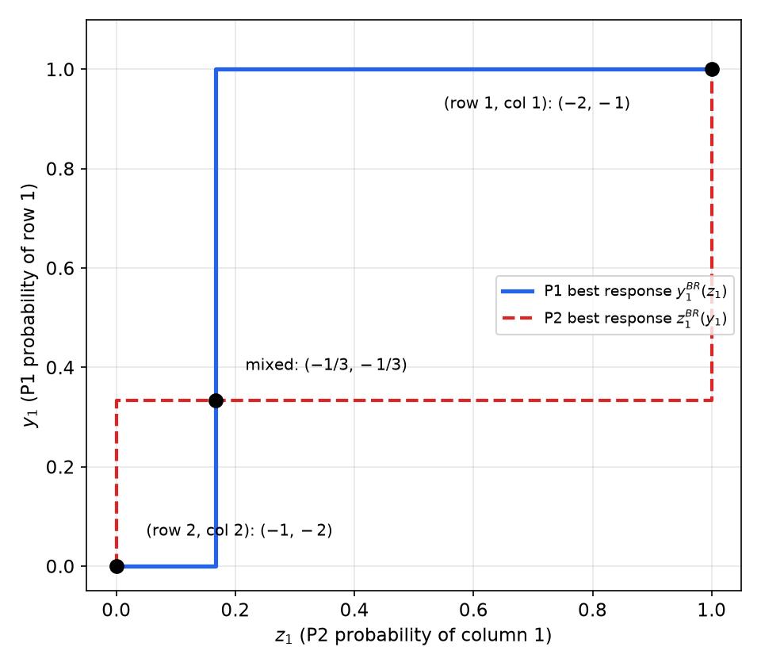
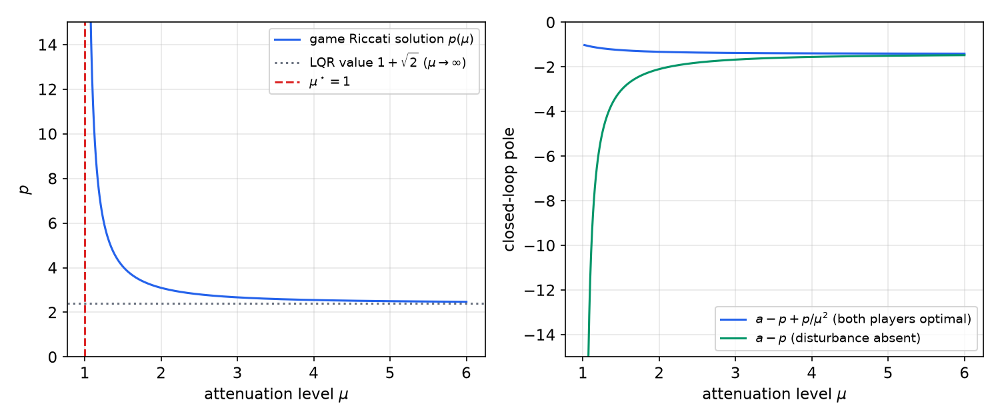
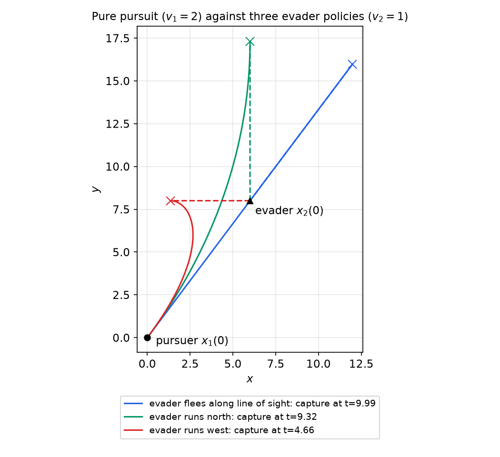

# Dynamic and Differential Games

Optimal control has one decision maker. Many engineering problems have several: a controller and a disturbance, a pursuer and an evader, users sharing a wireless channel, or a designer facing uncertain components. Noncooperative game theory studies such problems, in which each player optimizes its own objective and no player can force or trust the others. This chapter develops the theory from static matrix games to dynamic and differential games. The tools are familiar: security levels and saddle points generalize the minimum, linear programming computes mixed strategies, and dynamic programming becomes the Isaacs equation. For linear dynamics and quadratic costs, the Isaacs equation reduces to a Riccati equation that is the state-feedback \\(H\_\infty\\) controller.

The development follows the standard treatment of Başar and Olsder, *Dynamic Noncooperative Game Theory*. The one-player special case is [Dynamic Programming and the HJB Equation](dynamic-programming.md), and the Riccati machinery is from [Continuous-Time LQR](continuous-lqr.md). Throughout, in zero-sum games player 1 (P1) **minimizes** and player 2 (P2) **maximizes** the same cost; in nonzero-sum games every player minimizes its own cost.

## Elements of a Noncooperative Game

A game is specified by

- the **players**;
- the **rules**: what actions each player may take and when;
- the **information structure**: what each player knows when it acts (chess has full information; poker only partial);
- the **objectives**: the cost each player wants to minimize;
- the **rationality assumptions**: each player pursues its own interest, forms no coalition, and does not trust the others.

The central solution concept is an equilibrium against unilateral deviation.

**Definition (Nash equilibrium, informal).** A pair of policies \\((\pi\_1, \pi\_2)\\) is an equilibrium if (C1) P1 cannot do strictly better by changing its policy while P2 keeps \\(\pi\_2\\), and (C2) P2 cannot do strictly better by changing its policy while P1 keeps \\(\pi\_1\\).

A game may have no equilibrium, exactly one, or many. Changing the rewards, through pricing or taxes, so that selfish play produces a socially good outcome is called **mechanism design**.

**Example 1 (rope pulling: zero-sum, Nash and Pareto).** Two players pull a unit mass, initially at rest at the origin, with unit forces at angles \\(\theta\_1\\) and \\(\theta\_2\\):
\\[
\ddot x = \cos\theta\_1 + \cos\theta\_2, \qquad \ddot y = \sin\theta\_1 + \sin\theta\_2 .
\\]
The accelerations are constant, so after 1 s
\\[
x(1) = \tfrac12(\cos\theta\_1 + \cos\theta\_2), \qquad y(1) = \tfrac12(\sin\theta\_1 + \sin\theta\_2).
\\]

- *Zero-sum.* P1 wants \\(x(1)\\) large and P2 wants it small. P1 pulls along \\(+x\\) (\\(\theta\_1 = 0\\)) and P2 along \\(-x\\) (\\(\theta\_2 = \pi\\)), and the mass does not move. Neither can gain by deviating.
- *Nonzero-sum.* P1 wants \\(x(1)\\) large, P2 wants \\(y(1)\\) large. Since \\(x(1)\\) depends on \\(\theta\_2\\) only through an additive term, P1's best choice is \\(\theta\_1 = 0\\) whatever P2 does, and likewise \\(\theta\_2 = \pi/2\\) for P2. This Nash equilibrium gives \\(x(1) = y(1) = \tfrac12\\). Each policy is a best response to the other, and also a **security policy**: it guarantees the player its outcome regardless of the opponent.
- *Cooperation.* If both pull at \\(\theta\_1 = \theta\_2 = \pi/4\\), then \\(x(1) = y(1) = \sqrt2/2 > \tfrac12\\): both are better off. This outcome is **Pareto optimal** (no player can gain without the other losing), but it is not an equilibrium. If P2 secretly switches to \\(\pi/2\\), it gets \\(y(1) = (\sqrt2 + 2)/4 \approx 0.85\\) and leaves P1 with \\(x(1) = \sqrt2/4 \approx 0.35 < \tfrac12\\).

Pareto solutions are found by maximizing \\(x(1)\\) subject to \\(y(1) \ge \lambda\\), or by maximizing \\(\lambda x(1) + (1-\lambda)y(1)\\) for \\(\lambda\in[0,1]\\). They require trust; Nash equilibria do not.



*Figure: outcomes of the rope-pulling game. The grey disk is the set of reachable final positions, and the green arc its Pareto frontier. The zero-sum saddle point is at the origin, the Nash equilibrium at (0.5, 0.5), and the cooperative point on the frontier at (0.71, 0.71). The red triangle shows what happens to the cooperative agreement if P2 cheats.*

**Example 2 (robust design as a game against nature).** A resistor of nominal value \\(R\_{\text{nom}}\\) is placed across a 1 V source; we want the current to be 1 A. The manufactured resistance is \\((1+\delta)R\_{\text{nom}}\\) with \\(\delta\in[-0.1, 0.1]\\) unknown. The designer (P1) chooses \\(R\_{\text{nom}}\\) to minimize the error
\\[
e = \Big\lvert \frac{1}{(1+\delta)R\_{\text{nom}}} - 1\Big\rvert ,
\\]
and nature (P2) chooses \\(\delta\\) to maximize it.

- The designer's **security policy** is \\(R\_{\text{nom}} = 100/99\\): then \\(\delta = 0.1\\) gives current \\(99/110 = 0.9\\) and \\(\delta = -0.1\\) gives \\(99/90 = 1.1\\), so the worst-case error is \\(\bar V = 0.1\\), and no other choice does better.
- If nature had to move first, the designer could match any fixed \\(\delta\\) exactly, so nature's security level is \\(\underline V = 0\\). Since \\(\underline V < \bar V\\), there is no saddle point in pure policies.
- Allow nature to randomize: \\(\delta = -0.1\\) with probability 0.45 and \\(\delta = +0.1\\) with probability 0.55. For any \\(R\_{\text{nom}}\\) near 1,
\\[
E[e] = 0.45\Big(\frac{1}{0.9R\_{\text{nom}}} - 1\Big) + 0.55\Big(1 - \frac{1}{1.1R\_{\text{nom}}}\Big) = \frac{0.5}{R\_{\text{nom}}} - \frac{0.5}{R\_{\text{nom}}} + 0.1 = 0.1 .
\\]
So nature can guarantee an expected error of 0.1, the same as the designer's worst case. The pair \\((100/99,\ \text{this mixture})\\) is a mixed saddle point.

The interpretation is that the worst-case design is *not conservative*: a real population of resistors with that distribution of errors attains the worst-case bound on average.

A similar game models **network routing under attack**: a sender chooses one of two links and an attacker chooses one to disable. No pure equilibrium exists; at the mixed saddle point both randomize evenly and half of the packets are delivered.

### Actions and policies

An **action** is a single move. A **policy** (strategy) is a decision rule that maps the information available to a player into an action. The distinction matters as soon as a game has several stages.

- *Advertising campaign.* Two firms choose advertising levels. Played simultaneously, the game has two Nash equilibria with different payoffs (P1 profit 166 K or 170 K, depending on the equilibrium). Played in sequence (P1 then P2), it is solved by backward reasoning: P1 predicts P2's response to each of its choices.
- *War of attrition ("chicken").* Two players compete each stage for a prize; staying costs something and the last to quit wins. There are open-loop equilibria in which one player quits immediately and the other never does, and stochastic closed-loop equilibria in which each player quits at every stage with probability \\(p = 1/(1+v)\\) (with \\(v\\) the prize value in units of the per-stage cost), giving an expected profit of zero. The reward structure is pathological: competition destroys the whole prize.
- *Open loop versus closed loop: the zebra in the lake.* A zebra swims in a circular lake, and a lion runs around the shore waiting for it to land. Planning a path in advance (open loop) is useless for the zebra, because the lion simply runs to the landing point. With feedback the zebra escapes whenever \\(v\_{\text{zebra}} > 0.217\\,v\_{\text{lion}}\\): it swims toward the centre, then circles keeping the lion diametrically opposite, and finally dashes along a curved path to the shore. The game is only meaningful in closed loop.

## Zero-Sum Matrix Games

In a zero-sum matrix game, P1 chooses a row \\(i\in\\{1,\dots,m\\}\\), P2 chooses a column \\(j\in\\{1,\dots,n\\}\\), and the outcome \\(a\_{ij}\\) of the matrix \\(A\\) is P1's cost and P2's reward.

### Security levels and pure saddle points

**Definition (security levels).** P1's security level and P2's security level are
\\[
\bar V(A) = \min\_i\max\_j a\_{ij}, \qquad \underline V(A) = \max\_j\min\_i a\_{ij}.
\\]
A row attaining \\(\bar V\\) is a **security policy** for P1: it guarantees a cost no larger than \\(\bar V\\) whatever P2 does. A column attaining \\(\underline V\\) guarantees P2 a reward no smaller than \\(\underline V\\).

**Proposition.** The security levels are well defined, security policies exist, and
\\[
\underline V(A) \le \bar V(A).
\\]
*Proof.* Let \\(i^\star\\) and \\(j^\star\\) be security policies. Then \\(\underline V = \min\_i a\_{ij^\star} \le a\_{i^\star j^\star} \le \max\_j a\_{i^\star j} = \bar V\\). ∎

**Definition (pure saddle point).** A pair \\((i^\star, j^\star)\\) is a saddle point if
\\[
a\_{i^\star j} \le a\_{i^\star j^\star} \le a\_{ij^\star} \qquad \text{for all } i, j .
\\]
Neither player regrets its choice after seeing the other's: P1 could not have lowered the cost given column \\(j^\star\\), and P2 could not have raised it given row \\(i^\star\\). The value \\(a\_{i^\star j^\star}\\) is the **value** of the game.

**Theorem (saddle points and security levels).** A matrix game has a pure saddle point if and only if \\(\underline V(A) = \bar V(A)\\). In that case saddle-point policies are security policies and vice versa, and every saddle point has the same value \\(V(A) = \underline V(A) = \bar V(A)\\).

*Proof.* If \\((i^\star, j^\star)\\) is a saddle point, then \\(\bar V \le \max\_j a\_{i^\star j} = a\_{i^\star j^\star} = \min\_i a\_{ij^\star} \le \underline V\\), and with the proposition, equality holds. Conversely, if the levels are equal and \\(i^\star\\), \\(j^\star\\) are security policies, then \\(a\_{i^\star j} \le \bar V = \underline V \le a\_{ij^\star}\\) for all \\(i, j\\); taking \\(i = i^\star\\), \\(j = j^\star\\) shows \\(a\_{i^\star j^\star} = \bar V\\), and the saddle inequalities follow. ∎

**Proposition (order interchangeability).** If \\((i\_1, j\_1)\\) and \\((i\_2, j\_2)\\) are saddle points, so are \\((i\_1, j\_2)\\) and \\((i\_2, j\_1)\\). The players need not coordinate on which saddle point to play.

Computing the security levels takes \\(O(mn)\\) operations. Verifying that a given entry is a saddle point needs only the \\(m + n - 2\\) comparisons in its row and column.

**Example 3 (security levels).** For
\\[
A = \begin{bmatrix}1 & 3 & 3 & -1 \\\\ 0 & -1 & 2 & 1 \\\\ -2 & 2 & 0 & 1\end{bmatrix},
\\]
the row maxima are \\((3, 2, 2)\\), so \\(\bar V = 2\\) with security rows 2 and 3. The column minima are \\((-2, -1, 0, -1)\\), so \\(\underline V = 0\\) with security column 3. Since \\(0 < 2\\), there is no pure saddle point. By contrast,
\\[
A = \begin{bmatrix}3 & 1 \\\\ -1 & 1\end{bmatrix}
\\]
has row maxima \\((3, 1)\\) and column minima \\((-1, 1)\\), so \\(\bar V = \underline V = 1\\) and (row 2, column 2) is a pure saddle point.

```matlab
[Vover, i]  = min(max(A, [], 2))   % P1: minimize the row maxima
[Vunder, j] = max(min(A, [], 1))   % P2: maximize the column minima
```

### Mixed policies

When no pure saddle point exists, the players randomize. A **mixed policy** for P1 is a probability vector \\(y\\) in the simplex \\(\mathcal{Y} = \\{y\in\mathbb{R}^m: y \ge 0,\ \mathbf{1}^\top y = 1\\}\\); similarly \\(z\in\mathcal{Z}\subset\mathbb{R}^n\\) for P2. With independent choices the expected cost is
\\[
J(y,z) = \sum\_{i,j} y\_i a\_{ij} z\_j = y^\top Az .
\\]
Mixed policies make sense either for games played repeatedly, where the average outcome matters, or for large populations of players, where \\(y\\) is the fraction choosing each action.

**Definition (mixed security levels and saddle point).** The average security levels are
\\[
\bar V\_m(A) = \min\_{y\in\mathcal{Y}}\max\_{z\in\mathcal{Z}} y^\top Az, \qquad \underline V\_m(A) = \max\_{z\in\mathcal{Z}}\min\_{y\in\mathcal{Y}} y^\top Az ,
\\]
and \\((y^\star, z^\star)\\) is a mixed saddle point if \\(y^{\star\top}Az \le y^{\star\top}Az^\star \le y^\top Az^\star\\) for all \\(y\in\mathcal{Y}\\), \\(z\in\mathcal{Z}\\).

The minima and maxima exist because \\(y^\top Az\\) is continuous on compact sets (Weierstrass). Pure policies are vertices of the simplices, so randomizing can only help each player:
\\[
\underline V(A) \le \underline V\_m(A) \le \bar V\_m(A) \le \bar V(A).
\\]

**Lemma (vertices suffice for the inner optimization).** A linear function on a simplex attains its maximum and minimum at a vertex. Hence \\(\max\_{z} y^\top Az = \max\_j (A^\top y)\_j\\) and \\(\min\_y y^\top Az = \min\_i (Az)\_i\\): against a known mixed policy, a pure best response always exists.

**Theorem.** A mixed saddle point exists if and only if \\(\underline V\_m = \bar V\_m\\); the proof is the same as in the pure case.

### The minimax theorem

**Theorem (von Neumann's minimax theorem).** For every matrix \\(A\\),
\\[
\max\_{z\in\mathcal{Z}}\min\_{y\in\mathcal{Y}} y^\top Az = \min\_{y\in\mathcal{Y}}\max\_{z\in\mathcal{Z}} y^\top Az .
\\]
Consequently every matrix game has a mixed saddle point, all mixed saddle points have the same value \\(V\_m(A)\\), and they are interchangeable.

*Proof sketch.* The key step is a **theorem of the alternative**: for any matrix \\(M\\), either there is \\(y^\star\in\mathcal{Y}\\) with \\(y^{\star\top}Mz \le 0\\) for all \\(z\in\mathcal{Z}\\), or there is \\(z^\star\in\mathcal{Z}\\) with \\(y^\top Mz^\star \ge 0\\) for all \\(y\in\mathcal{Y}\\) (or both). It follows from the **separating hyperplane theorem**: if the first alternative fails, the convex hull of the columns of \\(M\\) does not intersect the nonpositive orthant, and a hyperplane separating the two sets supplies \\(z^\star\\). Apply the alternative to \\(M = A - c\mathbf{1}\mathbf{1}^\top\\) for a constant \\(c\\). The first alternative gives \\(\bar V\_m \le c\\); the second gives \\(\underline V\_m \ge c\\). If \\(\underline V\_m < \bar V\_m\\), choose \\(c\\) strictly between them; then neither alternative can hold, a contradiction. ∎

### Computing mixed saddle points

**Graphical method.** For a game in which one player has two actions, the inner maximization is a maximum of straight lines, which can be drawn.

**Example 4 (graphical method).** Let
\\[
A = \begin{bmatrix}3 & 0 \\\\ -1 & 1\end{bmatrix}.
\\]
P1 mixes rows with \\(y = (y\_1, 1 - y\_1)\\). Against column 1 the expected cost is \\(3y\_1 - (1 - y\_1) = 4y\_1 - 1\\); against column 2 it is \\(1 - y\_1\\). P1 minimizes the upper envelope:
\\[
\bar V\_m = \min\_{y\_1\in[0,1]}\max\\{4y\_1 - 1,\ 1 - y\_1\\}.
\\]
The minimum is where the lines cross, \\(4y\_1 - 1 = 1 - y\_1\\), so \\(y\_1^\star = 2/5\\) and \\(\bar V\_m = 3/5\\). For P2, mixing columns with \\(z = (z\_1, 1 - z\_1)\\), row 1 gives \\(3z\_1\\) and row 2 gives \\(-z\_1 + (1 - z\_1) = 1 - 2z\_1\\); P2 maximizes the lower envelope, \\(3z\_1 = 1 - 2z\_1\\), so \\(z\_1^\star = 1/5\\) and \\(\underline V\_m = 3/5\\). The value is \\(V\_m = 3/5\\), with \\(y^\star = (2/5, 3/5)\\) and \\(z^\star = (1/5, 4/5)\\).



*Figure: graphical solution of the 2×2 game. Left: P1's expected cost against each pure column as a function of its mixing probability; P1 minimizes the upper envelope (grey) at y1 = 2/5. Right: P2's expected reward against each pure row; P2 maximizes the lower envelope at z1 = 1/5. Both envelopes meet at the value 3/5, as the minimax theorem requires.*

**Linear programming.** For larger games, introduce the worst-case cost as a variable \\(v\\). By the vertex lemma, \\(\max\_z y^\top Az \le v\\) is equivalent to \\(A^\top y \le v\mathbf{1}\\). So P1's mixed security policy solves the linear program
\\[
\bar V\_m = \min\_{y,\\,v}\\; v \quad \text{s.t.}\quad A^\top y \le v\mathbf{1},\quad y \ge 0,\quad \mathbf{1}^\top y = 1 ,
\\]
and P2's solves
\\[
\underline V\_m = \max\_{z,\\,v}\\; v \quad \text{s.t.}\quad Az \ge v\mathbf{1},\quad z \ge 0,\quad \mathbf{1}^\top z = 1 .
\\]
The two LPs are duals of each other, which is another proof of the minimax theorem. The set of security policies is the solution set of an LP and hence convex.

```python
import numpy as np
from scipy.optimize import linprog
def mixed_saddle(A):
    m, n = A.shape
    # P1: min v s.t. A^T y - v <= 0, sum y = 1
    r = linprog(np.r_[np.zeros(m), 1], A_ub=np.c_[A.T, -np.ones(n)], b_ub=np.zeros(n),
                A_eq=np.r_[np.ones(m), 0][None], b_eq=[1], bounds=[(0, None)]*m + [(None, None)])
    # P2: max v s.t. -A z + v <= 0, sum z = 1
    s = linprog(np.r_[np.zeros(n), -1], A_ub=np.c_[-A, np.ones(m)], b_ub=np.zeros(m),
                A_eq=np.r_[np.ones(n), 0][None], b_eq=[1], bounds=[(0, None)]*n + [(None, None)])
    return r.x[-1], r.x[:m], s.x[:n]
```

**Dominance.** A row \\(i\\) is *dominated* by row \\(k\\) if \\(a\_{ij} \ge a\_{kj}\\) for all \\(j\\): P1, the minimizer, never needs it. A column \\(j\\) is dominated by column \\(\ell\\) if \\(a\_{ij} \le a\_{i\ell}\\) for all \\(i\\). Removing strictly dominated rows and columns loses no equilibria. Removing weakly dominated ones preserves the value but may lose some equilibria. Repeated removal gives a maximally reduced game.

**Example 4 (continued: dominance).** For
\\[
A = \begin{bmatrix}3 & -1 & 0 & -1 \\\\ 4 & 1 & 2 & 0 \\\\ -1 & 0 & 1 & 0\end{bmatrix},
\\]
row 2 is entrywise at least row 1, so P1 discards it. In the remaining rows \\(\\{1,3\\}\\), columns 2 and 4, \\((-1, 0)\\), are entrywise at most column 3, \\((0, 1)\\), so P2 discards them. What remains is the game of Example 4, with columns 1 and 3. Hence \\(y^\star = (2/5, 0, 3/5)\\), \\(z^\star = (1/5, 0, 4/5, 0)\\) and \\(V\_m = 3/5\\), confirmed by the LP.

Two classic games complete the picture. Rock–paper–scissors,
\\[
A = \begin{bmatrix}0 & 1 & -1 \\\\ -1 & 0 & 1 \\\\ 1 & -1 & 0\end{bmatrix},
\\]
has pure security levels \\(\underline V = -1\\), \\(\bar V = +1\\), and mixed value 0 at the uniform mixture \\((\tfrac13, \tfrac13, \tfrac13)\\) for both players. Its matrix is skew-symmetric, and every such symmetric game has value 0. The two-link routing game \\(A = \begin{bmatrix}1 & -1 \\\\ -1 & 1\end{bmatrix}\\) has value 0 at \\((\tfrac12, \tfrac12)\\).

## Games in Extensive Form

### Trees, information sets and policies

A game in **extensive form** is a tree. Each internal node belongs to a player who chooses a branch; leaves carry outcomes. What a player knows is encoded by **information sets**: nodes the player cannot distinguish are grouped (drawn joined by a dashed line), and the player must choose the same action at all nodes of a set. Multi-stage games, even with a variable number of stages, fit this form.

A pure policy assigns an action to each of a player's information sets, so the number of pure policies is the *product* of the numbers of actions at the information sets. Listing all policies gives an equivalent matrix game \\(A\_{\text{ext}}\\), whose size grows exponentially with the depth of the tree.

**Example 5 (one matrix, several games).** The outcome matrix
\\[
A = \begin{bmatrix}1 & 3 & 0 \\\\ 6 & 2 & 7\end{bmatrix}
\\]
(P1 chooses T or B, P2 chooses L, M or R) defines different games depending on who moves first and who sees what.

- *P2 moves first and P1 observes.* For each column P1 picks the smaller entry, giving \\((1, 2, 0)\\); P2 picks M. The outcome is \\(\underline V = 2\\).
- *P1 moves first and P2 observes.* For each row P2 picks the larger entry, giving \\((3, 7)\\); P1 picks T. The outcome is \\(\bar V = 3\\).
- *Simultaneous play.* Neither sees the other's move. The mixed saddle point is \\(y^\star = (2/3, 1/3)\\), \\(z^\star = (1/6, 5/6, 0)\\), with value \\(V\_m = 8/3\\). Check: against \\(z^\star\\) both rows give \\(\tfrac16 + \tfrac{15}{6} = 1 + \tfrac{10}{6} = \tfrac83\\); against \\(y^\star\\) columns L and M give \\(\tfrac83\\) and column R gives \\(\tfrac73 < \tfrac83\\), so P2 never plays R.

Information is valuable: the player who moves second, seeing the first move, does better, and simultaneous play falls in between.

In the P1-first game, P1 has 2 pure policies and P2 has \\(3\times3 = 9\\) (a response to T and a response to B). The extended matrix, with P2's policies ordered as (response to T, response to B), is
\\[
A\_{\text{ext}} = \begin{bmatrix}1 & 1 & 1 & 3 & 3 & 3 & 0 & 0 & 0 \\\\ 6 & 2 & 7 & 6 & 2 & 7 & 6 & 2 & 7\end{bmatrix}.
\\]
It has pure saddle points in columns 4 (M after T, L after B) and 6 (M after T, R after B), both with value 3. Removing dominated columns reduces it to the single entry 3, at the dominating equilibrium "P1 plays T; P2 plays M after T and R after B". The second equilibrium differs only off the equilibrium path, after B, where P2's threat to play R is credible and its alternative L is not optimal. The dominating equilibrium is exactly what **backward induction** produces: solve the last decisions first, then move up the tree.



*Figure: two extensive forms of the same outcome matrix. (a) P2 sees P1's move; backward induction (blue) gives values (3) and (7) at P2's nodes and 3 at the root. (b) P2 does not see P1's move; its two nodes form one information set (dashed), the game is equivalent to simultaneous play, and its value 8/3 requires mixed policies.*

### Backward induction and feedback games

**Proposition (pure saddle points of extensive games).** An extensive game has a pure saddle point if and only if its matrix form \\(A\_{\text{ext}}\\) has one. For single-stage games the saddle point can be computed recursively, bottom-up, solving a small game at each information set.

**Corollary.** A game of **perfect information**, in which every information set is a single node, has a pure saddle point, found by backward induction. When information sets contain several nodes, the recursive computation can fail even when a saddle point exists.

**Definition (feedback game).** A multi-stage game is a feedback game if information sets never span more than one stage and the stage roots do not share information sets: at the start of every stage, all players know the current node. Chess is a feedback game.

**Definition (feedback saddle point).** A pair of policies is a feedback saddle point if it is a saddle point of every subgame starting at any stage, after any past play. (This is subgame perfection.)

**Lemma.** A feedback saddle point is a saddle point. Feedback saddle points are computed recursively, by dynamic programming over the stages, and every multi-stage game of perfect information, chess included, has a feedback pure saddle point.

### Mixed and behavioral policies

Every extensive game has a mixed saddle point, since its matrix form does. But a mixed policy randomizes over *entire* pure policies, a set that grows exponentially. A **behavioral policy** randomizes independently at each information set, with only \\(\sum(\\#\text{actions} - 1)\\) degrees of freedom instead of \\(\prod\\#\text{actions} - 1\\).

**Theorem (feedback behavioral saddle points).** Every finite feedback game has a feedback behavioral saddle point. It is computed recursively by solving a mixed matrix game at each information set, from the last stage back to the first, and the recursion never fails. Mixed and behavioral equilibria are interchangeable in feedback games, so there is no reason to use mixed policies there.

Consider again the matrix of Example 5, now with P2 moving first and P1 able to tell R apart from L and M but not L from M. After R, P1 sees it and answers T, giving 0. At the information set {L, M}, P1 faces the subgame \\(\begin{bmatrix}1 & 3 \\\\ 6 & 2\end{bmatrix}\\), whose mixed value is \\(8/3\\) with \\(y = (2/3, 1/3)\\) and P2's mixture \\((1/6, 5/6)\\) over L and M. P2 therefore avoids R and mixes \\((1/6, 5/6, 0)\\) at the root, and the value is \\(8/3\\). Games that are not feedback games may have no behavioral equilibrium at all, for example when a player cannot recall its own earlier moves.

## Nonzero-Sum Games

### Nash equilibria

Now each player \\(i\\) has its own cost \\(J\_i\\) and minimizes it. With policies \\(\gamma\\) for P1 and \\(\sigma\\) for P2:

**Definition (security level).** P1's security level is \\(\bar V(J\_1) = \inf\_\gamma\sup\_\sigma J\_1(\gamma, \sigma)\\), and similarly for P2; a pair of security policies is a minimax pair.

**Definition (Nash equilibrium).** \\((\gamma^\star, \sigma^\star)\\) is a Nash equilibrium if
\\[
J\_1(\gamma^\star, \sigma^\star) \le J\_1(\gamma, \sigma^\star)\quad\forall\gamma, \qquad J\_2(\gamma^\star, \sigma^\star) \le J\_2(\gamma^\star, \sigma)\quad\forall\sigma .
\\]
A zero-sum game is the case \\(J\_2 = -J\_1\\), and its saddle points are its Nash equilibria.

In a **bimatrix game**, P1 chooses a row and pays \\(a\_{ij}\\), P2 chooses a column and pays \\(b\_{ij}\\). Three examples show how different nonzero-sum games are from zero-sum ones.

**Example 6 (prisoners' dilemma).**
\\[
A = \begin{bmatrix}2 & 30 \\\\ 0 & 8\end{bmatrix}, \qquad B = \begin{bmatrix}2 & 0 \\\\ 30 & 8\end{bmatrix}.
\\]
Row 2 is better for P1 against either column (\\(0 < 2\\), \\(8 < 30\\)), and column 2 is better for P2 against either row. The unique Nash equilibrium is (2, 2) with outcome (8, 8), which is also the minimax pair. Yet (1, 1) gives (2, 2), better for *both*. The cooperative outcome is not robust to unilateral deviation.

**Example 7 (admissibility).**
\\[
A = \begin{bmatrix}1 & 0 \\\\ 2 & -1\end{bmatrix}, \qquad B = \begin{bmatrix}2 & 3 \\\\ 1 & 0\end{bmatrix}.
\\]
Both (1, 1), with outcome (1, 2), and (2, 2), with outcome (−1, 0), are Nash equilibria. The second is better for both players. A Nash equilibrium is **admissible** if no other equilibrium is at least as good for every player and strictly better for one; here only (2, 2) is admissible. The Nash policies here are not security policies.

**Example 8 (battle of the sexes).**
\\[
A = \begin{bmatrix}-2 & 1 \\\\ 0 & -1\end{bmatrix}, \qquad B = \begin{bmatrix}-1 & 3 \\\\ 2 & -2\end{bmatrix}.
\\]
The equilibria (1, 1), outcome (−2, −1), and (2, 2), outcome (−1, −2), are both admissible: each player prefers a different one. They are **not interchangeable**: if P1 plays its part of the first and P2 its part of the second, the result (1, 2) is bad for both. The security policies (row 2 for P1, whose worst case is 0; column 1 for P2, whose worst case is 2) do not form an equilibrium either.

So, unlike saddle points, Nash equilibria need not be security policies, can have different values, and are not interchangeable. Each player's prediction of the outcome depends on what it believes about the other.

**Theorem (Nash, 1950).** Every bimatrix game, and more generally every finite \\(N\\)-player game, has at least one Nash equilibrium in mixed policies. The proof applies Brouwer's fixed-point theorem to a continuous map on the product of simplices.

**Strategic equivalence.** Two games are strategically equivalent if each player's cost in one is a strictly increasing function of its cost in the other (for example \\(\alpha J\_1 + c\\) with \\(\alpha > 0\\)). Strategically equivalent games have the same Nash equilibria. A nonzero-sum game that is strategically equivalent to a zero-sum game inherits interchangeability and a unique value. Games can thus be ordered by predictability: zero-sum games (or their equivalents), then games with a unique admissible equilibrium, then games with several. When the outcome is unpredictable, the remedies are to play security policies or to reshape the rewards.

### Computing mixed Nash equilibria

**Definition.** A mixed Nash equilibrium is **completely mixed** (inner) if every action is played with positive probability.

**Lemma (indifference).** If \\((y^\star, z^\star)\\) is a completely mixed Nash equilibrium with outcomes \\(p^\star = y^{\star\top}Az^\star\\), \\(q^\star = y^{\star\top}Bz^\star\\), then
\\[
Az^\star = p^\star\mathbf{1}, \qquad B^\top y^\star = q^\star\mathbf{1}.
\\]
*Reason.* P1's cost against \\(z^\star\\) is linear in \\(y\\); if some row gave a lower cost than another, P1 would put zero weight on the worse one, contradicting complete mixing. So each player's mixture makes the *opponent* indifferent among all its actions. Together with \\(\mathbf{1}^\top y = \mathbf{1}^\top z = 1\\) this is a linear system of \\(m + n + 2\\) equations, and any solution with \\(y, z \ge 0\\) is a Nash equilibrium. The same \\((y^\star, z^\star)\\) is then also an equilibrium of \\((-A, -B)\\), \\((A, -B)\\) and \\((-A, B)\\): indifference does not depend on the direction of preference. For a zero-sum game (\\(B = -A\\)) the lemma gives \\(Az^\star = V\mathbf{1}\\), \\(A^\top y^\star = V\mathbf{1}\\).

**Example 9 (completely mixed equilibrium).** Let
\\[
A = \begin{bmatrix}-2 & 0 \\\\ 3 & -1\end{bmatrix}, \qquad B = \begin{bmatrix}-1 & 3 \\\\ 0 & -2\end{bmatrix}.
\\]
With \\(y = (y\_1, 1 - y\_1)\\) and \\(z = (z\_1, 1 - z\_1)\\),
\\[
y^\top Az = y\_1(1 - 6z\_1) + 4z\_1 - 1, \qquad y^\top Bz = z\_1(2 - 6y\_1) + 5y\_1 - 2 .
\\]
P1 is indifferent to \\(y\_1\\) when \\(z\_1^\star = 1/6\\); P2 is indifferent to \\(z\_1\\) when \\(y\_1^\star = 1/3\\). Equivalently, \\(Az^\star = (-1/3, -1/3)^\top\\) and \\(B^\top y^\star = (-1/3, -1/3)^\top\\), so the outcome is \\((p^\star, q^\star) = (-1/3, -1/3)\\). The best responses also reveal two pure equilibria: (1, 1), outcome (−2, −1), and (2, 2), outcome (−1, −2). These three are all the equilibria, and the mixed one is not admissible: both pure equilibria are better for both players.



*Figure: best-response correspondences of the bimatrix game of Example 9. P1's best response (blue) jumps from row 2 to row 1 at z1 = 1/6; P2's (red, dashed) jumps from column 2 to column 1 at y1 = 1/3. The three intersections are the Nash equilibria: two pure ones in the corners and the completely mixed one at (1/6, 1/3).*

For equilibria that are not completely mixed, there is a characterization by optimization.

**Theorem (Nash equilibria as a quadratic program).** \\((y^\star, z^\star)\\) is a mixed Nash equilibrium with outcomes \\((p^\star, q^\star)\\) if and only if \\((y^\star, z^\star, p^\star, q^\star)\\) is a global minimizer, with value 0, of
\\[
\min\_{y,z,p,q}\\; y^\top(A + B)z - p - q \quad\text{s.t.}\quad Az \ge p\mathbf{1},\quad B^\top y \ge q\mathbf{1},\quad y\in\mathcal{Y},\quad z\in\mathcal{Z}.
\\]
*Proof sketch.* For any feasible point, \\(y^\top Az \ge p\\) and \\(y^\top Bz \ge q\\) (average the constraint rows with the weights \\(y\\) or \\(z\\)), so the objective is nonnegative. At a Nash equilibrium with \\(p = \min\_i(Az)\_i\\), \\(q = \min\_j(B^\top y)\_j\\), the equilibrium conditions say exactly that both inequalities hold with equality, so the objective is 0. Conversely, a feasible point with objective 0 makes each mixture a best response. ∎

The objective is an *indefinite* quadratic, so a local solver may stop at a nonzero local minimum; restarting from random initial points until the value 0 is reached is the practical remedy.

### Games with \\(N\\) players

With \\(N\\) players, write \\(\gamma\_{-i}\\) for the policies of all players except \\(i\\). A profile \\(\gamma^\star\\) is a Nash equilibrium if \\(J\_i(\gamma\_i^\star, \gamma\_{-i}^\star) \le J\_i(\gamma\_i, \gamma\_{-i}^\star)\\) for every \\(i\\) and every \\(\gamma\_i\\). In normal form each player has a cost tensor \\(A^i\\). Pure Nash equilibria may not exist, and checking all \\(\prod\_i m\_i\\) profiles is combinatorial. Nash's theorem still guarantees a mixed equilibrium. The indifference conditions still characterize completely mixed equilibria, but they are now multilinear rather than linear when \\(N > 2\\).

### Potential games

One large class of games always has pure equilibria and is easy to solve.

**Definition (exact potential game).** A game is an exact potential game if there is a function \\(\phi\\) such that, for every player \\(i\\), all \\(\gamma\_i\\), \\(\bar\gamma\_i\\) and all \\(\gamma\_{-i}\\),
\\[
J\_i(\gamma\_i, \gamma\_{-i}) - J\_i(\bar\gamma\_i, \gamma\_{-i}) = \phi(\gamma\_i, \gamma\_{-i}) - \phi(\bar\gamma\_i, \gamma\_{-i}).
\\]
Every unilateral change of policy changes the deviating player's cost and the potential by the same amount, like work done by a conservative force.

**Proposition.** A global minimizer of the potential \\(\phi\\) is a Nash equilibrium. Hence every finite potential game has a pure Nash equilibrium.

*Proof.* If \\(\gamma^\star\\) minimizes \\(\phi\\), then for any deviation by player \\(i\\), \\(J\_i(\gamma\_i, \gamma\_{-i}^\star) - J\_i(\gamma^\star) = \phi(\gamma\_i, \gamma\_{-i}^\star) - \phi(\gamma^\star) \ge 0\\). ∎

Special cases and building blocks:

- **Identical-interest games**, \\(J\_i = \phi\\) for all \\(i\\), are potential games; their admissible Nash equilibria are the global minima of \\(\phi\\) (but they may also have non-admissible equilibria, and multiple global minima need not be interchangeable).
- **Dummy games**, where \\(J\_i\\) depends only on \\(\gamma\_{-i}\\), are potential games with \\(\phi = 0\\). Every potential game is the sum of an identical-interest game and a dummy game, and sums of potential games are potential games.
- **Separable costs.** If \\(J\_i(\gamma) = H\_i(\gamma\_i) + Q\_i(\gamma\_{-i})\\), then \\(\phi = \sum\_k H\_k(\gamma\_k)\\).
- **Bilateral symmetric interactions.** If \\(J\_i = H\_i(\gamma\_i) + \sum\_{j\ne i}W\_{ij}(\gamma\_i, \gamma\_j)\\) with \\(W\_{ij}(a,b) = W\_{ji}(b,a)\\), then \\(\phi = \sum\_k\big(H\_k(\gamma\_k) + \sum\_{j<k}W\_{kj}(\gamma\_k, \gamma\_j)\big)\\).

**Lemma (continuous action spaces).** If each action space is an interval and the costs are twice continuously differentiable, the game is an exact potential game if and only if
\\[
\frac{\partial J\_i}{\partial\gamma\_i} = \frac{\partial\phi}{\partial\gamma\_i}\quad\text{for all } i,
\qquad\text{equivalently}\qquad
\frac{\partial^2 J\_i}{\partial\gamma\_i\partial\gamma\_j} = \frac{\partial^2 J\_j}{\partial\gamma\_i\partial\gamma\_j}\quad\text{for all } i, j .
\\]
The potential is then recovered by a line integral of the "force field" \\((\partial J\_1/\partial\gamma\_1, \dots, \partial J\_N/\partial\gamma\_N)\\), exactly as a potential energy is recovered from a conservative force.

**Example 10 (wireless power control).** \\(N\\) transmitters share a channel. Transmitter \\(i\\) chooses power \\(\gamma\_i > 0\\); its signal-to-interference ratio is \\(\gamma\_i/(n + \alpha\sum\_{j\ne i}\gamma\_j)\\), with noise \\(n\\) and coupling \\(\alpha\\). Its cost is the negative utility of that ratio plus a power price \\(C(\gamma\_i)\\). With \\(U = \log\\),
\\[
J\_i(\gamma) = C(\gamma\_i) - \log\gamma\_i + \log\Big(n + \alpha\sum\_{j\ne i}\gamma\_j\Big).
\\]
This has the separable form \\(H\_i(\gamma\_i) + Q\_i(\gamma\_{-i})\\), so it is a potential game with
\\[
\phi(\gamma) = \sum\_k\big(C(\gamma\_k) - \log\gamma\_k\big).
\\]
Now choose the price \\(C(s) = \log s + s\\). Then \\(\phi = \sum\_k\gamma\_k\\), the total transmitted power, which is the total interference. Selfish minimization by each transmitter then leads to the social optimum: everyone uses minimum power. This is mechanism design in its simplest form.

## Dynamic Games

### Dynamics and information structures

A **dynamic game** replaces the tree by a state equation,
\\[
x\_{k+1} = f\_k(x\_k, u\_k, d\_k), \qquad k = 1, \dots, K,
\\]
where \\(u\_k\\) is P1's action and \\(d\_k\\) P2's. This allows graphs instead of trees, infinite horizons and continuous action sets. Costs are usually stage-additive, \\(J\_i = \sum\_k g\_k^i(x\_k, u\_k, d\_k) + q^i(x\_{K+1})\\). The main information structures are

- **open loop**: policies depend only on the initial state \\(x\_1\\) (and time);
- **state feedback**: \\(u\_k = \gamma\_k(x\_k)\\) and \\(d\_k = \sigma\_k(x\_k)\\), with the two players acting simultaneously within each stage.

**Differential games** have continuous time, \\(\dot x = f(t, x, u, d)\\), with \\(J\_i = \int\_0^T g\_i(t, x, u, d)\\,dt + q\_i(x(T))\\). With **variable termination time**, the game ends when the state first reaches a closed target set \\(X\_{\text{end}}\\), as in pursuit and evasion.

### One player: dynamic programming revisited

With one player the game is an optimal control problem. Define the cost-to-go \\(V\_\ell(x) = \inf\sum\_{k\ge\ell}g\_k\\) from state \\(x\\) at stage \\(\ell\\). The DP recursion is
\\[
V\_\ell(x) = \inf\_u\Big[g\_\ell(x,u) + V\_{\ell+1}\big(f\_\ell(x,u)\big)\Big], \qquad V\_{K+1}(x) = q(x).
\\]
**Theorem.** The minimizing policy \\(u\_\ell = \gamma\_\ell^\star(x)\\) is optimal, with cost \\(V\_1(x\_1)\\), and no information structure can do better.

*Proof.* For any control sequence, \\(V\_\ell(x\_\ell) \le g\_\ell(x\_\ell, u\_\ell) + V\_{\ell+1}(x\_{\ell+1})\\), with equality for \\(\gamma^\star\\). Summing from \\(\ell = 1\\) to \\(K\\), the intermediate values telescope, leaving \\(V\_1(x\_1) \le \sum\_\ell g\_\ell + q(x\_{K+1}) = J\\), with equality for \\(\gamma^\star\\). ∎

The optimal open-loop sequence follows by a forward pass from \\(x\_1\\); the state-feedback form is time-consistent. DP is far cheaper than enumeration: exhaustive search over control sequences costs \\(\prod\_\ell\lvert U\_\ell\rvert\\) evaluations, DP only \\(\sum\_\ell\lvert U\_\ell\rvert\\,\lvert X\_\ell\rvert\\). For a one-player version of tic-tac-toe the counts are 362 880 against 19 107 comparisons. In MATLAB, with the stage costs tabulated as `G{k}` (states by actions) and the next-state indices as `F{k}`, the backward pass is one line per stage, `V{k} = min(G{k} + V{k+1}(F{k}), [], 2)`.

In continuous time, \\(V(\tau, x) = \inf\big[\int\_\tau^T g\\,dt + q(x(T))\big]\\) satisfies the HJB equation
\\[
-\frac{\partial V}{\partial t} = \inf\_u\Big[g(t,x,u) + \frac{\partial V}{\partial x}f(t,x,u)\Big], \qquad V(T, x) = q(x),
\\]
and a continuously differentiable solution gives the optimal cost and time-consistent feedback (proof by integrating \\(dV/dt\\) along trajectories, as in [Dynamic Programming](dynamic-programming.md)). With variable termination time the boundary condition becomes \\(V = q\\) on \\(X\_{\text{end}}\\). When the value function is not differentiable, viscosity solutions are needed.

### Zero-sum feedback games in discrete time

Now let P1 minimize and P2 maximize \\(J = \sum\_k g\_k(x\_k, u\_k, d\_k) + q(x\_{K+1})\\) with state-feedback information. If P2's optimal policy \\(\sigma^\star\\) were known, P1's problem would be a one-player DP, and vice versa. Both recursions must hold at once, so at every stage and every state the pair of actions must be a saddle point of the *stage game*
\\[
g\_k(x, u, d) + V\_{k+1}\big(f\_k(x, u, d)\big).
\\]

**Theorem (Isaacs' recursion).** Suppose that for all \\(k\\) and \\(x\\)
\\[
V\_k(x) = \min\_u\sup\_d\Big[g\_k(x,u,d) + V\_{k+1}\big(f\_k(x,u,d)\big)\Big] = \max\_d\inf\_u\Big[g\_k(x,u,d) + V\_{k+1}\big(f\_k(x,u,d)\big)\Big],
\\]
with \\(V\_{K+1} = q\\). Then the policies attaining the outer min and outer max form a feedback saddle point, and the value of the game is \\(V\_1(x\_1)\\).

The condition is sufficient, not necessary. If the min–sup and max–inf differ at some state, the stage game has no pure saddle point and mixed (behavioral) policies are needed at that stage. In a numerical implementation one checks that the two tables agree. The resulting policies are "extremely safe": they guarantee the value whatever information the opponent has, even if it could see P1's current action.

### Zero-sum differential games: the Isaacs equation

**Theorem (Hamilton–Jacobi–Bellman–Isaacs equation).** For \\(\dot x = f(t, x, u, d)\\) and \\(J = \int\_0^T g(t, x, u, d)\\,dt + q(x(T))\\), suppose a continuously differentiable \\(V(t, x)\\) satisfies
\\[
-\frac{\partial V}{\partial t} = \min\_u\sup\_d\Big[g + \frac{\partial V}{\partial x}f\Big] = \max\_d\inf\_u\Big[g + \frac{\partial V}{\partial x}f\Big], \qquad V(T, x) = q(x).
\\]
Then the policies \\(u = \gamma^\star(t, x)\\) and \\(d = \sigma^\star(t, x)\\) attaining the outer min and max form a state-feedback saddle point, with value \\(V(0, x\_0)\\). With variable termination time, the boundary condition is \\(V = q\\) on the target set.

The condition that min–sup equals max–inf (the **Isaacs condition**) holds automatically when the Hamiltonian separates into a part depending on \\(u\\) and a part depending on \\(d\\), as in the two examples that follow.

## LQ Games and \\(H\_\infty\\) Control

Let the disturbance \\(d\\) enter a linear plant,
\\[
\dot x = Ax + Bu + Ed ,
\\]
and consider the zero-sum game in which the controller minimizes and the disturbance maximizes
\\[
J = \int\_0^T\Big(\lVert Cx\rVert^2 + \lVert u\rVert^2 - \mu^2\lVert d\rVert^2\Big)dt + x(T)^\top P\_Tx(T).
\\]
The term \\(-\mu^2\lVert d\rVert^2\\) charges the disturbance for its energy; \\(\mu > 0\\) is the price.

**Derivation.** Try \\(V(t, x) = x^\top P(t)x\\), so \\(\partial V/\partial x = 2x^\top P\\) and \\(\partial V/\partial t = x^\top\dot Px\\). The Isaacs Hamiltonian is
\\[
x^\top C^\top Cx + u^\top u - \mu^2 d^\top d + 2x^\top P(Ax + Bu + Ed).
\\]
It is a sum of a convex function of \\(u\\) and a concave function of \\(d\\), so the min and max commute and the Isaacs condition holds. Setting the gradients to zero,
\\[
2u + 2B^\top Px = 0 \;\Rightarrow\; u^\star = -B^\top Px, \qquad -2\mu^2 d + 2E^\top Px = 0 \;\Rightarrow\; d^\star = \mu^{-2}E^\top Px .
\\]
Substituting and symmetrizing \\(2x^\top PAx = x^\top(PA + A^\top P)x\\), the Isaacs equation \\(-x^\top\dot Px = \min\_u\max\_d[\cdots]\\) becomes, for all \\(x\\), the **game Riccati differential equation**
\\[
-\dot P = PA + A^\top P + C^\top C + \mu^{-2}PEE^\top P - PBB^\top P, \qquad P(T) = P\_T .
\\]
If it has a solution on \\([0, T]\\), the saddle-point policies are \\(u^\star = -B^\top Px\\) and \\(d^\star = \mu^{-2}E^\top Px\\), and the value is \\(x\_0^\top P(0)x\_0\\). Compared with the LQR Riccati equation, the disturbance adds the *positive* term \\(\mu^{-2}PEE^\top P\\), so \\(P\\) is larger (control is harder) and may escape to infinity in finite time if \\(\mu\\) is too small.

**The \\(L\_2\\)-gain bound.** Define the performance output \\(z = [Cx;\ u]\\). Because \\(d^\star\\) maximizes \\(J\\) against \\(u^\star\\), any other disturbance does no better: \\(J(u^\star, d) \le V(0, x\_0)\\). Take \\(x\_0 = 0\\) and \\(P\_T \succeq 0\\). Then
\\[
\int\_0^T\lVert z\rVert^2dt - \mu^2\int\_0^T\lVert d\rVert^2dt \le J(u^\star, d) \le 0,
\qquad\text{so}\qquad
\int\_0^T\lVert z\rVert^2dt \le \mu^2\int\_0^T\lVert d\rVert^2dt
\\]
for every disturbance. The controller \\(u^\star\\) guarantees that the \\(L\_2\\)-induced gain from \\(d\\) to \\(z\\) is at most \\(\mu\\). As \\(T\to\infty\\), with the stabilizing solution of the algebraic game Riccati equation
\\[
0 = PA + A^\top P + C^\top C + \mu^{-2}PEE^\top P - PBB^\top P ,
\\]
this is the \\(H\_\infty\\) norm bound \\(\lVert T\_{zd}\rVert\_\infty \le \mu\\): the game Riccati equation is the state-feedback \\(H\_\infty\\) Riccati equation. The smallest \\(\mu\\) for which a stabilizing solution exists is the optimal attenuation level \\(\mu^\star\\). As \\(\mu\to\infty\\) the disturbance becomes infinitely expensive and the equation reduces to the LQR Riccati equation.

**Example 11 (scalar LQ game).** Take \\(a = b = c = e = 1\\). The algebraic game Riccati equation is
\\[
0 = 2p + 1 + \mu^{-2}p^2 - p^2 = 2p + 1 - \beta p^2, \qquad \beta = 1 - \mu^{-2}.
\\]
A positive solution exists if and only if \\(\beta > 0\\), that is \\(\mu > 1\\), and then
\\[
p = \frac{1 + \sqrt{1 + \beta}}{\beta}.
\\]
For \\(\mu = 2\\), \\(\beta = 0.75\\) and \\(p = 3.097\\). The closed loop with both players optimal is \\(\dot x = (a - p + p/\mu^2)x = (1 - \beta p)x = -\sqrt{1 + \beta}\\,x = -1.323\\,x\\), stable as required; against \\(d = 0\\) the controller gives the faster pole \\(1 - p = -2.097\\). As \\(\mu\to\infty\\), \\(\beta\to1\\) and \\(p\to1 + \sqrt2\\), the LQR solution. As \\(\mu\downarrow1\\), \\(p\to\infty\\): demanding attenuation close to 1 requires unbounded gain. The optimal attenuation level of this plant is \\(\mu^\star = 1\\).



*Figure: the scalar LQ game. Left: the game Riccati solution p as a function of the attenuation level μ; it blows up as μ approaches the optimal level 1 and tends to the LQR value 1 + √2 as μ grows. Right: closed-loop poles with both players optimal (blue) and with the disturbance absent (green). Demanding stronger attenuation (smaller μ) buys robustness with higher gain.*

## Pursuit–Evasion

In a pursuit–evasion game the pursuer wants to capture the evader as soon as possible and the evader wants to delay capture. The cost is the capture time, \\(J = \int\_0^{T\_{\text{end}}}dt\\), where \\(T\_{\text{end}}\\) is the first time the state reaches the capture set \\(X\_{\text{end}}\\). This is a zero-sum differential game with variable termination time.

**Example 12 (pure pursuit).** The pursuer and evader move in the plane with simple-motion dynamics and bounded speeds:
\\[
\dot x\_1 = u,\quad \lVert u\rVert \le v\_1 \quad(\text{pursuer}), \qquad \dot x\_2 = d,\quad \lVert d\rVert \le v\_2 < v\_1 \quad(\text{evader}),
\\]
with capture when \\(x\_1 = x\_2\\). The value does not depend on time, so the Isaacs equation is
\\[
0 = \min\_{\lVert u\rVert\le v\_1}\max\_{\lVert d\rVert\le v\_2}\Big[1 + \frac{\partial V}{\partial x\_1}u + \frac{\partial V}{\partial x\_2}d\Big] = 1 - v\_1\Big\lVert\frac{\partial V}{\partial x\_1}\Big\rVert + v\_2\Big\lVert\frac{\partial V}{\partial x\_2}\Big\rVert ,
\\]
using \\(\max\_{\lVert d\rVert\le v}c^\top d = v\lVert c\rVert\\), attained at \\(d = vc/\lVert c\rVert\\) (and the corresponding minimum for \\(u\\)). Try \\(V = \alpha\lVert x\_1 - x\_2\rVert\\). Both gradients have norm \\(\alpha\\), so
\\[
0 = 1 - \alpha v\_1 + \alpha v\_2 \quad\Rightarrow\quad \alpha = \frac{1}{v\_1 - v\_2}, \qquad V = \frac{\lVert x\_1 - x\_2\rVert}{v\_1 - v\_2},
\\]
which vanishes on the capture set as required. The saddle-point policies are
\\[
u^\star = v\_1\frac{x\_2 - x\_1}{\lVert x\_2 - x\_1\rVert}, \qquad d^\star = v\_2\frac{x\_2 - x\_1}{\lVert x\_2 - x\_1\rVert}:
\\]
the pursuer runs straight at the evader (pure pursuit) and the evader runs straight away along the line of sight. Capture occurs at \\(\lVert x\_1(0) - x\_2(0)\rVert/(v\_1 - v\_2)\\); for example, an initial distance 10 with \\(v\_1 = 2\\), \\(v\_2 = 1\\) gives capture at \\(T = 10\\).



*Figure: pure pursuit by a pursuer of speed 2 starting at the origin, against an evader of speed 1 starting 10 units away. Solid curves are pursuer paths, dashed curves evader paths, crosses the capture points. The saddle-point evader, fleeing along the line of sight, is caught at t = 10 (9.99 in the simulation, which stops at distance 0.01); evaders that deviate are caught sooner (9.3 and 4.7), as the saddle-point property guarantees.*

The zebra in the lake, met at the start of the chapter, is a much harder pursuit–evasion game: the lion is confined to the shore, the target set is the shoreline away from the lion, and the value function has a singular surface where the zebra switches from circling to dashing.

## Summary

- **Security levels.** \\(\bar V = \min\_i\max\_ja\_{ij}\\), \\(\underline V = \max\_j\min\_ia\_{ij}\\), \\(\underline V \le \bar V\\); a pure saddle point exists iff they are equal; saddle points are interchangeable and share one value.
- **Mixed policies.** \\(J = y^\top Az\\); von Neumann: \\(\max\_z\min\_y y^\top Az = \min\_y\max\_z y^\top Az\\) for every matrix. Compute by \\(\min v\\) s.t. \\(A^\top y \le v\mathbf{1}\\), \\(y\in\mathcal{Y}\\) (an LP), graphically for 2×n games, after removing dominated rows and columns.
- **Extensive form.** Information sets encode what players know; backward induction solves perfect-information and feedback games; behavioral policies randomize per information set and suffice in feedback games.
- **Nash equilibria.** Exist in mixed policies (Nash); need not be security policies, can have different values, and are not interchangeable. Completely mixed equilibria satisfy the indifference conditions \\(Az^\star = p^\star\mathbf{1}\\), \\(B^\top y^\star = q^\star\mathbf{1}\\); all equilibria are zero-value minima of an indefinite QP.
- **Potential games.** A unilateral change alters a player's cost and \\(\phi\\) equally; minimizers of \\(\phi\\) are pure Nash equilibria; separable costs give \\(\phi = \sum H\_k\\).
- **Dynamic games.** Stage-wise saddle points of \\(g\_k + V\_{k+1}(f\_k)\\) give feedback saddle points; in continuous time, \\(-V\_t = \min\_u\max\_d[g + V\_xf]\\) (Isaacs).
- **LQ game / \\(H\_\infty\\).** \\(-\dot P = PA + A^\top P + C^\top C + \mu^{-2}PEE^\top P - PBB^\top P\\), \\(u = -B^\top Px\\), \\(d = \mu^{-2}E^\top Px\\); guarantees \\(L\_2\\) gain \\(\le\mu\\).
- **Pursuit–evasion.** Simple motion: \\(V = \lVert x\_1 - x\_2\rVert/(v\_1 - v\_2)\\), pure pursuit against flight along the line of sight.

## See Also

- [Dynamic Programming and the HJB Equation](dynamic-programming.md): the one-player case of the Isaacs recursion and equation.
- [Reinforcement Learning and Adaptive Dynamic Programming](reinforcement-learning.md): learning value functions online, extendable to zero-sum games and \\(H\_\infty\\) control.
- [Continuous-Time LQR](continuous-lqr.md) and [Linear Quadratic Regulator](../linear/lqr.md): the Riccati equation that the LQ game modifies.
- [Pontryagin's Minimum Principle](pontryagin.md): necessary conditions with bounded controls, as in pursuit–evasion.
- [Static Optimization](optimization.md) and [Optimization](../../../cs/optimization/README.md): Lagrange duality and linear programming behind the minimax theorem.
- [Probability](../../../math/probability/README.md): expectations and mixed strategies.
