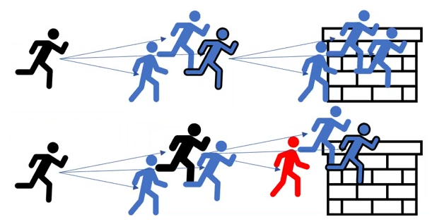
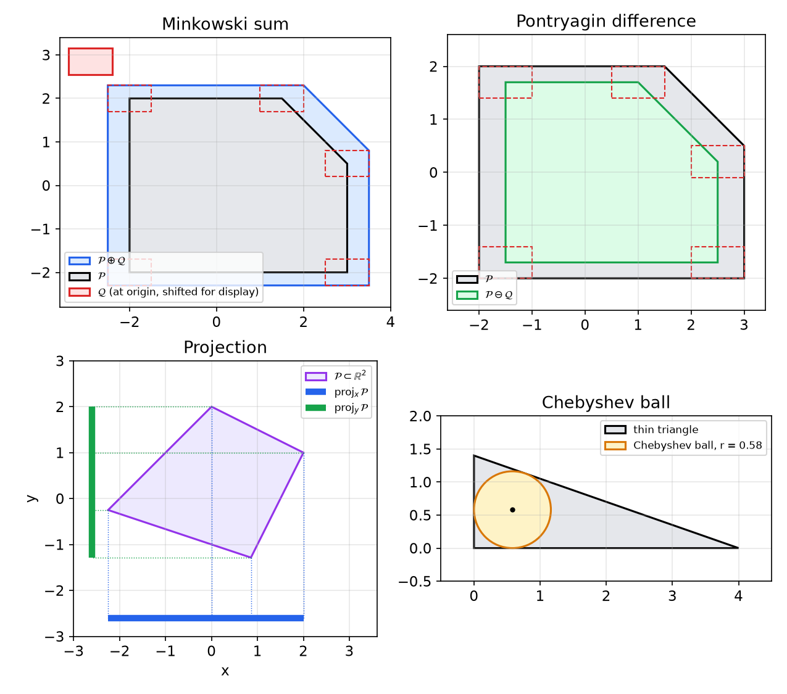
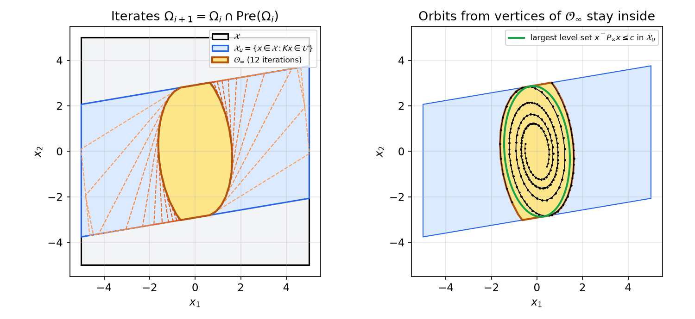
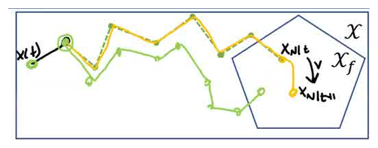
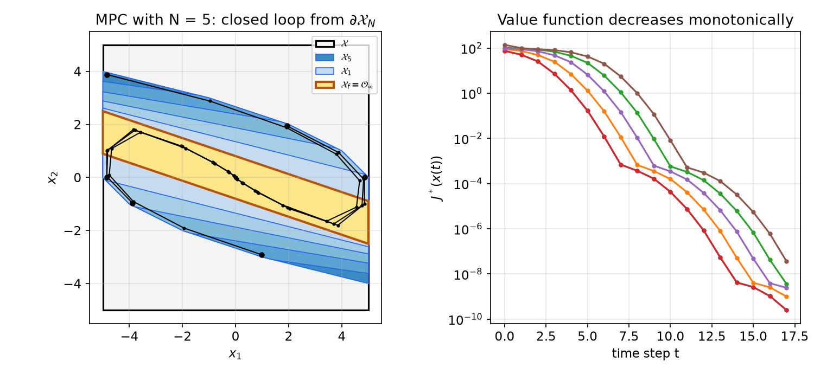

# Invariant Sets, Recursive Feasibility and Stability of MPC

A model predictive controller that is merely *implemented* can fail without warning. It may run correctly for many steps, then reach a state from which no admissible input sequence satisfies the constraints, so the optimizer returns nothing. Or it may stay feasible but fail to stabilize the system. This chapter shows how to design the three free ingredients of MPC, the terminal set \\(\mathcal{X}\_f\\), the terminal cost \\(p\\) and the horizon \\(N\\), so that neither failure can happen. The tools are polyhedral set computations and invariant sets; the guarantees are **recursive feasibility** and **asymptotic stability**, proved with the optimal value function as a Lyapunov function. The material follows a graduate course on model predictive control (Duke ME 555, 2023), based on Borrelli, Bemporad and Morari, *Predictive Control for Linear and Hybrid Systems* (Chapters 4, 10–12), and continues [Model Predictive Control: Formulation and Solution](mpc.md).

## Why MPC Can Fail

Picture a runner who plans a few strides ahead toward a wall. With a short planning horizon and high speed, every plan looks feasible until the wall comes into view, and by then the runner can no longer stop. The plans were feasible, but they ignored the need to decelerate in time.



*Figure: top, a planner whose horizon is long enough to see the wall in time. Bottom, a planner that keeps choosing fast strides because the wall is beyond its horizon; when the wall enters the horizon, no feasible plan remains (red). (Course slide.)*

In the phase plane \\((x, \dot x)\\) of a double integrator between two walls, the truly safe states form a lozenge. The closer the state is to a wall, the smaller its speed toward that wall must be, because the deceleration is limited. Inside the feasible box there is an "absolutely safe" subset, which once entered can always be stayed in. If every plan is required to *end* in such a set, a feasible plan can always be extended, and the controller "never paints itself into a corner". Making this precise requires computing sets: where can I get to from here, and which states can get here?

## Polyhedra

A **polyhedron** is an intersection of finitely many half-spaces; a **polytope** is a bounded polyhedron. There are two representations.

- **H-representation:** \\(\mathcal{P} = \\{x\in\mathbb{R}^n : Hx \le k\\}\\), with \\(H\in\mathbb{R}^{\ell\times n}\\).
- **V-representation:** a polytope is the convex hull of its vertices,
\\[
\mathcal{P} = \operatorname{conv}\\{v\_1,\dots,v\_r\\} = \Big\\{\sum\_i\lambda\_iv\_i : \lambda\_i \ge 0,\ \sum\_i\lambda\_i = 1\Big\\}.
\\]
An unbounded polyhedron adds a cone, \\(\operatorname{conv}\\{v\_i\\}\oplus\operatorname{cone}\\{y\_j\\}\\), where \\(\operatorname{cone}\\{y\_j\\} = \\{\sum\_j\lambda\_jy\_j : \lambda\_j \ge 0\\}\\).

Optimization software consumes H-representations. Converting between the two forms costs, in the worst case, time exponential in the number of facets, so algorithms are chosen to stay in one representation. Throughout, \\(\mathcal{P} = \\{x : H\_Px \le k\_P\\}\\) and \\(\mathcal{Q} = \\{x : H\_Qx \le k\_Q\\}\\).

### Basic operations

**Intersection.** Stack the inequalities:
\\[
\mathcal{P}\cap\mathcal{Q} = \Big\\{x : \begin{bmatrix}H\_P\\\\H\_Q\end{bmatrix}x \le \begin{bmatrix}k\_P\\\\k\_Q\end{bmatrix}\Big\\}.
\\]
*Example (where is a linear feedback admissible?).* With \\(x\in\mathcal{P}\\), inputs \\(\mathcal{U} = \\{u : H\_uu \le k\_u\\}\\) and \\(u = Kx\\), the input is admissible exactly on \\(\\{x : H\_uKx \le k\_u\\}\\). So the feedback is usable on \\(\\{x : [H\_P;\ H\_uK]x \le [k\_P;\ k\_u]\\}\\). For an LQR gain this is where LQR respects the input limits. It is *not* yet a guarantee that the state stays there.

**Minimal representation (MINREP).** Naive operations such as stacking create redundant rows, which waste computation and cause primal degeneracy in the KKT conditions (see [the LP section](mpc.md#linear-programs)). MINREP removes them with one LP per row: for each row \\(i\\), loosen only that row by one unit and maximize along its normal,
\\[
f\_i^\* = \max\_x\ h\_i^\top x \quad \text{s.t.} \quad Hx \le k + e\_i .
\\]
If \\(f\_i^\* > k\_i\\), the loosened row can be violated, so it is a facet and is kept. Otherwise the other rows already enforce it, so it is redundant and is deleted. Removing a redundant row never changes the set, so deciding the rows one at a time against the rows kept so far (deleting as you go) is correct, and it also handles exact duplicates, which a test against *all* other rows would delete in pairs. It is a simple and very useful algorithm; run it after intersections, perhaps every few operations when doing many.

**Convex hull.** \\(\operatorname{conv}(\mathcal{P}\_1,\dots,\mathcal{P}\_p) = \\{\sum\_i\lambda\_ix\_i : x\_i\in\mathcal{P}\_i,\ \lambda\_i \ge 0,\ \sum\lambda\_i = 1\\}\\). In V-representation this is trivial: pool the vertex lists. In H-representation it is exponentially expensive. In practice the advice is to avoid it.

**Envelope.** A cheap outer approximation: \\(\operatorname{env}(\mathcal{P}\_1,\dots,\mathcal{P}\_p)\\) keeps those inequalities of each \\(\mathcal{P}\_i\\) that are satisfied by *all* the other polytopes. To test row \\(j\\) of \\(\mathcal{P}\_i\\) against \\(\mathcal{P}\_\ell\\), solve \\(\max h\_{ij}^\top x\\) over \\(\mathcal{P}\_\ell\\) (adding the loosened row \\(h\_{ij}^\top x \le k\_{ij} + 1\\) keeps the LP bounded if \\(\mathcal{P}\_\ell\\) is unbounded). If the maximum exceeds \\(k\_{ij}\\), drop the row and move to the next. The envelope contains the convex hull and is therefore conservative.

**Chebyshev ball.** The largest ball \\(\mathcal{B}\_r(x\_c)\\) inside \\(\mathcal{P}\\) is a cheap measure of size, where volume is expensive to compute in high dimension. The ball lies in \\(\mathcal{P}\\) iff \\(h\_i^\top(x\_c + v) \le k\_i\\) for all \\(\lVert v\rVert \le r\\). The worst \\(v\\) is \\(r\\,h\_i/\lVert h\_i\rVert\\), which gives an LP:
\\[
(r^\*, x\_c^\*) = \arg\max\_{r \ge 0,\ x\_c}\ r \quad \text{s.t.} \quad h\_i^\top x\_c + r\lVert h\_i\rVert \le k\_i, \quad i = 1,\dots,\ell .
\\]
It can mislead for long, thin sets: the triangle in the figure below has area 2.8 but a Chebyshev radius of only 0.58. One use is to choose, among candidate feedback gains, the one whose terminal set has the largest Chebyshev ball.

**Projection.** For \\(\mathcal{P} = \\{(x,y) : A\_xx + A\_yy \le b\\}\\),
\\[
\operatorname{proj}\_x\mathcal{P} = \\{x : \exists y,\ (x,y)\in\mathcal{P}\\},
\\]
the "shadow" of \\(\mathcal{P}\\) on the \\(x\\)-coordinates. It is the workhorse behind Minkowski sums and precursor sets. Algorithms (Fourier–Motzkin elimination, vertex enumeration, parametric LP) are more involved than the other operations; use a library such as MPT3. Eliminating a *single* variable by Fourier–Motzkin is simple. Every pair of rows in which the variable appears with opposite signs is combined so as to cancel it, and the rows where it does not appear are kept. This is how the precursor sets below were computed for a scalar input.

**Set difference and union.** \\(\mathcal{P}\setminus\mathcal{Q}\\) and \\(\mathcal{P}\cup\mathcal{Q}\\) are generally *not* convex. Constraints built from them need non-convex (mixed-integer) solvers, which are slow. Where a union is needed, the envelope gives a convex over-approximation. It adds conservatism, but in practice that is better than not being careful enough, and often better than a very slow computation.

**Pontryagin difference.**
\\[
\mathcal{P}\ominus\mathcal{Q} = \\{x : x + q\in\mathcal{P}\ \ \forall q\in\mathcal{Q}\\}.
\\]
For numbers, \\(x = p - q \iff p = x + q\\), which explains the odd-looking definition. If \\(\mathcal{Q}\\) bounds a disturbance or measurement error, \\(\mathcal{P}\ominus\mathcal{Q}\\) is where the nominal state may be placed so that the true state is in \\(\mathcal{P}\\) whatever the error. To admit only people under 6 ft with a tape accurate to ±1 in, admit those measured at most 5 ft 11 in. Computing it takes one LP per facet:
\\[
a\_i = \max\_{q\in\mathcal{Q}}h\_{P,i}^\top q, \qquad \mathcal{P}\ominus\mathcal{Q} = \\{x : H\_Px \le k\_P - a\\}.
\\]

**Minkowski sum.**
\\[
\mathcal{P}\oplus\mathcal{Q} = \\{p + q : p\in\mathcal{P},\ q\in\mathcal{Q}\\}.
\\]
Writing \\(q = x - p\\),
\\[
\mathcal{P}\oplus\mathcal{Q} = \operatorname{proj}\_x\Big\\{(x,p) : \begin{bmatrix}H\_Q & -H\_Q\\\\ 0 & H\_P\end{bmatrix}\begin{bmatrix}x\\\\p\end{bmatrix} \le \begin{bmatrix}k\_Q\\\\k\_P\end{bmatrix}\Big\\}.
\\]
In V-representation it is the convex hull of all pairwise vertex sums. Note that \\((\mathcal{P}\ominus\mathcal{Q})\oplus\mathcal{Q} \subseteq \mathcal{P}\\), usually strictly.

**Affine maps.** For \\(f(x) = Ax + b\\):
- the **image** (forward, "children") is \\(f(\mathcal{P}) = \\{Ax + b : x\in\mathcal{P}\\}\\). If \\(A\\) is invertible, \\(f(\mathcal{P}) = \\{y : H\_PA^{-1}y \le k\_P + H\_PA^{-1}b\\}\\); otherwise it is a projection;
- the **preimage** (backward, "ancestors") is \\(f^{-1}(\mathcal{P}) = \\{x : f(x)\in\mathcal{P}\\} = \\{x : H\_PAx \le k\_P - H\_Pb\\}\\), always cheap.

The appearance of \\(A^{-1}\\) in one and \\(A\\) in the other mirrors forward against backward time.



*Figure: four polytope operations. Minkowski sum: a copy of the box Q placed at each vertex of P sweeps out P ⊕ Q. Pontryagin difference: P ⊖ Q is P shrunk so that a copy of Q at any of its points stays in P. Projection: the shadows of a polygon on each axis. Chebyshev ball: the largest inscribed ball, a crude size measure that underrates thin sets.*

## Reachable and Controllable Sets

Consider \\(x^+ = f(x,u)\\) with \\(x\in\mathcal{X}\\) and \\(u\in\mathcal{U}\\). For \\(\mathcal{S}\subseteq\mathbb{R}^n\\) define the **successor set** (where can I get to from \\(\mathcal{S}\\) in one step?) and the **precursor set** (which states can reach \\(\mathcal{S}\\) in one step?):
\\[
\operatorname{Suc}(\mathcal{S}) = \\{f(x,u) : x\in\mathcal{S},\ u\in\mathcal{U}\\}, \qquad \operatorname{Pre}(\mathcal{S}) = \\{x : \exists u\in\mathcal{U},\ f(x,u)\in\mathcal{S}\\}.
\\]
For an autonomous system \\(x^+ = f(x)\\), drop the input: \\(\operatorname{Pre}(\mathcal{S}) = \\{x : f(x)\in\mathcal{S}\\}\\). Iterating gives:
\\[
\begin{aligned}
&k\text{-step reachable sets:} && \mathcal{R}\_0(\mathcal{S}) = \mathcal{S}\cap\mathcal{X}, && \mathcal{R}\_{k+1} = \operatorname{Suc}(\mathcal{R}\_k)\cap\mathcal{X},\\\\
&k\text{-step controllable sets:} && \mathcal{K}\_0(\mathcal{S}) = \mathcal{S}\cap\mathcal{X}, && \mathcal{K}\_{k+1} = \operatorname{Pre}(\mathcal{K}\_k)\cap\mathcal{X}.
\end{aligned}
\\]
\\(\mathcal{K}\_k(\mathcal{S})\\) (the \\(k\\)-step backward reachable set) contains the states that can be driven into \\(\mathcal{S}\\) in \\(k\\) steps while respecting the constraints. With \\(\mathcal{S} = \mathcal{X}\_f\\), these are exactly the feasible sets of the DP recursion, \\(\mathcal{X}\_{N-k\to N} = \mathcal{K}\_k(\mathcal{X}\_f)\\), and \\(\mathcal{X}\_N := \mathcal{K}\_N(\mathcal{X}\_f)\\) is the set of states where the \\(N\\)-step MPC problem is feasible. Precursors answer "which initial conditions does a given horizon allow?" and "which horizon covers the initial conditions I care about?" Successors are used for obstacle avoidance: the reachable set of my vehicle, including uncertain inputs I do not choose, must avoid the pedestrian.

The driving analogy: with Montreal as the terminal set and one-hour steps, Ottawa and Burlington lie in \\(\mathcal{K}\_2\\), New York and Boston in \\(\mathcal{K}\_{10}\\), Durham in \\(\mathcal{K}\_{15}\\). Austin, about 20 hours away, is outside every \\(\mathcal{K}\_k\\) with \\(k < 20\\), so a 15-step MPC cannot start there.

**Computation for linear systems.** For \\(x^+ = Ax + Bu\\) with \\(\mathcal{U} = \\{H\_uu \le k\_u\\}\\) and \\(\mathcal{S} = \\{H\_Ss \le k\_S\\}\\):
\\[
\operatorname{Suc}(\mathcal{S}) = (A\mathcal{S})\oplus(B\mathcal{U}),
\\]
\\[
\operatorname{Pre}(\mathcal{S}) = \operatorname{proj}\_x\Big\\{(x,u) : \begin{bmatrix}H\_SA & H\_SB\\\\ 0 & H\_u\end{bmatrix}\begin{bmatrix}x\\\\u\end{bmatrix} \le \begin{bmatrix}k\_S\\\\k\_u\end{bmatrix}\Big\\}.
\\]
The second formula needs a single projection and is the efficient one. The elegant alternative \\(\operatorname{Pre}(\mathcal{S}) = A^{-1}\big(\mathcal{S}\oplus(-B\mathcal{U})\big)\\) (a preimage under \\(A\\)) chains an affine map, a Minkowski sum (itself a projection) and another map, and is slower. For an **autonomous** linear system no projection is needed: \\(\operatorname{Pre}(\mathcal{S}) = \\{x : H\_SAx \le k\_S\\}\\). This is why closed-loop computations are so much cheaper than open-loop ones.

## Invariant Sets

**Definition.** For the autonomous system \\(x^+ = f(x)\\), a set \\(\mathcal{S}\subseteq\mathcal{X}\\) is **positive invariant (PI)** if \\(x\in\mathcal{S} \Rightarrow f(x)\in\mathcal{S}\\). For the controlled system \\(x^+ = f(x,u)\\), \\(\mathcal{S}\subseteq\mathcal{X}\\) is **control invariant (CI)** if for every \\(x\in\mathcal{S}\\) there is \\(u\in\mathcal{U}\\) with \\(f(x,u)\in\mathcal{S}\\). The **maximal** PI set \\(\mathcal{O}\_\infty\\) (CI set \\(\mathcal{C}\_\infty\\)) is the PI (CI) set in \\(\mathcal{X}\\) that contains all others.

Once in a PI set, the state stays there forever. Once in a CI set, it *can* be kept there forever by some admissible input; how the inputs are chosen does not matter, only that they exist. An inverted pendulum's upright region is not PI (without input it falls out), but it is CI if the actuator can overcome gravity there.

**Theorem (is my set invariant?).** For \\(\mathcal{S}\subseteq\mathcal{X}\\), the following are equivalent:
1. \\(\mathcal{S}\\) is PI (CI);
2. \\(\mathcal{S}\subseteq\operatorname{Pre}(\mathcal{S})\\);
3. \\(\mathcal{S}\cap\operatorname{Pre}(\mathcal{S}) = \mathcal{S}\\).

*Proof* (PI case; the CI case is identical with "there exists \\(u\\)").
(1⇒2) If \\(w\in\mathcal{S}\\) but \\(w\notin\operatorname{Pre}(\mathcal{S})\\), then \\(f(w)\notin\mathcal{S}\\), contradicting invariance.
(2⇒1) If \\(x\in\mathcal{S}\subseteq\operatorname{Pre}(\mathcal{S})\\), then \\(f(x)\in\mathcal{S}\\) by the definition of \\(\operatorname{Pre}\\).
(2⇔3) Always \\(\mathcal{S}\cap\operatorname{Pre}(\mathcal{S})\subseteq\mathcal{S}\\), with equality iff every \\(x\in\mathcal{S}\\) lies in \\(\operatorname{Pre}(\mathcal{S})\\). ∎

Condition 3 is a computable stopping test, and it yields the algorithm.

**Algorithm (maximal PI / CI set).**
```text
Ω_old ← ∅ ;  Ω_new ← X
while Ω_new ≠ Ω_old  (and iteration < max_iter)
    Ω_old ← Ω_new
    Ω_new ← Ω_old ∩ Pre(Ω_old)
end
return Ω_new        (O_∞ for x⁺ = f(x);  C_∞ for x⁺ = f(x,u), u ∈ U)
```
After \\(k\\) iterations, \\(\Omega\\) is the set of states that remain in \\(\mathcal{X}\\) for \\(k\\) steps. The sets only shrink, and if \\(\mathcal{X} = \emptyset\\) the answer is \\(\emptyset\\). Some caveats:

- This is a *procedure* that may not terminate; always cap the iterations. For an asymptotically stable linear closed loop with \\(\mathcal{X}\\) a polytope containing the origin in its interior, \\(\mathcal{O}\_\infty\\) is **finitely determined**: the loop stops after finitely many steps (Gilbert and Tan).
- For PI sets, the iterates converge to \\(\mathcal{O}\_\infty\\). For CI sets, convergence to \\(\mathcal{C}\_\infty\\) holds when \\(\mathcal{X}\\) and \\(\mathcal{U}\\) are compact polyhedra and \\(f\\) is continuous, but not in general, and each iteration needs a projection.
- An iterate is invariant only once the test passes. "Almost invariant" carries no guarantee.

**PI sets give CI sets.** CI sets are expensive to compute. A practical substitute is to fix a stabilizing feedback \\(u = Kx\\) and compute the PI set of the closed loop \\(x^+ = (A + BK)x\\), starting from
\\[
\mathcal{X}\_u = \\{x\in\mathcal{X} : Kx\in\mathcal{U}\\} = \Big\\{x : \begin{bmatrix}H\_x\\\\H\_uK\end{bmatrix}x \le \begin{bmatrix}k\_x\\\\k\_u\end{bmatrix}\Big\\}.
\\]
Each iteration only intersects with \\(\\{x : H(A + BK)x \le k\\}\\), with no projection. Because the iterates only shrink, every iterate stays inside \\(\mathcal{X}\_u\\), so the feedback remains admissible. A PI set under an admissible feedback is CI, since the feedback supplies the required inputs. In practice the PI route is usually preferred. Larger CI sets give larger feasible regions for a given horizon, but they cost many more computations, and are mainly worth the trouble when a comparison with published work that uses them demands it.

**Example 1 (maximal PI set).** Take the oscillator of the [previous chapter](mpc.md#the-unconstrained-case-and-lqr), \\(A = \begin{bmatrix}1&0.1\\\\-0.4&0.96\end{bmatrix}\\), \\(B = \begin{bmatrix}0\\\\0.1\end{bmatrix}\\), with \\(\lvert x\_i\rvert \le 5\\), \\(\lvert u\rvert \le 1\\), and the LQR feedback for \\(Q = I\\), \\(R = 10\\), \\(u = Kx\\) with \\(K = [0.058,\ -0.343]\\). The admissible region \\(\mathcal{X}\_u\\) is a parallelogram of area 58.3. The algorithm terminates after 12 iterations with a 26-facet polygon \\(\mathcal{O}\_\infty\\) of area 15.7 and Chebyshev radius 1.61. (For the double integrator of Example 3 below, with \\(Q = I\\), \\(R = 1\\), the set \\(\mathcal{X}\_u\\) is already invariant and the loop stops at once.)



*Figure: left, the box X, the region X_u where the LQR input is admissible, the shrinking iterates (dashed) and the maximal PI set O_∞ (gold). Right, closed-loop orbits started at vertices of O_∞ spiral in without leaving it. The green ellipse, the largest level set of x^⊤P_∞x inside X_u, is also PI but smaller than O_∞.*

The ellipse in the right panel explains why a PI terminal set always exists for a stabilizable linear system. A stabilizing \\(K\\) has a quadratic Lyapunov function \\(x^\top Px\\), and its level sets \\(\\{x^\top Px \le c\\}\\) are invariant because \\(x^\top Px\\) decreases along trajectories. Taking \\(c = \min\_i k\_i^2/(h\_i^\top P^{-1}h\_i)\\) over the rows of \\(\mathcal{X}\_u\\) fits the largest such ellipse inside \\(\mathcal{X}\_u\\). It is a PI set in \\(\mathcal{X}\_u\\), and \\(\mathcal{O}\_\infty\\) contains it.

### Maximal controllable sets

**Definition.** The **maximal controllable set** of a target \\(\mathcal{S}\subseteq\mathcal{X}\\) is \\(\mathcal{K}\_\infty(\mathcal{S}) = \bigcup\_{k \ge 1}\mathcal{K}\_k(\mathcal{S})\\): every state that can be steered into \\(\mathcal{S}\\) in some finite number of steps. It is the largest region in which *any* controller, MPC or otherwise, can bring the state to \\(\mathcal{S}\\).

**Algorithm.**
```text
Ω_old ← ∅ ;  Ω_new ← S
while Ω_new ≠ Ω_old
    Ω_old ← Ω_new
    Ω_new ← (Pre(Ω_old) ∩ X) ∪ Ω_old
end
return Ω_new
```
For a finite horizon \\(N\\), stop after \\(N\\) passes. If \\(\mathcal{S}\\) is CI, then \\(\mathcal{S}\subseteq\operatorname{Pre}(\mathcal{S})\\), the sets are nested, and the union is harmless. If \\(\mathcal{S}\\) is not CI, part of it pokes outside its own precursor, and the (non-convex) union is genuinely needed. This is one more reason to make terminal sets invariant.

**Example 2 (\\(\mathcal{K}\_\infty \ne \mathcal{C}\_\infty\\)).** Take \\(x^+ = 2x + u\\), \\(\lvert x\rvert \le 1\\), \\(\lvert u\rvert \le 1\\), target \\(\mathcal{S} = \\{0\\}\\).

- *The whole of \\(\mathcal{X}\\) is CI.* The input \\(u = -x\\) is admissible for \\(\lvert x\rvert \le 1\\) and gives \\(x^+ = x\\). So \\(\mathcal{C}\_\infty = [-1,1]\\).
- *Controllable sets.* Reaching 0 in one step needs \\(u = -2x\\), so \\(\mathcal{K}\_1 = [-\tfrac12,\tfrac12]\\). Reaching \\([-a,a]\\) in one step needs \\(\lvert 2x + u\rvert \le a\\) for some \\(\lvert u\rvert \le 1\\), i.e. \\(\lvert x\rvert \le (1 + a)/2\\). Hence \\(\mathcal{K}\_k = [-(1 - 2^{-k}),\ 1 - 2^{-k}]\\) and \\(\mathcal{K}\_\infty = (-1,1)\\).

From \\(x = 1\\), the only admissible way to stay feasible is \\(u = -1\\), which gives \\(x^+ = 1\\): the state can remain feasible forever but never reaches the origin. An invariant region is not necessarily a good region. Note also that the algorithm never terminates here, since each pass adds a sliver.

## Recursive Feasibility

### What can be designed

The MPC problem of the previous chapter is
\\[
\underline u^\*(x) = \arg\min\_{\underline u}\ p(x\_N) + \sum\_{k=0}^{N-1}q(x\_k,u\_k) \quad \text{s.t.} \quad x\_{k+1} = f(x\_k,u\_k),\ x\_0 = x,\ x\_k\in\mathcal{X},\ u\_k\in\mathcal{U},\ x\_N\in\mathcal{X}\_f,
\\]
with \\(u\_{\text{rhc}}(x) = u\_0^\*(x)\\). Its ingredients split into two groups. The problem fixes the running cost \\(q\\) (the client's values: performance against operating cost), the dynamics \\(f\\), the safe region \\(\mathcal{X}\\) and the actuator limits \\(\mathcal{U}\\). The designer chooses the **terminal cost \\(p\\), the horizon \\(N\\) and the terminal set \\(\mathcal{X}\_f\\)**. Running costs encode priorities; the terminal ingredients are what we tune to make MPC work. There are two critical concerns:

- **Recursive (persistent) feasibility.** If we begin feasibly, we can always feasibly continue: if the problem has a solution at \\(x\\), it also has one at \\(f(x,u\_{\text{rhc}}(x))\\). An attitude controller for a satellite that suddenly becomes infeasible stops pointing the antenna at Earth, and with no way to intervene the satellite becomes space debris.
- **Stability.** \\(x(t)\to0\\), and for every \\(\epsilon > 0\\) there is \\(\delta > 0\\) with \\(\lVert x(0)\rVert < \delta \Rightarrow \lVert x(t)\rVert \le \epsilon\\) for all \\(t\\).

### The theorem

**Theorem (recursive feasibility).** If \\(\mathcal{X}\_f\subseteq\mathcal{X}\\) is control invariant for \\(x^+ = f(x,u)\\), \\(x\in\mathcal{X}\\), \\(u\in\mathcal{U}\\), then \\(u\_{\text{rhc}}\\) is persistently feasible: if the MPC problem is feasible at \\(x(0)\\), it is feasible at every \\(x(t)\\) of the closed loop.



*Figure: the optimal plan at time t (dashed green, then yellow) ends at x_{N|t} in X_f. After the first move, the rest of the old plan is still feasible, and one more step v inside X_f, which exists because X_f is control invariant, completes a feasible N-step plan from x(t+1). The MPC may then find a better plan (solid green) that keeps only its endpoint in X_f. (Course slide, annotated.)*

*Proof.* Write \\(x\_{k\vert t}\\), \\(u\_{k\vert t}\\) for the \\(k\\)-th state and input of the plan computed at time \\(t\\). Suppose the problem is feasible at \\(x(t)\\), with optimal inputs \\(u\_{0\vert t},\dots,u\_{N-1\vert t}\\) and states \\(x\_{0\vert t} = x(t), \dots, x\_{N\vert t}\in\mathcal{X}\_f\\). The closed loop applies \\(u\_{0\vert t}\\), so
\\[
x(t+1) = f(x\_{0\vert t},u\_{0\vert t}) = x\_{1\vert t}.
\\]
Since \\(x\_{N\vert t}\in\mathcal{X}\_f\\) and \\(\mathcal{X}\_f\\) is CI, there is \\(v\in\mathcal{U}\\) with \\(f(x\_{N\vert t},v)\in\mathcal{X}\_f\\). Claim: the **shifted sequence**
\\[
\tilde{\underline u} = [u\_{1\vert t},\ u\_{2\vert t},\ \dots,\ u\_{N-1\vert t},\ v]
\\]
is feasible at \\(x(t+1)\\). Its states are \\(x\_{k\vert t+1} = x\_{k+1\vert t}\\) for \\(k = 0,\dots,N-1\\), and \\(x\_{N\vert t+1} = f(x\_{N\vert t},v)\\). Check the constraints:

1. *Inputs:* \\(u\_{1\vert t},\dots,u\_{N-1\vert t}\in\mathcal{U}\\) as part of a feasible plan, and \\(v\in\mathcal{U}\\) by choice.
2. *States:* \\(x\_{k\vert t+1} = x\_{k+1\vert t}\in\mathcal{X}\\) for \\(k \le N-2\\), and \\(x\_{N-1\vert t+1} = x\_{N\vert t}\in\mathcal{X}\_f\subseteq\mathcal{X}\\).
3. *Terminal:* \\(x\_{N\vert t+1} = f(x\_{N\vert t},v)\in\mathcal{X}\_f\\).

So the problem is feasible at \\(t+1\\), and by induction at all times. ∎

| | \\(x(\cdot)\\) | step 0 | step 1 | … | step \\(N-1\\) | terminal |
|---|---|---|---|---|---|---|
| plan at \\(t\\) | \\(x(t)\\) | \\((x\_{0\vert t},u\_{0\vert t})\\) | \\((x\_{1\vert t},u\_{1\vert t})\\) | … | \\((x\_{N-1\vert t},u\_{N-1\vert t})\\) | \\(x\_{N\vert t}\\) |
| candidate at \\(t+1\\) | \\(x\_{1\vert t}\\) | \\((x\_{1\vert t},u\_{1\vert t})\\) | \\((x\_{2\vert t},u\_{2\vert t})\\) | … | \\((x\_{N\vert t},v)\\) | \\(f(x\_{N\vert t},v)\in\mathcal{X}\_f\\) |

The candidate is only a certificate. The MPC re-optimizes at \\(t+1\\) and usually finds a better plan; feasibility of the candidate is all the proof needs. The conclusion is the design rule: **choose the terminal set control invariant (in practice, positive invariant under an admissible feedback), and the MPC can never become infeasible.** Without this, MPC can work in 95% of simulations and fail in the rest, while a little more effort gives 100%.

Recursive feasibility also implies that the feasible set \\(\mathcal{X}\_N = \mathcal{K}\_N(\mathcal{X}\_f)\\) is **positive invariant for the closed loop** \\(x^+ = f(x,u\_{\text{rhc}}(x))\\).

## Stability

### Comparison functions and a constrained Lyapunov theorem

**Definition.** A function \\(\alpha:\mathbb{R}\_{\ge0}\to\mathbb{R}\_{\ge0}\\) is of **class \\(\mathcal{K}\_\infty\\)** if it is continuous, \\(\alpha(0) = 0\\), strictly increasing, and \\(\alpha(r)\to\infty\\) as \\(r\to\infty\\). Quadratics \\(c\lVert x\rVert^2\\) are the prototype. Bounds of the form \\(\alpha(\lVert x\rVert)\\) allow level sets that are boxes or other shapes rather than ellipsoids. (See [Advanced Lyapunov Theory](../nonlinear/lyapunov-advanced.md).)

**Theorem (constrained Lyapunov theorem).** Let \\(\Omega\subseteq\mathbb{R}^n\\) contain the origin in its interior and be positive invariant for \\(x^+ = g(x)\\), with \\(g(0) = 0\\). If there are \\(V:\Omega\to\mathbb{R}\_{\ge0}\\) and \\(\alpha\_1,\alpha\_2,\alpha\_3\in\mathcal{K}\_\infty\\) with
\\[
\alpha\_1(\lVert x\rVert) \le V(x) \le \alpha\_2(\lVert x\rVert), \qquad V(g(x)) - V(x) \le -\alpha\_3(\lVert x\rVert) \qquad \forall x\in\Omega,
\\]
then the origin is asymptotically stable with region of attraction \\(\Omega\\).

The plan is to use the optimal value \\(J^\*(x)\\) as \\(V\\) and \\(\Omega = \mathcal{X}\_N\\), which is PI by recursive feasibility. The lower bound and decrease will hold on all of \\(\mathcal{X}\_N\\). The upper bound is the delicate part.

### Stability in the terminal set

**Theorem 1.** Suppose \\(\mathcal{X}\_f\\) is CI, \\(0\in\mathcal{X}\_f\\), and there are \\(\alpha\_1,\alpha\_2\in\mathcal{K}\_\infty\\) with
\\[
q(x,u) \ge \alpha\_1(\lVert x\rVert) \ \ \forall x\in\mathcal{X},\ u\in\mathcal{U}, \qquad 0 \le p(x) \le \alpha\_2(\lVert x\rVert) \ \ \forall x\in\mathcal{X}\_f,
\\]
and suppose that for every \\(x\in\mathcal{X}\_f\\) there is \\(u\in\mathcal{U}\\) such that
\\[
f(x,u)\in\mathcal{X}\_f \quad \text{and} \quad p(f(x,u)) - p(x) \le -q(x,u). \tag{\\(\star\\)}
\\]
Then the origin of \\(x^+ = f(x,u\_{\text{rhc}}(x))\\) is asymptotically stable, and every trajectory starting in \\(\mathcal{X}\_f\\) converges to it.

Condition \\((\star)\\) says that inside \\(\mathcal{X}\_f\\) the terminal cost is itself a **control Lyapunov function** whose decrease pays for the stage cost. Persistent feasibility is assumed first, since an MPC that stops returning inputs certainly cannot converge. The proof establishes the three Lyapunov conditions for \\(J^\*\\) in turn.

*Lower bound.* For any feasible \\(x\\), with \\(x\_0 = x\\), all terms are non-negative, and the first does not depend on the decision variables:
\\[
J^\*(x) = \min\_{\underline u}\Big[p(x\_N) + q(x,u\_0) + \sum\_{k=1}^{N-1}q(x\_k,u\_k)\Big] \ \ge\ \alpha\_1(\lVert x\rVert) + \min\_{\underline u}\Big[p(x\_N) + \sum\_{k=1}^{N-1}\alpha\_1(\lVert x\_k\rVert)\Big] \ \ge\ \alpha\_1(\lVert x\rVert).
\\]
A general strategy for such proofs: look at each term, keep the ones related to a \\(\mathcal{K}\_\infty\\) function of the current state, and find ways to get rid of the others.

*Decrease.* To bound an optimal cost from *above*, exhibit a feasible candidate. At \\(x^+ = f(x,u\_{\text{rhc}}(x)) = x\_{1\vert t}\\), use the shifted sequence of the feasibility proof with its last input \\(v\\) chosen by \\((\star)\\):
\\[
J^\*(x^+) \le p(f(x\_{N\vert t},v)) + q(x\_{N\vert t},v) + \sum\_{k=1}^{N-1}q(x\_{k\vert t},u\_{k\vert t}).
\\]
Add and subtract \\(q(x\_{0\vert t},u\_{0\vert t})\\) and \\(p(x\_{N\vert t})\\), and recognize \\(J^\*(x) = p(x\_{N\vert t}) + \sum\_{k=0}^{N-1}q(x\_{k\vert t},u\_{k\vert t})\\):
\\[
J^\*(x^+) - J^\*(x) \le \underbrace{p(f(x\_{N\vert t},v)) + q(x\_{N\vert t},v) - p(x\_{N\vert t})}\_{\le\\, 0 \text{ by } (\star),\ x\_{N\vert t}\in\mathcal{X}\_f} - q(x,u\_{0\vert t}) \le -\alpha\_1(\lVert x\rVert).
\\]
So the decrease condition holds with \\(\alpha\_3 = \alpha\_1\\), at every feasible \\(x\\), not only in \\(\mathcal{X}\_f\\).

*Upper bound: monotonicity of the value function.* This is the conceptually hardest step. Let \\(J\_i^\*(x)\\) be the optimal cost with \\(i\\) steps to go (the cost-to-go \\(J^{\*(N-i)\to N}\\) of the DP recursion), so \\(J\_0^\* = p\\) on \\(\mathcal{X}\_f\\) and \\(J^\* = J\_N^\*\\). Because \\(\mathcal{X}\_f\\) is CI, a state in \\(\mathcal{X}\_f\\) can be kept there for any number of steps, so every \\(J\_i^\*\\) is finite on \\(\mathcal{X}\_f\\). **Claim:** \\(J\_i^\*(x) \le p(x)\\) for all \\(x\in\mathcal{X}\_f\\) and all \\(i\\).

By induction: \\(J\_0^\* = p\\). Suppose \\(J\_{i-1}^\*(y) \le p(y)\\) for all \\(y\in\mathcal{X}\_f\\). By Bellman's principle, and then choosing the particular \\(u\\) of \\((\star)\\), which keeps \\(f(x,u)\in\mathcal{X}\_f\\),
\\[
J\_i^\*(x) = \min\_{u}\Big[q(x,u) + J\_{i-1}^\*(f(x,u))\Big] \le q(x,u) + p(f(x,u)) \le q(x,u) + p(x) - q(x,u) = p(x). \qquad ∎
\\]
Hence \\(J^\*(x) \le p(x) \le \alpha\_2(\lVert x\rVert)\\) on \\(\mathcal{X}\_f\\). The same argument shows \\(J\_{i}^\* \le J\_{i-1}^\*\\): with a valid terminal cost, **a longer horizon never costs more**. This is counter-intuitive, since more non-negative terms are added. The intuition is that the horizon is spent driving the state toward the origin, where \\(p(x\_N)\\) is much smaller than \\(p(x)\\). With \\(\mathcal{X}\_f = \\{0\\}\\) and zero cost there, a one-step plan may need a violent input, while a two-step plan can repeat it and then rest at zero cost, or find two gentler and cheaper moves.

*Conclusion.* The three bounds hold with \\(\alpha\_1\\), \\(\alpha\_2\\) and \\(\alpha\_3 = \alpha\_1\\), the upper bound on \\(\mathcal{X}\_f\\), which contains a neighbourhood of the origin. The lower bound and decrease hold on the PI set \\(\mathcal{X}\_N \supseteq \mathcal{X}\_f\\), which contains every closed-loop trajectory from \\(\mathcal{X}\_f\\).

- *Lyapunov stability:* inside a ball in \\(\mathcal{X}\_f\\) the standard sandwich argument applies, \\(\alpha\_1(\lVert x(t)\rVert) \le J^\*(x(t)) \le J^\*(x(0)) \le \alpha\_2(\lVert x(0)\rVert)\\).
- *Attractivity:* summing the decrease, \\(\sum\_{t=0}^{T}\alpha\_1(\lVert x(t)\rVert) \le J^\*(x(0)) < \infty\\) for every \\(T\\), so \\(\alpha\_1(\lVert x(t)\rVert)\to0\\) and \\(x(t)\to0\\). ∎

The attractivity argument works from *any* point of \\(\mathcal{X}\_N\\). What Theorem 1 lacks on \\(\mathcal{X}\_N\\) is a uniform upper bound, which Theorem 2 supplies.

### Stability in the feasible set

Stability only in \\(\mathcal{X}\_f\\) is a weak statement: \\(\mathcal{X}\_f\\) is often a conservative PI set, and for hard nonlinear problems the "desperation move" is \\(\mathcal{X}\_f = \\{0\\}\\), which makes Theorem 1 nearly empty. We want stability on all of \\(\mathcal{X}\_N\\), every state where the MPC problem is feasible.

**Theorem 2.** Under the hypotheses of Theorem 1, suppose also that \\(0\in\operatorname{int}\mathcal{X}\_f\\) and \\(J^\*\\) is bounded on \\(\mathcal{X}\_N\\). (This holds, for example, when \\(\mathcal{X}\\) and \\(\mathcal{U}\\) are bounded and \\(p\\), \\(q\\) are continuous, since every feasible cost is then bounded.) Then the origin is asymptotically stable for \\(x^+ = f(x,u\_{\text{rhc}}(x))\\) with region of attraction \\(\mathcal{X}\_N\\).

*Proof.* The lower bound and the decrease never used \\(x\in\mathcal{X}\_f\\), only feasibility, so they hold on \\(\mathcal{X}\_N\\), which is PI. It remains to show \\(J^\*(x) \le c\\,\alpha\_2(\lVert x\rVert)\\) on \\(\mathcal{X}\_N\\) for some \\(c \ge 1\\); then \\(c\\,\alpha\_2\in\mathcal{K}\_\infty\\) and the constrained Lyapunov theorem applies.

1. Since \\(0\in\operatorname{int}\mathcal{X}\_f\\), there is \\(r > 0\\) with \\(\mathcal{B}\_r(0) = \\{\lVert x\rVert \le r\\}\subseteq\mathcal{X}\_f\\). Let \\(\alpha\_M = \alpha\_2(r)\\). For \\(x\in\mathcal{X}\_N\\) outside \\(\mathcal{B}\_r(0)\\), \\(\alpha\_2(\lVert x\rVert) > \alpha\_M\\), because \\(\alpha\_2\\) is strictly increasing.
2. Let \\(J\_M^\* = \sup\_{x\in\mathcal{X}\_N}J^\*(x) < \infty\\).
3. Outside the ball, \\(J^\*(x) \le J\_M^\* = \frac{J\_M^\*}{\alpha\_M}\alpha\_M \le \frac{J\_M^\*}{\alpha\_M}\alpha\_2(\lVert x\rVert)\\). Inside the ball, \\(J^\*(x) \le \alpha\_2(\lVert x\rVert)\\) by Theorem 1.

So \\(J^\*(x) \le c\\,\alpha\_2(\lVert x\rVert)\\) on \\(\mathcal{X}\_N\\) with \\(c = \max\\{1, J\_M^\*/\alpha\_M\\}\\). ∎

Together, the two theorems say: **with a CI terminal set, a terminal cost satisfying \\((\star)\\) there, and a positive-definite stage cost, MPC is recursively feasible and asymptotically stabilizing on the entire region where it is feasible.**

## Choosing the Terminal Cost by LMIs

Checking the hypotheses one by one:

- \\(q(x,u) \ge \alpha\_1(\lVert x\rVert)\\) is given by the problem (it is either satisfied or the client must be persuaded);
- \\(0 \le p \le \alpha\_2\\) is easy, by choosing \\(p\\) quadratic;
- \\(f(x,u)\in\mathcal{X}\_f\\) is handled by choosing \\(\mathcal{X}\_f\\) invariant.

The real work is the decrease condition \\((\star)\\).

For linear dynamics \\(x^+ = Ax + Bu\\), quadratic stage cost \\(q = x^\top Qx + u^\top Ru\\) and terminal cost \\(p = x^\top Px\\), restrict the decreasing input to a feedback \\(u = Kx\\). (A linear system is stabilizable by state feedback or not at all, so this loses nothing essential.) Then \\((\star)\\) holds for all \\(x\\) iff
\\[
(A + BK)^\top P(A + BK) + Q + K^\top RK - P \preceq 0 . \tag{\\(\ast\\)}
\\]
If the matrix had a positive eigenvalue, its eigenvector would be a "nefarious" direction violating \\((\star)\\). With both \\(P\\) and \\(K\\) unknown, \\((\ast)\\) is not an LMI. The Schur complement in the form
\\[
L + M^\top WM \preceq 0,\ W \succ 0 \iff \begin{bmatrix}L & M^\top\\\\ M & -W^{-1}\end{bmatrix} \preceq 0
\\]
removes a term that is quadratic in the unknowns and positive semidefinite (it makes the inequality harder to satisfy). Linear terms go in the top-left block, \\(M\\) below and \\(M^\top\\) to the right.

1. Schur on \\((A + BK)^\top P(A + BK)\\), then on \\(K^\top RK = \begin{bmatrix}K^\top\\\\0\end{bmatrix}R\begin{bmatrix}K & 0\end{bmatrix}\\):
\\[
(\ast) \iff \begin{bmatrix}Q - P & (A + BK)^\top & K^\top\\\\ A + BK & -P^{-1} & 0\\\\ K & 0 & -R^{-1}\end{bmatrix} \preceq 0 .
\\]
2. Congruence with \\(\operatorname{diag}(P^{-1}, I, I)\\), then the change of variables \\(\tilde P = P^{-1}\\), \\(\tilde K = KP^{-1}\\):
\\[
\begin{bmatrix}\tilde PQ\tilde P - \tilde P & \tilde PA^\top + \tilde K^\top B^\top & \tilde K^\top\\\\ A\tilde P + B\tilde K & -\tilde P & 0\\\\ \tilde K & 0 & -R^{-1}\end{bmatrix} \preceq 0 .
\\]
This looks worse, but the only nonlinear term left is \\(\tilde PQ\tilde P\\).
3. Schur once more on \\(\tilde PQ\tilde P\\):
\\[
\boxed{\begin{bmatrix}-\tilde P & \tilde PA^\top + \tilde K^\top B^\top & \tilde K^\top & \tilde P\\\\ A\tilde P + B\tilde K & -\tilde P & 0 & 0\\\\ \tilde K & 0 & -R^{-1} & 0\\\\ \tilde P & 0 & 0 & -Q^{-1}\end{bmatrix} \preceq 0, \qquad \tilde P \succ 0,}
\\]
an LMI in \\((\tilde P,\tilde K)\\), with \\(P = \tilde P^{-1}\\) and \\(K = \tilde K\tilde P^{-1}\\). The congruence is exact, whereas convex–concave over-bounding of \\(P^{-1}\\) would add conservatism.

```python
import cvxpy as cp, numpy as np
Pt = cp.Variable((n, n), symmetric=True); Kt = cp.Variable((m, n))
LMI = cp.bmat([[-Pt, Pt@A.T + Kt.T@B.T, Kt.T, Pt],
               [A@Pt + B@Kt, -Pt, np.zeros((n, m)), np.zeros((n, n))],
               [Kt, np.zeros((m, n)), -np.linalg.inv(R), np.zeros((m, n))],
               [Pt, np.zeros((n, n)), np.zeros((n, m)), -np.linalg.inv(Q)]])
cp.Problem(cp.Maximize(cp.log_det(Pt)), [LMI << 0, Pt >> 0]).solve()
P = np.linalg.inv(Pt.value); K = Kt.value @ P
```

For the double integrator of Example 3 below, maximizing \\(\log\det\tilde P\\) (that is, the smallest \\(P\\)) returns \\(P = \begin{bmatrix}2.947 & 2.369\\\\ 2.369 & 4.613\end{bmatrix}\\) and \\(K = [-0.422,\ -1.244]\\), exactly the Riccati solution \\(P\_\infty\\) and the LQR gain. This is no accident: \\(P\_\infty\\) satisfies \\((\ast)\\) with equality for \\(K = K\_{\text{LQR}}\\), and it is the smallest \\(P\\) that satisfies \\((\ast)\\) for any \\(K\\). So the common choice \\(p(x) = x^\top P\_\infty x\\), with \\(K\\) the LQR gain, satisfies \\((\star)\\) automatically.

**Compatible terminal set.** The decrease input \\(u = Kx\\) must also be admissible and keep the state in \\(\mathcal{X}\_f\\). So choose \\(\mathcal{X}\_f\\) **positive invariant for \\(x^+ = (A + BK)x\\) inside \\(\mathcal{X}\_u = \\{x\in\mathcal{X} : Kx\in\mathcal{U}\\}\\)**, by running the maximal-PI algorithm initialized at \\(\mathcal{X}\_u\\). It is PI rather than CI because, once \\(u = Kx\\) is fixed, there are no choices left. Such a set always exists for a stabilizable linear system: a Lyapunov ellipsoid fits inside \\(\mathcal{X}\_u\\), as in the figure of Example 1. The classic pitfall is to choose \\(p = x^\top P\_\infty x\\) but no compatible terminal set. The result works almost always, with no guarantee.

## Infinite-Horizon MPC

With \\(N = \infty\\) and no terminal ingredients,
\\[
\min\_{u\_0,u\_1,\dots}\ \sum\_{k=0}^{\infty}q(x\_k,u\_k) \quad \text{s.t.} \quad x\_{k+1} = f(x\_k,u\_k),\ x\_0 = x(t),\ x\_k\in\mathcal{X},\ u\_k\in\mathcal{U},
\\]
both guarantees come almost for free.

- **Recursive feasibility:** a feasible infinite sequence minus its first element is a feasible infinite sequence from the next state.
- **Stability:** if \\(q\\) is positive definite and the optimal cost is finite, the terms of a convergent series of non-negative numbers must vanish, so \\(q(x\_k,u\_k)\to0\\) and \\(x\_k\to0\\).

The batch approach is impossible (the matrices are infinite), so the problem is attacked recursively. For the unconstrained LQ case it is solved exactly.

**Finite horizon, recursive solution.** With \\(q = x^\top Qx + u^\top Ru\\), \\(p = x^\top Px\\), claim:
1. \\(J^{\*j\to N}(x) = x^\top P\_jx\\), with \\(P\_N = P\\);
2. the Riccati difference equation holds,
\\[
P\_j = A^\top P\_{j+1}A + Q - A^\top P\_{j+1}B(B^\top P\_{j+1}B + R)^{-1}B^\top P\_{j+1}A;
\\]
3. \\(u\_j^\* = F\_jx\\) with \\(F\_j = -(B^\top P\_{j+1}B + R)^{-1}B^\top P\_{j+1}A\\).

*Proof by induction.* At \\(j = N\\) the cost-to-go is the terminal cost. Assuming the claim for \\(j+1\\), Bellman's principle gives
\\[
J^{\*j\to N}(x) = \min\_u\ u^\top(R + B^\top P\_{j+1}B)u + 2x^\top A^\top P\_{j+1}Bu + x^\top(Q + A^\top P\_{j+1}A)x,
\\]
an unconstrained QP in \\(u\\). Its minimizer is (3). Substituting \\(u = F\_jx\\),
\\[
J^{\*j\to N}(x) = x^\top\big[Q + F\_j^\top RF\_j + (A + BF\_j)^\top P\_{j+1}(A + BF\_j)\big]x .
\\]
Expanding and using \\((B^\top P\_{j+1}B + R)F\_j = -B^\top P\_{j+1}A\\), the cross terms collapse to give (2). ∎

**Infinite horizon.** The cost-to-go from \\(j\\) to \\(\infty\\) equals that from \\(j+1\\) to \\(\infty\\) (the series trick "erase the \\(+1\\)"), so \\(P\_j = P\_{j+1} = P\_\infty\\). This gives the **algebraic Riccati equation**
\\[
P\_\infty = A^\top P\_\infty A + Q - A^\top P\_\infty B(B^\top P\_\infty B + R)^{-1}B^\top P\_\infty A, \qquad F\_\infty = -(B^\top P\_\infty B + R)^{-1}B^\top P\_\infty A .
\\]
A unique stabilizing solution \\(P\_\infty \succeq 0\\) exists if \\((A,B)\\) is stabilizable and \\((A,Q^{1/2})\\) is detectable; observability of \\((A,Q^{1/2})\\) gives \\(P\_\infty \succ 0\\). Stabilizability cannot be engineered around. If a state grows by a factor of 30 per step and no input reaches it, no controller will help, and the actuators must be moved or added. Detectability ensures that every unstable mode is seen by the cost; otherwise the optimizer is indifferent to it. The same results are developed in [Discrete-Time Optimal Control and LQR](discrete-optimal-control.md) and [Digital Control: LQR](../digital/lqr.md).

**Why \\(x^\top P\_\infty x\\) is the usual terminal cost.** With a reasonable horizon, the predicted state at step \\(N\\) is near the origin, where the constraints are inactive and remain so. From there, the unconstrained infinite-horizon cost *is* the true cost-to-go. Inside a compatible terminal set the finite-horizon MPC then equals the constrained infinite-horizon controller, without solving an infinite problem. Infinite-horizon optimality is no better than the model: with a poor model, a moderate horizon and robust design matter more.

## Designing an MPC: A Checklist

1. Write the running cost, the constraints \\(\mathcal{X}\\) and \\(\mathcal{U}\\), and the dynamics.
2. Approximate the constraints by polytopes (possibly several) if they are not already.
3. Use a quadratic, or at least convex, objective, so the problem is **well posed**: a solution exists, is unique, and depends continuously on the parameters. All models are wrong, and if a small parameter change causes a large change in the solution, the output is garbage.
4. Choose the solution method (batch QP, DP, explicit MPC) together with the software and hardware.
5. Choose the terminal cost so that \\((\star)\\) holds (for linear-quadratic problems, solve the LMI or use \\(P\_\infty\\) with the LQR gain).
6. Choose the terminal set PI for the feedback that achieves \\((\star)\\), inside \\(\mathcal{X}\_u\\).
7. Choose the horizon. It must be short enough for the online computation to finish in time (DP's online cost does not depend on \\(N\\); an online QP's does). It must be long enough that \\(\mathcal{X}\_N = \mathcal{K}\_N(\mathcal{X}\_f)\\) contains all initial conditions of interest. Compute \\(\mathcal{K}\_1, \mathcal{K}\_2, \dots\\) until this holds. If \\(\mathcal{K}\_{k+1} = \mathcal{K}\_k\\), all later sets are equal: every state that can ever reach \\(\mathcal{X}\_f\\) does so within \\(k\\) steps, and a longer horizon buys no feasibility. For linear systems this often happens within a handful of steps.

**Example 3 (double integrator, the complete design).** Take \\(A = \begin{bmatrix}1&1\\\\0&1\end{bmatrix}\\), \\(B = \begin{bmatrix}0\\\\1\end{bmatrix}\\), \\(\lvert x\_i\rvert \le 5\\), \\(\lvert u\rvert \le 1\\), \\(Q = I\\), \\(R = 1\\).

- **Terminal cost:** \\(p = x^\top P\_\infty x\\) with \\(P\_\infty\\) as above, and \\(K\_{\text{LQR}} = [-0.422,\ -1.244]\\) (\\(u = Kx\\)). The closed-loop eigenvalues are \\(0.378 \pm 0.188j\\).
- **Terminal set:** \\(\mathcal{X}\_u\\) is the strip \\(\lvert Kx\rvert \le 1\\) cut by \\(\lvert x\_1\rvert \le 5\\). It is already PI, so \\(\mathcal{X}\_f = \mathcal{O}\_\infty = \mathcal{X}\_u\\), a parallelogram of area 16.1.
- **Horizon:** the controllable sets \\(\mathcal{K}\_1,\dots,\mathcal{K}\_5\\) have areas 26.9, 36.5, 44.0, 48.6 and 50.0, and \\(\mathcal{K}\_6 = \mathcal{K}\_5\\). So \\(\mathcal{K}\_\infty(\mathcal{X}\_f) = \mathcal{K}\_5\\), and \\(N = 5\\) already makes the MPC feasible wherever *any* controller could succeed. That region is half the box. The rest consists of states moving toward a wall too fast to stop with \\(\lvert u\rvert \le 1\\): the lozenge of the running-man picture.



*Figure: left, the terminal set X_f (gold), the controllable sets X_1, …, X_5 (blue, nested; X_5 = K_∞), and closed-loop MPC trajectories (N = 5) from six points on the boundary of X_5. All remain feasible and converge. Right, the optimal value J*(x(t)) along each trajectory decreases at every step, as the stability proof requires.*

The six simulations confirm both theorems in practice. No QP was ever infeasible, even from the edge of \\(\mathcal{X}\_N\\) where the constraints are tightest, and \\(J^\*(x(t))\\) decreased strictly at every step on every trajectory.

**When computation is short.**

- DP moves the work offline.
- Explicit MPC (below) does the same for linear systems of modest dimension.
- **Move blocking** of the re-solve: compute a 10-step plan but apply its first two or three inputs before solving again, multiplying the time available for each solve.
- **Warm starting**, initializing the solver with the shifted previous solution, which is exactly the feasible candidate of the recursive-feasibility proof.

With the terminal ingredients designed as above, the worst consequences of a short horizon, loss of feasibility and of stability, disappear. Horizons of 3–4 steps often suffice, and the remaining cost of a short horizon is that the state must start within \\(N\\) steps of \\(\mathcal{X}\_f\\). MPC research focuses on what is left: meeting real-time limits, non-polytopic constraints, nonlinear dynamics, non-quadratic objectives, and uncertainty.

## Beyond the Core

**Explicit MPC.** Linear MPC is the parametric QP \\(\min\_z\tfrac12z^\top Hz + q(x)^\top z\\) s.t. \\(Gz \le w(x)\\). Near the origin no constraint is active, and the KKT conditions give the unconstrained linear law. Moving outward, some constraint \\(g\_i\\) reaches zero. On one side of that hyperplane it is inactive; on the other it is active, and the KKT system with that constraint as an equality again gives an affine law, with a different gain. Continuing partitions the feasible set \\(\mathcal{X}\_N\\) into polyhedral **critical regions**, each with its own affine law \\(u = F\_ix + g\_i\\). The optimal MPC law is therefore continuous and piecewise affine, and \\(J^\*\\) is continuous and piecewise quadratic. Online, the controller only locates the region containing \\(x\\) and evaluates the affine law. The number of regions can grow combinatorially with the number of constraints and the dimension, until the lookup is slower than solving the QP, so this is a balancing act.

**Suboptimal MPC.** Real solvers stop early. Suppose the computed input \\(\hat u\\) satisfies \\(\lVert\hat u - u^\*\rVert \le c\lVert x\rVert\\), and \\(J^\*\\) is Lipschitz in the input direction with constant \\(L\\), so that \\(\lvert J^\*(f(x,\hat u)) - J^\*(f(x,u^\*))\rvert \le L\lVert\hat u - u^\*\rVert\\). Adding and subtracting \\(J^\*(f(x,u^\*))\\),
\\[
J^\*(f(x,\hat u)) - J^\*(x) \le L\lVert\hat u - u^\*\rVert - \alpha\_3(\lVert x\rVert) \le Lc\lVert x\rVert - \alpha\_3(\lVert x\rVert).
\\]
If \\(\alpha\_3(r) \ge \beta r\\) near the origin with \\(\beta > Lc\\), the decrease survives, and suboptimal MPC inherits stability. Feasibility is inherited less easily; it is preserved by warm-starting from the shifted feasible candidate and accepting only feasible iterates.

**Tube MPC.** With an additive disturbance \\(x^+ = Ax + Bu + w\\), \\(w\in\mathcal{W}\\), plan a *nominal* trajectory \\(\bar x^+ = A\bar x + B\bar u\\) and apply
\\[
u = \bar u + K(x - \bar x),
\\]
with \\(A + BK\\) stable. The error \\(e = x - \bar x\\) obeys \\(e^+ = (A + BK)e + w\\). Let \\(\mathcal{E}\\) be a robust PI set for it, \\((A + BK)\mathcal{E}\oplus\mathcal{W}\subseteq\mathcal{E}\\). Then \\(e\\) stays in \\(\mathcal{E}\\), and the true state stays in the **tube** \\(\bar x\oplus\mathcal{E}\\). The nominal MPC is solved with tightened constraints \\(\bar x\in\mathcal{X}\ominus\mathcal{E}\\) and \\(\bar u\in\mathcal{U}\ominus K\mathcal{E}\\), the Pontryagin difference at work, so that nominal plus error never leaves \\(\mathcal{X}\\) and \\(\mathcal{U}\\). Recursive feasibility and robust stability follow from the nominal theory.

**LQR-trees.** For nonlinear systems, compute offline a library of locally optimal trajectories, each stabilized by time-varying LQR and surrounded by a verified funnel (a region of attraction, a PI tube). Sample states at random. If a sample already lies in some funnel, keep going; otherwise compute a new trajectory from it into an existing funnel, growing a tree. After many consecutive samples all fall inside funnels, the feasible region is covered with high probability.

## Summary

- **Polyhedra:** H- and V-representations. Intersection = stacking; MINREP = one LP per row; Chebyshev ball = an LP; Pontryagin difference = one LP per facet, \\(\\{H\_Px \le k\_P - a\\}\\); Minkowski sum and \\(\operatorname{Pre}\\) of controlled systems need projections; unions and set differences are non-convex.
- **Reachability:** \\(\mathcal{K}\_{k+1} = \operatorname{Pre}(\mathcal{K}\_k)\cap\mathcal{X}\\). The MPC feasible set is \\(\mathcal{X}\_N = \mathcal{K}\_N(\mathcal{X}\_f)\\). For linear systems, \\(\operatorname{Pre}(\mathcal{S}) = \operatorname{proj}\_x\\{H\_SAx + H\_SBu \le k\_S,\ H\_uu \le k\_u\\}\\).
- **Invariance:** \\(\mathcal{S}\\) is invariant iff \\(\mathcal{S}\subseteq\operatorname{Pre}(\mathcal{S})\\). The maximal PI/CI set comes from iterating \\(\Omega \leftarrow \Omega\cap\operatorname{Pre}(\Omega)\\). A PI set of an admissible feedback, computed inside \\(\mathcal{X}\_u\\), is CI. Invariant is not the same as controllable (\\(x^+ = 2x + u\\)).
- **Recursive feasibility:** a CI terminal set makes MPC persistently feasible, by the shifted sequence plus one terminal step.
- **Stability:** if \\(q \ge \alpha\_1\\), \\(0 \le p \le \alpha\_2\\), and \\(p(f(x,u)) - p(x) \le -q(x,u)\\) with \\(f(x,u)\in\mathcal{X}\_f\\) on \\(\mathcal{X}\_f\\), then \\(J^\*\\) is a Lyapunov function: \\(J^\* \ge \alpha\_1\\), \\(\Delta J^\* \le -\alpha\_1\\), and \\(J^\* \le p\\) on \\(\mathcal{X}\_f\\) (the value function is monotone in the horizon). With \\(0\in\operatorname{int}\mathcal{X}\_f\\) and bounded \\(J^\*\\), the region of attraction is all of \\(\mathcal{X}\_N\\).
- **Terminal cost by LMI:** the 4×4 block LMI in \\(\tilde P = P^{-1}\\), \\(\tilde K = KP^{-1}\\); \\(P\_\infty\\) with the LQR gain is the minimal solution.
- **Infinite horizon:** feasibility and stability are automatic. LQ solution by the Riccati equation \\(P = A^\top PA + Q - A^\top PB(B^\top PB + R)^{-1}B^\top PA\\).
- **Design:** cost, constraints, dynamics, then \\(p\\), then \\(\mathcal{X}\_f\\), then \\(N\\) from the growth of \\(\mathcal{K}\_k(\mathcal{X}\_f)\\).

## See Also

- [Model Predictive Control: Formulation and Solution](mpc.md): the batch QP, dynamic programming, LMIs and KKT conditions used here.
- [Dynamic Programming and the HJB Equation](dynamic-programming.md) and [Discrete-Time Optimal Control and LQR](discrete-optimal-control.md): Bellman's principle and the Riccati equation.
- [Invariant Sets and LaSalle's Principle](../nonlinear/invariance.md), [Lyapunov Stability](../nonlinear/lyapunov.md) and [Advanced Lyapunov Theory](../nonlinear/lyapunov-advanced.md): invariance and comparison functions in continuous time.
- [Control Lyapunov Functions](../nonlinear/clf.md): the continuous-time counterpart of the terminal decrease condition.
- [Input-to-State Stability](../nonlinear/iss.md): the robustness notion behind tube MPC.
- [Optimal Control overview](../optimal.md) and [Optimization](../../../cs/optimization/README.md).
