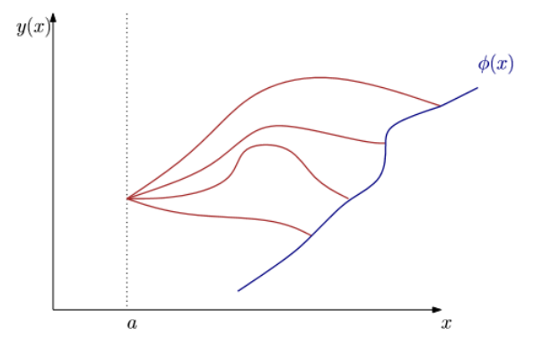
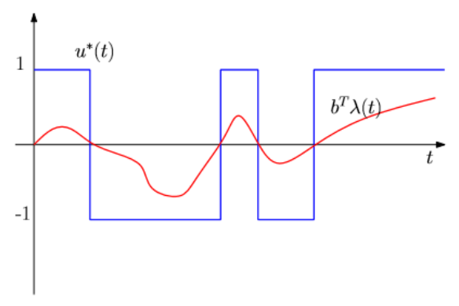
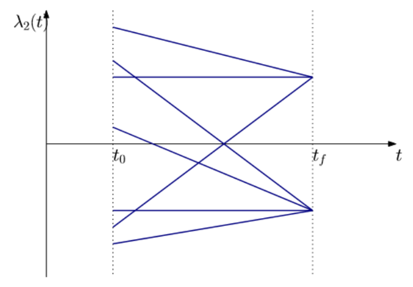
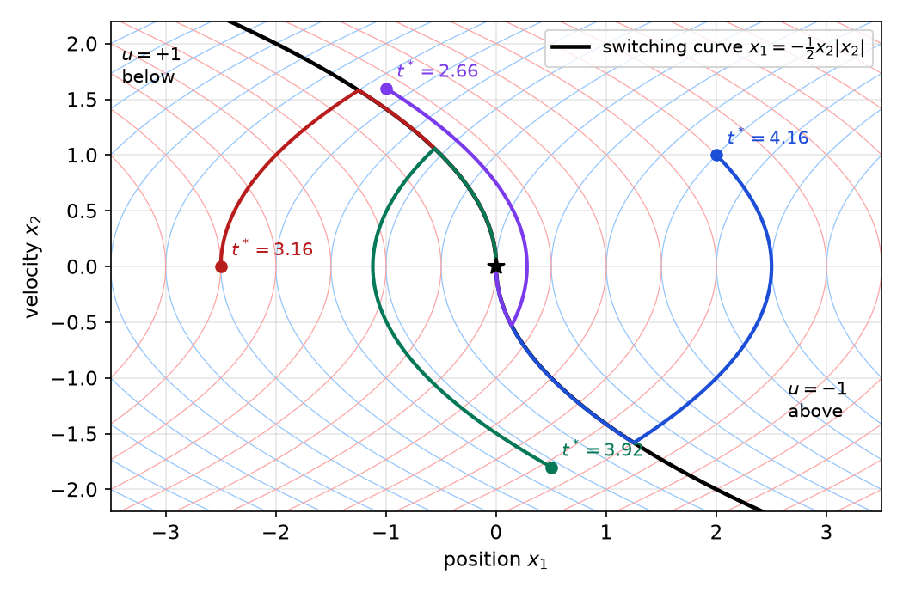
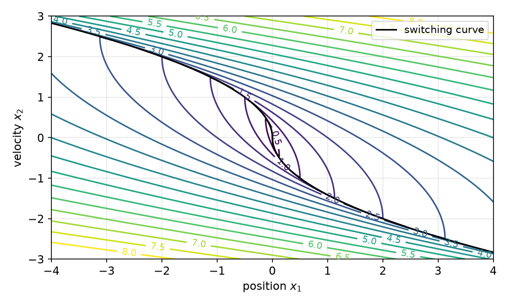
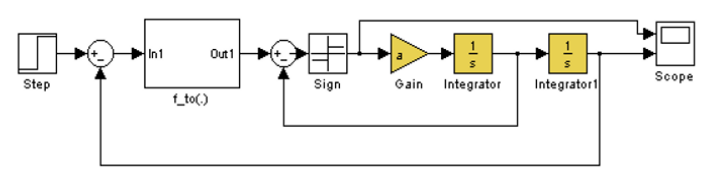
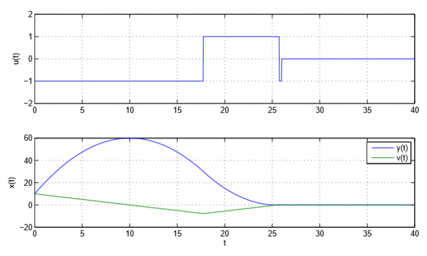

# Pontryagin's Minimum Principle

The variational necessary conditions of [Continuous-Time Optimal Control](continuous-optimal-control.md) contain the stationarity condition \\(\partial H/\partial u = 0\\). That condition silently assumes the optimal control lies in the interior of an unconstrained set. Real actuators saturate, and many of the most important problems (minimum time, minimum fuel) are meaningless without bounds on the control. Pontryagin's principle replaces stationarity with a pointwise *minimization of the Hamiltonian over the admissible control set*. This chapter states the principle, derives the transversality conditions for a free final time, and works out the canonical application: time-optimal bang-bang control of the double integrator and its switching curve. It closes with singular arcs, where the principle alone does not determine the control.

## Why Calculus of Variations Is Not Enough

Classical calculus of variations derives the optimality conditions by perturbing the control, \\(u + \varepsilon\eta\\), and setting the first variation to zero. That approach has three limitations for control problems:

1. **It requires first derivatives with respect to the control**, which only make sense if the optimal control is interior to the admissible set. If \\(\lvert u\rvert\le 1\\) and the optimum is \\(u = 1\\), the perturbation \\(u + \varepsilon\eta\\) is inadmissible for \\(\eta > 0\\), and \\(\partial H/\partial u\\) need not vanish there.
2. **Second derivatives of \\(H\\) need not exist or be informative.** Many applied problems are *linear in the control*: the Hessian \\(\partial^2H/\partial u^2\\) is identically zero, so the Legendre condition gives no information. In the language of the calculus of variations such problems are strongly degenerate.
3. **It cannot handle switching.** Optimal controls of bounded problems are typically discontinuous, jumping between the limits of the admissible set.

### History

Lev Semyonovich Pontryagin (1908–1988) was a Soviet mathematician, born in Moscow. He was blinded at fourteen by a primus-stove explosion; his mother, Tatyana Andreevna, read mathematics to him (including works of Hopf, Whitehead and Whitney), and he became a leading topologist before turning to differential equations and control.

The principle was discovered in the mid-1950s at the Steklov Institute in Moscow by Pontryagin and his students V. G. Boltyanskii and R. V. Gamkrelidze. According to Gamkrelidze's account, Pontryagin's interest began with a meeting with two military aerodynamics specialists who posed a time-optimal aircraft maneuvering problem: a fifth-order system with three scalar controls, two of them bounded and entering linearly, so that the Euler–Lagrange equations did not apply. Pontryagin remarked, half-jokingly, "We should invent a new calculus of variations." The maximum principle was first formulated as a conjecture, and a complete linear time-optimal theory, extensions to general integral functionals and to bounded state coordinates, and many applied problems were worked out before a general proof existed. The proof, found by Boltyanskii after about eight months, used **needle variations**: perturbations of the control that vanish except on intervals of small total length, where they may take *arbitrary* admissible values. Convex combinations of needle variations can always be formed, regardless of the shape of the admissible set \\(U\\), and this produces a sufficiently rich set of attainable perturbations to separate from the cost-decreasing directions. The full theory appeared in the 1961 monograph of Pontryagin, Boltyanskii, Gamkrelidze and Mishchenko, *The Mathematical Theory of Optimal Processes* (English translation 1962).

Optimal control became an independent branch of mathematics through this work, driven by applied problems that classical variational calculus could not handle. Later developments, such as non-smooth, infinite-dimensional and PDE-constrained problems, extended the class of problems by analogy with the maximum principle rather than by generalizing its proof, and the principle also proved fruitful in geometry (Riemannian and sub-Riemannian geodesics).

## From the Legendre Condition to a Maximum Principle

Why "maximum"? In the calculus of variations, with the integrand \\(L(x,y,y')\\) and the momentum \\(p = L\_{y'}\\), the Hamiltonian is
\\[
H(x,y,y',p) = p\\,y' - L(x,y,y').
\\]
Treat \\(y'\\) as an independent variable. Along an extremal, \\(H\_{y'} = p - L\_{y'} = 0\\): \\(H\\) is stationary in \\(y'\\). The Legendre necessary condition for a minimum is \\(L\_{y'y'}\ge 0\\), so \\(H\_{y'y'} = -L\_{y'y'}\le 0\\): the stationary point is a **maximum**. Thus, along a minimizing curve,
\\[
H\big(x, y^\star, (y^\star)', p^\star\big)\ \ge\ H\big(x, y^\star, y', p^\star\big)\quad\text{for all } y'.
\\]
Pontryagin's insight was that this maximization statement, unlike stationarity, still makes sense when \\(y'\\) (the control) is restricted to a closed set, and that it remains *necessary* there.

For a control problem with dynamics \\(\dot x = f(x,u,t)\\), the same construction with the augmented integrand \\(L(t,x,u) + \lambda^\top(\dot x - f)\\) leads to the Hamiltonian \\(H = -L + \lambda^\top f\\) in the original "maximum" convention. Stationarity \\(H\_u = 0\\) is just the special case in which the maximum is attained at an interior point because \\(U\\) is unbounded.

**Sign conventions.** Most engineering texts (and the rest of this book) write the Hamiltonian as \\(H = L + \lambda^\top f\\) and state a *minimum* principle. The two are equivalent: replacing \\(\lambda\\) by \\(-\lambda\\) gives \\(H\_{\min} = L + \lambda^\top f = -H\_{\max}\\), and maximizing \\(H\_{\max}\\) is minimizing \\(H\_{\min}\\). The canonical equations \\(\dot x = H\_\lambda\\), \\(\dot\lambda = -H\_x\\) have the same form in both conventions.

## Statement of the Principle

### Problem

Minimize
\\[
J = \phi\big(x(t\_f), t\_f\big) + \int\_{t\_0}^{t\_f}L(x,u,t)\\,dt
\\]
subject to
\\[
\dot x = f(x,u,t), \qquad x(t\_0) = x\_0, \qquad \psi\big(x(t\_f), t\_f\big) = 0, \qquad u(t)\in U\ \text{for all } t,
\\]
where \\(U\subset\mathbb{R}^m\\) is the admissible control set (for example a box \\(\lvert u\_i\rvert\le 1\\)), \\(\psi\in\mathbb{R}^p\\) collects the terminal constraints, and the final time \\(t\_f\\) may be fixed or free. Admissible controls are piecewise continuous (more generally, measurable and bounded) functions with values in \\(U\\). Define
\\[
H(x,u,\lambda,t) = L(x,u,t) + \lambda^\top f(x,u,t).
\\]

**Theorem (Pontryagin's minimum principle).** Let \\(u^\star\\) be an optimal control with state trajectory \\(x^\star\\) and \\(f, L, \phi, \psi\\) continuously differentiable in \\(x\\) and \\(t\\). Then there exist a costate \\(\lambda^\star(t)\\) and a multiplier \\(\nu\in\mathbb{R}^p\\) such that:

1. **Canonical equations.**
\\[
\dot x^\star = \frac{\partial H}{\partial\lambda} = f(x^\star,u^\star,t), \qquad \dot\lambda^\star = -\frac{\partial H}{\partial x}\big(x^\star,u^\star,\lambda^\star,t\big).
\\]
2. **Minimum condition.** For almost every \\(t\in[t\_0,t\_f]\\),
\\[
\boxed{H\big(x^\star(t),u^\star(t),\lambda^\star(t),t\big)\ \le\ H\big(x^\star(t),u,\lambda^\star(t),t\big)\quad\text{for all } u\in U.}
\\]
3. **Boundary conditions.** \\(x^\star(t\_0) = x\_0\\), \\(\psi(x^\star(t\_f),t\_f) = 0\\), and
\\[
\lambda^\star(t\_f) = \left.\Big(\frac{\partial\phi}{\partial x} + \frac{\partial\psi}{\partial x}^\top\nu\Big)\right\|\_{t\_f}.
\\]
4. **Transversality in time.** If \\(t\_f\\) is free,
\\[
\left.\Big(\frac{\partial\phi}{\partial t} + \frac{\partial\psi}{\partial t}^\top\nu + H\Big)\right\|\_{t\_f} = 0 .
\\]
5. **Constancy of \\(H\\).** If \\(f\\) and \\(L\\) do not depend explicitly on \\(t\\), then \\(H(x^\star,u^\star,\lambda^\star)\\) is constant along the optimal trajectory; if moreover \\(t\_f\\) is free and \\(\phi,\psi\\) do not depend on \\(t\\), that constant is zero.

The statement above is the *normal* case. In full generality the cost is multiplied by a constant \\(\lambda\_0\ge 0\\), \\(H = \lambda\_0L + \lambda^\top f\\), with \\((\lambda\_0,\lambda(t))\ne 0\\); *abnormal* extremals with \\(\lambda\_0 = 0\\) occur when the constraints alone pin down the trajectory, and they are rare in engineering problems. A complete proof is in Liberzon, *Calculus of Variations and Optimal Control Theory* (2012), Ch. 4.

Three remarks put the theorem in context.

- **It contains the earlier conditions.** If \\(U = \mathbb{R}^m\\) and \\(H\\) is differentiable in \\(u\\), the minimum over \\(u\\) is attained at a stationary point, \\(H\_u = 0\\), and the second-order condition \\(H\_{uu}\succeq 0\\) holds. All the LQ results of [Continuous-Time LQR](continuous-lqr.md), for fixed and free final state, can be re-derived this way. The principle is only *needed* when the control set is bounded.
- **The minimization is pointwise.** At each instant one minimizes an ordinary function of the vector \\(u\\) over the set \\(U\\), with \\(x\\) and \\(\lambda\\) frozen. No differentiability in \\(u\\) is needed, and \\(U\\) may be nonconvex or even discrete.
- **It is a necessary condition.** Like the Euler–Lagrange equation it produces candidates (extremals), and the boundary-value problem it defines must still be solved, usually numerically. Sufficiency requires additional arguments, for example convexity or the [Hamilton–Jacobi–Bellman equation](dynamic-programming.md).

### Proof sketch: needle variations

Consider the fixed-time, free-endpoint problem and absorb the running cost into an extra state \\(x\_0\\) with \\(\dot x\_0 = L\\), so the cost is a function of the final state alone, \\(J = \phi(x(t\_f)) + x\_0(t\_f)\\). Pick a time \\(\tau\\) at which \\(u^\star\\) is continuous, an arbitrary \\(v\in U\\), and a small \\(\varepsilon>0\\). The **needle variation** is
\\[
u\_\varepsilon(t) = \begin{cases} v, & t\in(\tau-\varepsilon,\tau],\\\\ u^\star(t), & \text{otherwise}.\end{cases}
\\]
It differs from \\(u^\star\\) by a large amount, but only on a short interval, so the state changes only by a small amount. At time \\(\tau\\) the (extended) state differs from the optimal one by
\\[
\delta x(\tau) = \varepsilon\big[f(x^\star(\tau),v,\tau) - f(x^\star(\tau),u^\star(\tau),\tau)\big] + o(\varepsilon),
\\]
and after \\(\tau\\) the perturbation propagates through the linearized dynamics \\(\dot{\delta x} = f\_x\\,\delta x\\). The costate is defined to be the solution of the adjoint equation \\(\dot\lambda = -f\_x^\top\lambda\\) (for the extended system this is \\(\dot\lambda = -H\_x\\)) with \\(\lambda(t\_f)\\) equal to the gradient of the terminal cost. The adjoint is built so that \\(\lambda^\top\delta x\\) is constant in time. Hence the change in cost is
\\[
\delta J = \lambda^\top(t\_f)\\,\delta x(t\_f) + o(\varepsilon) = \lambda^\top(\tau)\\,\delta x(\tau) + o(\varepsilon)
= \varepsilon\big[H(x^\star,v,\lambda,\tau) - H(x^\star,u^\star,\lambda,\tau)\big] + o(\varepsilon).
\\]
Optimality requires \\(\delta J\ge 0\\) for every \\(v\in U\\) and every small \\(\varepsilon\\), which is the minimum condition at \\(\tau\\). With terminal constraints the argument is harder: one must show that the set of endpoint perturbations generated by (convex combinations of) needles cannot point into the region where the constraints hold and the cost decreases, which is a separating-hyperplane argument; the hyperplane normal supplies \\(\lambda(t\_f)\\) and \\(\nu\\).

## Transversality: Free Final Time and Moving Endpoints

The transversality conditions (items 3 and 4) are easiest to understand in the calculus of variations, with one endpoint constrained to a curve.

### A variable-endpoint problem

Minimize \\(J(y) = \int\_a^{x\_f}L(x,y,y')\\,dx\\) over curves that start at a fixed point at \\(x = a\\) and end anywhere on a given target curve \\(y = \phi(x)\\). The final abscissa \\(x\_f\\) is not fixed: it is part of the solution.



*Figure: variable-endpoint problem. All candidate curves (red) start at the same point at x = a and end somewhere on the target curve φ(x) (blue). Both the shape of the curve and the end point are to be optimized.*

Perturb the curve to \\(y + \alpha\eta\\) and simultaneously stretch the interval to \\([a, x\_f + \alpha\Delta x]\\):
\\[
J(y + \alpha\eta) = \int\_a^{x\_f + \alpha\Delta x}L\big(x, y + \alpha\eta, y' + \alpha\eta'\big)\\,dx .
\\]
The first variation \\(\delta J = \frac{d}{d\alpha}J(y + \alpha\eta)\big\|\_{\alpha=0}\\) has two parts by Leibniz's rule: the derivative of the integrand, and the integrand at the moving upper limit times \\(\Delta x\\). Integrating the \\(\eta'\\) term by parts (with \\(\eta(a) = 0\\)):
\\[
\delta J = \int\_a^{x\_f}\Big(L\_y - \frac{d}{dx}L\_{y'}\Big)\eta\\,dx + L\_{y'}\eta\Big\|\_{x\_f} + L\\,\Delta x\Big\|\_{x\_f}.
\\]
Perturbations with \\(\eta(x\_f) = 0\\) and \\(\Delta x = 0\\) are still allowed, so the integral must vanish for all such \\(\eta\\): the Euler–Lagrange equation holds. What remains is
\\[
L\_{y'}\eta\big\|\_{x\_f} + L\\,\Delta x\big\|\_{x\_f} = 0 .
\\]
\\(\eta(x\_f)\\) and \\(\Delta x\\) are not independent: the perturbed end point must stay on the target curve,
\\[
y(x\_f + \alpha\Delta x) + \alpha\eta(x\_f + \alpha\Delta x) = \phi(x\_f + \alpha\Delta x).
\\]
Differentiating at \\(\alpha = 0\\): \\(y'(x\_f)\Delta x + \eta(x\_f) = \phi'(x\_f)\Delta x\\), i.e. \\(\eta(x\_f) = \big(\phi'(x\_f) - y'(x\_f)\big)\Delta x\\). Substituting and cancelling the arbitrary \\(\Delta x\\) gives the **transversality condition**
\\[
\boxed{L\_{y'}\big(\phi' - y'\big) + L = 0\quad\text{at } x = x\_f .}
\\]

**Example 1 (shortest distance from a point to a curve).** With \\(L = \sqrt{1 + (y')^2}\\), the Euler–Lagrange equation gives \\(y'' = 0\\): the path is a straight line from the starting point. Now \\(L\_{y'} = y'/\sqrt{1 + (y')^2}\\), and multiplying the transversality condition by \\(\sqrt{1 + (y')^2}\\):
\\[
y'(\phi' - y') + 1 + (y')^2 = 0 \quad\Longleftrightarrow\quad 1 + y'(x\_f)\\,\phi'(x\_f) = 0 \quad\Longleftrightarrow\quad
\begin{bmatrix}1 & y'(x\_f)\end{bmatrix}\begin{bmatrix}1\\\\ \phi'(x\_f)\end{bmatrix} = 0 .
\\]
The tangent vectors of the path and of the target are orthogonal: the shortest path meets the target curve **perpendicularly**. This is the geometric origin of the word *transversality*.

### Hamiltonian form

With \\(p = L\_{y'}\\) and \\(H = p\\,y' - L\\), the transversality condition reads
\\[
p\\,\phi' - H = 0\quad\text{at } x\_f .
\\]
If the target is a horizontal line, \\(\phi(x) = c\\), the end *value* is fixed but the end *abscissa* is free, and the condition reduces to \\(H(x\_f) = 0\\).

In the control setting the independent variable is time, \\(y\\) is the state, and "fixed end value, free end abscissa" is the problem with **fixed final state and free final time**. The result carries over directly, with the general form given in item 4 of the theorem:
\\[
\left.\Big(\frac{\partial\phi}{\partial t} + \frac{\partial\psi}{\partial t}^\top\nu + H\Big)\right\|\_{t\_f} = 0
\quad\xrightarrow{\ \phi,\ \psi\ \text{independent of } t\ }\quad H(t\_f) = 0 .
\\]
The interpretation: if the final time were extended by \\(dt\\), the cost would change by \\(H(t\_f)\\,dt\\) to first order; at the optimal free final time this marginal cost must vanish.

## Time-Optimal Control and Bang-Bang Solutions

### The minimum-time problem

The prototypical problem that requires the minimum principle is to reach a target as fast as possible:
\\[
J = \int\_{t\_0}^{t\_f}1\\,dt = t\_f - t\_0, \qquad L = 1 .
\\]
Without bounds on the control this problem has no solution: any transfer can be done faster with a larger control, and the infimum is zero. So bounds are essential. Consider a linear time-invariant plant
\\[
\dot x = Ax + Bu, \qquad x(0) = x\_0, \qquad x(t\_f) = 0, \qquad \lvert u\_i\rvert\le 1,\ i = 1,\dots,m,
\\]
with \\(t\_0 = 0\\) and \\(t\_f\\) free. The Hamiltonian is
\\[
H = 1 + \lambda^\top(Ax + Bu),
\\]
and the canonical equations are
\\[
\dot x = H\_\lambda = Ax + Bu, \qquad \dot\lambda = -H\_x = -A^\top\lambda \ \Rightarrow\ \lambda(t) = e^{-A^\top t}\lambda(0).
\\]
The control enters \\(H\\) only through \\(\lambda^\top Bu = \sum\_i(b\_i^\top\lambda)u\_i\\), where \\(b\_i\\) is the \\(i\\)-th column of \\(B\\). Each term is minimized independently over \\(u\_i\in[-1,1]\\): a linear function on an interval is minimized at the endpoint opposite to its slope. Therefore
\\[
\boxed{u\_i^\star(t) = -\operatorname{sgn}\big(b\_i^\top\lambda(t)\big)}
\\]
(in the maximum convention, with \\(\lambda\\) of opposite sign, this reads \\(u = \operatorname{sgn}(B^\top\lambda)\\)). The control is always at one of its limits and switches when the **switching function** \\(b\_i^\top\lambda(t)\\) changes sign: this is **bang-bang control**.



*Figure: a switching function bᵀλ(t) (red) and the resulting bang-bang control u⋆(t) (blue, drawn in the maximum convention u⋆ = sgn bᵀλ). The control sits at +1 or −1 and switches exactly at the zero crossings of the switching function.*

Since the final state is fixed and \\(t\_f\\) is free, transversality gives \\(H(t\_f) = 0\\), and because the problem is time-invariant, \\(H\equiv 0\\) along the optimal trajectory. In particular \\(\lambda(t)\ne 0\\) for all \\(t\\), since \\(\lambda = 0\\) would give \\(H = 1\\).

### General results for linear systems

For linear plants with a box constraint, the structure of time-optimal controls is completely understood. The following are classical results from the 1960s (see Pontryagin et al., 1962, and Lee and Markus, *Foundations of Optimal Control Theory*, 1967).

**Theorem (existence).** If the target \\(x = 0\\) can be reached from \\(x\_0\\) by some admissible control, then a time-optimal control exists. (The reachable sets of a linear system with a compact convex control set are compact and convex, which is what makes this work.)

**Theorem (bang-bang principle and uniqueness).** Suppose the system is **normal**: \\((A, b\_i)\\) is controllable for every column \\(b\_i\\) of \\(B\\). Then each switching function \\(b\_i^\top e^{-A^\top t}\lambda(0)\\) is a nonzero real-analytic function of \\(t\\), so it has only finitely many zeros on any bounded interval. The time-optimal control is bang-bang with finitely many switches, and it is unique.

**Theorem (number of switches; Feldbaum).** If the system is normal and all eigenvalues of \\(A\\) are real, each component \\(u\_i^\star\\) switches at most \\(n - 1\\) times, where \\(n\\) is the state dimension.

For complex eigenvalues (oscillatory plants) the number of switches is finite on bounded intervals but not bounded by \\(n-1\\); for a harmonic oscillator the control switches every half period of the oscillation.

### Example 2: the double integrator

The canonical example is the double integrator \\(\ddot y = u\\), \\(\lvert u\rvert\le 1\\), with position \\(x\_1 = y\\) and velocity \\(x\_2 = \dot y\\):
\\[
\dot x = \begin{bmatrix}0&1\\\\0&0\end{bmatrix}x + \begin{bmatrix}0\\\\1\end{bmatrix}u .
\\]
The task is to bring the mass to rest at the origin in minimum time from an arbitrary initial state.

**Costate and switching function.** The switching function is \\(b^\top\lambda = \lambda\_2\\), so \\(u^\star = -\operatorname{sgn}\lambda\_2\\). The costate equation \\(\dot\lambda = -A^\top\lambda\\) with \\(A^\top = \begin{bmatrix}0&0\\\\1&0\end{bmatrix}\\) reads \\(\dot\lambda\_1 = 0\\), \\(\dot\lambda\_2 = -\lambda\_1\\), so
\\[
\lambda\_1(t) = c\_1, \qquad \lambda\_2(t) = c\_2 - c\_1t .
\\]
At the final time \\(x(t\_f) = 0\\), so \\(H(t\_f) = 1 + \lambda\_2(t\_f)u(t\_f) = 0\\), i.e. \\(\lambda\_2(t\_f)u(t\_f) = -1\\): \\(\lambda\_2(t\_f) = \pm1\\), with sign opposite to the final control. The decisive observation is that **\\(\lambda\_2\\) is affine in \\(t\\), so it crosses zero at most once.** The optimal control therefore has **at most one switch**, in agreement with Feldbaum's theorem (\\(n = 2\\), eigenvalues both zero, so at most \\(n - 1 = 1\\) switch). The candidate controls are \\(\\{+1\\}\\), \\(\\{-1\\}\\), \\(\\{+1, -1\\}\\) and \\(\\{-1, +1\\}\\).



*Figure: possible histories of λ₂(t) on [t₀, t_f]. Every one is a straight line, so it changes sign at most once; at t_f all lines end at one of the two levels allowed by H(t_f) = 0. (The figure is drawn in the maximum convention; in the minimum convention the signs of λ are reversed.)*

**Trajectories under constant control.** With \\(u = \pm1\\) constant,
\\[
x\_2(t) = x\_2(0) + ut, \qquad x\_1(t) = x\_1(0) + x\_2(0)\\,t + \tfrac12ut^2 .
\\]
Eliminate \\(t = (x\_2 - x\_2(0))/u\\) and use \\(u^2 = 1\\):
\\[
u\big(x\_1 - x\_1(0)\big) = x\_2(0)\big(x\_2 - x\_2(0)\big) + \tfrac12\big(x\_2 - x\_2(0)\big)^2 = \tfrac12\big(x\_2^2 - x\_2^2(0)\big).
\\]
So the phase trajectories are parabolas \\(x\_1 = \tfrac{u}{2}x\_2^2 + \text{const}\\): opening to the right for \\(u = +1\\) (traversed upward, since \\(\dot x\_2 = +1\\)) and to the left for \\(u = -1\\) (traversed downward).

**The switching curve.** Only two of these parabola arcs pass through the origin in the direction of motion:

- with \\(u = +1\\): \\(x\_1 = \tfrac12x\_2^2\\), approached from below, so \\(x\_2<0\\);
- with \\(u = -1\\): \\(x\_1 = -\tfrac12x\_2^2\\), approached from above, so \\(x\_2>0\\).

Together they form the **switching curve**
\\[
\Gamma:\quad x\_1 = \begin{cases}\tfrac12x\_2^2, & x\_2<0,\\\\ -\tfrac12x\_2^2, & x\_2>0,\end{cases}
\qquad\text{i.e.}\qquad x\_1 = -\tfrac12x\_2\lvert x\_2\rvert .
\\]
Since at most one switch is allowed, the last arc of every optimal trajectory lies on \\(\Gamma\\). A state *above* \\(\Gamma\\) (to its right) must use \\(u = -1\\) until its leftward parabola meets the lower branch of \\(\Gamma\\), then switch to \\(u = +1\\) and ride \\(\Gamma\\) into the origin. A state below \\(\Gamma\\) does the mirror image. This yields the time-optimal law as a **state feedback**:
\\[
\boxed{u^\star(x) = \begin{cases}-1, & x\_1 > -\tfrac12x\_2\lvert x\_2\rvert,\ \text{ or } x\_1 = -\tfrac12x\_2\lvert x\_2\rvert \text{ and } x\_2>0,\\\\
+1, & x\_1 < -\tfrac12x\_2\lvert x\_2\rvert,\ \text{ or } x\_1 = -\tfrac12x\_2\lvert x\_2\rvert \text{ and } x\_2<0 .\end{cases}}
\\]
Off the curve the law can also be written \\(u^\star = -\operatorname{sgn}\big(x\_2 + \operatorname{sgn}(x\_1)\sqrt{2\lvert x\_1\rvert}\big)\\): the curve \\(\Gamma\\) solved for velocity is \\(x\_2 = -\operatorname{sgn}(x\_1)\sqrt{2\lvert x\_1\rvert}\\), and since \\(-\tfrac12x\_2\lvert x\_2\rvert\\) is decreasing in \\(x\_2\\), being above \\(\Gamma\\) is the same as having more velocity than \\(\Gamma\\) prescribes.

**Minimum time.** For a state above \\(\Gamma\\), the \\(u = -1\\) parabola through it is \\(x\_1 + \tfrac12x\_2^2 = c\\) with \\(c = x\_1 + \tfrac12x\_2^2\\). It meets the lower branch \\(x\_1 = \tfrac12x\_2^2\\) where \\(x\_2^2 = c\\), i.e. at \\(x\_2 = -\sqrt c\\). The velocity changes at unit rate, so the first arc takes \\(x\_2 + \sqrt c\\) and the second \\(\sqrt c\\):
\\[
t^\star(x) = x\_2 + 2\sqrt{x\_1 + \tfrac12x\_2^2}\quad\text{(above }\Gamma\text{)}, \qquad
t^\star(x) = -x\_2 + 2\sqrt{-x\_1 + \tfrac12x\_2^2}\quad\text{(below }\Gamma\text{)}.
\\]
On \\(\Gamma\\) both reduce to \\(\lvert x\_2\rvert\\). For example, from rest at \\(x\_1 = -2.5\\) the optimal control is \\(u = +1\\) for \\(\sqrt{2.5} = 1.58\\) s and then \\(u = -1\\) for another 1.58 s, total \\(2\sqrt{2.5} = 3.16\\) s: accelerate flat out for half the time, brake flat out for the other half.

The following script draws the parabola families, the switching curve and several optimal trajectories obtained by simulating the feedback law, and checks the switching times against the formula for \\(t^\star\\).

```python
import numpy as np, matplotlib.pyplot as plt

def u_opt(x1, x2):                       # time-optimal feedback law
    s = x1 + 0.5 * x2 * abs(x2)          # s > 0: above the switching curve
    return -1.0 if s > 0 else (1.0 if s < 0 else -np.sign(x2))

def t_star(x1, x2):
    if x1 + 0.5 * x2 * abs(x2) >= 0:
        return x2 + 2 * np.sqrt(x1 + 0.5 * x2**2)
    return -x2 + 2 * np.sqrt(-x1 + 0.5 * x2**2)

v = np.linspace(-2.2, 2.2, 400)
for c in np.arange(-6, 6.01, 0.5):       # trajectory families
    plt.plot(c + 0.5 * v**2, v, color="#93c5fd", lw=0.6)   # u = +1
    plt.plot(c - 0.5 * v**2, v, color="#fca5a5", lw=0.6)   # u = -1
plt.plot(-0.5 * v * np.abs(v), v, "k", lw=2)             # switching curve
for x0 in [(2.0, 1.0), (-2.5, 0.0), (0.5, -1.8), (-1.0, 1.6)]:
    x, dt, path = np.array(x0), 1e-3, [x0]
    for _ in range(int(t_star(*x0) / dt)):                # exact update for constant u
        u = u_opt(*x)
        x = np.array([x[0] + x[1] * dt + 0.5 * u * dt**2, x[1] + u * dt])
        path.append(tuple(x))
    plt.plot(*np.array(path).T, lw=2)
plt.xlim(-3.5, 3.5); plt.ylim(-2.2, 2.2); plt.xlabel("$x_1$"); plt.ylabel("$x_2$")
plt.show()
```



*Figure: phase plane of the time-optimal double integrator. Light blue: parabolas for u = +1 (moving up); light red: parabolas for u = −1 (moving down). Black: the switching curve x₁ = −½x₂|x₂|. Each colored trajectory follows one parabola until it hits the switching curve, switches once, and slides along the curve into the origin. The labels give the minimum time t⋆ from each initial state; the simulated switching and arrival times agree with the formula to 10⁻³ s (the integration step).*



*Figure: level sets of the minimum time t⋆(x). They are made of parabola arcs and have a corner on the switching curve: the minimum-time function is continuous but not differentiable there. This value function reappears in the Hamilton–Jacobi–Bellman equation of the next chapter, which is why HJB theory has to deal with non-smooth solutions.*

**Implementation and simulation.** The law can be implemented as a nonlinear feedback loop. In the Simulink diagram below, the step block supplies a position set point; the block `f_to` maps the position error \\(e\\) to the velocity that the switching curve prescribes, \\(\operatorname{sgn}(e)\sqrt{2a\lvert e\rvert}\\) for a control bound \\(a\\); the velocity is subtracted from it, and a sign block followed by the gain \\(a\\) produces the bang-bang control that drives the two integrators.



*Figure: Simulink implementation of time-optimal feedback for a double integrator with control bound a: the outer loop feeds back position through the switching-curve map f_to, the inner loop feeds back velocity, and the Sign block makes the control bang-bang.*



*Figure: simulated response from position 10 and velocity 10 with a = 1. The control is −1 (braking) until the trajectory meets the switching curve at t ≈ 17.8 s, at velocity ≈ −7.7, then +1 until the state reaches the origin at t ≈ 25.5 s. The position (blue) peaks at 60 at t = 10 s. The brief −1 pulse at the end is numerical chattering of the sign function at the origin.*

These numbers check against the formulas. From \\(x = (10,10)\\), which is above \\(\Gamma\\), \\(u = -1\\) gives \\(x\_2 = 10 - t\\), \\(x\_1 = 10 + 10t - \tfrac12t^2\\), with the peak \\(x\_1 = 60\\) at \\(t = 10\\). The switch occurs when \\(x\_1 = \tfrac12x\_2^2\\), i.e. \\(t^2 - 20t + 40 = 0\\), \\(t = 10 + \sqrt{60} = 17.75\\) s, where \\(x\_2 = -7.75\\). The total time is \\(t^\star = 10 + 2\sqrt{60} = 25.49\\) s.

**Chattering in practice.** On the switching curve and at the origin, the discontinuous law is sensitive to noise and to discrete-time implementation: the control chatters between \\(\pm1\\). Practical implementations replace the sign function near the origin by a linear (saturated) feedback, or use a small dead zone. This is the same issue met in [Sliding Mode Control](../nonlinear/sliding-control.md), where the switching curve plays the role of the sliding surface.

## Singular Arcs

The bang-bang argument breaks down if the switching function vanishes on a whole *interval*, not just at isolated instants. Then \\(H\\) does not depend on \\(u\\) along that interval, and the minimum condition says nothing about the control. Such a portion of the trajectory is a **singular arc**. Singular arcs are possible whenever the Hamiltonian is affine in the control,
\\[
H = H\_0(x,\lambda,t) + \sigma(x,\lambda,t)\\,u, \qquad \sigma = H\_u .
\\]
Off singular arcs, \\(u = -\operatorname{sgn}\sigma\\) (for \\(\lvert u\rvert\le1\\)). On a singular arc, \\(\sigma\equiv 0\\) on an interval, so all its time derivatives also vanish: \\(\dot\sigma = 0\\), \\(\ddot\sigma = 0\\), and so on. The control appears explicitly in some even derivative \\(\sigma^{(2q)}\\), and setting that derivative to zero determines the **singular control**. A further necessary condition for optimality of a singular arc in a minimization problem is the **generalized Legendre–Clebsch (Kelley) condition**
\\[
(-1)^q\\,\frac{\partial}{\partial u}\Big[\frac{d^{2q}}{dt^{2q}}H\_u\Big]\ \ge\ 0 .
\\]

**Double integrator: no singular arcs.** For the time-optimal double integrator, \\(\sigma = \lambda\_2 = c\_2 - c\_1t\\). If \\(\lambda\_2\equiv 0\\) on an interval then \\(c\_1 = c\_2 = 0\\), so \\(\lambda\equiv 0\\) and \\(H = 1\ne 0\\), contradicting \\(H\equiv 0\\). So singular arcs are impossible here, and the bang-bang solution is the whole story. The same argument shows that normal linear time-optimal problems never have singular arcs: \\(b\_i^\top e^{-A^\top t}\lambda(0)\equiv 0\\) on an interval with \\((A,b\_i)\\) controllable forces \\(\lambda(0) = 0\\).

**Example 3 (a problem with a singular arc).** Minimize \\(J = \tfrac12\int\_0^{t\_f}x^2dt\\) for \\(\dot x = u\\), \\(\lvert u\rvert\le 1\\), \\(x(0) = x\_0\\), fixed \\(t\_f > \lvert x\_0\rvert\\). Then
\\[
H = \tfrac12x^2 + \lambda u, \qquad \sigma = \lambda, \qquad \dot\lambda = -H\_x = -x .
\\]
Off singular arcs \\(u = -\operatorname{sgn}\lambda\\). On a singular arc, \\(\lambda\equiv 0\\) forces \\(\dot\lambda = -x = 0\\), so \\(x\equiv 0\\), and then \\(\ddot\lambda = -\dot x = -u = 0\\): the singular control is \\(u = 0\\), an *interior* value. The Kelley condition holds with \\(q = 1\\): \\(\frac{d^2}{dt^2}H\_u = -u\\), so \\((-1)\cdot\partial(-u)/\partial u = 1\ge 0\\). The optimal solution is what intuition suggests: drive \\(x\\) to zero at full rate, \\(u = -\operatorname{sgn}x\_0\\) for \\(t\le\lvert x\_0\rvert\\), then stay on the singular arc \\(x = 0\\) with \\(u = 0\\).

Singular arcs occur in many applications: the intermediate-thrust arc of the Goddard rocket problem, optimal harvesting, and some chemical-reactor problems. They can also be approached in infinitely many switches: in **Fuller's problem**, minimizing \\(\int x\_1^2dt\\) for the double integrator with \\(\lvert u\rvert\le 1\\), the optimal control switches infinitely often, at times accumulating geometrically, before reaching the origin in finite time (chattering control). This shows that "bang-bang with finitely many switches" is a property of specific problem classes, not of bounded-control problems in general.

## Summary

- **Minimum principle.** With \\(H = L + \lambda^\top f\\): \\(\dot x = H\_\lambda\\), \\(\dot\lambda = -H\_x\\), and \\(u^\star(t)\\) minimizes \\(H(x^\star,u,\lambda^\star,t)\\) over \\(u\in U\\) at (almost) every instant. With \\(H = -L + \lambda^\top f\\), the same statement is a maximum principle.
- **Boundary conditions.** \\(\lambda(t\_f) = \phi\_x + \psi\_x^\top\nu\\); for free final time \\((\phi\_t + \psi\_t^\top\nu + H)\big\|\_{t\_f} = 0\\), which gives \\(H(t\_f) = 0\\) for a fixed target. For time-invariant problems \\(H\\) is constant along optimal trajectories.
- **Transversality (calculus of variations).** \\(L\_{y'}(\phi' - y') + L = 0\\) at a moving endpoint; shortest paths meet the target curve perpendicularly.
- **Linear time-optimal control.** \\(u\_i^\star = -\operatorname{sgn}(b\_i^\top\lambda)\\), \\(\lambda(t) = e^{-A^\top t}\lambda(0)\\): bang-bang, unique for normal systems, at most \\(n-1\\) switches per input if all eigenvalues of \\(A\\) are real.
- **Double integrator.** At most one switch; switching curve \\(x\_1 = -\tfrac12x\_2\lvert x\_2\rvert\\); \\(u^\star = -1\\) above it and \\(+1\\) below; minimum time \\(t^\star = x\_2 + 2\sqrt{x\_1 + x\_2^2/2}\\) above the curve (mirror formula below).
- **Singular arcs.** If the switching function vanishes on an interval, the control is found by differentiating \\(H\_u = 0\\) until \\(u\\) appears, subject to the generalized Legendre–Clebsch condition. None occur in normal linear time-optimal problems.

## See Also

- [Continuous-Time Optimal Control](continuous-optimal-control.md): the unconstrained necessary conditions and the numerical solution of the resulting boundary-value problems.
- [Calculus of Variations](calculus-of-variations.md): Euler–Lagrange, Legendre condition, and variable endpoints.
- [Continuous-Time LQR and Its Extensions](continuous-lqr.md): the unconstrained linear-quadratic case.
- [Dynamic Programming and the HJB Equation](dynamic-programming.md): the value-function approach; the costate is the gradient of the value function.
- [Model Predictive Control](mpc.md): handling input constraints numerically, on-line.
- [Phase-Plane Analysis](../nonlinear/phase-plane.md) and [Sliding Mode Control](../nonlinear/sliding-control.md): switching curves and chattering in nonlinear control.
- [Optimal Control (overview)](../optimal.md).
