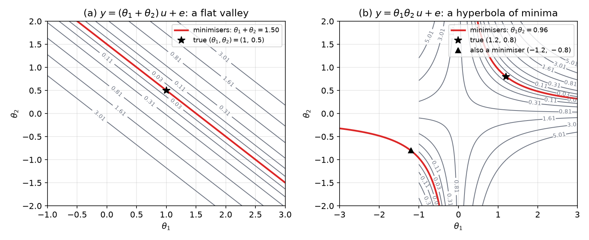
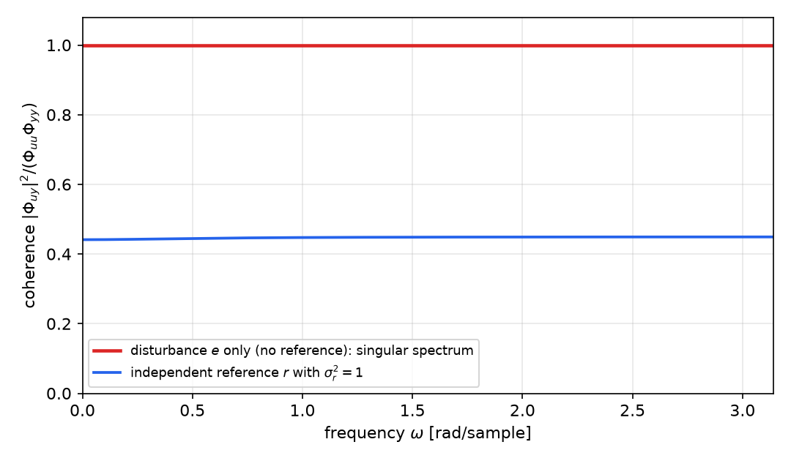
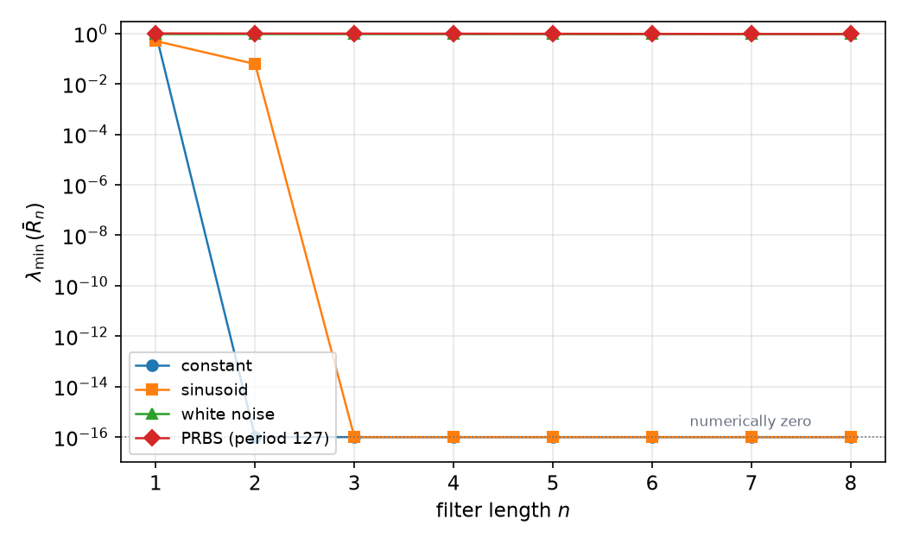
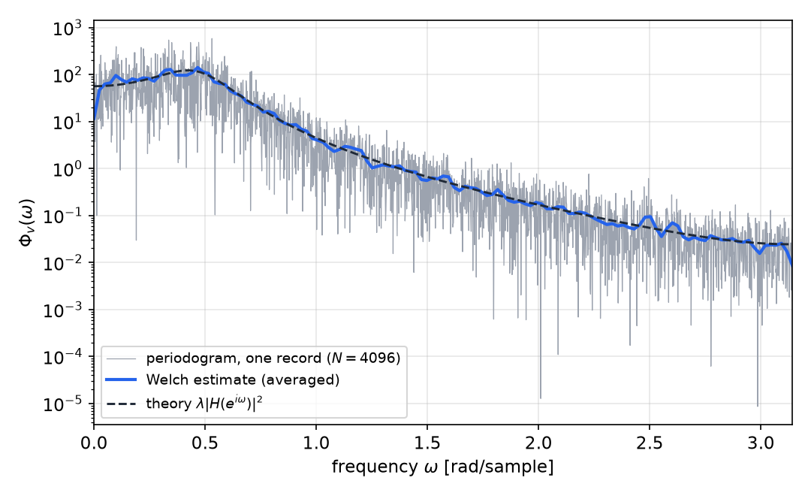
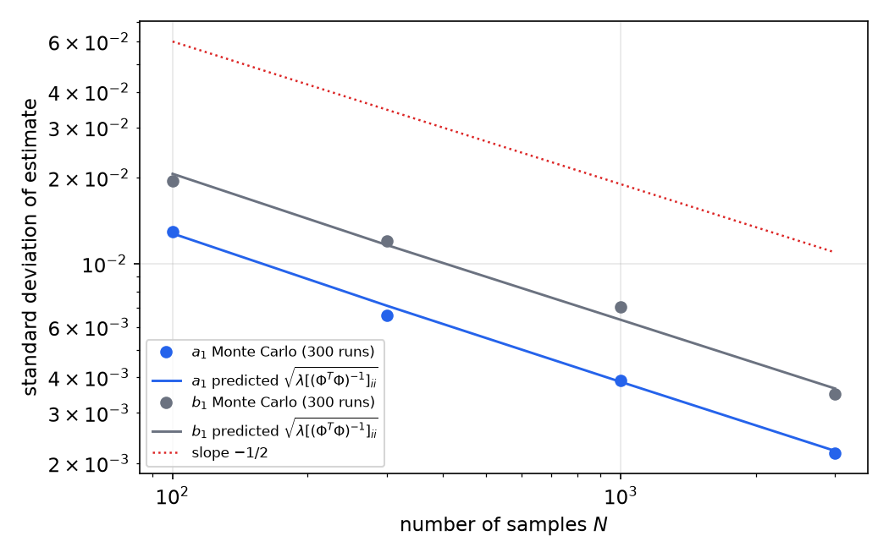

# Informative Experiments, Persistent Excitation and Asymptotic Properties

An estimator can only recover parameters that the data are able to reveal. Three questions decide whether a model can be estimated from a given experiment. Does the model structure map different parameter vectors to different input–output behaviour (**identifiability**)? Does the data set contain enough variety to tell apart the models in that structure (**informativeness**, and its time-domain form, **persistent excitation**)? And, once those hold, how fast does the estimate settle and how large is its uncertainty (**asymptotic properties**)? This chapter takes the three in order. It builds on the least-squares normal equations of [Least Squares and Recursive Least Squares](least-squares.md), whose matrix \\(\sum\varphi\varphi^T\\) is invertible exactly when the regressors are persistently exciting, and it prepares the choice of input in the [next chapter](input-design.md).

## Models, Predictors and Equality of Models

Every linear model in this subsection can be written as a **predictor**. Given input \\(u\\) and output \\(y\\), the one-step-ahead prediction takes the form
\\[
\hat y(t\mid\theta) = W\_u(q,\theta)\\,u(t) + W\_y(q,\theta)\\,y(t) = W(q,\theta)\\,z(t),\qquad z(t) = \begin{bmatrix}u(t)\\\\ y(t)\end{bmatrix}.
\\]
For a noise model \\(y = G(q)u + H(q)e\\) with \\(H\\) monic, inverse-stable, the predictor filters are \\(W\_u = H^{-1}G\\) and \\(W\_y = 1 - H^{-1}\\), and the prediction error is \\(\varepsilon(t) = y(t) - \hat y(t\mid\theta) = H^{-1}(q)\big[y(t) - G(q)u(t)\big]\\). Two models are **equal** when their predictors agree at every frequency,
\\[
W\_1(e^{i\omega}) = W\_2(e^{i\omega}) \quad\text{for almost all }\omega .
\\]
This is equivalent to \\(G\_1 = G\_2\\) and \\(H\_1 = H\_2\\), because \\(W\_u\\) and \\(W\_y\\) determine \\(G = W\_u/(1-W\_y)\\) and \\(H = 1/(1-W\_y)\\) and conversely.

A **model structure** is a differentiable map \\(\theta \mapsto \mathcal M(\theta) = W(q,\theta)\\) from an open parameter set \\(D\_{\mathcal M}\subset\mathbb R^d\\). Its **gradient** \\(\psi(t,\theta) = \frac{d}{d\theta}\hat y(t\mid\theta)\\) is what the estimation algorithm sees. For the ARX structure \\(A(q)y = B(q)u + e\\) the predictor is linear in \\(\theta\\), \\(\hat y = \varphi^T(t)\theta\\), with \\(\psi = \varphi\\). For other structures \\(\psi\\) depends on \\(\theta\\), and it is this gradient that controls the asymptotic covariance below.

## Structural Identifiability

Identifiability is a property of the map \\(\theta\mapsto\mathcal M(\theta)\\), before any data are collected. Following Ljung, the definitions are as follows.

**Definition (global identifiability).** A model structure \\(\mathcal M\\) is *globally identifiable at* \\(\theta^\*\\) if \\(\mathcal M(\theta) = \mathcal M(\theta^\*)\\) with \\(\theta\in D\_{\mathcal M}\\) implies \\(\theta = \theta^\*\\). It is *locally identifiable* at \\(\theta^\*\\) if the same holds for all \\(\theta\\) in some neighbourhood of \\(\theta^\*\\).

**Definition (identifiable almost everywhere).** The structure is *globally identifiable* (without qualification) if it is globally identifiable at almost every \\(\theta^\*\\). This is the realistic requirement. Identifiability fails on lower-dimensional sets of parameter values, for example where a pole and a zero cancel and the model reduces to a lower order.

The distinction matters in practice. A structure can be identifiable at generic parameter values and still fail at a few special ones; the estimator then works for almost every real plant, but not for one that happens to sit on the bad set.

**Example 1 (Only a sum is identifiable).** Consider the static-gain model \\(y(t) = (\theta\_1+\theta\_2)\\,u(t) + e(t)\\). Every pair with the same sum gives the same predictor, so the structure is not identifiable at any point: \\(\mathcal M(\theta)=\mathcal M(\theta^\*)\\) whenever \\(\theta\_1+\theta\_2 = \theta\_1^\*+\theta\_2^\*\\), a whole line of parameter vectors. No experiment, however long or rich, can separate \\(\theta\_1\\) from \\(\theta\_2\\). The cure is a reparametrization in which the unknowns enter separately, or a physical argument that fixes one of them.

**Example 2 (A product of parameters).** For \\(y(t) = \theta\_1\theta\_2\\,u(t) + e(t)\\) the predictor depends only on the product \\(p = \theta\_1\theta\_2\\). The structure is locally identifiable wherever \\(\theta\_1\neq0\\), since \\(p\\) then determines \\(\theta\_2\\) once \\(\theta\_1\\) is fixed. It is not globally identifiable: \\((\theta\_1,\theta\_2)\\) and \\((-\theta\_1,-\theta\_2)\\) give identical predictions. Estimation can then converge to either sign, and the sign must be fixed by a prior restriction.

*Figure: the least-squares cost \\(V\_N(\theta)\\) for two structures with 200 samples of white input and small noise. (a) For \\(y = (\theta\_1+\theta\_2)u + e\\) the cost depends on the parameters only through their sum, so the minimisers form the straight line \\(\theta\_1+\theta\_2 = 1.50\\) (red); the true point \\((1,\\,0.5)\\) is one of infinitely many equally good answers. (b) For \\(y = \theta\_1\theta\_2 u + e\\) the minimisers lie on the hyperbola \\(\theta\_1\theta\_2 = 0.96\\), which has two branches; \\((1.2,\\,0.8)\\) and \\((-1.2,\\,-0.8)\\) fit equally well.*

**Example 3 (Rigid-body dynamics).** The two-link arm of the [least-squares chapter](least-squares.md) shows the same phenomenon in a physical model. The link masses \\(m\_1\\), centre-of-mass distance \\(\ell\_{c1}\\) and inertia \\(I\_1\\) enter the torque only through the single group \\(b\_3 = I\_1 + m\_1\ell\_{c1}^2\\). The four identifiable groupings are the physically meaningful parameters of the dynamic model, and no experiment can separate the three original quantities. Structural identifiability is therefore a statement about the parametrization, and a reparametrization is the usual remedy.

### Identifiability of rational models

For the general transfer-function family
\\[
A(q)\\,y(t) = \frac{B(q)}{F(q)}\\,u(t) + \frac{C(q)}{D(q)}\\,e(t)
\\]
Ljung gives necessary and sufficient conditions for global identifiability in terms of common factors of the polynomials. The simplest case is the output-error structure \\(y = (B/F)u + e\\): the parameters are identifiable at \\(\theta^\*\\) exactly when the reversed polynomials \\(z^{n\_f}F^\*(z)\\) and \\(z^{n\_b}B^\*(z)\\) are coprime, that is, when the numerator and denominator share no common root. A common root is a pole–zero cancellation: a lower-order model with the same input–output map. The general theorem extends this to every pair of polynomials in the family, and its corollary states that the structure is globally identifiable almost everywhere. For the observer canonical state-space form the same question reduces to coprimeness of the corresponding ARMAX polynomials, which is why the model order must be chosen correctly. The practical lesson is that structural identifiability is secured by choosing orders not larger than the true ones, and that a mis-specified order produces a non-identifiable, cancelling model.

## Informative Experiments

Structural identifiability says nothing about the data. Even a perfectly identifiable structure yields a meaningless estimate if the experiment does not excite the model. The question is when two different models can be told apart by the data.

Following the standard formulation in Ljung's treatment, call two predictors \\(W\_1\\), \\(W\_2\\) **distinguishable on the data** if
\\[
\mathbb E\big[(\hat y\_1(t) - \hat y\_2(t))^2\big] = 0 \quad\Longrightarrow\quad W\_1(e^{i\omega}) = W\_2(e^{i\omega})\ \text{for almost all }\omega .
\\]
A quasi-stationary data set is **informative** with respect to the structure if this holds for every pair of models in it.

**Theorem (spectral test for informativeness).** Let \\(z(t) = [u(t)\ \ y(t)]^T\\) be quasi-stationary with spectrum matrix
\\[
\Phi\_z(\omega) = \begin{bmatrix}\Phi\_u(\omega) & \Phi\_{uy}(\omega)\\\\ \Phi\_{yu}(\omega) & \Phi\_y(\omega)\end{bmatrix}.
\\]
If \\(\Phi\_z(\omega)\\) is strictly positive definite for almost all \\(\omega\\), the data are informative for every linear predictor family of the form \\(W(q)z(t)\\).

*Proof.* Let \\(\Delta W = W\_1 - W\_2\\). Then \\(\hat y\_1 - \hat y\_2 = \Delta W(q)z(t)\\), and by the spectral representation of a filtered quasi-stationary vector,
\\[
\mathbb E\big[(\hat y\_1-\hat y\_2)^2\big] = \frac{1}{2\pi}\int\_{-\pi}^{\pi}\Delta W(e^{i\omega})\\,\Phi\_z(\omega)\\,\Delta W(e^{i\omega})^{\*}\\,d\omega .
\\]
The integrand is a nonnegative quadratic form in the row vector \\(\Delta W(e^{i\omega})\\), and it is zero only when that row vector is zero, because \\(\Phi\_z\\) is positive definite. So the integral vanishes only if \\(\Delta W(e^{i\omega}) = 0\\) for almost all \\(\omega\\). \\(\blacksquare\\)

The theorem gives a concrete criterion. For a two-channel data set \\((u,y)\\), the \\(2\times2\\) matrix must be nonsingular at almost every frequency. A singular \\(\Phi\_z\\) means that at each frequency \\(u\\) and \\(y\\) are linearly related in the spectral sense: some filter maps \\(u\\) exactly onto \\(y\\), or \\(y\\) onto \\(u\\), and the data contain no information about any other filter. This is the mechanism behind the most common failure of identification experiments, which is closed-loop operation without an external excitation.

### Closed-loop operation

**Example 4 (Closed loop with and without a reference).** Let the plant be \\(y(t) = G(q)u(t) + e(t)\\) with \\(G(q) = 0.5\\,q^{-1}/(1-0.8\\,q^{-1})\\), where \\(e\\) is white with variance \\(\lambda\\). The input comes from a proportional feedback \\(u(t) = r(t) - Ky(t)\\), with \\(K\\) a constant gain and \\(r\\) an external reference, independent of \\(e\\), white with variance \\(\sigma\_r^2\\). Define the sensitivity \\(S = 1/(1+KG)\\). Solving the two equations,
\\[
u = S\\,(r - Ke), \qquad y = S\\,(Gr + e).
\\]
Both signals are linear filters of the two independent white sources \\(r\\) and \\(e\\). Their spectra follow directly,
\\[
\Phi\_u = \lvert S \rvert^2(\sigma\_r^2 + K^2\lambda),\qquad \Phi\_y = \lvert S \rvert^2(\sigma\_r^2\lvert G \rvert^2+\lambda),\qquad \Phi\_{uy} = \lvert S \rvert^2\big(\sigma\_r^2\\,\overline{G} - K\lambda\big).
\\]
The determinant of the spectrum matrix simplifies, because \\(\lvert S \rvert^2\lvert 1+KG \rvert^2 = 1\\):
\\[
\Phi\_u\Phi\_y - \lvert \Phi\_{uy} \rvert^2 = \lvert S \rvert^4\\,\sigma\_r^2\lambda\\,\lvert 1+KG \rvert^2 = \sigma\_r^2\\,\lambda\\,\lvert S \rvert^2 .
\\]
Hence the spectrum matrix is positive definite at every frequency if and only if \\(\sigma\_r^2>0\\). Without a reference, \\(u\\) and \\(y\\) are both filtered versions of the single source \\(e\\), the coherence \\(\lvert \Phi\_{uy} \rvert^2/(\Phi\_u\Phi\_y)\\) equals one everywhere, and the data cannot distinguish any two models of the form \\(W(q)z(t)\\) that agree on the closed loop. With an independent reference of unit variance and \\(K=0.5\\), \\(\lambda = 1\\), the coherence falls to about 0.44 at all frequencies.

*Figure: squared coherence \\(\lvert \Phi\_{uy} \rvert^2/(\Phi\_u\Phi\_y)\\) for the closed loop of Example 4 (\\(K = 0.5\\), \\(G(q) = 0.5q^{-1}/(1-0.8q^{-1})\\)). Without an external reference (red) the coherence is exactly one at every frequency, so the spectrum matrix is singular and the closed-loop data are uninformative. With an independent reference of unit variance (blue) the coherence stays between 0.44 and 0.45 and the spectrum matrix is positive definite.*

The practical rule is therefore that closed-loop identification needs an extra excitation at the reference or as a dither signal, because the feedback otherwise removes the variety that identification requires. The price is a disturbance of the output by the dither, which is itself a design decision treated in [Input Design](input-design.md).

## Persistence of Excitation

The spectral test is general but abstract. For the linear-regression estimators that dominate practice, informativeness is equivalent to a condition on a finite matrix, and this is the condition that appears in every least-squares derivation.

**Definition (persistence of excitation of order \\(n\\)).** A quasi-stationary signal \\(u\\) with spectrum \\(\Phi\_u\\) is *persistently exciting of order \\(n\\)* if, for a filter \\(M\_n(q) = m\_1q^{-1}+\cdots+m\_nq^{-n}\\),
\\[
\lvert M\_n(e^{i\omega})\rvert^2\\,\Phi\_u(\omega) = 0 \text{ for almost all }\omega\quad\Longrightarrow\quad M\_n \equiv 0 .
\\]
In words, no nonzero moving-average filter of length \\(n\\) can reduce the input to zero. The quantity \\(\lvert M\_n\rvert^2\Phi\_u\\) is the spectrum of the filtered signal \\(v(t) = M\_n(q)u(t)\\).

**Theorem (matrix form).** Let \\(\bar R\_n\\) be the \\(n\times n\\) Toeplitz matrix with entries \\(R\_u(j-k)\\), \\(j,k=1,\dots,n\\), where \\(R\_u(\tau) = \mathbb E\\,u(t)u(t-\tau)\\). Then \\(u\\) is persistently exciting of order \\(n\\) if and only if \\(\bar R\_n\\) is nonsingular.

*Proof.* Write \\(v(t) = \sum\_{k=1}^n m\_k u(t-k)\\). Then, with \\(m = [m\_1\ \cdots\ m\_n]^T\\),
\\[
\mathbb E\\,v^2(t) = \sum\_{j,k} m\_j m\_k R\_u(j-k) = m^T\bar R\_n m = \frac1{2\pi}\int\_{-\pi}^{\pi}\lvert M\_n(e^{i\omega})\rvert^2\Phi\_u(\omega)\\,d\omega .
\\]
If \\(\bar R\_n\\) is singular, some \\(m\neq0\\) has \\(m^T\bar R\_nm = 0\\), so the integral of the nonnegative function \\(\lvert M\_n\rvert^2\Phi\_u\\) vanishes; it is then zero almost everywhere, and PE fails. Conversely, if \\(\bar R\_n\\) is nonsingular then \\(m^T\bar R\_n m>0\\) for all \\(m\neq0\\), so \\(\lvert M\_n\rvert^2\Phi\_u\\) cannot vanish almost everywhere unless \\(M\_n\equiv 0\\). \\(\blacksquare\\)

The matrix \\(\bar R\_n\\) is positive semidefinite by construction, so nonsingularity and positive definiteness coincide. The result links to least squares directly. With \\(\varphi(t) = [u(t-1)\ \cdots\ u(t-n)]^T\\), the regression matrix satisfies \\(\frac1N\sum\varphi\varphi^T \to \bar R\_n\\) for an ergodic input. The normal equations are therefore uniquely solvable for large \\(N\\) precisely when the input is persistently exciting of order \\(n\\). The rank-deficient matrix of the [least-squares chapter](least-squares.md), Example 4, is a finite-sample version of the same failure: its regressors did not span the parameter space.

### Examples of excitation order

**Example 5 (Constant input).** For \\(u(t) = c\\), \\(R\_u(\tau) = c^2\\) for every lag, so \\(\bar R\_1 = c^2 > 0\\) but \\(\bar R\_2 = c^2\begin{bmatrix}1&1\\\\1&1\end{bmatrix}\\) is singular. A constant input is persistently exciting of order 1 only. This is the same conclusion as the filter argument: \\(m\_1 = 1, m\_2 = -1\\) gives \\(u(t-1)-u(t-2) = 0\\).

**Example 6 (Single sinusoid).** Let \\(u(t) = A\cos(\omega\_0 t+\phi)\\) with \\(0<\omega\_0<\pi\\). Its autocovariance is \\(R\_u(\tau) = \tfrac{A^2}{2}\cos\omega\_0\tau\\). Write \\(a = \cos\omega\_0\\) and \\(b = \cos2\omega\_0 = 2a^2-1\\). Then
\\[
\bar R\_2 = \frac{A^2}{2}\begin{bmatrix}1 & a\\\\ a & 1\end{bmatrix},\qquad \det\bar R\_2 = \frac{A^4}{4}\sin^2\omega\_0 > 0,
\\]
so a sinusoid is persistently exciting of order 2. For order 3, with \\(\bar R\_3 = \tfrac{A^2}{2}\begin{bmatrix}1&a&b\\\\a&1&a\\\\b&a&1\end{bmatrix}\\), the determinant of the bracketed matrix is \\(1-2a^2+2a^2b-b^2\\). Substituting \\(b = 2a^2-1\\) gives exactly zero, for every \\(\omega\_0\\). A single sinusoid therefore identifies at most two parameters. This matches the spectrum: \\(\Phi\_u\\) consists of two lines at \\(\pm\omega\_0\\), and a line spectrum with \\(p\\) distinct positive frequencies supports excitation of order \\(2p\\).

**Example 7 (Maximal-length binary sequence).** A pseudo-random binary sequence of period \\(P\\) with values \\(\pm1\\) has, over one period, \\(R\_u(0) = 1\\) and \\(R\_u(\tau) = -1/P\\) for \\(\tau\\) not a multiple of \\(P\\) (stated with its justification in the [input design chapter](input-design.md)). Hence for \\(n\le P\\),
\\[
\bar R\_n = \Big(1+\tfrac1P\Big)I - \tfrac1P\\,\mathbf 1\mathbf 1^T ,
\\]
whose eigenvalues are \\(1+1/P\\) (multiplicity \\(n-1\\)) and \\(1-(n-1)/P\\) (along \\(\mathbf 1\\)). The smallest eigenvalue is \\(1-(n-1)/P\\), positive for every \\(n\le P\\). For \\(P = 127\\) and \\(n = 8\\) this is \\(1 - 7/127 \approx 0.945\\). The PRBS is therefore persistently exciting of every order up to its period, which is why it is the workhorse of identification experiments.

*Figure: the smallest eigenvalue \\(\lambda\_{\min}(\bar R\_n)\\) against the filter length \\(n\\) for four excitation signals, computed from their exact autocovariances. The constant input (blue) loses rank at \\(n = 2\\), the sinusoid (orange) at \\(n = 3\\), as Examples 5 and 6 predict. White noise and the period-127 PRBS (red) keep \\(\lambda\_{\min}\\) near one. The floor \\(10^{-16}\\) marks numerical zero.*

**Example 8 (Informativeness for two model orders).** Suppose the input autocovariance is \\(R\_u(\tau) = 2, 1, -1, -2, -1, 1\\) for \\(\tau = 0,\dots,5\\), which is \\(2\cos(\pi\tau/3)\\): a single sinusoid of period six samples. Consider two candidate models. Model A, a first-order model \\(G = bq^{-1}/(1+aq^{-1})\\), has two parameters. Model B, a second-order model \\(G = bq^{-1}/(1+a\_1q^{-1}+a\_2q^{-2})\\), has three. For model A we need order 2:
\\[
\bar R\_2 = \begin{bmatrix}2&1\\\\1&2\end{bmatrix},\qquad \det\bar R\_2 = 3 \neq 0,
\\]
so the data are informative for model A. For model B we need order 3:
\\[
\bar R\_3 = \begin{bmatrix}2&1&-1\\\\1&2&1\\\\-1&1&2\end{bmatrix},\qquad \det\bar R\_3 = 0 ,
\\]
so the data are not informative for model B. The example is Example 6 in numbers: a single sinusoid cannot support a third parameter, however long it is applied. The fix is an input with more spectral lines, such as a multisine with two or more frequencies.

### Excitation of models with many parameters

For a rational model with \\(n\_b\\) numerator and \\(n\_f\\) denominator coefficients, two candidate transfer functions differ by \\(\Delta G = (B\_1F\_2 - B\_2F\_1)/(F\_1F\_2)\\), and the numerator is a polynomial of order \\(n\_b+n\_f\\). The data distinguish the two models whenever the input is persistently exciting of order \\(n\_b+n\_f\\). This is the rational-model version of the matrix theorem, and it gives the order of excitation that a design must guarantee.

**Practical identifiability.** The conditions above are exact, but a finite record never has exactly singular matrices; instead some eigenvalues become small, and the estimate is then determined only up to large uncertainty along the corresponding directions. In eigenvalue terms this is the ill-conditioning of the least-squares chapter. An input whose spectrum is concentrated in a few bands produces it even when it is formally persistently exciting. 

**Example 9 (How many FIR taps does a repetitive input support?).** A nearly periodic input, such as the aortic flow that drives a radial pressure in a cardiovascular experiment, has most of its energy in a few repeating patterns. Forming the lagged regression matrix for an FIR model of length \\(m\\) and examining the eigenvalues of \\(\Phi\Phi^T\\) as \\(m\\) grows, a worked solution found that the minimum eigenvalue decreases steadily, from about 0.345 for \\(m\le180\\) to about 0.11 near \\(m\approx770\\), and that a null space appears near \\(m\approx760\\) for a record of 7650 samples at 100 Hz. The FIR parameters beyond about 760 are not identifiable from this experiment, although the arterial impulse response decays over roughly 500 taps and is well within that range. The numerical cut-off is the practical signature of an input whose spectrum is concentrated in a few bands. The remedy in the source solution is a low-order Laguerre expansion, which reduces the number of parameters needed; the model-structure choice is discussed in [Model Structures and Prediction-Error Methods](model-structures.md).

## Asymptotic Properties

Informativeness and identifiability are the conditions for the estimate to converge. The rest of the story is how fast it does so and how the uncertainty is distributed.

### Consistency

Let \\(\hat\theta\_N\\) minimize the prediction-error criterion \\(V\_N(\theta, Z^N) = \frac1N\sum\_{t=1}^N\varepsilon^2(t,\theta)\\) from \\(N\\) samples. Under the standard conditions (ergodic quasi-stationary data, informative for the structure, true system in the model set, and bounded noise moments), \\(\hat\theta\_N\\) converges to the true parameter \\(\theta\_0\\) with probability one. This is **consistency**. For linear time-invariant structures, prediction-error estimates are consistent when the data are informative, and Ljung's Chapter 8 gives the complete conditions. Consistency needs both legs: the structure must be identifiable so that \\(\theta\_0\\) is the only solution, and the data must be informative so that the cost has a unique minimum at all.

### Asymptotic covariance

Consistency says where the estimate goes. The asymptotic covariance says how it fluctuates around that point.

**Theorem (asymptotic covariance of prediction-error estimates).** Suppose \\(y(t) = \hat y(t\mid\theta\_0) + e(t)\\) with \\(e\\) white, zero mean, variance \\(\lambda\\), and \\(\theta\_0\\) in the model set. Let \\(\psi(t,\theta) = \frac{\partial}{\partial\theta}\hat y(t\mid\theta)\\). Then, as \\(N\to\infty\\),
\\[
\operatorname{cov}(\hat\theta\_N) \approx \frac{\lambda}{N}\big[\mathbb E\\,\psi(t,\theta\_0)\psi^T(t,\theta\_0)\big]^{-1}.
\\]

*Derivation for linear regression.* Take \\(\hat y = \varphi^T\theta\\) with \\(\varphi\\) independent of \\(e\\). The least-squares estimate satisfies \\(\big(\sum\varphi\varphi^T\big)\hat\theta = \sum\varphi y\\). Substituting \\(y = \varphi^T\theta\_0 + e\\),
\\[
\hat\theta - \theta\_0 = \Big(\sum\_{t}\varphi(t)\varphi^T(t)\Big)^{-1}\sum\_{t}\varphi(t)e(t).
\\]
The sum \\(\sum\varphi e\\) has mean zero and covariance \\(\lambda\sum\varphi\varphi^T\\), because the \\(e(t)\\) are uncorrelated. Therefore
\\[
\operatorname{cov}(\hat\theta) \approx \Big(\sum\varphi\varphi^T\Big)^{-1}\Big(\lambda\sum\varphi\varphi^T\Big)\Big(\sum\varphi\varphi^T\Big)^{-1} = \lambda\Big(\sum\varphi\varphi^T\Big)^{-1}.
\\]
With \\(\sum\varphi\varphi^T \approx N\\,\mathbb E\varphi\varphi^T\\) this is \\(\tfrac{\lambda}{N}[\mathbb E\varphi\varphi^T]^{-1}\\), the theorem for \\(\psi = \varphi\\). \\(\blacksquare\\)

Three consequences follow, and each is a design lesson. The covariance falls as \\(1/N\\). It is proportional to the noise variance \\(\lambda\\). And it is governed by the inverse of \\(\mathbb E\psi\psi^T\\): the more the model output responds to each parameter, the smaller the uncertainty. For linear regression \\(\mathbb E\psi\psi^T\\) is the input autocovariance matrix \\(\bar R\_n\\), so the best input is the one with the largest \\(\bar R\_n\\) in an appropriate sense. For nonlinear models \\(\psi\\) depends on \\(\theta\_0\\), which is unknown, so in practice the covariance is estimated from \\(\hat\theta\_N\\) and \\(\hat\lambda\_N\\). Each diagonal entry of the covariance is nonnegative, so \\(\sqrt{[\cdot]\_{ii}}\\) is the standard error of parameter \\(i\\).

### The frequency-domain view

The same result has a frequency-domain form. For a model with \\(n\\) parameters and an output of the form \\(y = G(q)u + v\\), where \\(v = H(q)e\\) is the disturbance with spectrum \\(\Phi\_v\\),
\\[
\operatorname{var}\big(\hat G(e^{i\omega})\big) \approx \frac{n}{N}\\,\frac{\Phi\_v(\omega)}{\Phi\_u(\omega)} .
\\]
(Ljung, Chapter 9.) The estimate of the transfer function is uncertain where the disturbance is large relative to the input. Two things follow. First, the uncertainty is not uniform in frequency: it is smallest where the input has power, and large where the input is weak. A motion-artifact filter illustrates this. The input accelerometer spectrum was concentrated near one frequency, and the estimated transfer function carried a tight confidence band there and a wide one elsewhere. Second, the trade-off is explicit: fewer parameters, more data, more input power at the frequencies of interest, or less disturbance all reduce the variance. The [input design chapter](input-design.md) turns this into an optimization.

The disturbance spectrum itself is easy to compute for a filtered white noise. For \\(v(t) = H(q)e(t)\\) with \\(H\\) stable, the spectrum is \\(\Phi\_v(\omega) = \lambda\lvert H(e^{i\omega})\rvert^2\\). The figure below uses a second-order coloured disturbance and shows that a single record's periodogram is erratic while a smoothed estimate follows the theory.

*Figure: the spectrum of the disturbance \\(v = H(q)e\\) with \\(H(q) = (1+0.5q^{-1})/(1-1.5q^{-1}+0.7q^{-2})\\) and \\(\lambda = 1\\). The dashed line is the theory \\(\lambda\lvert H(e^{i\omega})\rvert^2\\). The grey curve is the periodogram of one record of \\(N = 4096\\) samples, which fluctuates by orders of magnitude; the blue curve, a Welch average, follows the theory. Only the averaged spectrum is a reliable estimate of the disturbance.*

### A Monte Carlo check

The asymptotic covariance is an approximation, so it is worth checking. The figure below repeats the estimation of an ARX(2,2) model many times with a random input and increasing record lengths, and compares the scatter of the estimates with the predicted standard deviations \\(\sqrt{\lambda[(\Phi^T\Phi)^{-1}]\_{ii}}\\).

*Figure: standard deviations of the estimates of \\(a\_1\\) and \\(b\_1\\) for an ARX(2,2) system, from 300 Monte Carlo runs at several record lengths (dots), against the predicted values \\(\sqrt{\lambda[(\Phi^T\Phi)^{-1}]\_{ii}}\\) (lines). The dotted line has slope \\(-1/2\\) on these log–log axes, confirming the \\(N^{-1/2}\\) decay of the standard error.*

## Model Order and the Information Distance

The results so far assume the model structure is fixed. In practice the order must be chosen, and a larger model always fits the estimation data better. An objective criterion must trade fit against complexity. The information-theoretic route, which is reached through maximum likelihood, is the Akaike criterion.

### Kullback–Leibler distance

Let \\(f\_0(x)\\) be the true density of the data and \\(g(x\mid\theta)\\) the model density. The Kullback–Leibler information distance between them is
\\[
I(f\_0,g) = \int f\_0(x)\log\frac{f\_0(x)}{g(x\mid\theta)}\\,dx = \int f\_0\log f\_0\\,dx - \int f\_0(x)\log g(x\mid\theta)\\,dx .
\\]
The first term does not depend on \\(\theta\\). Minimizing the distance over \\(\theta\\) is therefore the same as maximizing \\(\mathbb E\_0[\log g(x\mid\theta)]\\), the expected log-likelihood under the true distribution. The distance is nonnegative and vanishes only when \\(g = f\_0\\) almost everywhere, so it measures how far a model is from the truth.

The maximum-likelihood estimate maximizes the sample average \\(\frac1N\sum\_t\log g(y(t)\mid\theta)\\) instead. Because the same data were used to fit and to evaluate, this sample average is biased upward as an estimate of the expected log-likelihood. For a model with \\(d\\) parameters estimated by maximum likelihood, the bias is asymptotically \\(d/N\\) per sample. This is Akaike's observation.

### The criterion

**Result (Akaike information criterion).** Among candidate models choose the one minimizing
\\[
\mathrm{AIC} = -2\log L(\hat\theta) + 2d ,
\\]
where \\(L\\) is the likelihood at the maximum-likelihood estimate and \\(d\\) the number of estimated parameters. For a Gaussian prediction error with residual sum of squares \\(N V\_N\\), the log-likelihood is \\(-\tfrac N2\log V\_N\\) up to a constant, so the criterion becomes \\(\mathrm{AIC} = N\log V\_N + 2d\\) up to a constant. Dividing by \\(N\\), and writing \\(V\_N\\) for the mean squared prediction error, this is \\(\log V\_N + 2d/N\\): fit improves as \\(V\_N\\) falls, while each added parameter costs a penalty of \\(2/N\\) on the log scale.

The criterion expresses the trade-off that Ljung calls accuracy versus reliability. A model with too few parameters has large bias, so \\(V\_N\\) is large. A model with too many fits the noise, which inflates the parameter variance and the prediction error on new data. The AIC balances the two using only the fitted residuals and the parameter count, which is why it is applied so widely in choosing orders for ARX, ARMAX and state-space models. The criterion is an asymptotic approximation and should be checked against independent validation data, as the [model evaluation](../../../cs/ml/evaluation.md) material on cross-validation emphasizes.

## Summary

- A model structure is identifiable if different parameters give different predictors. Global identifiability can fail on a whole set, as with a sum or product of parameters, and is usually secured by reparametrization and by choosing orders correctly.
- Informativeness is a property of the data. The data are informative when the spectrum matrix \\(\Phi\_z(\omega)\\) is positive definite at almost every frequency.
- Persistence of excitation of order \\(n\\) holds if and only if \\(\bar R\_n\\) is nonsingular; a sinusoid is exciting of order 2, a constant of order 1, and the period-\\(P\\) PRBS of every order up to \\(P\\), with smallest eigenvalue \\(1-(n-1)/P\\).
- Closed-loop data without an external reference are uninformative: the coherence is one, and \\(\det\Phi\_z = \sigma\_r^2\lambda\lvert S\rvert^2\\) vanishes when \\(\sigma\_r = 0\\).
- Under the standard conditions the estimate is consistent, and \\(\operatorname{cov}(\hat\theta\_N)\approx(\lambda/N)[\mathbb E\psi\psi^T]^{-1}\\); for linear regression this is \\((\lambda/N)\bar R\_n^{-1}\\).
- In the frequency domain \\(\operatorname{var}\hat G(e^{i\omega})\approx(n/N)\Phi\_v(\omega)/\Phi\_u(\omega)\\): uncertainty is large where the input has little power.
- The Akaike criterion \\(\mathrm{AIC} = -2\log L + 2d\\) selects model order by the trade-off between fit and the bias of the sample likelihood.

## See Also

- [Least Squares and Recursive Least Squares](least-squares.md): the normal equations whose invertibility is persistent excitation, and the rank-deficient example.
- [Parameter Estimation and Hypothesis Testing](statistical-inference.md): the sampling distribution of an estimate and the meaning of its standard error.
- [Input Design](input-design.md): choosing the input to satisfy the excitation conditions and minimize the covariance.
- [Model Structures and Prediction-Error Methods](model-structures.md): the ARX, ARMAX, output-error and Box–Jenkins families whose identifiability is discussed here.
- [Observers and the Kalman Filter for Estimation](state-estimation.md): recursive estimation of a state whose covariance plays the role of the parameter covariance.
- [Random Processes](../../../math/random-processes/README.md): quasi-stationary signals, autocorrelation and spectra.
- [Model Evaluation](../../../cs/ml/evaluation.md): validation on held-out data as a complement to information criteria.
