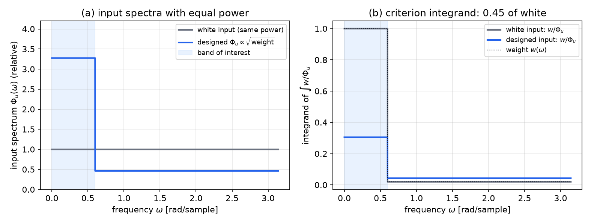
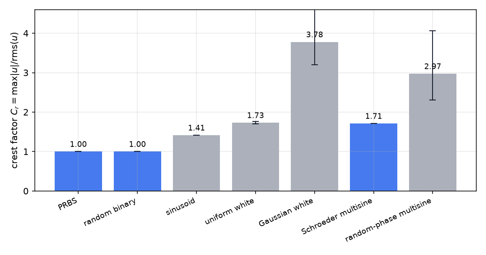
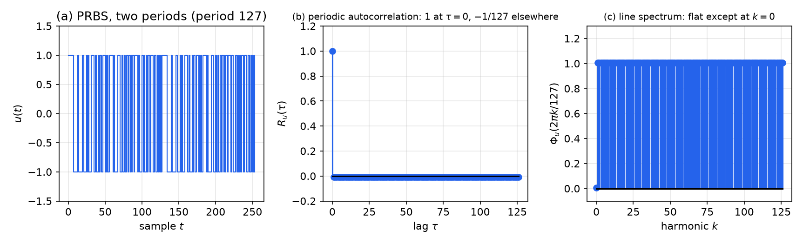
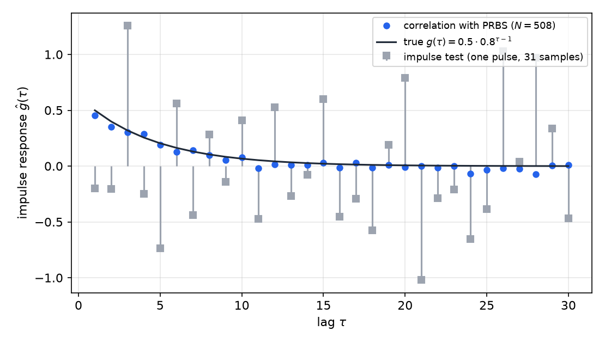
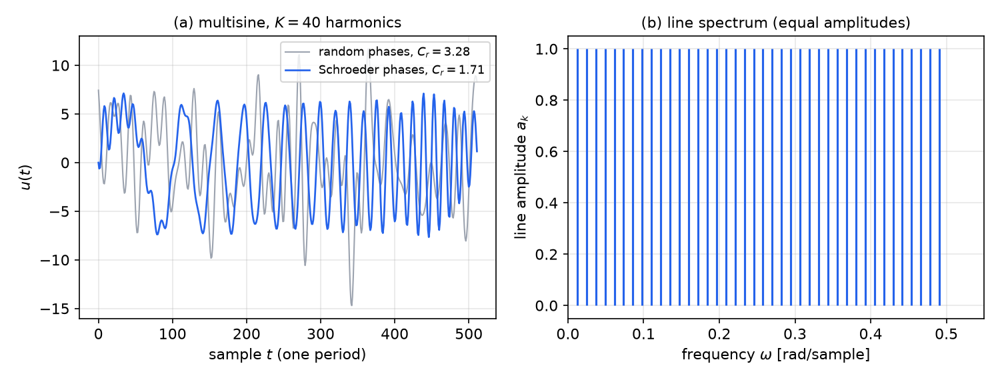

# Input Design

The experimenter controls one thing that decides the quality of an identified model more than any choice of estimator: the input signal. A model fitted to data from a feeble, narrow-band or saturated input carries large uncertainty, however carefully the least-squares problem is solved. Input design asks how to choose \\(u(t)\\) so that the parameter estimates are as accurate as possible for the purpose at hand, subject to what the actuators, sensors and safety limits allow. This chapter combines the excitation conditions of the [previous chapter](identifiability.md) with the covariance formulas of [Least Squares and Recursive Least Squares](least-squares.md) and [Parameter Estimation and Hypothesis Testing](statistical-inference.md). It derives the design criteria, the optimal spectrum for a frequency-weighted accuracy requirement, and the practical signals used in experiments: amplitude-limited binary sequences, maximal-length PRBS, multisines and correlation analysis.

## The Design Space

Designing an identification experiment means making decisions in three areas, and the input is only one of them.

1. **Data acquisition.** Which variables are measured and which are manipulated? Every measured disturbance that can be recorded should be recorded, because an unmodelled disturbance correlated with the input biases the estimate. The sampling rate is a compromise: faster sampling gives more data, but it also records more noise, and a pre-filter may be needed before sampling.
2. **Model-structure selection.** Linear or nonlinear, and within the linear family which polynomial structure. A Hammerstein model, a static nonlinearity followed by a linear dynamic block, and a Wiener model, a linear block followed by a static nonlinearity, need inputs with different amplitude content than a linear model does.
3. **Input-signal design.** The waveform, its amplitude range, its spectrum and its duration.

The third decision is where the statistics enter. Once the data-acquisition and structure decisions are made, the covariance of the estimate depends on the input alone, and the task is to choose the input that makes that covariance small in the sense that matters.

### Practical constraints

Experiments face physical limits. A typical chain runs from the actuator through the plant to the sensor. The actuator has a bounded range and a finite bandwidth, so the input must satisfy
\\[
\underline u \le u(t) \le \bar u
\\]
for all \\(t\\). The plant may saturate or be unsafe to drive far from its operating point. The sensor has a finite dynamic range, so a large output may clip and a small one may be lost in quantization. These constraints are not an afterthought: they define the set of admissible inputs over which the design optimization is performed. An input that is optimal in the abstract can be infeasible for the hardware, and the amplitude constraint in particular rules out many signals that look attractive on paper.

## What the Input Must Achieve

### The covariance criterion

Suppose the model is linear in its parameters, \\(\hat y(t) = \varphi^T(t)\theta\\), and the data satisfy \\(y(t) = \varphi^T(t)\theta\_0 + e(t)\\) with white noise \\(e\\) of variance \\(\lambda\\). The previous chapter showed that
\\[
\operatorname{cov}(\hat\theta\_N) \approx \frac{\lambda}{N}\\,\big[\mathbb E\varphi\varphi^T\big]^{-1} = \frac{\lambda}{N}\\,\bar R\_n^{-1}, \qquad \bar R\_n = \big[R\_u(j-k)\big]\_{j,k=1}^{n}
\\]
for a stationary input. The covariance of the estimate is therefore set by the inverse of the input autocovariance matrix, and the design problem is to make \\(\bar R\_n\\) large. Because a matrix is not ordered, "large" must be made precise by a scalar function of \\(\bar R\_n\\). The standard choices are the following. The **D-criterion** maximizes \\(\det\bar R\_n\\), which minimizes the volume of the confidence ellipsoid for \\(\theta\\). The **A-criterion** minimizes the trace of \\(\bar R\_n^{-1}\\), the sum of the individual variances. The **E-criterion** maximizes the smallest eigenvalue \\(\lambda\_{\min}(\bar R\_n)\\), which protects against the worst-determined direction. Each criterion is a function of the excitation alone, and each has the same qualitative behaviour: the input must have energy in every direction that the model needs.

The formula also shows why amplitude matters. Scaling the input by a factor \\(c\\) scales \\(\bar R\_n\\) by \\(c^2\\), so the covariance falls by \\(c^{-2}\\). Given a fixed amplitude budget, the designer wants as much power as possible, and the amplitude constraint is therefore active in almost every practical design.

### A scalar illustration

The simplest case is a straight-line fit \\(y = \beta\_0 + \beta\_1 x + e\\). The variance of the slope estimate is \\(\sigma^2/S\_{xx}\\) with \\(S\_{xx} = \sum(x\_i - \bar x)^2\\), which was derived in [Parameter Estimation and Hypothesis Testing](statistical-inference.md). Here the regressor is the input. Spreading the input over a wide range of values increases \\(S\_{xx}\\), and the slope becomes more precise. The same behaviour holds in the multivariable case, where \\(\bar R\_n\\) replaces \\(S\_{xx}\\). Designing an input for identification is therefore a matter of spreading its values, and of spreading its spectral content, over the region where the model must be accurate.

The general theory states the same thing in the frequency domain. In most applications the model is needed in a band of frequencies, not uniformly, so the design should concentrate the input power there. That is the subject of the next section.

## Frequency-Domain Design

### The weighted accuracy requirement

Let the true system be \\(G\_0\\), the model \\(G(q,\theta)\\), and the noise model \\(H(q)\\) fixed. Under the prediction-error method with the noise model held fixed, the estimate minimizes a frequency-weighted fit,
\\[
\hat\theta = \arg\min\_\theta \int\_{-\pi}^{\pi}\big\lvert G\_0(e^{i\omega}) - G(e^{i\omega},\theta)\big\rvert^2\\,\frac{\Phi\_u(\omega)}{\lvert H(e^{i\omega})\rvert^2\\,\lambda}\\,d\omega .
\\]
The weight \\(\Phi\_u/(\lvert H\rvert^2\lambda)\\) is the signal-to-noise ratio at each frequency, the input spectrum relative to the noise spectrum. The model is pushed toward the true system where the input has power, and is left poorly determined where it does not. This is the same conclusion as the frequency-domain formula for the estimate's variance from the previous chapter,
\\[
\operatorname{var}\big(\hat G(e^{i\omega})\big) \approx \frac{n}{N}\\,\frac{\Phi\_v(\omega)}{\Phi\_u(\omega)},
\\]
where \\(\Phi\_v = \lvert H\rvert^2\lambda\\) is the disturbance spectrum. If the requirement is an accurate model over a band, the design should choose \\(\Phi\_u\\) large in that band.

Let the design criterion be a weighted integral of the variance,
\\[
J(\Phi\_u) = \frac{n}{N}\int\_{-\pi}^{\pi} w(\omega)\\,\frac{1}{\Phi\_u(\omega)}\\,d\omega, \qquad w(\omega) = \lvert W(e^{i\omega})\rvert^2\\,\Phi\_v(\omega),
\\]
where \\(W\\) is any user-chosen frequency weighting that expresses how much accuracy matters at each frequency. The weight \\(w\\) is large where accuracy matters and where the disturbance is large.

### The optimal input spectrum

The input has a power constraint. With the normalization \\(R\_u(0) = \frac1{2\pi}\int\_{-\pi}^{\pi}\Phi\_u\\,d\omega = 1\\), the problem is
\\[
\min\_{\Phi\_u\ge0}\ \int\_{-\pi}^{\pi}\frac{w(\omega)}{\Phi\_u(\omega)}\\,d\omega \quad\text{subject to}\quad \int\_{-\pi}^{\pi}\Phi\_u(\omega)\\,d\omega = 2\pi .
\\]
Introduce a multiplier \\(\mu\\) for the constraint and differentiate the Lagrangian pointwise in \\(\omega\\). The condition \\(-w/\Phi\_u^2 + \mu = 0\\) gives \\(\Phi\_u = \sqrt{w/\mu}\\). The constraint then fixes \\(\mu\\), and the result is
\\[
\boxed{\Phi\_u^\star(\omega) = c\\,\sqrt{w(\omega)}, \qquad c = \frac{2\pi}{\int\_{-\pi}^{\pi}\sqrt{w(\omega)}\\,d\omega}}.
\\]
The optimal input spectrum is proportional to the square root of the weight. The minimal criterion is then \\(J^\star = \frac{n}{N}\big(\int\sqrt w\\,d\omega\big)^2/(2\pi)\\), and the white-input value is \\(J\_{\text{white}} = \frac{n}{N}\int w\\,d\omega\\). The Cauchy–Schwarz inequality \\((\int\sqrt w)^2\le 2\pi\int w\\) guarantees \\(J^\star\le J\_{\text{white}}\\), with equality only when \\(w\\) is constant, in which case white noise is already optimal.

*Figure: an example with weight \\(w = 1\\) on the band \\(0\le\omega\le0.6\\) rad/sample and \\(w = 0.02\\) elsewhere. (a) The white input has \\(\Phi\_u = 1\\), and the optimal input \\(\Phi\_u^\star = c\sqrt{w}\\) has \\(c\approx3.28\\) in the band and \\(0.46\\) outside, with the same total power. (b) The integrand \\(w/\Phi\_u\\) of the criterion: for the optimal input the criterion is \\(0.45\\) times its white-input value. The designed input spends its power on the band that matters, and accepts poor excitation where the weight is small.*

The result is a design rule with a clear meaning. The input spectrum follows the square root of how much the accuracy matters, so it is strong where the model must be right and weak where it need not be. The square root arises because the criterion is a sum of reciprocals, and reciprocals of powers are minimized by equalizing the marginal cost of power across frequencies.

### From spectrum to waveform

A spectrum does not determine a unique waveform, so the design step from \\(\Phi\_u^\star\\) to a signal is open. Two practical families realize a prescribed spectrum. One uses **multisines**, sums of sinusoids whose amplitudes follow \\(\Phi\_u^\star\\) at a grid of frequencies; the amplitude of harmonic \\(k\\) is \\(a\_k^2\propto\Phi\_u^\star(\omega\_k)\\). The other filters a white sequence through a shaping filter whose squared magnitude follows \\(\Phi\_u^\star\\). Both are discussed below. The multisine has the advantage of a deterministic, controllable crest factor, and the shaping filter has the advantage of a continuous spectrum.

## Amplitude Constraints and Crest Factor

The power constraint used above is the wrong constraint for real hardware, where the amplitude is bounded. A signal can have large power and still stay within bounds if its amplitude is nearly constant, and it can have small power and still be unusable if it contains one large spike. The measure of this is the **crest factor**
\\[
C\_r = \frac{\max\_{1\le t\le N}\lvert u(t)\rvert}{\operatorname{rms}(u)} = \sqrt{\frac{\max\_t u^2(t)}{\frac1N\sum\_{t=1}^N u^2(t)}}\ \ge 1 .
\\]
For a fixed power, a smaller crest factor means a larger share of the amplitude budget is used, and the input spends more time at high levels, where it is most informative. Among zero-mean signals the best is the binary signal \\(u = \pm\bar u\\), which has \\(C\_r = 1\\): it sits at its maximum amplitude at every instant.

*Figure: crest factors \\(C\_r = \max\lvert u\rvert/\operatorname{rms}(u)\\) for common excitation signals over \\(N = 4096\\) samples. Binary sequences (PRBS and i.i.d. \\(\pm1\\)) reach the minimum of one; a sinusoid gives \\(\sqrt2\\); the Schroeder-phase multisine with 40 harmonics gives 1.71; random-phase multisines average 2.97 over 200 draws, with a range from 2.30 to 4.06; and a Gaussian sequence averages 3.78 over 50 draws, since its large excursions are unavoidable. Bars show the mean and whiskers the range for the random signals.*

The table of values makes the design trade-off clear. A Gaussian input is the most common choice in theory because its analysis is simple, and it is the worst choice in practice for a bounded actuator: its peaks are about 3.8 times its rms, so most of the time the input is far below its available range. Binary and multisine signals with a low crest factor make the best use of the actuator. The binary signal has a second advantage, that it is easy to generate and its spectrum is flat, which is the subject of the next section.

Physical limits interact with the design in a further way. The input is generated by an actuator, and the output is measured by a sensor with limited dynamic range. Large inputs can drive the plant into saturation or nonlinear regimes that the linear model does not describe; small outputs can fall below the sensor resolution. A design that uses the whole amplitude range at all times may therefore be worse than one that uses a slightly smaller amplitude and stays in the linear range. The amplitude bound and the linearity requirement together fix the admissible set.

## Pseudo-Random Binary Signals

### Maximal-length sequences

A **pseudo-random binary sequence** (PRBS) is a deterministic periodic signal with the statistical properties of white noise. The standard generator is a linear feedback shift register. Let the register hold \\(n\\) bits, shift them one place at each clock tick, and feed back the exclusive-or of selected stages into the first position. A register with a suitable feedback polynomial cycles through all \\(2^n-1\\) nonzero states before repeating. The output sequence of length \\(P = 2^n-1\\) is a **maximal-length sequence** (m-sequence). The feedback polynomial must be primitive for the period to be maximal.

The sequence used in the figure below is generated by a 7-stage register with feedback taken from the sixth and seventh stages, which corresponds to the primitive polynomial \\(x^7 + x^6 + 1\\). It has period \\(P = 127\\). Writing the output bits \\(b(t)\\) as \\(0\\) and \\(1\\), the binary signal is \\(u(t) = 2b(t)-1 = \pm1\\). Over one period it contains 64 ones and 63 zeros, so its mean is \\(1/127\\), a very small bias.

### Periodic autocorrelation

The defining property of an m-sequence is its two-level autocorrelation. Over one period \\(P\\), with the periodic autocorrelation \\(R\_u(\tau) = \frac1P\sum\_{t=1}^{P}u(t)u(t+\tau)\\) (indices modulo \\(P\\)),
\\[
R\_u(\tau) = \begin{cases} 1, & \tau\equiv0 \pmod P,\\\\ -\dfrac1P, & \text{otherwise.}\end{cases}
\\]
The argument rests on the **shift-and-add** property of m-sequences. Adding a sequence modulo two to a shifted copy of itself produces another shift of the same m-sequence, because the shift is a linear recurrence and the sum is a shift of its state. A nonzero m-sequence over one period contains \\(2^{n-1}\\) ones and \\(2^{n-1}-1\\) zeros. Therefore, for \\(\tau\not\equiv0\\), the original and the shifted sequence disagree in \\(2^{n-1}\\) positions and agree in \\(2^{n-1}-1\\) positions. Their products \\(u(t)u(t+\tau)\\) are \\(-1\\) and \\(+1\\) respectively, so the sum is \\((2^{n-1}-1)-2^{n-1} = -1\\), and dividing by \\(P\\) gives \\(-1/P\\). The figure below shows the resulting autocorrelation and line spectrum for the period-127 sequence.

*Figure: the period-127 maximal-length PRBS. (a) Two periods of the \\(\pm1\\) sequence. (b) Its periodic autocorrelation, equal to one at lag zero and to \\(-1/127\\approx-0.008\\) at every other lag, so the off-peak values are indistinguishable from zero on this scale. (c) Its periodic line spectrum at the harmonics \\(2\pi k/127\\): flat at about \\(1.008\\) for all \\(k\neq0\\), with a small mean term at \\(k=0\\).*

The flat spectrum is the reason the PRBS is the standard identification input. A signal with a delta-like autocorrelation has a flat spectrum, and a flat spectrum excites every frequency equally, so the input is as informative as possible for a given power and amplitude. Two features make it practical. It is binary, so its crest factor is one. And it is periodic, so the transient at the start of the record can be removed by discarding one period, and the Fourier analysis of the data is exact.

### Clock period and bandwidth

In practice each binary level is held for a fixed number of samples \\(T\_c\\), the clock period. The autocorrelation of such a sequence is a triangle of half-width \\(T\_c\\) instead of a spike, \\(R\_u(\tau) = 1-\lvert\tau\rvert/T\_c\\) for \\(\lvert\tau\rvert\le T\_c\\), and its spectrum is proportional to \\(\operatorname{sinc}^2(\omega T\_c/2)\\). The spectrum is therefore flat only for frequencies well below \\(1/T\_c\\) rad per sample. A PRBS with a long clock period excites only the low frequencies, and a short clock excites the high frequencies at the price of a shorter memory. The design rule is to choose \\(T\_c\\) so that the band where the model must be accurate lies below the flat region, and to choose the register length so that the period is much longer than the settling time of the process. The period sets the frequency resolution of the experiment, and the clock period sets its bandwidth.

## Random Inputs and Correlation Analysis

### Impulse response from cross-correlation

A random input has a second use: estimating a model without assuming its structure. Consider a linear system with impulse response \\(g\\), output noise \\(v\\) uncorrelated with the input,
\\[
y(t) = \sum\_{k=1}^{\infty} g(k)\\,u(t-k) + v(t), \qquad \mathbb E\big[u(t)v(t-\tau)\big] = 0 \text{ for all }\tau .
\\]
Take the input to be white with unit variance, \\(\mathbb E[u(t-k)u(t-\tau)] = \delta\_{k\tau}\\). The cross-correlation between output and input is
\\[
R\_{yu}(\tau) = \mathbb E\big[y(t)\\,u(t-\tau)\big] = \sum\_{k=1}^{\infty}g(k)\\,\mathbb E\big[u(t-k)u(t-\tau)\big] + \mathbb E\big[v(t)u(t-\tau)\big] = g(\tau).
\\]
The noise drops out because it is uncorrelated with the input. The impulse response is therefore estimated directly from the sample cross-correlation \\(\hat R\_{yu}(\tau) = \frac1N\sum\_t y(t)u(t-\tau)\\). For an input of variance \\(\lambda\_u\\) the same argument gives \\(R\_{yu}(\tau) = \lambda\_u\\,g(\tau)\\), so the estimate is \\(\hat g(\tau) = \hat R\_{yu}(\tau)/\lambda\_u\\). A maximal-length PRBS, with its nearly delta-like autocorrelation, approximates a white input well, and the same procedure applies with the small correction \\(-1/P\\) at non-zero lags.

### Comparison with an impulse test

A single impulse of amplitude \\(\alpha\\) at \\(t=0\\) gives \\(y(t) = \alpha g(t) + v(t)\\), so the estimate \\(\hat g(t) = y(t)/\alpha = g(t) + v(t)/\alpha\\) has noise of standard deviation \\(\sigma\_v/\alpha\\) at every lag. The only way to reduce the noise is to increase \\(\alpha\\), which is often impossible without violating the amplitude bound. The correlation method uses the full record: each lag is estimated from all \\(N\\) samples, so the noise averages out as \\(N^{-1/2}\\) at the power level of the random input, not the impulse. The two methods are compared in the figure below.

*Figure: the impulse response \\(g(\tau) = 0.5\cdot0.8^{\tau-1}\\) (black) estimated two ways. The blue dots are the cross-correlation of the output with a PRBS input over 508 samples, which follows the true response closely at every lag. The grey squares come from a single pulse of 31 samples, whose estimates are corrupted by the full disturbance at every lag. Both experiments use the same disturbance level, but only the random input averages it.*

The correlation method has a further advantage: it needs no model structure and no optimization, and it makes the frequency content of the input explicit. It is, however, a nonparametric estimate and its variance is not the parametric result of the previous chapter. Its lags beyond the memory of the system should be truncated, and the record must be long enough to average the disturbance.

## Sinusoidal Inputs and Multisines

### Line spectra and excitation order

A sinusoid has a line spectrum. The previous chapter showed that a single sinusoid is persistently exciting of order two, and that \\(p\\) distinct positive frequencies give excitation of order \\(2p\\), since each frequency contributes a pair of lines at \\(\pm\omega\_k\\). An identification experiment with \\(n\\) parameters therefore needs at least \\(\lceil n/2\rceil\\) distinct frequencies. A sum of sinusoids of this kind is called a **multisine**:
\\[
u(t) = \sum\_{k=1}^{K}a\_k\cos(\omega\_k t + \phi\_k), \qquad \omega\_k = \frac{2\pi k}{N}.
\\]
Choosing the frequencies on the grid \\(2\pi k/N\\) makes the signal exactly periodic with period \\(N\\), so the periodic analysis is exact and there is no leakage between harmonics. The power of harmonic \\(k\\) is proportional to \\(a\_k^2\\). The optimal spectrum of the previous section is therefore realized by choosing \\(a\_k^2\propto\Phi\_u^\star(\omega\_k)\\), so that power sits in the frequencies where the weight is large.

### Phases and crest factor

The amplitudes fix the spectrum, but the phases fix the waveform and therefore the crest factor. Random phases give a signal whose peaks are typical of a sum of many sinusoids, and as the figure of crest factors showed, their crest factor is about three. Choosing the phases deterministically by the **Schroeder** formula
\\[
\phi\_k = -\frac{\pi k(k-1)}{K}
\\]
produces a sum whose instantaneous power is spread evenly over the period, with a crest factor close to that of a binary sequence. The spectrum is unchanged, since the Schroeder phases affect only the timing of the harmonics. The figure below shows the same multisine with random and Schroeder phases.

*Figure: (a) a multisine with \\(K = 40\\) equal-amplitude harmonics over one period of 512 samples, with random phases (grey, one draw, \\(C\_r = 3.28\\)) and Schroeder phases (blue, \\(C\_r = 1.71\\)). (b) The line spectrum, identical for both signals because only the phases differ. The Schroeder signal uses the same power far more evenly, and it reaches a given excitation level with a much smaller amplitude peak.*

The multisine is the most flexible of the practical excitation signals. Its spectrum is set exactly by its amplitudes, its period is set by the frequency grid, and its crest factor is controlled by the phases. Its drawback is that a deterministic periodic signal can excite unmodelled dynamics at its own period, so the experiment should be checked against a variety of frequency grids. A multisine with lines placed only in the band of interest is the discrete version of the optimal spectrum above.

## Worked Examples

**Example 1 (Spectrum of a sinusoid).** Let \\(u(t) = A\cos\omega\_0 t\\). Its autocovariance, averaged over a period, is \\(R\_u(\tau) = \tfrac{A^2}{2}\cos\omega\_0\tau\\). With the spectrum defined as \\(\Phi\_u(\omega) = \sum\_\tau R\_u(\tau)e^{-i\omega\tau}\\) and the identity \\(\sum\_\tau e^{-i\omega\tau} = 2\pi\sum\_k\delta(\omega-2\pi k)\\),
\\[
\Phi\_u(\omega) = \sum\_\tau \frac{A^2}{2}\cos(\omega\_0\tau)\\,e^{-i\omega\tau} = \frac{\pi A^2}{2}\big[\delta(\omega-\omega\_0) + \delta(\omega+\omega\_0)\big]
\\]
for \\(\omega\\) in one period \\((-\pi,\pi]\\). Two spectral lines of weight \\(\pi A^2/2\\) each sit at \\(\pm\omega\_0\\). The check is that the power is recovered: \\(\frac1{2\pi}\int\Phi\_u\\,d\omega = \frac1{2\pi}\cdot\frac{\pi A^2}{2}\cdot 2 = \frac{A^2}{2} = R\_u(0)\\). Different books use different normalizations of the delta weights; the convention that \\(\frac1{2\pi}\int\Phi\\) equals the variance is the one to keep.

**Example 2 (Spectrum of a damped cosine).** Let the autocorrelation be \\(R(\tau) = \sigma^2e^{-\beta\lvert\tau\rvert}\cos\omega\_0\tau\\) for continuous lag \\(\tau\\) and \\(\beta>0\\). Since the transform of \\(e^{-\beta\lvert\tau\rvert}\\) is \\(2\beta/(\beta^2+\omega^2)\\), and \\(\cos\omega\_0\tau\\) splits into two complex exponentials,
\\[
\Phi(\omega) = \sigma^2\beta\left[\frac{1}{\beta^2+(\omega-\omega\_0)^2} + \frac{1}{\beta^2+(\omega+\omega\_0)^2}\right] = \frac{2\sigma^2\beta\\,(\omega^2+\beta^2+\omega\_0^2)}{\omega^4 + 2(\beta^2-\omega\_0^2)\omega^2 + (\beta^2+\omega\_0^2)^2}.
\\]
The numerator contains \\(\beta\\) once, not squared. A dimensional check confirms this: \\(\Phi\\) has the units of \\(\sigma^2\\) times time, which the single-\\(\beta\\) form has and the squared form does not. For light damping, \\(\beta\ll\omega\_0\\), the spectrum has two sharp Lorentzian peaks of height about \\(\sigma^2/\beta\\) at \\(\pm\omega\_0\\), and it is small but nonzero at \\(\omega = 0\\), where its value is \\(2\sigma^2\beta/(\beta^2+\omega\_0^2)\\). The input therefore excites a narrow band around \\(\omega\_0\\), which is the situation in which the identified model is accurate near \\(\omega\_0\\) and uncertain elsewhere.

**Example 3 (Input richness limits the FIR order).** An FIR model of length \\(m\\) requires the lagged regression matrix to have full rank, which requires the input to be exciting of order \\(m\\). A nearly periodic input, such as the aortic flow that drives a radial pressure in a cardiovascular experiment, cannot excite every lag independently. The worked solution referred to in the [identifiability chapter](identifiability.md) found that the regression became numerically singular for FIR orders beyond about 760 with a 7650-sample record. The lesson for input design is that the orders a model can support are fixed by the input's spectral richness as well as by the data length, and that a design with a long impulse response must provide excitation over a correspondingly rich set of frequencies.

## Summary

- The covariance of a linear least-squares estimate is \\((\lambda/N)\bar R\_n^{-1}\\), so the input should make \\(\bar R\_n\\) large in the sense of a D-, A- or E-criterion.
- For a frequency-weighted accuracy requirement with weight \\(w = \lvert W\rvert^2\Phi\_v\\), the optimal input spectrum under a power constraint is \\(\Phi\_u^\star = c\sqrt{w}\\), with criterion ratio \\((\int\sqrt w)^2/(2\pi\int w)\\) relative to white noise.
- The crest factor \\(C\_r = \max\lvert u\rvert/\operatorname{rms}(u)\\) measures how well an input uses its amplitude budget; binary signals reach the minimum \\(C\_r = 1\\), a Gaussian sequence about 3.8.
- A period-\\(P\\) maximal-length PRBS has \\(R\_u(0) = 1\\) and \\(R\_u(\tau) = -1/P\\) otherwise, so its spectrum is flat; its clock period sets the bandwidth, with the flat region below about \\(1/T\_c\\) rad per sample.
- Cross-correlation with a random input gives \\(R\_{yu}(\tau) = \lambda\_u g(\tau)\\), so the impulse response is estimated without assuming a structure and with the disturbance averaged out.
- A multisine with \\(p\\) distinct frequencies excites order \\(2p\\); Schroeder phases \\(\phi\_k = -\pi k(k-1)/K\\) give a low crest factor without changing the spectrum.

## See Also

- [Informative Experiments, Persistent Excitation and Asymptotic Properties](identifiability.md): the excitation conditions that the design must satisfy.
- [Least Squares and Recursive Least Squares](least-squares.md): the normal equations and the covariance formula used throughout.
- [Parameter Estimation and Hypothesis Testing](statistical-inference.md): the slope variance \\(\sigma^2/S\_{xx}\\) and the role of spread in the regressor.
- [Model Structures and Prediction-Error Methods](model-structures.md): the structures whose inputs are designed here.
- [Signal Sampling](../../../signals/sampling.md): sampling rate and pre-filtering of the measured data.
- [Random Processes](../../../math/random-processes/README.md): stationarity, autocorrelation and spectra of random signals.
- [Fourier Transform](../../../signals/fourier-transform.md): the transform conventions used for line spectra and periodic signals.
