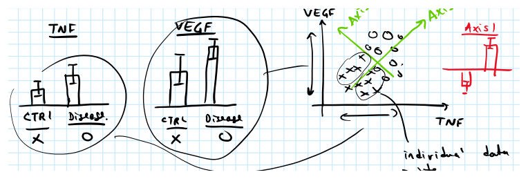
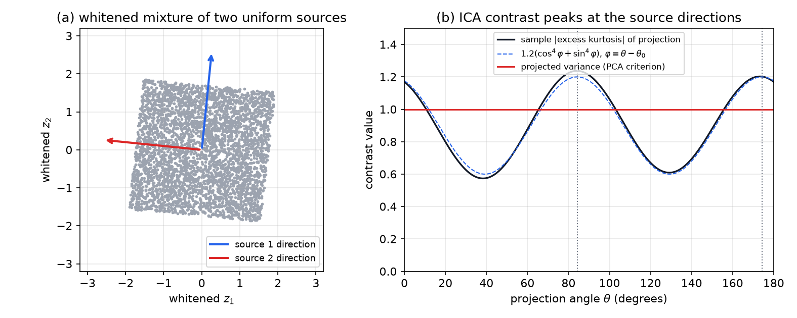
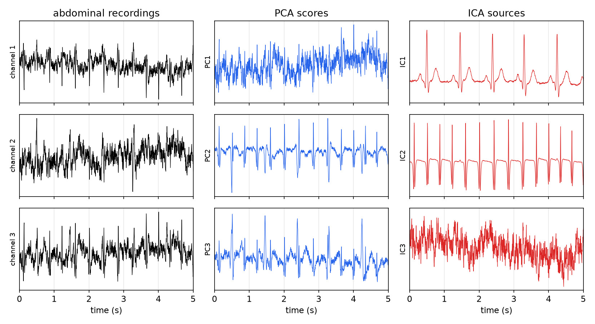
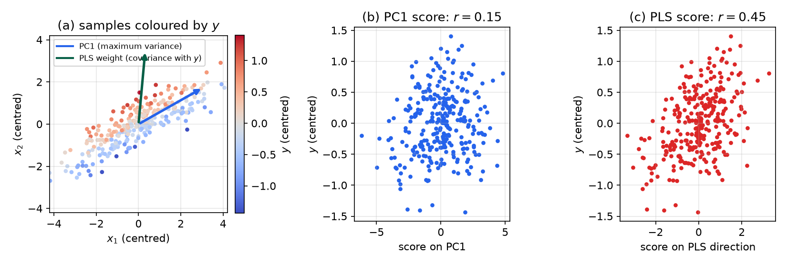
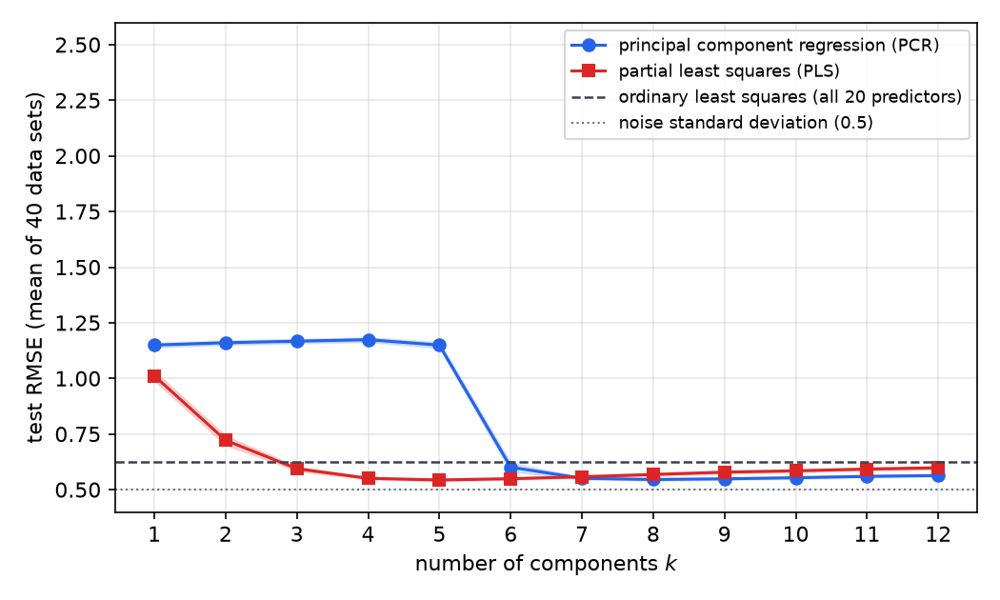

# PCA, ICA and Partial Least Squares

Many measurements are often driven by a few underlying sources. Gene expression, sensor arrays and multi-lead recordings all show it: each channel mixes the same handful of processes, so the coordinate axes of the measurements are rarely the natural axes of the data. Three methods find better axes, each with a different criterion. **Principal component analysis (PCA)** chooses orthogonal directions of maximum variance, which uses only second-order statistics. **Independent component analysis (ICA)** chooses directions along which the projections are as statistically independent as possible, which uses the higher-order statistics that uncorrelatedness ignores. **Partial least squares (PLS)** chooses directions that maximize covariance with a response, which makes it a regression method for many correlated predictors. The chapter derives the three, shows how they are computed, and compares them on data. It builds on the independence distinction of [Parameter Estimation and Hypothesis Testing](statistical-inference.md) and on the ill-conditioning of [Least Squares and Recursive Least Squares](least-squares.md).

## Many Measurements, Few Sources

Two examples make the idea concrete. In the first, two gene expression levels are measured in healthy and diseased subjects. Each gene alone separates the groups only weakly, but a composite axis drawn through both clusters separates them much better. The sketch below shows the idea.

*Figure: a hand sketch of the two-gene example. Each measurement alone (top) separates the groups weakly; the composite axis "Axis 1", running through both clusters, separates them clearly, and the projections on it (inset) do not overlap. Finding such an axis from data is the task of PCA.*

In the second, the **cocktail party problem**, several speakers are recorded by several microphones. Each microphone records a different weighted mixture of the voices. If the sources are \\(s\_1(t),\dots,s\_n(t)\\) and the sensors are \\(x\_1(t),\dots,x\_n(t)\\), the simplest model is linear and instantaneous,
\\[
x(t) = A\\,s(t),
\\]
with an unknown mixing matrix \\(A\\). The task is to recover the sources from the sensors alone, which is why the methods are called **blind** source separation.

For data in matrix form, let \\(X\\) be the \\(m\times n\\) array of \\(m\\) observations of \\(n\\) variables. The general aim is to represent the rows of \\(X\\) in a new coordinate system whose axes reveal the structure. The axes are the design choice, and each method defines them through its own criterion.

## Principal Component Analysis

### The variance criterion

Subtract the column means, so that \\(X\\) has zero-mean columns, and write the sample covariance
\\[
C = \frac{1}{m-1}X^TX .
\\]
The first principal direction is the unit vector that maximizes the variance of the projected data,
\\[
v\_1 = \arg\max\_{\lVert v\rVert=1}\ \operatorname{var}(Xv) = \arg\max\_{\lVert v\rVert=1}\ v^TCv .
\\]
The constraint is handled with a multiplier. Setting the gradient of \\(v^TCv - \lambda(v^Tv-1)\\) to zero gives \\(Cv = \lambda v\\). At any such stationary point the objective equals \\(\lambda\\), so the maximum is attained by the eigenvector of the largest eigenvalue, and the maximal variance is that eigenvalue.

The next directions are found in the orthogonal complement of the previous ones. The \\(k\\)-th principal direction \\(v\_k\\) is the eigenvector with the \\(k\\)-th largest eigenvalue \\(\lambda\_k\\), and the eigenvectors are orthonormal because \\(C\\) is symmetric. The **scores** \\(t\_k = Xv\_k\\) are uncorrelated, since
\\[
\operatorname{cov}(t\_j,t\_k) = \frac{1}{m-1}v\_j^TX^TXv\_k = v\_j^TCv\_k = \lambda\_k\\,v\_j^Tv\_k = \lambda\_k\\,\delta\_{jk}.
\\]
So PCA rotates the axes to make the covariance diagonal, with the variances ordered from largest to smallest. This is the **Karhunen–Loève** or Hotelling transform, and it is the optimal linear representation in the least-squares sense: discarding the last components gives the best approximation of \\(X\\) by a lower-dimensional subspace.

### Scores, loadings and residuals

Collecting the \\(k\\) leading directions into \\(P = [v\_1\ \cdots\ v\_k]\\) and the scores into \\(T = [t\_1\ \cdots\ t\_k]\\) gives the PCA decomposition
\\[
X = \bar X + T\\,P^T + E,
\\]
where \\(\bar X\\) holds the column means, the \\(m\times k\\) matrix \\(T\\) contains the scores, the \\(n\times k\\) matrix \\(P\\) contains the **loadings** (the weight each variable has in each component), and \\(E\\) is the residual that the \\(n-k\\) discarded components would explain. The loadings are orthonormal, so \\(P^TP = I\\), and \\(T = XP\\). Because the scores are uncorrelated, a plot of two score columns against each other shows the structure of the samples directly, and the loadings show which variables produce each pattern.

### Computation by the singular value decomposition

The eigenproblem of \\(C\\) is solved numerically through the **singular value decomposition** (SVD) of the data matrix,
\\[
X = U\\,S\\,V^T, \qquad U^TU = I,\quad V^TV = I,\quad S = \operatorname{diag}(s\_1\ge s\_2\ge\cdots\ge0).
\\]
Substituting into the definition of \\(C\\),
\\[
C = \frac1{m-1}VS^2V^T,
\\]
so the columns of \\(V\\) are the principal directions and the eigenvalues are \\(\lambda\_i = s\_i^2/(m-1)\\). The scores are \\(T = XV = US\\). The SVD route is preferred because it does not form \\(X^TX\\), whose condition number is the square of that of \\(X\\), and so it is more accurate for nearly collinear data. The next subsection carries out a complete decomposition by hand.

**Example 1 (A small SVD).** Take
\\[
X = \begin{bmatrix}1&1\\\\0&1\\\\1&0\end{bmatrix}.
\\]
Here \\(X^TX = \begin{bmatrix}2&1\\\\1&2\end{bmatrix}\\) (without the \\(1/(m-1)\\) factor, which does not change the directions). Its eigenvalues are \\(3\\) and \\(1\\), from \\((2-\lambda)^2-1=0\\), with unit eigenvectors
\\[
v\_1 = \tfrac1{\sqrt2}\begin{bmatrix}1\\\\1\end{bmatrix},\qquad v\_2 = \tfrac1{\sqrt2}\begin{bmatrix}1\\\\-1\end{bmatrix}.
\\]
The singular values are \\(s\_1 = \sqrt3\\) and \\(s\_2 = 1\\). The left singular vectors follow from \\(u\_i = Xv\_i/s\_i\\):
\\[
u\_1 = \frac{Xv\_1}{\sqrt3} = \begin{bmatrix}\sqrt6/3\\\\ \sqrt6/6\\\\ \sqrt6/6\end{bmatrix},\qquad u\_2 = Xv\_2 = \begin{bmatrix}0\\\\ -\sqrt2/2\\\\ \sqrt2/2\end{bmatrix}.
\\]
The sign of \\(u\_2\\) is the one that reproduces \\(X\\). A third column completing an orthonormal basis of \\(\mathbb R^3\\) is \\(u\_3 = [\sqrt3/3,\ -\sqrt3/3,\ -\sqrt3/3]^T\\). Multiplying out \\(X = \sum\_i s\_i u\_iv\_i^T\\) gives back the original matrix; for instance the \\((2,1)\\) entry is \\(\sqrt3\cdot\tfrac{\sqrt6}{6}\cdot\tfrac{\sqrt2}{2} - \tfrac{\sqrt2}{2}\cdot\tfrac{\sqrt2}{2} = \tfrac12-\tfrac12 = 0\\), as it should be. The rank is two, so the third singular value is zero and the third column of \\(U\\) does not contribute.

### Choosing the number of components

The eigenvalues measure the variance each component carries. A **scree plot** of \\(\lambda\_k\\) against \\(k\\) usually drops steeply and then flattens; the components beyond the knee are often attributed to noise. A common quantitative rule keeps the smallest \\(k\\) for which
\\[
\frac{\sum\_{i\le k}\lambda\_i}{\sum\_{i}\lambda\_i}\ \ge\ 0.95 .
\\]
The rule is a convention, not a theorem. Noise can carry as much variance as signal, and the discarded components can contain information about the response, which is the point developed in the PLS section below.

**Example 2 (Cytokine profiles).** A data set of nine samples in three groups, each measured for 32 cytokines, was z-scored and decomposed. The reference solution reports that the first five components explain about 55, 25, 6, 5 and 3 percent of the variance. Nine centred samples span at most eight dimensions, so only eight components carry variance at all. The first loading vector is positive for every cytokine, so the first component is a global cytokine level. The second contrasts a group of chemokines with another group of cytokines, and the group means separate along the first two scores. The example shows the typical outcome: a few components capture most of the variance, and the groups are visible in the scores rather than in any single measurement.

**Example 3 (Variance along a rotated direction).** Suppose a PCA of ten genes gives eigenvalues carrying 40 percent and 10 percent of the variance along \\(\text{PC}\_1\\) and \\(\text{PC}\_2\\), and a biological trend follows a direction at angle \\(\theta\\) to \\(\text{PC}\_1\\) within the plane of the first two components. The unit vector of that direction in the PC basis is \\(d = (\cos\theta,\ \sin\theta)^T\\), and the variance of the composite score \\(d^T\\,(t\_1,t\_2)^T\\) is \\(\lambda\_1\cos^2\theta+\lambda\_2\sin^2\theta\\), because the components are uncorrelated. As a fraction of the total variance,
\\[
\\%\operatorname{Var}(\theta) = 40\cos^2\theta + 10\sin^2\theta .
\\]
At \\(\theta = 45^\circ\\) the trend carries 25 percent of the variance. A rotation matrix has eigenvalues of modulus one, so the variance must be computed from the covariance in the rotated frame, not from the eigenvalues of the rotation. The example also shows why the principal axes can fail to align with a biological trend: the trend lies between two principal axes, so no single component carries it, and a non-orthogonal basis is needed.

### Principal component regression

PCA gives a natural regression: project the predictors onto the leading \\(k\\) components and regress the response on the scores. With \\(T\_k = XV\_k\\) and uncorrelated scores, the least-squares coefficients are
\\[
\hat\beta\_{\text{PCR}} = V\_k\\,(T\_k^TT\_k)^{-1}T\_k^Ty = V\_k\\,\Lambda\_k^{-1}T\_k^Ty\cdot\frac{1}{m-1},
\\]
with \\(\Lambda\_k\\) the diagonal matrix of the retained variances. The inversion is trivial because the scores are uncorrelated. The regression removes exactly the directions whose eigenvalues are small, which is the cure for the ill-conditioning described in the least-squares chapter: a small eigenvalue \\(\lambda\_m\\) of \\(X^TX\\) makes \\(1/\lambda\_m\\) large and the corresponding coefficient unstable. Discarding such directions is a form of shrinkage, closely related to ridge regression.

The weakness is the one that PLS repairs. PCR selects components by how much variance of \\(X\\) they carry, not by how much they explain \\(y\\). A direction with small variance can be the one that drives the response, and PCR discards it before the regression sees it.

## Uncorrelated Is Not Independent

PCA makes the scores uncorrelated, and the chapter on statistical inference showed that zero correlation is weaker than independence. Two random variables can be uncorrelated and still completely dependent, for example \\(Y = X^2\\) with \\(X\\) symmetric. The consequence for source separation is decisive. Let the sources \\(s\\) have unit variance and be independent, and let \\(x = As\\). Then \\(\operatorname{cov}(x) = AA^T\\), and any orthogonal matrix \\(Q\\) gives another decomposition, \\(x = (AQ)(Q^Ts)\\), with \\(Q^Ts\\) also uncorrelated and of unit variance. Second-order statistics cannot tell these apart. Among all rotations of the sources, only those that make the projections independent are the true sources, and for Gaussian sources no rotation is distinguished, because a Gaussian distribution is invariant under rotation. Independence beyond second order is therefore needed, and it is available only when the sources are non-Gaussian.

PCA is still useful. It is the first step of most ICA algorithms, because it reduces the problem to a rotation, as shown below.

## Independent Component Analysis

### Model and ambiguities

ICA assumes that the observations are linear mixtures of \\(n\\) independent sources, \\(x = As\\), with \\(A\\) invertible and \\(p(s) = \prod\_i p\_i(s\_i)\\). The goal is a demixing matrix \\(W\\) such that \\(y = Wx\\) has independent components, which are the sources up to two unavoidable ambiguities. The order of the sources cannot be determined, because permuting the sources and the columns of \\(A\\) together leaves the model unchanged. Their scale cannot be determined either, because \\(A\\,\Lambda\\) with \\(s/\Lambda\\) gives the same observations for any diagonal \\(\Lambda\\). Both ambiguities are fixed by convention: the sources are given unit variance, and their order is chosen afterwards by a criterion such as kurtosis or by prior knowledge of the signal. The estimated sources satisfy \\(y = PDs\\) for a permutation \\(P\\) and a diagonal matrix \\(D\\).

### Non-Gaussianity and the central limit theorem

The reason ICA works is the central limit theorem. A sum of independent non-Gaussian variables is closer to Gaussian than any of its components, so a projection of the mixture onto a direction that does not match a source is a mixture of several sources and looks more Gaussian than the sources themselves. Conversely, the directions along which the projections are maximally non-Gaussian are the sources. This is the sense in which independence is non-Gaussianity.

The measures of non-Gaussianity are the higher moments of a standardized variable \\(y\\) with mean zero and variance one. The **skewness** is \\(\mathbb E y^3\\), and the **kurtosis** is \\(\kappa = \mathbb E y^4\\). A Gaussian has \\(\kappa = 3\\). It is convenient to use the **excess kurtosis** \\(\gamma = \kappa - 3\\), which is zero for a Gaussian. A positive value is **super-Gaussian**: the density is peaked with heavy tails, as for spiky signals such as an ECG. A negative value is **sub-Gaussian**: the density is flat, as for a sinusoid, whose samples spend much time near their extremes. Two calculations fix the scale. For a sinusoid \\(A\sin\theta\\) with uniform phase, \\(\mathbb E\sin^2\theta = \tfrac12\\) and \\(\mathbb E\sin^4\theta = \tfrac38\\), so \\(\kappa = (3A^4/8)/(A^4/4) = 3/2\\) and \\(\gamma = -3/2\\). For a uniform variable on \\([-\sqrt3,\sqrt3]\\), which has unit variance, \\(\mathbb E y^4 = 9/5\\) and \\(\gamma = -6/5\\). On the signals of an ECG study, the reference measurements give excess kurtosis 8 for the spiky ECG, 0 for Gaussian noise, and \\(-1.5\\) for a sinusoidal interference, which is the separation the method exploits.

### Whitening reduces ICA to a rotation

ICA is simpler after the mixture has been decorrelated and scaled. Let \\(\operatorname{cov}(x) = E\\,D\\,E^T\\) be the eigendecomposition of the covariance of the centred observations. The **whitened** data
\\[
z = D^{-1/2}E^T x
\\]
have identity covariance. For independent unit-variance sources, \\(z = Qs\\) with \\(Q = D^{-1/2}E^TA\\), and \\(QQ^T = \mathbb E[zz^T] = I\\), so \\(Q\\) is orthogonal. Hence the demixing problem for whitened data is to find an orthogonal \\(W\\) with \\(y = Wz\\) independent. The search is over rotations (and reflections): in two dimensions it is a single angle, and in \\(n\\) dimensions it is an orthogonal group of dimension \\(n(n-1)/2\\). PCA performs the whitening, and ICA supplies the remaining rotation. This is the precise sense in which PCA does half of the work.

The two-source case shows the mechanism clearly. Let the sources be independent and uniform on \\([-\sqrt3,\sqrt3]\\), so each has excess kurtosis \\(-6/5\\). After whitening, a projection onto a unit vector at angle \\(\theta\\) is a combination \\(\cos\varphi\\,s\_1+\sin\varphi\\,s\_2\\), with \\(\varphi = \theta-\theta\_0\\) measured from the true source axis. The kurtosis of a sum of independent unit-variance variables is the sum of the fourth-power-weighted kurtoses, so
\\[
\gamma(\varphi) = \cos^4\varphi\\;\gamma(s\_1) + \sin^4\varphi\\;\gamma(s\_2) = -\tfrac65\big(\cos^4\varphi+\sin^4\varphi\big).
\\]
The magnitude is largest, \\(6/5\\), along the source axes \\(\varphi = 0,\ \pi/2\\), and smallest, \\(3/5\\), at the diagonal \\(\varphi = \pi/4\\). Its maximization over \\(\theta\\) therefore recovers the sources, while the projected variance is one for every \\(\theta\\), so PCA cannot choose.

*Figure: (a) the whitened mixture of two independent uniform sources; the cloud has straight edges, and the source directions are the directions normal to those edges. (b) The absolute excess kurtosis of the projection onto direction \\(\theta\\), measured from 6000 samples (black), and the formula \\(\tfrac65(\cos^4\varphi+\sin^4\varphi)\\) with \\(\varphi = \theta-\theta\_0\\) (blue dashed). The peaks at the two source directions identify the sources. The projected variance (red) is one for every direction, so a second-order criterion gives no information.*

### Contrast functions

The quantity maximized is a **contrast function**, a measure of independence. Three standard choices are used.

**Kurtosis.** The contrast \\(\lvert\gamma(y)\rvert\\) is simple and was used above. Its weakness is sensitivity to tails: a few outliers can dominate a fourth moment. An approximation of the negentropy that also uses kurtosis is \\(J(y)\approx\tfrac1{12}(\mathbb E y^3)^2+\tfrac1{48}\gamma(y)^2\\).

**Negentropy.** For a variable \\(y\\), the negentropy is \\(J(y) = H(y\_G) - H(y)\\), where \\(y\_G\\) is Gaussian with the same covariance and \\(H\\) is differential entropy. A Gaussian has the largest entropy among variables of equal variance, so \\(J(y)\ge0\\), with equality exactly when \\(y\\) is Gaussian. Negentropy is invariant under invertible linear transformations, and it is the statistically best measure of non-Gaussianity, but it requires a density estimate. A practical approximation replaces the density by expectations of a nonquadratic function \\(G\\),
\\[
J(y)\approx c\\,\big[\mathbb E\\,G(y) - \mathbb E\\,G(\nu)\big]^2,\qquad \nu\sim N(0,1),
\\]
with \\(G(y) = \tfrac1a\log\cosh(ay)\\) or \\(G(y) = -e^{-y^2/2}\\). The square makes the approximation nonnegative; the constant \\(c\\) is irrelevant for maximization.

**Mutual information.** The mutual information of the outputs, \\(I(y\_1,\dots,y\_n) = \sum\_iH(y\_i) - H(y)\\), is nonnegative and vanishes exactly when the outputs are independent. Restrict \\(W\\) to be orthogonal, so that \\(H(y) = H(z)\\) does not depend on \\(W\\). Writing \\(H(y\_i) = H(y\_{iG}) - J(y\_i)\\), where \\(H(y\_{iG})\\) is constant for unit variance, gives
\\[
I(y) = \text{const} - \sum\_i J(y\_i).
\\]
Minimizing mutual information is therefore the same as maximizing the sum of negentropies, which links the three contrasts.

A remark from the source notes is worth keeping. Sources whose kurtosis is zero, or which are Gaussian, cannot be recovered by this approach, and PCA with its orthogonality constraint is the correct tool when the sources are Gaussian. The distinction between uncorrelated and independent is exactly where the choice between the two methods lies.

### Maximum likelihood and the infomax rule

ICA can also be derived from a generative model. Let \\(y = Wx\\) with independent components of densities \\(p\_i\\). The change-of-variables formula gives the density of \\(x\\),
\\[
p\_x(x) = \lvert\det W\rvert\\,\prod\_i p\_i\big(w\_i^Tx\big),
\\]
where \\(w\_i^T\\) is the \\(i\\)-th row of \\(W\\). The log-likelihood of \\(N\\) samples is therefore
\\[
\mathcal L(W) = \sum\_{t=1}^N\Big[\log\lvert\det W\rvert + \sum\_i\log p\_i\big(y\_i(t)\big)\Big].
\\]
Differentiate with respect to \\(W\\). The determinant gives \\(\partial\log\lvert\det W\rvert/\partial W = (W^T)^{-1}\\), and the density term gives \\(\varphi\_i(y\_i)\\,x\_j\\) for entry \\((i,j)\\), where \\(\varphi\_i = (\log p\_i)'\\). The gradient ascent step is then the **Bell–Sejnowski infomax rule**,
\\[
\Delta W \propto (W^T)^{-1} + \varphi(y)\\,x^T .
\\]
Right-multiplying by \\(W^TW\\) gives the **natural gradient** form \\(\Delta W\propto(I+\varphi(y)y^T)\\,W\\), which removes the dependence of the step on the scale of the data.

The choice of \\(\varphi\\) encodes a belief about the source densities. For super-Gaussian sources, a common model is \\(p(s)\propto1/\cosh s\\), which gives \\(\varphi(y) = -\tanh y\\). A scaled version \\(\varphi(y) = -\tanh(\beta y)\\) interpolates between a Laplacian-like density at large \\(\beta\\) and near-Gaussian behaviour at small \\(\beta\\). With no nonlinearity, \\(\varphi(y) = -y\\) corresponds to Gaussian sources, and the rule reduces to second-order decorrelation, which is what PCA does. Gaussian sources are not separable, as the rotation argument above showed.

For the fixed-point method used in most software, FastICA, the unit-level update on whitened data is \\(w^+ = \mathbb E\\{z\\,g(w^Tz)\\} - \mathbb E\\{g'(w^Tz)\\}\\,w\\), followed by normalization to unit length, where \\(g\\) is the derivative of the contrast function \\(G\\) above (for example \\(g = \tanh\\)). Further components are found by orthogonalizing against the components already extracted.

### Example: abdominal recordings

A three-channel recording from electrodes on the abdomen of a pregnant subject, sampled at 256 Hz, contains the maternal ECG, a faster fetal ECG, and noise. The reference analysis reports that PCA explains about 71, 22 and 7 percent of the variance in its first three components, and that the PCA sources mix the maternal and fetal beats: the fetal beat is spread over more than one component. ICA separates the mixture, and its components are not orthogonal, since they point along the arms of the elongated point cloud. One of the ICA sources carries the fetal beat at about 180 beats per minute, and the others carry the maternal complex and noise. The figure below shows the three stages for these data.

*Figure: three channels of an abdominal recording (left, black), their PCA scores (centre, blue) and the ICA sources (right, red), on a common time axis in seconds. The PCA components remain mixtures of the maternal and fetal beats. The ICA components separate them: one carries a fast train of spikes at the fetal rate, another the slower maternal complex, and a third the broadband noise. The order and sign of the ICA components are arbitrary.*

The reconstruction of a single source uses the mixing matrix \\(A = W^{-1}\\). If \\(z\_k\\) is the \\(k\\)-th estimated source, setting every other source to zero and mapping back gives the contribution of that source to each channel,
\\[
\hat x\_k(t) = z\_k(t)\\,a\_k + \bar x,
\\]
where \\(a\_k\\) is the \\(k\\)-th column of \\(A\\) and \\(\bar x\\) the mean. Zeroing the noise sources and keeping the fetal one gives a denoised fetal signal on each channel. The same operation applied to PCA components is less useful, because each PCA component is a mixture.

### Limitations

ICA rests on assumptions that practical data violate in known ways. The mixing is assumed to be constant. In the ECG, breathing moves the heart relative to the electrodes, so the mixing changes slowly and the separation degrades. The sources are assumed independent. Muscle activity that accompanies an increase in heart rate makes the artifact and the heartbeat dependent, and the method then fails if the dependence is strong. The number of sources must be known: a 12-lead ECG has more channels than sources, which is the favourable over-determined case, while two microphones and many speakers is under-determined and needs source models. Finally, a separated source need not keep the clinically relevant features, because the clinical interpretation is made on the recorded leads, not on the sources. These limitations are the reason that ICA is a tool for hypothesis-driven separation, not a general filter.

## Partial Least Squares

### Why a new method

Ordinary least squares fails when the predictors are numerous or collinear. The normal equations of the least-squares chapter require \\(X^TX\\) to be invertible, which requires at least as many observations as predictors and linearly independent columns. PCR avoids the inversion by using the leading components, but it chooses those components without looking at the response. PLS chooses components that do both jobs at once: they describe the predictors and they predict the response.

Consider a single response \\(y\\) (the PLS1 case) and centred predictors \\(X\\) with \\(n\\) rows and \\(p\\) columns. The goal is a linear model \\(\hat y = X\beta\\) built from a small number of latent variables \\(t\_a = Xw\_a\\), where the directions \\(w\_a\\) are chosen to be useful for the response.

### The first PLS direction

The first component should carry as much covariance with \\(y\\) as possible, which is measured by the sample covariance between the score and the response. Maximize
\\[
\operatorname{cov}(Xw,\\,y)^2 = \frac{(w^TX^Ty)^2}{(n-1)^2}\quad\text{subject to}\quad \lVert w\rVert = 1 .
\\]
By the Cauchy–Schwarz inequality, \\(w^TX^Ty\\) is largest when \\(w\\) is parallel to \\(X^Ty\\), so
\\[
w\_1 = \frac{X^Ty}{\lVert X^Ty\rVert}, \qquad t\_1 = Xw\_1 .
\\]
Because \\(\operatorname{cov}(t,y)^2 = \operatorname{var}(t)\\,\operatorname{corr}(t,y)^2\\,\operatorname{var}(y)\\), the first PLS component maximizes the product of its variance and its squared correlation with \\(y\\). PCA maximizes the variance alone. This single difference explains most of the behaviour compared below. Also, \\(w\_1\\) is an eigenvector of \\(X^Tyy^TX\\), so its computation is a power iteration, which is how the algorithm is implemented in practice.

### The PLS1 algorithm

The subsequent components are computed on deflated data, so that each new direction is orthogonal to the scores already found in the predictors. The algorithm is:

1. Centre \\(X\\) and \\(y\\), and set \\(X\_0 = X\\) and \\(y\_0 = y\\).
2. For \\(a = 1,\dots,A\\):
   - \\(w\_a = X\_{a-1}^Ty\_{a-1}/\lVert X\_{a-1}^Ty\_{a-1}\rVert\\);
   - \\(t\_a = X\_{a-1}w\_a\\);
   - \\(p\_a = X\_{a-1}^Tt\_a/(t\_a^Tt\_a)\\), the predictor loading;
   - \\(c\_a = y\_{a-1}^Tt\_a/(t\_a^Tt\_a)\\), the response loading;
   - \\(X\_a = X\_{a-1} - t\_ap\_a^T\\) and \\(y\_a = y\_{a-1} - c\_at\_a\\).
3. Collect \\(W = [w\_1\cdots w\_A]\\), \\(P = [p\_1\cdots p\_A]\\) and \\(c = [c\_1\cdots c\_A]^T\\). The regression coefficients on the original predictors are
\\[
\hat\beta\_{\text{PLS}} = W^\*\\,c,\qquad W^\* = W\\,(P^TW)^{-1} .
\\]

The matrix \\(W^\*\\) expresses each latent direction in terms of the original predictors. It is needed because the deflation mixes the directions: \\(w\_a\\) applies to the deflated matrix \\(X\_{a-1}\\), not to \\(X\\). With \\(W^\*\\), the scores of the original data are \\(T = XW^\*\\), and the fitted response is \\(\hat y = T c = X\hat\beta\_{\text{PLS}}\\). With one component, \\(W^\* = w\_1/(p\_1^Tw\_1)\\) and the formula reduces to the first direction.

Predictions for new data follow the same steps. The new predictors must be centred and scaled with the **training** means and standard deviations, not with their own statistics, and then \\(\hat y\_{\text{new}} = (x\_{\text{new}} - \bar x)^T\hat\beta\_{\text{PLS}} + \bar y\\). A common error in worked solutions is to standardize the new samples on their own, which removes the offset that the model is supposed to see.

**Example 4 (PLS-DA prediction of new samples).** For the cytokine data of Example 2, with the response vector of the reference data set, a PLS model was fitted, and its first two latent variables separated the groups in the score plot. Three new samples from a fourth group were then scaled with the training statistics, projected by \\(\hat T\_{\text{new}} = Z\_{\text{new}}W^\*\\), and mapped to the response by \\(\hat y = \hat T\_{\text{new}}c\\) followed by undoing the response scaling. The reference solution reports predicted values of about 3.47, 3.52 and 3.52. The new points fall between the existing groups near the origin of the score plot, which is what a sample from a group not in the training set should do.

### The geometry of PCA and PLS

The difference between the two methods is easiest to see in two dimensions. The figure below shows a correlated sample of two predictors whose response depends mainly on the direction of small variance.

*Figure: synthetic sample of 300 points in two variables, coloured by the centred response \\(y\\) (a). The first principal direction (blue) is the direction of largest variance, and the score on it is almost unrelated to \\(y\\) (b, correlation 0.15). The PLS direction (dark green) tilts toward the direction in which \\(y\\) varies, and its score correlates with \\(y\\) at 0.45 (c). The regression of \\(y\\) on both predictors would do better still; a single direction cannot capture both the large variance and the response.*

The example shows the mechanism that makes PCR fail when the response lives in a low-variance direction. PLS does not need that direction to be dominant, because its criterion weighs covariance with \\(y\\), not variance of \\(X\\).

### Choosing the number of components

Each added component reduces the training error, so the number of components must be chosen on held-out data. The standard procedure is cross-validation: fit the model on part of the data with \\(A\\) components, predict the rest, and choose \\(A\\) with the smallest prediction error. The figure below compares PCR and PLS on synthetic data with 20 predictors, 60 training samples and a response driven by a direction of intermediate variance.

*Figure: test RMSE of principal component regression and PLS against the number of components, averaged over 40 synthetic data sets (20 predictors, 60 training samples, noise standard deviation 0.5). PCR stays near 1.15 until six components are included, because the response direction has only the sixth-largest variance, and then drops sharply. PLS reaches its minimum at four or five components, with the same final error. Ordinary least squares with all 20 predictors gives 0.62. Shaded bands show standard errors.*

Both methods approach the noise level of 0.5, but PLS reaches it with fewer components, and a PLS model with too many components begins to fit noise and its error rises again. In practice the choice is made by cross-validation, and the error curve is inspected for its minimum rather than trusting a fixed rule.

### Number of components and rank

A limiting case is worth noting. When there are more predictors than observations, \\(X^TX\\) is singular and the least-squares estimate is not unique. PLS remains well defined as long as \\(X^Ty\neq0\\), since each step only requires products with \\(X\\) and \\(X^T\\). The number of components cannot exceed the rank of \\(X\\), so the model is always determined. This is why PLS is the standard tool in chemometrics, where the number of spectral channels often exceeds the number of samples. The rank-deficient system of the least-squares chapter, whose matrix is not even symmetric, shows that a regression with more parameters than independent observations needs a method like PLS, not a row-reduction of the normal equations.

### PLS and ridge regression

Ridge regression, \\(\hat\beta = (X^TX+\lambda I)^{-1}X^Ty\\), is the other standard remedy. It shrinks all directions, while PLS keeps a few directions and shrinks the rest to zero. Their predictions are often similar, and the choice between them is largely a matter of interpretability: PLS components are a small number of latent variables with loadings, while ridge gives one coefficient per predictor. The penalty \\(\lambda\\) of ridge is chosen by cross-validation in the same way as the number of PLS components. The [regularization chapter](../../../cs/ml/regularization.md) develops the ridge side in detail.

## Summary

- PCA chooses orthogonal directions of maximum variance: \\(Cv = \lambda v\\), scores are uncorrelated, and the SVD \\(X = USV^T\\) gives the decomposition without forming \\(X^TX\\).
- Discarding small-variance components regularizes least squares, but PCR chooses components by variance of the predictors, not by their relevance to the response.
- Uncorrelatedness is second-order. For Gaussian sources no rotation is distinguished, so independence beyond second order is required.
- ICA whitens the data with PCA and then searches for an orthogonal rotation that maximizes non-Gaussianity: kurtosis, negentropy, or equivalently the minimum mutual information.
- The infomax rule is \\(\Delta W\propto(W^T)^{-1}+\varphi(y)x^T\\) with \\(\varphi = (\log p)'\\); for super-Gaussian sources \\(\varphi(y) = -\tanh y\\).
- ICA's ambiguities are order and scale, and its assumptions are constant mixing and independent sources.
- The first PLS direction is \\(w\_1\propto X^Ty\\), which maximizes covariance with the response; the regression is \\(\hat\beta = W(P^TW)^{-1}c\\).
- PLS is well defined for more predictors than observations. Its number of components is chosen by cross-validation, and new data must be scaled with the training statistics.

## See Also

- [Parameter Estimation and Hypothesis Testing](statistical-inference.md): the distinction between uncorrelated and independent variables.
- [Least Squares and Recursive Least Squares](least-squares.md): the normal equations, their ill-conditioning, and the rank-deficient example.
- [Informative Experiments, Persistent Excitation and Asymptotic Properties](identifiability.md): when the regressors span the parameter space.
- [Input Design](input-design.md): choosing inputs that avoid collinear regressors in the first place.
- [Singular Value Decomposition](../../../math/linear-algebra/svd.md): the factorization used for PCA and PCR.
- [Eigenvalues and Eigenvectors](../../../math/linear-algebra/eigen.md): the eigenproblem of the covariance matrix.
- [Regularization](../../../cs/ml/regularization.md): ridge and lasso, the alternatives to PLS.
- [Unsupervised Learning](../../../cs/ml/unsupervised.md): clustering and dimensionality reduction from the machine-learning side.
- [Manipulator Control](../../../app/robotics/manipulators/control.md): linear-in-parameters models whose regressors are estimated with the methods above.
