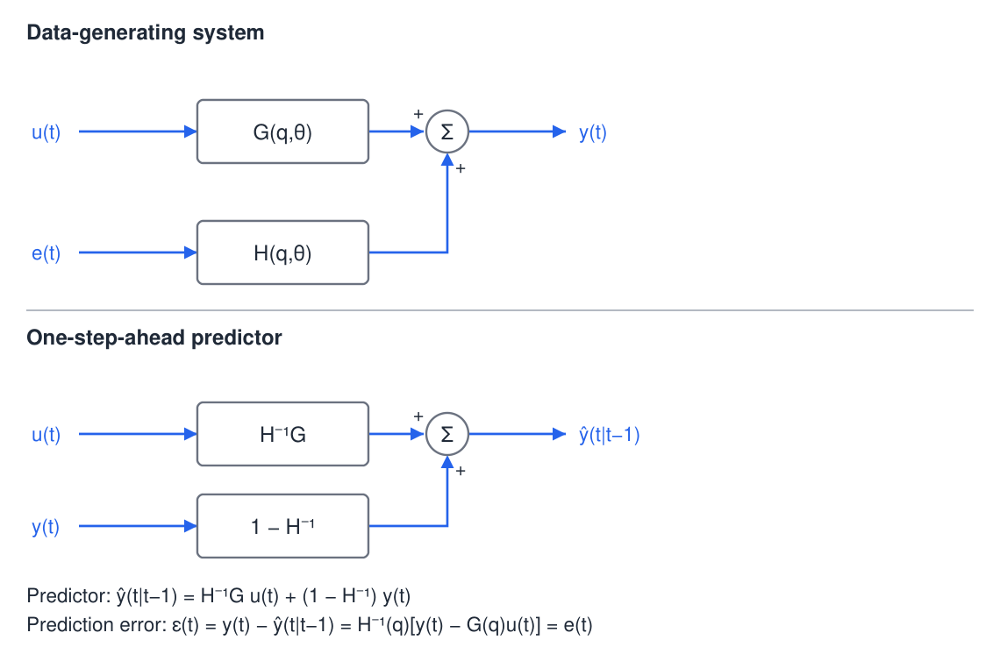
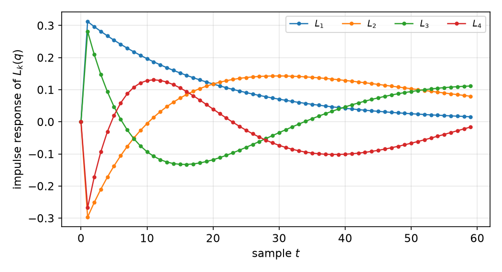
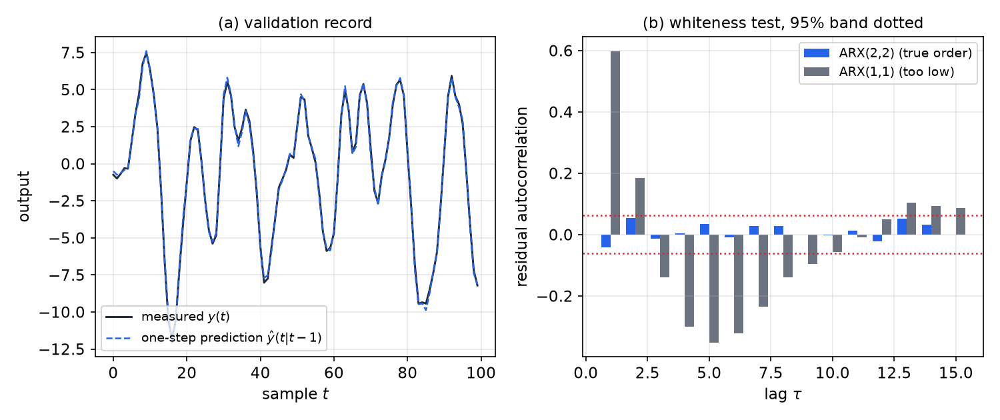
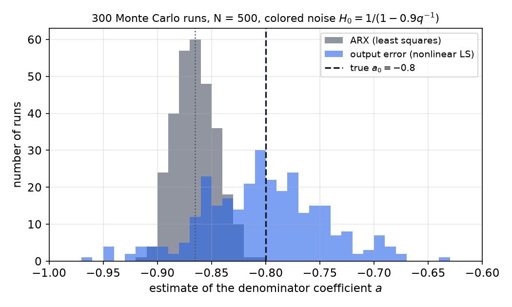

# Model Structures and Prediction-Error Methods

A model is only useful once its form has been chosen. A *model structure* is a parametrized family of input–output descriptions, and estimation means picking the member of that family whose predictions best match the measured output. This chapter builds the black-box families used in practice (FIR, ARX, ARMAX, output error and Box–Jenkins) from one rule, the one-step-ahead predictor, and shows that the **prediction-error method (PEM)** turns every family into a fitting problem. The linear-regression members are handled by the least-squares machinery of the [previous chapter](least-squares.md); the others need pseudo-linear regression or nonlinear optimization. The chapter closes with structural questions (when two parameter vectors describe the same model, and how to choose the orders). Whether the data are rich enough to make the estimates meaningful is the subject of [Identifiability](identifiability.md).

## From Impulse Responses to Transfer Functions

### Convolution and the shift operator

A discrete-time linear time-invariant (LTI) system is completely described by its impulse response \\(\\{g(k)\\}\\). The output at time \\(t\\) is the superposition of past inputs weighted by the impulse response,
\\[
y(t) = \sum\_{k=1}^{\infty} g(k)\\,u(t-k).
\\]
The sum starts at \\(k=1\\): a sample of delay separates input from output, so the output depends only on past inputs. The system is stable when the impulse response is absolutely summable, \\(\sum\_k \lvert g(k)\rvert < \infty\\).

The time shift is written with the operator \\(q\\), defined by \\(q\\,u(t) = u(t+1)\\) and \\(q^{-1}u(t) = u(t-1)\\). Substituting the shift for each term turns the convolution into a multiplication,
\\[
y(t) = \Big\\{\sum\_{k=1}^{\infty} g(k)\\,q^{-k}\Big\\}u(t) = G(q)\\,u(t),
\\]
where the braced sum is the **transfer operator** \\(G(q)\\). It is the z-transform of the impulse response with \\(z\\) replaced by \\(q\\), and it is the object that every model structure below parametrizes. (The discrete-time background is in [the z-transform](../../../signals/z-transform.md).)

**Example 1 (A geometric impulse response with one parameter).** Let \\(g(k) = a^{k-1}\\) for \\(k\ge 1\\) with \\(\lvert a\rvert < 1\\). The geometric series gives
\\[
G(q) = \sum\_{k=1}^{\infty} a^{k-1}q^{-k} = q^{-1}\sum\_{j=0}^{\infty}\big(aq^{-1}\big)^{j} = \frac{q^{-1}}{1-aq^{-1}} = \frac{1}{q-a}.
\\]
An infinite impulse response is therefore described exactly by one number, the pole \\(a\\). A general nonparametric response would need one coefficient per sample (thirty coefficients for a response that has died out after thirty samples), so the question that drives this chapter is how to choose a representation with as few parameters as the dynamics allow.

### Disturbances as filtered white noise

Measurement and process disturbances are rarely white. The standard representation, due to Wold, is \\(v(t) = H(q)\\,e(t)\\), where \\(\\{e(t)\\}\\) is a zero-mean white sequence of variance \\(\lambda\\) and \\(H\\) is a **monic** filter, \\(H(q) = 1 + h\_1q^{-1} + h\_2q^{-2} + \cdots\\). Monic means the leading coefficient is one, so \\(e\\) is the part of \\(v\\) that cannot be predicted from the past. The filter must also be stable and inversely stable, so that \\(e(t) = H^{-1}(q)v(t)\\) can be computed from the past of \\(v\\). The spectrum of \\(v\\) is
\\[
\Phi\_v(\omega) = \lambda\\,\big\lvert H(e^{i\omega})\big\rvert^2 .
\\]
Any stationary disturbance with a rational spectrum admits such a factorization (spectral factorization), so the noise model \\(H\\) loses no generality for the processes met in practice.

### The general model

Combining a deterministic part \\(G\\) and a noise part \\(H\\) gives the model
\\[
\boxed{y(t) = G(q,\theta)\\,u(t) + H(q,\theta)\\,e(t)},\qquad \theta\in D\_{\mathcal M}\subset\mathbb{R}^d ,
\\]
with \\(e\\) white, zero mean and variance \\(\lambda\\). The set \\(\mathcal M = \\{G(\cdot,\theta), H(\cdot,\theta): \theta\in D\_{\mathcal M}\\}\\) is the **model structure**. The true system is \\(G\_0, H\_0\\); when some \\(\theta\_0\\) gives \\(G(q,\theta\_0)=G\_0\\) and \\(H(q,\theta\_0)=H\_0\\), the true system lies in the model set. Choosing the structure means choosing how \\(G\\) and \\(H\\) depend on \\(\theta\\). The rest of the chapter explores that choice.



*Figure: top, the data-generating system, in which the deterministic path \\(G\\) driven by the input and the noise path \\(H\\) driven by the white sequence \\(e\\) are summed. Bottom, the predictor built from the same two filters: past inputs pass through \\(H^{-1}G\\), past outputs through \\(1-H^{-1}\\). The prediction error is the white sequence \\(e\\) itself, which is what PEM tries to make small.*

## One-Step-Ahead Prediction

The predictor is the best available guess of the next output given everything measured so far. It is the bridge between a model and data: the model is judged by how well its predictor matches the observations. The following result is the foundation of everything that follows.

**Theorem (one-step-ahead predictor).** Let \\(y = Gu + He\\) with \\(H\\) monic and \\(H^{-1}\\) stable, and let \\(\hat y(t\mid t-1)\\) denote the prediction of \\(y(t)\\) from the data \\(\\{y(s), u(s), s\le t-1\\}\\). Then
\\[
\boxed{\hat y(t\mid t-1) = H^{-1}(q)G(q)\\,u(t) + \big[1-H^{-1}(q)\big]\\,y(t)},
\\]
and the prediction error is
\\[
\varepsilon(t) = y(t) - \hat y(t\mid t-1) = H^{-1}(q)\big[y(t)-G(q)u(t)\big] = e(t).
\\]
For Gaussian \\(e\\) the predictor is the conditional mean of \\(y(t)\\) given the past; for non-Gaussian \\(e\\) it is the best linear predictor.

*Proof.* Write the output as \\(y(t) = G(q)u(t) + e(t) + (H(q)-1)e(t)\\). The term \\((H(q)-1)e(t) = \sum\_{k\ge 1} h\_k e(t-k)\\) involves only past noise values. Those past values are determined by past data, because \\(e(s) = H^{-1}(q)[y(s)-G(q)u(s)]\\) and the inverse filter is stable. So everything in the output except \\(e(t)\\) is known at time \\(t-1\\), and \\(e(t)\\) is zero mean and independent of the past. Hence
\\[
\hat y(t\mid t-1) = G(q)u(t) + \big(H(q)-1\big)e(t).
\\]
Substitute \\(e(t) = H^{-1}(q)[y(t)-G(q)u(t)]\\) and use \\((H-1)H^{-1} = 1 - H^{-1}\\):
\\[
\hat y(t\mid t-1) = G u + \big(1-H^{-1}\big)\big(y - Gu\big) = H^{-1}G\\,u + \big(1-H^{-1}\big)y .
\\]
The prediction error is then \\(y - \hat y = H^{-1}(y-Gu) = e\\). \\(\blacksquare\\)

Two features of the predictor matter in practice. First, both filters are causal: \\(H^{-1}G\\) acts on past inputs because \\(G\\) has no direct term, and \\(1-H^{-1}\\) acts on past outputs because \\(H^{-1}\\) is monic. Second, the predictor depends on the model only through the pair of filters
\\[
W\_u(q,\theta) = H^{-1}(q,\theta)G(q,\theta), \qquad W\_y(q,\theta) = 1-H^{-1}(q,\theta),
\\]
and these filters determine \\(G\\) and \\(H\\) uniquely. The noise model is therefore a tuning knob for the predictor. With \\(H=1\\) the predictor is pure simulation, \\(\hat y = Gu\\), and past outputs carry no weight. A larger \\(H\\) gives past outputs more weight, because they carry information about the disturbance. The prediction error is always the same kind of object, the part of the output that the past cannot explain.

The \\(k\\)-step-ahead predictor follows the same pattern. With \\(\bar H\_k(q) = \sum\_{\ell=0}^{k-1}h\_\ell q^{-\ell}\\) and \\(W\_k = \bar H\_k H^{-1}\\), one has \\(\hat y(t\mid t-k) = W\_kG\\,u + (1-W\_k)\\,y\\), with prediction-error variance \\(\lambda\sum\_{\ell=0}^{k-1}h\_\ell^2\\). Longer horizons are less accurate, and the one-step predictor is the one used for fitting.

## The Prediction-Error Method

### The criterion

For a model with parameter \\(\theta\\), the prediction error is \\(\varepsilon(t,\theta) = y(t) - \hat y(t\mid t-1;\theta)\\). The **prediction-error method** chooses the parameter that makes these errors small on average,
\\[
\boxed{V\_N(\theta) = \frac{1}{N}\sum\_{t=1}^{N}\varepsilon^2(t,\theta),\qquad \hat\theta\_N = \arg\min\_{\theta\in D\_{\mathcal M}} V\_N(\theta).}
\\]
The method has a probabilistic justification. If \\(e\\) is Gaussian and white with variance \\(\lambda\\), then \\(H\\) being monic makes the change of variables from \\(e\\) to \\(y\\) have unit Jacobian, and the log-likelihood of the data is
\\[
\log L(\theta,\lambda) = -\frac{1}{2\lambda}\sum\_{t=1}^{N}\varepsilon^2(t,\theta) - \frac{N}{2}\log(2\pi\lambda) .
\\]
Maximizing over \\(\lambda\\) gives \\(\hat\lambda = V\_N(\theta)\\), so the maximum-likelihood estimate of \\(\theta\\) is exactly the minimizer of \\(V\_N\\). PEM is therefore maximum likelihood with a Gaussian assumption on \\(e\\), and it remains a sensible fitting rule when that assumption fails.

### Gradient and the Gauss–Newton step

Define the gradient of the predictor,
\\[
\psi(t,\theta) = \frac{\partial \hat y(t\mid t-1;\theta)}{\partial\theta} = -\frac{\partial\varepsilon(t,\theta)}{\partial\theta}\in\mathbb{R}^d .
\\]
Then \\(\partial V\_N/\partial\theta = -\frac{2}{N}\sum\_t \psi(t,\theta)\varepsilon(t,\theta)\\), and the stationary points satisfy
\\[
\sum\_{t=1}^{N}\psi(t,\hat\theta)\\,\varepsilon(t,\hat\theta) = 0 .
\\]
This is the general form of the normal equations. Dropping the term that contains second derivatives of the predictor gives the Gauss–Newton iteration
\\[
\boxed{\theta\_{k+1} = \theta\_k + \Big[\sum\_{t=1}^{N}\psi(t,\theta\_k)\psi^T(t,\theta\_k)\Big]^{-1}\sum\_{t=1}^{N}\psi(t,\theta\_k)\\,\varepsilon(t,\theta\_k)} .
\\]
When the predictor is linear in \\(\theta\\), \\(\hat y = \varphi^T\theta\\) with \\(\varphi\\) independent of \\(\theta\\), we have \\(\psi=\varphi\\), the criterion is quadratic, and one step gives the least-squares solution \\(\hat\theta = (\sum\varphi\varphi^T)^{-1}\sum\varphi\\,y\\) of the [previous chapter](least-squares.md). For nonlinear predictors the iteration is a local method: it converges to a stationary point of \\(V\_N\\), and standard refinements such as Levenberg–Marquardt damping (see [unconstrained optimization](../../../cs/optimization/unconstrained.md)) are used in practice. The asymptotic behaviour of \\(\hat\theta\_N\\) (consistency and its covariance) is treated in [Identifiability](identifiability.md). The key fact is that under the regularity conditions for PEM, \\(\hat\theta\_N\\) converges to the minimizer of the expected squared prediction error. That minimizer is the true parameter when the true system lies in the model set and the data are informative, and it is the best approximation within the set otherwise.

```python
import numpy as np
def pem_gauss_newton(predict, psi, theta, u, y, iters=20):
    """Generic Gauss-Newton for PEM: predict(theta) -> yhat, psi(theta) -> (N, d) gradients."""
    for _ in range(iters):
        eps = y - predict(theta)
        P = psi(theta)
        theta = theta + np.linalg.solve(P.T @ P, P.T @ eps)
    return theta
```

## Black-Box Model Structures

The families below differ only in how the polynomials in \\(G\\) and \\(H\\) are tied together. Writing them in the form \\(A(q)y(t) = \cdots\\) makes the relations explicit. Each polynomial is a series in \\(q^{-1}\\) with constant term one unless stated otherwise, and the input polynomial carries the delay \\(n\_k\\) implicitly, so that \\(B(q) = q^{-n\_k}\bar B(q)\\) where \\(n\_k\\) is the number of samples before the input affects the output.

### FIR models

The finite-impulse-response model has \\(G(q,\theta) = B(q) = b\_1q^{-1}+\cdots+b\_mq^{-m}\\) and \\(H=1\\). Its predictor is
\\[
\hat y(t\mid\theta) = \varphi^T(t)\theta,\qquad \varphi(t) = \begin{bmatrix}u(t-1) & \cdots & u(t-m)\end{bmatrix}^T,\quad \theta = \begin{bmatrix}b\_1 & \cdots & b\_m\end{bmatrix}^T ,
\\]
which is linear regression, so the estimate is least squares. The estimate is consistent whenever the regressors are uncorrelated with the disturbance. Because the regressors contain only inputs, the condition is \\(E[u(t-k)v(t)]=0\\) for the true disturbance \\(v=H\_0e\\), and the disturbance may be colored.

The pros and cons follow from the parameter count. A slowly decaying impulse response, or a fast sampling rate that stretches the response over many samples, needs a large \\(m\\). Then the Gram matrix \\(\Phi\Phi^T = \sum\_t\varphi\varphi^T\\) becomes nearly singular, and the input must be persistently exciting for every direction to be estimated. Input richness is a property of the experiment, so this problem belongs partly to [Input Design](input-design.md).

**Example 2 (How many FIR taps can a repetitive input identify?).** A radial-pressure record was driven by an aortic-flow input sampled at 100 Hz, 7650 samples in total, with nearly periodic heartbeats. The eigenvalues of \\(\Phi\Phi^T\\), for a Toeplitz matrix \\(\Phi\\) of lagged inputs, were examined as the FIR order \\(m\\) grows. The computation shows that the null space of \\(\Phi\Phi^T\\) is trivial up to about \\(m\approx 760\\) and grows linearly beyond that, so at most about 760 taps are identifiable from this input. The impulse responses have a common slow mode of about 5 s, which corresponds to roughly 500 taps at 100 Hz. A plain FIR model is therefore both high-order and close to unidentifiable, which motivates the compressed representation below.

### Compressing an FIR model with Laguerre filters

An orthonormal filter bank replaces many delays by a few filters whose poles are chosen to match the slow dynamics. The continuous-time Laguerre functions are
\\[
L\_k(s) = \frac{\sqrt{2\bar a}}{s+\bar a}\Big(\frac{s-\bar a}{s+\bar a}\Big)^{k-1},\qquad k = 1,2,\dots
\\]
The first factor is a low-pass filter with a single slow pole at \\(-\bar a\\). The second factor, \\((s-\bar a)/(s+\bar a)\\), is all-pass: it changes phase but not magnitude. Each additional \\(k\\) therefore adds one more phase-shifted copy of the slow pole, which shapes the response without adding a new pole.

The discrete-time version, for a sampling period \\(T\\) and a pole \\(\lvert a\rvert<1\\), is
\\[
\boxed{L\_k(q) = \frac{K}{q-a}\Big(\frac{1-aq}{q-a}\Big)^{k-1},\qquad K = \sqrt{(1-a^2)T}}.
\\]
The continuous pole \\(-\bar a\\) maps to \\(a = e^{-\bar a T}\\) under \\(q = e^{sT}\\), so the left half-plane maps into the unit disc. The factor \\((1-aq)/(q-a)\\) is also all-pass on the unit circle, because for real \\(a\\) the moduli of \\(1-ae^{i\omega}\\) and \\(e^{i\omega}-a\\) are equal. The constant \\(K\\) only rescales the basis functions, so it changes the coefficients but not the model class or the fitted output. With \\(T=1\\) the constant is \\(\sqrt{1-a^2}\\), which gives the usual orthonormal Laguerre filter.

The filters can be computed recursively. Let \\(x\_k = L\_k(q)u\\). From \\(L\_1 = K/(q-a)\\) we get \\(x\_1(t) = a\\,x\_1(t-1) + K\\,u(t-1)\\). From \\(L\_k = L\_{k-1}(1-aq)/(q-a)\\) we get, after shifting back one sample,
\\[
x\_k(t) = a\\,x\_k(t-1) + x\_{k-1}(t-1) - a\\,x\_{k-1}(t),\qquad k\ge 2,
\\]
with zero initial conditions. Each state is updated from the previous one at the same time, so a Laguerre model needs one recursion per term and no long delay line. The model is then linear in the parameters, \\(y(t) = \sum\_{k=1}^{n}\theta\_k x\_k(t)\\), and least squares applies directly to the regressors \\(\varphi(t) = [x\_1(t)\ \cdots\ x\_n(t)]^T\\).



*Figure: impulse responses of \\(L\_1,\dots,L\_4\\) for \\(a=0.95\\) and \\(K=\sqrt{1-a^2}\\) (sampling period normalized to one). \\(L\_1\\) is a pure decaying exponential; higher-order functions are oscillatory and capture faster dynamics in the same sample count.*

The choice of pole matters. The rule is to place \\(a\\) near the dominant slow pole of the system: too small a pole needs many terms to represent the slow tail, and too large a pole mis-represents the fast part. The Laguerre network is also drawn as a block diagram in which the filters \\(L\_1(z),\dots,L\_n(z)\\) feed weights \\(\hat\theta\_1,\dots,\hat\theta\_n\\) that are summed into \\(\hat y\\). A variant with a Kautz basis, whose denominator is a second-order polynomial \\(s^2+bs+c\\), is better suited to oscillatory systems.

**Example 3 (Laguerre compression of an FIR model).** The same pressure record as in Example 2 was modelled with \\(T = 0.01\\) s. With \\(a = 0.95\\), only \\(n=10\\) Laguerre terms reproduce the 50–52 s pressure waveform almost exactly, including peaks near 71 mmHg and troughs near 40 mmHg. A truncated FIR model with \\(n=100\\) taps, which has ten times as many parameters, under-predicts the troughs (about 32–35 mmHg) and the peaks (about 64 mmHg). The Laguerre model needs far fewer terms for the same accuracy because its basis already contains the slow decay, which the FIR taps must reproduce one by one.

## ARX Models

### ARX as linear regression

The ARX structure, short for autoregressive with exogenous input, is
\\[
A(q)\\,y(t) = B(q)\\,u(t) + e(t),\qquad A = 1 + a\_1q^{-1}+\cdots+a\_{n\_a}q^{-n\_a},\quad B = b\_1q^{-1}+\cdots+b\_{n\_b}q^{-n\_b}.
\\]
Here \\(G = B/A\\) and \\(H = 1/A\\), so the noise model is fixed by the denominator. The inverse noise filter is \\(H^{-1} = A\\), and the predictor of the general theorem becomes
\\[
\hat y(t\mid\theta) = B(q)u(t) + \big[1-A(q)\big]y(t) = \varphi^T(t)\theta ,
\\]
\\[
\varphi(t) = \begin{bmatrix}-y(t-1)\ \cdots\ -y(t-n\_a)\ \ u(t-1)\ \cdots\ u(t-n\_b)\end{bmatrix}^T,\qquad \theta = \begin{bmatrix}a\_1\ \cdots\ a\_{n\_a}\ \ b\_1\ \cdots\ b\_{n\_b}\end{bmatrix}^T .
\\]
The predictor is linear in \\(\theta\\), so PEM is least squares and \\(\hat\theta\_N = (\sum\varphi\varphi^T)^{-1}\sum\varphi\\,y\\). Setting \\(n\_a = 0\\) recovers the FIR model, and dropping the input gives the autoregressive (AR) model. The ARX model is the workhorse of identification because its estimate is a single linear solve, but its predictor is correct only if the noise really enters as \\(e\\), which is a strong assumption.

**Example 4 (ARX(2,2) identification and validation).** Consider \\(A(q) = 1-1.5q^{-1}+0.7q^{-2}\\) and \\(B(q) = q^{-1}+0.5q^{-2}\\) with white noise of standard deviation 0.2. The poles of \\(A\\) are complex, \\(0.75\pm 0.30i\\), with modulus about 0.81, so the system is lightly damped but stable. A record of 1000 samples gives an ARX(2,2) estimate by least squares, and a fresh validation record tests the model. The figure below shows two validation checks.



*Figure: left, the measured output of a validation record and the one-step prediction from the ARX(2,2) model; the two curves nearly coincide. Right, the sample autocorrelation of the prediction residuals for ARX(2,2) (blue) and for an under-parametrized ARX(1,1) (gray). The dotted lines mark the 95% band \\(\pm 1.96/\sqrt{N}\\) for \\(N=1000\\). The correct order leaves white residuals, while the too-small model leaves correlation at many lags.*

The right panel is the basic validation test for a fitted model: if the model captures the dynamics, the residuals are white and uncorrelated with the input. A residual that is correlated at lags outside the band indicates a missing term, that is, a structure that is too small. The validation section below returns to these checks and to model-order selection.

### Equation error and bias

The ARX residual at the true parameter is
\\[
\varepsilon(t,\theta\_0) = A\_0(q)\\,y(t) - B\_0(q)\\,u(t) = A\_0(q)\\,H\_0(q)\\,e(t).
\\]
This equals \\(e(t)\\) only when \\(A\_0H\_0 = 1\\), that is, when the true disturbance has the ARX form \\(H\_0 = 1/A\_0\\). Otherwise the residual is a colored sequence. Because the regressor \\(\varphi(t)\\) contains past outputs, which themselves contain past disturbances, \\(\varphi(t)\\) is correlated with the residual, and least squares converges to a biased value. This is the **equation-error bias** of ARX models: a larger data set reduces the variance of the estimate but not its bias.

**Example 5 (Monte Carlo: ARX versus output error under colored noise).** Let the true system be \\(y(t) + a\_0 y(t-1) = b\_0 u(t-1) + v(t)\\) with \\(a\_0 = -0.8\\), \\(b\_0 = 0.5\\), and a colored disturbance \\(v = e/(1-0.9q^{-1})\\), where \\(e\\) is white with standard deviation 0.5 and the input is white with unit variance. For each of 300 independent runs of \\(N=500\\) samples, two estimators were applied to the same data. The ARX estimator is least squares. The output-error (OE) estimator is the nonlinear least-squares fit of \\(\hat y = b\\,q^{-1}u/(1+f\\,q^{-1})\\) described below. The results are as follows.

| Estimator | Mean of \\(\hat a\\) or \\(\hat f\\) | Standard deviation |
|---|---|---|
| ARX (least squares) | \\(-0.865\\) | \\(0.019\\) |
| Output error | \\(-0.803\\) | \\(0.055\\) |

The ARX estimate is tightly concentrated, but around the wrong value, and the bias is more than three standard deviations. Repeating the ARX experiment with \\(N=5000\\) samples (40 runs) gives a mean of \\(-0.867\\) with standard deviation 0.006, so more data sharpen the wrong answer. The output-error estimate is centered on the true value at a price in variance. The figure below shows the two distributions.



*Figure: distribution of the estimate of the denominator coefficient \\(a\\) over 300 Monte Carlo runs with \\(N=500\\). ARX least squares (gray) concentrates near \\(-0.87\\), away from the true value \\(-0.8\\) (dashed line). Output error (blue) is centered on the truth but more variable. The noise model here is not of ARX form, which is exactly the situation in which the equation-error bias appears.*

The output-error predictor needs no noise model at all. It is pure simulation, so the parameters enter nonlinearly, and it is consistent for the deterministic part \\(G\\) whatever the disturbance spectrum, provided \\(G\_0\\) lies in the model set and the input is independent of the disturbance.

## ARMAX Models and Pseudo-Linear Regression

### The ARMAX predictor

The ARMAX structure, autoregressive moving-average with exogenous input, adds a moving-average polynomial to the noise,
\\[
A(q)\\,y(t) = B(q)\\,u(t) + C(q)\\,e(t),\qquad C = 1+c\_1q^{-1}+\cdots+c\_{n\_c}q^{-n\_c}.
\\]
Now \\(G = B/A\\) and \\(H = C/A\\), so \\(H^{-1} = A/C\\). For the inverse to be stable, \\(C\\) must have all its zeros strictly inside the unit circle. The predictor of the general theorem is
\\[
\hat y(t\mid\theta) = \frac{B(q)}{C(q)}u(t) + \Big[1-\frac{A(q)}{C(q)}\Big]y(t).
\\]
Multiplying by \\(C\\) gives \\(C\\,\hat y = B\\,u + (C-A)\\,y\\). Write \\((C-A)y = (1-A)y + (C-1)y\\) and \\((C-1)y = (C-1)\hat y + (C-1)\varepsilon\\), where \\(\varepsilon = y-\hat y\\). Then \\(C\hat y - (C-1)\hat y = \hat y\\) gives
\\[
\hat y(t\mid\theta) = B(q)u(t) + \big[1-A(q)\big]y(t) + \big[C(q)-1\big]\varepsilon(t,\theta).
\\]
The last term is a sum of past prediction errors, \\((C-1)\varepsilon = \sum\_{k\ge 1} c\_k\varepsilon(t-k,\theta)\\), and it depends on \\(\theta\\). Collecting the terms gives
\\[
\hat y(t\mid\theta) = \varphi^T(t,\theta)\\,\theta,\qquad \varphi(t,\theta) = \begin{bmatrix}u(t-1)\cdots u(t-n\_b)\ \ -y(t-1)\cdots -y(t-n\_a)\ \ \varepsilon(t-1,\theta)\cdots \varepsilon(t-n\_c,\theta)\end{bmatrix}^T .
\\]
This is a **pseudo-linear regression**. It has the appearance of least squares, but the regressor depends on the parameter through the residuals, so the problem is not linear and must be solved iteratively. The residuals at the true parameter are white, which is why the regression is the natural form for a stochastic model.

### The gradient of the ARMAX predictor

The Gauss–Newton step needs \\(\psi = \partial\hat y/\partial\theta\\). The identity \\(\varepsilon = (Ay-Bu)/C\\) holds for every \\(\theta\\), so differentiating it is simple. For a coefficient \\(a\_i\\) of \\(A\\), \\(\partial\varepsilon/\partial a\_i = q^{-i}y/C\\). For \\(b\_j\\), \\(\partial\varepsilon/\partial b\_j = -q^{-j}u/C\\). For \\(c\_k\\), \\(\partial\varepsilon/\partial c\_k = -(q^{-k}/C)\\,\varepsilon\\), because \\(\partial(1/C)/\partial c\_k = -q^{-k}/C^2\\). Since \\(\psi = -\partial\varepsilon/\partial\theta\\), every component of the gradient is the corresponding component of the pseudo-linear regressor filtered by \\(1/C\\):
\\[
\boxed{\psi(t,\theta) = \frac{1}{C(q,\theta)}\\,\varphi(t,\theta)}.
\\]
The Gauss–Newton iteration of the previous section applies with this \\(\psi\\). Its stationary condition, \\(\sum\psi\varepsilon=0\\), is not the same as the naive regression condition \\(\sum\varphi\varepsilon=0\\) because of the filter \\(1/C\\). This distinction is the reason pseudo-linear regression is an approximation to PEM rather than PEM itself, unless \\(C=1\\).

**Example 6 (One-step predictor and pseudo-linear regression for an ARMAX-type model).** Let
\\[
y(t) = \frac{b\\,q^{-1}}{1+aq^{-1}}\\,u(t) + \frac{1}{(1+aq^{-1})(1+cq^{-1})}\\,e(t).
\\]
Here \\(G = bq^{-1}/(1+aq^{-1})\\) and \\(H = 1/\big[(1+aq^{-1})(1+cq^{-1})\big]\\), so
\\[
H^{-1}G = (1+cq^{-1})\\,bq^{-1},\qquad 1-H^{-1} = -(a+c)q^{-1} - ac\\,q^{-2}.
\\]
The predictor is therefore
\\[
\hat y(t\mid t-1) = b\\,u(t-1) + bc\\,u(t-2) - (a+c)\\,y(t-1) - ac\\,y(t-2).
\\]
The noise denominator shares the factor \\(1+aq^{-1}\\) with \\(G\\), so \\(H^{-1}\\) is a polynomial and the predictor is finite. The model is an ARX model in disguise. If \\(c=0.5\\) is known and only \\(\theta = (a,b)^T\\) is unknown, the predictor takes the form \\(\hat y = \varphi^T\theta + \mu\\) with
\\[
\varphi(t) = \begin{bmatrix}-y(t-1)-0.5\\,y(t-2)\\ u(t-1)+0.5\\,u(t-2)\end{bmatrix},\qquad \mu(t) = -0.5\\,y(t-1).
\\]
Least squares on \\(y(t)-\mu(t)\\) then estimates \\(a\\) and \\(b\\) directly. The known \\(c\\) has been absorbed into a known offset \\(\mu\\), so no iteration is needed in this case. If \\(c\\) were unknown, the same construction would give a pseudo-linear regression with \\(\varepsilon\\) in the regressor.

## Output Error, Box–Jenkins and the General Family

### Output error

The output-error (OE) structure takes the noise to be white measurement error, \\(H=1\\), and places all dynamics in \\(G=B/F\\):
\\[
y(t) = \frac{B(q)}{F(q)}\\,u(t) + e(t).
\\]
The predictor is pure simulation, \\(\hat y(t\mid\theta) = (B/F)\\,u(t)\\), which depends on \\(\theta\\) through the denominator and is nonlinear in \\(\theta\\). The gradient follows by differentiating the rational function. With \\(F = 1+f\_1q^{-1}+\cdots\\), we have \\(\partial\hat y/\partial b\_j = u(t-j)/F\\) and \\(\partial\hat y/\partial f\_i = -\hat y(t-i)/F\\). Hence
\\[
\psi(t,\theta) = \frac{1}{F(q)}\begin{bmatrix}u(t-1)\cdots u(t-n\_b)\ \ -\hat y(t-1)\cdots -\hat y(t-n\_f)\end{bmatrix}^T ,
\\]
which is computed by filtering the simulated input and output through \\(1/F\\). Because \\(\hat y\\) is a simulation driven by \\(u\\) alone, the output-error regressors are independent of the disturbance. This is the source of the consistency seen in Example 5.

The price is computational. The criterion is non-quadratic and may have several local minima, so the Gauss–Newton iteration must start from a good initial guess, often an ARX or ARMAX fit.

### Box–Jenkins

The Box–Jenkins (BJ) structure gives \\(G\\) and \\(H\\) separate denominators,
\\[
y(t) = \frac{B(q)}{F(q)}\\,u(t) + \frac{C(q)}{D(q)}\\,e(t).
\\]
The inverse noise filter is \\(H^{-1} = D/C\\), so the predictor is
\\[
\hat y(t\mid\theta) = \frac{D(q)B(q)}{C(q)F(q)}\\,u(t) + \frac{C(q)-D(q)}{C(q)}\\,y(t).
\\]
The BJ model has the most freedom of the classical structures: the dynamics and the noise each have their own poles and zeros. It is also nonlinear in \\(\theta\\).

### The general family

The most general single-equation structure is
\\[
\boxed{A(q)\\,y(t) = \frac{B(q)}{F(q)}\\,u(t) + \frac{C(q)}{D(q)}\\,e(t)},
\\]
which gives \\(G = B/(AF)\\) and \\(H = C/(AD)\\). Its predictor is
\\[
\hat y(t\mid\theta) = \frac{DB}{CF}\\,u(t) + \frac{C-AD}{C}\\,y(t),
\\]
or, in pseudo-linear form, \\(CF\\,\hat y = DB\\,u + F(C-AD)\\,y\\). The classical structures are special cases in which some polynomials equal one. The table lists the standard names.

| Polynomials present | Structure | Predictor linear in \\(\theta\\)? |
|---|---|---|
| \\(B\\) | FIR | yes |
| \\(AB\\) | ARX | yes |
| \\(ABC\\) | ARMAX | pseudo-linear |
| \\(AC\\) | ARMA (no input) | pseudo-linear |
| \\(ABD\\) | ARARX | pseudo-linear |
| \\(ABCD\\) | ARARMAX | pseudo-linear |
| \\(BF\\) | OE | nonlinear |
| \\(BFCD\\) | BJ | nonlinear |

The table shows the trade-off that drives the choice of structure. Equation-error structures, in which the same polynomial \\(A\\) appears in the dynamics and in the noise, have linear or pseudo-linear predictors and are cheap to fit, but they tie the noise model to the dynamics. Output-error and Box–Jenkins structures separate them at the cost of nonlinear optimization. A middle course is the ARARX structure, which keeps a linear-in-parameters form when the denominator \\(D\\) is known.

## State-Space Model Structures

State-space models are the other major black-box family. A discrete-time model with innovations (one noise source acting on both the state and the output) is
\\[
x(t+1) = A\\,x(t) + B\\,u(t) + K\\,e(t),\qquad y(t) = C\\,x(t) + e(t).
\\]
Its transfer functions are \\(G = C(qI-A)^{-1}B\\) and \\(H = I + C(qI-A)^{-1}K\\). The predictor is the observer that uses the innovations: with \\(\hat x(t+1) = A\hat x + Bu + K(y - C\hat x)\\) and \\(\hat y = C\hat x\\), eliminating \\(\hat x\\) gives
\\[
\hat y(t\mid\theta) = C\\,(qI - A + KC)^{-1}\big[B\\,u(t) + K\\,y(t)\big].
\\]
The steady-state gain \\(K\\) is the stationary Kalman gain, obtained from an algebraic Riccati equation. The derivation of that gain is the subject of [Observers and the Kalman Filter](state-estimation.md), so only the structural consequences are given here.

Two parametrizations are used. In a **physical** parametrization, \\(\theta\\) collects the parameters of a continuous-time model \\(\dot x = A(\theta)x + B(\theta)u\\), \\(y = C(\theta)x\\), sampled exactly through \\(e^{AT}\\) and \\(\int\_0^T e^{A\tau}B\\,d\tau\\). Such models have few parameters, each with a physical meaning, and they are the natural choice when the structure is known from first principles. In a **canonical** parametrization, the matrices are written in a standard form. The observer canonical form, with \\(A\\) having the negated coefficients of a monic polynomial in its first column, is in one-to-one correspondence with an ARMAX model with \\(n\_a=n\_b=n\_c=n\\). The black-box state-space model is therefore an ARMAX model in another guise, and the two families have the same identifiability conditions.

## Model Sets, Model Structures and Identifiability

Model structures need a precise vocabulary. A predictor model is a pair of stable filters \\(W(q) = [W\_u(q)\ W\_y(q)]\\) giving \\(\hat y = W\_uu + W\_yy\\). Two models are equal when \\(W\_1(e^{i\omega}) = W\_2(e^{i\omega})\\) for almost all \\(\omega\\). Since \\(W\_u = H^{-1}G\\) and \\(W\_y = 1-H^{-1}\\) determine \\(G\\) and \\(H\\) uniquely, this is the same as equality of \\(G\\) and \\(H\\).

A **model structure** is a differentiable map \\(\theta\mapsto W(q,\theta)\\) from a connected open set \\(D\_{\mathcal M}\subset\mathbb{R}^d\\), such that the gradient filter \\(\partial W/\partial\theta\\) is stable. The structures above all qualify, provided the denominator polynomials have all their zeros strictly inside the unit circle, so that the filters are stable. The map is **identifiable** at \\(\theta^\*\\) if \\(W(q,\theta) = W(q,\theta^\*)\\) with \\(\theta\in D\_{\mathcal M}\\) implies \\(\theta = \theta^\*\\). Identifiability is a property of the structure alone, independent of the data.

Identifiability fails on special sets of parameters. The typical cause is a **pole–zero cancellation**: when a numerator and denominator polynomial share a factor, a whole family of parameter values describes the same input–output relation, and the estimate is not unique. For the output-error model, \\(B/F\\) is identifiable at \\(\theta^\*\\) when the polynomials \\(B\\) and \\(F\\) have no common factor. For ARMAX the condition is that \\(A\\), \\(B\\) and \\(C\\) have no common factor. For the general family, the conditions of Ljung's identifiability theorem require that appropriate pairs of polynomials be coprime, which in particular excludes common factors between the dynamics and noise. The practical conclusion is that identifiability holds for almost all parameter values once the orders are chosen correctly, and failure occurs on lower-dimensional sets that correspond to smaller models. The order itself must therefore be chosen with care.

## Choosing the Structure and Its Orders

A structure is fixed by its polynomial orders: \\(n\_a\\), \\(n\_b\\), \\(n\_c\\), the delay \\(n\_k\\), and so on. Choosing them is the main task of model validation, and two complementary tools are standard.

### Residual tests

If the model captures the dynamics, the one-step prediction residuals \\(\varepsilon(t)\\) are white, and they are uncorrelated with past inputs. The sample autocorrelation of \\(\varepsilon\\) and the cross-correlation between \\(\varepsilon\\) and \\(u\\) should lie within \\(\pm 1.96/\sqrt{N}\\) at most lags, the 95% band for white noise. The right panel of the ARX validation figure above shows an under-parametrized model failing this test at many lags, while the correct order passes.

### Akaike's information criterion

Fit quality always improves with more parameters, so a criterion must penalize complexity. The theory starts from the Kullback–Leibler distance between the true density \\(f\_0\\) and a model density \\(g(\cdot\mid\theta)\\),
\\[
I(f\_0,g) = \int f\_0(x)\log\frac{f\_0(x)}{g(x\mid\theta)}\\,dx .
\\]
Minimizing it over \\(\theta\\) is equivalent to maximizing the expected log-likelihood, and the maximized log-likelihood of the data is a biased estimate of that expectation. Akaike showed that for large \\(N\\) the bias is approximately the number of estimated parameters \\(d\\). For Gaussian prediction errors this gives the criterion
\\[
\mathrm{AIC} = N\log V\_N(\hat\theta) + 2d,
\\]
up to an additive constant, and the structure with the smallest AIC is preferred. The first term rewards fit and the second penalizes parameters. The derivation is standard, and Akaike's result assumes that the true system lies in one of the candidate model sets, so it is a guide rather than a guarantee. In a model-selection study, AIC is evaluated for each candidate order, and the fit is then confirmed on data not used for estimation.

Held-out validation is the simplest and most reliable check. A model is estimated on one data set, and its prediction error is measured on another. The same logic governs the choice of neural-network size in the [neural-network chapter](neural-models.md), where a larger model that fits the training data better can predict the test data worse.

## Summary

- The model structure \\(y = G(q,\theta)u + H(q,\theta)e\\) with \\(H\\) monic and inversely stable; the one-step predictor is \\(\hat y = H^{-1}Gu + (1-H^{-1})y\\), and the prediction error is \\(\varepsilon = H^{-1}(y-Gu)\\), equal to the white noise \\(e\\) at the true parameter.
- The prediction-error method minimizes \\(V\_N(\theta) = \frac{1}{N}\sum\varepsilon^2(t,\theta)\\). Under Gaussian white noise this is maximum likelihood. Gauss–Newton uses \\(\psi = \partial\hat y/\partial\theta\\) and the update \\([\sum\psi\psi^T]^{-1}\sum\psi\varepsilon\\).
- FIR and ARX predictors are linear in \\(\theta\\), so PEM is least squares. The ARX predictor is biased when the disturbance is not of the form \\(e/A\\), and more data do not remove the bias.
- ARMAX predictors are pseudo-linear, \\(\hat y = \varphi^T(t,\theta)\theta\\) with past residuals in \\(\varphi\\), and \\(\psi = \varphi/C\\). Output-error and Box–Jenkins predictors are nonlinear in \\(\theta\\); output error gives a consistent deterministic model whatever the noise.
- Laguerre filters \\(L\_k(q) = \frac{K}{q-a}\big(\frac{1-aq}{q-a}\big)^{k-1}\\), \\(K=\sqrt{(1-a^2)T}\\), compress a long FIR model into a few terms; the pole should match the dominant slow mode.
- Identifiability of a structure fails on pole–zero cancellations, for example \\(A\\), \\(B\\) and \\(C\\) sharing a factor in ARMAX.
- Orders are chosen by residual whiteness and cross-correlation tests, by Akaike's criterion \\(N\log V\_N + 2d\\), and by held-out prediction error.

## See Also

- [Parameter Estimation and Hypothesis Testing](statistical-inference.md): significance and confidence intervals for the estimates.
- [Least Squares and Recursive Least Squares](least-squares.md): the linear-regression estimators that the ARX and FIR predictors reduce to.
- [Observers and the Kalman Filter for Estimation](state-estimation.md): the stationary Kalman gain used in state-space predictors.
- [Neural-Network Models](neural-models.md): nonlinear black-box structures and their validation by hold-out error.
- [Identifiability](identifiability.md): informative experiments, persistent excitation and the asymptotic properties of PEM estimates.
- [Input Design](input-design.md): choosing the input so that the chosen structure can be identified.
- [Optimal Estimation and the Kalman Filter](../linear/kalman-filter.md): the state-space predictor and the stochastic model behind innovations forms.
- [Unconstrained Optimization](../../../cs/optimization/unconstrained.md): Gauss–Newton and Levenberg–Marquardt methods for nonlinear PEM.
- [The z-transform](../../../signals/z-transform.md): the transfer-function background for shift operators.
