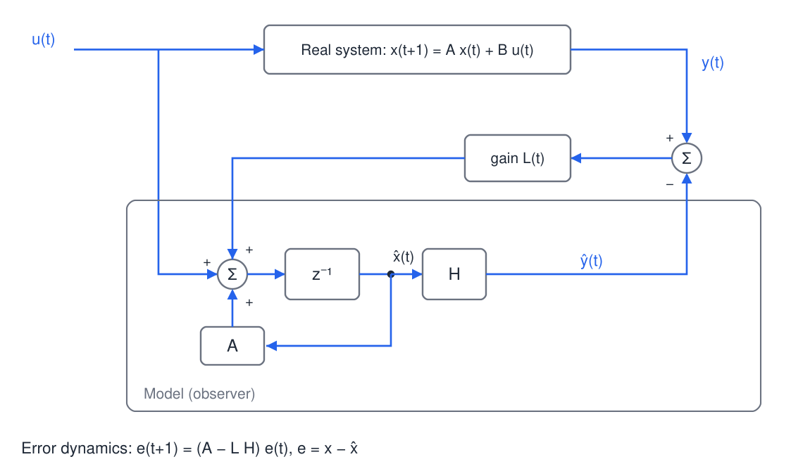
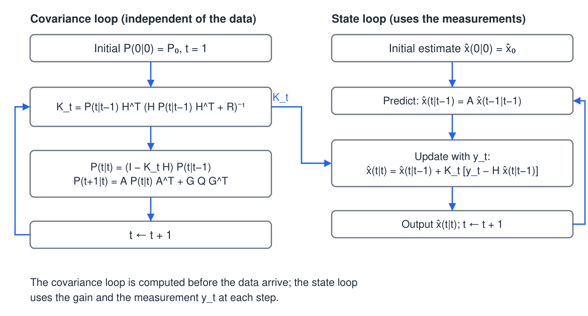
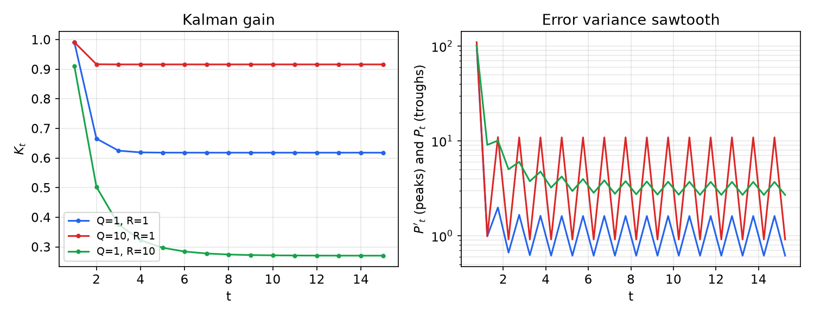
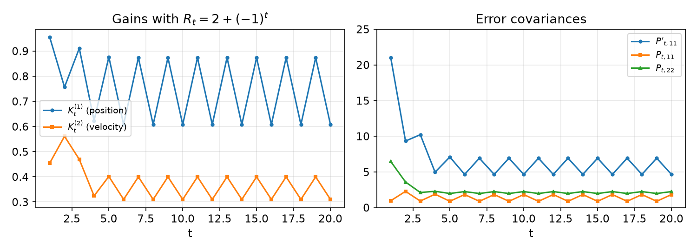
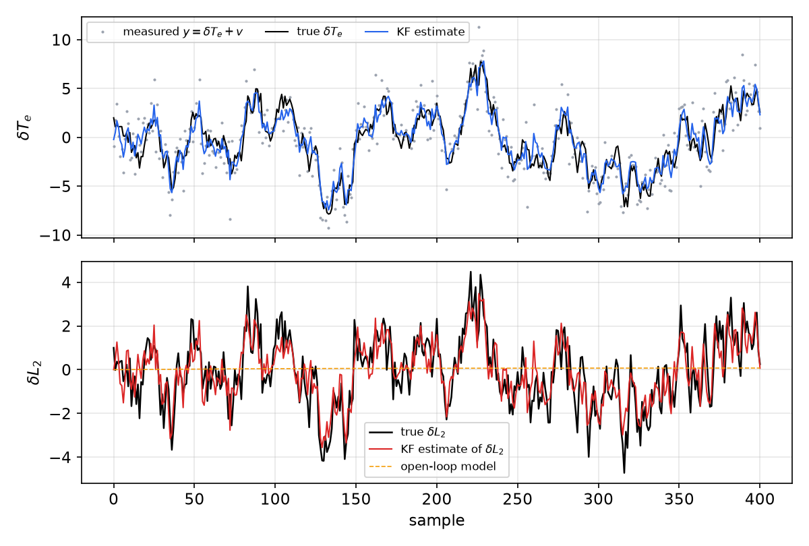

# Observers and the Kalman Filter for Estimation

Control laws need the state, but the state is rarely measured directly. An **observer** reconstructs it from the inputs and the noisy outputs, using a model of the system. This chapter treats two cases. For a deterministic model with an output-injection gain, the **Luenberger observer** has error dynamics that the gain can place. For a stochastic model, the gain that minimizes the mean-square estimation error is the **Kalman gain**, and the recursion that computes it is the **Kalman filter**. The filter is derived here in discrete time from the minimum-variance criterion. The continuous-time filter and its duality with LQR are in [Optimal Estimation and the Kalman Filter](../linear/kalman-filter.md), and deterministic observer design is in [Observers](../linear/observers.md). Recursive least squares, from the [previous chapter](least-squares.md), appears at the end as a special case.

## Deterministic State Observers

### The model and the observer

Consider a discrete-time, linear, time-varying system
\\[
x\_{t+1} = A\_t x\_t + B\_t u\_t,\qquad y\_t = H\_t x\_t,
\\]
with state \\(x\_t\in\mathbb{R}^n\\), input \\(u\_t\in\mathbb{R}^r\\), output \\(y\_t\in\mathbb{R}^\ell\\), and matrices of compatible sizes. The model can be simulated from an initial guess \\(\hat x\_0\\), but an error in the initial state or in the parameters persists forever in an open-loop simulation. The Luenberger observer runs the model and feeds back the output error:
\\[
\hat x\_{t+1} = A\_t\hat x\_t + B\_t u\_t + L\_t\big(y\_t - \hat y\_t\big),\qquad \hat y\_t = H\_t\hat x\_t ,
\\]
where \\(L\_t\in\mathbb{R}^{n\times\ell}\\) is the observer gain. The correction term is the prediction error multiplied by a gain, the same prediction–error–correction structure that recursive least squares uses.

*Figure: the real system produces the measured output \\(y\_t\\). Inside the dashed box, a copy of the model with the same input runs in parallel. The difference between \\(y\_t\\) and the model output \\(\hat y\_t\\) passes through the gain \\(L\_t\\) and is added to the model's state update.*

### Error dynamics and convergence

The estimation error \\(e\_t = x\_t - \hat x\_t\\) does not depend on the input. Subtracting the observer from the system gives
\\[
e\_{t+1} = A\_t x\_t - A\_t\hat x\_t - L\_tH\_t\\,(x\_t-\hat x\_t) = \big(A\_t - L\_tH\_t\big)\\,e\_t .
\\]
The error therefore evolves under the matrix \\(A\_t - L\_tH\_t\\), whatever the initial error. If the matrix is stable, the estimate converges to the state regardless of \\(\hat x\_0\\), so the observer forgets its starting point. For a time-invariant system, observability of the pair \\((A,H)\\) guarantees that the eigenvalues of \\(A - LH\\) can be placed anywhere by a suitable \\(L\\). This is the dual of pole placement by state feedback, and it is treated in [Observers](../linear/observers.md), with the test for observability in [Observability](../linear/observability.md). Observability says that the outputs contain enough information to reconstruct the state; without it, no gain can make every error mode decay.

Two limitations follow. The gain is chosen once from the model, so it cannot respond to noise levels that differ between measurements, and it gives no statement about the size of the estimation error in a stochastic setting. The Kalman filter removes both limitations by choosing the gain from the noise statistics.

### Recursive least squares as an observer

Take \\(A\_t = I\\), \\(B\_t = 0\\), and \\(H\_t = \varphi\_t^T\\). The state is then a constant parameter vector, \\(x\_{t+1} = x\_t\\), and the output is \\(y\_t = \varphi\_t^Tx\_t\\). Writing \\(\hat\theta\_t = \hat x\_t\\) and \\(L\_t = K\_t\\), the observer becomes
\\[
\hat\theta\_{t} = \hat\theta\_{t-1} + K\_t\big(y\_t - \varphi\_t^T\hat\theta\_{t-1}\big),
\\]
which is exactly the correction form of RLS derived in the [previous chapter](least-squares.md). State estimation and parameter estimation share one structure; they differ only in how the gain is chosen. For RLS the gain is \\(K\_t = P\_{t-1}\varphi\_t/(1+\varphi\_t^TP\_{t-1}\varphi\_t)\\), and the next section shows that this is the optimal gain for a particular stochastic model.

## Stochastic Models and the Optimal Linear Filter

### The model and its assumptions

Real systems are driven by disturbances that the model does not describe, and their outputs are measured with noise. The standard stochastic model is
\\[
x\_{t+1} = A\_t x\_t + G\_t w\_t,\qquad y\_t = H\_t x\_t + v\_t ,
\\]
where the known deterministic input has been subtracted out, since its effect is predictable. The noises \\(w\_t\in\mathbb{R}^n\\) (process noise) and \\(v\_t\in\mathbb{R}^\ell\\) (measurement noise) satisfy:

- zero mean, \\(E[w\_t]=0\\) and \\(E[v\_t]=0\\);
- covariances \\(E[w\_tw\_t^T]=Q\_t\\) and \\(E[v\_tv\_t^T]=R\_t\\), with \\(Q\_t\succeq 0\\) and \\(R\_t\succ 0\\);
- white in time, and uncorrelated with each other, \\(E[w\_tv\_s^T]=0\\) for all \\(t,s\\);
- the initial state has mean \\(\hat x\_0\\) and covariance \\(P\_0\\), and is uncorrelated with the noises.

The estimate is written \\(\hat x\_{t\mid t-1}\\) when it uses data up to time \\(t-1\\) (the prediction), and \\(\hat x\_{t\mid t}\\) when it also uses \\(y\_t\\) (the update). The corresponding error covariances are \\(P\_{t\mid t-1}\\) and \\(P\_{t\mid t}\\). The aim is to choose an estimator minimizing the mean-square error
\\[
J\_t = E\big[(\hat x\_{t\mid t}-x\_t)^T(\hat x\_{t\mid t}-x\_t)\big] = \operatorname{tr}P\_{t\mid t}.
\\]

### The discrete Kalman filter

**Theorem (discrete Kalman filter).** Under the assumptions above, among all estimators that are linear in the data, the estimator that minimizes \\(J\_t\\) is given by the recursion
\\[
\begin{aligned}
&\text{Prediction:}\quad \hat x\_{t\mid t-1} = A\_{t-1}\hat x\_{t-1\mid t-1},\qquad P\_{t\mid t-1} = A\_{t-1}P\_{t-1\mid t-1}A\_{t-1}^T + G\_{t-1}Q\_{t-1}G\_{t-1}^T,\\\\
&\text{Gain:}\quad K\_t = P\_{t\mid t-1}H\_t^T\big(H\_tP\_{t\mid t-1}H\_t^T + R\_t\big)^{-1},\\\\
&\text{Update:}\quad \hat x\_{t\mid t} = \hat x\_{t\mid t-1} + K\_t\big(y\_t - H\_t\hat x\_{t\mid t-1}\big),\qquad P\_{t\mid t} = (I-K\_tH\_t)P\_{t\mid t-1}.
\end{aligned}
\\]
The vector \\(i\_t = y\_t - H\_t\hat x\_{t\mid t-1}\\) is the **innovation**, the part of the measurement that the past could not predict.

*Proof.* Work with the errors, \\(e\_{t\mid t-1} = x\_t - \hat x\_{t\mid t-1}\\) and \\(e\_{t\mid t} = x\_t - \hat x\_{t\mid t}\\).

*Step 1: prediction.* From the state equation, \\(x\_t = A\_{t-1}x\_{t-1} + G\_{t-1}w\_{t-1}\\). Since \\(\hat x\_{t-1\mid t-1}\\) depends only on data up to time \\(t-1\\), and \\(w\_{t-1}\\) is uncorrelated with those data, the predicted state is \\(A\_{t-1}\hat x\_{t-1\mid t-1}\\), and
\\[
e\_{t\mid t-1} = A\_{t-1}e\_{t-1\mid t-1} + G\_{t-1}w\_{t-1}.
\\]
The two terms on the right are uncorrelated, so \\(P\_{t\mid t-1} = A\_{t-1}P\_{t-1\mid t-1}A\_{t-1}^T + G\_{t-1}Q\_{t-1}G\_{t-1}^T\\).

*Step 2: update covariance for any gain.* Substitute \\(y\_t = H\_tx\_t + v\_t\\) into the update. Then
\\[
e\_{t\mid t} = (I-K\_tH\_t)\\,e\_{t\mid t-1} - K\_tv\_t .
\\]
The prior error is uncorrelated with the measurement noise, so
\\[
P\_{t\mid t} = (I-K\_tH\_t)P\_{t\mid t-1}(I-K\_tH\_t)^T + K\_tR\_tK\_t^T .
\\]
This Joseph form is valid for every gain \\(K\_t\\).

*Step 3: optimal gain.* Write \\(P = P\_{t\mid t-1}\\), \\(S = HPH^T + R\\), and expand the trace, using \\(\operatorname{tr}M = \operatorname{tr}M^T\\):
\\[
\operatorname{tr}P\_{t\mid t} = \operatorname{tr}P - 2\operatorname{tr}(KHP) + \operatorname{tr}(KSK^T).
\\]
Differentiate with respect to \\(K\\), using \\(\partial\operatorname{tr}(KM)/\partial K = M^T\\) and \\(\partial\operatorname{tr}(KSK^T)/\partial K = 2KS\\) for symmetric \\(S\\):
\\[
-2(HP)^T + 2KS = 0 \quad\Longrightarrow\quad K = PH^TS^{-1} .
\\]
This is the gain of the theorem.

*Step 4: simplify.* Expanding the Joseph form gives \\(P\_{t\mid t} = P - KHP - PH^TK^T + KSK^T\\). Because \\(KS = PH^T\\), the last term equals \\(PH^TK^T\\), so \\(P\_{t\mid t} = P - KHP = (I-KH)P\\). \\(\blacksquare\\)

Several consequences deserve emphasis.

1. **Optimality.** The trace is the mean-square error, so the gain minimizes the total expected squared estimation error among linear filters. If the noises are Gaussian, the Kalman estimate is the conditional mean of \\(x\_t\\) given the data, and then it is the best estimator of any kind, linear or not.
2. **Innovations.** The innovation \\(i\_t\\) has zero mean and covariance \\(S\_t = H\_tP\_{t\mid t-1}H\_t^T + R\_t\\), and it is uncorrelated with all past data. The update adds to the prediction the part of the innovation that the gain selects. This orthogonality is the principle that the least-squares chapter identified for linear regression, here applied to a dynamic state.
3. **Offline gain.** The gain and covariance recursions do not depend on the measurements. They can be computed before the experiment, and only the state update runs online. This is visible in the recursive procedure in the figure below.
4. **Steady state.** For time-invariant matrices and under standard detectability and stabilizability conditions, \\(P\_{t\mid t-1}\\) converges to the solution \\(\bar P\\) of the discrete algebraic Riccati equation \\(\bar P = A(\bar P - \bar PH^T(H\bar PH^T+R)^{-1}H\bar P)A^T + GQG^T\\). The gain converges to a constant \\(\bar K\\), and the filter becomes a fixed observer of the same form as the Luenberger observer above, with its gain set by the noise statistics.

*Figure: the recursive discrete Kalman filter. The left column computes the gain and the covariances, which depend only on the model and the noise statistics, so it can run ahead of the data. The right column propagates the state estimate and forms the update with the new measurement, using the gain delivered from the left column.*

**Example 1 (Scalar random walk).** Let \\(x\_{t+1} = x\_t + w\_t\\) and \\(y\_t = x\_t + v\_t\\), with \\(Q=R=1\\) and \\(P\_0 = 100\\). The prediction is \\(\hat x\_{t\mid t-1} = \hat x\_{t-1}\\), and \\(P\_{t\mid t-1} = P\_{t-1}+Q\\). The gain simplifies to \\(K\_t = P\_{t\mid t-1}/(P\_{t\mid t-1}+R)\\), and the update variance is \\(P\_t = RK\_t\\). The first steps are
\\[
P\_{1\mid 0} = 101,\quad K\_1 = 0.9902,\quad P\_1 = 0.9902;\qquad P\_{2\mid 1} = 1.9902,\quad K\_2 = 0.6656;
\\]
\\[
P\_{3\mid 2} = 1.6656,\quad K\_3 = 0.6248;\qquad K\_4 = 0.6190,\quad K\_5 = 0.6182 .
\\]
The gain converges quickly to a steady value. In steady state \\(P\_{\infty\mid\infty-1} = \bar P\\) satisfies \\(\bar P = \bar P/(\bar P+1) + 1\\), that is \\(\bar P^2 - \bar P - 1 = 0\\), so \\(\bar P = (1+\sqrt5)/2\\). The posterior variance is \\(P\_{\infty\mid\infty} = \bar P/(\bar P+1) = (\sqrt5-1)/2 \approx 0.618\\), and since \\(R=1\\) the steady gain is also \\(0.618\\).

The sensitivity to the noise ratio is what matters in practice. With \\(Q=10\\) and \\(R=1\\) the steady gain is about 0.92, so the filter trusts the measurements. With \\(Q=1\\) and \\(R=10\\) it is about 0.27, so it trusts the model. A large measurement noise \\(R\\) relative to \\(Q\\) gives a small gain and a slow filter, and the reverse gives a fast, noisy one. The figure below shows both the gains and the sawtooth of the variances for three pairs.

*Figure: left, the Kalman gain \\(K\_t\\) for three \\((Q,R)\\) pairs, starting from \\(P\_0 = 100\\): \\((1,1)\\) in blue, \\((10,1)\\) in red, \\((1,10)\\) in green. Right, on a log scale, the predicted variance \\(P\_{t\mid t-1}\\) (peaks) and the updated variance \\(P\_{t\mid t}\\) (troughs). Each update lowers the variance and each prediction raises it by \\(Q\\), so the variance settles into a periodic pattern that the steady-state solution describes.*

**Example 2 (Two states with alternating measurement noise).** Let
\\[
x\_{t+1} = \begin{bmatrix}1 & 1\\\\ 0 & 1\end{bmatrix}x\_t + w\_t,\qquad y\_t = \begin{bmatrix}1 & 0\end{bmatrix}x\_t + v\_t,
\\]
with \\(w\_t\\) of covariance \\(I\\), \\(R\_t = 2 + (-1)^t\\), and \\(P\_0 = 10I\\). Measurement noise alternates between variance 1 and variance 3. The first prediction is
\\[
P\_{1\mid 0} = \begin{bmatrix}21 & 10\\\\ 10 & 11\end{bmatrix}.
\\]
At \\(t=1\\) (\\(R=1\\)), \\(K\_1 = (0.9545,\ 0.4545)^T\\) and \\(P\_1 = \begin{bmatrix}0.955 & 0.455\\\\ 0.455 & 6.455\end{bmatrix}\\). At \\(t=2\\) (\\(R=3\\)), \\(K\_2 = (0.7565,\ 0.5609)^T\\) and \\(P\_2 = \begin{bmatrix}2.269 & 1.683\\\\ 1.683 & 3.579\end{bmatrix}\\). At \\(t=3\\) (\\(R=1\\)) the gain is \\((0.9108,\ 0.4692)^T\\), and at \\(t=4\\) (\\(R=3\\)) it is \\((0.6231,\ 0.3241)^T\\). The gains do not converge to a constant. They settle into a period-two oscillation that follows the period-two measurement noise, which the figure shows. A time-invariant observer with a fixed gain would be a poor approximation here, and a time-varying gain is needed.

*Figure: the two-state filter of Example 2. Left, the gains for position (blue) and velocity (orange) alternate between high and low values with the period of the measurement noise. Right, the predicted position variance and the updated position and velocity variances, which settle into a periodic pattern after a few steps.*

## Correlated Process and Measurement Noise

The standard filter assumes that the process and measurement noises are uncorrelated at all times. Suppose instead that the process noise at one step is correlated with the measurement noise at the next, \\(E[w\_{t-1}v\_t^T] = C\\), for example because one disturbance enters the state and, a sample later, the sensor. All other cross-covariances are zero. The prediction step is unchanged, because \\(w\_{t-1}\\) is still uncorrelated with the data up to \\(t-1\\). The update must change.

Let \\(\varepsilon\_t = \hat x\_{t\mid t-1} - x\_t\\). Since \\(\hat x\_{t\mid t-1} = A\hat x\_{t-1\mid t-1}\\) and \\(x\_t = Ax\_{t-1} + w\_{t-1}\\), we have \\(\varepsilon\_t = Ae\_{t-1} - w\_{t-1}\\), with \\(e\_{t-1} = \hat x\_{t-1\mid t-1} - x\_{t-1}\\). The term \\(e\_{t-1}\\) depends on data up to \\(t-1\\), so it is uncorrelated with \\(v\_t\\). Hence
\\[
E[\varepsilon\_tv\_t^T] = -E[w\_{t-1}v\_t^T] = -C .
\\]
The posterior error is \\(e\_{t\mid t} = (I-KH)\varepsilon\_t + Kv\_t\\), because \\(y\_t - H\hat x\_{t\mid t-1} = -H\varepsilon\_t + v\_t\\). Its covariance is therefore
\\[
P\_{t\mid t} = (I-KH)P\_{t\mid t-1}(I-KH)^T + KRK^T - (I-KH)CK^T - KC^T(I-KH)^T .
\\]
The cross terms involve \\(C\\), and they change the optimal gain. Expanding the trace and collecting the terms that are linear in \\(K\\) gives \\(\operatorname{tr}P\_{t\mid t} = \operatorname{tr}P\_{t\mid t-1} - 2\operatorname{tr}\big(K(HP\_{t\mid t-1}+C^T)\big) + \operatorname{tr}(KSK^T)\\), with the quadratic coefficient \\(S = HP\_{t\mid t-1}H^T + R + HC + C^TH^T\\). Differentiating with respect to \\(K\\) and setting the result to zero gives \\(-2(P\_{t\mid t-1}H^T + C) + 2KS = 0\\). The result is:

**Theorem (filter with correlated noise).** With \\(E[w\_{t-1}v\_t^T] = C\\), the optimal gain and the posterior covariance are
\\[
\boxed{K\_t = \big(P\_{t\mid t-1}H\_t^T + C\big)\big(H\_tP\_{t\mid t-1}H\_t^T + R\_t + H\_tC + C^TH\_t^T\big)^{-1},\qquad P\_{t\mid t} = P\_{t\mid t-1} - K\_t\big(H\_tP\_{t\mid t-1} + C^T\big)}.
\\]
When \\(C=0\\) these reduce to the standard gain and covariance update. The term \\(C\\) enters because the prediction error and the measurement noise are now correlated: the innovation partly contains the noise that the measurement carries, and the gain must account for it.

## Worked Example: Heat-Pump Evaporator

**Example 3 (Estimating an unmeasured two-phase length).** A linearized model of a heat-pump evaporator has three deviation states: the refrigerant temperature \\(\delta T\_e\\), the water temperature \\(\delta T\_w\\), and the two-phase length \\(\delta L\_2\\). Only \\(\delta T\_e\\) is measured, by a thermocouple. The discrete model has
\\[
A = \begin{bmatrix}0.85 & 0.15 & 0.05\\\\ 0.05 & 0.70 & 0\\\\ 0.05 & -0.05 & 0.75\end{bmatrix},\quad B = \begin{bmatrix}10\\\\ 0\\\\ 14.2103\end{bmatrix},\quad G = \begin{bmatrix}1\\\\ 1\\\\ 1\end{bmatrix},\quad H = \begin{bmatrix}1 & 0 & 0\end{bmatrix},
\\]
with \\(Q = 1.0129\\) and \\(R = 2.9862\\). The Kalman filter with known input uses the prediction \\(\hat x\_{t\mid t-1} = A\hat x\_{t-1\mid t-1} + Bu\_{t-1}\\) and \\(P\_{t\mid t-1} = AP\_{t-1\mid t-1}A^T + Q\\,GG^T\\). Here the scalar \\(Q\\) multiplies the outer product \\(GG^T\\), which is the covariance of the process noise in the state.

Over the 401 samples, the gain converges to \\(\bar K \approx (0.44,\ 0.34,\ 0.34)^T\\). The filter estimates the unmeasured two-phase length using only the temperature measurement, because the model couples \\(\delta L\_2\\) to \\(\delta T\_e\\) through \\(A\\). The root-mean-square error of the \\(\delta L\_2\\) estimate is about 0.92, against a standard deviation of 1.60 for the true \\(\delta L\_2\\). In this record the input is very small, so the open-loop model with zero initial state stays near zero. The excursions of \\(\delta L\_2\\) are driven by the process noise, which the open-loop model does not see. The filter recovers them from the measurements.

*Figure: top, the thermocouple measurement \\(y = \delta T\_e + v\\) (gray dots), the true \\(\delta T\_e\\) (black) and the filter estimate (blue). Bottom, the true two-phase length \\(\delta L\_2\\) (black), the filter estimate (red), and the open-loop model (dashed), which stays near zero because it sees neither the process noise nor the measurements. The filter tracks the unmeasured state through its coupling to the measured temperature.*

## Recursive Least Squares as a Kalman Filter

The RLS algorithm is a Kalman filter for a constant parameter vector, and this identification gives the initial conditions their meaning. Take the state \\(\theta\\) with \\(A=I\\) and no process noise, and the measurement \\(y\_t = \varphi\_t^T\theta + v\_t\\) with \\(R = \sigma^2\\). Then \\(H\_t = \varphi\_t^T\\), and the filter gives
\\[
K\_t = \frac{P\_{t\mid t-1}\varphi\_t}{\sigma^2 + \varphi\_t^TP\_{t\mid t-1}\varphi\_t},\qquad \hat\theta\_t = \hat\theta\_{t-1} + K\_t\big(y\_t - \varphi\_t^T\hat\theta\_{t-1}\big),\qquad P\_{t\mid t} = (I-K\_t\varphi\_t^T)P\_{t\mid t-1}.
\\]
With \\(P\_{t\mid t} = \sigma^2 P\_t\\) (where \\(P\_t\\) is the RLS matrix), these are exactly the RLS equations. The prior \\(\hat\theta(0)\\) is the prior mean, and \\(\sigma^2P\_0\\) is the prior covariance. The statement that the initial conditions act as fictitious prior data is therefore the Bayesian prior of the filter, not an analogy. A large \\(P\_0\\) is a weak prior, and a small one is a strong prior.

If the parameters are allowed to drift, the state equation is \\(\theta\_{t+1} = \theta\_t + w\_t\\) with \\(\operatorname{Cov}(w\_t) = Q\\). The prediction step then becomes \\(P\_{t\mid t-1} = P\_{t-1\mid t-1} + Q\\), and the filter tracks the drift without any forgetting factor. This is the constant-state filter with a random-walk model, and it is an alternative to exponential forgetting. The comparison is instructive. Exponential forgetting divides the covariance by \\(\alpha\\) at every step, so an unexcited direction grows geometrically, as the least-squares chapter showed. The random-walk model adds \\(Q\\) at every step, so an unexcited direction grows only linearly. Modelling the drift explicitly therefore limits wind-up better than discounting the past.

## Summary

- The Luenberger observer \\(\hat x\_{t+1} = A\hat x\_t + Bu\_t + L\_t(y\_t-H\_t\hat x\_t)\\) has error dynamics \\(e\_{t+1} = (A\_t-L\_tH\_t)e\_t\\). Observability allows the eigenvalues of \\(A-LH\\) to be placed for time-invariant systems.
- Recursive least squares is an observer for a constant state, with gain \\(K\_t = P\_{t-1}\varphi\_t/(1+\varphi\_t^TP\_{t-1}\varphi\_t)\\) for unit noise variance.
- For \\(x\_{t+1} = A\_tx\_t + G\_tw\_t\\) and \\(y\_t = H\_tx\_t + v\_t\\) with white, uncorrelated noises of covariances \\(Q\\) and \\(R\\), the Kalman filter predicts \\(P\_{t\mid t-1} = AP\_{t-1\mid t-1}A^T + GQG^T\\), forms \\(K\_t = P\_{t\mid t-1}H^T(HP\_{t\mid t-1}H^T+R)^{-1}\\), and updates \\(\hat x\_{t\mid t} = \hat x\_{t\mid t-1} + K\_t(y\_t-H\hat x\_{t\mid t-1})\\) and \\(P\_{t\mid t} = (I-KH)P\_{t\mid t-1}\\).
- The gain minimizes \\(\operatorname{tr}P\_{t\mid t}\\) among linear estimators; with Gaussian noise the estimate is the conditional mean. The innovations are white and uncorrelated with past data.
- With cross-covariance \\(E[w\_{t-1}v\_t^T]=C\\), the gain becomes \\(K = (PH^T+C)(HPH^T+R+HC+C^TH^T)^{-1}\\), and \\(P\_{t\mid t} = P\_{t\mid t-1}-K(HP\_{t\mid t-1}+C^T)\\).
- For a scalar random walk with \\(Q=R=1\\), the steady gain is \\((\sqrt5-1)/2\\). The gain rises with \\(Q/R\\).
- A constant-state filter with a random-walk model gives RLS with \\(P\_{t\mid t-1} = P\_{t-1\mid t-1}+Q\\), a linear rather than geometric growth of unexcited covariance.

## See Also

- [Least Squares and Recursive Least Squares](least-squares.md): the RLS algorithm, which is the constant-state filter.
- [Model Structures and Prediction-Error Methods](model-structures.md): the innovations form and its stationary Kalman predictor.
- [Optimal Estimation and the Kalman Filter](../linear/kalman-filter.md): the continuous-time filter, the Riccati equation and the duality with LQR.
- [Observers](../linear/observers.md): Luenberger observer design by pole placement.
- [Observability](../linear/observability.md): the condition for reconstructing the state from the output.
- [Observer-Based Control Separation](../linear/separation.md): combining the observer with state feedback.
- [Linear-Quadratic-Gaussian Control](../linear/lqg.md): feedback built from the Kalman filter and LQR.
- [Discrete-Time Observers](../digital/observers.md): observers for sampled-data systems.
- [Estimation](../../../math/random-processes/estimation.md): minimum-mean-square-error estimation of random variables.
- [Parameter Estimation and Hypothesis Testing](statistical-inference.md): the statistics of estimators that complement the filter's covariance.
