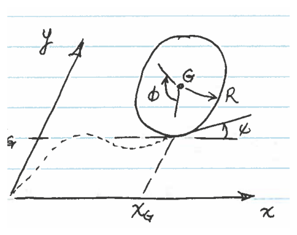
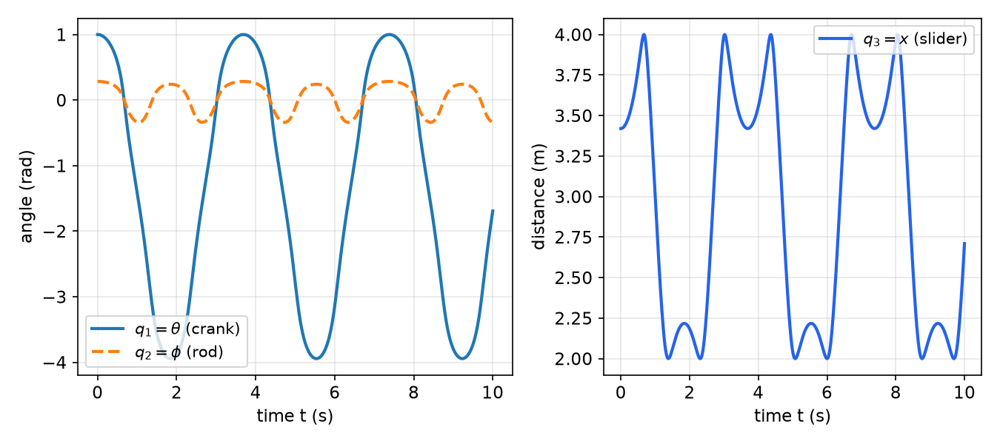

# Constrained Systems and Their Simulation

Lagrange's equations in independent coordinates handle most single-loop mechanisms, but many mechanisms are easier to model with redundant coordinates. Each body receives its own coordinates, and each joint or contact becomes a constraint between them. Lagrange multipliers turn those constraints into unknown forces, and the result is a system of equations that a computer can integrate directly. This chapter derives the multiplier form of Lagrange's equations, identifies the multipliers with physical constraint forces, separates holonomic from nonholonomic constraints, and sets out the augmented-matrix method that makes simulation possible. The examples cover detached bodies, a gear rolling on a rack and a coin rolling on a plane, followed by a numerical solution and a simulation pitfall. The formulation of [Lagrange's Equations](lagrange.md) is assumed throughout, and [Kane's Method](kanes-method.md) gives an alternative for nonholonomic systems.

## Constraint Equations

### Configuration and velocity forms

Let the coordinates be \\(q=(q\_1,\dots,q\_M)\\). A **configuration constraint** has the form \\(f\_i(q,t)=0\\) for \\(i=1,\dots,C\\). Differentiating with respect to time gives the **velocity form**

\\[
\sum\_{j=1}^{M}A\_{ij}(q,t)\dot q\_j + b\_i(q,t) = 0, \qquad A\_{ij}=\frac{\partial f\_i}{\partial q\_j}, \qquad b\_i=\frac{\partial f\_i}{\partial t},
\\]

or compactly \\(A\dot q+b=0\\), where \\(A\\) is the \\(C\times M\\) constraint matrix. When the \\(C\\) constraints are independent, the system has \\(n=M-C\\) degrees of freedom. A model with more coordinates than degrees of freedom is said to have redundant coordinates.

### Holonomic and nonholonomic constraints

A velocity constraint is **holonomic** if it is the time derivative of configuration constraints. Precisely, there must exist functions \\(f\_i(q,t)\\) and multipliers \\(g\_i(q,t)\\) such that, for every \\(i\\) and \\(j\\),

\\[
A\_{ij}\\,g\_i = \frac{\partial f\_i}{\partial q\_j}, \qquad b\_i\\,g\_i = \frac{\partial f\_i}{\partial t}.
\\]

If no such functions exist, the velocity constraint is **nonholonomic**. It limits the velocities at each configuration but does not confine the system to a lower-dimensional set of configurations, so the path taken matters. Most constraints in mechanisms, such as collars on rods, pins, and rolling contacts described by positions, are holonomic. The rolling coin in Example 7.5 is the standard nonholonomic case.

## Lagrange's Equations with Multipliers

Start from the Lagrange equations in the form

\\[
E\_j = \frac{d}{dt}\Big(\frac{\partial T}{\partial\dot q\_j}\Big) - \frac{\partial T}{\partial q\_j} + \frac{\partial V}{\partial q\_j} - Q\_j, \qquad j=1,\dots,M .
\\]

D'Alembert's principle says that the virtual work of the inertia forces, the applied forces and the potential forces balances, and that the constraint forces contribute nothing to it when the constraints are ideal. The combination \\(\sum\_j E\_j\delta q\_j\\) therefore vanishes for every virtual displacement consistent with the constraints. Virtual displacements consistent with \\(A\dot q+b=0\\) at a fixed instant satisfy \\(\sum\_j A\_{ij}\\,\delta q\_j=0\\). So \\(\sum\_j E\_j\\,\delta q\_j=0\\) for every \\(\delta q\\) in the null space of \\(A\\). A vector that is orthogonal to the whole null space of \\(A\\) is a combination of the rows of \\(A\\). Hence there exist numbers \\(\lambda\_1,\dots,\lambda\_C\\) such that \\(E\_j=\sum\_i\lambda\_iA\_{ij}\\), that is,

\\[
\frac{d}{dt}\Big(\frac{\partial T}{\partial\dot q\_j}\Big) - \frac{\partial T}{\partial q\_j} + \frac{\partial V}{\partial q\_j} = Q\_j + \sum\_{i=1}^{C}\lambda\_i A\_{ij}, \qquad j=1,\dots,M .
\\]

The \\(\lambda\_i\\) are **Lagrange multipliers**. The terms \\(\sum\_i\lambda\_iA\_{ij}\\) are the generalized forces of the constraint forces, and they are the only way the constraints enter the equations. There are \\(M\\) equations and \\(C\\) multipliers, and together with the \\(C\\) constraint equations they determine \\(M+C\\) unknowns.

**Interpretation.** For a pin, a guide or a contact, \\(\lambda\_i\\) is the magnitude of the physical constraint force associated with the \\(i\\)th constraint, with sign and scale fixed by the choice of \\(f\_i\\). The examples below confirm this by comparison with Newton's law for each body.

### Example 7.1 (A rod on a floor and an incline with three coordinates)

Take the rod of Example 6.1, with mass \\(m\\), length \\(L\\) and \\(I=mL^2/12\\), but use three coordinates \\((x\_c,y\_c,\theta)\\). Here \\(y\_c\\) is the height of the center \\(C\\), and \\(x\_c\\) is measured leftward from the corner \\(O\\), so \\(C\\) sits at \\((-x\_c,y\_c)\\). The two contacts give the configuration constraints

\\[
f\_1 = y\_c - \tfrac L2\sin\theta = 0, \qquad f\_2 = x\_c\sin\beta + y\_c\cos\beta - \tfrac L2\sin(\beta-\theta) = 0,
\\]

where \\(f\_1\\) expresses that end \\(A\\) stays on the floor and \\(f\_2\\) that end \\(B\\) stays on the incline. The constraint matrix and vector are

\\[
A=\begin{bmatrix}0 & 1 & -\tfrac L2\cos\theta\\\\ \sin\beta & \cos\beta & \tfrac L2\cos(\beta-\theta)\end{bmatrix}, \qquad b=\begin{Bmatrix}0\\\\0\end{Bmatrix}.
\\]

The kinetic energy is \\(T=\tfrac12m(\dot x\_c^2+\dot y\_c^2)+\tfrac12I\dot\theta^2\\) and the potential energy is \\(V=mgy\_c\\). No applied forces do work, so \\(Q\_j=0\\). Lagrange's equations with multipliers are

\\[
m\ddot x\_c = \lambda\_2\sin\beta, \qquad m\ddot y\_c + mg = \lambda\_1 + \lambda\_2\cos\beta, \qquad I\ddot\theta = -\tfrac L2\lambda\_1\cos\theta + \tfrac L2\lambda\_2\cos(\beta-\theta).
\\]

Newton's law for the rod has the floor pushing up on \\(A\\) with a force \\(N\_A\\) and the incline pushing along its normal \\((-\sin\beta,\cos\beta)\\) on \\(B\\) with \\(N\_B\\). Comparing components shows that \\(\lambda\_1=N\_A\\) and \\(\lambda\_2=N\_B\\). Eliminating \\(\lambda\_1\\) and \\(\lambda\_2\\) with the constraint velocities gives back the single equation of Example 6.1, which is a useful check on either formulation.

### Example 7.2 (A gear rolling on a pivoted rack)

A rack of mass \\(m\_2\\) and length \\(L\\) is pinned at a fixed point \\(A\\) and inclined at angle \\(\theta\\) below the horizontal. A gear of mass \\(m\_1\\) and radius \\(R\\) rolls without slip on the upper face of the rack. Let \\(s\\) be the distance from \\(A\\) to the contact point along the rack, and let \\((X\_C,Y\_C)\\) be the gear center, which lies a distance \\(R\\) from the contact point along the normal. The configuration constraints are

\\[
f\_1 = X\_C - (s\cos\theta + R\sin\theta) = 0, \qquad f\_2 = Y\_C - (R\cos\theta - s\sin\theta) = 0 .
\\]

With \\(q=(X\_C,Y\_C,s,\theta)\\), there are \\(M=4\\) coordinates and \\(C=2\\) constraints, so the system has two degrees of freedom. The constraint matrix is

\\[
A=\begin{bmatrix}1 & 0 & -\cos\theta & s\sin\theta - R\cos\theta\\\\ 0 & 1 & \sin\theta & s\cos\theta + R\sin\theta\end{bmatrix}, \qquad b=\begin{Bmatrix}0\\\\0\end{Bmatrix}.
\\]

The gear rolls on the rack, so its spin relative to the fixed frame is the rack's rotation plus the relative spin \\(\dot s/R\\). Only the magnitude of the absolute spin enters the kinetic energy, which is \\(\theta+\dot s/R\\) in magnitude. The energies are

\\[
T=\tfrac12m\_1(\dot X\_C^2+\dot Y\_C^2)+\tfrac14m\_1R^2\big(\dot\theta+\dot s/R\big)^2+\tfrac16m\_2L^2\dot\theta^2, \qquad V=m\_1gY\_C-\tfrac12m\_2gL\sin\theta .
\\]

The multiplier equations are

\\[
m\_1\ddot X\_C = \lambda\_1, \qquad m\_1\ddot Y\_C + m\_1g = \lambda\_2,
\\]
\\[
\tfrac12m\_1R\big(\ddot\theta+\ddot s/R\big) = -\lambda\_1\cos\theta + \lambda\_2\sin\theta,
\\]
\\[
\big(\tfrac12m\_1R^2+\tfrac13m\_2L^2\big)\ddot\theta + \tfrac12m\_1R\\,\ddot s - \tfrac12m\_2gL\cos\theta = \lambda\_1(s\sin\theta-R\cos\theta)+\lambda\_2(s\cos\theta+R\sin\theta).
\\]

The first two equations are Newton's law for the gear center, so \\(\lambda\_1\\) and \\(\lambda\_2\\) are the two components of the force that the rack exerts on the gear. The last two are moment balances about the gear center and about \\(A\\). Six equations determine the six unknowns \\(X\_C,Y\_C,s,\theta,\lambda\_1,\lambda\_2\\).

### Example 7.3 (A crank and a slotted link as detached bodies)

A crank \\(AB\\) is a thin rod of mass \\(m\\) and length \\(L\\) pinned at the fixed point \\(A\\). A slotted link \\(BD\\) of mass \\(2m\\) and length \\(2L\\) is pinned to the crank at \\(B\\), and its slot slides on a fixed pin \\(C\\) at horizontal distance \\(H\\) from \\(A\\). A moment \\(M(t)\\) acts on the crank, and a follower force \\(P\\) acts at \\(D\\) along the slot. The mechanism has one degree of freedom, but it is easier to model the two bodies separately. Use the coordinates \\(\theta\\) (crank angle), \\(\phi\\) (slot angle) and \\(s\\) (distance from \\(C\\) to the link's end \\(B\\), measured along the slot), and let \\(\mathbf e\_t=(-\cos\phi,\sin\phi)\\) point from \\(C\\) toward \\(B\\).

The crank end is at \\((L\cos\theta,L\sin\theta)\\) and the link end is at \\(C+s\\,\mathbf e\_t=(H-s\cos\phi,\\,s\sin\phi)\\). Equating them gives two constraints, which are written in the form whose derivatives give the rows of \\(A\\):

\\[
g\_1 = L\cos\theta + s\cos\phi - H = 0, \qquad g\_2 = L\sin\theta - s\sin\phi = 0,
\\]
\\[
A=\begin{bmatrix}-L\sin\theta & -s\sin\phi & \cos\phi\\\\ L\cos\theta & -s\cos\phi & -\sin\phi\end{bmatrix}, \qquad b=\begin{Bmatrix}0\\\\0\end{Bmatrix}.
\\]

The crank center is at height \\(\tfrac L2\sin\theta\\), and the link's center \\(G\_2\\) is at \\((s-L)\mathbf e\_t\\) from \\(C\\), so \\(\bar v\_{G\_2}=\dot s\\,\mathbf e\_t+(s-L)\dot\phi\\,\mathbf e\_n\\) with \\(\mathbf e\_n=(\sin\phi,\cos\phi)\\). The moment of inertia of the link about its center is \\(\tfrac23mL^2\\). The energies are

\\[
T=\tfrac16mL^2\dot\theta^2+m\big(\dot s^2+(s-L)^2\dot\phi^2\big)+\tfrac13mL^2\dot\phi^2, \qquad V=\tfrac12mgL\sin\theta+2mg(s-L)\sin\phi .
\\]

The generalized forces are \\(Q\_\theta=M\\), \\(Q\_\phi=0\\) and \\(Q\_s=P\\), since \\(D\\) moves with \\(\delta s\\) along the slot. The three Lagrange equations are

\\[
\tfrac13mL^2\ddot\theta + \tfrac12mgL\cos\theta = M - \lambda\_1L\sin\theta + \lambda\_2L\cos\theta ,
\\]
\\[
\big(2m(s-L)^2+\tfrac23mL^2\big)\ddot\phi + 4m(s-L)\dot s\dot\phi + 2mg(s-L)\cos\phi = -\lambda\_1s\sin\phi-\lambda\_2s\cos\phi ,
\\]
\\[
2m\ddot s - 2m(s-L)\dot\phi^2 + 2mg\sin\phi = P + \lambda\_1\cos\phi - \lambda\_2\sin\phi .
\\]

The teaching point is the trade. Detaching the bodies gives simple kinetic and potential energies, at the cost of two algebraic constraints. The multipliers are the pin forces at \\(B\\), so they are not needed for the motion, but they are available for checking the joint loads.

### Example 7.4 (A rod in a rotating T-bar with redundant coordinates)

A thin rod of mass \\(m\\) and length \\(L\\) slides through two frictionless collars, \\(A\\) on the horizontal arm of a T-bar and \\(B\\) on its vertical post. The T-bar turns about the vertical axis at a constant rate \\(\Omega\\), which is prescribed and therefore not a coordinate. Use the position \\((x\_G,z\_G)\\) of the rod center in the frame fixed to the T-bar, and the angle \\(\theta\\) of the rod below the horizontal arm. The collars give

\\[
x\_G - \tfrac L2\cos\theta = 0, \qquad z\_G - \tfrac L2\sin\theta = 0,
\\]

with velocity matrix rows \\([1,\\,0,\\,\tfrac L2\sin\theta]\\) and \\([0,\\,1,\\,-\tfrac L2\cos\theta]\\). The angular velocity of the rod is \\(\bar\omega=-\Omega\sin\theta\\,\bar i+\dot\theta\\,\bar j+\Omega\cos\theta\\,\bar k\\), with \\(\bar i\\) along the rod, so the energies are

\\[
T=\tfrac12m\big(\dot x\_G^2+\Omega^2x\_G^2+\dot z\_G^2\big)+\tfrac12\cdot\tfrac1{12}mL^2\big(\dot\theta^2+\Omega^2\cos^2\theta\big), \qquad V=mgz\_G .
\\]

The term \\(\Omega^2x\_G^2\\) is the centrifugal energy of the rod's center in the rotating frame. If a force \\(F\_B\\) pushes collar \\(B\\) upward, the height of \\(B\\) is \\(z\_B=z\_G+\tfrac L2\sin\theta\\), so the generalized forces are \\(Q\_{x\_G}=0\\), \\(Q\_{z\_G}=F\_B\\) and \\(Q\_\theta=\tfrac12F\_BL\cos\theta\\). The system has three coordinates, two independent constraints, and one degree of freedom. The three Lagrange equations with two multipliers are solved together with the two constraint equations, and the example shows that the redundancy costs nothing in the setup.

## Nonholonomic Constraints

A nonholonomic constraint cannot be integrated to a relation among the coordinates. The multiplier equations still apply, so no information is lost, but the constraints cannot be used to eliminate coordinates. The simplest test is the one above: look for \\(f\\) and \\(g\\) that satisfy the holonomy conditions, and show that none exists.

### Example 7.5 (A coin rolling on a plane)

A thin coin of radius \\(R\\) rolls upright in a vertical plane on the horizontal \\(xy\\) plane, without slipping. Use the center \\((x\_G,y\_G)\\), the heading \\(\psi\\) of the coin plane measured from the \\(x\\) axis, and the spin angle \\(\phi\\). The contact point is at the foot of the coin, so the center moves in the heading direction at speed \\(R\dot\phi\\):

\\[
\dot x\_G = R\dot\phi\cos\psi, \qquad \dot y\_G = R\dot\phi\sin\psi .
\\]

These are two velocity constraints on four coordinates, with

\\[
A=\begin{bmatrix}1&0&0&-R\cos\psi\\\\0&1&0&-R\sin\psi\end{bmatrix}, \qquad b=\begin{Bmatrix}0\\\\0\end{Bmatrix}.
\\]

**Holonomy test.** Suppose \\(f\_1\\) and \\(g\\) exist for the first row. The conditions \\(A\_{1j}g=\partial f\_1/\partial q\_j\\) give \\(\partial f\_1/\partial x\_G=g\\), \\(\partial f\_1/\partial y\_G=0\\), \\(\partial f\_1/\partial\psi=0\\) and \\(\partial f\_1/\partial\phi=-gR\cos\psi\\). The second and third conditions say that \\(f\_1\\) depends on \\(x\_G\\) and \\(\phi\\) only, so the left side of the last condition does not depend on \\(\psi\\). The right side depends on \\(\psi\\) unless \\(g=0\\), and if \\(g=0\\) then \\(f\_1\\) is constant and is not a constraint. No integrating factor exists, so the constraint is nonholonomic. The same argument applies to the second row.

The consequence is path dependence. The coin can reach the same center position and heading along different paths that leave it spun by different angles \\(\phi\\), so the four coordinates cannot be reduced to two. Lagrange's equations with two multipliers still give the correct motion, and [Kane's Method](kanes-method.md) treats the same coin without multipliers.



*Figure: the rolling coin of Example 7.5. The center \\(G\\) has coordinates \\((x\_G,y\_G)\\), \\(\psi\\) is the heading of the coin plane, \\(\phi\\) is the spin angle, and the dashed curve is the path of the contact point on the plane.*

### Example 7.6 (A bar with a collar and a prescribed direction)

A collar \\(A\\) of mass \\(m\_A\\) slides on a horizontal bar, with position \\(x\_A\\), and is pushed by a horizontal force \\(F\\). A uniform bar \\(AB\\) of mass \\(m\_{AB}\\) and length \\(L\\) is pinned to the collar and makes angle \\(\theta\\) above the horizontal. The end \\(B\\) must move along a line that makes the angle \\(\theta+\beta(t)\\) with the horizontal, where \\(\beta(t)\\) is prescribed. The velocity of \\(B\\) is \\(\bar v\_B=(\dot x\_A-L\dot\theta\sin\theta,\\;L\dot\theta\cos\theta)\\), and its component along the unit normal \\(\bar e\_n=(-\sin(\theta+\beta),\cos(\theta+\beta))\\) must vanish. This gives

\\[
A=\begin{bmatrix}-\sin(\theta+\beta) & L\cos\beta\end{bmatrix}, \qquad b=0,
\\]

with coordinates \\(q=(x\_A,\theta)\\). Using \\(T=\tfrac12m\_A\dot x\_A^2+\tfrac12m\_{AB}\big[(\dot x\_A-\tfrac12L\dot\theta\sin\theta)^2+\tfrac14L^2\dot\theta^2\cos^2\theta\big]+\tfrac1{24}m\_{AB}L^2\dot\theta^2\\), which simplifies to \\(T=\tfrac12(m\_A+m\_{AB})\dot x\_A^2-\tfrac12m\_{AB}L\dot x\_A\dot\theta\sin\theta+\tfrac16m\_{AB}L^2\dot\theta^2\\), and \\(V=0\\), the multiplier equations are

\\[
(m\_A+m\_{AB})\ddot x\_A - \tfrac12m\_{AB}L\ddot\theta\sin\theta - \tfrac12m\_{AB}L\dot\theta^2\cos\theta = F - \lambda\sin(\theta+\beta),
\\]
\\[
\tfrac13m\_{AB}L^2\ddot\theta - \tfrac12m\_{AB}L\ddot x\_A\sin\theta = \lambda L\cos\beta .
\\]

The second equation is the moment balance about \\(A\\), and \\(\lambda\\) is the normal force at \\(B\\).

The constraint is nonholonomic. Suppose it were holonomic with \\(f(x\_A,\theta)\\), which is forced to be time independent because \\(b=0\\). The conditions \\(A\_{11}g=\partial f/\partial x\_A\\) and \\(A\_{12}g=\partial f/\partial\theta\\) would require the ratio \\(A\_{12}/A\_{11}=-L\cos\beta/\sin(\theta+\beta)\\) to depend only on \\((x\_A,\theta)\\). It depends on \\(t\\) at fixed \\(\theta\\) whenever \\(\beta\\) varies, so no such \\(f\\) exists.

## Numerical Integration

### The augmented system

The multiplier equations are \\(M(q,t)\ddot q = F(q,\dot q,t) + A^T\lambda\\), where \\(M\\) is the mass matrix and \\(F\\) collects the applied forces and the velocity-dependent terms. The constraints differentiated once give \\(A\ddot q = -(\dot A\dot q+\dot b)\\). Together the two sets form a linear system for the accelerations and the multipliers:

\\[
\begin{bmatrix} M & -A^T\\\\ -A & 0\end{bmatrix}
\begin{Bmatrix}\ddot q\\\\ \lambda\end{Bmatrix} =
\begin{Bmatrix}F\\\\ \dot A\dot q+\dot b\end{Bmatrix}.
\\]

The matrix on the left is symmetric. It is nonsingular when \\(M\\) is positive definite and the rows of \\(A\\) are independent. At each instant it is solved for \\(\ddot q\\) and \\(\lambda\\). Writing the state as \\(x=(q,\dot q)\\), the equations become the first-order system \\(\dot x=f(t,x)\\) that an ordinary differential equation solver can integrate. The augmented system is the standard form for multibody dynamics.

### Consistent starting values and constraint drift

The starting values must satisfy the configuration constraints \\(f(q,0)=0\\) and the velocity constraints \\(A\dot q+b=0\\). If they do not, the solution begins off the constraint surface and the error persists. For a slider–crank, for example, the consistent starting values are a crank angle and a rod angle linked by the sine rule, and a slider position fixed by the cosine rule.

Even consistent starting values drift. The numerical solution satisfies the constraints only to the tolerance of the integrator, and the errors accumulate. Three checks are useful in practice. The configuration residuals \\(f(q(t),t)\\) should stay near the tolerance. For conservative systems the total energy should be constant. And the results should not change when the tolerances are tightened. A common remedy when drift grows is Baumgarte stabilization, which adds terms proportional to \\(f\\) and \\(\dot f\\) to the constraint equation.

### Example 7.7 (A slider–crank)

A crank \\(AB\\) of length \\(L\_1=1\\) m and mass \\(m\_1\\) is pinned at \\(A\\). A connecting rod \\(BC\\) of length \\(L\_2=3\\) m and mass \\(m\_2\\) has its center \\(G\\) at its midpoint. A slider \\(C\\) of mass \\(m\_3\\) moves on a horizontal guide under a force \\(P\\). The coordinates are \\(q\_1=\theta\\) (crank angle), \\(q\_2=\phi\\) (rod angle) and \\(q\_3=x\\) (distance from \\(A\\) to \\(C\\)). The two constraints are the coincidence of the two ends of the rod at \\(B\\):

\\[
f\_1 = q\_3 - L\_1\cos q\_1 - L\_2\cos q\_2 = 0, \qquad f\_2 = L\_1\sin q\_1 - L\_2\sin q\_2 = 0 .
\\]

The constraint matrix is \\(A=\begin{bmatrix}L\_1\sin q\_1 & L\_2\sin q\_2 & 1\\\\ L\_1\cos q\_1 & -L\_2\cos q\_2 & 0\end{bmatrix}\\), and \\(b=0\\). With \\(I\_A=m\_1L\_1^2/3\\) and \\(I\_C=\tfrac1{12}m\_2L\_2^2+\tfrac14m\_2L\_2^2\\), the energies give the mass matrix and force vector

\\[
M=\begin{bmatrix}I\_A&0&0\\\\0&I\_C&\tfrac12m\_2L\_2\sin q\_2\\\\0&\tfrac12m\_2L\_2\sin q\_2&m\_2+m\_3\end{bmatrix}, \qquad F=\begin{Bmatrix}-\tfrac12m\_1gL\_1\cos q\_1\\\\-\tfrac12m\_2gL\_2\cos q\_2\\\\P-\tfrac12m\_2L\_2\dot q\_2^2\cos q\_2\end{Bmatrix}.
\\]

The kinetic energy of the rod is \\(\tfrac12m\_2(\dot q\_3^2+L\_2\dot q\_2\dot q\_3\sin q\_2+\tfrac14L\_2^2\dot q\_2^2)+\tfrac12I\_G\dot q\_2^2\\), which gives the off-diagonal terms of \\(M\\).

With \\(m\_1=m\_2=m\_3=1\\) kg, \\(P=1\\) N constant, and the crank released from \\(q\_1(0)=1\\) rad with consistent starting values, the response over 10 s is shown below. The crank swings between about \\(1.0\\) rad and \\(-3.94\\) rad with a period of about 3.7 s. The slider stays between 2 m and 4 m, and the rod angle stays within about \\(\pm0.3\\) rad. With the integrator tolerances set to \\(10^{-7}\\), the constraint residuals remained below \\(1.1\times10^{-7}\\) over the run.



*Figure: response of the slider–crank of Example 7.7 with \\(m\_1=m\_2=m\_3=1\\) kg, \\(L\_1=1\\) m, \\(L\_2=3\\) m, \\(P=1\\) N, from \\(q\_1(0)=1\\) rad. This is a computed solution of the augmented system. The left panel shows the crank angle \\(q\_1\\) and rod angle \\(q\_2\\), and the right panel shows the slider distance \\(q\_3\\).*

The computation is a few lines of Python, solving the augmented system at each step:

```python
import numpy as np
from scipy.integrate import solve_ivp

m1 = m2 = m3 = 1.0; L1, L2, P, g = 1.0, 3.0, 1.0, 9.81
IA = m1*L1**2/3; IC = m2*L2**2/12 + m2*(L2/2)**2

def rhs(t, y):
    q1, q2, q3, d1, d2, d3 = y
    qd = np.array([d1, d2, d3])
    M = np.array([[IA, 0, 0], [0, IC, m2*L2*np.sin(q2)/2], [0, m2*L2*np.sin(q2)/2, m2+m3]])
    F = np.array([-m1*g*L1*np.cos(q1)/2, -m2*g*L2*np.cos(q2)/2, P - m2*L2*d2**2*np.cos(q2)/2])
    A = np.array([[L1*np.sin(q1), L2*np.sin(q2), 1.0], [L1*np.cos(q1), -L2*np.cos(q2), 0.0]])
    Ad = np.array([[L1*d1*np.cos(q1), L2*d2*np.cos(q2), 0.0], [-L1*d1*np.sin(q1), L2*d2*np.sin(q2), 0.0]])
    S = np.block([[M, -A.T], [-A, np.zeros((2, 2))]])
    sol = np.linalg.solve(S, np.concatenate([F, Ad @ qd]))
    return np.concatenate([qd, sol[:3]])

q1 = 1.0; q2 = np.arcsin(L1*np.sin(q1)/L2); q3 = L1*np.cos(q1) + L2*np.cos(q2)
sol = solve_ivp(rhs, [0, 10], [q1, q2, q3, 0, 0, 0], rtol=1e-7, atol=1e-7, max_step=0.01)
```

The sine rule gives the starting rod angle, and the cosine condition gives the slider position, so the constraints hold at \\(t=0\\).

### Example 7.8 (A follower force on a double pendulum: simulation without constraints)

Two rods of lengths \\(L\_1\\) and \\(L\_2\\), with bobs \\(m\_1\\) and \\(m\_2\\), hang from a fixed point. Torsional springs of stiffness \\(k\_1\\) and \\(k\_2\\) act at the joints. A follower force \\(P\\) always points along the second rod. Its generalized forces are \\(Q\_1=PL\_1\sin(\theta\_2-\theta\_1)\\) and \\(Q\_2=0\\), because the force is parallel to the second rod. The equations are \\(M(\theta)\ddot\theta=F\\), with

\\[
M=\begin{bmatrix}(m\_1+m\_2)L\_1^2 & m\_2L\_1L\_2\cos(\theta\_1-\theta\_2)\\\\ m\_2L\_1L\_2\cos(\theta\_1-\theta\_2) & m\_2L\_2^2\end{bmatrix}.
\\]

The right-hand side \\(F\\) contains the gravity, spring, centripetal and follower terms. Its centripetal terms are \\(-m\_2L\_1L\_2\sin(\theta\_1-\theta\_2)\dot\theta\_2^2\\) in the first row and \\(+m\_2L\_1L\_2\sin(\theta\_1-\theta\_2)\dot\theta\_1^2\\) in the second.

The system has no constraints, so the difficulties lie elsewhere. With \\(L\_1=1\\) m, \\(L\_2=1.7\\) m, \\(m\_1=1\\) kg, \\(m\_2=2\\) kg, \\(k\_1=k\_2=10\\) N·m/rad, the starting angles \\(\theta\_1=0\\) and \\(\theta\_2=1\\) rad, and integration over 20 s, the first angle stays within about \\(\pm1.2\\) rad and the second within about \\(\pm1.0\\) rad. With \\(P=0\\) the total energy is constant to three decimals, which shows that the equations and the energy agree. With \\(P=100\\) N the energy rises from 20.3 J to about 60 J during the run, and it ends near 42.5 J. The follower force does positive work on the system, so an energy check that is exact for the conservative case fails here. A simulation with a nonconservative force therefore needs a different check, such as a convergence test with respect to the tolerance and the step size.

## Summary

- **Constraints:** \\(f\_i(q,t)=0\\) and the velocity form \\(A\dot q+b=0\\), with \\(A\_{ij}=\partial f\_i/\partial q\_j\\) and \\(b\_i=\partial f\_i/\partial t\\). The number of degrees of freedom is \\(M-C\\).
- **Holonomy test:** the constraint is holonomic if there are \\(f\_i\\) and \\(g\_i\\) with \\(A\_{ij}g\_i=\partial f\_i/\partial q\_j\\) and \\(b\_ig\_i=\partial f\_i/\partial t\\). Otherwise it is nonholonomic.
- **Multiplier form:** \\(\dfrac{d}{dt}\Big(\dfrac{\partial T}{\partial\dot q\_j}\Big)-\dfrac{\partial T}{\partial q\_j}+\dfrac{\partial V}{\partial q\_j}=Q\_j+\sum\_i\lambda\_iA\_{ij}\\). The multipliers are the constraint forces.
- **Augmented system:** \\(\begin{bmatrix}M&-A^T\\\\-A&0\end{bmatrix}\begin{Bmatrix}\ddot q\\\\\lambda\end{Bmatrix}=\begin{Bmatrix}F\\\\\dot A\dot q+\dot b\end{Bmatrix}\\), solved at each step.
- **Starting values** must satisfy both the configuration and the velocity constraints. Check the constraint residuals and, for conservative systems, the energy.
- **Detached bodies** replace a complicated kinetic energy with simple ones and extra constraints, and the multipliers become the joint forces.
- **Nonholonomic constraints** are tested for an integrating factor. The rolling coin has none, so its path matters.

## See Also

- [Lagrange's Equations](lagrange.md): the independent-coordinate form, and the energies and generalized forces used here.
- [Kane's Method](kanes-method.md): generalized speeds and partial velocities, which handle the rolling coin without multipliers.
- [Rigid-Body Kinematics](rigid-body-kinematics.md): rolling contacts and the velocity constraints they produce.
- [Newton–Euler Equations of Rigid-Body Motion](newton-euler.md): the force balances against which the multipliers are checked.
- [Numerical ODEs](../../../math/numerical/odes.md): the integrators used for the augmented system.
- [Manipulator Dynamics](../../../app/robotics/manipulators/dynamics.md): constrained dynamics of closed kinematic chains in robot arms.
