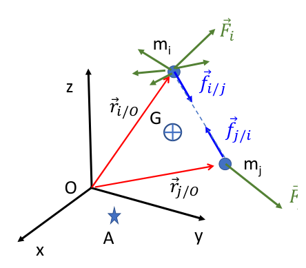
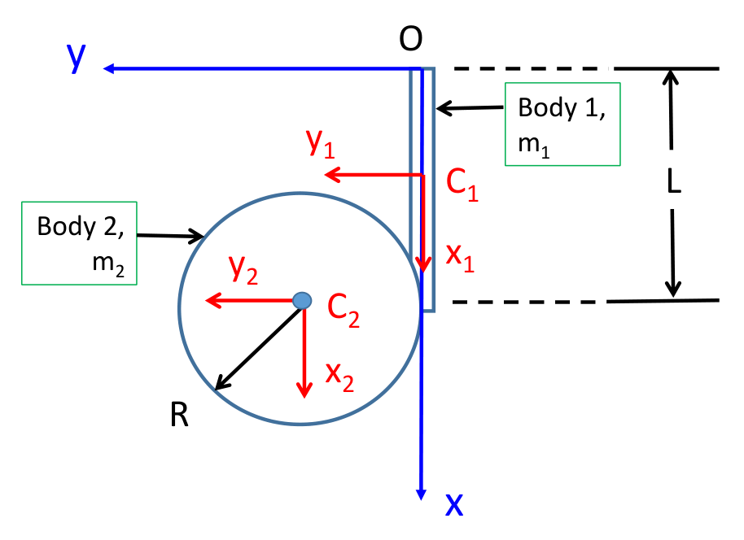
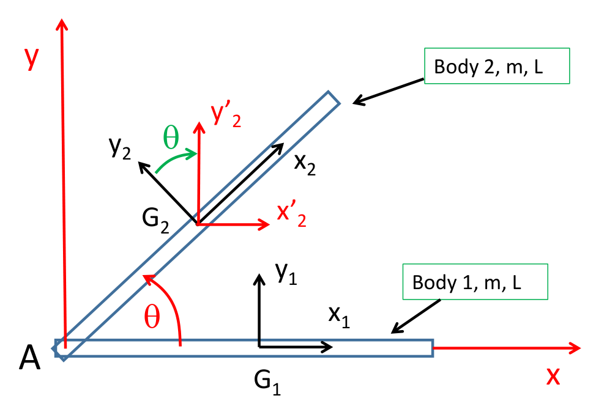
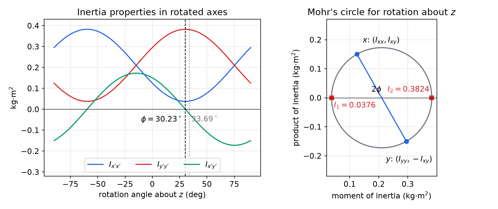

# Inertia and Momentum of Rigid Bodies

Kinematics tells us how a body moves; kinetics asks what forces and moments that motion requires. For a particle the answer is \\(\bar F = m\bar a\\). For an extended body the translational part survives almost unchanged, but the rotational part needs a new object, the **inertia tensor**, because in three dimensions the angular momentum of a spinning body is generally *not* parallel to its angular velocity. This chapter builds the momentum principles for a system of particles, specializes them to a rigid body, and develops the tools for computing and transforming inertia properties: the parallel-axis theorem, rotation of axes, and principal axes as an eigenvalue problem. It ends with the kinetic energy of a rigid body. The equations of motion that use these quantities are the subject of the next chapter, [Newton–Euler Equations of Rigid-Body Motion](newton-euler.md).

Notation follows the kinematics chapters. Vectors carry an overbar (\\(\bar r\\), \\(\bar\omega\\)); \\(\bar r\_{P/A}\\) is the position of \\(P\\) relative to \\(A\\); unit vectors of a frame \\(xyz\\) are \\(\bar i,\bar j,\bar k\\); braces \\(\\{\\,\\}\\) denote a column of components and brackets \\([\\,]\\) a matrix. A rotation (transformation) matrix \\([R]\\) maps components in one frame to components in another, \\(\\{v'\\} = [R]\\{v\\}\\), as in [Rotating Frames and Relative Motion](relative-motion.md).

## Systems of Particles

### Newton's second law summed over a system

Consider \\(N\\) particles of masses \\(m\_j\\) at positions \\(\bar r\_j\\) measured from the origin \\(O\\) of an inertial frame. Each particle feels an **external** force \\(\bar F\_j\\) (gravity, contact with bodies outside the system, applied loads) and **internal** forces \\(\bar f\_{j,i}\\) exerted on it by the other particles \\(i\\) of the system.



*Figure: a system of particles. Particle \\(m\_i\\) carries an external force \\(\bar F\_i\\) and internal forces such as \\(\bar f\_{i/j}\\) (the force on \\(i\\) due to \\(j\\)), which act along the line joining the two particles. \\(G\\) is the center of mass, \\(O\\) the inertial origin and \\(A\\) an arbitrary reference point used for moments.*

For particle \\(j\\),
\\[
\bar F\_j + \sum\_{i=1}^N \bar f\_{j,i} = m\_j\bar a\_j,\qquad \bar a\_j = \dot{\bar v}\_j = \ddot{\bar r}\_j .
\\]
Summing over all particles,
\\[
\sum\_{j=1}^N \bar F\_j + \sum\_{j=1}^N\sum\_{i=1}^N \bar f\_{j,i} = \sum\_{j=1}^N m\_j\bar a\_j .
\\]
Newton's third law states \\(\bar f\_{j,i} = -\bar f\_{i,j}\\), so the double sum cancels in pairs. What remains involves only external forces:
\\[
\sum\_{j=1}^N \bar F\_j = \sum\_{j=1}^N m\_j\ddot{\bar r}\_j = \frac{d^2}{dt^2}\Big(\sum\_{j=1}^N m\_j\bar r\_j\Big).
\\]

### Center of mass and linear momentum

**Definition (center of mass).** With total mass \\(m = \sum\_j m\_j\\), the center of mass \\(G\\) is the point whose position is the mass-weighted average
\\[
\bar r\_{G/O} \equiv \frac{1}{m}\sum\_{j=1}^N m\_j\bar r\_{j/O}.
\\]
For a continuous body the sum becomes an integral, \\(\bar r\_{G/O} = \frac1m\int \bar r\\,dm\\).

Substituting \\(\sum\_j m\_j\bar r\_j = m\bar r\_{G/O}\\) above gives the first fundamental principle:
\\[
\boxed{\Sigma\bar F^{ext} = m\bar a\_G}
\\]
The center of mass moves as if all the mass were concentrated there and all external forces acted there, however complicated the internal motion. Defining the **linear momentum** \\(\bar P = \sum\_j m\_j\bar v\_j = m\bar v\_G\\), the same statement reads
\\[
\boxed{\Sigma\bar F^{ext} = \dot{\bar P}}
\\]
If the resultant external force vanishes, or one of its components in a fixed direction vanishes, the corresponding component of \\(\bar P\\) is conserved. The time-integrated form (impulse equals change of momentum) is developed for particles and collisions in [Impulse and Momentum](../momentum.md).

## Angular Momentum and the Moment Equation

### Internal forces exert no net moment

The moment of a force \\(\bar F\\) applied at \\(\bar r\\) is \\(\bar r\times\bar F\\); the corresponding quantity built from momentum, \\(\bar r\times m\bar v\\), is the **moment of momentum**, or angular momentum. Before summing moments over the system we need one fact. The internal forces between particles \\(i\\) and \\(j\\) contribute
\\[
\bar r\_{i/O}\times\bar f\_{i/j} + \bar r\_{j/O}\times\bar f\_{j/i} = (\bar r\_{i/O} - \bar r\_{j/O})\times\bar f\_{i/j} = \bar r\_{i/j}\times\bar f\_{i/j} = \bar 0,
\\]
because \\(\bar f\_{i/j}\\) acts along the line joining the particles and is therefore parallel to \\(\bar r\_{i/j}\\). This is the *strong* form of the third law (equal, opposite and collinear). It holds for gravitational, elastic and contact interactions within a rigid body, and it is what lets internal forces drop out of the moment equation.

### Relative angular momentum about an arbitrary point

Let \\(A\\) be any point, moving or not, with velocity \\(\bar v\_A\\) and acceleration \\(\bar a\_A\\). Define relative position, velocity and acceleration
\\[
\bar r\_{i/A} = \bar r\_{i/O} - \bar r\_{A/O},\qquad \bar v\_{i/A} = \bar v\_i - \bar v\_A,\qquad \bar a\_{i/A} = \bar a\_i - \bar a\_A .
\\]

**Definition (angular momentum about \\(A\\)).** The (relative) angular momentum of the system about \\(A\\) is
\\[
\bar H\_A \equiv \sum\_{i=1}^N \bar r\_{i/A}\times m\_i\bar v\_{i/A}.
\\]
It is the angular momentum seen by an observer who translates with \\(A\\) but does not rotate.

Differentiate:
\\[
\dot{\bar H}\_A = \sum\_i \dot{\bar r}\_{i/A}\times m\_i\bar v\_{i/A} + \sum\_i \bar r\_{i/A}\times m\_i\dot{\bar v}\_{i/A}.
\\]
The first sum vanishes since \\(\dot{\bar r}\_{i/A} = \bar v\_{i/A}\\) and a vector crossed with itself is zero. In the second, \\(\dot{\bar v}\_{i/A} = \bar a\_i - \bar a\_A\\), so
\\[
\dot{\bar H}\_A = \sum\_i \bar r\_{i/A}\times m\_i\bar a\_i - \Big(\sum\_i m\_i\bar r\_{i/A}\Big)\times\bar a\_A .
\\]
In the first sum, replace \\(m\_i\bar a\_i\\) by \\(\bar F\_i + \sum\_j\bar f\_{i,j}\\); the internal moments cancel as shown above, leaving \\(\sum\_i \bar r\_{i/A}\times\bar F\_i = (\Sigma\bar M\_A)^{ext}\\), the resultant external moment about \\(A\\). In the second, \\(\sum\_i m\_i\bar r\_{i/A} = m\bar r\_{G/A}\\). Hence:

**Theorem (moment equation about an arbitrary point).** For any system of particles obeying the strong third law and any point \\(A\\),
\\[
\boxed{(\Sigma\bar M\_A)^{ext} = \dot{\bar H}\_A + \bar r\_{G/A}\times(m\bar a\_A)}
\\]

The last term is sometimes called the **anomaly term**. It is the moment about \\(A\\) of the "inertial force" \\(-m\bar a\_A\\) that appears because the observer at \\(A\\) is accelerating.

### When the anomaly term vanishes

The anomaly term \\(\bar r\_{G/A}\times m\bar a\_A\\) is zero, and the simple law \\((\Sigma\bar M\_A)^{ext} = \dot{\bar H}\_A\\) holds, in exactly three situations:

1. \\(A = G\\), so \\(\bar r\_{G/A} = \bar 0\\). Moments about the center of mass are always legitimate, whatever \\(G\\)'s acceleration.
2. \\(A\\) has zero acceleration, \\(\bar a\_A = \bar 0\\); in particular \\(A\\) is a **fixed point**.
3. \\(\bar a\_A\\) is parallel to \\(\bar r\_{G/A}\\). The classic case is a uniform disk rolling on a flat surface: the contact point has acceleration \\(R\omega^2\\) directed from the contact point toward the center \\(G\\), which is parallel to \\(\bar r\_{G/A}\\).

Such points are called **special points**. The third case is fragile. For a body whose center of mass is offset from its geometric center, such as a hoop with a rod welded along one radius, the acceleration of the geometric center \\(C\\) is parallel to \\(\bar r\_{G/C}\\) only in particular configurations (for instance when the rod is horizontal and \\(\bar a\_C\\) is horizontal). In general one should take moments about \\(G\\) or about a fixed point, or keep the anomaly term.

### Absolute angular momentum

A second definition uses absolute rather than relative velocities: \\(\bar L\_A = \sum\_i \bar r\_{i/A}\times m\_i\bar v\_i\\). The two are related by
\\[
\bar H\_A = \sum\_i\bar r\_{i/A}\times m\_i\bar v\_i - \Big(\sum\_i m\_i\bar r\_{i/A}\Big)\times\bar v\_A = \bar L\_A - \bar r\_{G/A}\times m\bar v\_A ,
\\]
that is, \\(\bar L\_A = \bar H\_A + \bar r\_{G/A}\times(m\bar v\_A)\\).

**Example 4.1 (Moment equation in terms of absolute angular momentum).** Show that \\((\Sigma\bar M\_A)^{ext} = \dot{\bar L}\_A + \bar v\_A\times(m\bar v\_G)\\), and state when the extra term vanishes.

*Solution.* Differentiate:
\\[
\dot{\bar L}\_A = \sum\_i\dot{\bar r}\_{i/A}\times m\_i\bar v\_i + \sum\_i\bar r\_{i/A}\times m\_i\bar a\_i,\qquad \dot{\bar r}\_{i/A} = \bar v\_i - \bar v\_A .
\\]
In the first sum, \\(\sum\_i\bar v\_i\times m\_i\bar v\_i = \bar 0\\), leaving \\(-\bar v\_A\times\sum\_i m\_i\bar v\_i = -\bar v\_A\times m\bar v\_G\\). The second sum is \\((\Sigma\bar M\_A)^{ext}\\) after the internal moments cancel. Therefore
\\[
(\Sigma\bar M\_A)^{ext} = \dot{\bar L}\_A + \bar v\_A\times(m\bar v\_G).
\\]
The extra term vanishes when \\(A = G\\), when \\(A\\) is fixed (\\(\bar v\_A = \bar 0\\)), or when \\(\bar v\_A\parallel\bar v\_G\\). At \\(A = G\\) we have \\(\bar r\_{G/A} = \bar 0\\) and \\(\bar L\_G = \bar H\_G\\); at a fixed point \\(O\\), \\(\bar v\_O = \bar 0\\) and \\(\bar L\_O = \bar H\_O\\).

The two "special point" conditions differ: for \\(\bar H\_A\\) the test involves the *acceleration* of \\(A\\) (\\(\bar a\_A\parallel\bar r\_{G/A}\\)), for \\(\bar L\_A\\) the *velocity* of \\(A\\) (\\(\bar v\_A\parallel\bar v\_G\\)). In this book, as in most engineering texts, \\(\bar H\_A\\) is the working definition; for \\(A = G\\) or \\(A\\) fixed the two coincide.

### Conservation of angular momentum

If \\((\Sigma\bar M\_A)^{ext} = \bar 0\\) about a special point, \\(\bar H\_A\\) is constant. More usefully, if the moment about a **fixed axis** through a fixed point (or through \\(G\\)) vanishes, the component of \\(\bar H\\) along that axis is conserved even though other components change. A body on a shaft that spins freely in its bearings is the standard example; it reappears in the work–energy section of the next chapter.

### Moments about \\(G\\) versus moments about another point

The angular momenta about different points are related by a transfer formula. Put \\(\bar r\_{i/A} = \bar r\_{G/A} + \bar r\_{i/G}\\) and \\(\bar v\_{i/A} = \bar v\_{G/A} + \bar v\_{i/G}\\) in the definition. Cross terms contain \\(\sum\_i m\_i\bar r\_{i/G} = \bar 0\\) or \\(\sum\_i m\_i\bar v\_{i/G} = \bar 0\\), so
\\[
\bar H\_A = \bar H\_G + \bar r\_{G/A}\times m\bar v\_{G/A}.
\\]
The angular momentum about \\(A\\) is the "spin" angular momentum about \\(G\\) plus the "orbital" angular momentum of the total mass concentrated at \\(G\\), both measured relative to \\(A\\).

## Angular Momentum of a Rigid Body

For a rigid body the relative velocities are not independent. If \\(B\\) is a point of the body and \\(\bar\omega\\) its angular velocity, \\(\bar v\_i - \bar v\_B = \bar\omega\times\bar r\_{i/B}\\) (see [Rigid-Body Kinematics](rigid-body-kinematics.md)). Substituting into the definition of \\(\bar H\_B\\) and passing from particles to a continuum (\\(m\_j\to dm\\)):
\\[
\bar H\_B = \sum\_j \bar r\_{j/B}\times m\_j(\bar\omega\times\bar r\_{j/B})\ \longrightarrow\ \boxed{\bar H\_B = \int\_{body}\bar r\times(\bar\omega\times\bar r)\\,dm}
\\]
where \\(\bar r\\) is the position of \\(dm\\) relative to the body point \\(B\\). This holds for any body point \\(B\\), including \\(G\\).

### Components: moments and products of inertia

Let \\(xyz\\) be any set of axes with origin at \\(B\\), and write \\(\bar r = x\bar i + y\bar j + z\bar k\\), \\(\bar\omega = \omega\_x\bar i + \omega\_y\bar j + \omega\_z\bar k\\). The vector triple product identity \\(\bar r\times(\bar\omega\times\bar r) = (\bar r\cdot\bar r)\bar\omega - (\bar r\cdot\bar\omega)\bar r\\) gives
\\[
\bar r\times(\bar\omega\times\bar r) = (x^2+y^2+z^2)(\omega\_x\bar i + \omega\_y\bar j + \omega\_z\bar k) - (x\omega\_x + y\omega\_y + z\omega\_z)(x\bar i + y\bar j + z\bar k).
\\]
Collecting the \\(\bar i\\) component,
\\[
(y^2+z^2)\omega\_x - xy\\,\omega\_y - xz\\,\omega\_z ,
\\]
and similarly for \\(\bar j\\) and \\(\bar k\\). Integrating over the body,
\\[
\begin{aligned}
H\_x &= I\_{xx}\omega\_x - I\_{xy}\omega\_y - I\_{xz}\omega\_z,\\\\
H\_y &= -I\_{xy}\omega\_x + I\_{yy}\omega\_y - I\_{yz}\omega\_z,\\\\
H\_z &= -I\_{xz}\omega\_x - I\_{yz}\omega\_y + I\_{zz}\omega\_z ,
\end{aligned}
\\]
with the following definitions.

**Definition (moments and products of inertia).** Relative to axes \\(xyz\\) with origin \\(B\\),
\\[
I\_{xx} = \int (y^2+z^2)\\,dm,\quad I\_{yy} = \int(x^2+z^2)\\,dm,\quad I\_{zz} = \int(x^2+y^2)\\,dm,
\\]
\\[
I\_{xy} = \int xy\\,dm,\quad I\_{xz} = \int xz\\,dm,\quad I\_{yz} = \int yz\\,dm .
\\]
The **moments of inertia** \\(I\_{xx}, I\_{yy}, I\_{zz}\\) are integrals of squared distance from an axis and are never negative. The **products of inertia** can have either sign. The **radius of gyration** about an axis is \\(\kappa = \sqrt{I/m}\\).

In matrix form,
\\[
\\{H\_B\\} = [I\_B]\\{\omega\\},\qquad [I\_B] = \begin{bmatrix} I\_{xx} & -I\_{xy} & -I\_{xz}\\\\ -I\_{xy} & I\_{yy} & -I\_{yz}\\\\ -I\_{xz} & -I\_{yz} & I\_{zz}\end{bmatrix}.
\\]
The **inertia matrix** stores the *negatives* of the products of inertia off the diagonal. This sign convention (products defined as \\(+\int xy\\,dm\\)) is the one used in Ginsberg's text and in this book; some references define the products with the minus sign built in, so always check which convention a table uses.

\\([I\_B]\\) is the matrix of a second-order tensor, the **inertia tensor** \\(\mathcal I\_B\\), in the basis \\(xyz\\). Coordinate-free, \\(\mathcal I\_B = \int(\lvert\bar r\rvert^2\mathcal U - \bar r\bar r)\\,dm\\) with \\(\mathcal U\\) the identity, and \\(\bar H\_B = \mathcal I\_B\cdot\bar\omega\\). The tensor depends on the reference point \\(B\\) but not on the axes; its *matrix* depends on both.

### Why \\(\bar H\\) need not be parallel to \\(\bar\omega\\)

Unless \\([I\_B]\\) happens to map \\(\\{\omega\\}\\) to a multiple of itself, \\(\bar H\_B\\) points in a different direction from \\(\bar\omega\\). Even a body spinning at constant rate about a fixed axis then has an angular momentum vector that swings around with the body, and a moment is needed to turn it. This is the root of dynamic imbalance in rotating machinery and of all gyroscopic effects, and it is the reason the rest of this chapter is devoted to computing \\([I]\\) and finding the axes in which it is diagonal.

### Properties of the inertia matrix

1. **Symmetric:** \\([I]^T = [I]\\).
2. **Positive semi-definite:** for any \\(\\{\omega\\}\\), \\(\\{\omega\\}^T[I]\\{\omega\\} = \int\lvert\bar\omega\times\bar r\rvert^2\\,dm\ge 0\\). This quantity is twice the rotational kinetic energy (see the last section). It is zero only if all the mass lies on the line through \\(B\\) along \\(\bar\omega\\), as for an idealized slender rod spinning about its own axis.
3. **Triangle inequality:** \\(I\_{xx} + I\_{yy}\ge I\_{zz}\\), with equality for a lamina in the \\(xy\\) plane (perpendicular-axis theorem), and cyclically.
4. **Trace invariant:** \\(I\_{xx} + I\_{yy} + I\_{zz} = 2\int\lvert\bar r\rvert^2dm\\) does not depend on the orientation of the axes.

### Symmetry and vanishing products

Symmetry often settles the products of inertia without integration.

**Theorem (plane of symmetry).** If the \\(xy\\) plane is a plane of mass symmetry of the body (for each \\(dm\\) at \\((x,y,z)\\) there is an equal \\(dm\\) at \\((x,y,-z)\\)), then \\(I\_{xz} = I\_{yz} = 0\\).

*Proof.* The integrands \\(xz\\) and \\(yz\\) are odd in \\(z\\), so the contributions of mirror-image elements cancel. \\(\square\\)

Consequently, if two of the coordinate planes are planes of symmetry, all three products vanish. A thin body lying entirely in the \\(xy\\) plane has \\(z = 0\\) for every element, so again \\(I\_{xz} = I\_{yz} = 0\\).

### Inertia properties of standard bodies

Centroidal values (axes through \\(G\\), all products zero) for the shapes used in the examples:

| Body | Axes | \\(I\_{xx}\\) | \\(I\_{yy}\\) | \\(I\_{zz}\\) |
|---|---|---|---|---|
| Slender rod, length \\(L\\), along \\(x\\) | centroidal | \\(0\\) | \\(\frac1{12}mL^2\\) | \\(\frac1{12}mL^2\\) |
| Thin rectangular plate \\(a\times b\\) in \\(xy\\) (\\(a\\) along \\(y\\), \\(b\\) along \\(x\\)) | centroidal | \\(\frac1{12}ma^2\\) | \\(\frac1{12}mb^2\\) | \\(\frac1{12}m(a^2+b^2)\\) |
| Thin disk, radius \\(R\\), axis \\(z\\) | centroidal | \\(\frac14mR^2\\) | \\(\frac14mR^2\\) | \\(\frac12mR^2\\) |
| Thin ring, radius \\(R\\), axis \\(z\\) | centroidal | \\(\frac12mR^2\\) | \\(\frac12mR^2\\) | \\(mR^2\\) |
| Solid cylinder, radius \\(R\\), length \\(h\\), axis \\(z\\) | centroidal | \\(m\big(\frac{R^2}4 + \frac{h^2}{12}\big)\\) | \\(m\big(\frac{R^2}4 + \frac{h^2}{12}\big)\\) | \\(\frac12mR^2\\) |
| Solid sphere, radius \\(R\\) | any centroidal | \\(\frac25mR^2\\) | \\(\frac25mR^2\\) | \\(\frac25mR^2\\) |

Moments about axes through other points follow from the parallel-axis theorem.

## The Parallel-Axis Theorem

Let \\(xyz\\) be centroidal axes and \\(x'y'z'\\) parallel axes with origin at a point \\(B\\). Denote by \\((x\_B, y\_B, z\_B)\\) the coordinates of \\(B\\) **relative to** \\(G\\) (that is, in the centroidal axes). An element at \\((x,y,z)\\) in the centroidal axes has coordinates \\(x' = x - x\_B\\) and so on in the new axes. Then
\\[
I\_{x'x'} = \int\big[(y-y\_B)^2 + (z-z\_B)^2\big]dm = \int(y^2+z^2)\\,dm - 2y\_B\int y\\,dm - 2z\_B\int z\\,dm + m(y\_B^2+z\_B^2).
\\]
The first-moment integrals \\(\int y\\,dm\\) and \\(\int z\\,dm\\) vanish because the origin is the center of mass. Likewise
\\[
I\_{x'y'} = \int(x-x\_B)(y-y\_B)\\,dm = I\_{xy} + m\\,x\_By\_B .
\\]

**Theorem (parallel-axis theorem).** With \\((x\_B,y\_B,z\_B)\\) the coordinates of \\(B\\) relative to the centroidal axes,
\\[
I^B\_{xx} = I^G\_{xx} + m(y\_B^2+z\_B^2),\quad I^B\_{yy} = I^G\_{yy} + m(x\_B^2+z\_B^2),\quad I^B\_{zz} = I^G\_{zz} + m(x\_B^2+y\_B^2),
\\]
\\[
I^B\_{xy} = I^G\_{xy} + m\\,x\_By\_B,\quad I^B\_{xz} = I^G\_{xz} + m\\,x\_Bz\_B,\quad I^B\_{yz} = I^G\_{yz} + m\\,y\_Bz\_B ,
\\]
or in matrix form
\\[
[I\_B] = [I\_G] + m\begin{bmatrix} y\_B^2+z\_B^2 & -x\_By\_B & -x\_Bz\_B\\\\ -x\_By\_B & x\_B^2+z\_B^2 & -y\_Bz\_B\\\\ -x\_Bz\_B & -y\_Bz\_B & x\_B^2+y\_B^2\end{bmatrix}.
\\]

Three cautions:

- The theorem relates the centroid to another point. To move between two non-centroidal points \\(B\\) and \\(D\\), go through \\(G\\): subtract the \\(B\\) correction, then add the \\(D\\) correction. (Passing a negative mass to the matrix formula performs the subtraction.)
- Moments of inertia are smallest about centroidal axes; the theorem only ever adds \\(m d^2\\). Products of inertia, however, can increase or decrease, and the sign of \\(x\_By\_B\\) matters.
- The coordinate offsets must be of \\(B\\) relative to \\(G\\). Using \\(G\\) relative to \\(B\\) flips all three signs together, which leaves the products unchanged (they are quadratic), so this particular slip is harmless; mixing frames is not.

For a **composite body** the inertia matrices of the parts about a common point and common axes simply add.

**Example 4.2 (Thin L-shaped plate).** A thin L-shaped plate of density \\(\rho\\) and thickness \\(t\\) has outer height 6 in and outer width 3 in; both legs are 1 in wide. The vertical leg is on the left, the horizontal leg along the bottom. \\(O\\) is the outer corner, \\(x\\) points right and \\(y\\) up. (a) Find \\([I\_O]\\). (b) Find \\(\bar H\_O\\) for \\(\bar\omega = \omega\_x\bar i\\). (c) Is \\(x\\) a principal axis? Is \\(z\\)?

*Solution.* Split the plate into body 1, the horizontal leg (\\(3\times1\\) in, \\(m\_1 = 3\rho t\\), \\(O\\) at \\((-1.5, -0.5, 0)\\) in its centroidal axes) and body 2, the part of the vertical leg above it (\\(1\times5\\) in, \\(m\_2 = 5\rho t\\), \\(O\\) at \\((-0.5,-3.5,0)\\)). Using the plate formulas and the parallel-axis theorem,
\\[
I^O\_{xx} = \big[\tfrac1{12}m\_1(1)^2 + m\_1(0.5)^2\big] + \big[\tfrac1{12}m\_2(5)^2 + m\_2(3.5)^2\big] = 72.67\rho t,
\\]
\\[
I^O\_{yy} = \big[\tfrac1{12}m\_1(3)^2 + m\_1(1.5)^2\big] + \big[\tfrac1{12}m\_2(1)^2 + m\_2(0.5)^2\big] = 10.67\rho t,
\\]
\\[
I^O\_{zz} = \big[\tfrac1{12}m\_1(3^2+1^2) + m\_1(1.5^2+0.5^2)\big] + \big[\tfrac1{12}m\_2(1^2+5^2) + m\_2(0.5^2+3.5^2)\big] = 83.33\rho t .
\\]
The plate lies in the \\(xy\\) plane, so \\(I\_{xz} = I\_{yz} = 0\\). Each rectangle has zero centroidal product, so
\\[
I^O\_{xy} = m\_1(-1.5)(-0.5) + m\_2(-0.5)(-3.5) = 11.00\rho t,
\\]
\\[
[I\_O] = \rho t\begin{bmatrix} 72.67 & -11 & 0\\\\ -11 & 10.67 & 0\\\\ 0 & 0 & 83.33\end{bmatrix}\ \text{(in}^4\text{ units)}.
\\]
(b) \\(\\{H\_O\\} = [I\_O]\\{\omega\_x, 0, 0\\}^T = \rho t\\,\omega\_x\\{72.67, -11, 0\\}^T\\).
(c) \\(\bar H\_O\\) is not parallel to \\(\bar\omega = \omega\_x\bar i\\), so \\(x\\) is **not** a principal axis. For \\(\bar\omega = \omega\_z\bar k\\), \\(\\{H\_O\\} = \rho t\\,\omega\_z\\{0,0,83.33\\}^T\\) is parallel to \\(\bar\omega\\), so \\(z\\) **is** principal. Note that \\(I\_{xz} = I\_{yz} = 0\\) is exactly the condition for \\(z\\) to be principal.

**Example 4.3 (Ring welded to a rod: a parallel-axis helper).** A ring of radius \\(r\\) is welded to a thin rod of length \\(L = 2r\\) perpendicular to the plane of the ring; both have density \\(\rho\\) and cross-section \\(A\\). The rod runs along \\(z\\) from \\(O\\) down to the ring, which is horizontal with its rim touching the lower end of the rod and its center offset by \\(r\\) along \\(y\\). Find \\([I\_O]\\).

*Solution.* Rod: \\(m\_1 = 2\rho Ar\\), \\(I^C\_{xx} = I^C\_{yy} = \frac1{12}m\_1L^2\\), \\(I^C\_{zz} = 0\\), and \\(O\\) at \\((0,0,r)\\) in its centroidal axes. Ring: \\(m\_2 = 2\pi\rho Ar\\), \\(I^C\_{xx} = I^C\_{yy} = \frac12m\_2r^2\\), \\(I^C\_{zz} = m\_2r^2\\), and \\(O\\) at \\((0, r, 2r)\\). Then
\\[
I^O\_{xx} = \big[\tfrac1{12}m\_1(2r)^2 + m\_1r^2\big] + \big[\tfrac12m\_2r^2 + m\_2(r^2+4r^2)\big] = 37.2242\\,\rho Ar^3,
\\]
\\[
I^O\_{yy} = \big[\tfrac1{12}m\_1(2r)^2 + m\_1r^2\big] + \big[\tfrac12m\_2r^2 + m\_2(2r)^2\big] = 30.9410\\,\rho Ar^3,
\\]
\\[
I^O\_{zz} = 0 + \big[m\_2r^2 + m\_2r^2\big] = 12.5664\\,\rho Ar^3 .
\\]
The \\(yz\\) plane is a plane of symmetry, so \\(I\_{xy} = I\_{xz} = 0\\); the remaining product is \\(I^O\_{yz} = m\_2(r)(2r) = 12.5664\\,\rho Ar^3\\), giving
\\[
[I\_O] = \rho Ar^3\begin{bmatrix} 37.2242 & 0 & 0\\\\ 0 & 30.9410 & -12.5664\\\\ 0 & -12.5664 & 12.5664\end{bmatrix}.
\\]
A small function implementing the matrix parallel-axis theorem makes such calculations mechanical:

```matlab
r=1; rho=1; L=2*r; A=1;    % results are multiples of rho*A*r^3
para = @(IG,m,rBG) IG + m*[(rBG(2)^2+rBG(3)^2) -rBG(1)*rBG(2) -rBG(1)*rBG(3);
                           -rBG(1)*rBG(2) (rBG(1)^2+rBG(3)^2) -rBG(2)*rBG(3);
                           -rBG(1)*rBG(3) -rBG(2)*rBG(3) (rBG(1)^2+rBG(2)^2)];
% (a negative m transforms from a point B back to the centroid)
m1 = rho*A*(2*r);  IG1 = diag([m1*L^2/12, m1*L^2/12, 0]);       I1O = para(IG1,m1,[0 0 r]);
m2 = 2*pi*r*rho*A; IG2 = diag([m2*r^2/2, m2*r^2/2, m2*r^2]);     I2O = para(IG2,m2,[0 r 2*r]);
IO = I1O + I2O     % [37.2242 0 0; 0 30.9410 -12.5664; 0 -12.5664 12.5664]
```

The same body reappears in the next chapter, spinning on a shaft, where the product \\(I\_{yz}\\) produces bearing reactions.

**Example 4.4 (Rod and disk composite, part 1).** A body is formed from a slender rod (body 1; \\(m\_1 = 6\\) kg, length \\(L = 0.15\\) m) and a thin disk (body 2; \\(m\_2 = 10\\) kg, radius \\(R = 0.1\\) m). Find the inertia matrix of the combined body with respect to the axes \\(xyz\\) at \\(O\\).



*Figure: the rod hangs from \\(O\\) along \\(x\\); the disk lies in the \\(xy\\) plane, touching the rod, with its center \\(C\_2\\) level with the lower end of the rod and one radius to the side. The centroidal axes \\(x\_1y\_1z\_1\\) (rod) and \\(x\_2y\_2z\_2\\) (disk) are parallel to \\(xyz\\).*

*Solution.* **Body 1.** The coordinates of \\(O\\) relative to \\(x\_1y\_1z\_1\\) are \\((-L/2, 0, 0)\\). The rod's centroidal axes are principal with \\(I^{C\_1}\_{xx}\approx0\\) and \\(I^{C\_1}\_{yy} = I^{C\_1}\_{zz} = \frac1{12}m\_1L^2\\). Then
\\[
(I^O\_{xx})\_1 = 0,\qquad (I^O\_{yy})\_1 = (I^O\_{zz})\_1 = \tfrac1{12}m\_1L^2 + m\_1\big(\tfrac L2\big)^2 = \tfrac13m\_1L^2 ,
\\]
and all products vanish (\\(xy\\) and \\(xz\\) are planes of symmetry of the rod).

**Body 2.** \\(O\\) is at \\((-L, -R, 0)\\) relative to \\(x\_2y\_2z\_2\\):
\\[
(I^O\_{xx})\_2 = \tfrac14m\_2R^2 + m\_2R^2 = \tfrac54m\_2R^2,\quad (I^O\_{yy})\_2 = \tfrac14m\_2R^2 + m\_2L^2,\quad (I^O\_{zz})\_2 = \tfrac12m\_2R^2 + m\_2(L^2+R^2).
\\]
The \\(xy\\) plane is a plane of symmetry of the disk, so \\((I^O\_{xz})\_2 = (I^O\_{yz})\_2 = 0\\), and
\\[
(I^O\_{xy})\_2 = 0 + m\_2(-L)(-R) = m\_2LR .
\\]
Adding and inserting numbers,
\\[
[I\_O] = \begin{bmatrix} 0.125 & -0.150 & 0\\\\ -0.150 & 0.295 & 0\\\\ 0 & 0 & 0.420\end{bmatrix}\ \text{kg·m}^2 .
\\]

```matlab
m1 = 6; m2 = 10; L = 0.15; R = 0.10;
% Body 1
xO1 = -L/2; yO1 = 0; zO1 = 0;
IC1 = [0 0 0; 0 (m1*L^2)/12 0; 0 0 (m1*L^2)/12];
IO1 = IC1 + m1*[(yO1^2 + zO1^2)  -xO1*yO1  -xO1*zO1;
                 -xO1*yO1  (xO1^2 + zO1^2)  -yO1*zO1;
                 -xO1*zO1  -yO1*zO1  (xO1^2 + yO1^2)];
% Body 2
xO2 = -L; yO2 = -R; zO2 = 0;
IC2 = [(m2*R^2)/4 0 0; 0 (m2*R^2)/4 0; 0 0 (m2*R^2)/2];
IO2 = IC2 + m2*[(yO2^2 + zO2^2)  -xO2*yO2  -xO2*zO2;
                 -xO2*yO2  (xO2^2 + zO2^2)  -yO2*zO2;
                 -xO2*zO2  -yO2*zO2  (xO2^2 + yO2^2)];
IO = IO1 + IO2     % combine bodies
```

## Rotation of Inertia Properties

Often the inertia matrix is easy to write in one set of axes (for example the principal axes of a part) but needed in another (axes aligned with a shaft or with the rest of the machine). Let \\(xyz\\) and \\(x'y'z'\\) share the origin \\(B\\), and let \\([R]\\) be the rotation matrix with \\(\\{v'\\} = [R]\\{v\\}\\) for the components of any vector. Its rows are the components of \\(\bar i', \bar j', \bar k'\\) in \\(xyz\\) (direction cosines), and \\([R]^{-1} = [R]^T\\).

Apply the transformation to both \\(\bar H\\) and \\(\bar\omega\\):
\\[
\\{H'\\} = [R]\\{H\\} = [R][I]\\{\omega\\} = [R][I][R]^T\\{\omega'\\}.
\\]
Since also \\(\\{H'\\} = [I']\\{\omega'\\}\\) for every \\(\\{\omega'\\}\\):

**Theorem (rotational transformation of the inertia matrix).** If \\(\\{v'\\} = [R]\\{v\\}\\), then
\\[
\boxed{[I'] = [R][I][R]^T}
\\]
The inverse is \\([I] = [R]^T[I'][R]\\). In components, the moment of inertia about an axis with unit vector \\(\bar e\\) (components \\(\\{e\\}\\) in \\(xyz\\)) is the quadratic form
\\[
I\_{ee} = \\{e\\}^T[I]\\{e\\} = I\_{xx}e\_x^2 + I\_{yy}e\_y^2 + I\_{zz}e\_z^2 - 2I\_{xy}e\_xe\_y - 2I\_{xz}e\_xe\_z - 2I\_{yz}e\_ye\_z ,
\\]
and the product for two orthogonal unit vectors \\(\bar e\\), \\(\bar f\\) is \\(I\_{ef} = -\\{e\\}^T[I]\\{f\\}\\).

For a rotation by \\(\theta\\) about \\(z\\), \\([R\_z(\theta)] = \begin{bmatrix} \cos\theta & \sin\theta & 0\\\\ -\sin\theta & \cos\theta & 0\\\\ 0&0&1\end{bmatrix}\\), and multiplying out gives the planar formulas
\\[
\begin{aligned}
I\_{x'x'} &= I\_{xx}\cos^2\theta + I\_{yy}\sin^2\theta - 2I\_{xy}\sin\theta\cos\theta,\\\\
I\_{y'y'} &= I\_{xx}\sin^2\theta + I\_{yy}\cos^2\theta + 2I\_{xy}\sin\theta\cos\theta,\\\\
I\_{x'y'} &= (I\_{xx}-I\_{yy})\sin\theta\cos\theta + I\_{xy}(\cos^2\theta - \sin^2\theta),
\end{aligned}
\\]
which are the same as the stress-transformation formulas of solid mechanics with \\(I\_{xy}\\) playing the role of a shear stress of opposite sign.

**Example 4.5 (Rod and disk composite, part 2: rotated axes).** For the body of Example 4.4, find the inertia matrix at \\(O\\) for axes \\(x'y'z'\\) obtained by rotating \\(xyz\\) about \\(z\\) so that \\(x'\\) passes through the disk center \\(C\_2\\).

*Solution.* \\(C\_2\\) is at \\((L, R, 0)\\), so \\(\theta = \tan^{-1}(R/L) = 33.6901^\circ\\) and \\(\\{x'\\} = [R\_z(\theta)]\\{x\\}\\). Then
\\[
[I'] = [R\_z(\theta)][I\_O][R\_z(\theta)]^T = \begin{bmatrix} 0.0388 & 0.0208 & 0\\\\ 0.0208 & 0.3812 & 0\\\\ 0 & 0 & 0.4200\end{bmatrix}\ \text{kg·m}^2 .
\\]
The off-diagonal term has shrunk but not vanished: the line through the disk center is *not* a principal axis, because the rod also contributes. Principal axes are found below.

**Example 4.6 (Two welded rods).** Two identical slender rods, each of mass \\(m\\) and length \\(L\\), are welded together at point \\(A\\) at angle \\(\theta\\). Rod 1 lies along \\(x\\) from \\(A\\); rod 2 makes angle \\(\theta\\) with it, in the \\(xy\\) plane. Find \\([I\_A]\\) in \\(xyz\\).



*Figure: rod 1 along \\(x\\) with centroid \\(G\_1\\); rod 2 at angle \\(\theta\\) with centroid \\(G\_2\\), its own axes \\(x\_2y\_2\\) along and across the rod, and axes \\(x'\_2y'\_2\\) parallel to \\(xy\\). The body lies in the \\(xy\\) plane.*

*Solution.* The body lies in the \\(xy\\) plane, so \\(I\_{xz} = I\_{yz} = 0\\).

Rod 1: centroidal \\(\mathrm{diag}(0, \frac1{12}mL^2, \frac1{12}mL^2)\\), with \\(A\\) at \\((-L/2, 0, 0)\\), gives
\\[
[I\_A]\_1 = \mathrm{diag}\big(0,\ \tfrac13mL^2,\ \tfrac13mL^2\big).
\\]
Rod 2: in its own axes \\(x\_2y\_2z\_2\\) the centroidal matrix is again \\(\mathrm{diag}(0,\frac1{12}mL^2,\frac1{12}mL^2)\\). The parallel axes \\(x'\_2y'\_2z'\_2\\) are obtained by rotating back through \\(-\theta\\), \\(\\{x'\_2\\} = [R\_z(-\theta)]\\{x\_2\\}\\):
\\[
[I\_{G\_2}]' = [R\_z(-\theta)]\\,\mathrm{diag}\big(0,\tfrac1{12}mL^2,\tfrac1{12}mL^2\big)[R\_z(-\theta)]^T = \frac{mL^2}{12}\begin{bmatrix}\sin^2\theta & -\sin\theta\cos\theta & 0\\\\ -\sin\theta\cos\theta & \cos^2\theta & 0\\\\ 0&0&1\end{bmatrix}.
\\]
The coordinates of \\(A\\) relative to \\(x'\_2y'\_2z'\_2\\) are \\((-\frac L2\cos\theta, -\frac L2\sin\theta, 0)\\). The parallel-axis correction is \\(m\frac{L^2}4\\) times the same matrix pattern, so
\\[
[I\_A]\_2 = \frac{mL^2}{3}\begin{bmatrix}\sin^2\theta & -\sin\theta\cos\theta & 0\\\\ -\sin\theta\cos\theta & \cos^2\theta & 0\\\\ 0&0&1\end{bmatrix},
\\]
and for the welded pair
\\[
[I\_A] = \frac{mL^2}{3}\begin{bmatrix}\sin^2\theta & -\sin\theta\cos\theta & 0\\\\ -\sin\theta\cos\theta & \cos^2\theta + 1 & 0\\\\ 0&0&2\end{bmatrix}.
\\]
*Check:* for \\(\theta = 0\\) the rods coincide and \\([I\_A] = \mathrm{diag}(0, \frac23mL^2, \frac23mL^2)\\), twice the single-rod value. The product \\(I\_{xy} = \frac13mL^2\sin\theta\cos\theta\\) of rod 2 alone is the quantity that makes a single inclined rod on a shaft dynamically unbalanced (next chapter).

**Example 4.7 (Bent rod in rotated axes).** A Z-shaped bent rod of total mass 4 kg is formed from a horizontal segment of length \\(2L\\) centered at \\(O\\), an upper-left vertical segment of length \\(L\\) rising from its left end, and a lower-right vertical segment of length \\(L\\) hanging from its right end (\\(L = 1\\) m). Find the inertia matrix for \\(x'y'z'\\), rotated \\(-45^\circ\\) about \\(z\\).

*Solution.* Each vertical segment has \\(m = 1\\) kg, the horizontal one 2 kg. Coordinates of \\(O\\) relative to the segment centroids: \\((L, -L/2, 0)\\), \\((0,0,0)\\) and \\((-L, L/2, 0)\\). Centroidal values: vertical rods \\(I\_x = I\_z = \frac1{12}mL^2\\), \\(I\_y = 0\\); horizontal rod \\(I\_x = 0\\), \\(I\_y = I\_z = \frac1{12}(2m)(2L)^2\\). The product of inertia is \\(I\_{xy} = m\_1x\_1y\_1 + m\_3x\_3y\_3 = -\frac12 - \frac12 = -1\\) kg·m², so
\\[
[I\_O] = \begin{bmatrix} 2/3 & 1 & 0\\\\ 1 & 8/3 & 0\\\\ 0 & 0 & 10/3\end{bmatrix}\ \text{kg·m}^2 .
\\]
With \\([R\_z(-45^\circ)] = \begin{bmatrix}0.7071 & -0.7071 & 0\\\\ 0.7071 & 0.7071 & 0\\\\ 0&0&1\end{bmatrix}\\),
\\[
[I'] = [R][I\_O][R]^T = \begin{bmatrix} 0.6667 & -1.0000 & 0\\\\ -1.0000 & 2.6667 & 0\\\\ 0 & 0 & 3.3333\end{bmatrix}\ \text{kg·m}^2 .
\\]
The \\(\pm45^\circ\\) axes are not principal (the off-diagonal term is still \\(-1\\)). The planar principal-angle formula derived below gives \\(\lvert\tan2\theta\rvert = 2(1)/(8/3 - 2/3) = 1\\), so the principal axes are \\(22.5^\circ\\) from \\(xy\\) (a rotation of \\(-22.5^\circ\\) about \\(z\\)).

```matlab
theta = -pi/4;
Rz = [cos(theta) sin(theta) 0; -sin(theta) cos(theta) 0; 0 0 1];
Iprime = Rz*IO*transpose(Rz)
```

**Example 4.8 (Rotate, then translate).** A slender rod of mass \\(m\\) and length \\(L\\) is pinned at its centroid \\(B\\) to a massless L-shaped arm \\(OAB\\) (\\(OA = L\\) along \\(x\\), \\(AB = L/2\\) along \\(y\\)), inclined at angle \\(\theta\\) to the \\(x\\) axis. Find the rod's inertia matrix in \\(xyz\\) at \\(O\\).

*Solution.* The rod's own axes \\(x\_2y\_2z\_2\\) (with \\(x\_2\\) along the rod) are principal: \\([I^B\_2] = \frac1{12}mL^2\\,\mathrm{diag}(0,1,1)\\). First **rotate** to axes \\(x\_1y\_1z\_1\\) at \\(B\\) parallel to \\(xyz\\): \\(\\{x\_1\\} = [R\_z(-\theta)]\\{x\_2\\}\\), so \\([I^B\_1] = [R\_z(-\theta)][I^B\_2][R\_z(-\theta)]^T\\). Then **translate**: \\(O\\) is at \\((-L, -L/2, 0)\\) relative to \\(B\\), and
\\[
[I^O] = \frac{mL^2}{12}\begin{bmatrix}\sin^2\theta & -\sin\theta\cos\theta & 0\\\\ -\sin\theta\cos\theta & \cos^2\theta & 0\\\\ 0&0&1\end{bmatrix} + \frac{mL^2}{4}\begin{bmatrix} 1 & -2 & 0\\\\ -2 & 4 & 0\\\\ 0 & 0 & 5\end{bmatrix}.
\\]
The order matters: the parallel-axis theorem must be applied in axes parallel to the final ones, and the rotation formula must be applied at a single point. Because the \\(xy\\) plane is a plane of symmetry, \\(z\\) is a principal axis at \\(O\\) for any \\(\theta\\).

## Principal Axes

### The eigenvalue problem

**Definition (principal axes).** Axes \\(x'y'z'\\) at a point \\(B\\) are **principal axes** of the body at \\(B\\) if all products of inertia vanish there, \\([I'] = \mathrm{diag}(I\_1, I\_2, I\_3)\\). The diagonal entries are the **principal moments of inertia**.

In principal axes, \\(\bar H = I\_1\omega\_1\bar e\_1 + I\_2\omega\_2\bar e\_2 + I\_3\omega\_3\bar e\_3\\), so rotation about a principal axis produces an angular momentum parallel to \\(\bar\omega\\). Conversely, an axis is principal if and only if \\([I]\\{e\\} = \lambda\\{e\\}\\) for its unit vector \\(\\{e\\}\\).

To find principal axes, let \\([R]\\) be the rotation to the principal frame, so that \\([R][I][R]^T = \mathrm{diag}(I\_1,I\_2,I\_3)\\). The columns of \\([R]^T\\) are the unit vectors \\(\\{e\_1\\}, \\{e\_2\\}, \\{e\_3\\}\\) of the principal axes expressed in \\(xyz\\). Multiply on the left by \\([R]^T\\):
\\[
[I]\big[\\{e\_1\\}\ \\{e\_2\\}\ \\{e\_3\\}\big] = \big[\\{e\_1\\}\ \\{e\_2\\}\ \\{e\_3\\}\big]\begin{bmatrix} I\_1 & 0 & 0\\\\ 0 & I\_2 & 0\\\\ 0 & 0 & I\_3\end{bmatrix} = \big[I\_1\\{e\_1\\}\ \ I\_2\\{e\_2\\}\ \ I\_3\\{e\_3\\}\big].
\\]
Column by column:

**Theorem (principal axes as an eigenproblem).** The principal moments of inertia at \\(B\\) are the eigenvalues and the principal directions the eigenvectors of \\([I\_B]\\):
\\[
\boxed{[I]\\{e\_i\\} = I\_i\\{e\_i\\},\qquad \det\big([I] - I\_i[U]\big) = 0}
\\]
Because \\([I]\\) is real and symmetric, the eigenvalues are real and eigenvectors belonging to distinct eigenvalues are orthogonal (the spectral theorem; see [Eigenvalues and Eigenvectors](../../../math/linear-algebra/eigen.md)). Hence **every rigid body has at least one set of three mutually perpendicular principal axes at every point.** Because \\([I]\\) is positive semi-definite, the principal moments are non-negative.

Two consequences follow from the Rayleigh quotient \\(I\_{ee} = \\{e\\}^T[I]\\{e\\}\\). The largest principal moment is the maximum of \\(I\_{ee}\\) over all axes through \\(B\\), and the smallest is the minimum. The principal axes are where the moment of inertia is stationary as the axis is turned.

Degenerate cases:

- **Two equal principal moments** (axisymmetric bodies such as disks, cylinders, gears): any axis perpendicular to the symmetry axis is principal. This is what lets us use frames that do not spin with the body but remain principal.
- **Three equal principal moments** (an "inertially spherical" body, such as a sphere, a cube about its center, or a cylinder with \\(h = \sqrt3R\\) about its center): \\([I] = I[U]\\) and *every* axis through the point is principal.

### Practical tests

- If the products \\(I\_{xz}\\) and \\(I\_{yz}\\) both vanish, \\(z\\) is a principal axis (the third column of \\([I]\\) is then a multiple of \\(\\{0,0,1\\}^T\\)). This condition is **necessary and sufficient**.
- If the \\(xy\\) plane is a plane of mass symmetry, \\(z\\) is principal (a sufficient condition, from the symmetry theorem).
- The normal to a plane of symmetry is principal at every point of that plane, and an axis of rotational symmetry is principal at every point on it.

### The planar case and Mohr's circle

When \\(z\\) is already principal (\\(I\_{xz} = I\_{yz} = 0\\)), the other two principal axes lie in the \\(xy\\) plane at the angle \\(\phi\\) that makes \\(I\_{x'y'} = 0\\) in the rotation formula:
\\[
(I\_{xx}-I\_{yy})\sin\phi\cos\phi + I\_{xy}(\cos^2\phi - \sin^2\phi) = 0\ \Longrightarrow\ \tan2\phi = \frac{2I\_{xy}}{I\_{yy}-I\_{xx}} ,
\\]
with principal moments
\\[
I\_{1,2} = \frac{I\_{xx}+I\_{yy}}{2}\mp\sqrt{\Big(\frac{I\_{xx}-I\_{yy}}{2}\Big)^2 + I\_{xy}^2}.
\\]
Geometrically, the points \\((I\_{x'x'}, I\_{x'y'})\\) for all rotation angles lie on a circle of center \\(\frac12(I\_{xx}+I\_{yy})\\) and radius \\(\sqrt{\frac14(I\_{xx}-I\_{yy})^2 + I\_{xy}^2}\\), traversed at twice the physical rotation angle: Mohr's circle for inertia.

**Example 4.9 (Rod and disk composite, part 3: principal axes).** Find the principal axes and moments of the rod–disk body at \\(O\\).

*Solution.* \\(z\\) is principal (\\(xy\\) is a plane of symmetry), with \\(I\_3 = 0.420\\) kg·m². In the plane, \\(\tan2\phi = 2(0.150)/(0.295 - 0.125)\\), so \\(\phi = 30.2306^\circ\\), and
\\[
I\_{1,2} = 0.210\mp\sqrt{0.085^2 + 0.150^2} = 0.0376,\ 0.3824\ \text{kg·m}^2 .
\\]
In MATLAB, `eig` returns both at once:

```matlab
>> [Rtrans,Iprinc] = eig(IO)
Rtrans =
   -0.8640   -0.5035         0
   -0.5035    0.8640         0
         0         0    1.0000
Iprinc =
    0.0376         0         0
         0    0.3824         0
         0         0    0.4200
```

The columns of `Rtrans` are eigenvectors, but `eig` chooses their order and signs arbitrarily, and the resulting set need not be right-handed. Choose them so that the principal frame is a proper rotation of \\(xyz\\): here
\\[
\\{e\_1\\} = \\{0.8640,\ 0.5035,\ 0\\}^T\ (I\_1 = 0.0376),\quad \\{e\_2\\} = \\{e\_3\\}\times\\{e\_1\\} = \\{-0.5035,\ 0.8640,\ 0\\}^T\ (I\_2 = 0.3824),\quad \\{e\_3\\} = \\{0,0,1\\}^T\ (I\_3 = 0.420),
\\]
a rotation of \\(\phi = \tan^{-1}(0.5035/0.8640) = 30.2306^\circ\\) about \\(z\\). (Taking \\(\\{e\_2\\} = \\{0.5035, -0.8640, 0\\}^T\\) instead would produce a left-handed set with \\(\det[R] = -1\\).) The minimum-inertia axis \\(x\_1\\) lies close to, but not on, the line \\(OC\_2\\) at \\(33.69^\circ\\).

A Python equivalent, which also enforces right-handedness:

```python
import numpy as np
IO = np.array([[0.125, -0.150, 0], [-0.150, 0.295, 0], [0, 0, 0.420]])
I_p, E = np.linalg.eigh(IO)          # ascending eigenvalues, orthonormal columns
if np.linalg.det(E) < 0:             # make the principal frame right-handed
    E[:, 1] *= -1
R = E.T                              # {x'} = [R]{x};  R @ IO @ R.T is diagonal
print(I_p, np.degrees(np.arctan2(E[1, 0], E[0, 0])))
```



*Figure: left, the moments and product of inertia of the rod–disk body about axes rotated by an angle about \\(z\\). The product \\(I\_{x'y'}\\) passes through zero at \\(\phi = 30.23^\circ\\), where \\(I\_{x'x'}\\) is minimum and \\(I\_{y'y'}\\) maximum; the line through the disk center (\\(33.69^\circ\\), dotted) is close to but not at the principal direction. Right, the same information as Mohr's circle: the diameter joining the \\(x\\) and \\(y\\) points rotates through \\(2\phi\\) to reach the principal moments on the horizontal axis.*

## Kinetic Energy of a Rigid Body

The kinetic energy of the system is \\(T = \frac12\sum\_j m\_j\bar v\_j\cdot\bar v\_j\\). For a rigid body take any body point \\(B\\); then \\(\bar v\_j = \bar v\_B + \bar\omega\times\bar r\_{j/B}\\) and
\\[
T = \tfrac12\sum\_j m\_j\big[\bar v\_B\cdot\bar v\_B + 2\bar v\_B\cdot(\bar\omega\times\bar r\_{j/B}) + (\bar\omega\times\bar r\_{j/B})\cdot(\bar\omega\times\bar r\_{j/B})\big].
\\]
The first term sums to \\(\frac12m\bar v\_B\cdot\bar v\_B\\). The middle term is \\(\bar v\_B\cdot(\bar\omega\times\sum\_jm\_j\bar r\_{j/B}) = m\\,\bar v\_B\cdot(\bar\omega\times\bar r\_{G/B})\\). In the last, the scalar triple product identity gives \\((\bar\omega\times\bar r)\cdot(\bar\omega\times\bar r) = \bar\omega\cdot[\bar r\times(\bar\omega\times\bar r)]\\), whose sum is \\(\bar\omega\cdot\bar H\_B\\). Hence:

**Theorem (kinetic energy of a rigid body).** For any point \\(B\\) of the body,
\\[
\boxed{T = \tfrac12m\\,\bar v\_B\cdot\bar v\_B + m\\,\bar v\_B\cdot(\bar\omega\times\bar r\_{G/B}) + \tfrac12\bar\omega\cdot\bar H\_B}
\\]

The middle (coupling) term vanishes if \\(B = G\\), if \\(\bar\omega\parallel\bar r\_{G/B}\\), or if \\(\bar v\_B = \bar 0\\). The two forms used almost always are therefore
\\[
T = \tfrac12m\\,\bar v\_G\cdot\bar v\_G + \tfrac12\bar\omega\cdot\bar H\_G = \tfrac12m\\,v\_G^2 + \tfrac12\\{\omega\\}^T[I\_G]\\{\omega\\}\qquad(B = G),
\\]
\\[
T = \tfrac12\bar\omega\cdot\bar H\_O = \tfrac12\\{\omega\\}^T[I\_O]\\{\omega\\}\qquad(B = O\ \text{a fixed point of the body}).
\\]
The first is **König's theorem**: translational energy of the mass center plus rotational energy about it. In principal axes the rotational part is \\(\frac12(I\_1\omega\_1^2 + I\_2\omega\_2^2 + I\_3\omega\_3^2)\\). Since \\([I]\\) is positive semi-definite, the rotational kinetic energy is never negative, as it must be.

For a body rolling without slip in the plane, the contact point \\(P\\) is instantaneously at rest and the fixed-point form applies instantaneously with the moment of inertia about the contact point: \\(T = \frac12I\_P\omega^2\\) with \\(I\_P = I\_G + mR^2\\). This is often the quickest way to write \\(T\\) for rolling wheels and gears (see [Work and Energy](../energy.md) for the planar case).

**Example 4.10 (Collar carrying a pendulum rod).** A collar of mass \\(m\_1\\) slides on a horizontal guide; a uniform slender rod of mass \\(m\_2\\) and length \\(L\\) hangs from a pin at the collar, \\(A\\). With collar position \\(x\\) and rod angle \\(\theta\\) from the downward vertical, find \\(T\\).

*Solution.* \\(\bar r\_{G/A} = \frac L2(\sin\theta\\,\bar i - \cos\theta\\,\bar j)\\), \\(\bar v\_A = \dot x\bar i\\), and
\\[
\bar v\_G = \bar v\_A + \dot\theta\bar k\times\bar r\_{G/A} = \big(\dot x + \tfrac L2\dot\theta\cos\theta\big)\bar i + \tfrac L2\dot\theta\sin\theta\\,\bar j .
\\]
Using König's theorem for the rod,
\\[
T = \tfrac12m\_1\dot x^2 + \tfrac12m\_2\bar v\_G\cdot\bar v\_G + \tfrac12I\_G\dot\theta^2 = \tfrac12(m\_1+m\_2)\dot x^2 + \tfrac12m\_2L\dot x\dot\theta\cos\theta + \tfrac12\big(I\_G + m\_2\tfrac{L^2}{4}\big)\dot\theta^2 .
\\]
The last coefficient is \\(I\_A = \frac13m\_2L^2\\). The same result follows from the general formula with \\(B = A\\): the coupling term \\(m\_2\bar v\_A\cdot(\bar\omega\times\bar r\_{G/A}) = \frac12m\_2L\dot x\dot\theta\cos\theta\\) does not vanish because \\(A\\) moves. This kinetic energy is the starting point for [Lagrange's Equations](lagrange.md).

## Summary

- **Force equation:** \\(\Sigma\bar F^{ext} = m\bar a\_G = \dot{\bar P}\\), with \\(\bar r\_{G/O} = \frac1m\sum m\_j\bar r\_j\\); internal forces cancel by the third law.
- **Moment equation about any point \\(A\\):** \\((\Sigma\bar M\_A)^{ext} = \dot{\bar H}\_A + \bar r\_{G/A}\times m\bar a\_A\\), with \\(\bar H\_A = \sum\bar r\_{i/A}\times m\_i\bar v\_{i/A}\\). The anomaly term vanishes for \\(A = G\\), \\(A\\) fixed, or \\(\bar a\_A\parallel\bar r\_{G/A}\\). In absolute form, \\((\Sigma\bar M\_A)^{ext} = \dot{\bar L}\_A + \bar v\_A\times m\bar v\_G\\).
- **Transfer:** \\(\bar H\_A = \bar H\_G + \bar r\_{G/A}\times m\bar v\_{G/A}\\).
- **Rigid body:** \\(\bar H\_B = \int\bar r\times(\bar\omega\times\bar r)\\,dm\\), \\(\\{H\_B\\} = [I\_B]\\{\omega\\}\\), with \\(I\_{xx} = \int(y^2+z^2)dm\\), \\(I\_{xy} = \int xy\\,dm\\) and \\(-I\_{xy}\\) stored off the diagonal. In general \\(\bar H\not\parallel\bar\omega\\).
- **Parallel axes:** \\([I\_B] = [I\_G] + m\big[(\lvert\bar r\rvert^2[U] - \\{r\\}\\{r\\}^T)\big]\\) with \\(\\{r\\} = \\{x\_B,y\_B,z\_B\\}\\) the coordinates of \\(B\\) relative to \\(G\\); only between \\(G\\) and another point.
- **Rotated axes:** \\(\\{v'\\} = [R]\\{v\\}\Rightarrow[I'] = [R][I][R]^T\\); \\(I\_{ee} = \\{e\\}^T[I]\\{e\\}\\).
- **Principal axes:** \\([I]\\{e\_i\\} = I\_i\\{e\_i\\}\\). Always exist (real symmetric matrix). \\(z\\) is principal iff \\(I\_{xz} = I\_{yz} = 0\\); a plane of symmetry makes its normal principal. Planar case: \\(\tan2\phi = 2I\_{xy}/(I\_{yy}-I\_{xx})\\). Order eigenvectors into a right-handed set.
- **Kinetic energy:** \\(T = \frac12mv\_B^2 + m\bar v\_B\cdot(\bar\omega\times\bar r\_{G/B}) + \frac12\bar\omega\cdot\bar H\_B\\); in particular \\(T = \frac12mv\_G^2 + \frac12\\{\omega\\}^T[I\_G]\\{\omega\\}\\), or \\(T = \frac12\\{\omega\\}^T[I\_O]\\{\omega\\}\\) about a fixed point.

## See Also

- [Newton–Euler Equations of Rigid-Body Motion](newton-euler.md): the equations of motion that use \\(\bar H\\) and \\([I]\\).
- [Rigid-Body Kinematics](rigid-body-kinematics.md) and [Rotating Frames and Relative Motion](relative-motion.md): angular velocity, rotation matrices and moving frames.
- [Lagrange's Equations](lagrange.md): energy-based equations of motion built from \\(T\\).
- [Impulse and Momentum](../momentum.md) and [Work and Energy](../energy.md): the introductory particle and planar treatments.
- [Rigid-Body Dynamics](../../../physics/classical/rigid-body.md): the physics viewpoint on the inertia tensor.
- [Eigenvalues and Eigenvectors](../../../math/linear-algebra/eigen.md): the spectral theorem behind principal axes.
