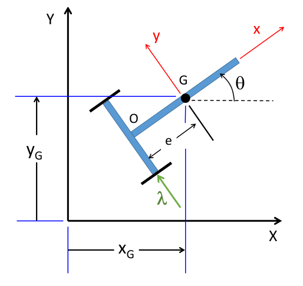
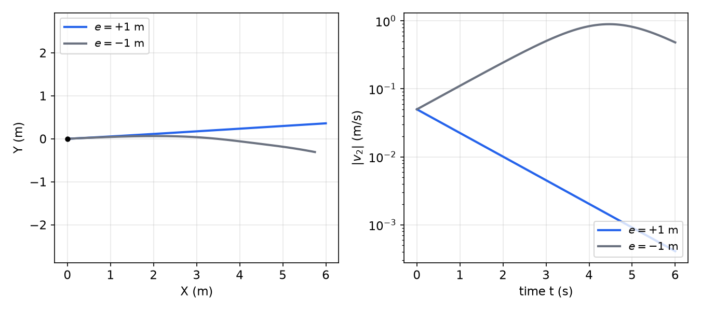
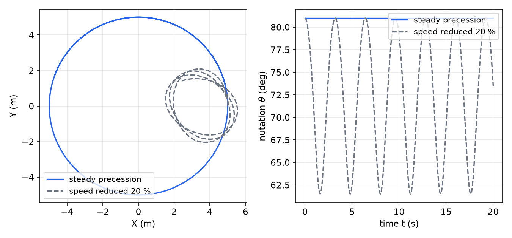

# Kane's Method

Lagrange's equations are written in coordinates and their rates, and they need the energies of the whole system. When the constraints are nonholonomic, the coordinates cannot all be chosen freely, and Lagrange's equations must be supplemented with multipliers, as in [Constrained Systems and Their Simulation](constrained-systems.md). Kane's method works with the velocities the system can actually have. It chooses a set of **generalized speeds** equal in number to the degrees of freedom, expresses every velocity in terms of them, and eliminates the constraint forces by a virtual-power argument. Nonholonomic constraints are then handled without multipliers or extra coordinates. This chapter develops the method from d'Alembert's principle, shows that it reduces to Lagrange's equations when the speeds are the coordinate rates, and applies it to a nonholonomic cart and to a rolling disk.

## Generalized Speeds and Partial Velocities

Let the system have \\(n\\) degrees of freedom. Choose \\(n\\) generalized speeds \\(u\_1,\dots,u\_n\\), each a linear combination of the coordinate rates with coefficients that depend on \\(q\\) and \\(t\\), and chosen so that \\(\dot q\\) can be recovered from \\(u\\). For a holonomic system the simplest choice is \\(u\_r=\dot q\_r\\). For a nonholonomic system the speeds are chosen as components of velocity that the constraints leave free. Generalized speeds need not be time derivatives of any coordinates, and that freedom is the main advantage of the method.

Every velocity is linear in the speeds. For a point \\(P\\) and a body with angular velocity \\(\bar\omega\\),

\\[
\bar v\_P = \sum\_{r=1}^{n}\bar v\_P^{r}u\_r + \bar v\_P^{t}, \qquad \bar\omega = \sum\_{r=1}^{n}\bar\omega^{r}u\_r + \bar\omega^{t}.
\\]

The vectors \\(\bar v\_P^{r}=\partial\bar v\_P/\partial u\_r\\) and \\(\bar\omega^{r}=\partial\bar\omega/\partial u\_r\\) are the **partial velocities** and **partial angular velocities**. They depend only on the configuration and on time, not on the speeds. The remaining terms \\(\bar v\_P^{t}\\) and \\(\bar\omega^{t}\\) are the velocities that remain when all the speeds are zero, which is nonzero only for rheonomic systems. The notation \\(\bar v\_P^{r}\\) follows the convention of Kane and Levinson, and the corresponding terms of Lagrange's equations are the derivatives \\(\partial\bar v\_P/\partial\dot q\_r\\) that appeared in [Lagrange's Equations](lagrange.md).

The speeds are related to the coordinate rates by a kinematic matrix. Writing \\(\dot q\\) in terms of the speeds gives \\(\dot q=S(q,t)u+\sigma(q,t)\\), where \\(S\\) is an \\(N\times n\\) matrix for \\(N\\) coordinates and \\(\sigma\\) collects the part of \\(\dot q\\) that does not depend on the speeds. For a holonomic system with \\(u=\dot q\\), \\(S\\) is the identity and \\(\sigma=0\\). The relation is needed to close the problem, because the speeds alone do not determine the configuration.

## Generalized Active and Inertia Forces

The **generalized active force** associated with \\(u\_r\\) is

\\[
F\_r = \sum\_P\bar F\_P\cdot\bar v\_P^{r} + \sum\_B\bar M\_B\cdot\bar\omega\_B^{r},
\\]

where \\(\bar F\_P\\) are the applied forces and \\(\bar M\_B\\) the applied moments. The **generalized inertia force** is

\\[
F\_r^{\*} = -\sum\_P m\_P\bar a\_P\cdot\bar v\_P^{r} - \sum\_B\Big[m\_B\bar a\_G\cdot\bar v\_G^{r} + \dot{\bar H}\_G\cdot\bar\omega\_B^{r}\Big],
\\]

where \\(\dot{\bar H}\_G=[I\_G]\bar\alpha+\bar\omega\times[I\_G]\bar\omega\\) is the rate of change of angular momentum about the mass center. The inertia moment on a body is \\(-\dot{\bar H}\_G\\), and the inertia force is \\(-m\_B\bar a\_G\\).

**Kane's equations** are

\\[
F\_r + F\_r^{\*} = 0, \qquad r=1,\dots,n .
\\]

They are derived from d'Alembert's principle written in terms of virtual velocities. Let \\(\delta u\_r\\) be arbitrary, and define the virtual velocities \\(\delta\bar v\_P=\sum\_r\bar v\_P^{r}\delta u\_r\\) and \\(\delta\bar\omega\_B=\sum\_r\bar\omega\_B^{r}\delta u\_r\\). The virtual form of d'Alembert's principle is

\\[
\sum\_P\big(\bar F\_P - m\_P\bar a\_P\big)\cdot\delta\bar v\_P + \sum\_B\big(\bar M\_B - \dot{\bar H}\_G\big)\cdot\delta\bar\omega\_B = 0 .
\\]

For ideal constraints the constraint forces do no virtual power in these variations, so they do not appear. Substituting the expressions for \\(\delta\bar v\_P\\) and \\(\delta\bar\omega\_B\\), and noting that the \\(\delta u\_r\\) are independent, gives the coefficient of each \\(\delta u\_r\\) as \\(F\_r+F\_r^{\*}\\). Setting each coefficient to zero gives Kane's equations.

The argument shows where the constraint forces go. A reaction that does no work in every admissible motion has zero partial velocity at its point of application. Its generalized active force is therefore zero, and it drops out without ever being named. This is the same mechanism that removed the constraint forces from Lagrange's equations, but here it does not require the constraints to be holonomic.

**The mass matrix.** The accelerations are linear in the speed derivatives. Write \\(\bar a\_P=\sum\_s\bar v\_P^{s}\dot u\_s+\bar a\_P^{\prime}\\) and \\(\bar\alpha=\sum\_s\bar\omega^{s}\dot u\_s+\bar\alpha^{\prime}\\), where the primed terms depend only on \\(q\\), \\(u\\) and \\(t\\). The inertia forces then take the form \\(F\_r^{\*}=-\sum\_sM\_{rs}\dot u\_s-\hat G\_r\\), with

\\[
M\_{rs}=\sum\_P m\_P\\,\bar v\_P^{r}\cdot\bar v\_P^{s}+\sum\_B\bar\omega\_B^{r}\cdot[I\_B]\\,\bar\omega\_B^{s}
\\]

the **mass matrix**, and with \\(\hat G\_r\\) collecting the velocity-dependent terms. Kane's equations are therefore \\(\sum\_sM\_{rs}\dot u\_s=F\_r-\hat G\_r\\). The mass matrix is symmetric, and it is positive definite when the partial velocities are independent, because each term is a sum of squares weighted by mass or inertia. It is the generalized counterpart of the mass matrix in Lagrange's equations. When the speeds are the coordinate rates and the terms \\(\bar v\_P^{t}\\) and \\(\bar\omega^{t}\\) vanish, \\(T=\tfrac12\sum\_{r,s}M\_{rs}u\_ru\_s\\).

## Kane's Equations and Lagrange's Equations

Suppose the coordinates are independent and the speeds are the coordinate rates, \\(u\_r=\dot q\_r\\). Then the partial velocities are \\(\bar v\_P^{r}=\partial\bar r\_P/\partial q\_r\\), by the identity from [Lagrange's Equations](lagrange.md). The active force is \\(F\_r=Q\_r\\). The inertia force is \\(F\_r^{\*}=-\big(\tfrac{d}{dt}\tfrac{\partial T}{\partial\dot q\_r}-\tfrac{\partial T}{\partial q\_r}\big)\\), which is the same calculation that produced Lagrange's equations for particles, carried through for the rotational terms. Kane's equations then reduce to

\\[
\frac{d}{dt}\Big(\frac{\partial T}{\partial\dot q\_r}\Big) - \frac{\partial T}{\partial q\_r} = Q\_r ,
\\]

which are Lagrange's equations. Kane's method therefore contains the Lagrange formulation as a special case, and it extends to the cases where Lagrange's equations need multipliers.

Kane's method has advantages and costs. It needs no kinetic energy, so the energy of a body need not be assembled. It works directly with the velocity constraints, because the speeds are chosen so that the constraints are satisfied. The partial velocities are often simpler to find than the derivatives of \\(T\\), since they come directly from the velocity expressions. Its cost is that the accelerations of the bodies must be computed, which Lagrange's equations avoid, and the method is less systematic than Lagrange's for large systems with many coordinates.

## Procedure

1. Count the degrees of freedom \\(n\\) and choose \\(n\\) independent generalized speeds \\(u\_r\\). Include the kinematic relations between \\(\dot q\\) and \\(u\\).
2. Express the velocity \\(\bar v\_P\\) of each point of interest and the angular velocity \\(\bar\omega\\) of each body in terms of the speeds. The coefficients are the partial velocities.
3. Differentiate the velocities to find the accelerations \\(\bar a\_G\\) and the angular accelerations \\(\bar\alpha\\).
4. Form \\(F\_r\\) from the applied forces and moments, and \\(F\_r^{\*}\\) from the inertia terms.
5. Solve the \\(n\\) equations \\(F\_r+F\_r^{\*}=0\\) for \\(\dot u\\). They are linear in \\(\dot u\\) with a mass matrix.
6. Integrate \\(\dot u\\) and the kinematic relations for \\(\dot q\\) together.

**Computation.** For a multibody system the partial velocities are most reliably found by writing every velocity with the speeds as symbols and differentiating with respect to each speed. The accelerations come from differentiating the velocities, and the mass matrix and the velocity-dependent terms follow from the expressions above. Symbolic algebra handles this bookkeeping well. A numerical implementation evaluates the same partial velocities at each time step, and the speed derivatives then come from one linear solve with the mass matrix. The kinematic relation \\(\dot q=S(q,t)u+\sigma(q,t)\\) is integrated alongside the speed equations, so the solution yields both the configuration and the speeds.

## Worked Examples

### Example 8.1 (A nonholonomic cart)

A planar cart has mass \\(m\\) and centroidal inertia \\(I\_G=m\kappa^2\\). The axle, with its wheels, has a midpoint \\(O\\), and the mass center \\(G\\) lies a distance \\(e\\) from \\(O\\) along the cart's body axis \\(x\\), which is directed along the cart's heading \\(\theta\\). The wheels prevent sliding sideways along the axle, so the velocity of \\(O\\) in the direction \\(\bar j\\) normal to the axle is zero.

*Figure: the cart of Example 8.1. \\(G\\) is the mass center, a distance \\(e\\) ahead of the axle point \\(O\\) along the body axis \\(x\\), \\(\theta\\) is the heading, and \\(\lambda\\) is the sideways reaction at the wheels that prevents slip.*

*Constraint and a Lagrange check.* Let \\((X\_G,Y\_G)\\) be the position of \\(G\\). Since \\(\bar r\_{O/G}=-e\bar i\\),

\\[
\bar v\_O = \bar v\_G - e\dot\theta\\,\bar j, \qquad\text{so}\qquad \bar v\_O\cdot\bar j = -\dot X\_G\sin\theta+\dot Y\_G\cos\theta - e\dot\theta = 0 .
\\]

With the reaction \\(\lambda\bar j\\) at \\(O\\), Lagrange's equations with a multiplier give \\(m\ddot X\_G=-\lambda\sin\theta\\), \\(m\ddot Y\_G=\lambda\cos\theta\\), and \\(I\_G\ddot\theta=-e\lambda\\). That is four equations for \\(\ddot X\_G,\ddot Y\_G,\ddot\theta,\lambda\\) together with the constraint.

*Kane's formulation.* Choose the generalized speeds \\(v\_1\\) and \\(v\_2\\) as the components of \\(\bar v\_G\\) along the body axes, so that \\(\bar v\_G=v\_1\bar i+v\_2\bar j\\). The constraint gives \\(\dot\theta=v\_2/e\\), and the velocity of \\(O\\) is \\(\bar v\_O=v\_1\bar i\\), which has no \\(\bar j\\) component for any admissible motion. The reaction \\(\lambda\bar j\\) therefore has zero partial power, and it does not appear. The acceleration of \\(G\\) is

\\[
\bar a\_G = \big(\dot v\_1-\frac{v\_2^2}{e}\big)\bar i + \big(\dot v\_2+\frac{v\_1v\_2}{e}\big)\bar j .
\\]

The partial velocities are \\(\bar v\_G^{1}=\bar i\\) and \\(\bar v\_G^{2}=\bar j\\). The angular velocity is \\(\bar\omega=(v\_2/e)\bar k\\), so \\(\bar\omega^{1}=0\\) and \\(\bar\omega^{2}=\bar k/e\\). The active forces are zero, and \\(\dot{\bar H}\_G=I\_G(\dot v\_2/e)\bar k\\). Kane's equations are

\\[
r=1:\quad -m\big(\dot v\_1-\tfrac{v\_2^2}{e}\big)=0, \qquad r=2:\quad -m\big(\dot v\_2+\tfrac{v\_1v\_2}{e}\big) - \frac{I\_G\dot v\_2}{e^2}=0 .
\\]

They give

\\[
\dot v\_1 = \frac{v\_2^2}{e}, \qquad \dot v\_2 = -\frac{v\_1v\_2}{e\big(1+\kappa^2/e^2\big)} .
\\]

These two equations, with \\(\dot\theta=v\_2/e\\) and \\(\dot X\_G=v\_1\cos\theta-v\_2\sin\theta\\), \\(\dot Y\_G=v\_1\sin\theta+v\_2\cos\theta\\), describe the whole motion. The multiplier \\(\lambda\\) is not needed, and the system is solved as a set of ordinary equations. In the notation of the mass matrix, \\(M\_{11}=m\\), \\(M\_{12}=0\\) and \\(M\_{22}=m+I\_G/e^2\\). The active forces are zero, so the two equations read \\(M\dot u=-\hat G\\), with \\(\hat G\_1=-mv\_2^2/e\\) and \\(\hat G\_2=mv\_1v\_2/e\\).

*Stability.* Linearize about a forward motion \\(v\_1=V>0\\) with \\(v\_2\\) small. The first equation gives \\(\dot v\_1\\) of second order, so \\(V\\) is nearly constant, and the second becomes

\\[
\dot v\_2 \approx -\frac{Ve}{e^2+\kappa^2}\\,v\_2 .
\\]

The lateral speed decays when \\(e>0\\), that is, when the mass center is ahead of the axle in the direction of motion, and it grows when \\(e<0\\). A cart whose mass center is behind the axle is directionally unstable, and it swings round until the mass center is ahead.

**Comparison with the multiplier form.** The multiplier formulation of the cart has four equations in \\(\ddot X\_G\\), \\(\ddot Y\_G\\), \\(\ddot\theta\\) and \\(\lambda\\), together with the constraint. Kane's formulation has two equations in \\(\dot v\_1\\) and \\(\dot v\_2\\), together with the kinematic relations, and the reaction \\(\lambda\\) is not computed. If it is wanted, \\(\lambda\\) follows from the first multiplier equation, \\(\lambda=-m\ddot X\_G/\sin\theta\\), once \\(\ddot X\_G\\) is known. The saving grows with the number of constraints, because a multiplier formulation adds one unknown for each constraint, while Kane's equations keep one unknown for each degree of freedom.

*Figure: computed motion of the cart of Example 8.1 with \\(\kappa=0.5\\) m, \\(v\_1(0)=1\\) m/s, \\(v\_2(0)=0.05\\) m/s and \\(\theta(0)=0\\). Left: the path of \\(G\\) for \\(e=+1\\) m is nearly straight, and for \\(e=-1\\) m it curves away and turns. Right: the lateral speed decays for \\(e=+1\\) m and grows for \\(e=-1\\) m, peaking near 0.9 m/s at about 4.5 s. The value of \\(\kappa\\) is an illustrative choice.*

### Example 8.2 (A disk rolling on a plane)

A thin disk of mass \\(m\\) and radius \\(R\\) rolls without slip on the horizontal \\(XY\\) plane. Use Euler angles: \\(\psi\\) is the precession about the vertical \\(Z\\), \\(\theta\\) is the nutation, measured from \\(Z\\) to the disk axis \\(z\\), so that \\(\theta=90^\circ\\) is the upright disk, and \\(\phi\\) is the spin. Attach the frame \\(xyz\\) to the center \\(C\\). Its \\(x\\) axis points from \\(C\\) to the contact point \\(A\\), \\(z\\) is the disk axis, and \\(y\\) is horizontal. The frame precesses and nutates with the disk but does not spin, so the disk's angular velocity is the frame's plus \\(\dot\phi\bar k\\).

*Kinematics.* With \\(s=\sin\theta\\) and \\(c=\cos\theta\\), the frame's angular velocity is \\(\bar\omega\_f=-\dot\psi s\\,\bar i+\dot\theta\\,\bar j+\dot\psi c\\,\bar k\\), and the disk's is \\(\bar\omega=\bar\omega\_f+\dot\phi\bar k\\). The inertia tensor at \\(C\\) is \\([I]=\mathrm{diag}(\tfrac14mR^2,\tfrac14mR^2,\tfrac12mR^2)\\) in \\(xyz\\). Rolling requires the contact point to have zero velocity, so \\(\bar v\_C=\bar\omega\times(-R\bar i)=-R(\dot\phi+\dot\psi c)\bar j+R\dot\theta\bar k\\).

*Partial velocities.* The speeds are \\(u=(\dot\psi,\dot\theta,\dot\phi)\\). The partial velocities of \\(C\\) are \\(\bar v\_C^{\psi}=-Rc\\,\bar j\\), \\(\bar v\_C^{\theta}=R\bar k\\) and \\(\bar v\_C^{\phi}=-R\bar j\\). The partial angular velocities are \\(\bar\omega^{\psi}=-s\bar i+c\bar k\\), \\(\bar\omega^{\theta}=\bar j\\) and \\(\bar\omega^{\phi}=\bar k\\). At the contact point the velocity \\(\bar v\_A=\bar v\_C+\bar\omega\times R\bar i\\) is identically zero, so the contact forces have zero partial power. Their combined contribution is \\(\bar F\_A\cdot\bar v\_A^{r}=0\\), and only gravity contributes to \\(F\_r\\). Gravity gives \\(F\_\psi=0\\), \\(F\_\theta=-mgRc\\) and \\(F\_\phi=0\\).

*Accelerations.* The acceleration of \\(C\\) is \\(\bar a\_C=(\partial\bar v\_C/\partial t)\_{xyz}+\bar\omega\_f\times\bar v\_C\\), with the frame's angular velocity, which gives

\\[
a\_y = 2R\dot\psi\dot\theta s - R(\ddot\phi+\ddot\psi c), \qquad a\_z = R\ddot\theta + R\dot\psi s(\dot\phi+\dot\psi c).
\\]

The angular momentum about \\(C\\) is \\(\bar H\_C=[I]\bar\omega\\), and its rate is \\((\partial\bar H\_C/\partial t)\_{xyz}+\bar\omega\_f\times\bar H\_C\\). Its components are \\(\dot H\_x=\frac{mR^2}{4}(2\dot\theta\dot\phi-\ddot\psi s)\\), \\(\dot H\_y=\frac{mR^2}{4}(\ddot\theta+2\dot\psi s\dot\phi+\dot\psi^2sc)\\) and \\(\dot H\_z=\frac{mR^2}{2}(\ddot\phi+\ddot\psi c-\dot\psi\dot\theta s)\\).

*Kane's equations.* The inertia forces are \\(F\_r^{\*}=-m\bar a\_C\cdot\bar v\_C^{r}-\dot{\bar H}\_C\cdot\bar\omega^{r}\\). Substituting, and dividing each equation by \\(mR^2/4\\), gives the three equations

\\[
\begin{bmatrix}1+5\cos^2\theta & 0 & 6\cos\theta\\\\ 0 & 5 & 0\\\\ 6\cos\theta & 0 & 6\end{bmatrix}
\begin{Bmatrix}\ddot\psi\\\\ \ddot\theta\\\\ \ddot\phi\end{Bmatrix} =
\begin{Bmatrix} 10\dot\psi\dot\theta\sin\theta\cos\theta+2\dot\theta\dot\phi\sin\theta\\\\ -5\dot\psi^2\sin\theta\cos\theta-6\dot\psi\dot\phi\sin\theta-4\dfrac{g}{R}\cos\theta\\\\ 10\dot\psi\dot\theta\sin\theta\end{Bmatrix}.
\\]

The first row comes from the partial velocity \\(\bar v\_C^{\psi}\\), the second from \\(\bar v\_C^{\theta}\\), and the third from \\(\bar v\_C^{\phi}\\). The coefficient matrix is \\(4/(mR^2)\\) times the mass matrix \\(M\_{rs}\\) of the general theory, so its entries can be checked directly from the partial velocities. For example, \\(M\_{\theta\theta}=mR^2+\tfrac14mR^2\\), which is the sum of the translational term \\(m\bar v\_C^{\theta}\cdot\bar v\_C^{\theta}\\) and the rotational term \\(\bar\omega^{\theta}\cdot[I]\bar\omega^{\theta}\\). The matrix is symmetric, and its determinant is \\(30\sin^2\theta\\), so the three accelerations are found at each instant except at \\(\theta=0\\) and \\(180^\circ\\), where the Euler angles are singular. The contact forces are then recovered from Newton's law for the center, since the accelerations are known. With \\(a\_x=R\dot\theta^2+R\dot\psi c(\dot\phi+\dot\psi c)\\) the frame components of \\(\bar a\_C\\) are \\(a\_x\\), \\(a\_y\\) and \\(a\_z\\), and Newton's law gives \\(N=mg+m(a\_zc-a\_xs)\\), \\(f\_n=m(a\_xc+a\_zs)\\) and \\(f\_y=ma\_y\\) for the normal force and the two friction components.

Lagrange's equations would need six coordinates, three rolling constraints and multipliers for the same disk. Kane's method needs three equations in the three speeds, and the rolling contact is absorbed into the partial velocities.

*Steady precession.* A steady precession has \\(\dot\theta=\ddot\theta=0\\) and constant \\(\dot\psi\\) and \\(\dot\phi\\). The center then moves on a horizontal circle of radius \\(\rho\\) at speed \\(v\\), with \\(\dot\psi=v/\rho\\) and, from rolling, \\(\dot\phi=-(v/R+(v/\rho)\cos\theta)\\). The middle equation reduces to \\(5\dot\psi^2sc+6\dot\psi\dot\phi s+4(g/R)c=0\\). Substituting the rates gives

\\[
v^2 = \frac{4g\rho^2}{R\sin\theta+6\rho\tan\theta}.
\\]

For \\(\theta=81^\circ\\), \\(\rho=5\\) m and \\(R=1\\) m, this gives \\(v=2.27\\) m/s, \\(\dot\psi=0.454\\) rad/s and \\(\dot\phi=-2.34\\) rad/s.

*Figure: computed motion of the disk of Example 8.2, with \\(R=1\\) m (the mass cancels from the equations) and \\(g=9.81\\) m/s². The disk starts at \\((5,0)\\) m with \\(\theta=81^\circ\\). Left: the steady case traces a circle of radius 5 m. With the speed reduced by 20 %, the center moves in loops. Right: the nutation angle stays at 81° in the steady case and oscillates between about 61.5° and 81° in the reduced-speed case.*

### Example 8.3 (The rod on a floor and an incline with one speed)

The rod of Example 6.1 has one degree of freedom, so one generalized speed suffices. Take \\(u=\dot\theta\\). The velocity of the center and the angular velocity are then

\\[
\bar v\_C=\dot\theta\\,\bar v\_C^{\theta}, \qquad \bar v\_C^{\theta}=\frac{\partial x\_C}{\partial\theta}\bar i+\frac{\partial y\_C}{\partial\theta}\bar j, \qquad \bar\omega=\dot\theta\\,\bar k, \qquad \bar\omega^{\theta}=\bar k ,
\\]

with \\(x\_C=\tfrac L2(2\cot\beta\sin\theta-\cos\theta)\\) and \\(y\_C=\tfrac L2\sin\theta\\) from Example 6.1. The ends \\(A\\) and \\(B\\) move along the floor and the incline, so their velocities have no component normal to the surface they touch. The normal contact forces therefore do no virtual power, and the only active force is gravity. Its generalized force is \\(F\_\theta=-mg\\,\bar v\_C^{\theta}\cdot\bar j=-\tfrac12mgL\cos\theta\\).

The acceleration of \\(C\\) is \\(\bar a\_C=\ddot\theta\\,\bar v\_C^{\theta}+\dot\theta^2\\,\frac{d\bar v\_C^{\theta}}{d\theta}\\), so

\\[
\bar a\_C\cdot\bar v\_C^{\theta}=\ddot\theta\\,\lvert\bar v\_C^{\theta}\rvert^2+\tfrac12\dot\theta^2\frac{d}{d\theta}\lvert\bar v\_C^{\theta}\rvert^2 .
\\]

Since \\(m\lvert\bar v\_C^{\theta}\rvert^2+I\_C=J(\theta)\\), with \\(J\\) as in Example 6.1, and since \\(\bar\alpha\cdot\bar\omega^{\theta}=\ddot\theta\\), the inertia part of Kane's equation is

\\[
F\_\theta^{\*} = -m\\,\bar a\_C\cdot\bar v\_C^{\theta} - I\_C\ddot\theta = -J\ddot\theta-\tfrac12J'\dot\theta^2 .
\\]

Kane's equation \\(F\_\theta+F\_\theta^{\*}=0\\) is then

\\[
J(\theta)\ddot\theta+\tfrac12J'(\theta)\dot\theta^2+\tfrac12mgL\cos\theta=0 ,
\\]

which is the equation of Example 6.1. With a single speed equal to the coordinate rate, Kane's and Lagrange's equations coincide, as the general theory predicts. The two contact forces, which Newton's law would have to find and eliminate, never appear.

## Summary

- **Generalized speeds** \\(u\_r\\): \\(n\\) independent velocity components, with \\(\bar v\_P=\sum\_r\bar v\_P^{r}u\_r+\bar v\_P^{t}\\) and \\(\bar\omega^{r}=\partial\bar\omega/\partial u\_r\\).
- **Generalized active force:** \\(F\_r=\sum\_P\bar F\_P\cdot\bar v\_P^{r}+\sum\_B\bar M\_B\cdot\bar\omega\_B^{r}\\).
- **Generalized inertia force:** \\(F\_r^{\*}=-\sum\_P m\_P\bar a\_P\cdot\bar v\_P^{r}-\sum\_B\big[m\_B\bar a\_G\cdot\bar v\_G^{r}+\dot{\bar H}\_G\cdot\bar\omega\_B^{r}\big]\\).
- **Kane's equations:** \\(F\_r+F\_r^{\*}=0\\), \\(r=1,\dots,n\\). Constraint forces that do no virtual power drop out, holonomic or not.
- **Mass matrix:** \\(M\_{rs}=\sum\_Pm\_P\bar v\_P^{r}\cdot\bar v\_P^{s}+\sum\_B\bar\omega\_B^{r}\cdot[I\_B]\bar\omega\_B^{s}\\), symmetric and positive definite, with Kane's equations \\(\sum\_sM\_{rs}\dot u\_s=F\_r-\hat G\_r\\).
- **Lagrange limit:** with \\(u\_r=\dot q\_r\\), Kane's equations are Lagrange's equations.
- **Nonholonomic cart:** \\(\dot v\_1=v\_2^2/e\\) and \\(\dot v\_2=-v\_1v\_2/[e(1+\kappa^2/e^2)]\\), with \\(\dot\theta=v\_2/e\\). Forward motion is stable only when \\(e>0\\).
- **Rolling disk:** the three Kane equations in \\((\ddot\psi,\ddot\theta,\ddot\phi)\\), and in steady precession \\(v^2=4g\rho^2/(R\sin\theta+6\rho\tan\theta)\\).

## See Also

- [Lagrange's Equations](lagrange.md): the coordinate formulation, which Kane's equations generalize.
- [Constrained Systems and Their Simulation](constrained-systems.md): the multiplier formulation for the same nonholonomic cart and rolling coin.
- [Newton–Euler Equations of Rigid-Body Motion](newton-euler.md): the force and moment balances from which the inertia terms are taken.
- [Rigid-Body Kinematics](rigid-body-kinematics.md): Euler angles and rolling without slip.
- [Stability](../../../eng/control/stability.md): the linearized stability argument used for the cart.
- [Numerical ODEs](../../../math/numerical/odes.md): integration of the Kane equations.
